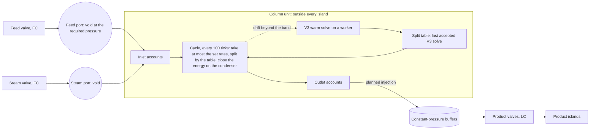

# Column operation: the column simulator in the plant (plan)

Batch `2026-10-28-column-operation`. Base `ac572f12` (main, 0.17.0). Status: Planned. Design only: no code changed, no Gradle run. This is the "next stage" of [the multi-machine framework plan](../2026-10-26-multi-machine-framework/MULTI_MACHINE_FRAMEWORK_PLAN.md) (its section 14.4: D5, D7, D14, D16) and W9 of [the heat exchanger plan](../2026-10-27-heat-exchanger-design/HEAT_EXCHANGER_PLAN.md). Owner questions: section 15.

Owner request 2026-10-28 (summary):

1. Feed, steam and utilities enter the simulation through a buffer. The column takes them at most at a given rate, set in the column GUI and initialized from the column calculator.
2. Detach the inlet and outlet islands, so that the fluid network never solves across the column. Some lag is fine.
3. Products go into buffers that act as boundary conditions for the islands downstream.
4. Inputs arrive at least at the design pressure. The inlet control valves are assumed to regulate them to target.
5. Products follow from the column simulation of the feeds. Some lag is fine.
6. No new solve while the input conditions do not change. A new solve when they change.
7. Insufficient feed: either run everything at a reduced rate, or simulate honestly.
8. Drifting composition and temperature: maybe another specification than the reboiler duty (which converges badly), such as a top or bottom flow rate, approximated from earlier solves.

## 1. Expected behaviour (the plant first)

**The real unit.** A flow controller (FC) sets the crude rate through the furnace into the flash zone. The stripping steam is flow controlled, usually as a ratio to the feed. The overhead vapour condenses into the receiver drum: a pressure controller (PC) on the off-gas holds the drum, a level controller (LC) on the distillate holds its level, a second LC on the boot holds the water interface. The reflux is flow or top-temperature controlled. Side draws are flow controlled. A sump LC sets the bottoms. A reboiler, where there is one, is usually set by a tray temperature controller. The sump and the drum hold minutes of product; the product compositions answer a feed change over tens of minutes.

**The game's unit.** V3 is a steady-state model: it has no holdup of its own. The buffers give the column its lag. That lag is seconds, faster than a real unit.

**Three facts that shape the design.**

1. **Throughput scales exactly.** At a fixed pressure profile, the column's equations (component balances, equilibrium, energy balances) are homogeneous of degree one in the extensive inputs: the feed, the steam, the draws and the duties. Multiply all of them by α: every flow and duty of the solution is multiplied by α, and every temperature and composition stays. A change of throughput alone needs no new solve. Only the tray pressure drop breaks this, because it depends on the vapour and liquid loads. Estimate for a 40-tray sieve column: the drop per tray falls from about 0.7 to about 0.45 kPa at half rate (dry drop ∝ α², liquid head mostly the 50 mm weir). The sump then stands about 10 kPa lower and its bubble point about 1.4 K lower (Clausius-Clapeyron at 620 K, 80 kJ/mol, 280 kPa). C1 measures it.
2. **Recoveries drift slowly.** The fraction of each component that leaves in each product (its recovery) changes much less with a small feed change than the product compositions do. A table of recoveries from the last solve, applied to the feed actually taken, conserves every component exactly and errs only in the second order of the drift.
3. **The condenser closes the energy balance.** With the condenser temperature, the reflux ratio and the other duties held, extra enthalpy brought by the feed leaves through the condenser at steady state. Example: crude 2 K warmer at 160 kg/s (cp ≈ 2.5 kJ/kg K, the default design's ~100 kbpd) brings 0.8 MW, which the condenser removes.

**Costs (measured in batch 2026-10-26-v3-solver-performance).** A warm solve from the last accepted state: 0.09 to 0.79 s. A cold solve of the 40-tray literature fixture: 2.3 to 2.7 s. The 42-stage case: about 9 s. The deadline: 45 s. A column that solves once a minute costs about 1 % of one worker.

## 2. What the code does now

| Fact | Where | Consequence |
|---|---|---|
| A COMPLETE assembly opens the column's screen with an Operation tab that is a placeholder. The report is state (`icheme_assemblies`, format 1); a dropped store is rebuilt by one walk per column when its controller loads. | `AssemblyScreen`, `AssemblyStore`, `AssemblyService.controllerLoaded` | The Operation tab becomes the column's control room (section 13). Running needs COMPLETE. |
| The members are fluid devices: the receiver drum a RESERVOIR, pumps movers or in-line fittings, exchangers, air coolers and the kettle heat sides (the kettle's shell a vessel with a pool), the valves `ControlValve` fittings. The column body is drawing-only. | `EquipmentStructure.register`, `FluidWorldAuthority.placeVessel`/`placeMover`/`placeUnit` | While the column runs, the members inside the boundary must leave the network (D5), or the network simulates a second plant beside the model. |
| Generators and voids are fixed boundaries; islands split at them. | `TopologyCompiler.fixed`, `NetworkReduction` (split at fixed boundaries), `FixedBoundarySplitTest` | An inlet port as a void detaches its island by an existing rule. |
| A closed vessel is a bag: below its capacity it stands at 101 325 Pa; at capacity its contents set the pressure. | `PhaseLayout.wallRow` (`slack = 2 (P_amb − P)/P_amb`), `AMBIENT_PRESSURE` | A product at 250 kPa cannot sit in a vessel below capacity. An outlet buffer needs its own slack pressure (section 4.2). |
| Injections and withdrawals at a vessel, booked in the same balances as pipe flow, exist in the science layer. No runtime class creates one. | `ScheduledTransfer`, `ConservativeTransport`, `PassiveStepSolver` | The column becomes their first runtime producer (outlet injections). |
| Two islands coupled by heat wait for each other at a fence (form C, owner Q16), read the partner at dispatch, and keep the heat in transit as a fact. A complete exchanger's control works a real valve as a planned slice input. | `IslandCoordinator` (`coupledThrough`, `reads`, `operations`), `ExchangerRelay.Operation(valve, feed, ratio)`, `PassiveStepSolver.couple` | The same seams carry the column's deterministic timing (section 9) and its valve targets (section 4.3). |
| A control valve has a source (NONE, PRESSURE, MASS_FLOW, VOLUME_FLOW) and a sensor; with no sensor it is bare and stands open. | `FlowControl.ControlValve`, `bare()` | The master's operation must give a valve its source; no flowmeter is needed (the port measures the stream). |
| The heat units' DUTY mode is the hook W9 left for the column's duties. | `HeatControl`, heat plan W9 (deferred 2026-10-28) | Stage B of the utilities (section 10). |
| V3's input: feed component flows (mol/s) and temperature, trays, feed tray, top pressure, tray drop, three specifications, at most 4 draws, 2 steam feeds and 4 pumparounds, a diameter. The specifications are the condenser temperature, the organic reflux ratio and the reboiler duty only; no product-flow specification. | `V3ColumnInput`, `V3ColumnSpecification` (sealed) | Section 8. |
| Warm solves exist: `calculateWithStrategy` with `DRIFT_SPEC` (each input within 15 %, 16 iterations) or `AGGRESSIVE` (50 %, 8 iterations), from an accepted state kept in memory only; a seed with free water on trays is refused and the cold route runs. | `V3ColumnCalculator.warmStartPass`, `warmCompatible`, `retargetWarmSeed`, `V3SolveStrategy` | The column's solves start warm; a wet column solves cold (Q10). |
| The fluid network runs one package, `icheme:tjl20_methane_nitrogen`, with water last on its axis. The bundled learned model declines nitrogen, so a column on that package takes the classical seed. | `materials/networks/default.json`, `V3AnchorTransformerInitializer.supported` | V3 runs on the network's package; cold solves take the classical route (section 11). |
| A saved column design holds the trays, the components and the diameter, not the operating values. | `ColumnDesign(trays, diameter)`, `ColumnTrays` | D7: the design must carry its operating point (C2). |
| V3's water enters only as steam feeds and leaves only overhead (vapour and condenser free water); the sump is never wet; draws carry no free water. | `V3SteamFeedSpec`, `V3ColumnProblem` | Feed water needs a rule (section 11). |
| The engine publishes on 100-tick buckets; island cadences are 20 to 400 ticks; worker jobs run on one shared pool, one job per owner. | `FluidPresentation`, `IslandClock`, `BoundedCpuSolveService` | The column's cycle is a worker job on its own clock (section 5). |

## 3. Core idea

1. **The boundary valves are the boundary.** While the column runs, everything between its boundary valves (the column, the members, the inside pipes) leaves the fluid network and becomes one column unit. The network never solves across it.
2. **Inlets are sinks at the required pressure.** Each inlet port is a void. What it receives goes into the column's inlet account.
3. **Outlets are constant-pressure buffers.** Each holds the product's pressure while its volume follows its inventory (a gasholder or bladder accumulator). The column fills them; the network empties them through the product valves.
4. **The column works in cycles.** Every 100 ticks it takes from its inlet accounts at most its set rates, splits what it took with its split table, and fills its outlet accounts. Mass, every component and energy are conserved by construction.
5. **The split table comes from the last accepted V3 solve.** It is applied to the feed actually taken, so it follows drift to first order without a solve.
6. **A solve runs only when the intensive input state leaves a band** around the table's state: the feed composition and enthalpy, the steam ratio, the setpoints. A change of throughput alone never solves (fact 1). The solve starts warm from the table's state.
7. **Everything runs on the engine schedule, deterministically** (section 9).

## 4. The column unit in the network

### 4.1 The boundary and the members

- **Start.** The player presses Start on a COMPLETE column. At the next bucket, one ledger event: the inside devices (members and inside pipes, from the report's footprint) stop compiling into islands, and the port nodes take the place of the junction at each boundary valve's inner end.
- **Members keep their contents.** A suspended member's inventory stays as it was, a fact. It returns to the network with it at Stop. Nothing is moved or lost (D5).
- **Stop, a revert or a dismantled member.** One ledger event back: the inside compiles again, and the column's nozzles become dead ends again (the body is no fluid device). The outlet vessels' contents go back into the column's outlet accounts.
- **The valves stay outside.** Each boundary valve belongs to its port island and does its job there (4.3).
- **Ports at the valves, not at the nozzles.** With ports at the nozzles, the distillate's line would hold the reflux pump, the tee and the reflux line back to the column. The reflux would then circulate through the network (alternatives, section 16).

### 4.2 Ports

| Port | Node in the network | Its pressure (static head: ρ g (z_nozzle − z_valve)) | Account |
|---|---|---|---|
| Feed | void | feed tray pressure + static head | inlet |
| Steam i | void | steam stage pressure + static head | inlet |
| Off-gas | buffer, gas | node 0 (the drum) | outlet |
| Sour water | buffer | node 0 + boot head | outlet |
| Distillate | buffer | node 0 + the reflux pump's set pressure rise | outlet |
| Draw i | buffer | draw tray pressure + static head | outlet |
| Bottoms | buffer | sump pressure + static head | outlet |

- The pressures come from the table (state). A new solve that moves a port's pressure by more than 1 kPa changes it, by one queued topology event.
- The inside lines' friction is left out. Example: 20 m of 0.2 m pipe at 1 m/s of liquid loses about 0.8 kPa, against 250 kPa.
- **The buffer's form.** A new node kind, not a vessel: its pressure is fixed at the port's pressure (the solve's P_k plus the static head, refreshed when a new split table applies) and its inventory is an account of mass in and out, in any phase. The vessel wall row (`PhaseLayout.wallRow`) is unchanged, so existing worlds are bit-identical by construction. It cannot be drawn below empty, so conservation holds by construction (D14); a gas product needs no blanket and no separation rule, and a liquid-full buffer is not stiff. Owner decision 2026-10-28 (variable-volume buffer instead of a padded vessel).
- **Size.** An inlet account aims at 30 s of its set rate. A buffer holds 120 s of design production (a real drum holds 5 to 10 min).

### 4.3 The valves

The master operates its boundary valves while it runs (the plan of 2026-10-26, section 1, "each valve has one job"):

| Valve | Job | Target |
|---|---|---|
| Feed, steam i | FC | the column's demand (its set rate, × α under rule A), corrected by its inlet account's level |
| Distillate, sour water, draw i, bottoms | LC on its buffer | the production rate, corrected by the buffer's fill |
| Off-gas | LC on the gas buffer (a PC in effect) | the production rate |
| Reflux | inside: no job | the model sets the reflux |

- The target is a planned slice input, as an exchanger's real valve is (`IslandCoordinator.operations`, `PassiveStepSolver.couple`), from a ratio to a mass flow. The master gives the valve a MASS_FLOW source for the time it runs; the valve's own module comes back at Stop.
- A valve that cannot regulate (no drive, a conflict) shows on the status line. Conservation does not depend on it (4.4).
- The assembly check still counts the valve body only (owner decision 2026-10-27).
- D16 of the 2026-10-26 plan: the distillate valve is its product port's valve (LC). The distillate rate follows from the reflux ratio in the solve; no new V3 specification is needed for it.

### 4.4 Conservation

- A void books what arrives at it, every component and its energy, as the island books it. The inlet account takes exactly that.
- A cycle takes from an inlet account at most what it holds, and puts the same moles, split, into the outlet accounts.
- The energy closes on the condenser: the condenser duty booked is the energy taken plus the reboiler duty, less the pumparound duties, less the energy of the products. A product's energy is the network model's own (section 5).
- An outlet account is drawn only by a planned injection no larger than its content. The vessel cannot give more than it holds.
- The duties leave or enter the world as HEAT boundaries named by member (stage A, section 10).
- Every transfer is booked once, from committed data. No account goes negative.

## 5. The column cycle

Every 100 online ticks (staggered by column), one worker job, committed on the server thread:

1. **Take.** From each inlet account, at most its set rate × 5 s. Rule A gives one throughput α for every input (section 7).
2. **Split.** Product k gets r_ik of each component i taken (Σ_k r_ik = 1), water included. Solids go to the bottoms.
3. **Energy.** A product's energy is the network model's enthalpy of its actual composition at its solved temperature and its port pressure: one property call per product, cached while the composition holds. The reboiler and pumparound duties are their set ratios × α. The condenser duty closes the balance (4.4).
4. **Credit.** Products to the outlet accounts; duties to the ledger.
5. **Check.** The drift band (section 6).

**The split table (state):** for each product k: r_ik, T_k, P_k; the duty ratios; the reference state (feed composition z_ref, specific enthalpy h_ref, steam ratio, setpoints, α_ref); the hydraulics summary; the warm seed. It is saved as state, so a reload resumes without a solve.

## 6. New solves

| Trigger (proposed; C1 sets them) | Band |
|---|---|
| Feed composition | Σ_i \|z_i − z_ref,i\| > 1 % |
| Feed specific enthalpy | more than the enthalpy of 2 K |
| Steam ratio (rule B only) | 2 % |
| Throughput (the tray pressure drop) | \|α − α_ref\| > 0.2 |
| Energy closure | booked condenser duty more than 5 % from α × the solved one |
| A setpoint edit, a component the table does not hold | at once |
| The package's identity changed | at once, cold |

- **Input.** The state actually taken: the feed at α × its set rate with its composition and enthalpy, the steam, the draws and duties at their ratios × α.
- **Route.** `calculateWithStrategy(AGGRESSIVE)` from the table's state; its own fallback is the cold route. One solve in flight per column; at most one per 30 s online, except for a setpoint edit.
- **Application.** A new table applies at the second cycle after its trigger (10 s). If the solve has not finished, the column's cycle waits for it, up to the deadline. Cold solves come only at Start and after a data change.
- **Failure.** The table stays. The status line names the reason and the table's age. Retries back off: 30, 60, 120 s.
- **Trip.** When the closure would make the condenser heat, or departs more than 50 % from the solved duty, the column trips: inlet valves close, the buffers drain, status UPSET. This is a capability limit (AGENTS.md "Holds stay only for capability limits"): the model has no steady state for this input.

## 7. Short inputs and blocked outlets (Q1, Q2)

**Ratios make the two options one.** With the extensive setpoints held as ratios to the feed (ratio control), the honest solve of a smaller feed is the scaled table (fact 1). The request's two options give the same products for a feed shortage. They part only when the inputs fall short in different proportions (steam short, feed not), or when setpoints are absolute rates.

| Rule | What the column does | Solves | Physical reading |
|---|---|---|---|
| A (recommended) | α = min(1, each inlet account / its demand, each buffer's room); every input taken at α × its rate; products and duties scale | none | ratio controllers cut together; a full buffer cuts the feed |
| B | each input taken as available up to its rate; a changed steam ratio is a new intensive state | one per change; rule A where the solve fails (zero steam without a reboiler, the draw wall) | a unit that keeps its crude rate and strips less |

- Absolute setpoints (draws and duties held whatever the feed) are not recommended. With the draws held, a feed cut raises their share of the tray liquid (ρ) about 1/(1 − cut) times, 1.43 times for a 30 % cut. That share meets the liquid-supply screen (ρ ≥ 0.30 rejected) and then the draw wall (ρ ≥ 1).
- Rates above design (Q8): cap α at 1, or allow it up to a flood fraction from the table's hydraulics. Below about 30 to 50 % a real sieve tray weeps; V3 has no efficiency, so a turndown floor would be a rule, not physics.

## 8. Drift and the specifications (Q6)

- **Between solves the table holds every component's recovery.** That is the request's "top and bottom flow rates approximated from earlier runs", per component, and it conserves exactly.
- **At a solve the specification is a control choice, not only a numerical one.** Holding Q_r/F lets the distillate grow when the feed gets lighter. Holding D/F keeps the distillate and sends light ends into the bottoms. A real unit holds a tray temperature with its reboiler, which V3 has no specification for.
- **Where the duty matters.** The bundled crude presets strip with sump steam at zero reboiler duty, so the duty specification is zero there. It matters only for kettle designs.
- **The duty's trouble is a cold-start trouble.** From a nearby accepted state the warm route corrects in 8 to 16 Newton iterations (0.09 to 0.79 s measured).

| Option | What | Cost |
|---|---|---|
| S1 (recommended now) | V3's three specifications are the setpoints; warm solves | none |
| S2 | a product-rate specification (D/F or B/F) as a player choice | a solver batch: a row, the ledger, the audit; the learned seed declines it |
| S3 | a specification switch inside the solver: solve at the table's D/F, then walk to the set duty | solver work, only if C1 shows warm solves of kettle designs failing |
| S4 | a tray-temperature specification (the real control) | a larger solver batch |

## 9. Timing and determinism (Q4, Q5)

- **The column's clock.** One cycle per 100 online ticks, on the online epoch.
- **Inlets.** A void's island books what arrived at each commit. The column books an inlet window only when each inlet island has committed through the window's end, or is certified (its replay gives the delivery), held or stopped (it delivers nothing past its committed tick). An interval across a window edge is shared by time; the total is kept.
- **Outlets.** A product island's slice gets a constant injection, planned at dispatch from the outlet account as booked through its slice start less L, and no larger than that content. L = 440 ticks (the longest cadence, 400, plus the dispatch latency). The inlet islands are almost always committed that far, so this fence (form C, owner Q16) seldom waits. A held inlet island never stalls the product side.
- **Lag.** A feed change reaches the product islands after one cycle (5 s), L (22 s) and the product island's own cadence: about 30 to 50 s.
- **Result.** The same world gives the same products whatever the worker timing, except a deadline that expires (as with budget holds today).
- **Alternative (form B).** Plan from whatever is committed at dispatch: no waits and a shorter lag, but results that depend on job timing (the exchanger study measured a 1.0 K spread for B).

## 10. Utilities (Q7)

- **Material utilities join the process.** The stripping steam now, the ejector's motive steam with the vacuum stage. They are inlets like the feed.
- **Heat utilities never touch the process.** The condenser exchanger's tubes (cooling water), the kettle's bundle (heating medium), the pumparound coolers' tubes.
  - **Stage A (this batch).** The duties are HEAT boundaries named by member. The energy is exact; no utility flows.
  - **Stage B (recommended, a later batch: W9).** Those utility sides stay in the network as heat sides in DUTY mode, with the column as their partner. Only heat crosses, booked as the exchanger relay books its heat in transit. A side that cannot take its duty (LIMITED, DUTY INSUFFICIENT) bounds the column: under rule A it cuts the throughput, under rule B a new solve takes a warmer condenser. An air-cooled condenser has no utility stream: its own law (`AirCooled`) on the column's overhead curve gives its capacity. The member capacities (pumps, drum, kettle) come with it.
  - **Alternative.** Utility streams buffered like the feed, the column warming them by the duty at a design temperature rise. It copies the exchanger physics into the column; not recommended.

## 11. Package, water, nitrogen and solids

- **Package.** V3 runs on the network's package, so the network's axis maps one to one, water last. A design saved on another column package is restated on that axis by component id at Start (nitrogen at zero). A package the column refuses (crystals or a spine, such as `pilot_cryogenic`) cannot run: "NOT READY: the network's package admits crystal phases".
- **Feed water.** Hot feed water is superheated steam at the feed tray (365 °C against about 129 °C saturation at 260 kPa). It enters the solve as a steam feed at the feed stage; V3's 5 K superheat rule holds. `MAX_STEAM_FEEDS` goes from 2 to 3 when a design has two stripping stages. A feed too cold for that sends its water straight to the sour water, with a status note. Magnitude (estimate): 0.3 vol % of water in crude is about 4.6 mol % of the feed, about 10 % of the default design's stripping steam.
- **Light ends.** Nitrogen and methane leave overhead by the solve.
- **Solids.** All to the bottoms (crude solids end in the residue). A crystal population melts when taken, booked as its component with the crystal's enthalpy, as D61 books a junction's melt.
- **A component the table does not hold.** It takes the recovery row of the solved component nearest in normal boiling point, until the solve that its arrival starts.
- **Hydrocarbons at a steam port.** They are split as feed.

## 12. Saves (AGENTS.md "Saves and data formats")

| Kind | What | Where |
|---|---|---|
| Fact | The design's operating point (D7): feed composition and rate, feed temperature, top pressure, the three specifications, the steam, draw and pumparound values. Append-only; absent means no operating point, which is every column built before (it cannot run, as before the field). | equipment shape field; corpus `compat/equipment/shapes-4.snbt` |
| Fact | The column unit's registration: setpoints (rates, specifications, rule), the run switch, the inlet and outlet accounts (moles by component, energy, solids), its ledger totals (taken, produced, duties). | fluid facts schema 6; corpus `compat/fluid/schema-6/` |
| Fact | The buffers' inventories (amounts, composition, enthalpy). | new buffer facts |
| State | The split table and its warm seed (dropped: one cold solve, status STARTING, nothing taken); the port pressures; the cycle clock and windows; the drift reference; pending solves; the valve operations; the suspension set (from the report: a dropped store stops the column until its rebuild walk). | the column unit's state section |

Dismantling the column books every account as removed, named on the ledger, as `removedHeat` does for an exchanger's transit.

## 13. The GUI

- **The Operation tab** (a placeholder today) becomes the column's control room:
  - the status line;
  - inputs: rate now and set rate, pressure at the port against the required one, account level;
  - setpoints: condenser temperature, reflux ratio, reboiler duty per feed, draws and pumparound duties per feed, maximum rates, the rule;
  - products: rate, temperature, vessel level, valve state;
  - duties: the condenser's booked and solved duty, the reboiler, the pumparounds;
  - the last solve: route, time, trigger, age;
  - Start and Stop.
- **Statuses:** NOT READY (with the reason), STOPPED, STARTING, RUNNING, LIMITED (feed, steam or outlet, n %), RE-SOLVING (the trigger), UPSET (the reason).
- **Edits are queued engine events**, acknowledged at the bucket. A setpoint edit starts a solve. The tab is an `AssemblyPresentation` session: opening replays the last view; nothing is sent unasked.
- **Members.** A member's screen says "Part of the column at x, y, z: running" and shows its column values (the condenser duty, the reflux rate, ...). Pumps and fans show running through the `mover-1` display.
- **Process.** The `gui-creation` skill applies, and a drawing goes to the owner first, as the heat GUI's did. No dev-client check unless the owner asks.

## 14. Work packages and gates

| WP | Content | Gates |
|---|---|---|
| C1 Measurement | Homogeneity (α 0.5 and 1.2, prescribed drop and hydraulics); the table's error against drift (feed temperature ±2, 5, 10 K; composition 1, 5, 10 % toward a lighter and a heavier network crude); warm solve success and time (dry, wet, a kettle design). Sets section 6's bands. | One sweep on the default design restated on the network package, and one kettle design; review of at most 50 lines; no product code |
| C2 Operating point | Save design keeps the operating point; Import copies it; the Operation tab shows it, read only | `EquipmentShapeCompatTest` with `shapes-4.snbt`; `ColumnDesignCodecTest` |
| C3 Column unit | The registry device and its facts; Start and Stop as queued events; the suspension; the ports; the constant-pressure buffer node | `FluidFactsCompatTest` with schema 6; chain-100 exact and the 33 junction lines identical (no vessel row changes); GameTests: Start and Stop keep the members' contents, ports split islands, a full buffer cuts the feed, dismantling books the accounts |
| C4 Cycle | Accounts, split, energy closure, injections (`ScheduledTransfer`'s first runtime producer), valve operation, the fence and L | A conservation gate (components and energy exact over 1000 cycles of drifting feed); a determinism gate (two worker timings, identical products); a running-column GameTest |
| C5 Solves | The first solve, the triggers, the warm and cold route, fixed application, failure and trip, the table as state | A trigger table test; a failed solve keeps the table; a reload resumes without a solve |
| C6 Short inputs | Rule A, the outlet room, the statuses (rule B later) | α from the accounts; a blocked product cuts the feed; the prescribed-drop scaled table equals a new solve within closure |
| C7 GUI | The Operation tab, the members' screens, the mover displays | Codec and presentation tests (a replay is a read; nothing unasked) |
| C8 Merge prep | Code guide (a new chapter `column-operation.md`; README, machine-assemblies, fluid-runtime, fluid-science, column-v3); CHANGELOG; a minor version, chosen by the owner; tooling cleanup | `test` and `slowGates`; the final lane with the campaign, because the wall row changed |

Later batches: stage B (heat utilities through W9, member capacities), stage C (vacuum: the ejector, its motive steam, node 0 at the drum's pressure, with the VDU batch), rule B.

## 15. Owner questions

| # | Question | Options | Recommended |
|---|---|---|---|
| Q1 | Short inputs | A: one α for every input; B: inputs as available, solve on the new ratios; B with A where it fails | A now, B later |
| Q2 | Setpoints while running | per unit feed (ratio control); absolute rates | per unit feed |
| Q3 | Outlet form | decided 2026-10-28: constant-pressure variable-volume buffers (pressure fixed, inventory free, bounded by capacity); rejected: padded vessels in the wall row, generator outlets (conservation not by construction, D14) | decided |
| Q4 | Timing | fence with the lag L = 22 s (deterministic); reads at dispatch (form B: no waits, timing-dependent) | fence |
| Q5 | Applying a new table | at a fixed cycle (deterministic); when the solve finishes | fixed cycle |
| Q6 | Specification at a solve | S1; S2; S3; S4 (section 8) | S1 now; decide S2 or S3 after C1 |
| Q7 | Utilities | stage A HEAT boundaries now, stage B through W9 later; buffered utility streams | stage A, then B |
| Q8 | Rates | cap at the design rate; up to a flood fraction. A turndown floor or none | cap at design; no floor |
| Q9 | Feed water | a steam feed at the feed stage; straight to the sour water | steam feed |
| Q10 | Wet columns (free water on trays) | accept cold solves (2.3 to 9 s); extend the warm route to wet seeds in C5 | accept now; extend if C1 shows many wet designs |
| Q11 | Vacuum columns | not runnable until the VDU batch | as stated |

**Defaults taken (reversible):** ports at the valves' inner ends; members suspended with their contents kept; V3 on the network's package; the bands of section 6 until C1; a 100-tick cycle; inlet accounts aiming at 30 s; buffer vessels of 120 s; at most one solve per 30 s; a trip at a 50 % closure departure; static heads in the port pressures; inside-line friction left out.

## 16. Risks, alternatives and what the plan leaves out

**Risks.**

- The constant-pressure buffer is a new node kind in the network solver; it touches no existing vessel row, but its own rows and facts need the full final lane.
- A port's pressure change after a solve is a topology event. The rate limit bounds how often.
- Product islands certify only if their injection is constant between cycles. Composition changes are applied in bands, as the exchanger's wake thresholds are.
- V3 and the network model differ (water: Shomate against IF97; the network's translated PR78). The condenser closure absorbs the difference; it shows as the gap between the booked and the solved condenser duty.
- The column has no holdup dynamics. A start fills nothing; products appear one cycle and one lag after the feed.

**Alternatives considered.**

- **Body-only column.** V3 models the trays only; the members run in the network; reflux and pumparounds circulate through it. Rejected: the reflux, the pumparounds and the kettle become recycles through lagged couplings that need a solve at every turn and may not settle, and V3 would need a column without node 0. The black box keeps the recycles inside one Newton, where they belong.
- **Generator ports for outlets** (Q3; D14 of the 2026-10-26 plan rejected them for conservation).
- **Inlet buffer vessels with `ScheduledTransfer` withdrawals.** A hot two-phase crude in a vessel adds a flash at every step and the hold risk of a crude vessel; a void needs none.

**Left out.** Column start-up physics, tray efficiency and weeping, flooding beyond the hydraulics summary, member capacities (stage B), vacuum (stage C), product quality targets (cut points) for the player.
