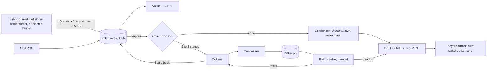

# Batch distiller: research and plan

Owner, 2026-11-09: a batch distiller, less industrial than the columns, as the step before them. A pot heated by a solid- or
liquid-fuelled firebox or an electric heater (no jacket), at a realistic efficiency; solid fuel on Minecraft's fuel values,
converted at mod-market values (coal coke as a starting point), with a working burner animation; an optional built-in
condenser on a water supply; U constant for the pot and the condenser, A scaling with size, the condenser matched to the pot;
an optional small column with a reflux pot and a manual reflux valve; the charge heated gradually to its boiling point and
the distillate collected by hand (a dynamic batch simulation); the same still in the process simulator. Owner, later: "right
now the mass of a single coal/coke item is unknown, so there is some freedom".

## 1. References

| Reference | Shows | Taken for |
|---|---|---|
| [Nikka Yoichi, adding coal to the pot still (A)](https://commons.wikimedia.org/wiki/File:Nikka_Whisky_Yoichi_Distillery._Still_House._Adding_coal_to_the_pot_still._A.jpg), also [C](https://commons.wikimedia.org/wiki/File:Nikka_Whisky_Yoichi_Distillery._Still_House._Adding_coal_to_the_pot_still._C.jpg) (CC BY-SA 4.0) | Copper pot stills still fired by coal: a plastered brick setting, a cast-iron firing door, coal shovelled in | The solid-fuel firebox: brick base, iron door with glow and flames |
| [Koval's Kothe pot still](https://commons.wikimedia.org/wiki/File:Koval%27s_Potstill.jpg) (CC BY-SA 3.0) | Copper pot with a sight-glass helmet and two bubble-plate columns with portholes | The column option: copper column with portholes on the pot |
| [Pioneer Oil Refinery, 1880](https://commons.wikimedia.org/wiki/File:PioneerOilRefinery1880.jpeg) (public domain), [Star Oil Works](https://commons.wikimedia.org/wiki/File:Pioneer_Oil_Refinery_-_Star_Oil_Works.jpg) (CC BY 3.0) | "Cheese box" crude stills in brick settings with brick chimneys, fired with the refinery's own sludge (liquid fuel) | The crude-oil still this mod's thermo can run; the liquid-fuel firebox |
| [Coupier's still](https://commons.wikimedia.org/wiki/File:Coupier%27s_still.jpg) (public domain, Sydney Young) | Pot, plate column, water condenser above, reflux lines back to the column, receiver | The column option's flow: column, condenser, reflux back, receiver |
| 1870s receiving house (period text, e.g. [Pioneer refinery history](https://scvhistory.com/scvhistory/files/hb1713_2/files/basic-html/page9.html)) | Worm condenser in a water box; the stillman sends each run to its own tank by gravity (naphtha, kerosene, lube) | "Collected manually": the player switches the distillate between tanks |
| ASTM D2892 TBP still ([B/R Instrument](https://brinstrument.com/products/astm-d2892)) | Lab batch still: 15-plate column, 5:1 reflux, reflux dividing valve | Column stages and reflux range; the crude assay use |

## 2. Physics (simplified, in numbers)

- **Run.** Charge the pot (about 70 % full). Firing heats the liquid at Q / (m cp): 500 L of naphtha (245 kg) rises
  about 0.06 K/s at 32 kW. At its bubble point vapour leaves at (Q − m cp dT_b/dt) / λ; the pot follows the Rayleigh
  curve: lights first, the pot temperature climbing as it strips, and that climb takes its share of Q (naphtha 12 to
  45 % of the boil-up heat, a wide crude 2 to 2.7 times it: section 7, B3). Without a column the distillate is one equilibrium stage; with N stages and
  reflux ratio R it is sharper, and slower (D = V / (R + 1)).
- **Column (quasi-steady).** Column holdup is small next to the pot's, so the column at each moment is a steady
  rectifier: pot vapour in at the bottom, liquid back to the pot, total condenser, reflux ratio from the valve. This is
  the standard batch short-cut (Diwekar); the run integrates the pot.
- **Heat sources (no jacket).** Efficiency = heat into the pot / fuel or power drawn. Published ranges: direct fire
  30 to 55 % (vendor and forum figures for direct-fired kettles), electric immersion 85 to 99 %. Proposed: solid fuel
  (hand-fired grate, natural draught) 45 %, liquid fuel (burner in the firebox) 55 %, electric 90 % (owner, B2).
- **Pot U·A.** The heated surface is the bottom and the flue-swept lower wall, A ≈ 1.73 D². A constant design flux of
  25 kW/m² (direct fire's usual limit before scorching) gives U·ΔT; the heater's rating is that flux on A.
- **Condenser U·A.** Hydrocarbon vapour to water: published 400 to 1000 W/m²K. Proposed U = 500 W/m²K, sized for the
  pot's full boil-up plus the owner's 20 % (design excess rule) at a design LMTD of 40 K (vapour about 75 °C, water 25 to
  35 °C). A lighter cut condenses at a lower LMTD: the condenser then limits, and the vapour leaves through the vent.
- **Solid fuel.** Minecraft fuel values are burn ticks: coal 1600, charcoal 1600, coal coke 3200 (Immersive Engineering,
  Thermal), block of coal 16000, log 300, blaze rod 2400, lava bucket 20000. The item mass is free (owner), but a block
  is 9 items and 1 m³ (owner: "it shouldn't be that small"), and a block of loose fuel weighs its bulk density
  (owner). Item masses and energies, a block of 9 items being 1 m³ at bulk density (a log is one solid block):

  | Fuel | Bulk density | One item | Energy (mass × LHV) | Burn ticks × 1.45 MJ (coal anchor) |
  |---|---|---|---|---|
  | Coal, broken bituminous | 833 kg/m³ | 93 kg | 2.31 GJ (25 MJ/kg) | 2.31 GJ |
  | Coal coke, lump | 450 kg/m³ | 50 kg | 1.45 GJ (29 MJ/kg) | 4.63 GJ |
  | Charcoal | 220 kg/m³ | 24 kg | 0.71 GJ (29 MJ/kg) | 2.31 GJ |
  | Log (one block, air-dry) | 550 kg/m³ | 550 kg | 8.25 GJ (15 MJ/kg) | 0.43 GJ |

  Burn ticks keep vanilla's ratios (coke twice coal, charcoal equal to coal, a log a fifth of a coal); mass × LHV at
  bulk density gives the opposite for coke (a light, porous lump: less heat per item than coal, more per kilogram) and
  charcoal, and a log many coals. A real 500 L batch burns about 8 kg of coal: one coal fires it about 11 times, one
  coke about 7 (by mass) or 22 (by burn ticks); the firebox rating, not the item, limits the heat.
  The market check: Thermal's Stirling dynamo gives coal 24,000 RF and coke 40,000 RF; at the mod's 2.5 J/FE that is
  60 kJ per coal, about 38,000 times less heat than the anchor gives it.

Example sizes (naphtha, 70 % fill, heat-up 70 K, 70 % distilled, full firing):

| Pot | D | A pot | Q pot | Firing (solid) | A condenser | Charge | Batch | Batches per coal | One coal lasts | Electric | Column D |
|---|---|---|---|---|---|---|---|---|---|---|---|
| 100 L | 0.50 m | 0.44 m² | 11 kW | 24 kW | 0.66 m² | 49 kg | 0.5 h | 55 | 26 h | 230 FE/t | 124 mm |
| 500 L | 0.86 m | 1.28 m² | 32 kW | 71 kW | 1.92 m² | 245 kg | 0.8 h | 11 | 9 h | 674 FE/t | 213 mm |
| 2000 L | 1.37 m | 3.23 m² | 81 kW | 179 kW | 4.84 m² | 980 kg | 1.3 h | 2.8 | 3.6 h | 1698 FE/t | 338 mm |

(Column diameter at an F-factor of 1.5 Pa^0.5 at full boil-up; vapour 3.3 kg/m³.)

## 3. What the code has

- **Kettle pool** (`Pool`, `ExchangerRelay.planPool`, `PassiveStepSolver.poolHeat`/`boilUp`): heat into a closed vessel
  through a wall, the film following the level, the boil-up drawn by the vapour port. The pot is this pool with a heater
  as its partner instead of a tube bundle.
- **Fired heater burners** (2026-11-09-furnace-fuel-power): fuel from a pipe, its heating value from the `combustion`
  records, firing as a slice input. The liquid-fuel firebox reuses them.
- **FE terminals** (`TerminalEnergy`, `ElectricStores`, 2.5 J/FE from config): the electric heater draws its watts as
  the air-cooler fans do.
- **Exchanger sides** (`HeatSide` with films, relay, water side): the built-in condenser's two sides.
- **Running column** (`ColumnOperation`, split table from one V3 solve, drift bands): the small column's quasi-steady
  split.
- **Alarms and data inputs** (`EquipmentAlarm`, `BuiltInInputs`), the constructor, the layout refresh, the flowsheet
  catalog and sizing (`FlowsheetCatalog`, `UnitSize`, `Limit`).
- **Gaps:** no equipment holds items (the firebox needs an item slot and an item capability); the simulator is
  steady-state (`Report` has scalar readings, no time series); no alcohols in the catalog (46 components, PR78 only:
  ethanol and water cannot be modelled); no heat loss to ambient from a vessel; a constant-U law is new beside the films.

## 4. Proposal

- **W1 Law** (`science/fluid/network/BatchStill`, Minecraft-free): heat sources (solid, liquid, electric) with their
  efficiency and rating, the burn-tick energy scale, the pot's pool partner, the condenser's constant U, alarms; the
  pot's energy balance (its bubble point rising with the strip takes m cp dT_b/dt of the heat); the column as the
  bubble-point method with the energy-balance flow update in pot mode (B3, section 7) on the network's phase evaluator.
- **W2 Structure** (`EquipmentShape.Kind.BATCH_STILL`, `BatchStillDesign`, `ProcessUnit.batchStill`): pot size 100 L to
  2000 L; options heater (solid, liquid, electric), condenser (built-in or none), column (none or 2 to 8 stages). Copper
  pot and helmet, brick firebox with an iron door and a brick flue (solid, liquid) or a steel skirt with a terminal box
  (electric), swan neck, worm tub condenser, copper column with portholes, reflux pot with a hand-wheel valve. Nozzles:
  CHARGE, DRAIN, DISTILLATE, VENT, WATER IN and OUT (built-in condenser), VAPOUR (no condenser), FUEL (liquid); one free
  block between nozzle pipe blocks.
- **W3 Engine:** the pot a closed reservoir with its heater pool; the condenser a unit pair (vapour side, water side);
  the column with reflux pot and valve one quasi-steady block between the pot vapour and the condenser (the B3 column,
  warm from its last profile, its liquid back to the pot). Statuses: HEATING, BOILING, DISTILLING, COOLING LIMITED, BOIL DRY, FLOODING, OVERHEAT, NO FUEL.
- **W4 Fuel:** the firebox's item slot (an item handler, so hoppers feed it); each item's energy by B1 B: solid fuel
  records in the material data (`materials/fuels/`, one per item or tag: bulk density, items per cubic metre, LHV, its
  own `revision`), energy = bulk density / items per m³ × LHV; an item without a record at its burn ticks × 1.45 MJ (a
  config value, as joules per FE is); the burning item's remaining energy kept as a fact; a damper 0 to 100 % setting
  the firing up to the rating; liquid fuel through the burner path; the electric heater's power setting drawn from FE.
- **W5 Data network:** pot and head temperature, pot level, heat rate, distillate flow, status and alarms out; firing or
  power and the reflux valve in.
- **W6 GUI and animation:** the still's page (temperatures, level, heat, fuel slot, damper or power, reflux valve);
  the constructor's options; firebox glow, flames at the door and chimney smoke while firing (burner flame for liquid
  fuel, a lamp for electric), boiling sound, a drip at the spout while distilling.
- **W7 Process simulator:** a Batch still unit that integrates one batch inside its calculation with the W1 law and the
  same column split; the charge from its inlet (composition, and mass = inlet flow × cycle time), cuts by head
  temperature or by time, each cut a product port plus the residue, as cycle-averaged flows; a new curve report (pot and
  head temperature, distillate rate and composition over time) drawn on its page; sizing (pot, heater, condenser area,
  column diameter) with lamps and Auto.
- **W8 Tests and docs:** law tests (heat-up rate, Rayleigh against a binary, the column against V3, fuel scale), a
  runtime rig like `FlareRuntimeTest`, layouts, palette coverage, the facts corpus image, the drawings workflow.

## 5. Owner decisions

| | Question | Options | Proposed |
|---|---|---|---|
| B1 | Solid fuel energy | A: burn ticks × 1.45 MJ, anchored on a coal block of broken coal at bulk density (coal 2.31 GJ, coke 4.63 GJ); B: mass × LHV per material at bulk density (coal 2.31, coke 1.45, charcoal 0.71, log 8.25 GJ), burn ticks × 1.45 MJ for fuels without a material (blaze rod, lava, modded); C: market FE × 2.5 J (60 kJ a coal) | Owner's call between A (vanilla ratios, coke above coal) and B (physical, coke below coal per item); either a config value |
| B2 | Efficiency | A: fixed per source (45, 55, 95 %), U·A only caps the flux; B: efficiency from U·A and the flue gas (NTU), higher at low firing | A |
| B3 | Column model | A: V3 quasi-steady split, re-solved when the pot drifts (same column code as the big columns); B: a new short stage march (cheaper, a second column model) | A |
| B4 | Cut collection | A: one distillate outlet; the player switches tanks with valves (the receiving house); B: a built-in cut selector with three outlets | A |
| B5 | What it distils | A: crude, naphtha, aromatics, water (steam distillation) with today's catalog; B: ethanol and water, which needs an activity model (a new reference model, its own batch) | A |
| B6 | Pot heat loss | A: neglect (the wall holds no heat, as exchangers); B: 10 W/m²K to ambient (500 L at 100 °C: 2.6 kW, 8 % of the duty), booked as a loss | A |
| B7 | Reflux pot | A: drawn, its holdup neglected (quasi-steady); B: a real vessel that fills at total reflux first | A |
| B8 | Overheat | A: OVERHEAT alarm and firing cut at 350 °C pot temperature (cracking is not modelled); B: no limit | A |

Owner answers (2026-11-09): **B1 B**, mass × LHV per material at bulk density (coal 2.31 GJ, coke 1.45 GJ, charcoal
0.71 GJ, a log 8.25 GJ); burn ticks × 1.45 MJ only for fuels without a record. **B2 A** with electric at 90 % (solid
45 %, liquid 55 %). **B3:** try a simpler column model and keep it if it converges better and faster than V3 (section
7). **B4 A**, plus an automatable switching valve: a diverter on the distillate line, one inlet and several outlets, set
on its page or by a data-network input, so a control system can switch cuts. **B5 A** for now. **B6:** evaluate the
solver cost first (section 7). **B7 A. B8 A.** After the B3 measurement (section 7): **B3**, the still's column is
the bubble-point method with the energy-balance flow update in pot mode, on the network's phase evaluator; V3 stays
for the big columns. After the B6 evaluation (section 7): **B6 A**, no heat loss to ambient; the setting losses stay
inside the heater efficiency, and the pot keeps its heat until drained.

## 6. What the request leaves open

1. **Thermo:** no alcohols. The iconic charge (wine or wash) cannot be modelled; crude and naphtha can (B5).
2. **Fuel scale:** at block scale one coal is 93 kg; a still burns a fraction of an item per batch, so the firebox
   keeps the burning item's remaining energy (a fact) and fuel is cheap next to the run's time. Burn ticks keep vanilla's
   ratios, so logs carry far less and lava far more than their own blocks would (B1). Coal heat in this mod is then far
   above other mods' generator output (Thermal: 60 kJ of FE a coal): a pack with both should know.
3. **Time:** simulated time is online ticks with no acceleration; a full-fired batch takes 0.5 to 1.3 h of play, a
   gentle (high-reflux) one several hours.
4. **Simulator:** it is steady-state. A batch unit integrates time inside one unit, outputs cycle averages, and needs a
   curve report and a page to draw it. A column re-solved through a run costs seconds to minutes on the client.
5. **Air at start:** an empty pot holds nitrogen; it must leave by the VENT, and a vent or relief is needed anyway (a
   closed distillate line would pressurise the pot).
6. **Overfill and boil-up limits:** a pot filled past about 75 % pukes liquid into the neck; a small column floods at
   high firing (FLOODING, boil-up capped by its diameter).
7. **Fuel handling:** item slot, hopper input, the fire going out with the fuel (NO FUEL), what happens to a burning
   item when the structure is broken (refund the rest or lose it), saved as facts with a corpus image.
8. **Draft and power:** a natural-draught firebox needs no fan power, unlike the fired heaters' fans; the electric heater
   draws 230 to 1700 FE/t, large next to typical generators but consistent with the mod's motors.
9. **Residue:** the drain must pass solids and heavy residue; a pot that boils dry stops heating its contents (BOIL DRY).
10. **Automation:** with head temperature and level on the data network, a DCS can switch cuts and firing.
11. **Progression:** crafting cost or unlock order before the big columns is not part of this plan.
12. **Pot heating during the run** (found by B3): the boil-up is not Q / λ. The pot's bubble point climbs as it strips
    and its warming takes its share of the heat: 12 to 45 % of the boil-up heat for naphtha, 2 to 2.7 times it for a
    wide crude. Energy conservation needs it in the run; the batch times of section 2 (naphtha) grow by about a quarter,
    a crude batch takes 3 to 3.7 times as long as Q / λ says.

## 7. Evaluations before the build (owner B3, B6)

### B3: a simpler column model against V3 (measured, 2026-11-09)

- **Forms.** The bubble-point method (Wang and Henke) on V3's own PR fugacities (`V3PengRobinsonThermo`): per iteration
  one tridiagonal balance per component (Thomas), then each stage's bubble point. Form 1: constant molar overflow (CMO).
  Form 2: the method's energy-balance flow update, started on CMO and switched on once no stage moves 1 K. Test code:
  `BubblePointColumn` and `BatchColumnComparisonTest` (`src/test/.../science/column/batch/`).
- **Problem.** V3's topology (total condenser, N trays, reboiler), the pot liquid fed into the reboiler at 20 × the
  boil-up (1 mol/s), so the reboiler holds the pot's composition; specs reflux ratio, reboiler duty and V3's condenser
  outlet at the CMO distillate's bubble point less 1 K. Package `icheme:tjl20_methane_nitrogen`: V3 refuses
  `icheme:refinery` (it admits CO₂ crystals; no aromatics run). Charges: the light crude stabilised (no C1 to C4,
  N2), a naphtha (iC5, nC5, PC01 to PC03) and an iC5/nC5 pair. N = 2, 4, 8; R = 0.5, 2, 8; the pot at 0, 25, 50, 70 %
  distilled on its simple-distillation path: 108 snapshots a form, cold and warm. Then a 70-step batch per charge
  (N 4, R 2), in this proxy and in pot mode (no feed; the reboiler is the pot). Output:
  `research/2026-11-09-batch-distiller/b3-column/`.

| | Converged cold / warm | Median ms cold / warm | p95 ms cold | Distillate against V3 (max) | Pot T against V3 (max) |
|---|---|---|---|---|---|
| V3 | 108 / 81 | 10.2 / 4.0 | 108 | | |
| BP form 1 (CMO) | 108 / 81 | 0.6 / 0.7 | 2.2 | 0.126 (crude), 0.069 (naphtha), 0.0003 (pair) | 5.0 K |
| BP form 2 (energy) | 81 / 57: crude 9 of 36 | 0.7 / 0.7 | 3.1 | 0.004 (crude, naphtha), 0.0003 (pair) | 0.01 K |

- **Pot mode, the still itself:** both forms converge on all 70 steps of every batch, warm, 0.03 to 0.05 s a batch
  (V3 in the proxy: 0.07 to 0.66 s). Form 2 in pot mode and V3 in the proxy agree within 0.01 on every cut.
- **Why form 1 misses:** CMO holds the molar flows equal on every stage; on a wide-boiling mixture the stage
  enthalpies (latent heat and the sensible heat between stages) differ. The error grows with the boiling range (pair
  0.0003, naphtha 0.07, crude 0.13).
- **Why form 2 fails in the crude proxy:** the 20 mol/s feed must be heated to the reboiler's rising bubble point; that
  sensible heat is 2 to 2.7 times the boil-up heat for crude (below), more than the duty given, so successive
  substitution runs to a negative distillate where V3's Newton converges. The pot has no feed: the same
  heat is the pot's own warming, which belongs to the pot's energy balance, not to the column.
- **Pot heating against boil-up** (energy balance of a 1 mol step of a 100 mol charge on the simple-distillation path:
  the pot's warming N cp ΔT over the rest of the heat): crude 2.16, 2.65, 2.16, 2.02 at 0, 25, 50, 70 % (pot 384 to
  555 K, boil-up heat 27 to 44 kJ/mol); naphtha 0.12, 0.17, 0.26, 0.45; iC5/nC5 0.00. A crude batch spends about two
  thirds of its heat raising the pot, so the run splits the heat: Q = N cp dT_b/dt + the boil-up's (section 6, item 12).
- **Result.** Form 2 meets the keep rule in the still's own mode: it converges on every pot step V3's proxy does, is
  about 13 × faster cold and 5 × warm (34 × at p95), and stays within 0.004 mole fraction and 0.01 K of V3 wherever both
  converge. Form 1 fails the 0.01 rule on naphtha and crude. **Adopted by the owner (2026-11-09):** the still's column is form 2 in pot mode, its
  K values and enthalpies from the network's own phase evaluator (`science/fluid/thermo`, which takes
  `icheme:refinery`); V3 stays for the big columns. After the B6 evaluation (section 7): **B6 A**, no heat loss to ambient; the setting losses stay
inside the heater efficiency, and the pot keeps its heat until drained. Form 1 is dropped. The harness goes to `tools/batch-still-column/`
  at the merge.

### B6: the solver cost of pot heat loss (evaluated, 2026-11-09)

- **In the Newton: none.** A loss to ambient is an explicit term on a step's start state, as the kettle pool's heat is
  (`PassiveStepSolver.poolHeat`): one number in the vessel's energy row.
- **In the schedule: the real cost.** A vessel with a nonzero heat term is never at rest (`NetworkReduction.atRest`: a
  heated pool keeps its island awake). With a loss, a pot is never at rest until it reaches ambient. After a 500 L naphtha
  batch the 74 kg residue at 200 °C cools with τ = m cp / (U A) = 1.35 h (U 10 W/m²K, shell 3.5 m²): about 5 h to within
  5 K and 7 h to within 1 K. Its whole island (the pot and every tank piped to it) stays awake that long, solving every
  cadence: 1,250 extra interval solves at 400 ticks, 25,000 at the 20-tick floor a light island falls to. Without a loss
  the pot rests the moment firing stops (it keeps its temperature).
- **Applied to every vessel** (no special case for the still), every hot tank and drum in a world would stay awake for
  hours: a world-wide cost.
- **Simplification instead:** fold the loss into the heater efficiency while firing. At full firing the pot loses about
  2.6 kW of 32 kW (8 %); the published efficiency ranges already include setting losses. Cool-down after a batch is not
  modelled (the pot keeps its heat until drained). Recommended: B6 A. **Adopted by the owner (2026-11-09).**
