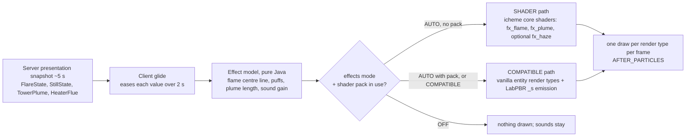

# Custom shader and effects system: plan

Batch `2026-11-10-custom-shader-system`, 2026-11-10. Status: plan, waiting for owner decisions (section 8).

## 1. Request and reading

Owner, 2026-11-10: a custom shader system for (a) normal textures, the wires on equipment surfaces first; (b) better flare stack SFX; (c) a cloud effect for the two water coolers and the furnace chimney; (d) SFX for the fuelled still. Style: industrial realism. It must work with FPS optimization mods and the usual shader packs, and it needs a config switch.

Readings this plan takes (section 8 asks the owner to confirm the ones still open):

- **Wires** (owner, 2026-11-10): the instrument wiring that is laid out on an equipment's surface and joins its built-in sensors to its data port (`InstrumentWiring`, drawn by `InstrumentRenderer`). These are not the cable conduits the player lays.
- **SFX**: what you see and what you hear.
- **Two water coolers**: the induced-draft and natural-draft cooling towers.
- **Furnace chimney**: the stacks of the vertical and cabin fired heaters. Boilers and gasifiers come later.
- **Fuelled still**: a batch still with a solid or liquid heater. An electric still gets only its hum.

## 2. Expected behaviour (physics, simplified)

**Flare (unassisted pipe flare).** A soot-bright yellow-orange flame that keeps moving, with the length from API 521 that the code already uses: `L = exp(0.4562 ln Q − 5.3603)` m. A 0.3 m tip at its 212 MW rating gives L ≈ 30 m. A cross-wind bends the flame. How far depends on the ratio u∞/Uj of wind speed to exit velocity (API 521 flame distortion). Gas with a high carbon-to-hydrogen ratio (propane and heavier, olefins) smokes at high load; methane burns without smoke. The roar is broadband and low (about 40 to 400 Hz) and gets louder with the heat released. A pilot hisses all the time.

**White plumes are condensed water.** A plume is visible where the mixing line between the exhaust and the ambient air crosses the saturation curve. Each table entry is the most liquid water at any point along that line, in g per kg of dry air (computed for this plan; a negative value means no visible plume).

| Source | 25 °C, 50 % RH (the mod's fixed ambient) | 15 °C, 70 % | 5 °C, 80 % | −5 °C, 80 % |
|---|---|---|---|---|
| Tower at the calibration point (water 35 → 25 °C, L/G 1, exhaust saturated at 28.5 °C) | none (−0.01) | 0.28, faint | 2.8, dense | 5.0, dense |
| Tower with hot water (45 → 30 °C, exhaust 32.4 °C) | none (0.00) | 1.3 | — | — |
| Gas-fired heater stack, 180 °C flue, 12 % water by mass of dry gas | none (−10) | none (−3) | 0.4, faint | 4.4 |
| Gas-fired heater stack, 350 °C flue | none | none | none | 0.1 |

So at the mod's ambient (`CoolingTower.AIR_TEMPERATURE` 298.15 K, RH 0.5), a real tower or gas stack shows **no white plume**. It shows a heat shimmer, plus a faint haze over a tower. A white plume belongs to cold or humid weather. Oil and solid fuel add grey smoke, whatever the weather. Owner decision X2 settles this.

**Plume shape.** The plume rises at the exit velocity (fan stack about 8 to 10 m/s; natural tower about 1 to 2 m/s), leans downwind and spreads as it dilutes. The visible part ends where the dilution f drops below the value that still has liquid water. Its edge is sharp, a real cue.

**Fuelled still.** A solid fire glows orange through the firedoor and crackles. The flue smokes grey-brown, most at high fire. A liquid (pressure-jet) burner gives a short yellow flame with a blue root, a fan whine and a steady roar, and a light haze from the flue. The pot thumps while it boils, and the spout drips.

## 3. What the code does now

- `FlareFlames` adds up to 24 vanilla `FLAME` particles each client tick, plus `LAVA` sparks and campfire smoke. A vanilla flame particle lives about 12 to 44 ticks, so a flare at full rating keeps about 480 particles alive. Each one is ticked on the CPU and drawn as its own quad. The flame always leans the same way (lean 0.25), smoke rises with load only, and there is no sound.
- `StillFires` uses vanilla `FLAME`, `LAVA`, `SMALL_FLAME`, smoke, `FURNACE_FIRE_CRACKLE` and `BUBBLE_COLUMN_UPWARDS_AMBIENT`.
- Towers and heaters have no world effects. The client gets fan speed and basin level only. There is no watch for heaters.
- Normals: shell and conduit quads bake their shade into the vertex colour. The tower and still sprites have relief painted in, because "the game's block shader reads no normals". No `_n` or `_s` textures exist.
- Instrument wiring (section 4.4): a flat stripe on the skin. Its sprite is stretched over the whole length of each run, and its light ignores relief.
- Iris lesson already in the code (`EquipmentGhost`): chunk render types drawn from a level-stage event vanish under a shader pack. Entity render types drawn at `AFTER_PARTICLES` work.

## 4. Design

### 4.1 Two render paths, one effect model



- **Effect model** (`client/fx/`, no rendering): each emitter turns its glided state into geometry: ribbons along a centre line for flames, a list of puffs for smoke and plumes, and a gain and pitch for sound. Plain Java, deterministic for a given game time, so it can be unit tested.
- **SHADER path** (no shader pack): our own core shaders, registered through `RegisterShadersEvent`. `fx_flame` draws domain-warped noise scrolling up the ribbon, coloured by a blackbody ramp (about 1100 K at the tip to 1900 K in the core), darkened by soot near the top, premultiplied alpha, full bright, with vanilla fog. `fx_plume` draws soft noise puffs lit by sky brightness and sun angle, so they are not white at night. Time comes from game time plus partial tick, so the effects freeze while the game is paused.
- **COMPATIBLE path** (shader pack active, or forced): the same geometry with flipbook textures that a tool bakes from the same noise. Drawn with `RenderType.entityTranslucentEmissive` for flame and `entityTranslucentCull` for smoke and plume, at `AFTER_PARTICLES`, the combination that already works under Iris. The `_s` textures carry LabPBR emission, so packs that read emission make the flame bloom.
- **Wind** (X3): one presentation wind for every effect. Direction and speed (2 to 8 m/s) change slowly with game time and dimension, so every client sees the same thing. It bends flames (API 521 u∞/Uj) and carries plumes and smoke.
- **Visual ambient** (X2 option A): temperature from the biome at the exhaust (`Biome.getTemperature(pos)`, which already falls with height), humidity from the biome's downfall and from rain, and minus 5 K at night. It sets only how much plume is visible. The server keeps 25 °C and 50 % for the heat duty.

### 4.2 Compatibility rules

1. Chunk geometry stays plain baked quads, which Sodium, Embeddium and Iris mesh as they do now. No chunk shader is replaced and no rendering mixin is added.
2. Our own `ShaderInstance`s are used only when no shader pack is active. Iris does not intercept a mod's own shader, so such a shader would render wrong or vanish (the malilib issue in the sources shows the same thing for custom pipelines).
3. Iris is an optional dependency, wired the way Create is ([SOFT_DEPENDENCY_REVIEW.md](SOFT_DEPENDENCY_REVIEW.md)). The code compiles against its public v0 API (`net.irisshaders.iris.api.v0.IrisApi`: `isShaderPackInUse`, `isRenderingShadowPass`), and `client/fx/compat/iris/` loads only when Iris is present. The answer is read once per frame. Without Iris, the answer is "no pack". No other mod is a dependency; the review records why. OptiFine does not run on NeoForge, and Oculus is a Forge 1.20.1 port, so Iris is the one shader loader on NeoForge 1.21.1.
4. No vanilla particles for these effects. Particle CPU cost, particle caps and particle-culling mods all differ between setups. We draw our own batches, cull them against the frustum ourselves and use the `RenderLod` distance tiers.
5. All effects draw at `RenderLevelStageEvent` `AFTER_PARTICLES`. Shadow passes are not hooked, so flames and plumes cast no shadow.
6. Distant Horizons: effects draw only inside the vanilla render distance, and the shell model already returns no quads to DH.

### 4.3 Config switch (client, `icheme-client.toml`, new `[effects]` section)

| Key | Values | Default | Effect |
|---|---|---|---|
| `mode` | `AUTO`, `COMPATIBLE`, `OFF` | `AUTO` | AUTO picks the path per frame (section 4.1); COMPATIBLE never uses our shaders (the escape hatch if some mod conflicts); OFF draws no flames, smoke or plumes |
| `pbr_textures` | true / false | true | Wiring: lit through its normal map, by our shader without a pack or by the pack (section 4.4). Off: the vanilla entity shader, flat. Later chunk sprites: X5 |
| `heat_haze` | true / false | false | SHADER path only (X6): a screen copy plus a distortion over flames and stacks |

Changes take effect on the next frame. A change to `pbr_textures` re-meshes the chunks, as `low_polygon_mode` does. Sounds use Minecraft's Blocks volume slider.

### 4.4 Normal textures (LabPBR 1.3), the instrument wiring first

**The wiring today.** `InstrumentWiring.build` lays out each structure's wiring:

1. A straight 20 mm steel lead (`INSTRUMENT_STEEL`, real geometry) runs from each sensor head's cable entry down to the skin. The process connection under the head (`root`: nozzle, flange, hex) is separate.
2. A 20 mm branch runs from each root's foot to a shared baseline.
3. The 25 mm baseline (trunk) runs to the service enclosure's instrument entry, which is the data port.

Runs follow the skin's facets (shell, heads, pipes, supports, tower panels) and stay horizontal or vertical on flat casings. The ribbon is a decal: polygons clipped to each carrier triangle, 0.5 mm proud of the skin, with the facet's normal and the material `INSTRUMENT_CONDUIT` (sprite `instrument_conduit`, 32 × 64 px in the block atlas). u runs across the ribbon from 0 to 1. v runs along the whole run from 0 to 1 (offset / total), so a 1 m branch and a 15 m baseline carry the same 64 px. `InstrumentRenderer` bakes the quads per structure and draws them as entity geometry (`entityCutoutNoCull` on the block atlas, at `AFTER_PARTICLES`) with one light value. It hides the wiring once the ribbon covers less than a pixel.

```
 Elevation, a drum with two sensors                       Section across the ribbon, as the normal map shapes it

   [T]          [P]      <- sensor heads                     branch, 20 mm            trunk, 25 mm (3 cables)
    |            |       <- protected roots (steel tube)       ___                   _   _   _
    :            :       <- branches, 20 mm, on the skin    __/   \__              _/ \_/ \_/ \_
    :............:....   <- baseline (trunk), 25 mm   ======|=======|======  ======|=============|======  skin
                     :   <- run to the entry, 25 mm         u=0  .5  1              u=0     .5      1
                    [=]  <- service enclosure, data port    normal tilts -side .. up .. +side; AO at both edges
```

**What an ATEX connection looks like** (owner request 2026-11-10; references and photos in section 9):

- **At the transmitter.** The cable enters the head through a certified cable gland screwed into its M20 entry, an Ex d / Ex e gland for armoured cable, nickel-plated brass with a hex body of about 30 to 40 mm and often a PVC shroud. Leaving the gland, the cable drops in a **drip loop** below the entry, so water runs off before it reaches the gland. It is then cleated to a support. A rigid steel lead screwed into the head is the North American conduit practice (NEC Class I Div 1, with a seal fitting), not ATEX.
- **The cable.** Each transmitter has its own single-pair armoured instrument cable (outer sheath, steel wire or braid armour, bedding, one pair), about 10 to 14 mm across. Intrinsically safe circuits are marked by a **light blue** sheath, which is common practice: Lapp sells blue IS glands and cable. I could not confirm the clause in IEC 60079-14. Other circuits are black. A 4 to 20 mA transmitter is usually Ex ia, so its cable is light blue.
- **No multicore along the vessel.** The single-pair branch cables run side by side on a small perforated galvanised tray (channel) on brackets to the junction box. The number of cables on the tray grows as each branch joins. Instrument cables are not normally strapped straight to a shell or pipe; they ride on tray or brackets fixed to clips. Tray supports are about 1 m apart, at most 3 m. Cables are tied on the tray, closely on vertical runs.
- **The junction box.** An Ex e box in 316L stainless steel. Branch cables enter through glands on its **bottom** face (sometimes the sides, never the top), each in a drip loop. One multi-pair main cable (for example 12 pairs) leaves the bottom for the control room. In the mod, that main cable is the data cable the player lays from the data port.

```
 At the head (ATEX)                    Section of the baseline: tray        Junction box (the service enclosure)

  [ head ]=[gland]  <- M20 entry,        tie strap every 0.5 m                   tray, branch cables
            |          brass, shroud      _ __________________ _                ======\
            \                            | (o)(o)(o)          |  <- one light-        |
             \__  drip loop below        |____________________|     blue cable    +---------+
                \___________ to tray     ======================      per sensor   | Ex e JB | 316L
                                         bracket / skin              joined       +--+-+-+--+
                                                                                     U U U  <- bottom glands, drip loops
                                                                                     |
                                                                                 main cable = the player's data cable
```

**Design.**

- **Own tiled textures, drawn after the ATEX practice.** `textures/wiring/branch.png`: one light-blue armoured cable on a narrow galvanised strap, held by a stainless saddle once per period. `textures/wiring/tray_1.png` to `tray_6.png`: a perforated galvanised channel with a lip at each edge, holding 1 to 6 light-blue cables, with a tie strap across once per period. Each texture has `_n` and `_s` beside it. The textures stay outside the block atlas, so they can repeat. v becomes metres over a period of 0.5 m. Within a period a cable sags very slightly. u stays across the ribbon. `tools/pbr-textures/` writes all three files from one height field: cable profiles across u, the channel's lips and perforations, saddles, ties, sag. In `_n`, R and G hold the normal's X and Y, B holds AO and A holds height. In `_s`, R is smoothness (sheath 0.35, galvanised 0.5, stainless 0.65), G is F0 (sheath about 0.04) or a metal id (steel parts 230, iron), B is porosity and A is emission (none). The albedo has no relief painted in.
- **Cable count on the baseline (X10).** `InstrumentWiring.build` already knows where each branch joins the baseline. Each baseline segment takes the tray texture for the number of joins on its far side from the exit, which is the number of cables it carries. Past 6 the tray shows 6. The run to the entry carries every cable.
- **The lead at the head (X9).** The straight 20 mm steel lead becomes an ATEX entry: a gland on the head's cable entry (a short hex body and shroud), then the cable as a tube that drops in a drip loop below the entry before it meets the skin. It is real geometry, `INSTRUMENT_STEEL` for the gland, the branch sheath for the cable.
- **The entry into the service enclosure.** The run to the entry ends on the enclosure's bottom or side face, never its top. W2 checks every kind's `instrumentEntry` and moves any top entry.
- **Without a shader pack: our own shader.** `icheme:rendertype_wiring` is the vanilla entity-cutout shader plus a normal map. The tangent frame comes from screen-space derivatives of position and UV, so the vertex format does not change. The per-pixel normal is lit by vanilla's two entity light directions and the lightmap, the way vanilla lights entities, with a faint sheen on the metal clamps from `_s`. This works only because the wiring is entity geometry. Chunk geometry goes through Sodium's own chunk shader, which cannot take a normal map.
- **With a shader pack:** `RenderType.entityCutoutNoCull(<wiring texture>)`. Iris loads `_n` and `_s` beside the texture and the pack lights the wiring. Packs with parallax also use the height.
- **`pbr_textures = false`:** the same tiled albedo, lit flat by the vanilla entity shader. This is still better than today, because the texture is no longer stretched.
- **Quads:** unshaded vertex colour, because the shader or the pack does the lighting, and v in metres. At a corner where two runs meet, the strips already overlap by half a width. The wiring is still baked per structure, now with one draw per texture per frame, so at most seven draws (branch and six trays). The cost is one more texture fetch per wiring pixel.
- **Later:** the protected roots take the same steel normal map. After that come the chunk sprites (still, tower panels, shell weld seams). Chunk geometry cannot use our shader, so those need X5.

### 4.5 Effects

| Effect | Geometry and look | Sound | Data needed from the server |
|---|---|---|---|
| Flare flame | 3 to 5 crossed ribbons, 8 segments each, along a centre line bent by the wind; length from `Flare.flameLength`; flicker in the shader; up to 48 quads | `flare_roar` loop, gain ∝ log Q, audible to 16 × gain blocks (about 64 blocks at rating); pilot hiss within 16 blocks | `FlareState` + exit velocity share, + soot index (X7) |
| Flare smoke | 6 to 16 puffs from the flame tip, grey-black thinning to brown-grey, downwind, growing | — | soot index |
| Tower plume | puffs from each fan stack (induced) or the throat ring (natural), rising at exit velocity, leaning downwind; visible length from the mixing-line dilution; up to 32 puffs per tower | faint water rush loop near the basin (later) | new `TowerPlume`: dry-air flow, exhaust temperature and humidity per bank, from `TowerTransfer.Result` (`dryAirFlow`, `evaporation`, energy) |
| Heater stack | heat shimmer when firing (X6); white plume by the mixing line; grey smoke for liquid or solid fuel | low stack draught rumble near the stack (later) | new watch `HEATERS`: firing share, stack temperature (bridgewall minus convection duty over C_g), flue flow, water share, fuel kind |
| Still, solid fire | emissive glow quad behind the firedoor with flipbook flames; flue puffs grey-brown | `fire_draught` loop (crackle over a low roar), gain from fire share | existing `StillState` |
| Still, liquid burner | short flame jet, blue root, yellow tip; light flue haze | `burner_roar` loop (fan whine + roar) | existing `StillState` |
| Still, common | boiling thump loop at the pot, drip at the spout, steam wisps over a hot worm tub (later) | `pot_boil` loop | `StillState` (+ tub temperature later) |

Engine rules hold: all data comes from the watch replies on the ~5 s presentation schedule. Watches start and stop on the client's request, as for flares and stills. The client only eases between snapshots and adds no process state. Watch payloads are wire formats: the fluid protocol number goes up, with no compatibility work. No facts or shape fields change. The new part marks (`stack_top`, `fan_exhaust`, `throat`, `flare_tip`) are design data, not saved.

Sounds are synthesised by the `tools/machine-sounds` route (periodic noise shaped over the whole loop, seamless, mono 24 kHz Ogg, no recordings; X8), in a new `tools/process-sounds/`.

### 4.6 Budgets

At most 48 quads per flare, 32 puffs per plume and 16 per smoke trail. At most 2,000 effect quads per frame in total, ranked by screen size. One draw per render type per frame. CPU at most 0.2 ms per frame with 10 active emitters. That replaces about 480 particles per full flare. The heat-haze screen copy costs one full-screen blit, and only while haze is visible.

How the budgets are met:

- **SHADER path.** The CPU writes an emitter's vertices into a cached vertex buffer only when a snapshot arrives. Each vertex carries the old and new values and the glide's start time, and the vertex shader eases between them, faces the camera and flickers. There are no per-frame vertex writes.
- **COMPATIBLE path.** Vertices are written every frame, because Iris's programs cannot run our animation. Density is halved and haze is off under a pack.
- **Wiring.** Without a pack, a cached vertex buffer per structure; under a pack, the immediate entity draw that works today.
- **Shadow pass.** No effect work while Iris renders a shadow pass.

```
 Side view, flare in wind (X3 A)                 Side view, induced-draft tower plume (X2 A, cold day)

            ~~ smoke, downwind ~~>                       . . . o O O ( )  <- visible edge: the mixture
         ___----''''                                  o O O ()               leaves saturation
     _-''  flame, bent by u∞/Uj                  O O ()  rising at exit velocity, leaning downwind
    /  L = flameLength(Q)                       ()
   |                                          ___||___  fan stack (fan_exhaust mark)
  =|= tip (flare_tip mark), pilots hiss      |  tower |
   |                                         |________|
```

## 5. Compatibility matrix (W0 and the final check)

Setups: vanilla NeoForge 21.1.219; Sodium 0.6 for NeoForge; Embeddium 1.0.15; Sodium + Iris 1.8 with Complementary Reimagined, BSL and one more LabPBR pack; Distant Horizons; ImmediatelyFast; Create with Flywheel. Each setup checks that every effect is visible and fogged, that the flame blooms under a pack, that the instrument wiring shows its relief with and without a pack, that a pack toggle switches paths without a restart, and the frame time. These are dev-client checks. Under AGENTS.md the owner starts them, through the `runMcpClient` lane.

## 6. Work packages

| WP | Content | Gate |
|---|---|---|
| W0 | Spike: `FxCompat` detection, one test flame ribbon on both paths, one drum's wiring on its tiled `_n` / `_s` textures; settles the questions in section 7 | owner-run matrix on 3 setups |
| W1 | Core: `FxSettings`, `FxCompat` (+ `compat/iris/`, compileOnly Iris, optional in `neoforge.mods.toml`, `-PwithoutIris`), `FxShaders`, `FxRenderTypes`, `FxBatch` (cached GPU-animated buffers), `FxWind`, `FxAmbient`, glide | unit tests: wind determinism, ambient mapping, mixing-line excess against section 2's table, batch budgets; the effects core loads without Iris |
| W2 | `tools/pbr-textures/`; the branch and tray textures; `InstrumentWiring.paint` v in metres and the cable count per baseline segment; the gland and drip loop at the head (X9); bottom or side entries; `icheme:rendertype_wiring`; `InstrumentRenderer` picks the render type by path | resource test: `_n` / `_s` sizes and channel ranges; InstrumentWiring tests: v grows by run length (a 15 m run spans 30 periods), a baseline segment carries the cables joined beyond it, no entry on a top face; the existing wiring and equipment gates |
| W3 | Flare: flame, smoke, roar; `FlareState` additions; old particle code removed | flame geometry tests; FlareRuntimeTest for the new fields |
| W4 | Tower plume: `TowerPlume` watch, marks, puffs | plume length tests; tower runtime test for the published exhaust |
| W5 | Heater stacks: `HEATERS` watch, flue state, marks, plume, smoke, haze hook | flue-state tests (stack temperature, water share by fuel) |
| W6 | Still: glow, burner jet, flue, sounds | StillFires geometry tests |
| W7 | `tools/process-sounds/`: five loops | seam and RMS report, as machine-sounds |
| W8 | Heat haze (if X6 A) | SHADER path only; off by default |
| W9 | Docs, code guide chapter "effects", translations of the new config lines, tooling cleanup | final lane |

Order: W0 → W1 → W2 (the owner reviews the wires) → W3 → W4/W5 → W6/W7 → W8 → W9.

## 7. Unknowns W0 settles

- Whether Iris builds a tangent for entity quads drawn from a level-stage event (the wiring, `entityTranslucentEmissive` flames), and whether it reads `_n` / `_s` beside a standalone (non-atlas) texture. If not, the wiring falls back to block-atlas sprites, with each run's quads split at every 0.5 m period (v from 0 to 1 per period).
- Whether the derivative tangent frame of `rendertype_wiring` holds where a run crosses facets of a curved head. A visible seam there would mean passing the run direction in the vertex normal's place instead.
- (For later chunk sprites) whether Iris with Sodium keeps our smooth vertex normals for chunk quads or recomputes face normals. Face normals would light round shells in facets under a pack.
- Whether toggling a shader pack re-meshes chunks, so the X5 variant switch follows the pack without F3+T.
- Whether Sodium 0.6 and Embeddium fire `AFTER_PARTICLES` at the same point as vanilla. Today's ghost and outline renderers suggest yes.

## 8. Owner decisions

- **X1 Wires.** Decided (owner, 2026-11-10): the instrument wiring laid out on equipment from sensors to the data port (section 4.4). Open within it: the period (0.5 m between saddles and ties, recommended) and the sheath colour, light blue for intrinsically safe circuits (recommended after the ATEX check) or black.
- **X9 Lead at the head.** A: an ATEX entry, a gland plus a cable in a drip loop (recommended). B: keep the straight steel lead (the North American conduit look).
- **X10 Baseline.** A: a perforated tray showing the cables joined so far, 1 to 6, at today's 25 mm width (recommended). B: the same, with the width growing to a real tray, 12 mm per cable plus 6 mm of lips, 25 to 78 mm; the level-of-detail rule then takes the widest run. C: one cable, as now.
- **X2 White plume at the mod's ambient.** A: a visual ambient from biome, altitude, rain and night; the plume follows the mixing line (recommended: real physics, weather the player can see). B: always a plume, sized by evaporation or flue flow, whatever the weather. C: the 25 °C, 50 % physics only, so no white plume, only shimmer and haze.
- **X3 Wind.** A: one presentation wind for flame lean and plume drift (recommended). B: no wind; flames stand straight and plumes rise straight up.
- **X4 Switch.** A: `AUTO`, `COMPATIBLE`, `OFF`; the old particle code is deleted (recommended). B: keep a `PARTICLES` mode with today's code.
- **X5 Later chunk sprites under a pack** (not the wiring, which our shader lights in both cases). A: the model swaps to a flat albedo and unshaded vertex colour while a pack is in use; the quad cache keys on it (recommended). B: flat only (play without a pack loses the painted relief). C: baked only (relief lit twice under a pack).
- **X6 Heat haze.** A: in, SHADER path only, off by default (recommended). B: out.
- **X7 Flare smoke.** A: a soot index from the flared gas's carbon-to-hydrogen ratio and the load, a new published value (recommended). B: load only, as now.
- **X8 Sounds.** A: synthesised loops, no recordings (recommended, the machine-sounds route). B: CC0 recordings after a licence check.
- **X11 Distant Horizons silhouettes** (later batch). A: with DH present, coarse box silhouettes of the tall towers, stacks and columns past the vanilla render distance, through DH's generic rendering API. B: none (recommended for this batch).
- **X12 Fire light** (later batch). A: with LambDynamicLights present, flare, still and heater fires light their surroundings. B: none (recommended for this batch).

## 9. Sources

- API 521 flame length, as already used: [FLARE_STACK_PLAN.md](../2026-11-09-flare-stack/FLARE_STACK_PLAN.md).
- LabPBR and `_n` / `_s` naming: [shaders.properties PBR standards](https://shaders.properties/current/how-to/pbr_standards/); Iris PBR support: [Iris guide](https://github.com/IrisShaders/Iris/blob/1.19.4/docs/guide.md).
- Iris v0 API (`IrisApi`, `isShaderPackInUse`): [Iris commit 41721a5](https://github.com/IrisShaders/Iris/commit/41721a53dde15698bf03c6763475c62978105e7c), [Iris architecture](https://deepwiki.com/IrisShaders/Iris/2-architecture).
- Custom pipelines invisible under a pack: [malilib issue 165](https://github.com/sakura-ryoko/malilib/issues/165).
- Loaders on 1.21.1: [Iris NeoForge 1.21.1](https://www.curseforge.com/minecraft/mc-mods/irisshaders/files/5654382), [Sodium 0.6.13 NeoForge](https://modrinth.com/mod/sodium/version/mc1.21.1-0.6.13-neoforge), [Embeddium](https://nothingseries.github.io/docs/mods/modpages/embeddium).
- ATEX connection practice: Ex d / Ex e glands for armoured cable, [CMP catalogue](https://acomee.com.mx/catalogos/catalogosc/CMP%20PRODUCTS%20CABLE%20GLANDS%20AND%20CONNECTORS.pdf), [Axis M20 Ex d armoured gland](https://www.axis.com/en-ae/products/ex-d-cable-gland-m20-armored-cable); blue IS glands and cable, [Lapp ATEX gland](https://lappaustralia.com.au/en/atex-gland-m40-2); Ex e junction boxes in 316L with bottom glands, [Pepperl+Fuchs](https://files.pepperl-fuchs.com/webcat/navi/productInfo/pds/t47951_eng.pdf), [Eaton GHG7](https://www.eaton.com/content/dam/eaton/products/enclosures/crouse-hinds/catalog-pages/crouse-hinds-ghg7-junction-box-catalog-pages.pdf); tray supports 1 m (3 m at most), [NOV electrical assembly requirements](https://nov.com/media/nov/files/about/rt-supply-chain-resources/procurement/electrical-assembly-general-requirements-103189068.pdf); instrument cables not strapped to equipment, [instrumentationtools forum](https://ask.instrumentationtools.com/t/installation-of-cables/7962). Photos: a transmitter's armoured cable in a drip loop into its side gland, [sanhuiex](https://sanhuiex.net/wp-content/uploads/2024/04/Digital-Pressure-Transmitter-Cable-inlet-and-outlet.jpg); five light-blue single-pair branch cables on a tray into a junction box and one 12-pair main cable out of its bottom, [Instrumentation Tools video](https://www.youtube.com/watch?v=kZl2rt60JCE).
- Mixing-line numbers: Magnus-type saturation pressure (Arden Buck), humidity ratio 0.621945 p/(P − p), as `TowerTransfer`; computed for this plan.
