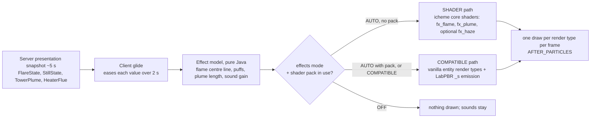

# Custom shader and effects system: plan

Batch `2026-11-10-custom-shader-system`, 2026-11-10. Status: plan, waiting for owner decisions (section 8).

## 1. Request and reading

Owner, 2026-11-10: a custom shader system for (a) normal textures, the wires on equipment surfaces first; (b) better flare stack SFX; (c) a cloud effect for the two water coolers and the furnace chimney; (d) SFX for the fuelled still. Style: industrial realism. It must work with FPS optimization mods and the usual shader packs, and it needs a config switch.

Readings this plan takes (X1 and section 8 ask the owner to confirm them):

- **Wires**: the metal cable conduits that `ConduitModel` draws on racks, sockets and leads into equipment (`instrument_conduit`, `data_cable`, `power_cable` sprites, tinted blue for data and orange for FE).
- **SFX**: what you see and what you hear.
- **Two water coolers**: the induced-draft and natural-draft cooling towers.
- **Furnace chimney**: the stacks of the vertical and cabin fired heaters. Boilers and gasifiers come later.
- **Fuelled still**: a batch still with a solid or liquid heater. An electric still gets only its hum.

## 2. Expected behaviour (physics, simplified)

**Flare (unassisted pipe flare).** A soot-bright yellow-orange flame that keeps moving, with the length from API 521 that the code already uses: `L = exp(0.4562 ln Q − 5.3603)` m. A 0.3 m tip at its 212 MW rating gives L ≈ 30 m. A cross-wind bends the flame. How far depends on the ratio u∞/Uj of wind speed to exit velocity (API 521 flame distortion). Gas with a high carbon-to-hydrogen ratio (propane and heavier, olefins) smokes at high load; methane burns without smoke. The roar is broadband and low (about 40 to 400 Hz) and gets louder with the heat released. A pilot hisses all the time.

**White plumes are condensed water.** A plume is visible where the mixing line between the exhaust and the ambient air crosses the saturation curve. Each table entry is the most liquid water at any point along that line, in g per kg of dry air (computed for this plan; a negative value means no visible plume).

| Source | 25 °C, 50 % RH (the mod's fixed ambient) | 15 °C, 70 % | 5 °C, 80 % | −5 °C, 80 % |
|---|---|---|---|---|
| Tower at the calibration point (water 35 → 25 °C, L/G 1, exhaust saturated at 28.5 °C) | none (−0.01) | 0.28, faint | 2.8, dense | 5.0, dense |
| Tower with hot water (45 → 30 °C, exhaust 32.4 °C) | none (0.00) | 1.3 | — | — |
| Gas-fired heater stack, 180 °C flue, 12 % water by mass of dry gas | none (−10) | none (−3) | 0.4, faint | 4.4 |
| Gas-fired heater stack, 350 °C flue | none | none | none | 0.1 |

So at the mod's ambient (`CoolingTower.AIR_TEMPERATURE` 298.15 K, RH 0.5), a real tower or gas stack shows **no white plume**. It shows a heat shimmer, plus a faint haze over a tower. A white plume belongs to cold or humid weather. Oil and solid fuel add grey smoke, whatever the weather. Owner decision X2 settles this.

**Plume shape.** The plume rises at the exit velocity (fan stack about 8 to 10 m/s; natural tower about 1 to 2 m/s), leans downwind and spreads as it dilutes. The visible part ends where the dilution f drops below the value that still has liquid water. Its edge is sharp, a real cue.

**Fuelled still.** A solid fire glows orange through the firedoor and crackles. The flue smokes grey-brown, most at high fire. A liquid (pressure-jet) burner gives a short yellow flame with a blue root, a fan whine and a steady roar, and a light haze from the flue. The pot thumps while it boils, and the spout drips.

## 3. What the code does now

- `FlareFlames` adds up to 24 vanilla `FLAME` particles each client tick, plus `LAVA` sparks and campfire smoke. A vanilla flame particle lives about 12 to 44 ticks, so a flare at full rating keeps about 480 particles alive. Each one is ticked on the CPU and drawn as its own quad. The flame always leans the same way (lean 0.25), smoke rises with load only, and there is no sound.
- `StillFires` uses vanilla `FLAME`, `LAVA`, `SMALL_FLAME`, smoke, `FURNACE_FIRE_CRACKLE` and `BUBBLE_COLUMN_UPWARDS_AMBIENT`.
- Towers and heaters have no world effects. The client gets fan speed and basin level only. There is no watch for heaters.
- Normals: shell and conduit quads bake their shade into the vertex colour. The tower and still sprites have relief painted in, because "the game's block shader reads no normals". No `_n` or `_s` textures exist.
- Iris lesson already in the code (`EquipmentGhost`): chunk render types drawn from a level-stage event vanish under a shader pack. Entity render types drawn at `AFTER_PARTICLES` work.

## 4. Design

### 4.1 Two render paths, one effect model



- **Effect model** (`client/fx/`, no rendering): each emitter turns its glided state into geometry: ribbons along a centre line for flames, a list of puffs for smoke and plumes, and a gain and pitch for sound. Plain Java, deterministic for a given game time, so it can be unit tested.
- **SHADER path** (no shader pack): our own core shaders, registered through `RegisterShadersEvent`. `fx_flame` draws domain-warped noise scrolling up the ribbon, coloured by a blackbody ramp (about 1100 K at the tip to 1900 K in the core), darkened by soot near the top, premultiplied alpha, full bright, with vanilla fog. `fx_plume` draws soft noise puffs lit by sky brightness and sun angle, so they are not white at night. Time comes from game time plus partial tick, so the effects freeze while the game is paused.
- **COMPATIBLE path** (shader pack active, or forced): the same geometry with flipbook textures that a tool bakes from the same noise. Drawn with `RenderType.entityTranslucentEmissive` for flame and `entityTranslucentCull` for smoke and plume, at `AFTER_PARTICLES`, the combination that already works under Iris. The `_s` textures carry LabPBR emission, so packs that read emission make the flame bloom.
- **Wind** (X3): one presentation wind for every effect. Direction and speed (2 to 8 m/s) change slowly with game time and dimension, so every client sees the same thing. It bends flames (API 521 u∞/Uj) and carries plumes and smoke.
- **Visual ambient** (X2 option A): temperature from the biome at the exhaust (`Biome.getTemperature(pos)`, which already falls with height), humidity from the biome's downfall and from rain, and minus 5 K at night. It sets only how much plume is visible. The server keeps 25 °C and 50 % for the heat duty.

### 4.2 Compatibility rules

1. Chunk geometry stays plain baked quads, which Sodium, Embeddium and Iris mesh as they do now. No chunk shader is replaced and no rendering mixin is added.
2. Our own `ShaderInstance`s are used only when no shader pack is active. Iris does not intercept a mod's own shader, so such a shader would render wrong or vanish (the malilib issue in the sources shows the same thing for custom pipelines).
3. Iris is detected by reflection on its public v0 API (`net.irisshaders.iris.api.v0.IrisApi.getInstance().isShaderPackInUse()`), read once per frame, with no hard dependency. Without Iris, the answer is "no pack". OptiFine does not run on NeoForge, and Oculus is a Forge 1.20.1 port, so Iris is the one shader loader on NeoForge 1.21.1.
4. No vanilla particles for these effects. Particle CPU cost, particle caps and particle-culling mods all differ between setups. We draw our own batches, cull them against the frustum ourselves and use the `RenderLod` distance tiers.
5. All effects draw at `RenderLevelStageEvent` `AFTER_PARTICLES`. Shadow passes are not hooked, so flames and plumes cast no shadow.
6. Distant Horizons: effects draw only inside the vanilla render distance, and the shell model already returns no quads to DH.

### 4.3 Config switch (client, `icheme-client.toml`, new `[effects]` section)

| Key | Values | Default | Effect |
|---|---|---|---|
| `mode` | `AUTO`, `COMPATIBLE`, `OFF` | `AUTO` | AUTO picks the path per frame (section 4.1); COMPATIBLE never uses our shaders (the escape hatch if some mod conflicts); OFF draws no flames, smoke or plumes |
| `pbr_textures` | true / false | true | With a pack: flat albedo with `_n` and `_s` maps, unshaded vertex colour (X5). Off: baked albedo always |
| `heat_haze` | true / false | false | SHADER path only (X6): a screen copy plus a distortion over flames and stacks |

Changes take effect on the next frame. A change to `pbr_textures` re-meshes the chunks, as `low_polygon_mode` does. Sounds use Minecraft's Blocks volume slider.

### 4.4 Normal textures (LabPBR 1.3), wires first

- One height source per sprite. A new tool, `tools/pbr-textures/`, writes three files from it: the **baked** albedo (relief painted in, as now, for play without a pack), a **flat** albedo `<name>_flat.png`, and next to it `<name>_flat_n.png` and `<name>_flat_s.png`. In `_n`, R and G hold the normal's X and Y, B holds AO and A holds height. In `_s`, R is smoothness, G is F0 (0 to 229) or a metal id (230 iron, 234 copper, 255 albedo), B is porosity and A is emission. Iris loads `_n` and `_s` beside any atlas sprite, in any namespace.
- The model chooses the variant (X5). `ConduitModel` and later `EquipmentShellModel` add "pack in use and `pbr_textures`" to their quad-cache key. With a pack, the quads use the flat sprite and a vertex colour of tint × 1, with no baked shade, because the pack lights them from normals. Without a pack, nothing changes.
- Wires first: `instrument_conduit`, `data_cable` and `power_cable`. The finish is painted steel tube, gloss paint (F0 about 0.04, smoothness 0.55), with worn edges in bare iron (230). The normal map shows the lap seam, coupling ridges and paint chips. U runs along the tube so the tangent follows it; W2 checks this in the `ConduitGeometry` quads.
- Next, after the owner sees the wires: still sprites, tower panels, painted shell weld seams.

### 4.5 Effects

| Effect | Geometry and look | Sound | Data needed from the server |
|---|---|---|---|
| Flare flame | 3 to 5 crossed ribbons, 8 segments each, along a centre line bent by the wind; length from `Flare.flameLength`; flicker in the shader; up to 48 quads | `flare_roar` loop, gain ∝ log Q, audible to 16 × gain blocks (about 64 blocks at rating); pilot hiss within 16 blocks | `FlareState` + exit velocity share, + soot index (X7) |
| Flare smoke | 6 to 16 puffs from the flame tip, grey-black thinning to brown-grey, downwind, growing | — | soot index |
| Tower plume | puffs from each fan stack (induced) or the throat ring (natural), rising at exit velocity, leaning downwind; visible length from the mixing-line dilution; up to 32 puffs per tower | faint water rush loop near the basin (later) | new `TowerPlume`: dry-air flow, exhaust temperature and humidity per bank, from `TowerTransfer.Result` (`dryAirFlow`, `evaporation`, energy) |
| Heater stack | heat shimmer when firing (X6); white plume by the mixing line; grey smoke for liquid or solid fuel | low stack draught rumble near the stack (later) | new watch `HEATERS`: firing share, stack temperature (bridgewall minus convection duty over C_g), flue flow, water share, fuel kind |
| Still, solid fire | emissive glow quad behind the firedoor with flipbook flames; flue puffs grey-brown | `fire_draught` loop (crackle over a low roar), gain from fire share | existing `StillState` |
| Still, liquid burner | short flame jet, blue root, yellow tip; light flue haze | `burner_roar` loop (fan whine + roar) | existing `StillState` |
| Still, common | boiling thump loop at the pot, drip at the spout, steam wisps over a hot worm tub (later) | `pot_boil` loop | `StillState` (+ tub temperature later) |

Engine rules hold: all data comes from the watch replies on the ~5 s presentation schedule. Watches start and stop on the client's request, as for flares and stills. The client only eases between snapshots and adds no process state. Watch payloads are wire formats: the fluid protocol number goes up, with no compatibility work. No facts or shape fields change. The new part marks (`stack_top`, `fan_exhaust`, `throat`, `flare_tip`) are design data, not saved.

Sounds are synthesised by the `tools/machine-sounds` route (periodic noise shaped over the whole loop, seamless, mono 24 kHz Ogg, no recordings; X8), in a new `tools/process-sounds/`.

### 4.6 Budgets

At most 48 quads per flare, 32 puffs per plume and 16 per smoke trail. At most 2,000 effect quads per frame in total, ranked by screen size. One draw per render type per frame. CPU at most 0.2 ms per frame with 10 active emitters. That replaces about 480 particles per full flare. The heat-haze screen copy costs one full-screen blit, and only while haze is visible.

```
 Side view, flare in wind (X3 A)                 Side view, induced-draft tower plume (X2 A, cold day)

            ~~ smoke, downwind ~~>                       . . . o O O ( )  <- visible edge: the mixture
         ___----''''                                  o O O ()               leaves saturation
     _-''  flame, bent by u∞/Uj                  O O ()  rising at exit velocity, leaning downwind
    /  L = flameLength(Q)                       ()
   |                                          ___||___  fan stack (fan_exhaust mark)
  =|= tip (flare_tip mark), pilots hiss      |  tower |
   |                                         |________|
```

## 5. Compatibility matrix (W0 and the final check)

Setups: vanilla NeoForge 21.1.219; Sodium 0.6 for NeoForge; Embeddium 1.0.15; Sodium + Iris 1.8 with Complementary Reimagined, BSL and one more LabPBR pack; Distant Horizons; ImmediatelyFast; Create with Flywheel. Each setup checks that every effect is visible and fogged, that the flame blooms under a pack, that cables show normal relief under a pack, that a pack toggle switches paths without a restart, and the frame time. These are dev-client checks. Under AGENTS.md the owner starts them, through the `runMcpClient` lane.

## 6. Work packages

| WP | Content | Gate |
|---|---|---|
| W0 | Spike: `FxCompat` detection, one test ribbon on both paths, a cable with `_n` / `_s`; settles the questions in section 7 | owner-run matrix on 3 setups |
| W1 | Core: `FxSettings`, `FxCompat`, `FxShaders`, `FxRenderTypes`, `FxBatch`, `FxWind`, `FxAmbient`, glide | unit tests: wind determinism, ambient mapping, mixing-line excess against section 2's table, batch budgets |
| W2 | `tools/pbr-textures/` + the three conduit sprites; model variant switch | resource test: `_n` / `_s` sizes and channel ranges; ConduitModel cache-key test |
| W3 | Flare: flame, smoke, roar; `FlareState` additions; old particle code removed | flame geometry tests; FlareRuntimeTest for the new fields |
| W4 | Tower plume: `TowerPlume` watch, marks, puffs | plume length tests; tower runtime test for the published exhaust |
| W5 | Heater stacks: `HEATERS` watch, flue state, marks, plume, smoke, haze hook | flue-state tests (stack temperature, water share by fuel) |
| W6 | Still: glow, burner jet, flue, sounds | StillFires geometry tests |
| W7 | `tools/process-sounds/`: five loops | seam and RMS report, as machine-sounds |
| W8 | Heat haze (if X6 A) | SHADER path only; off by default |
| W9 | Docs, code guide chapter "effects", translations of the new config lines, tooling cleanup | final lane |

Order: W0 → W1 → W2 (the owner reviews the wires) → W3 → W4/W5 → W6/W7 → W8 → W9.

## 7. Unknowns W0 settles

- Whether Iris builds a tangent for `entityTranslucentEmissive` quads drawn from a level-stage event, and whether it reads PBR from a standalone (non-atlas) effect texture. If not, effect textures go into a mod atlas.
- Whether Iris with Sodium keeps our smooth vertex normals for chunk quads or recomputes face normals. Face normals would light round shells in facets under a pack.
- Whether toggling a shader pack re-meshes chunks, so the X5 variant switch follows the pack without F3+T.
- Whether Sodium 0.6 and Embeddium fire `AFTER_PARTICLES` at the same point as vanilla. Today's ghost and outline renderers suggest yes.

## 8. Owner decisions

- **X1 Wires.** A: the cable conduits of `ConduitModel` (recommended). B: other wires, to be named.
- **X2 White plume at the mod's ambient.** A: a visual ambient from biome, altitude, rain and night; the plume follows the mixing line (recommended: real physics, weather the player can see). B: always a plume, sized by evaporation or flue flow, whatever the weather. C: the 25 °C, 50 % physics only, so no white plume, only shimmer and haze.
- **X3 Wind.** A: one presentation wind for flame lean and plume drift (recommended). B: no wind; flames stand straight and plumes rise straight up.
- **X4 Switch.** A: `AUTO`, `COMPATIBLE`, `OFF`; the old particle code is deleted (recommended). B: keep a `PARTICLES` mode with today's code.
- **X5 Albedo under a pack.** A: flat albedo and unshaded vertex colour while a pack is in use (recommended). B: flat only (play without a pack loses the painted relief). C: baked only (relief lit twice under a pack).
- **X6 Heat haze.** A: in, SHADER path only, off by default (recommended). B: out.
- **X7 Flare smoke.** A: a soot index from the flared gas's carbon-to-hydrogen ratio and the load, a new published value (recommended). B: load only, as now.
- **X8 Sounds.** A: synthesised loops, no recordings (recommended, the machine-sounds route). B: CC0 recordings after a licence check.

## 9. Sources

- API 521 flame length, as already used: [FLARE_STACK_PLAN.md](../2026-11-09-flare-stack/FLARE_STACK_PLAN.md).
- LabPBR and `_n` / `_s` naming: [shaders.properties PBR standards](https://shaders.properties/current/how-to/pbr_standards/); Iris PBR support: [Iris guide](https://github.com/IrisShaders/Iris/blob/1.19.4/docs/guide.md).
- Iris v0 API (`IrisApi`, `isShaderPackInUse`): [Iris commit 41721a5](https://github.com/IrisShaders/Iris/commit/41721a53dde15698bf03c6763475c62978105e7c), [Iris architecture](https://deepwiki.com/IrisShaders/Iris/2-architecture).
- Custom pipelines invisible under a pack: [malilib issue 165](https://github.com/sakura-ryoko/malilib/issues/165).
- Loaders on 1.21.1: [Iris NeoForge 1.21.1](https://www.curseforge.com/minecraft/mc-mods/irisshaders/files/5654382), [Sodium 0.6.13 NeoForge](https://modrinth.com/mod/sodium/version/mc1.21.1-0.6.13-neoforge), [Embeddium](https://nothingseries.github.io/docs/mods/modpages/embeddium).
- Mixing-line numbers: Magnus-type saturation pressure (Arden Buck), humidity ratio 0.621945 p/(P − p), as `TowerTransfer`; computed for this plan.
