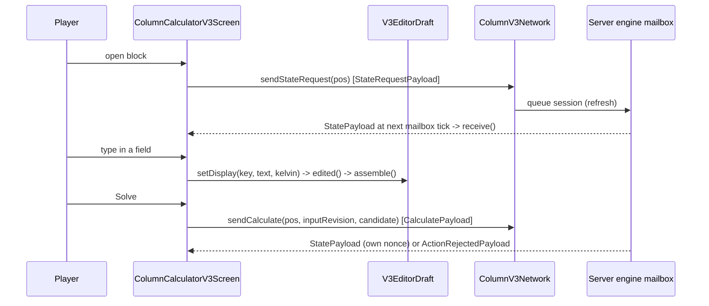
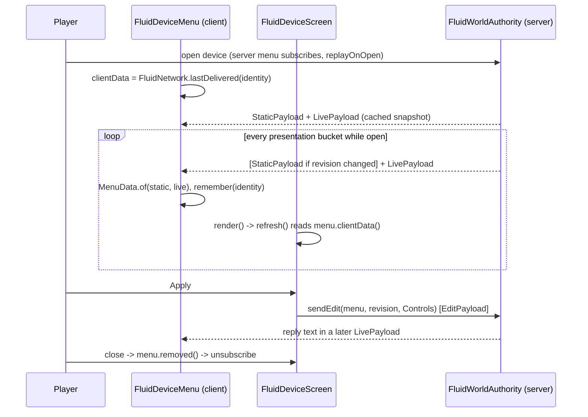

# Client GUI: screens, drafts, presets and the dev-client check

**Port-colour feature snapshot:** `645e203d` (`claude/column-operation-5c3005`), 2026-10-29: `AssemblyFlowsheet` and the pipe laying tool use `PortColours.assembly`, matching a slot, nozzle role and ordinal to the design's fixed port order (negative mark ordinals accept any nozzle of that role). Colours spread hues and vary brightness/saturation. Reports keep the GUI fill; CONNECTED uses a grey edge, UNUSED is hidden. `FlowsheetPainter.square` accepts an optional ARGB edge. The tool resolves a column's own nozzles without validation and other equipment from its watched report; matched world squares keep the colour with grey connected frames or yellow misplaced frames, other nozzles use class colours. A design edit can reorder colours. 20 mapping/drawing/watch tests green; both theme renders unchanged. No live world-marker check.

**Snapshot:** 545c827a (main, mod 0.17.1), 2026-10-28 · **Updated:** 2026-10-28 (batch 2026-10-28-constructor-templates: the constructor's Templates page (`ConstructorColumn.templates`, `ColumnTemplates`), the draft's kind latched and acting, `SkinButton` draws a latched key latched whether it acts or not) · earlier: 2026-10-28 (batch 2026-10-28-gui-toolkit, device pages on big screens: the fluid device screen holds 464 by 480 GUI px and steps down until its door fits, never below `WindowScale.minimum`; a flow valve's target inside its Set point group; a compressor reads its pressure ratio, its Δp on hover) · earlier: 2026-10-28 at f20ceefa, released as 0.17.0 (batches 2026-10-27-heat-exchanger-design and 2026-10-28-gui-toolkit: every screen a panel door on the GUI kit, in the client's theme and units and at its own whole scale; the heat units' Control tab, stream switch and line readings; the calculator's four pages need a diameter, the Holland 3-2 presets are gone) · earlier: 2026-10-28 (batch 2026-10-28-main-test-repair: the creative tab registers from `ModCreativeTabs`) · earlier: 2026-10-27 (stale persisted column results are hidden until a fresh solve)

**Creative tab (commit `188fba66`, 2026-10-27):** all registered IChemE items are listed in the mod creative tab; the mod no longer injects items into vanilla Functional Blocks. Since batch 2026-10-28-main-test-repair the tab is registered by `registry/ModCreativeTabs` (`MAIN`), not in `IChemE`'s static state: a registry needs Minecraft bootstrapped, and unit tests read `IChemE.LOGGER`.

**Process control (batch 2026-10-26-process-control, 0.14.1):** sensor rows and the Control Valve on the fluid screen; the contracts are in [process-control.md](process-control.md).

`FluidDeviceScreen` shows cached sensor readings as LED meters in its Readings group (since batch 2026-10-28-gui-toolkit): pressure and temperature in the player's units, a flowmeter's signed mass flow in kg per the flow time unit with its volume flow on hover, a level gauge's percent of span with its height in metres (and overrange) on hover. A bare Control Valve's Valve group says “Lacking components” and offers no set point; a configured one shows the set point of its controls' `valveSource`: a pressure, or a flow with its target, mass or volume flow, chosen above it in the Set point group (a draft until Apply). The Valve group shows the accepted opening as a bar and the controller's regulation, limit, conflict or signal words. `MenuData`/`LiveData` carry readings and `ValveData`; registry item IDs retain `pressure_control_valve` while its visible name is Control Valve. `InstrumentRenderer` renders the cached blank housings/connectors and placement ghosts without requesting live sensor data.


**Feature branch:** `b1477c09` (`codex/liquid-gauge-accessory`), 2026-10-26, based on main `600549d9`. Floating-roof tank level gauge is an optional item/accessory;24 focused checks/package and8 native views pass. Main merge pending. [Contracts](../../2026-10-26-liquid-level-gauge-accessory/LEVEL_GAUGE_CONTRACTS.md).


**Snapshot:** dbefe7f4 (main, mod 0.15.3), 2026-10-27 · **Updated:** 2026-10-27 (batch 2026-10-27-constructor-import: the constructor's Import sends its draft and waits for the server's answer, `EquipmentConstructorScreen.answered`; a refusal on its status line) · earlier: 2026-10-27 (batch 2026-10-26-multi-machine-framework: the column screen's Components page and Save design, its dataset shown by label; the constructor's import-only column and its Nozzles page; the assembly screen, `AssemblyDiagram`, `PortColours` and the laying tool's assembly marks (`AssemblyToolClient`), see [machine-assemblies.md](machine-assemblies.md), and its port label's limit from the nozzle (`67343274`); the datasheet sent by the server; the `tia_juana_residue` mixture preset) · earlier: 2026-10-27 (batch 2026-10-26-process-control: sensor rows, the Control Valve's modules, opening and status on `FluidDeviceScreen`, `ValveData`, sensor housings and ghosts in `InstrumentRenderer`; no client change in the review fixes or the merge of main 0.14.0) · earlier: 2026-10-27 (batch 2026-10-26-pipe-laying-system: the pipe tools' settings screen with line paints, the shared `PaintSwatch`, `PipeLayingClient`, `PipeRackModel`, painted pipe and rack tints, transition pipes in `FluidDeviceModel`; the tool and racks are in [pipe-laying.md](pipe-laying.md)) · earlier: 2026-10-26 (batch 2026-10-26-backward-compat: the datasheet's "N cells blocked" line, counted on the client; a stale `MachineAnimation.toggle` trap removed) · earlier: 2026-10-26 (batch 2026-10-16-minecraft-mcp-mouse-input: the MCP lane pins the official bridge v0.4.18 with `mcp.background_input=true`, compat range `[0.4.18,0.5.0)`, `BackgroundCursorMixin`) · earlier: 2026-10-26 (batch 2026-10-26-air-cooler-chunk-rendering: the Moving parts switch stops parts without re-meshing a chunk; one layer set per shell cell) · earlier: 2026-10-25 (batch 2026-10-21-floating-roof-tanks: display units and phase bases on the fluid screen, power switch, gauge and pipeline-tool screens, world-space renderers for open tanks, sight glasses, gauges and mover sounds, glass layers and mover markings in the shell model, fitting models) · earlier: 2026-10-21 (0.11.1 test review; mod rename to IChemE, 0.11.0); 2026-10-20 (the equipment client)
Up: [code guide](README.md)

## Read this when

- You change what a player sees or types in the column calculator or in a fluid device screen (pump, valve, pipe, tank, generator, filter, void, compressor, a heat unit's side), a gauge's settings screen or the pipe tools' settings screen (the laying tool's ghost, marks and HUD are in [pipe-laying.md](pipe-laying.md)).
- You change a heat unit's Control tab (its drawing, switch, targets and set points), the Overview's stream switch or a pipe's line reading. The data and the control's physics are in [heat-exchangers.md](heat-exchangers.md).
- You change the GUI kit (`gui/common/kit`): rows, alignment, scrolling, the light or dark panel, a screen's own scale; or a panel builder (`DeviceColumn`, `HeatControlColumn`, `DialogColumns`, `ConstructorColumn`, `AssemblyColumn`, `CalculatorColumn`). The owner's GUI rules and the render workflow are in the project skill `.claude/skills/gui-creation/SKILL.md`.
- You change a display unit (temperature, pressure, flow time basis), the composition basis, the panel theme (`ClientConfig`, `icheme-client.toml`) or the phase-ratio basis of the fluid screen.
- You change a world-space display: an open tank's roof, ladder and level glass, a sight glass's liquid and bubbles, a gauge dial, a constructed mover's sound or animation.
- You change the column screen's Equipment page (component choices, Save design), the constructor's Nozzles page, or a column's assembly screen ([machine-assemblies.md](machine-assemblies.md)).
- You change the equipment constructor's screen, a vessel or unit datasheet, the constructor's ghost, how shell cells, pipes or pipe fittings are meshed, or the moving parts of units.
- You add a GUI field, a unit, a tab, a preset file or a translation key.
- A screen shows a wrong number, loses typed text, or does not refresh after Apply or Solve.
- A fluid status line shows "outside data range" or "HELD (phases)", or the Solids tab lists a crystal such as "Carbon dioxide (solid)".
- You must verify GUI work in the dev client through the MCP bridge (AGENTS.md requires this).

## In one paragraph

The player right-clicks a block. Two process screens exist. **Column Calculator V3** has four pages: Column, Feed, Results and Equipment. The player edits trays, feed, condenser, reboiler, side draws, pumparounds and steam in the door's entries and picks connections on the column drawing, or edits the feed mixture on the Feed page. **Solve** then sends one complete `V3ColumnInput`. The Results page shows the accepted result: profiles, products, heat, a tray and the solver's report. **Fluid device** screens show what the engine last published for one device: its switches, set points and meters, its phases, and its pipe connections or tank outlets; a heat unit's side adds a **Control** tab with the unit's drawing and its control. Their **Apply** button sends one bounded `Controls` record. In the code, every screen keeps the typed text in a widget-free draft class. A draft class parses text to SI units and builds the exact record that the button sends, so unit tests can pin the record without Minecraft. The screens never compute process state. They show what the server sent. Inputs go to the server as queued engine events, and the answer comes back on the engine schedule (about every 5 s of online time). The server side of the packets is described in [fluid-runtime.md](fluid-runtime.md) and [column-v3.md](column-v3.md).

Every screen is a control panel door drawn by a small GUI kit of our own (`gui/common/kit`, batch 2026-10-28-gui-toolkit). A Minecraft-free builder class (`DeviceColumn`, `HeatControlColumn`, `CalculatorColumn`, ...) turns the screen's state into rows: function groups under short plates, entries (LCD boxes the player types in), meters (LED boxes the plant reads), selectors, buttons, bars. `Column.place` lays the rows out from the width in one pass, so the same placement draws the texts, places the widgets and answers clicks and hovers; the gates and the render tool place exactly what the screen draws. The door holds switches, set points and meters; tables and drawings sit on the HMI glass (`Skin.well`). The theme (a light or a dark door) and the display units are the client's (`ClientConfig`, `icheme-client.toml`), one switch for every screen, never sent to the server. Each screen takes its own whole GUI scale (`WindowScale`), so it is laid out at 464 by 254 GUI px or somewhat more, whatever the player's GUI scale. The fluid device screen holds 464 by 480 instead and steps down while its door does not fit, never below the minimum a player reads, so on a big window every device page shows whole at one scale (2 at 1920 by 1080, 3 at 2560 by 1440, 4 at 3840 by 2160).

The equipment client adds two more screens and the drawing of equipment. The **equipment constructor** screen is client-only and edits a local draft: the player picks what to build, steps its sizes, sets side connections and paint on a door at the left of the screen, and sees the vessel's ghost in the world beside it; the design is sent when the screen closes, and with a build request on **Build**. Using a unit without a fluid device opens its **datasheet** (`VesselScreen`), built from the cells the client already has, so it requests nothing; a column opens its assembly screen, which has the datasheet behind a button; a drum, tank, sphere, heat unit or constructed mover shows the same datasheet as page 5 of its fluid screen. Shell cells, pipes and pipe fittings are drawn by two chunk models from their block entities' model data; units' fans, shafts and rods move on the client only. The server side and the shared geometry (`ShapeRasterizer`, `Mesh`, `LineGeometry`) are in [equipment.md](equipment.md).

Some things move in the world with the process: an open tank's roof and level glass, a sight glass's liquid and bubbles, a gauge's needle, a constructed mover's sound and moving parts. Their client renderers ask the server to **watch** the nearest ones (one request a second, at most 64 of each kind) and draw what the server publishes on its bucket. They never compute process state, and nothing is sent unasked ([fluid-runtime.md](fluid-runtime.md), flow (d)).

## Class map

All paths are under [`src/main/java/com/wormzjl/icheme/client/`](../../../src/main/java/com/wormzjl/icheme/client/).

| Class | Role | Read it for |
|---|---|---|
| **Entry** | | |
| [IChemEClient](../../../src/main/java/com/wormzjl/icheme/client/IChemEClient.java) | Registers the menu screens (column, fluid device, `gauge`, `pipeline_tool`, `assembly`); on logout clears the delivered-view cache and the caches of `TankRenderer`, `SightGlassRenderer` and `MoverSounds` | Where a new screen is registered |
| [EquipmentClient](../../../src/main/java/com/wormzjl/icheme/client/EquipmentClient.java) | Registers the `equipment_shell`, `fluid_device` and `pipe_rack` geometry loaders; tints a `fluid_pipe` quad by its line paint (tint index `STRUCTURE` the secondary, else the primary; -1 bare) and a `pipe_rack` quad by the paint of the lane whose option is the tint index >> 1 (channel: the index & 1); tints a shell quad by its `Paint` channel (`Paint.tint`, default paint while unbound); replaces the per-cell outline with the vessel's silhouette (`ShapeRasterizer.outline` from the camera); `openConstructor`, called by the constructor block on the client; `openVessel` (the datasheet), sent by the server (`assembly_datasheet`, [machine-assemblies.md](machine-assemblies.md)) | Where the equipment client hooks in |
| [ClientConfig](../../../src/main/java/com/wormzjl/icheme/client/ClientConfig.java) | The client's own settings, `icheme-client.toml` (registered by `IChemE` as a client config, so a dedicated server never loads it): section `gui` `theme` (`LIGHT`, `DARK`; `skin()` gives `PanelSkin.LIGHT` or `.DARK`, `toggleTheme()`), section `units` `temperature`, `pressure`, `flow_time` and `basis` (`MOLE`, `MASS`); each setter saves the file; before the config loads, the defaults (light, Celsius, kPa, per second, mole) | Where the theme and the display units live |
| **GUI kit (`gui/common/kit`)** | | |
| [Column](../../../src/main/java/com/wormzjl/icheme/client/gui/common/kit/Column.java) | Rows placed top to bottom in one pass from the width (`place`, `Metrics.DEFAULT` or `COMPACT`): `Group` (rows framed under a plate, `INSET` 4), `Line`, `Paragraph`, `Choice` (a mark, a title, an action key), `Field` (an entry), `Reading` (a meter), `Setting` (an LCD value with [−] and [+] steppers, `STEP` 14), `Buttons` of `Button` (`latched`, `soft`), `Bar`, `Split` (a share bar with a legend line a share), `Gap`; a `Placed` row keeps its rect, slots by key, texts and hover; `slots()`, `at`, `action`, `hover`, `draw(canvas, dy, skin)`. Every box `BOX` 46 px at one place, every unit after it in `UNIT` 23 px (a wider unit is the label's last line); a group's labels all beside their boxes (two lines, words whole) or all above; no text cut: texts wrap, a button row stacks | Every panel's layout rules |
| [Rect](../../../src/main/java/com/wormzjl/icheme/client/gui/common/kit/Rect.java), [Measure](../../../src/main/java/com/wormzjl/icheme/client/gui/common/kit/Measure.java), [Canvas](../../../src/main/java/com/wormzjl/icheme/client/gui/common/kit/Canvas.java), [Palette](../../../src/main/java/com/wormzjl/icheme/client/gui/common/kit/Palette.java), [Format](../../../src/main/java/com/wormzjl/icheme/client/gui/common/kit/Format.java) | A GUI-pixel rectangle; text width, cut and wrap (`Measure.fixed(6)` in tests, the game font in the game, `LINE` 10); where the kit draws (fills, lines, text, clip) in the game or in the render tool; the screens' dark palette and the assembly report's teal, yellow and red; `Format.number` (one decimal, three significant figures below 0.05) | The kit's Minecraft-free base |
| [Skin](../../../src/main/java/com/wormzjl/icheme/client/gui/common/kit/Skin.java), [PanelSkin](../../../src/main/java/com/wormzjl/icheme/client/gui/common/kit/PanelSkin.java) | How a screen draws: page, title, status (the message display), buttons (`Press` `REST`, `OFF`, `CURRENT` latched, `PRIMARY`), display keys on their tray (`softKeys`, `softKey`), the theme key's sign (`Icon.THEME`), entries (`field`), meters (`meter`), the HMI glass (`well`, returns the box inside), groups, marks, bars, splits, scroll bars; `Skin.PLAIN` the old look; `PanelSkin.LIGHT` (door 3a, RAL 7035 grey, red LED meters) and `.DARK` (door 3c, RAL 7016 anthracite, amber meters): engraved plates and text, 7-segment LCD entries, LED meters, IEC 60073 button colours | The light and dark doors |
| [ScrollView](../../../src/main/java/com/wormzjl/icheme/client/gui/common/kit/ScrollView.java), [KitWidgets](../../../src/main/java/com/wormzjl/icheme/client/gui/common/kit/KitWidgets.java), [KitDoor](../../../src/main/java/com/wormzjl/icheme/client/gui/common/kit/KitDoor.java) | A viewport with its own 8 px bar (wheel step 30 px) that takes input only while shown and inside; widgets kept at their content slots and moved as the view scrolls, shown only wholly inside, so a scroll rebuilds nothing; a door's columns (one, or two side by side in one view with one bar) with their kept widgets (`keep`), drawing and hover, and `KitDoor.hint` (a hover wrapped to 200 px) | Scrolling a door; why a scroll does not rebuild |
| [GuiCanvas](../../../src/main/java/com/wormzjl/icheme/client/gui/common/kit/GuiCanvas.java), [SkinButton](../../../src/main/java/com/wormzjl/icheme/client/gui/common/kit/SkinButton.java), [SkinField](../../../src/main/java/com/wormzjl/icheme/client/gui/common/kit/SkinField.java) | The game adapters: the canvas on `GuiGraphics` (the scissor in screen coordinates); a vanilla `Button` drawn by the skin (`of(spec, slot, action, skin)`, `latched` (drawn latched whether it acts or not), `primary`, `soft`, `icon`); an unbordered `EditBox` whose box and resting value the skin draws, the game's text and cursor only while focused | Kit widgets in the game |
| [FlowsheetPainter](../../../src/main/java/com/wormzjl/icheme/client/gui/common/kit/FlowsheetPainter.java) | The flowsheets' drawing on a design grid, shared by the assembly screen and the heat Control tab: `fit` (origin and scale), process and dashed utility lines with arrows, vessels, boxes, rounded shells, tees, valves, circles, nozzle squares, pills, and labels in a font scaled with the drawing (never below `MIN_FONT` 0.5) that draw only where they fit; `Look.TEAL`, `YELLOW`, `RED` | A flowsheet's look |
| [WindowScale](../../../src/main/java/com/wormzjl/icheme/client/gui/common/kit/WindowScale.java) | A screen's own GUI scale: the largest whole scale at which the window holds `WIDTH` 464 by `HEIGHT` 254 GUI px, at least 1 (an even one with the forced Unicode font); `apply` first in `init()`, `restore` (the player's scale) in `removed()`; used by all seven kit screens. `minimum`: half that scale rounded up, at least 2 where it is 2 or more. `of(width, height, unicode, designHeight, fit)`: for a screen designed taller, the scale that holds 464 by its design height, stepped down while its `Fit` (its door columns in their view) fails, never below the minimum; `apply(minecraft, screen, designHeight, fit)` and `lower` (used by `FluidDeviceScreen`) | Why a screen ignores the player's GUI scale |
| **Shared widgets and helpers (`gui/common`)** | | |
| [ProcessUi](../../../src/main/java/com/wormzjl/icheme/client/gui/common/ProcessUi.java) | Palette constants (aliases of the kit's `Palette`), `number` (the kit's `Format.number`), `pressure` formatting, table rows, `button`, cursor recovery, key priority of text fields; `materialName` (translates a server `MaterialName`, adds an NBP range for petroleum fractions); nested `Label`, `NumericDraft` (short text over an exact SI double in a `DisplayUnit`; untouched text returns the exact SI bits across any number of unit changes, `in(unit)`, `si()`) and `ProcessScroll` (draggable row scrollbar: the fluid screen's tables, the dropdown); `pressure` prints through `PressureUnit.KILOPASCAL` | Number format, keyboard traps, component labels, fluid numeric fields |
| [`science/display/DisplayUnit`](../../../src/main/java/com/wormzjl/icheme/science/display/DisplayUnit.java) (outside `client/`) | Interface `display`/`si`; nested `PressureUnit` (Pa, kPa, bar, MPa with 1, 4, 6, 7 decimals: every unit keeps the 0.1 Pa resolution), `TemperatureUnit` (`CELSIUS` "°C", `KELVIN` "K"; the wire is always kelvin; moved here from `ProcessUi` so `ClientConfig` can name it) and `FlowRateUnit` (per second, per minute, per hour; `next()` cycles them) | Unit conversion for every screen |
| [ComponentDropdown](../../../src/main/java/com/wormzjl/icheme/client/gui/common/ComponentDropdown.java) | Search `EditBox` with an overlay match list (max 6 rows, z = 500) | Adding a component to a mixture |
| [ComponentSearch](../../../src/main/java/com/wormzjl/icheme/client/gui/common/ComponentSearch.java) | Deterministic ranking: exact, prefix, substring, subsequence, typo distance | Search order |
| [RelativeComposition](../../../src/main/java/com/wormzjl/icheme/client/gui/common/RelativeComposition.java) | Relative amounts per component, mole or mass basis, full precision until edited | Composition maths, basis toggle |
| [ColumnDiagram](../../../src/main/java/com/wormzjl/icheme/client/gui/common/ColumnDiagram.java) | The column schematic shared by the column calculator and the equipment constructor, drawn on the kit's `Canvas` (so the render tool draws it too): a 49-pixel shell (`HALF` 24) with rounded heads, a line per tray, feed, draw, pumparound and steam marks (`MARK` 26); each screen maps trays to heights and adds its own labels | Changing the drawing of a column in either screen |
| [PaintSwatch](../../../src/main/java/com/wormzjl/icheme/client/gui/common/PaintSwatch.java) | One palette swatch button, outlined white while its colour is the one being edited; shared by the equipment constructor's `PAINT` page and the pipe tools' settings, which place the swatches in their Paint group's gap (`DialogColumns.palette`) | A colour picker |
| **Panel builders (`gui/common`, no Minecraft classes)** | | |
| [DeviceColumn](../../../src/main/java/com/wormzjl/icheme/client/gui/common/DeviceColumn.java) | A fluid device's door column on every page but the Control tab (it replaced the rail): first the groups with widgets (a heat side's side selector, Control Off/On, Set point (a flow valve's with its target, mass or volume flow, above the entry), Limit, a pipe's Size, a filter's Solids, Phases with its basis key), then the groups whose texts follow the plant (a tank's Level, a valve's Valve opening, Readings as LED meters); keys `power:off`, `power:on`, `recover`, `phase_basis`, `side:0`, `side:1`, actions `valve:mass`, `valve:volume` | A device's set points, groups and meters |
| [HeatControlColumn](../../../src/main/java/com/wormzjl/icheme/client/gui/common/HeatControlColumn.java) | The heat Control tab's column from the side's `FluidView.Heat`, its applied `HeatUnit.Control` and the drafts: the side selector (tube and shell, convection and radiant, tubes and pool; none for an air cooler), Control (Off, On), Target (outlet temperature, duty; an exchanger's feed ratio, an air cooler's fan speed), Set point (the target's field: outlet temperature, duty in kW, ratio, an air cooler's fan speed in %; a heater's coil outlet) or By hand while Off (an exchanger's bypass %), with the low limit (none on an air cooler), the actuator's group named by the server (bar, effort, the lines' note, Check lines); `columns` (layout C: selector, Control and Target left, the rest right) or `rows` (one column); its `Texts` interface is how every builder reads lang lines | The Control tab's switch, targets and fields |
| [HeatDiagram](../../../src/main/java/com/wormzjl/icheme/client/gui/common/HeatDiagram.java), [HeatFlowsheet](../../../src/main/java/com/wormzjl/icheme/client/gui/common/HeatFlowsheet.java) | The Control tab's drawing: `HeatDiagram.of(unit, side, design)` on a 444 by 250 design grid (the unit's body glyph, a square at each nozzle, a pill per outside stream, an exchanger's W8 line parts; each line a `Value` read from the view: `port:`, `part:`, `duty`, `air`); `roles(unit, side)`; lang keys under `gui.icheme.heat.`. `HeatFlowsheet` draws it through `FlowsheetPainter` (body neutral, line parts teal, yellow or red by their state, this side's pills in the accent colour) and answers `part` and `pill` hit tests | The heat drawing |
| [DialogColumns](../../../src/main/java/com/wormzjl/icheme/client/gui/common/DialogColumns.java) | The small dialogs' doors: `gauge` (Range, unit selector, a pressure gauge's Reading), `pipelineTool` (Size; the laying tool's Paint channel selector, palette gap, custom #RRGGBB, Bare steel), `vessel` (the datasheet's Size group: chosen sizes as entries, the rest as meters; a moving unit's Still/Running switch); `footer` (two or more share the width, one stands at the right); the datasheet's `Sheet` and its glass (`glass`, `draw`: the warning, notes wrapped, a role/port/side nozzle table that stacks where a word does not fit, every second entry on a faint `BAND`) | Gauge, pipe tool and datasheet layouts |
| [ConstructorColumn](../../../src/main/java/com/wormzjl/icheme/client/gui/common/ConstructorColumn.java) | The equipment constructor's door, `PANEL` 200 px at the left: the pages' rows (`choose`: `Category` and `Equipment`, 5 groups, 27 kinds, the draft's kind latched and acting; `design`: sizes and places as `Setting` steppers, a column's imported diameter, trays and feed shown, not stepped, with Import and Templates; `templates`: a key a column template, one that builds no column off; `connections`; `nozzles`; `paint`), each `Page` with its footer (Build last, the primary) and whether the message display shows | Constructor pages and rows |
| [AssemblyColumn](../../../src/main/java/com/wormzjl/icheme/client/gui/common/AssemblyColumn.java), [AssemblyFlowsheet](../../../src/main/java/com/wormzjl/icheme/client/gui/common/AssemblyFlowsheet.java) | The assembly screen's door (Structure and Operation tabs, the status once, Check with Check parts and a one-line summary, Selected with Open unit, Close and Datasheet on the footer), its parts list on the glass (a word per part, every second on a band; also the calculator's template list) and the drawing from `AssemblyDiagram` through `FlowsheetPainter`, with its hit tests ([machine-assemblies.md](machine-assemblies.md)) | Assembly door and drawing |
| [CalculatorColumn](../../../src/main/java/com/wormzjl/icheme/client/gui/common/CalculatorColumn.java) | The column calculator's door: the frame (`width` 320 to 960, `height` at least 220, `door`, `glass`, `dividers`, `tabSlots`, `footer`, `keys`), `Page` (`COLUMN`, `FEED`, `RESULTS`, `EQUIPMENT`), `View` (`PROFILES`, `PRODUCTS`, `HEAT`, `TRAY`, `SOLVER`), `Metric`; the status said once (`status`); each page's `Rows` (left and right column); the Draft group (Use server, Keep mine); the column drawing (`pitch`, `drawingHeight`, `drawing` with its click places `Hit`, `temperatureColour`), the plots, the readout sheets and the feed table on the glass | Everything the column player sees; drawing scale |
| **Column calculator (`gui/screens/inventory`)** | | |
| [ColumnCalculatorV3Screen](../../../src/main/java/com/wormzjl/icheme/client/gui/screens/inventory/ColumnCalculatorV3Screen.java) | The screen on `CalculatorColumn`: four tabs, a `KitDoor` (one door column, two on the Column page where the door is wide enough), the glass in its own `ScrollView`, Templates/Solve/Save and the basis and temperature display keys; the feed's search and amount boxes on the glass (`KitWidgets`); Save design (`ColumnV3Network.sendSaveDesign`) with the component choices; the client's temperature unit and basis (`ClientConfig`) | Screen state, packets, clicks |
| [V3EditorDraft](../../../src/main/java/com/wormzjl/icheme/client/gui/screens/inventory/V3EditorDraft.java) | Keyed text fields (`s0..s9`, `d*`, `t*`, `c*`), exact values, `assemble()`; nested row parsers, see below. `s8`, the tray drop, has no field: `assemble()` keeps the base input's value, and a column preset leaves it alone (`loadColumn`) | What Solve sends |
| `V3EditorDraft.ColumnInputDraft` | Builds one `V3ColumnInput` from the row parsers; rescales the server feed vector | Assembly order, error prefixes |
| `V3EditorDraft.ColumnScalarDraft` | Parses the ten scalar fields to SI units with field-specific messages; the diameter must be above 0 (the tray hydraulics give the pressure profile) and at most `V3ColumnInput.MAX_COLUMN_DIAMETER_METRES` | Units and ranges |
| `V3EditorDraft.SideDrawDraft` | Side-draw rows: blank or zero rate = off; total below feed | Draw rules |
| `V3EditorDraft.SteamFeedDraft` | Sump/tray steam rows; total not above feed | Steam rules |
| `V3EditorDraft.PumparoundDraft` | Cooler rows; the only place where positive MW of cooling becomes negative W | Sign convention |
| [V3CompositionDraft](../../../src/main/java/com/wormzjl/icheme/client/gui/screens/inventory/V3CompositionDraft.java) | Binds a `RelativeComposition` to the source `V3ColumnInput` | Mixture identity |
| [V3ClientPresets](../../../src/main/java/com/wormzjl/icheme/client/gui/screens/inventory/V3ClientPresets.java) | Bundled and custom JSON preset libraries (column and mixture); `Mixture` carries an optional `SlurryFeed solids` (`solids(o)` reads it) | Preset file format |
| **Fluid devices** | | |
| [FluidDeviceScreen](../../../src/main/java/com/wormzjl/icheme/client/gui/screens/inventory/FluidDeviceScreen.java) | One screen for every fluid device kind, a panel door: the title row with the theme key, up to four tabs, the status once on the message display (`statusText`, the raw status on hover), the door column (`DeviceColumn`, from `deviceInput()`: switches, set points as `SkinField` entries, the Phases group, `meters()` as LED meters), the tables on the HMI glass (`pageWell`), and the footer: Close, Apply, then the basis, temperature, pressure and flow-time display keys. A heat unit's side adds the Control tab (page 6: `buildControl`, `renderControl`, `controlAction`, `controlStatus`, `heatControl()` builds the `HeatUnit.Control` Apply sends) and the Overview's stream switch (`streams`, `selectedPort`). `loadMixture` loads a generator mixture choice; the Solids tab draws `shownSolids()`, one row per solid at its mean size (`SolidInventory.oneSizePerSolid`); `solidName` names a crystal after its component (key `crystal_name`, "%s (solid)"). The screen's scale: `WindowScale.apply` with the design height `FluidGuiLayout.HEIGHT` 480 and `fits` (the tallest of the device column and a heat unit's Control columns, `tallest`); `containerTick` builds the screen again at a lower scale when a column grew past its view after it opened (`WindowScale.lower`). Nested `FluidGuiLayout` (`footer`, `softKeys`, `tabs`, `side`, `control`: the frame's slots at every width from 300 px; `imageWidth`, `imageHeight`, `DOOR_TOP`, `DOOR_FOOT`, `doorView`, `fits`, `HEIGHT`) and `PhaseRatioBasis` (VOLUME, MOLAR, MASS from the cached phase volumes, moles and solids; molar counts only crystals) | Everything the fluid player sees |
| [GaugeScreen](../../../src/main/java/com/wormzjl/icheme/client/gui/screens/inventory/GaugeScreen.java) | A gauge item's settings on a 246 px door (`DialogColumns.gauge`): the range's endpoints through `NumericDraft`, the unit selector (`GaugeSettings.Unit.of(kind)`), a pressure gauge's gauge or absolute reading; a unit or reading switch keeps both physical endpoints; Cancel and Save, which sends `FluidNetwork.saveGauge` ([instrument-accessories.md](instrument-accessories.md)) | Gauge settings editing |
| [PipelineToolScreen](../../../src/main/java/com/wormzjl/icheme/client/gui/screens/inventory/PipelineToolScreen.java) | Both pipe tools' settings (`PipelineToolMenu`) on a 230 px door (`DialogColumns.pipelineTool`): the target bore; for the laying tool (`menu.paints()`) also the line's two paints: the Primary (pipe) and Secondary (flanges) channel selector, the palette (`PaintSwatch`), a custom RRGGBB entry and Bare steel; the panel as tall as its column; Cancel and Save, which sends `PipelineToolSave(menuId, diameter, paint, secondary)` | Pipe sizing and laying tool settings |
| **World-space displays (root `client/`)** | | |
| [TankRenderer](../../../src/main/java/com/wormzjl/icheme/client/TankRenderer.java) | An open tank's roof (floats on the liquid), rolling ladder (rests on the roof) and level glass (free water and hydrocarbon bands, red float collar) from its `TankDisplay.Glide`; once a second watches the tanks within `WATCH_RANGE` (128 − 8 blocks), nearest first; draws within 192 blocks; a tank with no display shows its roof on its legs and an empty glass; GPU buffers as `MachineAnimation` (at most 64); `renderGlass` at `AFTER_BLOCK_ENTITIES` | Roof and gauge drawing |
| [SightGlassRenderer](../../../src/main/java/com/wormzjl/icheme/client/SightGlassRenderer.java) | A watched sight glass's liquid colour and moving bubble rings (count from the published gas share, travel along the published flow direction) within 120 m; metal and glass stay chunk-baked; no direction or no liquid draws no rings | Sight glass drawing |
| [InstrumentRenderer](../../../src/main/java/com/wormzjl/icheme/client/InstrumentRenderer.java) | Gauge dials, placement ghosts and the one-line hover; watches the nearest 64 gauges within 120 m ([instrument-accessories.md](instrument-accessories.md)) | Gauge drawing |
| [MoverSounds](../../../src/main/java/com/wormzjl/icheme/client/MoverSounds.java) | Watches constructed movers within `MOVER_RANGE` − 8 (88 blocks); plays the `pump_running` or `compressor_running` loop (`sounds.json`) within 24 m while the published state runs; gain `UnitDesign.soundGain` of the shape (0.10 to 0.60); `running(shell)` tells `MachineAnimation` whether a mover turns | Mover sound; why a pump's shaft stands still |
| [PipeLayingClient](../../../src/main/java/com/wormzjl/icheme/client/PipeLayingClient.java) | The pipe laying tool on the client: one command per press of the use key, the aimed rack slot, the route search and its translucent ghost, the HUD, the outlines and the port, open-end and free-slot marks ([pipe-laying.md](pipe-laying.md)); port colours from `PortColours`; each tick it tells `AssemblyToolClient.watch` whether the tool is held, frames a watched assembly's port (`AssemblyToolClient.frame`) and appends its line to the port label; the label's "fits up to" is the nozzle's own largest bore, rounded down to the centimetre (`EquipmentShellBlockEntity.largestBore`, `NozzleBore`) | The laying tool |
| [AssemblyScreen](../../../src/main/java/com/wormzjl/icheme/client/gui/screens/inventory/AssemblyScreen.java), [AssemblyDiagram](../../../src/main/java/com/wormzjl/icheme/client/gui/common/AssemblyDiagram.java), [AssemblyToolClient](../../../src/main/java/com/wormzjl/icheme/client/AssemblyToolClient.java), [PortColours](../../../src/main/java/com/wormzjl/icheme/client/PortColours.java) | A column's assembly screen, a panel door on `AssemblyColumn` and `AssemblyFlowsheet` (drawing and parts list on the glass, Check parts, Open unit, Datasheet), its Minecraft-free drawing model, the laying tool's assembly marks, the port-class colours | [machine-assemblies.md](machine-assemblies.md) |
| **Equipment (`gui/screens`, root `client/`, `model/`)** | | |
| [EquipmentConstructorScreen](../../../src/main/java/com/wormzjl/icheme/client/gui/screens/EquipmentConstructorScreen.java) | The door at the left (`ConstructorColumn`, a `KitDoor`), the world and the ghost beside it. Pages `CHOOSE` (5 groups, 27 choices: vessels incl. `FLOATING_ROOF_TANK` and `SPHERE`, heat, machines, reactors, solid fuel), `DESIGN` (Size and Place groups: sizes from the kind's `UnitDesign` rows and placement offsets as steppers, Shift steps by five; a column's diameter, trays and feed are the import's, shown, not stepped, with Import and Templates (page `TEMPLATES`: the column templates from `ColumnTemplates.load`; a press sends the draft, then a `TemplatePayload`); its `ColumnDiagram` on the glass; Change beside the title), `CONNECTIONS` (a drum's side connections, boot, the first clash), `NOZZLES` (a column's side nozzles one at a time, stepped: where it stands and its height; Faces: Auto (the side it takes by itself) or one of the four sides, latched; All auto on the footer), `PAINT` (body/structure selector, the palette, custom RRGGBB, default); the status on the message display (importing, a refused import, what Build waits for, blocked cells, else what the equipment holds, `UnitDesign.held`); `removed()` sends a changed design; Build (the primary key) sends it with `build = true` and is active only when the design builds (an imported column, no clash, no unplaced side nozzle) | What a constructor player sees and sends |
| [VesselScreen](../../../src/main/java/com/wormzjl/icheme/client/gui/screens/VesselScreen.java) | A column's or unit's datasheet from the client's cells, a 400 by 250 door (150 px door column): its Size group (`DialogColumns.vessel`: sizes the player chose as entries, shown not edited, the rest as meters) and a moving unit's motion switch (Still, Running: `MachineAnimation.toggle`); on the glass `DialogColumns.glass`. Static `sheet(vessel)` (a `DialogColumns.Sheet`: sizes; notes: the kind, a designed shape's lines (unit, tank, sphere) from `UnitDesign.of(kind).datasheet`, support, cells, controller; each nozzle's role, port and side seen from the vessel's front, `EquipmentShape.front()`); while layout cells hold no part of the vessel on the client (a shell position without a shell cell of the vessel's origin, an interior position without an interior block), the warning "N cells blocked by other blocks: clear them, then reload the world" first on the glass (`gui.icheme.vessel.blocked`, private `blocked`: a refresh left them out, [equipment.md](equipment.md)) | Datasheet lines; the blocked-cells line; the motion switch |
| [EquipmentGhost](../../../src/main/java/com/wormzjl/icheme/client/EquipmentGhost.java) | Translucent ghost of every loaded constructor's design within `RANGE` 48 until its vessel stands, the open screen's draft instead of its own; blocked cells of the focused ghost outlined red (Catnip `Outliner`), rechecked every 10 ticks; drawn as `entityTranslucentCull` on the block atlas so it survives Iris | Ghost visibility, blocked cells |
| [MachineAnimation](../../../src/main/java/com/wormzjl/icheme/client/MachineAnimation.java) | Draws units' moving parts (`ShapeRasterizer.moving`) within `RANGE` 96 once a frame after solid blocks, turned or slid by `ProcessUnit.Motion` at `gameTime mod MOTION_PERIOD`, each unit from its own phase; a constructed mover turns only while `MoverSounds.running` (its published state), other units always; while `running()` is off (the datasheet switch, `toggle()`) every part stands at rest as a stopped mover's, and no chunk is re-meshed; one GPU buffer per unit, part and light (at most 256); on by default, not saved | Moving fans, shafts, rods; FPS |
| [model/EquipmentShellModel](../../../src/main/java/com/wormzjl/icheme/client/model/EquipmentShellModel.java) | Chunk-meshed shell cell: quads per `CellKey` from `ShapeRasterizer.fixedSurface`, moving parts left out for `MachineAnimation` (cache 4096, rebuilt on resource reload), smooth normals, no AO, directional shade and the metallic sheen (`IChemE.equipmentSheen`) baked into vertex colours; painted materials carry their paint channel as tint index; nested `Layers(solid, glass, all)`, one per cell: `Mesh.Material.GLASS` quads (the tank gauge's sleeve, sprite `icheme:block/gauge_glass`) go to the translucent pass, and only cells holding glass ask for it; every kind's nozzle flow arrows (`PortMarkings.surface`) are baked into the solid list; no model data = empty; shared with the pipe and rack models: `bake` with a tint function, `paintedLines` (the line sprites with neutral `painted_pipe` and `painted_flange` for each painted mask), `painted(paint, secondary)` (the mask), `lineTints(painted, base)` (tint index base + channel) | Shell look, sheen, glass, mover arrows; line paints |
| [model/FluidDeviceModel](../../../src/main/java/com/wormzjl/icheme/client/model/FluidDeviceModel.java) | Chunk-meshed pipe or pipe fitting: key = block state plus `FluidDeviceBlockEntity.Drawn` (bore, line met at each face, flanged faces, spool end) plus a `Look` (sight-glass key, `Shutoff`, pressure valve, filter, inline mover kind, the line's painted mask); a transition pipe's `Drawn.offsets` go into its `LineGeometry.Key`; polygons from `LineGeometry` and the fitting geometries ([equipment.md](equipment.md)); a sight glass asks for the translucent pass; cache 4096; item form `LineGeometry.Key.item` | Pipe, reducer, flange and fitting models |
| [model/PipeRackModel](../../../src/main/java/com/wormzjl/icheme/client/model/PipeRackModel.java) | Chunk-meshed pipe rack cell: the frame (untinted) and each lane on painted sprites, tint index 2 × option + channel; key `Look(rack, lanes, painted, spools)`, cache 4096; loader `icheme:pipe_rack` ([pipe-laying.md](pipe-laying.md)) | Rack drawing |
| **Dev-client lane (not shipped)** | | |
| [McpCompatibilityMod + mixins](../../../src/mcpCompat/java/com/wormzjl/icheme/mcpcompat/) | Routes the bridge's click, type, paste and Ctrl+A to the focused widget; requires `mcpmod` `[0.4.18,0.5.0)` (`neoforge.mods.toml`); `WindowHandleMixin` hands the bridge the window's own GLFW handle; `BackgroundCursorMixin` skips vanilla's cursor grab and release while the window is in the background | Why `runMcpClient` can type into fields |

Client-side packet entry points live in server-owned classes: `ColumnV3Network.sendStateRequest / sendCalculate / sendSaveDesign / setClientStateConsumer / setClientRejectionConsumer`, the assembly payloads of `AssemblyNetwork` ([machine-assemblies.md](machine-assemblies.md)), `FluidNetwork.sendEdit / recoverSolids / remember / lastDelivered / forgetDelivered`, a heat unit's `FluidNetwork.openPartner` (the side selector: the server opens the other side's menu, `PartnerPayload`) and `checkLines` (Check lines, `LinesPayload`), and `FluidDeviceMenu.acceptStatic / acceptLive` (in `network/` and `world/inventory/`); the fluid menu protocol is `fluid-16` (a heat side's actuator, effort, limit, ports and lines, a pipe's line reading; [heat-exchangers.md](heat-exchangers.md)). `FluidNetwork.MenuData`, built by `acceptLive`, also refuses a view that holds a crystal made of a component off the menu's axis (`requireCrystalAxis`). Equipment: `EquipmentNetwork.send(position, design, action)` (`KEEP`, `BUILD` or `IMPORT`; a build's reply is a chat message) and `EquipmentConstructorScreen.answered` for an import's answer (the imported design, or why there is none). World-space displays: `FluidNetwork.requestTanks`, `request(kind, watch, unwatch)` (sight glasses, movers) and `requestInstruments`, and the renderers' `accept` methods for the replies. Gauges: `FluidNetwork.saveGauge(menu, settings)`. Pipe tools: `FluidNetwork.savePipelineTool(menuId, diameter, paint, secondary)`, `openPipeLaying`, `layPipe`, `dismantlePipe`, and `PipeLayingClient.answered` for the lay's reply ([pipe-laying.md](pipe-laying.md)).

## Main flow



1. `init()` sets the screen's own scale (`WindowScale.apply`), sizes the door to the window (`CalculatorColumn.width`, `height`), makes the preset library, installs the screen as the static state and rejection consumer of `ColumnV3Network`, and sends a state request. Until the first state arrives, the status reads "Waiting for the engine" and the Column, Feed and Equipment doors are empty. The request is queued in `ColumnPresentation`; the engine mailbox answers it. The packet handler does not answer it.
2. `receive()` drops states for another block and states older than the current `stateRevision`. It replaces the draft when there is no draft, when the state carries this screen's pending nonce, or when the draft is clean. If the player has a dirty draft and the server input changed, `conflict` is set. A Draft group with **Use server** and **Keep mine** (key `keep_draft`) then leads every page's door, and Solve stays disabled.
3. Each keystroke goes to `V3EditorDraft.setDisplay`. A Kelvin entry is converted to Celsius once. `edited()` sets `invalidated`, which hides the old result, and `validate()` runs `draft.assemble()`. Any `IllegalArgumentException` becomes a translated status (`invalid_steam`, `invalid_draw`, `invalid_mixture`, `invalid_pa` or `invalid_input`; a diameter of 0 gives `invalid_input`). Tray-count and tray-position fields set `needsRebuild`, and `containerTick` rebuilds the door and the drawing on the next tick.
4. **Solve** sends the candidate with the server's `inputRevision` and stores the returned nonce. A rejection with the same nonce shows `request_rejected`. A state with the same nonce replaces the draft. When the status is no longer `CALCULATING`, `invalidated` is cleared and the Results page shows the inspection.
5. `onClose()` resets both static consumers to no-ops; `removed()` gives the window back the player's GUI scale (`WindowScale.restore`). The server session ends by itself when the menu is no longer valid.



1. On the server, the `FluidDeviceMenu` constructor subscribes the menu to its device's presentation bucket. `FluidDeviceBlockEntity` then calls `world.replayOnOpen(menu)`, which replays the cached snapshot. No solver runs.
2. The client menu constructor starts with `FluidNetwork.lastDelivered(identity)`, the view this session last received for the device (LRU of 32). If the client has no remembered view and no snapshot has arrived, the screen draws `waiting` ("Waiting for the next simulation update.").
3. `acceptStatic` stores the static part (kind, component axis, presets, names, molecular weights). `acceptLive` joins it with the live part (view, controls, reply) and validates the result (including the crystal-axis check). A live payload that arrives before any static payload is ignored.
4. The screen calls `refresh()` on every frame. Drafts are reloaded from `controls` only when `view.inputRevision()` changes. A new reply message is detected by `messageRevision`. The door column is placed again each frame from the new view (`renderDevice`), so its meters follow the plant; its widgets were placed at the last rebuild and do not move, because the rows with widgets come first.
5. **Apply** builds `FluidNetwork.Controls` and sends it with the revision; a heat side's Apply shows only on its Control tab and carries `heatControl()`. **Recover solids** (filter only) sends a `RecoverPayload`; **Check lines** (an exchanger side) a `LinesPayload`. The message line above the footer then shows `waiting`. The engine's reply ("Queued for simulation event at tick N", "Applied" or "Not applied: ...") arrives with a later bucket. The side selector sends a `PartnerPayload`, and the server opens the other side's menu.
6. Closing calls `removed()`, which unsubscribes the menu and gives back the player's GUI scale. Logging out clears the delivered-view cache, because device identities belong to a world.

```mermaid
sequenceDiagram
    participant P as Player
    participant S as EquipmentConstructorScreen
    participant G as EquipmentGhost
    participant N as EquipmentNetwork (server)
    P->>S: use constructor (client only: EquipmentClient.openConstructor)
    loop every client tick
        G->>S: vessel() of the draft; ghost + blocked cells
    end
    P->>S: Build
    S->>N: ConstructorPayload(design, build=true)
    N-->>P: chat: built / blocked / clash / invalid
    P->>S: close -> removed(): ConstructorPayload(design, false) if changed
```

1. The constructor block opens the screen on the client; the server hears nothing until a save or a build.
2. The screen opens on `CHOOSE`; a choice moves to `DESIGN`. Each page's rows come from `ConstructorColumn`; a stepper or selector edits the draft, and the screen rebuilds its widgets only when the page's signature (rows, footer, states) changes. The draft's vessel (`constructor.vessel(design())`) drives the ghost and the message display (`EquipmentGhost.blockedCount()`).
3. **Build** sends the design and closes the screen. The server validates, checks clashes and cells, places the vessel and answers in chat. Shell cells arrive as block updates with their update tags; the models mesh them.
4. **Import** sends the draft with `IMPORT` and shows "Importing…" until the server's `ImportAnswer`: the screen then loads the answered design whole (the message to chat), or shows why there is none on its message display until the next edit.
5. The server decides what using a cell opens (`EquipmentShellBlock.use`): a column its assembly screen ([machine-assemblies.md](machine-assemblies.md)); a structure with a fluid device (`EquipmentShape.fluidDevice()`: a drum, tank, sphere, constructed mover or heat unit) its fluid menu at its first fluid cell (`FluidDeviceMenu`, replayed snapshot), with the datasheet on page 5; any other unit its datasheet (`AssemblyNetwork.datasheet`, opened by `EquipmentClient.openVessel` as `VesselScreen`, built from the client's cells).

<details><summary>Pages and tabs of each screen</summary>

**Column calculator.** The title row has the theme key. Four tabs follow: `Column`, `Feed`, `Results`, `Equipment` (the shown one latched). The message display under them says the status once (`CalculatorColumn.status`, the first that applies: waiting, conflict, a refusal, a notice such as saved or copied, solving or saving the design, failed, why the draft does not assemble, accepted, then draft changed or ready); its hover gives the engine's status and first diagnostic. The door columns stand at the right, the HMI glass at the left. The footer has **Templates** (latched while the list shows), **Solve** (the primary key), **Save** (a column preset; on the Feed page a mixture), then the basis (Mole, Mass) and temperature (°C, K) display keys on their tray. Templates replace the door with Templates (Back, Refresh, Open folder) and put the list on the glass (bundled and custom, every second on a band); Save puts Save and Back on the door and the name's box on the glass.

- *Column*: on the left the Column group (trays `s2`, diameter `s9`, top pressure `s7`) and the Feed group (flow `s0`, temperature `s1`, tray `s3`); on the right Condenser (outlet `s4`, reflux `s6`), Reboiler (duty `s5`), Add (Draw, PA, Steam) and the selected connection's group: a draw's flow and tray; a pumparound's cooling, draw and return trays, Spread or Return (its cooling over its trays or at the return tray), Remove; a steam feed's flow, tray and temperature. The two columns stand side by side where the door is wide enough (`CalculatorColumn.split`), else one under the other. The glass shows the column drawing (`CalculatorColumn.drawing`): a click selects a tray, a draw, a PA or a steam feed, and a click on the feed opens the Feed page; a hover reads a tray's temperature and pressure. When a result is accepted, each tray line is coloured by its temperature (blue coldest, amber hottest). Up/Down keys move the selected tray.
- *Feed*: the Feed group and Mixture (Clear) on the door; on the glass the component search (`ComponentDropdown`) and the feed table: name, relative-amount box and × to remove, % on the composition's basis, the rate on the shown basis and on the other one (`CalculatorColumn.feedTable`, which stacks where names do not fit).
- *Results*: View (Profiles, Products, Heat, Tray, Solver: latched selectors). *Profiles*: Profile (temperature, pressure, tray dP, traffic with 4 series); a click on the plot shows that tray in the Tray view. *Products*: one selector per product stream; the glass gives the stream's flow, mass flow, temperature and pressure, then per component the % and the rate on the shown basis, and on the other basis where the glass has room. *Heat*: the signed duty ledger in MW. *Tray*: the tray shown (a setting stepped with [−] and [+]): T, P, tray dP, the four flows and the liquid and vapour compositions. *Solver*: status, the refusal, wet trays, column dP, flooding, the dew-point warning, why a solve failed, Newton iterations, residual, closure, audit checks, the dataset (`MaterialCatalog.Package.label` of the composed identity) and formulation revisions, input digest; the Report group's **Copy report** puts the report on the clipboard.
- *Equipment*: Condenser (air cooler, exchanger), Reflux pump and each pumparound's pump (standard, in-line) as latched selectors, and Design (**Save design**). The glass reads the design's state, `design_not_saved` (with `ColumnDesign.of`'s reason, or the server's after `NOT_SAVED: `), `design_saved` or `design_ready`; then the rows the design's numbers decide (ejector, kettle) and the fixed ones (receiver, reflux line, valves); then `design_differs` or `design_none`. The status reads `design_saving` while the request waits. The choices come from the saved design until the player edits them; the acknowledgement keeps the draft.
- The glass hides the result whenever `invalidated || conflict` is set, and whenever the state's status is not `SUCCESS` (a persisted result replays as `STALE` until a fresh solve). There is no freshness label and no "retained result" pill: the status says accepted or draft changed. `V3ResultProvenance` was removed on 2026-10-15, because the block entity keeps no retained result (`tryBegin` clears it).
- There is no tray-drop field: the hydraulics give the pressure profile, and a column needs a diameter above 0 (owner choices (a) and (b), batch 2026-10-28-gui-toolkit). The server refuses a zero diameter too ([column-v3.md](column-v3.md)).

**Fluid device.** The title row has the title (cut, read in full on hover) and the theme key. Up to four tabs follow (`FluidGuiLayout.tabs`). The message display under them says the status once (`statusText`, warning colour on `HELD`/`ERROR`; a pipe prefixes `reversed_interval` when its flow reversed); its hover adds the raw engine status. On every page but the Control tab the door column (`DeviceColumn`) stands at the left and the tables sit on the HMI glass at the right. The door column holds, in order: a heat side's side selector; Control (Off, On) for a generator or a constructed mover; the set points (Set point, a flow valve's with its target, mass or volume flow, above its flow; Limit; a pipe's Size); a filter's Solids (Recover solids); Phases; a tank's Level (a bar, "N % full · contents of capacity L", known even while empty); a valve's Valve (opening bar, "N % open", the controller's words); Readings, one LED meter a value (`meters()`): a junction's line first; for a tank temperature, top and bottom absolute pressure and mass; for other devices temperature and pressure (suction pressure for a mover, inlet pressure for a valve or a heat side); a plain pipe's line temperature and pressure (the stream it carries as its temperature gauge reads it, the last flowing one while still, from `PipeInfo.reading`); then throughput (net flow for a tank), a pipe's velocity and pressure-gradient (one meter, or lowest and highest over its connections), a filter's load and captured mass, the device's Δp (a compressor with a ratio reads its pressure ratio in its place, the Δp on that meter's hover, `pressure_ratio.hint`); a heat side's outlet temperature, duty, bypass, fan speed and power, set temperature and available duty; the sensors. The Phases group is a basis display key (volume, mole, mass: `PhaseRatioBasis`, kept while the game runs, not saved) over a split bar of organic, aqueous, vapour and solid shares with a `phase_short.*` legend in %; a pipe, actuator or filter shows what it carried over the last interval, a void what it received, a tank what it holds, a generator its configured feed, a heat unit's Overview the stream it shows; in MOLAR the fourth share counts only crystals, and a custom solid is reported as excluded. The footer holds Close, Apply and four display keys on their tray: the composition basis (Mole, Mass), the temperature unit (°C, K), the pressure unit (Pa, kPa, bar, MPa) and the flow time (/s, /min, /h). The keys convert the drafts and the shown values, save the choice in `ClientConfig` for every screen, and send nothing. `statusText` first cuts a data-range notice from the end of the status (`DataRangeNotices.suffix`, marker `"; outside data range: "`), words the rest clause by clause (" / " between a device's prefixes and its island's status, joined with " · "; a LOW LIMIT or DUTY INSUFFICIENT clause re-read in the player's temperature unit), and appends the notice unchanged. Example: "Ready.; outside data range: Methane liquid viscosity extrapolated below 90.69 K at node 7 (+2 more)". The server adds the notice: an accepted interval's status is `FULL` plus the notice, a steady status is `STEADY: …` plus the notice (`IslandCoordinator`); an open tank's island also carries `; venting …` or `; spilling …`. `statusText` passes `HELD`, `ERROR`, `WAITING`, `closed` and `UNBOUND` statuses through, so a pump's `ERROR: …` condition (`PipePresentation.pumpStatus`) shows in the warning colour. A phase hold reads "HELD (phases): …" (`ProcessSolveServices.PHASE_HOLD`) and passes through as `HELD`. "STEADY: no flow" reads `no_flow` ("No flow."), every other `STEADY:` status reads `flowing` ("Flowing normally."), and `FULL` or `READY` reads `ready` ("Ready."). A pipe's status reports no velocity limit. The glass depends on the page:

| Page | Shown for | Content |
|---|---|---|
| 0 Overview | all | a heat unit first has the stream switch (`streams`): Contents (a kettle's pool only), then each inlet and outlet of the unit, this side's first; the stream chosen fills the phase tables and the Phases group, with its T · P · flow line under the switch ("Nothing flows here yet." while empty). Then the phase tabs Organic phase / Aqueous phase / Vapor / Solids (`fluid.phase.*`). The fluid tabs show the component table: percentage on the shown basis, then kmol and kg side by side (rates in the flow time unit, kmol/s, /min or /h, when the view has pipe info, a pipe or filter, or a heat unit's port is shown). Molecular weights are kg/mol, so mol × weight is kg. The Solids tab shows Solid / Mean size (µm) / Mass (kg) (keys `solid`, `mean_size`, `mass_kg`), one row per solid at its mean size; arrivals since the stock's last refresh are merged as that refresh merges them (owner decision D23). A crystal reads "<component> (solid)" and its hover shows that name, the material id and `crystal.hint`; a custom solid shows its material id |
| 1 Composition | editable generator | mixture editor, server presets plus client mixture library; every choice goes through `loadMixture`, which loads the composition and the preset's solids (`SlurryFeed.NONE` clears the solid rows) |
| 2 Solids | editable generator | solid fraction (vol %) plus up to 64 rows: material ID, size (µm), mass share (headers `solid_col.0..2`) |
| 3 Connections | pipe with more than one connection | per-connection flow, speed and Pa/m |
| 4 Outlets ("Connections by face") | tank | per-outlet port, face, what it draws, flow |
| 5 Datasheet | a drum, tank, sphere, heat unit or constructed mover (`EquipmentStructure.find` finds a vessel at the menu position) | the datasheet's glass (`DialogColumns.glass` of `VesselScreen.sheet`, its sizes included, the blocked-cells warning first), scrolled a line at a time; tab `datasheet`; absent for a one-block device |
| 6 Control | a heat unit's side (`view.heat()`), a kettle's pool included | the unit's drawing on the glass (`HeatFlowsheet`: body, nozzle squares, stream pills with T and flow, an exchanger's line parts teal, yellow or red with the column's hover words, the legend under it) and `HeatControlColumn` at the right; the status says what the control does, then the island's state (`controlStatus`: "Holding 120.0 °C · steady since 40 s", "Burners out", "Held at the low limit, …"); the page last chosen on a heat unit opens first this session, so the side selector lands on the other side's Control tab |

Door set points by kind: generator p, T and its power switch; pump suction flow and maximum added pressure (Limit); compressor suction flow and maximum pressure ratio (Limit; its bounds, `FluidNetwork.pressureRatioAllowed`, checked on the client too); a constructed mover's power switch; a configured control valve's pressure or flow; void p; pipe bore; a filter's Recover solids. A heat side's control is on its Control tab: Control (Off, On; a heater's burners, an air cooler's fans), Target while On (outlet temperature, duty; an exchanger's feed ratio, an air cooler's fan speed), Set point (the target's field; a heater's coil outlet) or By hand while Off (an exchanger's bypass %), the low limit (blank for none; none on an air cooler), and the group named by the server's actuator with its effort bar, the lines' note while an exchanger's lines are incomplete, and Check lines on an exchanger side while a target is drafted; a kettle's pool says the tubes hold the duty; a reader sees a note and nothing active. An inline pump, compressor, pressure valve or filter on a pipe opens this screen with its own title and the mover's, valve's or filter's fields; a plain pipe opens it only with the debugger. Tanks and filters have no **Apply**; a heat side has it only on its Control tab. A probe menu (`menu.debug()`) is read-only.
</details>

<details><summary>Draft parsing and units</summary>

| Column key | Displayed unit | Sent as |
|---|---|---|
| `s0` feed flow | kmol/h | mol/s (÷3.6), rescaling the server component vector |
| `s1`, `s4`, `t*T` | °C (or K when toggled) | K |
| `s2` tray count | total trays incl. condenser and reboiler | `stageCount = s2 − 2` |
| `s3`, `d*stage`, `t*stage`, `c*draw/return` | public tray number (1 = condenser) | internal number − 1 |
| `s5` reboiler duty | MW | W |
| `s6` reflux | ratio | ratio |
| `s7` top pressure | bar | Pa |
| `s8` stage Δp | no field (since batch 2026-10-28-gui-toolkit) | the base input's value, unchanged: the tray hydraulics' first guess |
| `s9` diameter | m, above 0 (the tray hydraulics give the pressure profile) | m |
| `c*duty` | positive MW of cooling | negative W (`V3EditorDraft.PumparoundDraft`) |

- `V3EditorDraft` stores one-decimal text plus the exact value. `assemble()` returns `base` unchanged when nothing is dirty, and it keeps the base value of every unchanged field (`unchanged(key)`), so display rounding never reaches the solver. The Holland 3-2 snap to the fixed benchmark is gone with its presets; the benchmark stays in the solver's tests ([column-v3.md](column-v3.md)).
- Steam on the bottom tray follows the tray count (`steamAtBottom`). Interior steam stays on its tray.
- `ProcessUi.NumericDraft` (fluid and gauge screens) works the same way: untouched text returns the exact server value. Values below 1 display with 4 significant digits. A blank heat low limit stays blank across a unit change (no limit).
- `RelativeComposition` normalises on use: amounts need not sum to 100. The basis toggle converts the amounts through the molecular weights and keeps the physical mixture.
</details>

<details><summary>Shared widgets</summary>

- **ComponentDropdown** is an `EditBox` plus an arrow. Its list is drawn by `renderSuggestions` after all widgets, so it overlays tables and the glass. Each screen must route `popupClick / popupScroll / popupDrag / popupRelease` before its own handling, as both screens do. Typing does not rebuild the screen. It is a plain game widget, not a kit one, on the column's Feed glass and the generator's Composition page.
- **ComponentSearch** normalises NFKD, lower case and punctuation. Score bands: 0 exact, 10+ prefix, 40+ substring, 60+ typo (Damerau distance; 1 for 3 to 5 letters, 2 for 6 letters and more), 70+ subsequence. Empty query = catalogue order.
- **ProcessUi.textKeyPressed**: a focused text field consumes every key except Escape and Tab, so typing "e" does not open the inventory.
- **ProcessUi.restoreCursor** runs every frame and releases a grabbed mouse.
- **ProcessUi.pressure** rounds to 0.1 Pa (decision D42) and prints kPa with 4 decimals (`PressureUnit.KILOPASCAL.format`). Only the text is rounded.
</details>

<details><summary>The GUI kit and the panel rules</summary>

- A screen with the kit: a builder class without Minecraft classes returns `Column.Row`s from the screen's state (`DeviceColumn.rows`, `HeatControlColumn.columns`, `CalculatorColumn.column`, ...). The screen places them (`Column.place(rows, x, y, width, measure, Column.Metrics.COMPACT)`, or `KitDoor.layout` and `placeAll`), keeps a widget at each slot (`KitDoor.keep`: a `SkinField` for a `Field`, a `SkinButton` for a `Button` or a `Setting`'s stepper), and places the rows again each frame for their texts. Rows with widgets come before rows whose texts follow the plant, so a widget never moves while values change. A scroll moves the kept widgets (`KitWidgets.place`) and rebuilds nothing.
- One placement serves drawing, widgets, clicks and hovers: `Column.action(x, y)` answers a `Choice`'s click, `Column.hover` a row's hint (outside its widgets; a meter's and a setting's over its box too). A group's plate hover says more; sentences go to hovers, never on the door.
- Tests and the render tool measure with `Measure.fixed(6)`; the game measures with the font (`GuiCanvas.measure`), which is narrower for i, l, t and k. The render tool (`tools/heat-gui-renders/`: `GuiPrototypes`, `HeatDiagramRender`) draws the shipped builders in the game's bitmap font at 464 by 254 to PNG.
- The door holds switches, set points and meters; tables and drawings sit on the HMI glass (`Skin.well`), which keeps the screens' dark `Palette` in both themes. An entry is an LCD (`Skin.field`), a meter an LED (`Skin.meter`), a display key (a unit, a basis) a flat key on an engraved tray (`softKey`, `softKeys`); only a confirming key is primary (Apply, Save, Solve, Build); a selector's or switch's position is latched (an inactive button drawn as pressed, `Press.CURRENT`).
- The panel rules, the alignment rule and the gates every builder needs are in the `gui-creation` skill; the batch's choices are in `documentation/2026-10-28-gui-toolkit/` (`GUI_TOOLKIT_PLAN.md`, `GUI_REVIEW.md`).
</details>

<details><summary>Presets (client JSON libraries)</summary>

- Bundled presets: `assets/icheme/{columnpreset,mixturepreset}/index.json` lists the file names. At this snapshot: 7 column presets (`pot` and six crudes) and 8 mixture presets (the Holland Example 3-2 column and mixture presets were removed in batch 2026-10-28-gui-toolkit), among them `tia_juana_residue.json` (a vacuum unit's feed on `icheme:tjl20_methane`: 95 mol % `crude_pc08` to `crude_pc12` in the Tia Juana crude's proportions, with a 5 % `crude_pc07` gas-oil tail) and `tia_juana_nitrogen.json` ("Tia Juana Light + 2 % nitrogen", package `icheme:tjl20_methane_nitrogen`, Nitrogen amount 2.0 on a mole basis).
- Custom presets: `<gameDir>/CreateChemE/{columnpreset,mixturepreset}/*.json`. The limits are 256 files and 64 KiB per file. A file is read only when the player presses Refresh or opens the library. Saving uses `CREATE_NEW` and adds `_1`, `_2` and so on, so a save never overwrites an existing file. Neither files nor paths cross the wire.
- Column schema (`schema_version` 2, `kind` "column"; a schema 1 file is refused): `name`, `translation_key`, `tray_count` (2..66), `feed_tray`, `feed_flow_kmol_h`, `feed_temperature_kelvin`, `top_temperature_kelvin`, `reboiler_duty_mw`, `reflux_ratio`, `top_pressure_bar`, `diameter_m`, `draws` (max `V3ColumnInput.MAX_SIDE_DRAWS` = 4: `tray`, `flow_kmol_h`), `steam` (max 2: `tray`, `flow_kmol_h`, `temperature_kelvin`), `pumparounds` (max 4: `draw_tray`, `return_tray`, `cooling_mw`, `split` `UNIFORM`/`RETURN_TRAY`). Every key is required; mixture presets stay at schema 1. `stage_pressure_drop_kpa` (added by schema 2) is no longer written, and a file's is ignored: a loaded preset keeps the draft's `s8`.
- Mixture schema (`kind` "mixture", `schema_version` 1): `package`, `basis` (`mole`/`mass`), `components` (max 64: `id`, `amount`), optional `solids` object `{volume_fraction_percent, grades: [{material, diameter_um, mass_share}]}` (at most 64 grades; absent = `SlurryFeed.NONE`; the `SlurryFeed` record checks the ranges). The fluid generator loads the solids; the column screen ignores them.
- A mixture loads into the column only if the editor catalog has a template on its package (a visible server column preset); otherwise the screen shows `preset_incompatible`. The server preset `tia_juana_nitrogen` exists so that the `tia_juana_nitrogen` mixture loads.
- A broken file becomes a `Problem` and the other entries still load. The column screen shows `preset_errors` with the first bad file. The column screen lists the column library on the Column, Results and Equipment pages and the mixture library on the Feed page (`pageKind`). The fluid generator lists server presets first, then client mixtures whose component IDs all exist on the network axis.
</details>

<details><summary>Layout scaling</summary>

- Every kit screen sets its own whole GUI scale (`WindowScale.apply` first in `init()`): the largest at which the window is at least 464 by 254 GUI px, never below 1, so the player's GUI scale does not size it. A 1920×1080 window gives scale 4 and 480×270; a window under 928×508 screen px gets scale 1 and up to twice the design size. `removed()` gives the player's scale back. Design and render a screen at 464 by 254 and check it up to about 1.5 times that.
- The column screen's door is the window minus 16 px, 320 to 960 wide and at least 220 high (`CalculatorColumn.width`, `height`). A door column is `clamp((width − 200) / 2, 132, 180)` px; the Column page splits into two columns where the door is at least 464 wide (`split`), else its rows stand in one. The glass runs from x 5 to 8 px before the first door column. The tray pitch is `max(3, (glass height − 28) / (trays + 1))` (`CalculatorColumn.pitch`): a taller drawing scrolls on the glass, and a tray never gets smaller than 3 GUI px.
- The fluid screen's width is clamped to 300..790 and its height is at least 250. The door column runs from x 10 to `FluidGuiLayout.side(width)` = `clamp(width · 3/8, 120, 190)`, its bar 3 px after, the glass from 15 px after; the view runs from y 74 (`DOOR_TOP`) to 52 px above the image's foot (`DOOR_FOOT`), 338 px at the design height 480; a column taller than its view at the minimum scale scrolls (30 px a wheel step). The Control tab (`FluidGuiLayout.control`): the drawing to 38 % of the width; two columns (the left `clamp((area − 12) · 2/5, 120, 170)`) where the right keeps at least 120 px (`SPLIT_MIN`, from about 460 px), else one column of `clamp(width · 9/25, 150, 240)`; one bar for both. The footer (`FluidGuiLayout.footer`): Close and Apply shrink from 50 and 60 px to 38 and 40; the four display keys are 40 px, 6 px apart, on their tray (`softKeys`), so all fit from 300 px.
- The dialogs: the gauge door 246 px wide, the pipe tools' 230, each as tall as its column with its warning line (so neither moves while the player types); the datasheet 400 by 250 (150 px door column) where the window has room; the constructor's door 200 px at the left, full height.
- `-PmcpClientWidth/-PmcpClientHeight` (3 or 4 digits each, default 854×480) sets the window size of `runMcpClient` without desktop input; with `WindowScale` it also picks the kit screens' scale.
</details>

<details><summary>Equipment drawing on the client</summary>

- Shell cells are drawn in the chunk mesh (`RenderType.solid()`), never by a block-entity renderer. The quads of one key are built once; body cells share a key per texture class, so a tall column costs a few keys per box column.
- A painted quad's tint index is its `Paint` channel (`BODY` 0, `STRUCTURE` 1); `EquipmentClient` scales the cell's colour by 255/236 so the neutral sprite shows the paint itself. Pipes, flanges, gratings, handrails, motors and actuators keep their own colours.
- The selection box of any shell or interior cell is replaced by the whole vessel's outline: its silhouette meridians from the camera, plus fixed edges (base ring, decks, saddles, flange faces).
- The shell model always leaves moving facets out of the chunk mesh; `MachineAnimation` draws them per frame, at rest while a mover is stopped or the switch on a moving unit's datasheet is off. The switch re-meshes no chunk (before 0.12.3 it called `levelRenderer.allChanged`, the F3+A reload).
- The ghost uses the painted plate sprite in the design's body colour (other parts light grey, alpha 128).
- Under Distant Horizons (no model data) a shell cell's model is empty and the particle sprite gives its colour; interior cells give the solid voxel.
- Pipes take their drawn geometry from `FluidDeviceBlockEntity`'s update tag (`Bore`, `Faces`), a transition pipe's `Offsets` and a laid line's `Paint` and `Secondary`; a late data packet re-requests the model data and rebuilds the section (`onDataPacket`). A fitting is part of the pipe's blockstate, so installing, toggling or removing one re-meshes the section; a committed check-valve reversal or shutoff toggle reaches the model only when the engine applies it.
- A laid line's pipe and flanges take its two paints through the block tint, so a pipe or rack model bakes once per painted mask, not per colour (`EquipmentShellModel.lineTints`); bare steel draws on the old sprites. A rack cell is drawn by `PipeRackModel` ([pipe-laying.md](pipe-laying.md)).
- Glass on equipment (the open tank's level gauge sleeve) is chunk-baked in the translucent pass; the liquid bands behind it are drawn by `TankRenderer.renderGlass` after block entities. A sight glass's metal and glass are chunk-baked; `SightGlassRenderer` adds only the liquid and the bubble rings.
- Every kind's IN and OUT nozzle necks carry flow arrows, paint baked with the shell (`PortMarkings`, since 0.15.0; before it only a constructed mover's, `MoverPortMarkings`); no renderer draws them.
</details>

<details><summary>Traps</summary>

- `rebuild()` clears every widget. It restores focus and cursor by editor key, and it keeps the dropdown expanded only for the key `search`. A new widget must be registered in `editors` under a stable key, or a rebuild loses its focus.
- Two keys in one placed column throw (`Column.slots`: "Two widgets with key …"); a builder's keys must be unique across a door's columns.
- A widget belongs above the rows whose texts follow the plant. A builder that puts a field or button under a meter, a level or a status line makes that widget move while the engine's answers come; the `*ColumnTest` gates (`aWidgetKeepsItsSlotWhile…`) catch it.
- A kit screen that does not call `WindowScale.restore` in `removed()` leaves the player's window at the screen's scale. Never size a widget from the player's GUI scale.
- `ColumnV3Network` holds one static consumer. Only the open column screen may set it, and `onClose` must reset it.
- Side-draw slots on the client (`V3EditorDraft` keys `d0..d3`, the drawing's draw marks and the Add group's **Draw**, the preset reader) all loop to `V3ColumnInput.MAX_SIDE_DRAWS`; change the limit there, not in the client.
- The fluid screen reloads its fields when `inputRevision` changes. When someone else's edit is applied, text that the player typed and did not apply is lost.
- A live payload is ignored until a static payload has arrived for this menu.
- Column tray numbers on screen are public numbers (internal + 1). The total tray count includes the condenser and the reboiler.
- The display keys (units, composition basis) and the theme key are client settings, saved in `icheme-client.toml` and shared by every screen: they send no edit and ask for nothing; Apply still sends SI values. The Phases group's basis is kept only while the game runs. Before the config has loaded, `ClientConfig` reads its defaults and its setters do nothing.
- The Control tab re-reads two server clauses by their formats: `LOW LIMIT: the outlet is held at %.1f K` and `DUTY INSUFFICIENT: outlet %.1f K below the set point` (`FluidDeviceScreen.LOW_LIMIT`, `DUTY_SHORT`), and a status's `since N s`. A change to those server strings needs the screen's patterns changed with it.
- The client checks the compressor ratio before sending. All other ranges (domain, T, p) are checked by the server, whose reason arrives as the reply text: "Not applied: …" names the package's input envelope (`FluidNetwork`: `spec.validate`, `requireInputPressure`).
- Since 0.8.0 the GUI names the hydrocarbon liquid "Organic phase" and free water "Aqueous phase" (fluid `phase.*` and `phase_short.*`, column `hc_liquid`, `free_water`, `stream.free_water`, `traffic_legend`, `dew_warning`); code identifiers and stream ids still say free water.
- Translations are in `lang/en_us.json` (prefixes `gui.icheme.column.*`, `fluid.*`, `heat.*`, `assembly.*`, `equipment_constructor.*`, `vessel.*`, `gauge.*`, `pipeline_tool.*`, `common.*`, `column_preset.*`, `material.icheme.*`). `lang/zh_cn.json` (from main) still holds keys these screens no longer use and none of the kit screens' new keys, which show in English. Many labels use `translatableWithFallback` or `tr(key)`. A missing key shows the raw key; the builders' gates (`everyTextThe…HasItsEnglishLine`) catch it for every text a builder names, nothing for the screens' own `tr` calls. `HeatDiagramTest.noLanguageKeyIsDefinedTwice` checks `en_us.json` for duplicates. Data-range notices and hold reasons are English text built by the server. The screen shows them as received; they have no lang key.
- When the column calculator is opened, the client sends a state request, and the engine answers it at its next mailbox tick. The fluid screen instead gets the cached snapshot right after it opens. Both follow AGENTS.md: nothing runs on the packet thread.
- The constructor screen holds the only copy of the draft. Closing without a change sends nothing; any change is sent on close (`removed()`), so a draft is never lost on Escape.
- The constructor screen's text must fit its 200-pixel door: 180 px for the message display's line, 68 px beside a stepped row's box for its label (two lines, words whole), 122 px for the kind's name before Change (else its short name shows), 168 px for a plate; `UnitTextTest` checks every unit kind's lang lines against the vanilla font's advances. A new unit kind needs its `gui.icheme.equipment_constructor.*` and `gui.icheme.vessel.*` keys.
- `VesselScreen` and the drum's datasheet read only the client's cells; they show geometry, never process state. The blocked-cells count reads the client level as it is, so a layout cell in a chunk the client has not loaded counts as blocked.
- The screen closes itself when its constructor is gone (`tick`). An import replaces the whole draft when the constructor's synced design changes. The imported column is the server's: the screen shows it and never sends it, so a column draft without an import builds nothing.
- A component choice the player edits on the column screen is kept until Save design; a state that arrives meanwhile does not overwrite it (`choicesEdited`).
</details>

## Change the layer that owns it

| Change | Owning class | Tests that pin it |
|---|---|---|
| Column field unit, range or message | `V3EditorDraft.ColumnScalarDraft`, `V3EditorDraft` | `V3ColumnInputDraftTest`, `V3EditorDraftTest` |
| Draw / steam / cooler rules | `V3EditorDraft.SideDrawDraft`, `.SteamFeedDraft`, `.PumparoundDraft` | `V3ColumnInputDraftTest` |
| New column input field | `V3EditorDraft` keys + `V3ClientPresets` schema + a `Column.Field` in a `CalculatorColumn` page group (server: [column-v3.md](column-v3.md)) | `V3EditorDraftTest`, `V3ClientPresetsTest`, `CalculatorColumnTest` |
| Preset file format or bundled preset | `V3ClientPresets`, `assets/icheme/*preset/` | `V3ClientPresetsTest` |
| Mixture solids in a preset, generator mixture loading | `V3ClientPresets.solids`, `FluidDeviceScreen.loadMixture` | `V3ClientPresetsTest.aMixtureFileCarriesItsSolidsForTheFluidGenerator` |
| Side-draw count | `V3ColumnInput.MAX_SIDE_DRAWS` (server, see [column-v3.md](column-v3.md)); client loops follow it | `V3SideDrawContractTest`, `V3ClientPresetsTest` |
| Mixture maths, basis toggle | `RelativeComposition` | `ProcessPresentationTest`, `V3EditorDraftTest` |
| Number display, temperature unit | `Format.number`, `ProcessUi` (with `NumericDraft`), `DisplayUnit.TemperatureUnit` | `ProcessPresentationTest` |
| Search ranking | `ComponentSearch` | – (archived 2026-10-21) |
| Key handling in text fields | `ProcessUi.textKeyPressed` | – (archived 2026-10-21) |
| Kit rows: placement, wrapping, alignment, groups, hovers, clicks, scrolling | `kit/Column`, `ScrollView`, `KitWidgets`, `KitDoor` | `KitLayoutTest` |
| The panel's look (doors, LCD and LED boxes, keys, plates) | `kit/Skin`, `PanelSkin` | `KitLayoutTest.aSkinDrawsTheMarksTheBarsAndTheTonesItsRowsName` (the hooks); the look: renders, `tools/heat-gui-renders/` |
| A screen's own scale | `kit/WindowScale`, each kit screen's `init`/`removed` | `KitLayoutTest.aScreenTakesTheLargestWholeScaleAtWhichTheWindowHoldsTheDesignSize`; in game: none |
| Theme and display units kept for every screen | `ClientConfig`, the screens' keys | none; the file `icheme-client.toml` |
| Flowsheet drawing (assembly and heat) | `kit/FlowsheetPainter` | `FlowsheetPainterTest` |
| Column calculator door: pages, groups, status, footer, frame | `CalculatorColumn` (`column`, `feed`, `results`, `equipment`, `presets`, `status`, `footer`, `door`) | `CalculatorColumnTest` |
| Drawing scale, the column drawing's click places | `CalculatorColumn.pitch`, `.drawingHeight`, `.drawing` | `CalculatorColumnTest.theDrawingFitsLargeGlassesAndScrollsSmallOnesWithTraysClickable` |
| Column screen status | `CalculatorColumn.status`, `ColumnCalculatorV3Screen.status` | `CalculatorColumnTest.theStatusIsSaidOnceInOrder` |
| Fluid device field, group or meter | `DeviceColumn` (rows), `FluidDeviceScreen.deviceInput`, `.meters`, `FluidNetwork.Controls` (server: [fluid-runtime.md](fluid-runtime.md)) | `DeviceColumnTest`, `FluidPacketCodecTest` |
| Display units, phase-ratio basis, footer, key tray, tab, door column and Control tab slots | `DisplayUnit`, `ProcessUi.NumericDraft`, `FluidDeviceScreen.PhaseRatioBasis`, `.FluidGuiLayout` | `FluidGuiConsistencyTest` |
| Status line words, the overview table | `FluidDeviceScreen.statusText`, `.clauseText`, the overview table | none; check on a render or in the dev client |
| The heat Control tab's column: switch, targets, set points, actuator group | `HeatControlColumn`; the drafts and Apply: `FluidDeviceScreen.controlAction`, `.heatControl` (the control's physics: [heat-exchangers.md](heat-exchangers.md)) | `HeatControlColumnTest` |
| The heat drawing, its readings and hover | `HeatDiagram`, `HeatFlowsheet`, `FluidDeviceScreen.heatValue`, `.partState` | `HeatDiagramTest`; drawing: renders, `tools/heat-gui-renders/HeatDiagramRender.java` |
| The Control tab's status words | `FluidDeviceScreen.controlStatus`, `.islandWords` | none; the server formats are named under Traps |
| A heat unit's ports, lines and actuator on the wire; a pipe's line reading | server: `HeatPresentation`, `FluidView.Heat`, `PipeInfo.reading` ([heat-exchangers.md](heat-exchangers.md)); client: `FluidDeviceScreen.streams`, `.meters` | `FluidPacketCodecTest.aHeatSidesPortsLinesAndActuatorRoundTrip`, `.aPipesLineReadingRoundTrips`, `runtime/fluid/HeatPresentationTest` |
| Solids tab rows, crystal name and hint | `FluidDeviceScreen.shownSolids`, `.solidName`; the merge rule `SolidInventory.oneSizePerSolid` (see [fluid-science.md](fluid-science.md)) | `PrecipitatedSolidsTest.aRefreshLeavesOneSizePerSolidInEveryStock`, `.aStockOfOneSizePerSolidAndNoCrystalIsLeftAsItIs` (merge rule); display: none, dev client |
| Data-range notice on a status line | server: `DataRangeNotices.line`, `IslandCoordinator`; client: `FluidDeviceScreen.statusText` | `runtime/FluidDataRangeIslandTest.aCompressorHeatingNitrogenPastItsRecordKeepsRunning` (the server line); display: none |
| Crystal axis of a menu view | `FluidNetwork.MenuData` (`requireCrystalAxis`) | `FluidPacketCodecTest.theProtocolIsFluidSixteenWithDistinctStaticAndLivePayloads` |
| Delivered-view cache, payload split | `FluidNetwork` client section, `FluidDeviceMenu` | `FluidPacketCodecTest` (`theClientRemembers...`, `theStaticAndLivePayloads...`) |
| Open replay, bucket timing, reply | server side, see [fluid-runtime.md](fluid-runtime.md) | `FluidPresentationGameTests` |
| Labels and hints | `lang/en_us.json` | the builders' `everyText…HasItsEnglishLine` gates, `HeatDiagramTest.noLanguageKeyIsDefinedTwice`; the screens' own keys: none |
| Bridge input forwarding | `src/mcpCompat` mixins | none; exercised only in `runMcpClient` |
| Constructor pages, rows, kinds offered; a column's Nozzles page and Build's activity | `ConstructorColumn` (rows), `EquipmentConstructorScreen` (server: [equipment.md](equipment.md)) | `ConstructorColumnTest`, `UnitTextTest` (words fit) |
| The column screen's Equipment page and Save design | `CalculatorColumn.equipment`, `ColumnCalculatorV3Screen` (`equipment`, `checkDesign`, `saveDesign`); server: [column-v3.md](column-v3.md) | `CalculatorColumnTest`, `network/ColumnDesignCodecTest` |
| The assembly screen, its drawing, the laying tool's assembly marks | `AssemblyColumn`, `AssemblyFlowsheet`, `AssemblyScreen`, `AssemblyDiagram`, `AssemblyToolClient`, `PortColours` ([machine-assemblies.md](machine-assemblies.md)) | `AssemblyColumnTest`, `AssemblyDiagramTest`, `AssemblyToolWatchTest` |
| Gauge and pipe tool dialogs, the datasheet's door and glass | `DialogColumns`, `GaugeScreen`, `PipelineToolScreen`, `VesselScreen` | `DialogColumnsTest` |
| Datasheet lines | `VesselScreen.sheet`, the kind's `UnitDesign.datasheet` | `UnitTextTest` (the kinds' lines), `DialogColumnsTest` (the glass); the blocked-cells line: none, dev client |
| Column schematic in both screens | `ColumnDiagram` (on the kit's `Canvas`) | `CalculatorColumnTest` (the calculator's drawing fits); the look: renders |
| Ghost and blocked cells | `EquipmentGhost` | none; dev client |
| Shell shading, sheen, tint, glass layer | `EquipmentShellModel`, `EquipmentClient.registerBlockColours`, `Paint.tint` | `PaintTest.tintShowsThePaintOnTheNeutralSprite` |
| Vessel outline | `ShapeRasterizer.outline`, `EquipmentClient.highlight` | `ShapeRasterizerTest.outlineFollowsTheViewer` |
| Moving parts on screen | `MachineAnimation`; the parts: `ProcessUnit.Motion` | `ProcessUnitTest.movingPartsAreTheStillOnesSetGoing` (geometry); drawing: none |
| Pipe and fitting models | `FluidDeviceModel` (`Look`), `LineGeometry` and the fitting geometries | `LineGeometryTest`, `runtime/fluid/PipelineFittingTest.eligibilityAndMeshesCoverBothAxesHeadingsAndDiameterExtremes` |
| Line paints on pipes and rack lanes, the rack model | `EquipmentShellModel.paintedLines`/`lineTints`, `EquipmentClient` colour handlers, `PipeRackModel` | none; software renders ([pipe-laying.md](pipe-laying.md)) |
| Pipe tool settings, paint selector | `PipelineToolScreen`, `DialogColumns.pipelineTool`, `.palette`, `PaintSwatch`, `PipelineToolMenu` | `DialogColumnsTest` (`thePaletteFillsItsGap`); in game: none |
| The laying tool's ghost, HUD and marks | `PipeLayingClient` | none; dev client ([pipe-laying.md](pipe-laying.md)) |
| Open tank roof, ladder and level glass | `TankRenderer`; the display `TankDisplay` (server) | `runtime/fluid/OpenTankRuntimeTest` (display and watchers); drawing: none, software renders |
| Sight glass liquid and bubbles | `SightGlassRenderer`; the sample `PipePresentation.sightGlass` | `PipePresentationTest` (the sample, bubble travel); drawing: none |
| Gauge dials and hover | `InstrumentRenderer`, `GaugeScreen` | `GaugeAccessoriesTest` ([instrument-accessories.md](instrument-accessories.md)) |
| Mover sound and when a mover turns | `MoverSounds`, `MachineAnimation`; gain `UnitDesign.soundGain` | `PipePresentationTest.soundGainIsBoundedAndIncreasesWithConstructorDiameterAndStageOrThrowCount`; playback: none |

## Tests that document it

Unit tests (no Minecraft runtime) are in [`src/test/java/com/wormzjl/icheme/client/`](../../../src/test/java/com/wormzjl/icheme/client/):

- `gui/common/kit`: `KitLayoutTest` (the kit's rules: rows in order and apart, no text cut, hovers and clicks from the same placement, a scroll clamped and a hidden view inert, a widget shown only wholly inside, groups and plates, labels all beside or all above, boxes and units in line, readings and settings, two columns in one view, the screen's own scale), `FlowsheetPainterTest` (the grid fitted and centred, a label only where it fits, marks inside their box).
- `gui/common`, one gate class per builder, each run at every width the screen takes (300 to 790 px for the fluid screens): every text it names has its English line; its rows fit (no text cut, plates in one line, widgets at least 40 px, boxes in line, `DeviceColumnTest.assertInLine`); each kind, mode or page shows its keys with the current positions latched; no widget moves while readings, values or answers change. `DeviceColumnTest`, `HeatControlColumnTest` (also layout C's split, each side's switch, targets and settings, a ratio's measured ratio, the lines' note), `DialogColumnsTest` (also the palette's gap, the datasheet's glass and bands, the footer), `ConstructorColumnTest`, `AssemblyColumnTest` (also the parts list, the glass's split, the drawing's hit tests), `CalculatorColumnTest` (also the frame at every width and height, the reflux entry at every width, the status order, the sheets, feed table, plots, drawing and save form on the glass).
- `gui/common`: `HeatDiagramTest` (every unit's and line design's parts inside the grid and apart, a part per slot the lines ask for and a flowmeter on each valve, a square and a pill per nozzle, readings that name only the unit's nozzles and parts, every text's English line, no lang key defined twice), `ProcessPresentationTest` (basis switch, Celsius "°C" default, precision of untouched values), `FluidGuiConsistencyTest` (unit switches keep untouched SI values, every pressure unit's resolution and label, phase bases, the footer, key tray and tabs at every width, the Control tab's columns at every width), `AssemblyDiagramTest` (the assembly drawing model, [machine-assemblies.md](machine-assemblies.md)).
- `gui/screens/inventory`: `V3EditorDraftTest` (exact identity, connections, kelvin edits, bottom steam), `V3ClientPresetsTest` (bundled counts 7 column / 8 mixture, mixture `solids`, the VDU feed template is the crude's residue with a gas-oil tail), `V3ColumnInputDraftTest` (the scalar, side-draw and steam-feed cases; the diagram-layout cases moved to `CalculatorColumnTest`).
- The heat GUI's data: `runtime/fluid/HeatPresentationTest` (an air cooler's ports, an exchanger's lines), `FluidPacketCodecTest` (`fluid-16`: ports, lines, actuator, a pipe's line reading) ([heat-exchangers.md](heat-exchangers.md)).
- The client tests run in the quick suite `test` ([verification.md](verification.md)). The gates check placement, and drawing calls on a recording canvas; the look itself is judged on the renders of `tools/heat-gui-renders/` (`GuiPrototypes`, `HeatDiagramRender`; how to run them: the `gui-creation` skill).
- Equipment (in `src/test/java/com/wormzjl/icheme/science/equipment/`, described in [equipment.md](equipment.md)): `UnitTextTest` (lang widths of every unit kind on the constructor and datasheet), `PaintTest`, `ShapeRasterizerTest.outlineFollowsTheViewer`, `LineGeometryTest`.
- Wire and cache: [`runtime/fluid/FluidPacketCodecTest`](../../../src/test/java/com/wormzjl/icheme/runtime/fluid/FluidPacketCodecTest.java). Open/bucket/acknowledge behaviour: [`FluidPresentationGameTests`](../../../src/fluidGameTest/java/com/wormzjl/icheme/fluid/gametest/FluidPresentationGameTests.java).

**GUI verification through the MCP bridge.** The procedure is in the `minecraft-mcp` skill (`.claude/skills/minecraft-mcp/SKILL.md`). **It is not on `main` or in the main checkout.** It exists only on branch `claude/minecraft-mcp-skill-c3f0f0` (commits 20b1587c and 03952fd3, worktree `.claude/worktrees/cleanup-unused-branches-deee8e`). Read it with `git show 03952fd3:.claude/skills/minecraft-mcp/SKILL.md`. The skill gives these steps:

1. Two launch lanes. The first is `gradlew runMcpClient --offline`: game directory `run/mcp-client/`, a window of 854×480 by default, and the mods `icheme` plus `icheme_mcp_compat`. `prepareMcpControlMod` copies `run/mcp-client-mods/minecraft-mcp-1.21.1-neoforge-v0.4.18.jar` into `run/mcp-client/mods` after a SHA-256 check (`e9359fce…25f0`), and deletes every other `minecraft-mcp-*.jar` there. The jar is the official release v0.4.18. The `mcpClient` run sets `mcp.background_input=true` (the bridge's background input mode): the bridge's own tools never move the OS cursor, and `BackgroundCursorMixin` skips vanilla's `InputConstants.grabOrReleaseMouse` while the window is not the foreground window, so a world join or screen close leaves it alone too. The jar and its notes are in the main checkout's `tools/minecraft-mcp-bridge/`. The skill at `03952fd3` still names the 0.3.0 jar; the build file wins. The second is `gradlew runClient`, which uses `run/mods/`; on this lane text entry needs the skill's `robot.ps1`. Write `run/options.txt` first (`pauseOnLostFocus:false`, `guiScale:2`).
2. Talk HTTP to `127.0.0.1:9876/api/cmd` through `scripts/bridge.js`, one call at a time. Call `enter_control_mode` first. Send commands through chat, and check each one in `latest.log`.
3. Create a creative superflat world and place the devices with `/setblock` (y = −59). Aim with `/tp ... facing` and open the screen with `right_click`/`use_item`. Confirm the screen class with `enumerate_widgets`.
4. Edit fields, Apply, then wait 3 to 8 s for the engine bucket, or reopen the screen. "Waiting for the engine" on a first open is expected.
5. Take screenshots with `bridge.js shot` (it flattens the alpha). Store them under `documentation/<batch>/screenshots/` with `client-latest.log`. Record a table of sub-check, evidence, quoted text and PASS/FAIL in the batch review.

What `src/mcpCompat` adds: `ScreenInputMixin` forwards the bridge's `guiClick`, `guiCharType` and `pasteText` to the real focused widget. Its class comment and the mod description say that MCP 0.4.x (the dependency range `[0.4.18,0.5.0)`) otherwise misses the inherited `charTyped` and inserts nothing. A left click with no screen open goes to the normal attack path. `HotkeyMixin` makes Ctrl+A select all in the focused `EditBox`. Helper copies of the skill's scripts are in the main checkout under `tools/mcp-gui-helpers/` and `tools/column-gui-mcp/` (not opened for this chapter); the bridge jar is in `tools/minecraft-mcp-bridge/`. When the jar is missing, the `prepareMcpControlMod` error text reads "Copy minecraft-mcp-1.21.1-neoforge-v0.4.18.jar from tools/minecraft-mcp-bridge/ (main checkout) into run/mcp-client-mods/ first."

## Terms

- **Draft**: the text a player has typed and not yet sent, held outside the widgets, with exact values behind the rounded text.
- **Candidate**: the `V3ColumnInput` that `assemble()` builds; Solve is enabled only when it exists.
- **Nonce**: the client sequence number on each column request; it matches a reply or a rejection to its request.
- **Conflict**: the server input changed while the player had a dirty draft.
- **Bucket**: the engine's presentation publication for an island, about every 5 s of online time.
- **Static / live payload**: the per-revision part (axis, presets, names, weights) and the per-bucket part (view, controls, reply) of a fluid menu's data.
- **Last delivered view**: the client cache of the 32 most recent device views, shown on reopen until the first bucket.
- **Door**: a screen drawn as a control panel door (`Skin.page`): title plate, tabs, message display, function groups, push buttons and display keys. Its **door column** holds the switches, set points and meters; on the fluid screen it replaced the old rail (`DeviceColumn`).
- **Glass** (HMI glass): the dark screen set in the door (`Skin.well`) where tables, plots and drawings sit.
- **Function group**: rows framed under a plate of a word or two (`Column.Group`); its sentence is the plate's hover.
- **Entry / meter**: a value the player types, an LCD box (`Column.Field`, `SkinField`), and a value the plant reads, an LED box (`Column.Reading`); a **setting** is an LCD value stepped with [−] and [+] (`Column.Setting`).
- **Latched**: a selector's or switch's current position, drawn pressed and not clickable (`Column.Button.latched`, `Skin.Press.CURRENT`).
- **Display key**: a flat key on the footer's tray that changes only what the screens show (a unit, a basis), never the plant (`Column.Button.soft`, `Skin.softKey`).
- **Theme**: the light or dark door, a client setting with the display units (`ClientConfig`).
- **Builder**: a Minecraft-free class that turns a screen's state into kit rows (`DeviceColumn`, `HeatControlColumn`, `DialogColumns`, `ConstructorColumn`, `AssemblyColumn`, `CalculatorColumn`), so gates and the render tool place what the screen draws.
- **Layout C**: the Control tab's arrangement: the drawing left, then a column of side selector, Control and Target, then a column of Set point, the actuator group and notes (`HeatControlColumn.columns`); one column where the screen is narrow.
- **Side selector**: a two-sided heat unit's latched pair (tube and shell, convection and radiant, tubes and pool); the other side opens its own screen.
- **Stream switch**: the Overview's buttons choosing a heat unit's contents or one of its inlets and outlets for the phase tables.
- **Public tray number**: the tray number the player sees, with 1 = condenser; internal stage numbers are one lower.
- **Data-range notice**: one advisory line after an island's status when its committed state lies outside a data range; never a hold.
- **Crystal**: a solid made of a fluid component (CO2-I, ice Ih), shown as "<component> (solid)".
- **Ghost**: the translucent preview of a constructor's design in the world, with the cells it cannot take outlined red.
- **Datasheet**: the read-only geometry of a vessel or unit (sizes, cells, nozzles), from the client's cells.
- **Moving part**: a unit's facets that turn or slide on the client (`ProcessUnit.Motion`); the server never moves them.

- **Watch**: a client renderer's request for the published display of a nearby open tank, sight glass, gauge or constructed mover; the reply comes on the device's bucket.
- **Display unit**: a presentation unit (temperature, pressure, flow time basis) chosen on the client for every screen and saved in `icheme-client.toml`; the wire and the drafts keep SI values.
- **Phase-ratio basis**: whether the Phases group's split bar shows volume, mole or mass shares.


## Optional tank level-gauge accessory (feature 2026-10-26)

InstrumentRenderer adds level-gauge item ghosts and height-only hover using TankRenderer cached published TankDisplay. InstrumentHosts loaded index includes fitting-only hosts and long-bound selection. TankRenderer Part.GAUGE caches metal in its native VBO cache; fitting metadata gates the metal, bands, float and separate clear-sleeve pass. A bare tank draws no gauge. No new GUI/live payload/process calculation.
