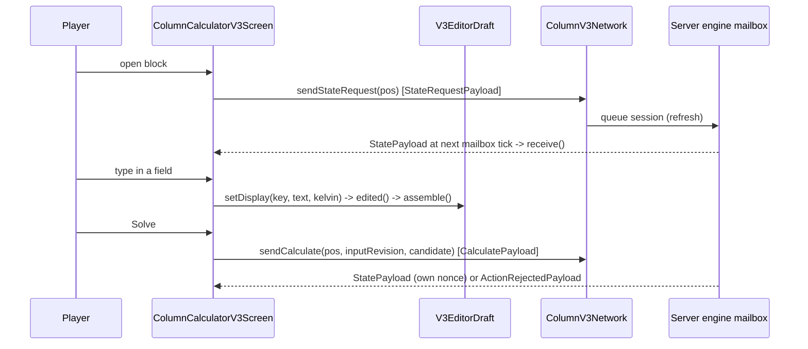
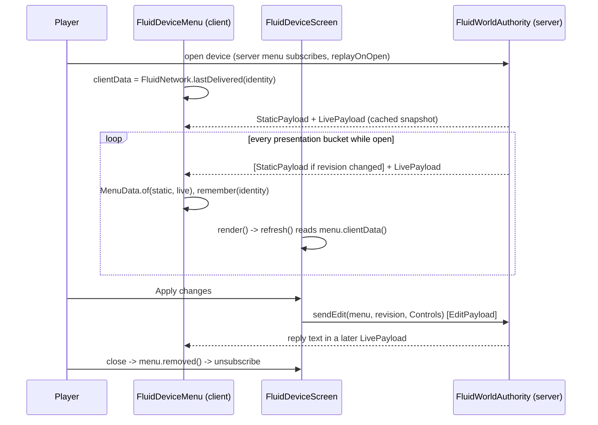

# Client GUI: screens, drafts, presets and the dev-client check

**Snapshot:** 1b31ddf3 (main, mod 0.16.1), 2026-10-27 · **Updated:** 2026-10-27 (stale persisted column results are hidden until a fresh solve)

**Creative tab (commit `188fba66`, 2026-10-27):** all registered IChemE items are listed in the mod creative tab; the mod no longer injects items into vanilla Functional Blocks. Since batch 2026-10-28-main-test-repair the tab is registered by `registry/ModCreativeTabs` (`MAIN`), not in `IChemE`'s static state: a registry needs Minecraft bootstrapped, and unit tests read `IChemE.LOGGER`.

**Process control (batch 2026-10-26-process-control, 0.14.1):** sensor rows and the Control Valve on the fluid screen; the contracts are in [process-control.md](process-control.md).

`FluidDeviceScreen` shows cached sensor rows with pressure/temperature units, signed kg/s and local m³/s, and raw level metres/height percent with explicit overrange. Bare Control Valve says “Lacking components”; pressure/flow modules enable the corresponding target and mass/volume basis. Accepted opening and regulation/limit/conflict/signal status accompany the process view. `MenuData`/`LiveData` carry readings and `ValveData`; registry item IDs retain `pressure_control_valve` while its visible name is Control Valve. `InstrumentRenderer` renders the cached blank housings/connectors and placement ghosts without requesting live sensor data.


**Feature branch:** `b1477c09` (`codex/liquid-gauge-accessory`), 2026-10-26, based on main `600549d9`. Floating-roof tank level gauge is an optional item/accessory;24 focused checks/package and8 native views pass. Main merge pending. [Contracts](../../2026-10-26-liquid-level-gauge-accessory/LEVEL_GAUGE_CONTRACTS.md).


**Snapshot:** dbefe7f4 (main, mod 0.15.3), 2026-10-27 · **Updated:** 2026-10-27 (batch 2026-10-27-constructor-import: the constructor's Import sends its draft and waits for the server's answer, `EquipmentConstructorScreen.answered`; a refusal on its status line) · earlier: 2026-10-27 (batch 2026-10-26-multi-machine-framework: the column screen's Components page and Save design, its dataset shown by label; the constructor's import-only column and its Nozzles page; the assembly screen, `AssemblyDiagram`, `PortColours` and the laying tool's assembly marks (`AssemblyToolClient`), see [machine-assemblies.md](machine-assemblies.md), and its port label's limit from the nozzle (`67343274`); the datasheet sent by the server; the `tia_juana_residue` mixture preset) · earlier: 2026-10-27 (batch 2026-10-26-process-control: sensor rows, the Control Valve's modules, opening and status on `FluidDeviceScreen`, `ValveData`, sensor housings and ghosts in `InstrumentRenderer`; no client change in the review fixes or the merge of main 0.14.0) · earlier: 2026-10-27 (batch 2026-10-26-pipe-laying-system: the pipe tools' settings screen with line paints, the shared `PaintSwatch`, `PipeLayingClient`, `PipeRackModel`, painted pipe and rack tints, transition pipes in `FluidDeviceModel`; the tool and racks are in [pipe-laying.md](pipe-laying.md)) · earlier: 2026-10-26 (batch 2026-10-26-backward-compat: the datasheet's "N cells blocked" line, counted on the client; a stale `MachineAnimation.toggle` trap removed) · earlier: 2026-10-26 (batch 2026-10-16-minecraft-mcp-mouse-input: the MCP lane pins the official bridge v0.4.18 with `mcp.background_input=true`, compat range `[0.4.18,0.5.0)`, `BackgroundCursorMixin`) · earlier: 2026-10-26 (batch 2026-10-26-air-cooler-chunk-rendering: the Moving parts switch stops parts without re-meshing a chunk; one layer set per shell cell) · earlier: 2026-10-25 (batch 2026-10-21-floating-roof-tanks: display units and phase bases on the fluid screen, power switch, gauge and pipeline-tool screens, world-space renderers for open tanks, sight glasses, gauges and mover sounds, glass layers and mover markings in the shell model, fitting models) · earlier: 2026-10-21 (0.11.1 test review; mod rename to IChemE, 0.11.0); 2026-10-20 (the equipment client)
Up: [code guide](README.md)

## Read this when

- You change what a player sees or types in the column calculator or in a fluid device screen (pump, valve, pipe, tank, generator, filter, void, compressor), a gauge's settings screen or the pipe tools' settings screen (the laying tool's ghost, marks and HUD are in [pipe-laying.md](pipe-laying.md)).
- You change a display unit (temperature, pressure, flow time basis) or the phase-ratio basis of the fluid screen.
- You change a world-space display: an open tank's roof, ladder and level glass, a sight glass's liquid and bubbles, a gauge dial, a constructed mover's sound or animation.
- You change the column screen's Components page, the constructor's Nozzles page, or a column's assembly screen ([machine-assemblies.md](machine-assemblies.md)).
- You change the equipment constructor's screen, a vessel or unit datasheet, the constructor's ghost, how shell cells, pipes or pipe fittings are meshed, or the moving parts of units.
- You add a GUI field, a unit, a tab, a preset file or a translation key.
- A screen shows a wrong number, loses typed text, or does not refresh after Apply or Solve.
- A fluid status line shows "outside data range" or "HELD (phases)", or the Solids tab lists a crystal such as "Carbon dioxide (solid)".
- You must verify GUI work in the dev client through the MCP bridge (AGENTS.md requires this).

## In one paragraph

The player right-clicks a block. Two screens exist. **Column Calculator V3** is a full-window process drawing. The player edits trays, feed, side draws, pumparounds and steam on the drawing, or edits the feed mixture on the Composition tab. **Solve** then sends one complete `V3ColumnInput`. The tabs show the accepted result: profiles, products, heat and diagnostics. **Fluid device** screens show what the engine last published for one device: its phases, its rail values, and its pipe connections or tank outlets. Their **Apply changes** button sends one bounded `Controls` record. In the code, every screen keeps the typed text in a widget-free draft class. A draft class parses text to SI units and builds the exact record that the button sends, so unit tests can pin the record without Minecraft. The screens never compute process state. They show what the server sent. Inputs go to the server as queued engine events, and the answer comes back on the engine schedule (about every 5 s of online time). The server side of the packets is described in [fluid-runtime.md](fluid-runtime.md) and [column-v3.md](column-v3.md).

The equipment client adds two more screens and the drawing of equipment. The **equipment constructor** screen is client-only and edits a local draft: the player picks what to build, sets its sizes, side connections and paint, and sees the vessel's ghost in the world; the design is sent when the screen closes, and with a build request on **Build**. Using a column or unit opens its **datasheet** (`VesselScreen`), built from the cells the client already has, so it requests nothing; a drum, tank, sphere or constructed mover shows the same datasheet as page 5 of its fluid screen. Shell cells, pipes and pipe fittings are drawn by two chunk models from their block entities' model data; units' fans, shafts and rods move on the client only. The server side and the shared geometry (`ShapeRasterizer`, `Mesh`, `LineGeometry`) are in [equipment.md](equipment.md).

Some things move in the world with the process: an open tank's roof and level glass, a sight glass's liquid and bubbles, a gauge's needle, a constructed mover's sound and moving parts. Their client renderers ask the server to **watch** the nearest ones (one request a second, at most 64 of each kind) and draw what the server publishes on its bucket. They never compute process state, and nothing is sent unasked ([fluid-runtime.md](fluid-runtime.md), flow (d)).

## Class map

All paths are under [`src/main/java/com/wormzjl/icheme/client/`](../../../src/main/java/com/wormzjl/icheme/client/).

| Class | Role | Read it for |
|---|---|---|
| **Entry** | | |
| [IChemEClient](../../../src/main/java/com/wormzjl/icheme/client/IChemEClient.java) | Registers the menu screens (column, fluid device, `gauge`, `pipeline_tool`, `assembly`); on logout clears the delivered-view cache and the caches of `TankRenderer`, `SightGlassRenderer` and `MoverSounds` | Where a new screen is registered |
| [EquipmentClient](../../../src/main/java/com/wormzjl/icheme/client/EquipmentClient.java) | Registers the `equipment_shell`, `fluid_device` and `pipe_rack` geometry loaders; tints a `fluid_pipe` quad by its line paint (tint index `STRUCTURE` the secondary, else the primary; -1 bare) and a `pipe_rack` quad by the paint of the lane whose option is the tint index >> 1 (channel: the index & 1); tints a shell quad by its `Paint` channel (`Paint.tint`, default paint while unbound); replaces the per-cell outline with the vessel's silhouette (`ShapeRasterizer.outline` from the camera); `openConstructor`, called by the constructor block on the client; `openVessel` (the datasheet), sent by the server (`assembly_datasheet`, [machine-assemblies.md](machine-assemblies.md)) | Where the equipment client hooks in |
| **Shared widgets and helpers (`gui/common`)** | | |
| [ProcessUi](../../../src/main/java/com/wormzjl/icheme/client/gui/common/ProcessUi.java) | Palette, `number`/`pressure` formatting, table rows, `button`, cursor recovery, key priority of text fields; `materialName` (translates a server `MaterialName`, adds an NBP range for petroleum fractions); nested `Label`, `TemperatureUnit` (Celsius/Kelvin display, a `DisplayUnit`; the wire is always kelvin), `NumericDraft` (short text over an exact SI double in a `DisplayUnit`; untouched text returns the exact SI bits across any number of unit changes, `in(unit)`, `si()`) and `ProcessScroll` (draggable row scrollbar); `pressure` prints through `PressureUnit.KILOPASCAL` | Colours, number format, keyboard traps, component labels, unit toggle, fluid numeric fields |
| [`science/display/DisplayUnit`](../../../src/main/java/com/wormzjl/icheme/science/display/DisplayUnit.java) (outside `client/`) | Interface `display`/`si`; nested `PressureUnit` (Pa, kPa, bar, MPa with 1, 4, 6, 7 decimals: every unit keeps the 0.1 Pa resolution) and `FlowRateUnit` (per second, per hour) | Unit conversion for the fluid and gauge screens |
| [ComponentDropdown](../../../src/main/java/com/wormzjl/icheme/client/gui/common/ComponentDropdown.java) | Search `EditBox` with an overlay match list (max 6 rows, z = 500) | Adding a component to a mixture |
| [ComponentSearch](../../../src/main/java/com/wormzjl/icheme/client/gui/common/ComponentSearch.java) | Deterministic ranking: exact, prefix, substring, subsequence, typo distance | Search order |
| [RelativeComposition](../../../src/main/java/com/wormzjl/icheme/client/gui/common/RelativeComposition.java) | Relative amounts per component, mole or mass basis, full precision until edited | Composition maths, basis toggle |
| [ColumnDiagram](../../../src/main/java/com/wormzjl/icheme/client/gui/common/ColumnDiagram.java) | The column schematic shared by the column calculator and the equipment constructor: a 49-pixel shell (`HALF` 24) with rounded heads, a line per tray, feed, draw, pumparound and steam marks (`MARK` 26); each screen maps trays to heights and adds its own labels | Changing the drawing of a column in either screen |
| [PaintSwatch](../../../src/main/java/com/wormzjl/icheme/client/gui/common/PaintSwatch.java) | One palette swatch button (`WIDTH` 19, `HEIGHT` 16, `GAP` 4), outlined white while its colour is the one being edited; shared by the equipment constructor's `PAINT` page and the pipe tools' settings | A colour picker |
| **Column calculator (`gui/screens/inventory`)** | | |
| [ColumnCalculatorV3Screen](../../../src/main/java/com/wormzjl/icheme/client/gui/screens/inventory/ColumnCalculatorV3Screen.java) | 5 tabs (the fifth `components`), drawing canvas, presets pane, Solve, conflict buttons; Save design (`ColumnV3Network.sendSaveDesign`) with the component choices; nested `DiagramLayout` (tray pitch of the drawing, minimum 3 GUI px) | Everything the column player sees; drawing scale |
| [V3EditorDraft](../../../src/main/java/com/wormzjl/icheme/client/gui/screens/inventory/V3EditorDraft.java) | Keyed text fields (`s0..s9`, `d*`, `t*`, `c*`), exact values, `assemble()`; nested row parsers, see below | What Solve sends |
| `V3EditorDraft.ColumnInputDraft` | Builds one `V3ColumnInput` from the row parsers; rescales the server feed vector | Assembly order, error prefixes |
| `V3EditorDraft.ColumnScalarDraft` | Parses the ten scalar fields to SI units with field-specific messages | Units and ranges |
| `V3EditorDraft.SideDrawDraft` | Side-draw rows: blank or zero rate = off; total below feed | Draw rules |
| `V3EditorDraft.SteamFeedDraft` | Sump/tray steam rows; total not above feed | Steam rules |
| `V3EditorDraft.PumparoundDraft` | Cooler rows; the only place where positive MW of cooling becomes negative W | Sign convention |
| [V3CompositionDraft](../../../src/main/java/com/wormzjl/icheme/client/gui/screens/inventory/V3CompositionDraft.java) | Binds a `RelativeComposition` to the source `V3ColumnInput` | Mixture identity |
| [V3ClientPresets](../../../src/main/java/com/wormzjl/icheme/client/gui/screens/inventory/V3ClientPresets.java) | Bundled and custom JSON preset libraries (column and mixture); `Mixture` carries an optional `SlurryFeed solids` (`solids(o)` reads it) | Preset file format |
| **Fluid devices** | | |
| [FluidDeviceScreen](../../../src/main/java/com/wormzjl/icheme/client/gui/screens/inventory/FluidDeviceScreen.java) | One screen for every fluid device kind: rail, phase tables, composition, solids, connections, outlets; the rail blocks `renderPhaseRatio` and `renderStatus` are shared by pipe and tank; `loadMixture` loads a generator mixture choice; the Solids tab draws `shownSolids()`, one row per solid at its mean size (`SolidInventory.oneSizePerSolid`); `solidName` names a crystal after its component (key `crystal_name`, "%s (solid)"); `statusText` keeps a data-range notice after the status words; `readings()` lists the rail values; the power switch for a generator or a constructed mover (`switchable`); session preferences for temperature, pressure and flow-time units, component basis and phase-ratio basis; nested `FluidGuiLayout` (`tabs`, `footer`: control slots that fit every width from 300 px) and `PhaseRatioBasis` (VOLUME, MOLAR, MASS from the cached phase volumes, moles and solids; molar counts only crystals) | Everything the fluid player sees |
| [GaugeScreen](../../../src/main/java/com/wormzjl/icheme/client/gui/screens/inventory/GaugeScreen.java) | A gauge item's settings (kind, endpoints, unit, gauge or absolute reference) through `NumericDraft`; Save sends `FluidNetwork.GaugeSave` ([instrument-accessories.md](instrument-accessories.md)) | Gauge settings editing |
| [PipelineToolScreen](../../../src/main/java/com/wormzjl/icheme/client/gui/screens/inventory/PipelineToolScreen.java) | Both pipe tools' settings (`PipelineToolMenu`): the target bore; for the laying tool (`menu.paints()`) also the line's two paints: Primary (pipe) and Secondary (flanges) channel buttons, the 16-swatch palette (`PaintSwatch`), a custom #RRGGBB field and Bare steel; panel height 270, else 136; Save sends `PipelineToolSave(menuId, diameter, paint, secondary)` | Pipe sizing and laying tool settings |
| **World-space displays (root `client/`)** | | |
| [TankRenderer](../../../src/main/java/com/wormzjl/icheme/client/TankRenderer.java) | An open tank's roof (floats on the liquid), rolling ladder (rests on the roof) and level glass (free water and hydrocarbon bands, red float collar) from its `TankDisplay.Glide`; once a second watches the tanks within `WATCH_RANGE` (128 − 8 blocks), nearest first; draws within 192 blocks; a tank with no display shows its roof on its legs and an empty glass; GPU buffers as `MachineAnimation` (at most 64); `renderGlass` at `AFTER_BLOCK_ENTITIES` | Roof and gauge drawing |
| [SightGlassRenderer](../../../src/main/java/com/wormzjl/icheme/client/SightGlassRenderer.java) | A watched sight glass's liquid colour and moving bubble rings (count from the published gas share, travel along the published flow direction) within 120 m; metal and glass stay chunk-baked; no direction or no liquid draws no rings | Sight glass drawing |
| [InstrumentRenderer](../../../src/main/java/com/wormzjl/icheme/client/InstrumentRenderer.java) | Gauge dials, placement ghosts and the one-line hover; watches the nearest 64 gauges within 120 m ([instrument-accessories.md](instrument-accessories.md)) | Gauge drawing |
| [MoverSounds](../../../src/main/java/com/wormzjl/icheme/client/MoverSounds.java) | Watches constructed movers within `MOVER_RANGE` − 8 (88 blocks); plays the `pump_running` or `compressor_running` loop (`sounds.json`) within 24 m while the published state runs; gain `UnitDesign.soundGain` of the shape (0.10 to 0.60); `running(shell)` tells `MachineAnimation` whether a mover turns | Mover sound; why a pump's shaft stands still |
| [PipeLayingClient](../../../src/main/java/com/wormzjl/icheme/client/PipeLayingClient.java) | The pipe laying tool on the client: one command per press of the use key, the aimed rack slot, the route search and its translucent ghost, the HUD, the outlines and the port, open-end and free-slot marks ([pipe-laying.md](pipe-laying.md)); port colours from `PortColours`; each tick it tells `AssemblyToolClient.watch` whether the tool is held, frames a watched assembly's port (`AssemblyToolClient.frame`) and appends its line to the port label; the label's "fits up to" is the nozzle's own largest bore, rounded down to the centimetre (`EquipmentShellBlockEntity.largestBore`, `NozzleBore`) | The laying tool |
| [AssemblyScreen](../../../src/main/java/com/wormzjl/icheme/client/gui/screens/inventory/AssemblyScreen.java), [AssemblyDiagram](../../../src/main/java/com/wormzjl/icheme/client/gui/common/AssemblyDiagram.java), [AssemblyToolClient](../../../src/main/java/com/wormzjl/icheme/client/AssemblyToolClient.java), [PortColours](../../../src/main/java/com/wormzjl/icheme/client/PortColours.java) | A column's assembly screen (process drawing, parts list, Validate, Open unit, Datasheet), its Minecraft-free drawing model, the laying tool's assembly marks, the port-class colours | [machine-assemblies.md](machine-assemblies.md) |
| **Equipment (`gui/screens`, root `client/`, `model/`)** | | |
| [EquipmentConstructorScreen](../../../src/main/java/com/wormzjl/icheme/client/gui/screens/EquipmentConstructorScreen.java) | Pages `CHOOSE` (5 groups, 27 choices: vessels incl. `FLOATING_ROOF_TANK` and `SPHERE`, heat, machines, reactors, solid fuel), `DESIGN` (sizes from the kind's `UnitDesign` rows, placement offsets; a column's diameter, trays and feed are the import's, shown, not edited, with its `ColumnDiagram` strip, Import and a Nozzles button beside Change), `CONNECTIONS` (a drum's side connections, boot, the first clash), `NOZZLES` (a column's side nozzles one at a time: where it stands, a Faces button cycling automatic, front, left, back, right, and All auto), `PAINT` (body/structure, 16 swatches, custom #RRGGBB, default); `removed()` sends a changed design; Build sends it with `build = true` and is active only when the design builds (an imported column, no clash, no unplaced side nozzle) | What a constructor player sees and sends |
| [VesselScreen](../../../src/main/java/com/wormzjl/icheme/client/gui/screens/VesselScreen.java) | A column's or unit's datasheet from the client's cells; static `datasheet(vessel)` (kind, sizes, volume, area, cells, controller, each nozzle's role, port, facing and widest neck; a designed shape's lines (unit, tank, sphere) from `UnitDesign.of(kind).datasheet`); after the cell counts, while layout cells hold no part of the vessel on the client (a shell position without a shell cell of the vessel's origin, an interior position without an interior block), "N cells blocked by other blocks: clear them, then reload the world" (`gui.icheme.vessel.blocked`, private `blocked`: a refresh left them out, [equipment.md](equipment.md)); a moving unit's motion switch | Datasheet lines; the blocked-cells line; the motion switch |
| [EquipmentGhost](../../../src/main/java/com/wormzjl/icheme/client/EquipmentGhost.java) | Translucent ghost of every loaded constructor's design within `RANGE` 48 until its vessel stands, the open screen's draft instead of its own; blocked cells of the focused ghost outlined red (Catnip `Outliner`), rechecked every 10 ticks; drawn as `entityTranslucentCull` on the block atlas so it survives Iris | Ghost visibility, blocked cells |
| [MachineAnimation](../../../src/main/java/com/wormzjl/icheme/client/MachineAnimation.java) | Draws units' moving parts (`ShapeRasterizer.moving`) within `RANGE` 96 once a frame after solid blocks, turned or slid by `ProcessUnit.Motion` at `gameTime mod MOTION_PERIOD`, each unit from its own phase; a constructed mover turns only while `MoverSounds.running` (its published state), other units always; while `running()` is off (the datasheet switch, `toggle()`) every part stands at rest as a stopped mover's, and no chunk is re-meshed; one GPU buffer per unit, part and light (at most 256); on by default, not saved | Moving fans, shafts, rods; FPS |
| [model/EquipmentShellModel](../../../src/main/java/com/wormzjl/icheme/client/model/EquipmentShellModel.java) | Chunk-meshed shell cell: quads per `CellKey` from `ShapeRasterizer.fixedSurface`, moving parts left out for `MachineAnimation` (cache 4096, rebuilt on resource reload), smooth normals, no AO, directional shade and the metallic sheen (`IChemE.equipmentSheen`) baked into vertex colours; painted materials carry their paint channel as tint index; nested `Layers(solid, glass, all)`, one per cell: `Mesh.Material.GLASS` quads (the tank gauge's sleeve, sprite `icheme:block/gauge_glass`) go to the translucent pass, and only cells holding glass ask for it; every kind's nozzle flow arrows (`PortMarkings.surface`) are baked into the solid list; no model data = empty; shared with the pipe and rack models: `bake` with a tint function, `paintedLines` (the line sprites with neutral `painted_pipe` and `painted_flange` for each painted mask), `painted(paint, secondary)` (the mask), `lineTints(painted, base)` (tint index base + channel) | Shell look, sheen, glass, mover arrows; line paints |
| [model/FluidDeviceModel](../../../src/main/java/com/wormzjl/icheme/client/model/FluidDeviceModel.java) | Chunk-meshed pipe or pipe fitting: key = block state plus `FluidDeviceBlockEntity.Drawn` (bore, line met at each face, flanged faces, spool end) plus a `Look` (sight-glass key, `Shutoff`, pressure valve, filter, inline mover kind, the line's painted mask); a transition pipe's `Drawn.offsets` go into its `LineGeometry.Key`; polygons from `LineGeometry` and the fitting geometries ([equipment.md](equipment.md)); a sight glass asks for the translucent pass; cache 4096; item form `LineGeometry.Key.item` | Pipe, reducer, flange and fitting models |
| [model/PipeRackModel](../../../src/main/java/com/wormzjl/icheme/client/model/PipeRackModel.java) | Chunk-meshed pipe rack cell: the frame (untinted) and each lane on painted sprites, tint index 2 × option + channel; key `Look(rack, lanes, painted, spools)`, cache 4096; loader `icheme:pipe_rack` ([pipe-laying.md](pipe-laying.md)) | Rack drawing |
| **Dev-client lane (not shipped)** | | |
| [McpCompatibilityMod + mixins](../../../src/mcpCompat/java/com/wormzjl/icheme/mcpcompat/) | Routes the bridge's click, type, paste and Ctrl+A to the focused widget; requires `mcpmod` `[0.4.18,0.5.0)` (`neoforge.mods.toml`); `WindowHandleMixin` hands the bridge the window's own GLFW handle; `BackgroundCursorMixin` skips vanilla's cursor grab and release while the window is in the background | Why `runMcpClient` can type into fields |

Client-side packet entry points live in server-owned classes: `ColumnV3Network.sendStateRequest / sendCalculate / sendSaveDesign / setClientStateConsumer / setClientRejectionConsumer`, the assembly payloads of `AssemblyNetwork` ([machine-assemblies.md](machine-assemblies.md)), `FluidNetwork.sendEdit / recoverSolids / remember / lastDelivered / forgetDelivered`, and `FluidDeviceMenu.acceptStatic / acceptLive` (in `network/` and `world/inventory/`). `FluidNetwork.MenuData`, built by `acceptLive`, also refuses a view that holds a crystal made of a component off the menu's axis (`requireCrystalAxis`). Equipment: `EquipmentNetwork.send(position, design, action)` (`KEEP`, `BUILD` or `IMPORT`; a build's reply is a chat message) and `EquipmentConstructorScreen.answered` for an import's answer (the imported design, or why there is none). World-space displays: `FluidNetwork.requestTanks`, `request(kind, watch, unwatch)` (sight glasses, movers) and `requestInstruments`, and the renderers' `accept` methods for the replies. Pipe tools: `FluidNetwork.savePipelineTool(menuId, diameter, paint, secondary)`, `openPipeLaying`, `layPipe`, `dismantlePipe`, and `PipeLayingClient.answered` for the lay's reply ([pipe-laying.md](pipe-laying.md)).

## Main flow



1. `init()` sizes the panel to the window, makes the preset library, installs the screen as the static state and rejection consumer of `ColumnV3Network`, and sends a state request. Until the first state arrives, the status line reads "Waiting for the engine". The request is queued in `ColumnPresentation`; the engine mailbox answers it. The packet handler does not answer it.
2. `receive()` drops states for another block and states older than the current `stateRevision`. It replaces the draft when there is no draft, when the state carries this screen's pending nonce, or when the draft is clean. If the player has a dirty draft and the server input changed, `conflict` is set. The **Use server** and **Keep draft** buttons then appear, and Solve stays disabled.
3. Each keystroke goes to `V3EditorDraft.setDisplay`. A Kelvin entry is converted to Celsius once. `edited()` sets `invalidated`, which hides the old result, and `validate()` runs `draft.assemble()`. Any `IllegalArgumentException` becomes a translated status line (`invalid_steam`, `invalid_draw`, `invalid_mixture`, `invalid_pa` or `invalid_input`). Tray-count and tray-position fields set `needsRebuild`, and `containerTick` rebuilds the drawing on the next tick.
4. **Solve** sends the candidate with the server's `inputRevision` and stores the returned nonce. A rejection with the same nonce shows `request_rejected`. A state with the same nonce replaces the draft. When the status is no longer `CALCULATING`, `invalidated` is cleared and the result tabs show the inspection.
5. `onClose()` resets both static consumers to no-ops. The server session ends by itself when the menu is no longer valid.



1. On the server, the `FluidDeviceMenu` constructor subscribes the menu to its device's presentation bucket. `FluidDeviceBlockEntity` then calls `world.replayOnOpen(menu)`, which replays the cached snapshot. No solver runs.
2. The client menu constructor starts with `FluidNetwork.lastDelivered(identity)`, the view this session last received for the device (LRU of 32). If the client has no remembered view and no snapshot has arrived, the screen draws `waiting` ("Waiting for the next simulation update.").
3. `acceptStatic` stores the static part (kind, component axis, presets, names, molecular weights). `acceptLive` joins it with the live part (view, controls, reply) and validates the result (including the crystal-axis check). A live payload that arrives before any static payload is ignored.
4. The screen calls `refresh()` on every frame. Drafts are reloaded from `controls` only when `view.inputRevision()` changes. A new reply message is detected by `messageRevision`.
5. **Apply** builds `FluidNetwork.Controls` and sends it with the revision. **Recover solids** (filter only) sends a `RecoverPayload`. The status line then shows `waiting`. The engine's reply ("Queued for simulation event at tick N", "Applied" or "Not applied: ...") arrives with a later bucket.
6. Closing calls `removed()`, which unsubscribes the menu. Logging out clears the delivered-view cache, because device identities belong to a world.

```mermaid
sequenceDiagram
    participant P as Player
    participant S as EquipmentConstructorScreen
    participant G as EquipmentGhost
    participant N as EquipmentNetwork (server)
    P->>S: use constructor (client only: EquipmentClient.openConstructor)
    loop every client tick
        G->>S: vessel() of the draft; ghost + blocked cells
    end
    P->>S: Build
    S->>N: ConstructorPayload(design, build=true)
    N-->>P: chat: built / blocked / clash / invalid
    P->>S: close -> removed(): ConstructorPayload(design, false) if changed
```

1. The constructor block opens the screen on the client; the server hears nothing until a save or a build.
2. The screen opens on `CHOOSE`; a choice moves to `DESIGN`. The draft's vessel (`constructor.vessel(design())`) drives the ghost and the status line (`EquipmentGhost.blockedCount()`).
3. **Build** sends the design and closes the screen. The server validates, checks clashes and cells, places the vessel and answers in chat. Shell cells arrive as block updates with their update tags; the models mesh them.
4. **Import** sends the draft with `IMPORT` and shows "Importing…" until the server's `ImportAnswer`: the screen then loads the answered design whole (the message to chat), or shows why there is none on its status line until the next edit.
5. Using a column or unit cell opens `VesselScreen` on the client (no packet). Using a drum, tank, sphere or constructed mover opens its fluid menu on the server (`FluidDeviceMenu`, replayed snapshot), with the datasheet on page 5.

<details><summary>Pages and tabs of each screen</summary>

**Column calculator.** The top row has five tabs: `overview`, `composition`, `results`, `diagnostics`, `components`. The bottom row has **Solve**, a status line, a hint, and a C/K toggle.

- *Overview*: buttons for column templates, save column, connections, mixture templates, and (narrow layout only) drawing/information. The drawing is a vessel with one line per tray. When a result is accepted, each tray line is coloured by temperature. The canvas carries editable fields: tray count `s2`, diameter `s9`, top temperature `s4`, reflux `s6`, top pressure `s7`, feed flow `s0`, feed temperature `s1`, feed tray `s3` and reboiler duty `s5`. Clickable icons select a draw (`D`), a pumparound (`PA`, which can switch between uniform and return-tray heat) or a steam feed, and open its fields. **Connections** adds a draw, a PA or steam. A *solver info* column and a *tray info* column sit to the right. Up/Down keys move the selected tray.
- *Composition*: a component dropdown, one relative-amount box per row, mole%/mass%, the feed rate on the toggled basis and, on a panel at least 660 wide (`bothRates()`), the rate on the other basis too (`amountX` then moves 96 px left), and template/save/clear buttons.
- *Results*: three sub-tabs. *Profiles* cycles temperature, pressure, pressure drop and traffic (4 series); a click on the plot selects that tray in the Overview. *Products* cycles product streams; the header line gives the stream's kmol/h and kg/h, and the table shows Mol %, Mass %, Flow (kmol/h) and Flow (kg/h) per component (independent of the basis toggle). *Heat* is the signed duty ledger in MW.
- *Diagnostics*: status, Newton iterations, residual, closure, audit checks, the dataset (`MaterialCatalog.Package.label` of the composed identity) and formulation revisions, input digest, and **Copy report** to the clipboard.
- *Components*: a choice button per row (condenser, reflux pump, one per pumparound pump; a click cycles the kind), **Save design**, and the rows the design's numbers decide (ejector, kettle) and the fixed ones (receiver, reflux line, valves). The save state beside Save design reads `design_not_saved` (with `ColumnDesign.of`'s reason, or the server's after `NOT_SAVED: `), `design_saved`, `design_ready`, then `design_differs` or `design_none` below; `design_saving` while the request waits. The choices come from the saved design until the player edits them; the acknowledgement keeps the draft.
- The freshness label at top right reads `accepted`, `draft_cleared` or `no_result`. It is set from `invalidated`/`conflict`. The screen hides the result whenever `invalidated || conflict` is set. There is no "retained result" pill: `V3ResultProvenance` was removed on 2026-10-15, because the block entity keeps no retained result (`tryBegin` clears it).

**Fluid device.** The top shows the title and one status line (`statusText`, warning colour on `HELD`/`ERROR`). The left rail lists the operating fields for the device kind, then its readings (`readings()`): power state for a generator or constructed mover; for a tank temperature, top and bottom absolute pressure, volume as current / capacity litres (known even while empty), fill and mass; for other devices temperature and pressure (suction pressure for a mover, inlet pressure for a valve); then throughput (net flow for a tank), a pipe's velocity and pressure-gradient ranges, a filter's load and captured mass, the device's Δp and a compressor's ratio. Every kind ends the rail with two shared blocks: `renderPhaseRatio` (a bar of organic, aqueous, vapor and solid shares with a `phase_short.*` legend in %, on the `PhaseRatioBasis` the button above it selects; a pipe, actuator or filter shows what it carried over the last interval, a void what it received, a tank what it holds, a generator its configured feed; in MOLAR the fourth share counts only crystals, and a custom solid is reported as excluded) and `renderStatus` ("Status / errors", key `pipe_status`: every line of `statusText(status)`, hover shows the raw engine status; a pipe prefixes `reversed_interval` when its flow reversed). The footer holds Close, Apply and four display toggles: component basis (mole or mass), temperature unit, pressure unit (Pa, kPa, bar, MPa) and flow time basis (/s or /h). The toggles are session preferences; they convert the drafts and the shown values and send nothing. `statusText` first cuts a data-range notice from the end of the status (`DataRangeNotices.suffix`, marker `"; outside data range: "`), words the rest, and appends the notice unchanged. Example: "Ready.; outside data range: Methane liquid viscosity extrapolated below 90.69 K at node 7 (+2 more)". The server adds the notice: an accepted interval's status is `FULL` plus the notice, a steady status is `STEADY: …` plus the notice (`IslandCoordinator`); an open tank's island also carries `; venting …` or `; spilling …`. `statusText` passes `HELD`, `ERROR`, `WAITING`, `closed` and `UNBOUND` statuses through, so a pump's `ERROR: …` condition (`PipePresentation.pumpStatus`) shows in the warning colour. A phase hold reads "HELD (phases): …" (`ProcessSolveServices.PHASE_HOLD`) and passes through as `HELD`. "STEADY: no flow" reads `no_flow` ("No flow."), every other `STEADY:` status reads `flowing` ("Flowing normally."), and `FULL` or `READY` reads `ready` ("Ready."). A pipe's status reports no velocity limit. The table area depends on the page:

| Page | Shown for | Content |
|---|---|---|
| 0 Overview | all | phase tabs Organic phase / Aqueous phase / Vapor / Solids (`fluid.phase.*`). The fluid tabs show the component table: percentage on the toggled basis, then kmol and kg side by side (kmol/h and kg/h when the view has pipe info: pipe, filter). Molecular weights are kg/mol, so mol × weight is kg. The Solids tab shows Solid / Mean size (µm) / Mass (kg) (keys `solid`, `mean_size`, `mass_kg`), one row per solid at its mean size; arrivals since the stock's last refresh are merged as that refresh merges them (owner decision D23). A crystal reads "<component> (solid)" and its hover shows that name, the material id and `crystal.hint`; a custom solid shows its material id |
| 1 Composition | editable generator | mixture editor, server presets plus client mixture library; every choice goes through `loadMixture`, which loads the composition and the preset's solids (`SlurryFeed.NONE` clears the solid rows) |
| 2 Solids | editable generator | solid fraction (vol %) plus up to 64 rows: material ID, size (µm), mass share (headers `solid_col.0..2`) |
| 3 Connections | pipe with more than one connection | per-connection flow, speed and Pa/m |
| 4 Outlets ("Connections by face") | tank | per-outlet port, face, what it draws, flow |
| 5 Datasheet | a drum, tank, sphere or constructed mover (`EquipmentStructure.find` finds a vessel at the menu position) | `VesselScreen.datasheet` lines (the blocked-cells line included), one per row, scrolled; button `datasheet`; absent for a one-block device |

Rail fields by kind: generator p, T and its power switch; pump flow and maximum added pressure; compressor flow and pressure ratio (1.01..10, checked on the client too); a constructed mover's power switch; pressure valve and void p; pipe diameter; filter shows a recover button. An inline pump, compressor, pressure valve or filter on a pipe opens this screen with its own title and the mover's, valve's or filter's fields; a plain pipe opens it only with the debugger. Tanks and filters have no **Apply**. A probe menu (`menu.debug()`) is read-only.
</details>

<details><summary>Draft parsing and units</summary>

| Column key | Displayed unit | Sent as |
|---|---|---|
| `s0` feed flow | kmol/h | mol/s (÷3.6), rescaling the server component vector |
| `s1`, `s4`, `t*T` | °C (or K when toggled) | K |
| `s2` tray count | total trays incl. condenser and reboiler | `stageCount = s2 − 2` |
| `s3`, `d*stage`, `t*stage`, `c*draw/return` | public tray number (1 = condenser) | internal number − 1 |
| `s5` reboiler duty | MW | W |
| `s6` reflux | ratio | ratio |
| `s7` top pressure | bar | Pa |
| `s8` stage Δp | kPa | Pa; canvas field `pressure_drop` beside top pressure (at diameter 0 the uniform profile, at a positive diameter the hydraulics' first guess) |
| `s9` diameter | m (0 = prescribed Δp; > 0 = tray hydraulics) | m |
| `c*duty` | positive MW of cooling | negative W (`V3EditorDraft.PumparoundDraft`) |

- `V3EditorDraft` stores one-decimal text plus the exact value. `assemble()` returns `base` unchanged when nothing is dirty, and it keeps the base value of every unchanged field (`unchanged(key)`), so display rounding never reaches the solver. For the Holland 3-2 package, a result equal to the fixed benchmark within 16 ulp snaps back to `V3HollandExample32.input()`.
- Steam on the bottom tray follows the tray count (`steamAtBottom`). Interior steam stays on its tray.
- `ProcessUi.NumericDraft` (fluid screen) works the same way: untouched text returns the exact server value. Values below 1 display with 4 significant digits.
- `RelativeComposition` normalises on use: amounts need not sum to 100. The basis toggle converts the amounts through the molecular weights and keeps the physical mixture.
</details>

<details><summary>Shared widgets</summary>

- **ComponentDropdown** is an `EditBox` plus an arrow. Its list is drawn by `renderSuggestions` after all widgets, so it overlays tables. Each screen must route `popupClick / popupScroll / popupDrag / popupRelease` before its own handling, as both screens do. Typing does not rebuild the screen.
- **ComponentSearch** normalises NFKD, lower case and punctuation. Score bands: 0 exact, 10+ prefix, 40+ substring, 60+ typo (Damerau distance; 1 for 3 to 5 letters, 2 for 6 letters and more), 70+ subsequence. Empty query = catalogue order.
- **ProcessUi.textKeyPressed**: a focused text field consumes every key except Escape and Tab, so typing "e" does not open the inventory.
- **ProcessUi.restoreCursor** runs every frame and releases a grabbed mouse.
- **ProcessUi.pressure** rounds to 0.1 Pa (decision D42) and prints kPa with 4 decimals (`PressureUnit.KILOPASCAL.format`). Only the text is rounded.
</details>

<details><summary>Presets (client JSON libraries)</summary>

- Bundled presets: `assets/icheme/{columnpreset,mixturepreset}/index.json` lists the file names. At this snapshot: 8 column presets (`pot`, `holland_3_2` and six crudes) and 9 mixture presets, among them `tia_juana_residue.json` (a vacuum unit's feed on `icheme:tjl20_methane`: 95 mol % `crude_pc08` to `crude_pc12` in the Tia Juana crude's proportions, with a 5 % `crude_pc07` gas-oil tail) and `tia_juana_nitrogen.json` ("Tia Juana Light + 2 % nitrogen", package `icheme:tjl20_methane_nitrogen`, Nitrogen amount 2.0 on a mole basis).
- Custom presets: `<gameDir>/CreateChemE/{columnpreset,mixturepreset}/*.json`. The limits are 256 files and 64 KiB per file. A file is read only when the player presses Refresh or opens the library. Saving uses `CREATE_NEW` and adds `_1`, `_2` and so on, so a save never overwrites an existing file. Neither files nor paths cross the wire.
- Column schema (`schema_version` 2, `kind` "column"; a schema 1 file is refused): `name`, `translation_key`, `tray_count` (2..66), `feed_tray`, `feed_flow_kmol_h`, `feed_temperature_kelvin`, `top_temperature_kelvin`, `reboiler_duty_mw`, `reflux_ratio`, `top_pressure_bar`, `stage_pressure_drop_kpa` (≥ 0), `diameter_m`, `draws` (max `V3ColumnInput.MAX_SIDE_DRAWS` = 4: `tray`, `flow_kmol_h`), `steam` (max 2: `tray`, `flow_kmol_h`, `temperature_kelvin`), `pumparounds` (max 4: `draw_tray`, `return_tray`, `cooling_mw`, `split` `UNIFORM`/`RETURN_TRAY`). Every key is required; mixture presets stay at schema 1.
- Mixture schema (`kind` "mixture", `schema_version` 1): `package`, `basis` (`mole`/`mass`), `components` (max 64: `id`, `amount`), optional `solids` object `{volume_fraction_percent, grades: [{material, diameter_um, mass_share}]}` (at most 64 grades; absent = `SlurryFeed.NONE`; the `SlurryFeed` record checks the ranges). The fluid generator loads the solids; the column screen ignores them.
- A mixture loads into the column only if the editor catalog has a template on its package (a visible server column preset); otherwise the screen shows `preset_incompatible`. The server preset `tia_juana_nitrogen` exists so that the `tia_juana_nitrogen` mixture loads.
- A broken file becomes a `Problem` and the other entries still load. The column screen shows `preset_errors` with the first bad file. The fluid generator lists server presets first, then client mixtures whose component IDs all exist on the network axis.
</details>

<details><summary>Layout scaling</summary>

- The column screen fills the window minus 16 px (minimum 180×140). Below a panel width of 710 the layout is *narrow*: the drawing and the information columns alternate behind one button. The tray pitch is `max(3, max(96, viewport − 131) / (trays + 1))`. Small windows scroll the canvas; trays never get smaller than 3 GUI px. The skill advises GUI scale 1 at a 560×300 window for a full capture.
- The fluid screen width is clamped to 300..790 and its height is at least 250. Rail width = `min(210, width / 3)`. The rail scrolls in 10 px steps when its content is too long (at 427×240 GUI px, a pump or compressor rail does not fit). The tabs and the six footer controls take their slots from `FluidDeviceScreen.FluidGuiLayout`: each control shrinks from its natural to its minimum width, so all fit from 300 px.
- `-PmcpClientWidth/-PmcpClientHeight` (3 or 4 digits each, default 854×480) sets the window size of `runMcpClient` without desktop input.
</details>

<details><summary>Equipment drawing on the client</summary>

- Shell cells are drawn in the chunk mesh (`RenderType.solid()`), never by a block-entity renderer. The quads of one key are built once; body cells share a key per texture class, so a tall column costs a few keys per box column.
- A painted quad's tint index is its `Paint` channel (`BODY` 0, `STRUCTURE` 1); `EquipmentClient` scales the cell's colour by 255/236 so the neutral sprite shows the paint itself. Pipes, flanges, gratings, handrails, motors and actuators keep their own colours.
- The selection box of any shell or interior cell is replaced by the whole vessel's outline: its silhouette meridians from the camera, plus fixed edges (base ring, decks, saddles, flange faces).
- The shell model always leaves moving facets out of the chunk mesh; `MachineAnimation` draws them per frame, at rest while a mover is stopped or the switch on a moving unit's datasheet is off. The switch re-meshes no chunk (before 0.12.3 it called `levelRenderer.allChanged`, the F3+A reload).
- The ghost uses the painted plate sprite in the design's body colour (other parts light grey, alpha 128).
- Under Distant Horizons (no model data) a shell cell's model is empty and the particle sprite gives its colour; interior cells give the solid voxel.
- Pipes take their drawn geometry from `FluidDeviceBlockEntity`'s update tag (`Bore`, `Faces`), a transition pipe's `Offsets` and a laid line's `Paint` and `Secondary`; a late data packet re-requests the model data and rebuilds the section (`onDataPacket`). A fitting is part of the pipe's blockstate, so installing, toggling or removing one re-meshes the section; a committed check-valve reversal or shutoff toggle reaches the model only when the engine applies it.
- A laid line's pipe and flanges take its two paints through the block tint, so a pipe or rack model bakes once per painted mask, not per colour (`EquipmentShellModel.lineTints`); bare steel draws on the old sprites. A rack cell is drawn by `PipeRackModel` ([pipe-laying.md](pipe-laying.md)).
- Glass on equipment (the open tank's level gauge sleeve) is chunk-baked in the translucent pass; the liquid bands behind it are drawn by `TankRenderer.renderGlass` after block entities. A sight glass's metal and glass are chunk-baked; `SightGlassRenderer` adds only the liquid and the bubble rings.
- Every kind's IN and OUT nozzle necks carry flow arrows, paint baked with the shell (`PortMarkings`, since 0.15.0; before it only a constructed mover's, `MoverPortMarkings`); no renderer draws them.
</details>

<details><summary>Traps</summary>

- `rebuild()` clears every widget. It restores focus and cursor by editor key, and it keeps the dropdown expanded only for the key `search`. A new widget must be registered in `editors` under a stable key, or a rebuild loses its focus.
- `ColumnV3Network` holds one static consumer. Only the open column screen may set it, and `onClose` must reset it.
- Side-draw slots on the client (`V3EditorDraft` keys `d0..d3`, the screen's draw icons and **Add liquid draw**, the preset reader) all loop to `V3ColumnInput.MAX_SIDE_DRAWS`; change the limit there, not in the client.
- The fluid screen reloads its fields when `inputRevision` changes. When someone else's edit is applied, text that the player typed and did not apply is lost.
- A live payload is ignored until a static payload has arrived for this menu.
- Column tray numbers on screen are public numbers (internal + 1). The total tray count includes the condenser and the reboiler.
- The display toggles (units, bases) are client-session preferences: they send no edit and ask for nothing; Apply still sends SI values.
- The client checks the compressor ratio before sending. All other ranges (domain, T, p) are checked by the server, whose reason arrives as the reply text: "Not applied: …" names the package's input envelope (`FluidNetwork`: `spec.validate`, `requireInputPressure`).
- Since 0.8.0 the GUI names the hydrocarbon liquid "Organic phase" and free water "Aqueous phase" (fluid `phase.*` and `phase_short.*`, column `hc_liquid`, `free_water`, `stream.free_water`, `traffic_legend`, `dew_warning`); code identifiers and stream ids still say free water.
- Translations exist only in `lang/en_us.json` (prefixes `gui.icheme.column.*`, `fluid.*`, `common.*`, `column_preset.*`, `material.icheme.*`). Many labels use `translatableWithFallback` or `tr(key)`. A missing key shows the raw key, and no test catches it. Data-range notices and hold reasons are English text built by the server. The screen shows them as received; they have no lang key.
- When the column calculator is opened, the client sends a state request, and the engine answers it at its next mailbox tick. The fluid screen instead gets the cached snapshot right after it opens. Both follow AGENTS.md: nothing runs on the packet thread.
- The constructor screen holds the only copy of the draft. Closing without a change sends nothing; any change is sent on close (`removed()`), so a draft is never lost on Escape.
- The constructor screen's text must fit 196-pixel panel rows; `UnitTextTest` checks every unit kind's lang lines against the vanilla font's advances. A new unit kind needs its `gui.icheme.equipment_constructor.*` and `gui.icheme.vessel.*` keys.
- `VesselScreen` and the drum's datasheet read only the client's cells; they show geometry, never process state. The blocked-cells count reads the client level as it is, so a layout cell in a chunk the client has not loaded counts as blocked.
- The screen closes itself when its constructor is gone (`tick`). An import replaces the whole draft when the constructor's synced design changes. The imported column is the server's: the screen shows it and never sends it, so a column draft without an import builds nothing.
- A component choice the player edits on the column screen is kept until Save design; a state that arrives meanwhile does not overwrite it (`choicesEdited`).
</details>

## Change the layer that owns it

| Change | Owning class | Tests that pin it |
|---|---|---|
| Column field unit, range or message | `V3EditorDraft.ColumnScalarDraft`, `V3EditorDraft` | `V3ColumnInputDraftTest`, `V3EditorDraftTest` |
| Draw / steam / cooler rules | `V3EditorDraft.SideDrawDraft`, `.SteamFeedDraft`, `.PumparoundDraft` | `V3ColumnInputDraftTest` |
| New column input field | `V3EditorDraft` keys + `V3ClientPresets` schema + screen `canvasField` (server: [column-v3.md](column-v3.md)) | `V3EditorDraftTest`, `V3ClientPresetsTest` |
| Preset file format or bundled preset | `V3ClientPresets`, `assets/icheme/*preset/` | `V3ClientPresetsTest` |
| Mixture solids in a preset, generator mixture loading | `V3ClientPresets.solids`, `FluidDeviceScreen.loadMixture` | `V3ClientPresetsTest.aMixtureFileCarriesItsSolidsForTheFluidGenerator` |
| Side-draw count | `V3ColumnInput.MAX_SIDE_DRAWS` (server, see [column-v3.md](column-v3.md)); client loops follow it | `V3SideDrawContractTest`, `V3ClientPresetsTest` |
| Mixture maths, basis toggle | `RelativeComposition` | `ProcessPresentationTest`, `V3EditorDraftTest` |
| Number display, temperature unit | `ProcessUi` (with `NumericDraft`, `TemperatureUnit`) | `ProcessPresentationTest` |
| Search ranking | `ComponentSearch` | – (archived 2026-10-21) |
| Key handling in text fields | `ProcessUi.textKeyPressed` | – (archived 2026-10-21) |
| Drawing scale | `ColumnCalculatorV3Screen.DiagramLayout` | `V3ColumnInputDraftTest` (diagram layout cases) |
| Result freshness label | `ColumnCalculatorV3Screen.freshness` | none; check in the dev client |
| Fluid device field or rail value | `FluidDeviceScreen` + `FluidNetwork.Controls` (server: [fluid-runtime.md](fluid-runtime.md)) | `FluidPacketCodecTest` |
| Display units, phase-ratio basis, footer and tab slots | `DisplayUnit`, `ProcessUi.NumericDraft`, `FluidDeviceScreen.PhaseRatioBasis`, `.FluidGuiLayout` | `FluidGuiConsistencyTest` (4) |
| Phase ratio and status blocks, readings, amount columns | `FluidDeviceScreen.renderPhaseRatio`, `.renderStatus`, `.statusText`, `.readings`, the overview table | none; check in the dev client |
| Solids tab rows, crystal name and hint | `FluidDeviceScreen.shownSolids`, `.solidName`; the merge rule `SolidInventory.oneSizePerSolid` (see [fluid-science.md](fluid-science.md)) | `PrecipitatedSolidsTest.aRefreshLeavesOneSizePerSolidInEveryStock`, `.aStockOfOneSizePerSolidAndNoCrystalIsLeftAsItIs` (merge rule); display: none, dev client |
| Data-range notice on a status line | server: `DataRangeNotices.line`, `IslandCoordinator`; client: `FluidDeviceScreen.statusText` | `runtime/FluidDataRangeIslandTest.aCompressorHeatingNitrogenPastItsRecordKeepsRunning` (the server line); display: none |
| Crystal axis of a menu view | `FluidNetwork.MenuData` (`requireCrystalAxis`) | `FluidPacketCodecTest.theProtocolIsFluidFourteenWithDistinctStaticAndLivePayloads` |
| Delivered-view cache, payload split | `FluidNetwork` client section, `FluidDeviceMenu` | `FluidPacketCodecTest` (`theClientRemembers...`, `theStaticAndLivePayloads...`) |
| Open replay, bucket timing, reply | server side, see [fluid-runtime.md](fluid-runtime.md) | `FluidPresentationGameTests` |
| Labels and hints | `lang/en_us.json` | none; check in the dev client |
| Bridge input forwarding | `src/mcpCompat` mixins | none; exercised only in `runMcpClient` |
| Constructor pages, rows, kinds offered; a column's Nozzles page and Build's activity | `EquipmentConstructorScreen` (server: [equipment.md](equipment.md)) | `UnitTextTest` (words fit); layout: none, dev client |
| The column screen's Components page and Save design | `ColumnCalculatorV3Screen` (`buildComponents`, `components`, `saveDesign`); server: [column-v3.md](column-v3.md) | `network/ColumnDesignCodecTest`; layout: none, dev client |
| The assembly screen, its drawing, the laying tool's assembly marks | `AssemblyScreen`, `AssemblyDiagram`, `AssemblyToolClient`, `PortColours` ([machine-assemblies.md](machine-assemblies.md)) | `AssemblyDiagramTest`, `AssemblyToolWatchTest`; layout: none, dev client |
| Datasheet lines | `VesselScreen.datasheet`, the kind's `UnitDesign.datasheet` | `UnitTextTest` (the kinds' lines; the blocked-cells line: none, dev client) |
| Column schematic in both screens | `ColumnDiagram` | none; dev client |
| Ghost and blocked cells | `EquipmentGhost` | none; dev client |
| Shell shading, sheen, tint, glass layer | `EquipmentShellModel`, `EquipmentClient.registerBlockColours`, `Paint.tint` | `PaintTest.tintShowsThePaintOnTheNeutralSprite` |
| Vessel outline | `ShapeRasterizer.outline`, `EquipmentClient.highlight` | `ShapeRasterizerTest.outlineFollowsTheViewer` |
| Moving parts on screen | `MachineAnimation`; the parts: `ProcessUnit.Motion` | `ProcessUnitTest.movingPartsAreTheStillOnesSetGoing` (geometry); drawing: none |
| Pipe and fitting models | `FluidDeviceModel` (`Look`), `LineGeometry` and the fitting geometries | `LineGeometryTest`, `runtime/fluid/PipelineFittingTest.eligibilityAndMeshesCoverBothAxesHeadingsAndDiameterExtremes` |
| Line paints on pipes and rack lanes, the rack model | `EquipmentShellModel.paintedLines`/`lineTints`, `EquipmentClient` colour handlers, `PipeRackModel` | none; software renders ([pipe-laying.md](pipe-laying.md)) |
| Pipe tool settings, paint selector | `PipelineToolScreen`, `PaintSwatch`, `PipelineToolMenu` | none; dev client |
| The laying tool's ghost, HUD and marks | `PipeLayingClient` | none; dev client ([pipe-laying.md](pipe-laying.md)) |
| Open tank roof, ladder and level glass | `TankRenderer`; the display `TankDisplay` (server) | `runtime/fluid/OpenTankRuntimeTest` (display and watchers); drawing: none, software renders |
| Sight glass liquid and bubbles | `SightGlassRenderer`; the sample `PipePresentation.sightGlass` | `PipePresentationTest` (the sample, bubble travel); drawing: none |
| Gauge dials and hover | `InstrumentRenderer`, `GaugeScreen` | `GaugeAccessoriesTest` ([instrument-accessories.md](instrument-accessories.md)) |
| Mover sound and when a mover turns | `MoverSounds`, `MachineAnimation`; gain `UnitDesign.soundGain` | `PipePresentationTest.soundGainIsBoundedAndIncreasesWithConstructorDiameterAndStageOrThrowCount`; playback: none |

## Tests that document it

Unit tests (no Minecraft runtime) are in [`src/test/java/com/wormzjl/icheme/client/`](../../../src/test/java/com/wormzjl/icheme/client/):

- `gui/common`: `ProcessPresentationTest` (basis switch, Celsius default, precision of untouched values), `FluidGuiConsistencyTest` (4: unit switches keep untouched SI values, every pressure unit's resolution and label, phase bases, footer and tabs fit every width).
- `gui/screens/inventory`: `V3EditorDraftTest` (15 cases: exact identity, connections, kelvin edits, bottom steam), `V3ClientPresetsTest` (8: bundled counts 8 column / 9 mixture, mixture `solids`, the VDU feed template is the crude's residue with a gas-oil tail), `V3ColumnInputDraftTest` (also the scalar, side-draw, steam-feed and diagram-layout cases).
- `gui/common/AssemblyDiagramTest` (3): the assembly drawing model ([machine-assemblies.md](machine-assemblies.md)).
- Equipment (in `src/test/java/com/wormzjl/icheme/science/equipment/`, described in [equipment.md](equipment.md)): `UnitTextTest` (lang widths of every unit kind on the constructor and datasheet), `PaintTest`, `ShapeRasterizerTest.outlineFollowsTheViewer`, `LineGeometryTest`.
- Wire and cache: [`runtime/fluid/FluidPacketCodecTest`](../../../src/test/java/com/wormzjl/icheme/runtime/fluid/FluidPacketCodecTest.java). Open/bucket/acknowledge behaviour: [`FluidPresentationGameTests`](../../../src/fluidGameTest/java/com/wormzjl/icheme/fluid/gametest/FluidPresentationGameTests.java).

**GUI verification through the MCP bridge.** The procedure is in the `minecraft-mcp` skill (`.claude/skills/minecraft-mcp/SKILL.md`). **It is not on `main` or in the main checkout.** It exists only on branch `claude/minecraft-mcp-skill-c3f0f0` (commits 20b1587c and 03952fd3, worktree `.claude/worktrees/cleanup-unused-branches-deee8e`). Read it with `git show 03952fd3:.claude/skills/minecraft-mcp/SKILL.md`. The skill gives these steps:

1. Two launch lanes. The first is `gradlew runMcpClient --offline`: game directory `run/mcp-client/`, a window of 854×480 by default, and the mods `icheme` plus `icheme_mcp_compat`. `prepareMcpControlMod` copies `run/mcp-client-mods/minecraft-mcp-1.21.1-neoforge-v0.4.18.jar` into `run/mcp-client/mods` after a SHA-256 check (`e9359fce…25f0`), and deletes every other `minecraft-mcp-*.jar` there. The jar is the official release v0.4.18. The `mcpClient` run sets `mcp.background_input=true` (the bridge's background input mode): the bridge's own tools never move the OS cursor, and `BackgroundCursorMixin` skips vanilla's `InputConstants.grabOrReleaseMouse` while the window is not the foreground window, so a world join or screen close leaves it alone too. The jar and its notes are in the main checkout's `tools/minecraft-mcp-bridge/`. The skill at `03952fd3` still names the 0.3.0 jar; the build file wins. The second is `gradlew runClient`, which uses `run/mods/`; on this lane text entry needs the skill's `robot.ps1`. Write `run/options.txt` first (`pauseOnLostFocus:false`, `guiScale:2`).
2. Talk HTTP to `127.0.0.1:9876/api/cmd` through `scripts/bridge.js`, one call at a time. Call `enter_control_mode` first. Send commands through chat, and check each one in `latest.log`.
3. Create a creative superflat world and place the devices with `/setblock` (y = −59). Aim with `/tp ... facing` and open the screen with `right_click`/`use_item`. Confirm the screen class with `enumerate_widgets`.
4. Edit fields, Apply, then wait 3 to 8 s for the engine bucket, or reopen the screen. "Waiting for the engine" on a first open is expected.
5. Take screenshots with `bridge.js shot` (it flattens the alpha). Store them under `documentation/<batch>/screenshots/` with `client-latest.log`. Record a table of sub-check, evidence, quoted text and PASS/FAIL in the batch review.

What `src/mcpCompat` adds: `ScreenInputMixin` forwards the bridge's `guiClick`, `guiCharType` and `pasteText` to the real focused widget. Its class comment and the mod description say that MCP 0.4.x (the dependency range `[0.4.18,0.5.0)`) otherwise misses the inherited `charTyped` and inserts nothing. A left click with no screen open goes to the normal attack path. `HotkeyMixin` makes Ctrl+A select all in the focused `EditBox`. Helper copies of the skill's scripts are in the main checkout under `tools/mcp-gui-helpers/` and `tools/column-gui-mcp/` (not opened for this chapter); the bridge jar is in `tools/minecraft-mcp-bridge/`. When the jar is missing, the `prepareMcpControlMod` error text reads "Copy minecraft-mcp-1.21.1-neoforge-v0.4.18.jar from tools/minecraft-mcp-bridge/ (main checkout) into run/mcp-client-mods/ first."

## Terms

- **Draft**: the text a player has typed and not yet sent, held outside the widgets, with exact values behind the rounded text.
- **Candidate**: the `V3ColumnInput` that `assemble()` builds; Solve is enabled only when it exists.
- **Nonce**: the client sequence number on each column request; it matches a reply or a rejection to its request.
- **Conflict**: the server input changed while the player had a dirty draft.
- **Bucket**: the engine's presentation publication for an island, about every 5 s of online time.
- **Static / live payload**: the per-revision part (axis, presets, names, weights) and the per-bucket part (view, controls, reply) of a fluid menu's data.
- **Last delivered view**: the client cache of the 32 most recent device views, shown on reopen until the first bucket.
- **Rail**: the left column of a fluid screen with the operating fields and values.
- **Public tray number**: the tray number the player sees, with 1 = condenser; internal stage numbers are one lower.
- **Data-range notice**: one advisory line after an island's status when its committed state lies outside a data range; never a hold.
- **Crystal**: a solid made of a fluid component (CO2-I, ice Ih), shown as "<component> (solid)".
- **Ghost**: the translucent preview of a constructor's design in the world, with the cells it cannot take outlined red.
- **Datasheet**: the read-only geometry of a vessel or unit (sizes, cells, nozzles), from the client's cells.
- **Moving part**: a unit's facets that turn or slide on the client (`ProcessUnit.Motion`); the server never moves them.

- **Watch**: a client renderer's request for the published display of a nearby open tank, sight glass, gauge or constructed mover; the reply comes on the device's bucket.
- **Display unit**: a presentation unit (temperature, pressure, flow time basis) chosen per session; the wire and the drafts keep SI values.
- **Phase-ratio basis**: whether the rail's phase bar shows volume, mole or mass shares.


## Optional tank level-gauge accessory (feature 2026-10-26)

InstrumentRenderer adds level-gauge item ghosts and height-only hover using TankRenderer cached published TankDisplay. InstrumentHosts loaded index includes fitting-only hosts and long-bound selection. TankRenderer Part.GAUGE caches metal in its native VBO cache; fitting metadata gates the metal, bands, float and separate clear-sleeve pass. A bare tank draws no gauge. No new GUI/live payload/process calculation.
