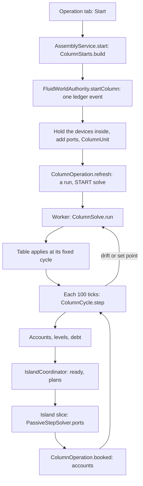

# Column operation: the column running in the built plant

**Snapshot:** d647d331d (branch `claude/gas-vent-hold`), 2026-11-11. Batches `2026-11-11-minecraft-time-delta` and `2026-11-11-drum-operation-holds`, not merged at this snapshot: the column's windows as counts of cycles under the time factor, a waiting cycle run at the decision point (`decide`) · earlier: 0893d2339 (branch `claude/distillation-failure-mode-control-db2da5`, `claude/custom-shader-system-caff9e` merged in), 2026-11-10. Batch `2026-11-10-column-failure-modes`, merged as 0.26.0: one condition record for the running column (`Condition`, `ColumnStatus`, `Refusal`), the solve policy without a retry ladder, flooding as a limit, the reboiler's and pumparound coolers' utilities, the members' power (`ColumnPower`), the Operation tab's conditions and trays, the column on the DCS and a feed-rate loop; fluid facts schema 21 · earlier: f4130065f (branch `claude/refinery-compounds-thermos-252973`), 2026-11-09. Batches `2026-11-04-refinery-compounds` (V4: a column solves on its feed island's compound list; a port grows its island before it gives a compound the island lacks), `2026-11-04-open-thermo-data` (condenser carry-over, the network's water in V3) and `2026-11-05-neural-retrain`, merged as 0.23.0 on 2026-11-09 · earlier: 050cd1098 (branch `codex/simulator-sizing`), 2026-11-08, batch `2026-11-06-simulator-sizing`, merged as 0.22.0 on 2026-11-08.

## Time factor and the decision point (batches 2026-11-11, not merged)

- A cycle is still `CYCLE_TICKS` 100 online ticks; it advances `cycleSeconds()` = `time.seconds(CYCLE_TICKS)` of process time (5 s at factor 1, 20 s at the default 4), and every per-cycle rate divides by it.
- The windows are counts of cycles (owner T6), so they answer in the same play time at any factor: `INLET_AIM_CYCLES` 6, `BUFFER_CYCLES` 24, `CONDENSER_HOLD_CYCLES` 12 (30 s, 120 s and 60 s of process at factor 1; `inletAimSeconds()`, `bufferSeconds()`, `condenserHoldSeconds()`). The solve's age (`OperationView.Solve`) and the kept-table status are in play seconds.
- Defect 5 of batch 2026-11-11-drum-operation-holds: `booked` only records that a port's island booked while a cycle was due (`bookedWhileDue`); `decide()` (the `IslandCoordinator.Ports` hook, called at each decision point after the shafts) runs `due()`. A cycle never runs inside an island's materialisation. Test: `ColumnRunTest.aHorizonPassedBeforeItsDeadlineFiresWithACycleDueBehindIt`.

## Failure modes and control (0.26.0, batch 2026-11-10-column-failure-modes)

- **One condition record.** A cycle and the solves give one list of `Condition.Active` (condition, value, index, text of at most 256 characters). Each `Condition` has one `Rank`: NOT_READY, NOTICE, LIMIT, OFF_TABLE, TRIP. LIMITs: FEED_SHORT, STEAM_SHORT, PRODUCT_FULL, COOLING_SHORT, HEATING_SHORT, PUMPAROUND_SHORT, FLOODING, NO_POWER. OFF_TABLE: OFF_TABLE (a solve pending, its trigger as text), SOLVE_REFUSED. TRIP: CLOSURE. NOTICEs: SETPOINT_REFUSED, ADVISORY (V3's advisory texts, at most 4, `ColumnSolve.Solved.MAX_ADVISORIES`), FEED_WATER_ROUTED, UNMETERED, HIGH_LOAD. The status line, the Operation tab and the column's alarm channels all read this list. It is engine state, saved nowhere.
- **A LIMIT is a share of the set feed.** `ColumnCycle.step` weighs every limit against a full take at the set demand and lists each one that holds, with the share of the set feed it allows. `Condition.binding` takes the TRIP, else the LIMIT with the lowest share (the first of equal ones). The cycle takes that share. No limit asks a solve. `ColumnCycle.Limit` is gone.
- **Status.** `ColumnStatus.phase` and `ColumnStatus.line` make the phase and the line from the list: STARTING or NOT READY before a table; UPSET for a TRIP, LIMITED for a LIMIT, else RUNNING. The words stay as before: `LIMITED: <word>, N %` (the word is the condition's, for example `condenser`, `reboiler`, `flooding`, `power`), `RE-SOLVING: <trigger>; …`, the fans' suffix and rule A's text, then the refusals and notices.
- **Start refusals.** `Refusal` names every text of `ColumnStarts.build`, `FluidWorldAuthority.startColumn` and the first solve, said after `NOT READY: `. New ones: `TOO_MANY_UTILITY_UNITS` and `NO_DRIVER` (a member pump with no driver while `energy.machinesNeedPower` is on; the batch README marks this as an assumption the owner may veto).
- **Solve policy.** The cycle runs on the accepted set points, `table.reference().setpoints()`, at the feed rate it takes; a requested set point waits for its solve. A refused set point is remembered (`refusedSetpoints`) and not solved again while the unit's set points equal it. A refused drift state is remembered as `Refused` (its state as a `SplitTable.Reference`, from `DriftBands.reference`) and not solved again while the state taken stays inside its bands (`DriftBands.check(reference, held, step, demand)`). A solve the worker did not finish (`ColumnSolve.Failed.transientFailure`: a deadline, a worker failure, a shutdown) is asked once more after `TRANSIENT_WAIT` 600 ticks; a second such failure is a refusal. `RETRY_TICKS` is gone. Memory only.
- **Flooding.** `ColumnSolve.run` keeps V3's tray hydraulics as `SplitTable.Flood` (the worst tray's flood fraction per mol/s of feed, the tray, whether vapour limits it, the total dry drop and liquid head); `Flood.NONE` at a prescribed drop. At one table the flood fraction is proportional to the feed taken, so FLOODING allows 1/(fraction at the set feed) and HIGH_LOAD is a notice from 85 % (`Condition.HIGH_LOAD_FRACTION`) at the feed taken. Flooding is Fair's flood fraction alone; there is no downcomer backup check. The live drop is `Flood.drop(ratio)`: the dry part by the square of the feed ratio, the liquid head as solved (`ColumnOperation.drop`); port pressures do not move with it.
- **Utilities.** Start finds the reboiler's and each pumparound cooler's utility sides by the condenser's rule (`ColumnUnit.Utilities`). Every duty is owed to its utility through the heat in transit, one `Debt` per `Utility` (CONDENSER, REBOILER, PUMPAROUND j). A short utility cuts the feed (HEATING_SHORT, PUMPAROUND_SHORT), no solve. A duty with no utility side stays free, as before.
- **Power.** Start keeps the column's powered members (`ColumnUnit.Members`): the air condenser's fan sides, the reflux pump's movers, each pumparound pump's. Each cycle `ColumnPower` books them; one without power gives NO_POWER. Off when `energy.machinesNeedPower` is false.
- **Control.** The column's alarms are channels on its host; a DCS lists the columns on its bus and sends Start, Stop and Apply; a flow or level loop on the column plans its feed rate, and the cycle takes min(set, plan) (`ColumnOperation.feedRate`). See [process-control.md](process-control.md) and [wired-control-power.md](wired-control-power.md).
- **Small fixes.** An outlet whose available account holds 1e-9 kg or less (`TRACE_KG`) plans nothing (`outletPlan`). A column that trips while rule B's steam is short asks a STEAM_RATIO solve, whose refusal brings rule A; otherwise a trip asks the first band the state left, else CLOSURE.

## Accepted instrumentation (0.22.0)

`ColumnSolve.Solved` carries the already accepted `V3ColumnInspection` to the scheduled application boundary. `ColumnOperation` reduces it to `ColumnUnit.Probes`: top/bottom/reflux pressure and temperature, and internal mass-per-total-feed coefficients. The denominator is `reference.alpha * reference.setpoints.designFeedRate`, including feed water; V3's hydrocarbon-only vector is not that basis. The latest accepted cycle supplies actual throughput. Stream boundary readings use existing accepted cycle accounts and conditions.

`FluidFacts.columnState` round-trips this bounded snapshot as rebuildable state, not player facts. Restoring it runs no solver. A state without the snapshot can keep its split table while the normal engine deadline asks for a refresh. `FluidWorldAuthority.columnInstrument` is read-only; opening a controller never advances a column. The duty/energy/heat-in-transit contract is unchanged. Pumparound specifications currently prescribe heat only, so no fictitious circulation flow or return temperature is created. `ColumnProbeTest` covers the wet-feed mass basis; `ColumnRunTest` covers saved-reading reload and continuing operation.

## Exchanger configuration integration (0.22.0)

Column member designs now carry Standard/Low-dP crossflow choices through sizing, sent designs, constructor import and assembly matching. Water condenser, trim and pumparound designs share the catalogued exchanger model and pressure-drop checks. The running column keeps its current V3 solve, duty/energy-transfer contract and publication cadence; no new crossflow-specific column solver was introduced. A layout or type mismatch is an assembly issue, not permission to fabricate a required duty.

Up: [code guide](README.md)

## Read this when

- A column's status reads `NOT READY`, `STARTING`, `LIMITED`, `UPSET` or `RE-SOLVING`, or a device says `COLUMN: part of the column at …, running`.
- Start refuses, or a port stands in the wrong place.
- A running column's rates, duties or accounts look wrong, or one of its boundary lines holds (the solver side of that: [fluid-science.md](fluid-science.md)).
- A running column reads `LIMITED: condenser`, or its cooling water flow, its water's outlet or its air fans look wrong.
- A running column reads `LIMITED: reboiler`, `pumparound`, `flooding` or `power`, a solve is refused and not asked again, or a column alarm (`alarm_upset`, `alarm_off_table`, …) is raised.
- You change the split table, the cycle, a condition, a drift band, rule A or B, the solve policy, or the set points.
- You change a column unit's facts (`ColumnUnit`, fluid facts schemas 6, 8, 9 and 21) or the operating point in a saved design (`ColumnOperatingPoint`, shape fields 4).
- You work on the Operation tab, the DCS's column page, or rebuild a review plant (`ColumnOperationReviewWorld`, `ColumnFailureModesReviewWorld`).

Not here: the tray solver ([column-v3.md](column-v3.md)), the parts check ([machine-assemblies.md](machine-assemblies.md)), the wall of the condenser ([heat-exchangers.md](heat-exchangers.md)), the island scheduler ([fluid-runtime.md](fluid-runtime.md)).

## In one paragraph

A real column takes feed and steam, and gives products at steady state after hours of holdup. The game does not march its trays. One V3 solve gives a **split table**: the share of each component that leaves by each product, the duties per mole of feed, and the state of each product. While a column runs, the devices inside its boundary valves are held. The boundary valves' column sides become **ports**: a VOID at each inlet and a GENERATOR at each outlet, on their own lane. Each port has an **account** of moles and energy. Inlets book what arrives into their accounts. Every 5 s of online time a **cycle** takes the feed the accounts hold, splits it by the table and credits the product accounts; the condenser closes the energy. The condenser's cooling water takes its share of that duty through the exchanger's heat in transit, and the column sets the water's flow where the water side's flow station is complete; an air condenser takes the rest, its fans at the least speed that holds it. The fluid network never sees the column: it sees a mass target on each boundary valve, set from the accounts. Each side reads the other through a fence of 22 s, so a column's products do not depend on when an island's job completes. When the feed, the steam or the set points leave their bands, a new V3 solve runs on the worker pool and its table applies at a fixed cycle. Each cycle lists what holds it back as conditions: every limit (a short feed, steam or utility, a full product, flooding, a member without power) allows a share of the set feed, and the lowest share binds. A refused solve is not asked again until the state or the set points move.

## Class map

| Class | Role | Read it for |
|---|---|---|
| [Port](../../../src/main/java/com/wormzjl/icheme/science/column/operation/Port.java) | FEED, STEAM, OFF_GAS, SOUR_WATER, DISTILLATE, DRAW, BOTTOMS; saved by name; `inlet()`, `gas()` | Which ports exist |
| [Setpoints](../../../src/main/java/com/wormzjl/icheme/science/column/operation/Setpoints.java) | The player's numbers, a fact: design and set feed rate, condenser temperature, reflux ratio; reboiler, steam, draws and pumparounds per mole of feed. `of(point)`, `withFeedRate` (capped at the design rate), `intensivelyDiffers` | What the player sets |
| [PortConditions](../../../src/main/java/com/wormzjl/icheme/science/column/operation/PortConditions.java) | A port's pressure and temperature estimated from the design (`estimate`) | Why a port stands at its pressure |
| [SplitTable](../../../src/main/java/com/wormzjl/icheme/science/column/operation/SplitTable.java) | The table: `axis`, `products` (`Product`: port, index, recovery by component, temperature, pressure), `reboilerPerFeed`, `pumparoundPerFeed`, `condenserPerFeed`, `reference`, `held`, `condenserWaterPerFeed` (the cooling water's share of the duty), `waterBelow` (where a booking difference goes), `airArea` (an air condenser's bare tube per mol/s of feed at each of `FAN_STEPS` 8 fan speeds), `flood` (`Flood`: flood fraction per mol/s of feed, worst tray, vapour limited, total dry drop and liquid head; `fraction`, `drop`; `NONE`), `pumparoundDraw` (each pumparound's draw tray temperature as solved, K). `of` builds it from a V3 result; `split`, `perFeed`, `product`, `waterShare`, `waterTakes`, `airFeed` (and `airFeed(powered, natural)`), `fans`, `withFlood`, `withPumparoundDraw`, `drawTemperature`, `bottomsTemperature` | What one solve leaves behind |
| [Condition](../../../src/main/java/com/wormzjl/icheme/science/column/operation/Condition.java) | One constant per failure, each in one `Rank` (NOT_READY, NOTICE, LIMIT, OFF_TABLE, TRIP) with its status word; `Active` (condition, value, index, text); `binding`, `find`; `HIGH_LOAD_FRACTION` 0.85, `MAX_TEXT` 256, `RULE_A` | What a cycle found |
| [ColumnStatus](../../../src/main/java/com/wormzjl/icheme/science/column/operation/ColumnStatus.java) | `phase` and `line` from a condition list: one pure formatter | The status words |
| [Refusal](../../../src/main/java/com/wormzjl/icheme/science/column/operation/Refusal.java) | Every Start refusal and first-solve refusal as a constant with its text (`text(parameters)`) | Why a column does not start |
| [ColumnCycle](../../../src/main/java/com/wormzjl/icheme/science/column/operation/ColumnCycle.java) | One cycle as arithmetic: `Account`, `Rooms` (what the condenser's water, the reboiler's and each pumparound's utility can still pass, J; the air's most feed; unpowered fans and pumps), `Step` (with its `conditions`, `binding`, `tripped`), `step` | Limits, rules A and B, the closure, the trip |
| [DriftBands](../../../src/main/java/com/wormzjl/icheme/science/column/operation/DriftBands.java) | The bands and `Trigger`; `check` (a table's, and a reference's without the closure); `reference` (a refused state as a reference) | Why a solve started, and why a refused one does not start again |
| [ColumnSolve](../../../src/main/java/com/wormzjl/icheme/science/column/operation/ColumnSolve.java) | The worker's job: `Job` (with the design's `ColumnComponents.Condenser`), `Taken`, `Steam`, sealed `Outcome` (`Solved` with its `advisories`, `Failed` with `transientFailure`); `run`; `trim` (an air-then-water condenser's water share, which the simulator's column block calls too), `airArea`; `SUPERHEAT` (public: the simulator's sizing `Limit` reads it) | From a taken feed to a table |
| [OperationView](../../../src/main/java/com/wormzjl/icheme/science/column/operation/OperationView.java) | What the tab shows: `Phase`, `conditions`, `accepted` (the set points the table in force was solved at, where they differ from the requested ones), `Stream`, `Duty` (`DutyKind` CONDENSER, REBOILER, PUMPAROUND, FANS), `Solve`, `Trays` (drop and worst flood fraction at the feed taken and at the set feed, the worst tray from 1), `idle`, `binding`, `ruleA`, `refused` | The tab's data |
| [ColumnOperation](../../../src/main/java/com/wormzjl/icheme/runtime/fluid/ColumnOperation.java) | The runs, on the server thread, without Minecraft: cycles, solves, plans, booking, one `Debt` per `Utility` (CONDENSER, REBOILER, PUMPAROUND j), each side's heat rate and the fans, `view`, `status`, `conditions`, `drop`, `feedRate`. `Solves` (`design`, `condenser`, `submit`); `Power` (members' booking, `NONE`), `FeedPlans` (a control loop's feed). `implements IslandCoordinator.Ports`. Plans and bookings map the accounts (world list) to each island's own list by id; `compounds(device)` is what an outlet port may deliver (the compounds its account holds), and `grow(submit)` queues one registration edit per port whose account holds a compound its island lacks, so the island recompiles with it on the engine's schedule while the account holds the moles | Everything between the table and the islands |
| [ColumnUnit](../../../src/main/java/com/wormzjl/icheme/runtime/fluid/ColumnUnit.java) | The facts of one column in the topology ledger: `Station`, `Totals`, `condensers`, `airSurface`, `Utilities` (reboiler's and each pumparound cooler's utility sides), `Members` (fan sides, reflux pump's and each pumparound pump's movers; `NO_POWER` indices `CONDENSER` 0, `REFLUX_PUMP` 1, `pumparoundPump(j)` 2 + j), `State` (engine state) | What is saved |
| [ColumnPower](../../../src/main/java/com/wormzjl/icheme/runtime/fluid/ColumnPower.java) | `ColumnOperation.Power` over `ElectricStores` and `ShaftTrains`: a fan side books its fans on its store (`ElectricStores.member`), a casing books its rated shaft power at the cycle's share on its train (`ShaftTrains.held`), an in-line pump on its own store; `undriven` names a member pump with no driver | The members' power |
| [PortPlan](../../../src/main/java/com/wormzjl/icheme/science/fluid/network/PortPlan.java), `PassiveStepSolver.ports` | One slice's mass target on a port's valve; an outlet's generator stated at its product | How the network meets a port |
| [ColumnStarts](../../../src/main/java/com/wormzjl/icheme/runtime/assembly/ColumnStarts.java), `AssemblyService.start`/`stop`/`setpoints`/`operation`/`dismantled` | From a complete report to a start request: ports, the condenser's water sides, the air condenser's surface, the reboiler's and pumparound coolers' heat sides (`heatSides` of slots `REBOILER`, `pumparoundCooler(i)`), the fan sides and the pumps' movers (`movers` of `REFLUX_PUMP`, `pumparoundPump(i)`) | Start's refusals before the ledger |
| `FluidWorldAuthority.startColumn`/`stopColumn`/`editColumn`/`columnRemoved`/`columnView`/`columnCondenser`/`columnAlarms`/`columnLoop`, `PhysicalFluidTopology.PORT_LANE`, `Device.suspendedBy` | Start and Stop as one queued ledger event each; utility sides by `utilitySides` (outside the column, partner held inside), members by `held` (inside) | Start's refusals in the ledger, what is held |
| [ColumnOperatingPoint](../../../src/main/java/com/wormzjl/icheme/science/equipment/ColumnOperatingPoint.java) | The design's solved input, a shape field of `ColumnTrays` (`operating`): package, assay, components, feed, pressures, condenser, reflux, reboiler, steam, draws, pumparounds. `of(input)`, `fits`, `input(trays, diameter)` | What a column remembers from the solve its design came from |
| [OperationColumn](../../../src/main/java/com/wormzjl/icheme/client/gui/common/OperationColumn.java) | The Operation page ([client-gui.md](client-gui.md)) | The page |

## Main flow

1. **Start.** The tab sends `AssemblyNetwork.Action.START`, a queued command (`AssemblyPresentation.act`). `AssemblyService.start` calls `ColumnStarts.build`, which reads the assembly report and the operating point and names each port: its boundary valve, its cell and its estimated conditions. `FluidWorldAuthority.startColumn` does the rest as one queued ledger event.
2. **Hold.** The event walks from the column's nozzles to the boundary valves. It marks each device on the way `withSuspendedBy(unit)` and adds one port device per station. It saves a `ColumnUnit`. Stations keep their accounts across a restart, and a restart keeps the player's set points if they are `compatible` with the design.
3. **First solve.** `ColumnOperation.refresh` makes a `Run` with status `STARTING`, and the first cycle asks for a START solve of the design. No seed goes in, and nothing moves until the table applies.
4. **Run.** See the steps of a cycle below. `RUNNING` means no limit acted. `LIMITED: <word>, N %` means a cycle took less than the set feed; the word is the binding condition's. `UPSET: …` means the cycle tripped and took nothing. `RE-SOLVING: <trigger>; …` is added while a solve is pending. `ColumnStatus` makes the line from the cycle's conditions.
5. **Stop.** Two phases. `ColumnOperation.stop` queues one event: the held devices are released and the ports go. The unit keeps running until that event commits (`committed`, from `Host.committed`), so what its ports take and give to the last slice is booked. A Start still queued goes first, the event queues behind it; a stop already queued has nothing left to edit. `standing` asks whether a port is in the active registry or named by a queued event (`WorldTopologyLedger.queued`), so a port placed and removed again in the queue still counts. Then it stops: the accounts stay on the unit, and the unit forgets its engine state. Contents of the held vessels are as they were.
6. **Removal.** `EquipmentStructure` dismantling calls `AssemblyService.removed` and `dismantled`; `columnRemoved` marks the unit `leaving` and stops it; when the stop commits, the unit goes and the ledger books its accounts and solids as destroyed. A layout refresh calls `removed` alone and keeps the unit. Reverting a report stops the column too.

Ports, stations and accounts

- `ColumnUnit` has `id`, `master`, `running`, `setpoints`, `stations`, `totals`, `condensers`, `state`, `leaving` and `airSurface`. Its id comes from the ledger's identity counter (`WorldTopologyLedger.reserve`) and is never a device's. A unit is running only if its stations have devices. `MAXIMUM_STATIONS` is 16. `condensers` are the condenser's water sides, one per shell in parallel, at most `MAXIMUM_CONDENSERS` (`ColumnComponents.MAX_UNITS`, 6), distinct and above 0; `condenser()` is the first or 0. `airSurface` is the bare tube of the air condenser's banks as Start found them, m² (0: none, or a save before facts schema 9).
- `Station`: `port`, `index`, `device` (0 while stopped, and for a station its design lost, `ColumnUnit.lost`), `valve`, `account` and `solids`. The account is moles by component on the basis axis, and energy. `solids` is the inert solids at that port (crystals melt on arrival).
- A port device is a VOID (inlet) or GENERATOR (outlet) in the cell on the valve's column side, on `PhysicalFluidTopology.PORT_LANE` (15, one past the rack places), facing the valve, with the valve's geometry, one BULK port and spec `FluidDeviceSpec(1, T, P, nitrogen)`. The spec's composition means nothing: `PortPlan` states an outlet's product each slice.
- A port stands in for the held pipe block next to its valve, and joins the valve as that pipe did. `across` finds a port at `next.withLane(PORT_LANE)` first, so the valve's island ends on it.
- A held device joins nothing (`joins` is false if either end is `suspended()`). As built it still joins (`mechanicallyJoins`), so Stop needs no rebuild of the line. A held pipe has no island, and its status reads `COLUMN: part of the column at x, y, z, running`. A held vessel stands alone in a one-node island and keeps its contents (`ColumnSuspensionTest`).
- A port's pressure is `PortConditions.estimate` and stays there: V3's stage pressure, top pressure plus (j − 1) stage drops for tray j, the sump at the bottom tray's (the condenser's ports at the top pressure), at the feed's, the steam's or the condenser's temperature. The ledger keeps it; a solve does not move it. Only a product's temperature comes from the table.
- `OFF_GAS`, `SOUR_WATER`, `DISTILLATE`, `DRAW` and `BOTTOMS` are outlets. `ColumnStarts.port` maps the blueprint's `*_valve` slots to ports; a slot's index counts from 1 where a part repeats (`index==0?0:index-1`).

The cycle and the fence

Constants of `ColumnOperation`: `CYCLE_TICKS` 100 (5 s), `FENCE_TICKS` 440 (22 s), `INLET_AIM_CYCLES` 6, `BUFFER_CYCLES` 24 (30 s and 120 s at factor 1), `SOLVE_SPACING` 600 ticks, `TRANSIENT_WAIT` 600 ticks (one retry of an unfinished solve; `RETRY_TICKS` is gone), `APPLY_TICKS` two cycles, `KEEP_TICKS` 2400, `CONDENSER_HOLD_CYCLES` 12 (60 s at factor 1; the hold of every utility), `APPROACH_KELVIN` 5 (`HeatSides.WATER_APPROACH`), `TAKE_MARGIN` 1 − 1e-6, `TRACE_KG` 1e-9.

A column and its islands advance on the online clock but do not advance together. An island's job can complete late. The fence keeps results the same whatever the job's timing:

- A cycle at tick *t* waits until each inlet's island is through *t*, and each outlet's and the water side's through *t* − fence (`portsThrough`; `IslandCoordinator.through` is true for a committed, certified, held, parked or suspended island, and with no island). It sees an arrival only up to *t*: `available` is the account less later arrivals, and an arrival span across *t* is shared by time.
- A slice starting at *s* reads a port's level as of *s* − fence (`Level` logs), and waits (`ready`) until the run has cycled past *s* − fence. An outlet's temperature is the table in force at the fence (`Run.tableAt`).
- A cycle already due runs from a booking. `schedule` also looks again a cycle later, because an island that holds books nothing.
- A cycle's first tick is the next multiple of 100, staggered by `floorMod(unit*37, 100)`. It is scheduled on `IslandScheduler.Kind.COLUMN_CYCLE`.

One cycle (`cycle`, then `ColumnCycle.step`):

1. Take the feed the accounts hold, up to the set rate over 5 s. The set points are the accepted ones (`running`: the table's reference set points at the unit's feed rate, or a control loop's plan below it; the requested ones before any table). Room in each product is `designFeedRate*bufferSeconds()*perFeed(k)` less its account and what the outlet gave after the fence (`Gift`, `givenSince`), so a slow island's booking changes nothing; a full product cuts the feed. Each utility has room as well (`room`, below), an air condenser a most feed, and the members their power (`powered`); they go into `ColumnCycle.Rooms`.
2. `step` lists every LIMIT that holds, each with the share of the set feed it allows, in this order: FEED_SHORT, PRODUCT_FULL (the fullest product as index), COOLING_SHORT (the water's room), COOLING_SHORT or NO_POWER (the air's most feed; NO_POWER where some banks have no power), NO_POWER of each unpowered pump (share 0), HEATING_SHORT, PUMPAROUND_SHORT (index j), FLOODING (the worst tray), STEAM_SHORT under rule A. The binding one sets `alpha`. It takes the steam by rule A or B and splits feed and steam by the table. The condenser duty is the closure: energy out less energy in, less the reboiler and pumparounds, each at the table's ratio to the feed taken.
3. The step trips and takes nothing if the condenser would heat the overhead, or its duty departs more than 50 % (`TRIP_DEPARTURE`) from the solved one: a CLOSURE condition with the departure. Status `UPSET`. A solve is asked on the attempted take: STEAM_RATIO where rule B's steam is short (it stands beside the trip), else the first band the state left, else CLOSURE.
4. Otherwise accounts move, every inert solid that arrived by the tick moves to the bottoms, a `Credit` is logged, totals grow (every duty whole), each utility is owed its duty (`owed`: the condenser's water its `waterShare`, the reboiler and each pumparound its duty; a duty with no side stays in the totals alone), and new levels are logged. HIGH_LOAD is added where the worst tray stands at 85 % of flood or more at the feed taken. The fans' speed and power at the feed taken are kept for the status and the tab. `publish` sets the conditions, the status and the phase. `save` writes the state after each cycle.

Plans (`plans`, called at an island's dispatch):

- **Inlet.** Rate from the level as of the fence. It aims to keep 30 s of the set rate in the account: `gain = clamp(1 + (aim − held)/aim, 0, 2)`, `target = rate*gain*molarMass`. An empty account meters at the design feed's molar mass (water for steam). With no molar mass the rate is 0 and the status says so.
- **Outlet.** `available` is the account less credits after the fence, its solids likewise. Its rate aims at 60 s of what the column produces: `rate = produced*clamp(mass/aim, 0, 2)`, capped by `mass/seconds*TAKE_MARGIN`, so an outlet cannot give more than the account holds. An empty account, or one holding 1e-9 kg or less (`TRACE_KG`: the round-off a booking leaves), plans target 0. Composition is the account's; temperature the table's.
- `PortPlan(node, valve, massTarget, temperature, moles, solids)`; `moles` null for an inlet. `PassiveStepSolver.ports` runs after `sizeJunctionHoldups` and before `couple`: it restates an outlet's generator (composition, temperature, port pressure, its own volume, solids at their ratio to the moles) unless its shares match to 1e-12 and neither side holds solids, and it sets the valve to `ControlValve(MASS_FLOW, …, COLUMN_SENSOR, …)`. A target within `VALVE_DEADBAND` of the standing one stays; a target of 0 always applies. A bottoms holding solids therefore does not certify. A valve that bounds two columns takes the lower plan, and flow valves in series carry the lower target ([fluid-science.md](fluid-science.md)).
- `IslandCoordinator.sameControl` counts a port's planned regulator and the valve's own `FlowControl.Valve` of the same `targetPressure` as one control: a planned target is a slice input, not a change of the connection.

Booking (`booked`, at island commit): an inlet's EXCHANGE arrivals go into its account at once, logged as a `Span`. A crystal melts there (`melted`): its component, with its stored energy made true by its offset. An inert solid goes to the station's `solids`. An outlet's account is debited exactly what the step gave, by component, its energy by share, its solids by what left; the difference between given and debited energy goes to the condenser's total, and the gift is logged (`Gift`). The difference is owed to the cooling water if the port offered its product below the table's `waterBelow` (the table as of the fence, `water`); otherwise the air takes it, in the totals alone. Before any table the water takes it. An overdraw logs `column status=OVERDRAWN`.

Solves and the split table

- One solve pends at a time. SETPOINT and START are urgent; others wait `SOLVE_SPACING` from the last. None is asked before `waitUntil` (an unfinished solve's wait), and none of a state inside the bands of a refused one at the same set points (`inside`), except SETPOINT.
- A solve's table applies at `trigger tick + APPLY_TICKS`, however long the job took. The cycle at that tick waits for the outcome (`applied`). This is why results do not depend on the worker.
- A failed solve keeps the old table, with the text `the <trigger> solve failed (<reason>), the table of N s ago kept` (before any table: `Refusal.FIRST_SOLVE`, NOT READY). A refused SETPOINT solve gives SETPOINT_REFUSED and stores the refused set points; the cycle keeps the accepted ones, and Apply (`edited`) or moving the set points away forgets the refusal. Any other refused solve gives SOLVE_REFUSED and stores the state as `Refused`; a STEAM_RATIO refusal sets rule A. A transient failure (`Failed.transientFailure`) is first asked once more after `TRANSIENT_WAIT`. A solve that gives a product the column has no nozzle for is refused (`missingStation`, `Refusal.NO_NOZZLE`). An accepted solve clears the refused state; a SETPOINT or START solve also the refused set points.
- `request` builds `ColumnSolve.Job`. SETPOINT and START solve the unit's requested set points; every other the accepted ones at the unit's feed rate. The feed taken is `taken(step, design)`, the last cycle's rates; a steam port's hydrocarbons count as feed. With no cycle to read, `designTaken` gives the design's feed scaled to the set rate. A START solve has no seed; later ones warm-start from the last solve's seed. The seed is not saved.
- `ColumnSolve.run(job, model, screen, checkpoint)` builds a V3 input with the design's trays and the set ratios times the feed taken, and calls `calculateWithStrategy` with `V3SolveStrategy.AGGRESSIVE` under the model's own catalog. The model is the feed island's (`FluidWorldAuthority` takes it on the engine thread at submission; a feed port in no island submits nothing and the next cycle tries again), so V3's basis is that island's compounds, at most 64 whatever the network package holds. The feed taken, the split table, its reference and the products' partial enthalpies stay on the world list, mapped by id; a compound off the list takes the nearest boiling solved row (`SplitTable.of`) and its product's specific enthalpy. A warm seed on another basis is dropped. It runs through `ProcessSolveServices.submitColumnUnit` on the solve pool (`ColumnUnitCommand(job, model, liquidSupplyScreenRatio)`: no catalog of its own; `ColumnUnitCompletion`). A deadline or a worker failure gives `Failed`; a shutdown gives `Failed("SERVER_SHUTDOWN")`.
- Feed water enters as steam at the feed tray if it can be stated 5 K (`SUPERHEAT`) above its boiling point and a steam slot is free. Otherwise it follows the distillate, and a note says so.
- A seed with wet trays is dropped.
- `SplitTable.of` maps the V3 streams: `overhead_vapor` to OFF_GAS, `distillate_liquid` to DISTILLATE, `free_water` to SOUR_WATER, `bottoms_liquid` to BOTTOMS, `side_liquid_tray_N` to DRAW. Each component's row sums to 1 within 1e-12. A component without solved feed borrows the row of the component nearest in normal boiling point; unsolved water goes to the distillate.
- The job carries the design's condenser kind (`Solves.condenser`, `FluidWorldAuthority.columnCondenser`: `ColumnComponents.condenser()` of the loaded column, EXCHANGER where it has none). It sets three fields of the table:

  | Condenser | `condenserWaterPerFeed` | `waterBelow` | `airArea` |
  |---|---|---|---|
  | EXCHANGER | the whole duty | `WATER_ALWAYS` | empty |
  | AIR_COOLER | 0 | `WATER_NEVER` (0) | top tray to the receiver |
  | AIR_THEN_WATER | `trim`: the overhead from the split to the receiver | `HeatSides.AIR_SPLIT_TEMPERATURE` (40 °C) | top tray to the split |

- `trim`: the overhead is the top tray's vapour with its water vapour (V3's inspection node 1), flashed at the condenser's pressure. The split is `HeatSides.airSplit(top, receiver)`: 40 °C, but never below the receiver (no trim duty) nor above the top vapour (the whole duty is the water's). The trim never exceeds the whole duty.
- `airArea`: the overhead's curve (`HeatCurve.sample`) marched against 25 °C air with `HeatSides.airFilms` at each fan step from natural draught (0) to full (8/8); `exposure` bisects the bare tube per kg/s that reaches the air's outlet, times the overhead's mass per mol/s of feed. None where the overhead already arrives there; `Double.MAX_VALUE` where the outlet is at or below 25 °C.
- `flood`: V3's `V3TrayHydraulicsSummary` reduced to `Flood(maximumFloodFraction / rate, maximumFloodTray, vaporLimited, totalDryPascal, totalLiquidPascal)`; `Flood.NONE` where the result has no hydraulics. `pumparoundDraw`: each pumparound's draw tray temperature from the inspection (node n is tray n); a table without it reads the hottest product (`drawTemperature`). `bottomsTemperature` is the BOTTOMS product's, else the hottest. `Solved.advisories` are V3's acceptance audit's advisory texts, at most 4.
- `condenserPerFeed` is the closure on the network's energy basis, not V3's. V3's own duty stays as `solvedCondenser`. Table enthalpies are partial molar, by forward difference (`PARTIAL_STEP` 1e-5), shifted so they sum to the stream's enthalpy (Euler). A cycle prices a product as the sum of `n_i·h_i`, so no property call runs on the server thread.

Drift bands

`DriftBands.check`, in this order, on what a cycle took against the table's `Reference`:

| Trigger | Band |
|---|---|
| COMPONENT | a share over 1e-6 (`NEW_COMPONENT`), in the feed or a steam, of a component whose row the table borrowed |
| COMPOSITION | the feed's shares over 0.005 from the reference, summed |
| ENTHALPY | the feed's specific enthalpy over 1 K of its own slope from the reference |
| STEAM_RATIO | a steam's ratio over 2 % from the solved one, relative to the larger of solved and set |
| THROUGHPUT | the fed share of the design rate over 0.2 from the table's `alpha` |
| CLOSURE | the closed condenser duty over 3 % from the solved one |

The second form, `check(reference, held, step, demand)`, checks the first five bands against any reference without the closure; it decides whether a state stands inside a refused state's bands (`DriftBands.reference` turns a cycle's take into that reference).

`SETPOINT` comes first in `cycle`: `Setpoints.intensivelyDiffers` of the requested set points against the reference's, unless those set points were refused. A change of feed rate alone is not a set-point trigger, because the column's equations are homogeneous in their extensive inputs; only THROUGHPUT reads the rate. `START` is the first solve.

Rule A and rule B

Steam short of its set ratio:

- **Rule B** (the default): take what steam there is; the product follows the table. STEAM_SHORT with share 1, so it binds only where nothing else does: status `LIMITED: steam`. The cycle's steam ratio drifts, so a STEAM_RATIO solve follows.
- **Rule A**: a refused STEAM_RATIO solve sets `ruleA`. Steam then limits the whole take: STEAM_SHORT with its share and the text `inputs cut together (rule A)`, feed and steam cut together at the table's ratio. A STEAM_RATIO solve that succeeds clears it. So does a cycle (tried first under rule B) whose steam is no longer short, or whose shortage left the refused state's bands: rule B tries once more.

Every limit scales `alpha` as a share of the set feed; the lowest binds (`Condition.binding`). The condenser's cooling water's room against the table's water duty is COOLING_SHORT; an air condenser's most feed at full fans (`airFeed`) is COOLING_SHORT, or NO_POWER of member 0 where some banks have no power.

The condenser: cooling water and air fans

- **The water sides.** `ColumnBlueprint.waterCooled(condenser)` names the slot whose units are water-cooled: `CONDENSER` for an exchanger, `TRIM_CONDENSER` for an air-then-water condenser, none for an air cooler. `ColumnStarts` takes every unit of that slot (`s.units()`, one per shell in parallel) and their sides by `EquipmentStructure.heatSides`. `startColumn` keeps each side outside the column whose partner is held inside, as `condensers`; more than 6 refuses Start ("the condenser has more than 6 shells"). With none, the water's share goes nowhere but the totals.
- **The air surface.** Where the water slot is not `CONDENSER`, `ColumnStarts` sums the bare tube (`HeatSides.of(...).area()`) of every AIR_COOLER unit in the `CONDENSER` slot into `ColumnStart.airSurface`, kept as `ColumnUnit.airSurface`.
- **The debt.** Each cycle the water's share of the duty, `−condenser·waterShare`, is owed (`owe`) in equal shares to each water side with a partner: `coordinator.owe(side, partner, share)` adds to that pair's heat in transit, the store of [heat-exchangers.md](heat-exchangers.md), and wakes the side a fence later. Identical shells split the overhead equally (S3b). The condenser's `Debt` (one per `Utility`) holds the `Owed` records (one shell's share each) and the `Duty` rates (each shell's heat rate, W, for the valve).
- **The read.** `heatRead`, at dispatch, for a water side: `Read.column(due, seconds, ceiling, heatRate)`. `due` is the transit less what was owed after *start* − fence; `ceiling` is the accepted condenser temperature (the table's set point; the requested one before a table) less `APPROACH_KELVIN` (at least 1 K). `heatRate` is the shell's share of the last cycle's water duty at or before *start* − fence (`waterRate`; before any cycle, the table's water duty at the set feed over the shells), plus `excess/condenserHoldSeconds()`, where `excess` is the transit due beyond that rate over the slice and one cycle. `ExchangerRelay.plan` gives the transit back over the slice, no more than keeps the outlet at the ceiling; the rest stays owed.
- **The water valve.** Where the water side's control is `HeatUnit.Mode.COLUMN` and its flow station is complete, the coordinator adds its `Operation.column(valve, WATER_RANGE)` to the read, and `PassiveStepSolver.couple` sets the feed valve's mass flow to `heatRate/(h(T_out) − h(T_in))`, `T_out` = min(T_in + 10 K, ceiling). Water at or above the ceiling takes nothing, and its valve holds. Without a complete station the water flows as its line lets it, as before ([heat-exchangers.md](heat-exchangers.md)).
- **Room:** `CONDENSER_HOLD_SECONDS*|condenserWaterPerFeed|*designFeedRate` less the shells times the fullest shell's transit as of the fence, with what outlets booked after the fence left out (`Owed.booked`). A water side that does not take the heat (no water, or a valve that cannot pass the flow) fills the room, the step's `alphaCondenser` cuts the feed, and status reads `LIMITED: condenser`.
- **The fans.** `SplitTable.fans(airSurface, feed)` is the least fan speed whose surface per feed (`airArea`, linear between the steps) the built banks reach: 0 where natural draught holds it, 1 where full fans do not. Their power is `HeatSides.fanPower(airSurface, fans)`, by the cube of the speed. `airFeed(airSurface)`, the surface over `airArea[8]`, is the most feed full fans hold; past it the cycle is `LIMITED: condenser`. A table with no air, or `airSurface` 0, limits nothing and shows no fans.
- **Status.** A cycle's status adds `; air fans N %, P kW` where it knows the fans. `status` and the view add `; cooling water F kg/s, out at T °C` where the column sets a valve: the valves' mass targets as their islands last committed them, and the inlet as read plus the range under the ceiling (`water`, a presentation read).
- A held side with no column read (a member whose Start found no utility side, or a unit saved before facts schema 21) reads `ExchangerRelay.Read.NONE` and moves no heat: that duty is the column's own.
- The debts, the fans, the unpowered fan sides and the wake at *tick* + fence are in memory. The transit is saved, by the coupling.

The reboiler's and pumparound coolers' utilities

- **Start.** `ColumnStarts` takes the heat sides of every unit in slot `REBOILER` and in each `pumparoundCooler(i)`. `startColumn` keeps, by the condenser's rule (`utilitySides`), each side outside the column whose partner it holds, at most 6 a duty (`Refusal.TOO_MANY_UTILITY_UNITS`). They are `ColumnUnit.utilities`; a side serves one duty.
- **Debt and room.** Each cycle owes `-reboiler` to REBOILER and `-pumparounds[j]` to PUMPAROUND j, shared equally by their sides (`owed`, `owe`). `room` is the same for every utility: `condenserHoldSeconds()·|duty per feed|·designFeedRate` less the sides times the fullest side's transit as of the fence (signed: the reboiler's transit is negative, `Utility.sign`). A duty with no side has no bound. A short room gives HEATING_SHORT or PUMPAROUND_SHORT: a feed cut, no solve (owner decision D1).
- **The read.** A pumparound cooler's side reads `Read.column` with its ceiling at the draw tray's temperature less the approach (`SplitTable.drawTemperature`). The reboiler's utility side reads `ExchangerRelay.Read.heating(due, seconds, floor, heatRate)`: the floor is the bottoms' temperature plus the approach, the heat rate given as a negative number. Both read only once a table stands at *start* − fence.
- **The valve.** A kettle's tube side takes `HeatUnit.Mode.COLUMN` (`Lines.FEED`): the column sets its feed valve to `heatRate / (h(inlet) − h(floor))` ([heat-exchangers.md](heat-exchangers.md), [fluid-science.md](fluid-science.md)). An air-cooled pumparound cooler has no partnered utility side, so its duty stays free.

The members' power

- **Start.** `ColumnStarts` collects the air condenser's fan sides (an AIR_COOLER member's sides whose heat unit has fans), the movers of slot `REFLUX_PUMP` and of each `pumparoundPump(i)` (a casing's, `EquipmentStructure.movers`, or an in-line pump's registration). `startColumn` keeps those it holds (`ColumnUnit.Members`). While `energy.machinesNeedPower` is on, a member pump whose casing's train has no driver refuses Start (`ColumnPower.undriven`, `Refusal.NO_DRIVER`).
- **Each cycle** (`powered`, only with power needed and members present): each fan side books its fans over the span that ran, at the last speed (0 where it had no power), on its store (`ElectricStores.member`), then says whether it has power. Banks without power hold their surface at natural draught: the air's most feed is `airFeed(powered, natural)`, and the limit is NO_POWER of member 0. Each pump books its rated shaft power (`InlineMachines.ratedShaftPower`, at 1000 kg/m³) times the last cycle's share: a casing on its train (`ShaftTrains.held`, which steps the train at once), an in-line pump on its own store. A pump without power gives NO_POWER with its member index and share 0.
- With `energy.machinesNeedPower` off, or a unit with no members (`Members.NONE`, a save before facts schema 21), nothing books and every member has power.

Saves and formats

- **Facts** (`FluidFacts`, schema 6, now 9): a registration's `suspendedBy`, and the world's column units by identity: id, master, running, set points, stations (port by name, index, device, valve, account, solids), totals, the first condenser water side, leaving; schema 8 appends the further water sides (a unit before it has one at most; further sides without a first refuse); schema 9 appends `airSurface` (0 before it: the air takes any duty, as before); schema 21 (batch 2026-11-10-column-failure-modes) appends two records: the utilities (the reboiler's sides, then each pumparound's list; default none: the duties stay free until the next Start) and the members (fan sides, reflux pump movers, each pumparound pump's list; default none: nothing draws until the next Start). The batch's README and plan name its two steps schema 17 and 18; the merge with the 0.25.0 branch made them one schema 21. Corpora: `src/test/resources/compat/fluid/schema-6/`, `schema-8/`, `schema-9/`, `schema-21/` (`columns=` in `expected.properties`: `reboiler`, `pumparounds`, `fans`, `reflux`, `pumps`).
- A column that never ran gets a stopped unit with no stations when its set points are applied (`editColumn`, W7); its first Start keeps them while they fit. `ColumnRunTest.aStoppedUnitWithNoStationsSurvivesTheFacts`.
- **State** (state format 46 at this snapshot, `FluidFacts.topologyState`; on the world list): each running unit's `ColumnUnit.State`, after the queued events: table, enthalpies, `tableTick`, `applied`, `solvedCondenser`, levels and credits, then the table's `condenserWaterPerFeed`, `waterBelow` and `airArea`, the probes, the table's `Flood` record and its `pumparoundDraw`. A state written before the first three reads the whole duty as the water's, `waterBelow` from the water's share, and no air. A state without the `Flood` record is dropped and that unit solves again (no format bump); one without draw temperatures reads the hottest product. It holds windows from the last `FENCE + KEEP` ticks. A state that does not validate is dropped; that unit solves again.
- On a rebuild, accounts and totals map onto the current axis, and solids onto the current records; a removed component or solid is booked. A component removed from a station's account takes its molar share of the account's energy, booked in `Restated`: an account has no temperature to restate at. Queued events do not survive this path, so `FluidFacts.settled` settles each unit on what stands: orphan port devices go, a `leaving` unit goes, booked. `refresh` then restores a run if the state's axis equals the current one and every product has a station; otherwise it starts over.
- Not saved: arrival spans, the utilities' debts, the fans and unpowered fan sides, the conditions, the refused set points and state, the advisories, the seed, the pending solve, `solvedBy` and the wakes. After a load each utility's heat rate starts from the table.
- **Shape** (`ColumnTrays.operating`, shape field 4): saved under `Operating` by `ColumnDesignTags.writeOperating`, read by `ShapeRepair.SavedOperating.resolve`. An unreadable one repairs to none (`operating point (…) -> none`). Corpus: `src/test/resources/compat/equipment/shapes-4.snbt`. A column with no point says "save it from the calculator again".
- `ColumnDesign.of` fills it from the input: the process simulator's Save design (`ProcessSimulatorNetwork`) and a constructor's column template (`EquipmentNetwork`). The constructor's `Column` tag and the shell's tag carry it.
- **Protocol:** `assembly-3` then; `assembly-6` at this snapshot (`assembly-5` the conditions list in place of the limit, rule A and failed flags; `assembly-6` the accepted set points and the tray readings): `AssemblyView.operation`, `OperationPayload`. A view writes at most `MAX_STREAMS` conditions, each as its constant, value, index + 1 and text. `AssemblyNetwork.encodeOperation`/`decodeOperation` give the same bytes for the DCS's column page. The tab's refusal is `AssemblyNetwork.REFUSALS`, per server, cleared at the next press, not saved.

The Operation tab's data

- `AssemblyNetwork.Host.view` adds `AssemblyService.operation(level, origin, refusal, opening)` to the assembly view, unless the column has no design. The view comes from the unit's `ColumnOperation.view`; if stopped, from the design's set points. It is `NOT_READY` with "a vacuum column cannot run yet" for a column with an ejector. Without an operating point it is null, and the tab shows a note.
- `view` is a read of the last cycle. Each station shows its rate over that cycle, temperature (the feed's along the table's slope, `reference.feedTemperature(h)`), pressure, how full its account is (an inlet against 30 s of the set rate, an outlet against its 120 s buffer) and the valve's opening (`FluidNetwork.opening`, NaN if there is none; a stored read, `FluidWorldAuthority.stored`, that advances no island). Duties show booked against the table at the set feed. An air condenser adds a FANS duty: its power at the last cycle, and at the set feed on the table in force; `OperationColumn.duties` shows that row in kW, the others in MW. The view's status carries the cooling water's suffix. `Solve` shows the trigger, warm or cold and the age.
- Since batch 2026-11-10-column-failure-modes the view carries the run's `conditions`, `accepted` (the table's set points at the demanded feed, where the requested ones differ) and `Trays` (where the table has hydraulics: the drop by `drop(table, feed)` and the worst flood fraction at the feed taken and at the set feed, the worst tray + 1). An inlet's fill is against 30 s of the accepted rates. The view is `editable` for every column that can run, also before its first run (a vacuum column cannot). `OperationColumn` draws the conditions table, the tray rows beside the duties and the set points at the set feed ([client-gui.md](client-gui.md)).
- Start, Stop and Apply are `OperationPayload` commands, run on the presentation bucket. Every open screen of the master is answered. Apply sends values in the order feed, condenser, reflux, reboiler, steam…, draws…, pumparounds…; `AssemblyService.setpoints` clamps the feed to the design rate and refuses a wrong count. A column that never ran takes them on its design's set points (refused for a vacuum column or one with no operating point). A set point is a fact; `FluidWorldAuthority.editColumn` queues it, calls `ColumnOperation.edited` (a refusal of earlier set points is forgotten), and the next cycle reads it. A DCS sends the same three actions over the data link (`ColumnCommands`, [process-control.md](process-control.md)).
- The column's channels (`ColumnOperation.instrument`): on a trip flows read 0 and pressures and temperatures stay the table's; role `COLUMN:differential` (`DIFFERENTIAL`, channel `differential_pressure`) reads the live drop, a PRESSURE.

Traps

- A column's cycle never runs on a packet or a menu. `ColumnOperation` is driven by the scheduler's due deadline and by island commits; `due` guards re-entry with `cycling`.
- The first cycle after a load can wait: a cycle needs its inlets through its tick.
- Never set a port's target from anything but `plans`. The fence is the only thing that keeps a run independent of job timing (`aColumnsProductsDoNotDependOnWhenItsIslandsJobsComplete`).
- A boundary valve's target changes each slice. Identity comparisons that decide "same line" must ignore a flow valve's target: `PassiveNetwork.Pipe.Identity.line` ([fluid-science.md](fluid-science.md)).
- `ScheduledTransfer` is not a port. It still has no runtime producer.
- A vacuum column (one with an ejector) does not run: `ColumnStarts` and `AssemblyService.operation` refuse it.
- A running column is mechanically still joined. If you walk the registry, read `suspendedBy` first.

## Change the layer that owns it

| Change | Layer |
|---|---|
| What a cycle takes, a limit, a rule, the trip | `ColumnCycle` (arithmetic only) |
| A new failure mode, its rank, its status word or its alarm | `Condition`, `ColumnStatus`, `EquipmentAlarm.of`; the tab's key in `OperationColumn` |
| A Start refusal's text | `Refusal`, then the check in `ColumnStarts` or `FluidWorldAuthority.startColumn` |
| A band or a trigger | `DriftBands`, then `cycle` in `ColumnOperation` |
| What a table holds, how streams map | `SplitTable.of`, `ColumnSolve.run` |
| When a solve runs and applies, what a refusal holds back | `ColumnOperation.request`, `applied`, `inside` |
| Flooding, the live drop | `SplitTable.Flood`, `ColumnSolve.run`, `ColumnCycle.step`, `ColumnOperation.drop` |
| A reboiler's or pumparound's utility | `ColumnStarts`, `FluidWorldAuthority.startColumn` (`utilitySides`), `ColumnOperation` (`room`, `owed`, `bound`, `heatRead`), `ExchangerRelay.Read.heating` |
| A member's power | `ColumnStarts`, `ColumnUnit.Members`, `ColumnOperation.powered`, `ColumnPower`, `ElectricStores.member`, `ShaftTrains.held` |
| A control loop on the column's feed | `ControlLaw.column`, `ControlPlans.columnFeed`, `ColumnOperation.feedRate` |
| A port's target | `ColumnOperation.plans`, then `PortPlan`, `PassiveStepSolver.ports` |
| A new port kind or a new refusal | `Port`, `ColumnStarts`, `FluidWorldAuthority.startColumn` |
| A saved field | `ColumnUnit` and `FluidFacts` (append only, corpus image; state: `FluidFacts.columnState`) |
| A condenser's heat | `ColumnOperation.heatRead`, `owe`, `waterRate`; `ExchangerRelay.Read.column` |
| The water's and the air's shares, the fans | `ColumnSolve.run`, `trim`, `airArea`; `SplitTable.waterShare`, `waterTakes`, `airFeed`, `fans` |
| The water valve's flow | `PassiveStepSolver.couple`, `ExchangerRelay.Operation.column` ([heat-exchangers.md](heat-exchangers.md)) |
| What the tab shows | `OperationView`, `ColumnOperation.view`, `OperationColumn` |

## Tests that pin it

The JUnit classes run under `test`, except where a gate group is named.

- `science/column/operation/ColumnCycleTest` (15): components and energy close over a thousand cycles of drifting feed; rules A and B; a full buffer; the trip; the bands; the split's sum; the condenser's room bounds only its water's share; an air condenser's face bounds its feed and sets its fans; a booking difference goes to the water below the split. Batch 2026-11-10-column-failure-modes: the list holds every limit and the lowest binds; each utility's room bounds its own duty; a table below flood takes its set feed, past flood cuts to the limit and closes; flooding and a short feed, the lower binds; a short feed with a tight outlet fills the buffer to its room.
- `ColumnSolveTest.theFloodPerFeedIsLinearInTheThroughputBand`; `ColumnProbeTest.theLiveDropIsTheSolvedOneAtTheTablesFeedAndItsDryPartGoesWithTheSquare`.
- `ColumnSolveTest` (6): a START solve's table closes a cycle on the network's basis; half the feed at a prescribed drop gives the same table; a saved point on a removed package starts; the trim rule alone; the crude column's air-then-water water share at receivers of 45, 38 and 30 °C; the condenser's utilities on the default column (water valve flows, fans on Auto's banks; it prints the numbers).
- `science/column/operation/PortConditionsTest` (3): a port stands at V3's stage pressure, the sump at the bottom tray's, the condenser's ports at the top.
- `runtime/fluid/ColumnRunTest` (32, three on a Stop or a dismantle while another event is queued): conservation through a running column downstream; the view is a read; products independent of job timing, also at a full buffer with one slow island; a table applies at the second cycle; set-point solves and failed solves; a reload resumes without a solve; a blocked product; rules A and B; the condenser's duty and a shortage of cooling water; Stop and dismantling; a pump on the feed line; a held port; solids and crystals; a station its design lost; a second flow valve on a product line; one column's outlet into another's inlet. Batch 2026-11-02-process-simulator: an air-then-water condenser divides its booking differences by temperature; an air-cooled condenser's water takes nothing; the water valve carries its duty over the water's rise (and the ceiling); without its valve the water runs as before; a short water valve limits the column; the fans hold the air's duty and a short face limits the column; two shells each hold what one shell holds at half the feed. Batch 2026-11-10-column-failure-modes (49 tests in the class now): a refused set point asks one solve and the cycle keeps the accepted ones; a refused state is not solved again inside its bands; an unfinished solve is asked once more; a tripped column's channels still answer; a reflux that floods cuts the feed; a feed loop's plan holds the feed below the set rate; a stopped unit with no stations survives the facts; a saved flood limit restores and a state without it solves again; the water's ceiling follows the accepted condenser temperature; a trip on a lost steam asks the steam's solve; unpowered fans hold natural draught and an unpowered reflux pump stops the feed, both resume with power; a reboiler's heat closes against its utility's island and its steam valve carries the duty down to the floor; short reboiler and pumparound utilities limit the column; a unit saved without utilities runs as before; an outlet holding only round-off gives nothing.
- `runtime/fluid/ColumnSuspensionTest` (2): a port splits the line; Stop joins it with every vessel as it was; two ports cannot share a place.
- `runtime/fluid/RegulatingValveHoldTest` (7): the column's boundary lines regulate at any ratio; targets on running islands; a liquid product into its line's gas ([fluid-science.md](fluid-science.md)).
- `FluidFactsCompatTest` (corpora to `schema-9/`: a second condenser shell, a COLUMN water side, an air surface; `schema-21/`: a column unit's reboiler and pumparound utility sides and its members), `EquipmentShapeCompatTest` (`equipmentGates`), `AssemblyNetworkCodecTest`, `AssemblyPresentationTest`, `OperationColumnTest` (the fans' row in kW; the conditions, trays and set points at the set feed; the status reads the binding condition; a column that never ran takes set points; the door fits the DCS page): formats, commands, the page.
- `runtime/control/ControlSystemTest`: a DCS column command reaches the column only over its data link; a column loop plans the feed in mol/s; a column level loop reads its feed valve either way. `BuiltInInputsTest`: the column's alarm and `differential_pressure` channels.
- GameTest `ColumnOperationGameTests.aDcsListsStartsAppliesStopsAndSeesABlockedProduct` (batch `column-dcs`, 24000 ticks): a DCS on one cable to the column's data socket lists it; START, APPLY and STOP are answered APPLIED and reach the unit; a blocked product raises `alarm_blocked` in the DCS menu's publication.
- `ColumnFailureModesReviewWorld.theFailureModesPlantRunsItsCases` (`runReviewWorldServer -PreviewBatch=review-failure-modes`, namespace `icheme_review`): a hand review, not a gate. Plant A a full-size crude column (air-then-water condenser, pumps on FE motors, named shutoffs, a DCS, a level loop on a surge drum), plant B a reboiled column on a kettle; 13 failure cases, one `review_failure case=<n>` line each, then `review_failure end`. The world stays in `run/review-world/world` ([MANUAL_TEST.md](../../2026-11-10-column-failure-modes/MANUAL_TEST.md)).
- GameTest `ColumnOperationGameTests.aMenuReadAdvancesNoIsland` (batch `column-read`): a stored read leaves a resting island's clock where it stands, and a live read, the control, moves it.
- GameTest `ColumnOperationGameTests.aColumnRunsInItsPlantStopsAndLeaves` (batch `column-operation`): in the review plant, Start, the design feed with its ports splitting islands, cooling water warmed by Q/(m·c_p), a blocked product cuts the feed, Stop keeps the contents, dismantling books the accounts.
- `ColumnOperationReviewWorld.aCrudeColumnRuns` (`runReviewWorldServer`, namespace `icheme_review`): a hand review, not a gate; a full plant at 1/16 of the feed, water-cooled, `review_operation` lines each 600 ticks. Its `Rig` builds the GameTest's plant.

Off-line tools: `tools/column-operation/` (the table's bench), `tools/valve-hold-probes/`, `tools/column-failure-modes/` (the dropped downcomer-backup patch, the full-size run's case lines, the merge scripts).

## Terms

| Term | Meaning |
|---|---|
| Column unit | One column's facts in the ledger, `ColumnUnit` |
| Held | A device with `suspendedBy` set: inside a running column, out of the islands |
| Port | A VOID or GENERATOR on the boundary valve's column side, lane 15 |
| Station | A port's record in the unit, with its account |
| Account | Moles by component and energy a port holds |
| Cycle | One 100-tick step of the column |
| Fence | 440 ticks: how far back each side reads the other |
| Split table | The product of one solve; per mole of feed |
| Rule A, rule B | Steam short: cut all inputs together, or take the steam as it is |
| Closure | The condenser duty that closes one cycle's energy |
| Water share | The part of the closure the condenser's cooling water takes: all (exchanger), none (air cooler), the trim's (air then water) |
| Split | 40 °C: where an air-then-water condenser's air hands the overhead to its water trim, and below which a booking difference is the water's |
| Condition | One failure a cycle or a solve found, with its rank: notice, limit, off table, trip (`Condition.Active`) |
| Binding | The condition that sets the cycle's take: the trip, else the limit with the lowest share of the set feed |
| Accepted set points | The set points the table in force was solved at; the cycle runs on them while a requested change waits for its solve |
| Utility | The side outside the column that takes or gives a member's duty: the condenser's water, the reboiler's heating, a pumparound cooler's cooling |
| Member | A powered part held inside the column: an air condenser's fan side, a reflux or pumparound pump |
