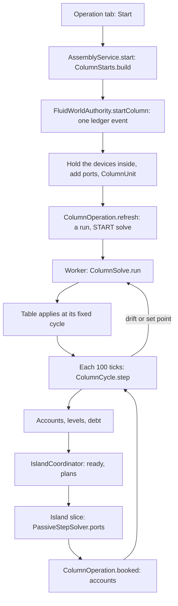

# Column operation: the column running in the built plant

**Snapshot:** 321b8d1d (branch `claude/column-operation-5c3005`), 2026-11-02 · **Updated:** 2026-11-02 (new chapter, batches 2026-10-28-column-operation and 2026-11-02-valve-hold)
Up: [code guide](README.md)

## Read this when

- A column's status reads `NOT READY`, `STARTING`, `LIMITED`, `UPSET` or `RE-SOLVING`, or a device says `COLUMN: part of the column at …, running`.
- Start refuses, or a port stands in the wrong place.
- A running column's rates, duties or accounts look wrong, or one of its boundary lines holds (the solver side of that: [fluid-science.md](fluid-science.md)).
- You change the split table, the cycle, a drift band, rule A or B, or the set points.
- You change a column unit's facts (`ColumnUnit`, fluid facts schema 6) or the operating point in a saved design (`ColumnOperatingPoint`, shape fields 4).
- You work on the Operation tab, or rebuild the review plant (`ColumnOperationReviewWorld`).

Not here: the tray solver ([column-v3.md](column-v3.md)), the parts check ([machine-assemblies.md](machine-assemblies.md)), the wall of the condenser ([heat-exchangers.md](heat-exchangers.md)), the island scheduler ([fluid-runtime.md](fluid-runtime.md)).

## In one paragraph

A real column takes feed and steam, and gives products at steady state after hours of holdup. The game does not march its trays. One V3 solve gives a **split table**: the share of each component that leaves by each product, the duties per mole of feed, and the state of each product. While a column runs, the devices inside its boundary valves are held. The boundary valves' column sides become **ports**: a VOID at each inlet and a GENERATOR at each outlet, on their own lane. Each port has an **account** of moles and energy. Inlets book what arrives into their accounts. Every 5 s of online time a **cycle** takes the feed the accounts hold, splits it by the table and credits the product accounts; the condenser closes the energy. The fluid network never sees the column: it sees a mass target on each boundary valve, set from the accounts. Each side reads the other through a fence of 22 s, so a column's products do not depend on when an island's job completes. When the feed, the steam or the set points leave their bands, a new V3 solve runs on the worker pool and its table applies at a fixed cycle.

## Class map

| Class | Role | Read it for |
|---|---|---|
| [Port](../../../src/main/java/com/wormzjl/icheme/science/column/operation/Port.java) | FEED, STEAM, OFF_GAS, SOUR_WATER, DISTILLATE, DRAW, BOTTOMS; saved by name; `inlet()`, `gas()` | Which ports exist |
| [Setpoints](../../../src/main/java/com/wormzjl/icheme/science/column/operation/Setpoints.java) | The player's numbers, a fact: design and set feed rate, condenser temperature, reflux ratio; reboiler, steam, draws and pumparounds per mole of feed. `of(point)`, `withFeedRate` (capped at the design rate), `intensivelyDiffers` | What the player sets |
| [PortConditions](../../../src/main/java/com/wormzjl/icheme/science/column/operation/PortConditions.java) | A port's pressure and temperature estimated from the design (`estimate`) | Why a port stands at its pressure |
| [SplitTable](../../../src/main/java/com/wormzjl/icheme/science/column/operation/SplitTable.java) | The table: `axis`, `products` (`Product`: port, index, recovery by component, temperature, pressure), `reboilerPerFeed`, `pumparoundPerFeed`, `condenserPerFeed`, `reference`, `held`. `of` builds it from a V3 result; `split`, `perFeed`, `product` | What one solve leaves behind |
| [ColumnCycle](../../../src/main/java/com/wormzjl/icheme/science/column/operation/ColumnCycle.java) | One cycle as arithmetic: `Account`, `Limit`, `Step`, `step` | Limits, rules A and B, the closure, the trip |
| [DriftBands](../../../src/main/java/com/wormzjl/icheme/science/column/operation/DriftBands.java) | The bands and `Trigger`; `check` | Why a solve started |
| [ColumnSolve](../../../src/main/java/com/wormzjl/icheme/science/column/operation/ColumnSolve.java) | The worker's job: `Job`, `Taken`, `Steam`, sealed `Outcome` (`Solved`, `Failed`); `run` | From a taken feed to a table |
| [OperationView](../../../src/main/java/com/wormzjl/icheme/science/column/operation/OperationView.java) | What the tab shows: `Phase`, `Stream`, `Duty`, `Solve`, `idle` | The tab's data |
| [ColumnOperation](../../../src/main/java/com/wormzjl/icheme/runtime/fluid/ColumnOperation.java) | The runs, on the server thread, without Minecraft: cycles, solves, plans, booking, the condenser's debt, `view`. `implements IslandCoordinator.Ports` | Everything between the table and the islands |
| [ColumnUnit](../../../src/main/java/com/wormzjl/icheme/runtime/fluid/ColumnUnit.java) | The facts of one column in the topology ledger: `Station`, `Totals`, `State` (engine state) | What is saved |
| [PortPlan](../../../src/main/java/com/wormzjl/icheme/science/fluid/network/PortPlan.java), `PassiveStepSolver.ports` | One slice's mass target on a port's valve; an outlet's generator stated at its product | How the network meets a port |
| [ColumnStarts](../../../src/main/java/com/wormzjl/icheme/runtime/assembly/ColumnStarts.java), `AssemblyService.start`/`stop`/`setpoints`/`operation`/`dismantled` | From a complete report to a start request | Start's refusals before the ledger |
| `FluidWorldAuthority.startColumn`/`stopColumn`/`editColumn`/`columnRemoved`/`columnView`, `PhysicalFluidTopology.PORT_LANE`, `Device.suspendedBy` | Start and Stop as one queued ledger event each | Start's refusals in the ledger, what is held |
| [ColumnOperatingPoint](../../../src/main/java/com/wormzjl/icheme/science/equipment/ColumnOperatingPoint.java) | The design's solved input, a shape field of `ColumnTrays` (`operating`): package, assay, components, feed, pressures, condenser, reflux, reboiler, steam, draws, pumparounds. `of(input)`, `fits`, `input(trays, diameter)` | What a column remembers from the calculator |
| [OperationColumn](../../../src/main/java/com/wormzjl/icheme/client/gui/common/OperationColumn.java) | The Operation page ([client-gui.md](client-gui.md)) | The page |

## Main flow

1. **Start.** The tab sends `AssemblyNetwork.Action.START`, a queued command (`AssemblyPresentation.act`). `AssemblyService.start` calls `ColumnStarts.build`, which reads the assembly report and the operating point and names each port: its boundary valve, its cell and its estimated conditions. `FluidWorldAuthority.startColumn` does the rest as one queued ledger event.
2. **Hold.** The event walks from the column's nozzles to the boundary valves. It marks each device on the way `withSuspendedBy(unit)` and adds one port device per station. It saves a `ColumnUnit`. Stations keep their accounts across a restart, and a restart keeps the player's set points if they are `compatible` with the design.
3. **First solve.** `ColumnOperation.refresh` makes a `Run` with status `STARTING`, and the first cycle asks for a START solve of the design. No seed goes in, and nothing moves until the table applies.
4. **Run.** See the steps of a cycle below. `RUNNING` means no limit acted. `LIMITED: <limit>, N %` means a cycle took less than the set feed. `UPSET: …` means the cycle took nothing. `RE-SOLVING: <trigger>; …` is added while a solve is pending.
5. **Stop.** Two phases. `ColumnOperation.stop` queues one event: the held devices are released and the ports go. The unit keeps running until that event commits (`committed`, from `Host.committed`), so what its ports take and give to the last slice is booked. A Start still queued goes first, the event queues behind it; a stop already queued has nothing left to edit. `standing` asks whether a port is in the active registry or named by a queued event (`WorldTopologyLedger.queued`), so a port placed and removed again in the queue still counts. Then it stops: the accounts stay on the unit, and the unit forgets its engine state. Contents of the held vessels are as they were.
6. **Removal.** `EquipmentStructure` dismantling calls `AssemblyService.removed` and `dismantled`; `columnRemoved` marks the unit `leaving` and stops it; when the stop commits, the unit goes and the ledger books its accounts and solids as destroyed. A layout refresh calls `removed` alone and keeps the unit. Reverting a report stops the column too.

Ports, stations and accounts

- `ColumnUnit` has `id`, `master`, `running`, `setpoints`, `stations`, `totals`, `condenser` and `state`. Its id comes from the ledger's identity counter (`WorldTopologyLedger.reserve`) and is never a device's. A unit is running only if its stations have devices. `MAXIMUM_STATIONS` is 16.
- `Station`: `port`, `index`, `device` (0 while stopped, and for a station its design lost, `ColumnUnit.lost`), `valve`, `account` and `solids`. The account is moles by component on the basis axis, and energy. `solids` is the inert solids at that port (crystals melt on arrival).
- A port device is a VOID (inlet) or GENERATOR (outlet) in the cell on the valve's column side, on `PhysicalFluidTopology.PORT_LANE` (15, one past the rack places), facing the valve, with the valve's geometry, one BULK port and spec `FluidDeviceSpec(1, T, P, nitrogen)`. The spec's composition means nothing: `PortPlan` states an outlet's product each slice.
- A port stands in for the held pipe block next to its valve, and joins the valve as that pipe did. `across` finds a port at `next.withLane(PORT_LANE)` first, so the valve's island ends on it.
- A held device joins nothing (`joins` is false if either end is `suspended()`). As built it still joins (`mechanicallyJoins`), so Stop needs no rebuild of the line. A held pipe has no island, and its status reads `COLUMN: part of the column at x, y, z, running`. A held vessel stands alone in a one-node island and keeps its contents (`ColumnSuspensionTest`).
- A port's pressure is `PortConditions.estimate` and stays there: V3's stage pressure, top pressure plus (j − 1) stage drops for tray j, the sump at the bottom tray's (the condenser's ports at the top pressure), at the feed's, the steam's or the condenser's temperature. The ledger keeps it; a solve does not move it. Only a product's temperature comes from the table.
- `OFF_GAS`, `SOUR_WATER`, `DISTILLATE`, `DRAW` and `BOTTOMS` are outlets. `ColumnStarts.port` maps the blueprint's `*_valve` slots to ports; a slot's index counts from 1 where a part repeats (`index==0?0:index-1`).

The cycle and the fence

Constants of `ColumnOperation`: `CYCLE_TICKS` 100 (5 s), `FENCE_TICKS` 440 (22 s), `INLET_AIM_SECONDS` 30, `BUFFER_SECONDS` 120, `SOLVE_SPACING` 600 ticks, `RETRY_TICKS` 600, 1200, 2400, `APPLY_TICKS` two cycles, `KEEP_TICKS` 2400, `CONDENSER_HOLD_SECONDS` 60, `APPROACH_KELVIN` 5, `TAKE_MARGIN` 1 − 1e-6.

A column and its islands advance on the online clock but do not advance together. An island's job can complete late. The fence keeps results the same whatever the job's timing:

- A cycle at tick *t* waits until each inlet's island is through *t*, and each outlet's and the water side's through *t* − fence (`portsThrough`; `IslandCoordinator.through` is true for a committed, certified, held, parked or suspended island, and with no island). It sees an arrival only up to *t*: `available` is the account less later arrivals, and an arrival span across *t* is shared by time.
- A slice starting at *s* reads a port's level as of *s* − fence (`Level` logs), and waits (`ready`) until the run has cycled past *s* − fence. An outlet's temperature is the table in force at the fence (`Run.tableAt`).
- A cycle already due runs from a booking. `schedule` also looks again a cycle later, because an island that holds books nothing.
- A cycle's first tick is the next multiple of 100, staggered by `floorMod(unit*37, 100)`. It is scheduled on `IslandScheduler.Kind.COLUMN_CYCLE`.

One cycle (`cycle`, then `ColumnCycle.step`):

1. Take the feed the accounts hold, up to the set rate over 5 s. Room in each product is `designFeedRate*BUFFER_SECONDS*perFeed(k)` less its account and what the outlet gave after the fence (`Gift`, `givenSince`), so a slow island's booking changes nothing; a full product cuts the feed. A water-cooled condenser has room as well (below).
2. `step` scales the feed by `alpha`, takes the steam by rule A or B, and splits feed and steam by the table. The condenser duty is the closure: energy out less energy in, less the reboiler and pumparounds, each at the table's ratio to the feed taken.
3. The step trips and takes nothing if the condenser would heat the overhead, or its duty departs more than 50 % (`TRIP_DEPARTURE`) from the solved one. Status `UPSET`; a CLOSURE solve is asked on the attempted take.
4. Otherwise accounts move, every inert solid that arrived by the tick moves to the bottoms, a `Credit` is logged, totals grow, the condenser's duty is owed, and new levels are logged. `save` writes the state after each cycle.

Plans (`plans`, called at an island's dispatch):

- **Inlet.** Rate from the level as of the fence. It aims to keep 30 s of the set rate in the account: `gain = clamp(1 + (aim − held)/aim, 0, 2)`, `target = rate*gain*molarMass`. An empty account meters at the design feed's molar mass (water for steam). With no molar mass the rate is 0 and the status says so.
- **Outlet.** `available` is the account less credits after the fence, its solids likewise. Its rate aims at 60 s of what the column produces: `rate = produced*clamp(mass/aim, 0, 2)`, capped by `mass/seconds*TAKE_MARGIN`, so an outlet cannot give more than the account holds. An empty account plans target 0. Composition is the account's; temperature the table's.
- `PortPlan(node, valve, massTarget, temperature, moles, solids)`; `moles` null for an inlet. `PassiveStepSolver.ports` runs after `sizeJunctionHoldups` and before `couple`: it restates an outlet's generator (composition, temperature, port pressure, its own volume, solids at their ratio to the moles) unless its shares match to 1e-12 and neither side holds solids, and it sets the valve to `ControlValve(MASS_FLOW, …, COLUMN_SENSOR, …)`. A target within `VALVE_DEADBAND` of the standing one stays; a target of 0 always applies. A bottoms holding solids therefore does not certify. A valve that bounds two columns takes the lower plan, and flow valves in series carry the lower target ([fluid-science.md](fluid-science.md)).
- `IslandCoordinator.sameControl` counts a port's planned regulator and the valve's own `FlowControl.Valve` of the same `targetPressure` as one control: a planned target is a slice input, not a change of the connection.

Booking (`booked`, at island commit): an inlet's EXCHANGE arrivals go into its account at once, logged as a `Span`. A crystal melts there (`melted`): its component, with its stored energy made true by its offset. An inert solid goes to the station's `solids`. An outlet's account is debited exactly what the step gave, by component, its energy by share, its solids by what left; the difference between given and debited energy goes to the condenser's total and is owed, and the gift is logged (`Gift`). An overdraw logs `column status=OVERDRAWN`.

Solves and the split table

- One solve pends at a time. SETPOINT and START are urgent; others wait `SOLVE_SPACING` from the last. After a failure, `retryAt` steps through `RETRY_TICKS`.
- A solve's table applies at `trigger tick + APPLY_TICKS`, however long the job took. The cycle at that tick waits for the outcome (`applied`). This is why results do not depend on the worker.
- A failed solve keeps the old table, with the note `the <trigger> solve failed (<reason>), the table of N s ago kept`. A solve that gives a product the column has no nozzle for is refused (`missingStation`).
- `request` builds `ColumnSolve.Job`. The feed taken is `taken(step, design)`, the last cycle's rates; a steam port's hydrocarbons count as feed. With no cycle to read, `designTaken` gives the design's feed scaled to the set rate. A START solve has no seed; later ones warm-start from the last solve's seed. The seed is not saved.
- `ColumnSolve.run` builds a V3 input on the network's package with the design's trays and the set ratios times the feed taken, and calls `calculateWithStrategy` with `V3SolveStrategy.AGGRESSIVE`. It runs through `ProcessSolveServices.submitColumnUnit` on the solve pool (`ColumnUnitCommand`, `ColumnUnitCompletion`). A deadline or a worker failure gives `Failed`; a shutdown gives `Failed("SERVER_SHUTDOWN")`.
- Feed water enters as steam at the feed tray if it can be stated 5 K (`SUPERHEAT`) above its boiling point and a steam slot is free. Otherwise it follows the distillate, and a note says so.
- A seed with wet trays is dropped.
- `SplitTable.of` maps the V3 streams: `overhead_vapor` to OFF_GAS, `distillate_liquid` to DISTILLATE, `free_water` to SOUR_WATER, `bottoms_liquid` to BOTTOMS, `side_liquid_tray_N` to DRAW. Each component's row sums to 1 within 1e-12. A component without solved feed borrows the row of the component nearest in normal boiling point; unsolved water goes to the distillate.
- `condenserPerFeed` is the closure on the network's energy basis, not V3's. V3's own duty stays as `solvedCondenser`. Table enthalpies are partial molar, by forward difference (`PARTIAL_STEP` 1e-5), shifted so they sum to the stream's enthalpy (Euler). A cycle prices a product as the sum of `n_i·h_i`, so no property call runs on the server thread.

Drift bands

`DriftBands.check`, in this order, on what a cycle took against the table's `Reference`:

| Trigger | Band |
|---|---|
| COMPONENT | a share over 1e-6 (`NEW_COMPONENT`), in the feed or a steam, of a component whose row the table borrowed |
| COMPOSITION | the feed's shares over 0.005 from the reference, summed |
| ENTHALPY | the feed's specific enthalpy over 1 K of its own slope from the reference |
| STEAM_RATIO | a steam's ratio over 2 % from the solved one, relative to the larger of solved and set |
| THROUGHPUT | the fed share of the design rate over 0.2 from the table's `alpha` |
| CLOSURE | the closed condenser duty over 3 % from the solved one |

`SETPOINT` comes first in `cycle`: `Setpoints.intensivelyDiffers` against the reference's set points. A change of feed rate alone is not a set-point trigger, because the column's equations are homogeneous in their extensive inputs; only THROUGHPUT reads the rate. `START` is the first solve.

Rule A and rule B

Steam short of its set ratio:

- **Rule B** (the default): take what steam there is; the product follows the table. Status `LIMITED: steam`. The cycle's steam ratio drifts, so a STEAM_RATIO solve follows.
- **Rule A**: a failed STEAM_RATIO solve sets `ruleA`. Steam then limits the whole take: feed and steam are cut together at the table's ratio. Status adds `, inputs cut together (rule A)`. A STEAM_RATIO solve that succeeds clears it. So does a cycle with no solve pending and no retry waiting: the next shortage tries rule B again.

`ColumnCycle.Limit` names the lowest room: NONE, FEED, STEAM, OUTLET, CONDENSER. Feed and outlets scale `alpha`. So does the condenser, under either rule.

The water-cooled condenser

- `ColumnStarts` finds the sides of the blueprint's `ColumnBlueprint.CONDENSER` unit by `EquipmentStructure.heatSides`, unless the design's condenser is an air cooler. The unit's `condenser` is the side outside the column whose partner is held inside. Without one it is 0, and the condenser's duty goes nowhere but the totals.
- The condenser's duty each cycle is owed to the water side: `coordinator.owe(side, partner, joule)` adds to the pair's heat in transit, the store of [heat-exchangers.md](heat-exchangers.md).
- `heatRead`: at dispatch, for the water side, `Read.column(due, seconds, ceiling)`, `due` being the transit less what was owed after *start* − fence, `ceiling` being the condenser temperature less `APPROACH_KELVIN` (at least 1 K). `ExchangerRelay.plan` then gives that heat back over the slice, no more than keeps the outlet at the ceiling; the rest stays owed.
- **Room:** `CONDENSER_HOLD_SECONDS*|condenserPerFeed|*designFeedRate` less the transit as of the fence, with what outlets booked after the fence left out (`Owed.booked`). A water side that does not take the heat fills the room, the step's `alphaCondenser` cuts the feed, and status reads `LIMITED: condenser`.
- A held side with no column read (a kettle's bundle, a pumparound cooler) reads `ExchangerRelay.Read.NONE` and moves no heat: those duties are the column's.
- `ColumnOperation.owed` entries and the wake at *tick* + fence are in memory. The transit is saved, by the coupling.

Saves and formats

- **Facts** (`FluidFacts`, schema 6): a registration's `suspendedBy`, and the world's column units by identity: id, master, running, set points, stations (port by name, index, device, valve, account, solids), totals, condenser, leaving. Corpus: `src/test/resources/compat/fluid/schema-6/`.
- **State** (state format 29, `FluidFacts.topologyState`): each running unit's `ColumnUnit.State`, after the queued events: table, enthalpies, `tableTick`, `applied`, `solvedCondenser`, levels and credits. It holds windows from the last `FENCE + KEEP` ticks. A state that does not validate is dropped; that unit solves again.
- On a rebuild, accounts and totals map onto the current axis, and solids onto the current records; a removed component or solid is booked. A component removed from a station's account takes its molar share of the account's energy, booked in `Restated`: an account has no temperature to restate at. Queued events do not survive this path, so `FluidFacts.settled` settles each unit on what stands: orphan port devices go, a `leaving` unit goes, booked. `refresh` then restores a run if the state's axis equals the current one and every product has a station; otherwise it starts over.
- Not saved: arrival spans, the condenser's `owed` entries, the seed, the pending solve, `solvedBy` and the wakes.
- **Shape** (`ColumnTrays.operating`, shape field 4): saved under `Operating` by `ColumnDesignTags.writeOperating`, read by `ShapeRepair.SavedOperating.resolve`. An unreadable one repairs to none (`operating point (…) -> none`). Corpus: `src/test/resources/compat/equipment/shapes-4.snbt`. A column with no point says "save it from the calculator again".
- `ColumnDesign.of` fills it from the input at Save design. The calculator's `Design`, the constructor's `Column` tag and the shell's tag carry it. `ColumnV3Network.writeDesign` sends it as an optional section; wire schema 17 and protocol `"13"` did not change.
- **Protocol:** `assembly-3`: `AssemblyView.operation`, `OperationPayload`. The tab's refusal is `AssemblyNetwork.REFUSALS`, per server, cleared at the next press, not saved.

The Operation tab's data

- `AssemblyNetwork.Host.view` adds `AssemblyService.operation(level, origin, refusal, opening)` to the assembly view, unless the column has no design. The view comes from the unit's `ColumnOperation.view`; if stopped, from the design's set points. It is `NOT_READY` with "a vacuum column cannot run yet" for a column with an ejector. Without an operating point it is null, and the tab shows a note.
- `view` is a read of the last cycle. Each station shows its rate over that cycle, temperature (the feed's along the table's slope, `reference.feedTemperature(h)`), pressure, how full its account is (an inlet against 30 s of the set rate, an outlet against its 120 s buffer) and the valve's opening (`FluidNetwork.opening`, NaN if there is none; a stored read, `FluidWorldAuthority.stored`, that advances no island). Duties show booked against the table at the set feed. `Solve` shows the trigger, warm or cold and the age.
- Start, Stop and Apply are `OperationPayload` commands, run on the presentation bucket. Every open screen of the master is answered. Apply sends values in the order feed, condenser, reflux, reboiler, steam…, draws…, pumparounds…; `AssemblyService.setpoints` clamps the feed to the design rate and refuses a wrong count. A set point is a fact; `FluidWorldAuthority.editColumn` queues it and the next cycle reads it.

Traps

- A column's cycle never runs on a packet or a menu. `ColumnOperation` is driven by the scheduler's due deadline and by island commits; `due` guards re-entry with `cycling`.
- The first cycle after a load can wait: a cycle needs its inlets through its tick.
- Never set a port's target from anything but `plans`. The fence is the only thing that keeps a run independent of job timing (`aColumnsProductsDoNotDependOnWhenItsIslandsJobsComplete`).
- A boundary valve's target changes each slice. Identity comparisons that decide "same line" must ignore a flow valve's target: `PassiveNetwork.Pipe.Identity.line` ([fluid-science.md](fluid-science.md)).
- `ScheduledTransfer` is not a port. It still has no runtime producer.
- A vacuum column (one with an ejector) does not run: `ColumnStarts` and `AssemblyService.operation` refuse it.
- A running column is mechanically still joined. If you walk the registry, read `suspendedBy` first.

## Change the layer that owns it

| Change | Layer |
|---|---|
| What a cycle takes, a limit, a rule, the trip | `ColumnCycle` (arithmetic only) |
| A band or a trigger | `DriftBands`, then `cycle` in `ColumnOperation` |
| What a table holds, how streams map | `SplitTable.of`, `ColumnSolve.run` |
| When a solve runs and applies | `ColumnOperation.request`, `applied` |
| A port's target | `ColumnOperation.plans`, then `PortPlan`, `PassiveStepSolver.ports` |
| A new port kind or a new refusal | `Port`, `ColumnStarts`, `FluidWorldAuthority.startColumn` |
| A saved field | `ColumnUnit` and `FluidFacts` (append only, corpus image; state: `FluidFacts.columnState`) |
| A condenser's heat | `ColumnOperation.heatRead`, `owe`; `ExchangerRelay.Read.column` |
| What the tab shows | `OperationView`, `ColumnOperation.view`, `OperationColumn` |

## Tests that pin it

- `science/column/operation/ColumnCycleTest` (6): components and energy close over a thousand cycles of drifting feed; rules A and B; a full buffer; the trip; the bands; the split's sum.
- `ColumnSolveTest` (2): a START solve's table closes a cycle on the network's basis; half the feed at a prescribed drop gives the same table.
- `science/column/operation/PortConditionsTest` (3): a port stands at V3's stage pressure, the sump at the bottom tray's, the condenser's ports at the top.
- `runtime/fluid/ColumnRunTest` (25, three on a Stop or a dismantle while another event is queued): conservation through a running column downstream; the view is a read; products independent of job timing, also at a full buffer with one slow island; a table applies at the second cycle; set-point solves and failed solves; a reload resumes without a solve; a blocked product; rules A and B; the condenser's duty and a shortage of cooling water; Stop and dismantling; a pump on the feed line; a held port; solids and crystals; a station its design lost; a second flow valve on a product line; one column's outlet into another's inlet.
- `runtime/fluid/ColumnSuspensionTest` (2): a port splits the line; Stop joins it with every vessel as it was; two ports cannot share a place.
- `runtime/fluid/RegulatingValveHoldTest` (7): the column's boundary lines regulate at any ratio; targets on running islands; a liquid product into its line's gas ([fluid-science.md](fluid-science.md)).
- `FluidFactsCompatTest`, `EquipmentShapeCompatTest`, `AssemblyNetworkCodecTest`, `AssemblyPresentationTest`, `OperationColumnTest`: formats, commands, the page.
- GameTest `ColumnOperationGameTests.aMenuReadAdvancesNoIsland` (batch `column-read`): a stored read leaves a resting island's clock where it stands, and a live read, the control, moves it.
- GameTest `ColumnOperationGameTests.aColumnRunsInItsPlantStopsAndLeaves` (batch `column-operation`): in the review plant, Start, the design feed with its ports splitting islands, cooling water warmed by Q/(m·c_p), a blocked product cuts the feed, Stop keeps the contents, dismantling books the accounts.
- `ColumnOperationReviewWorld.aCrudeColumnRuns` (`runReviewWorldServer`, namespace `icheme_review`): a hand review, not a gate; a full plant at 1/16 of the feed, water-cooled, `review_operation` lines each 600 ticks. Its `Rig` builds the GameTest's plant.

Off-line tools: `tools/column-operation/` (the table's bench), `tools/valve-hold-probes/`.

## Terms

| Term | Meaning |
|---|---|
| Column unit | One column's facts in the ledger, `ColumnUnit` |
| Held | A device with `suspendedBy` set: inside a running column, out of the islands |
| Port | A VOID or GENERATOR on the boundary valve's column side, lane 15 |
| Station | A port's record in the unit, with its account |
| Account | Moles by component and energy a port holds |
| Cycle | One 100-tick step of the column |
| Fence | 440 ticks: how far back each side reads the other |
| Split table | The product of one solve; per mole of feed |
| Rule A, rule B | Steam short: cut all inputs together, or take the steam as it is |
| Closure | The condenser duty that closes one cycle's energy |
