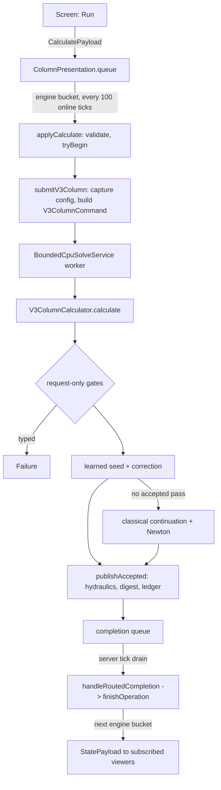

# V3 distillation column calculator

**Snapshot:** d2e4ae40 (main, mod 0.16.0), 2026-10-27 · **Updated:** 2026-10-27 (batch `2026-10-27-column-pressure-drop`: aggressive interactive solves now apply the bounded hydraulic correction before publication, so the inspection pressure profile and tray-hydraulics summary agree) · earlier: 2026-10-27 (batch `2026-10-27-constructor-import`: the constructor's Import is a `ConstructorPayload` with `IMPORT`; no column change)

Up: [code guide](README.md)

## Read this when

- A column result is wrong, missing, slow or rejected, and you need to know which stage (admission, seed, continuation, Newton, audit, hydraulics, publication) decided it.
- You add or change a column feature: an equation family, a specification, side draws, steam, pumparound heat, tray pressure drop, a property package or a preset.
- You touch the calculator block, its packets, its saved NBT, or the worker service that runs a column solve.
- You change Save design: what a design holds and when it is refused. The constructor's Import and the plant around the column are in [equipment.md](equipment.md) and [machine-assemblies.md](machine-assemblies.md).
- You need to know what a published label, digest or audit check means before trusting a number in the GUI.

## In one paragraph

Physically, the block simulates a crude-oil atmospheric distillation column at steady state: a hot hydrocarbon feed enters a stack of equilibrium trays; vapour rises, liquid falls; a partial or total condenser at the top (node 0) runs at a specified temperature and reflux ratio, and a reboiler/sump at the bottom (node N+1) takes a specified duty. Liquid products can be drawn from trays, stripping steam can be injected low in the column, pumparound coolers remove heat from tray zones, and water that condenses on cold upper trays forms a separate immiscible free-water phase. The steady state is the one where every tray closes its component balances, vapour-liquid equilibrium (Peng-Robinson 1978) and energy balance at once (MESH). In code, the player edits an immutable SI [`V3ColumnInput`][input]; the server validates it, freezes it into an operation, and runs [`V3ColumnCalculator.calculate`][calculator] on a bounded CPU worker. The calculator builds a seed (a bundled learned Transformer by default, a classical sequential initializer as backup), walks continuations from an easy surrogate to the authored request, corrects with a damped banded Newton solver, re-audits the candidate from scratch, optionally re-solves once on a flow-dependent tray pressure profile, and returns either an accepted result or a typed failure. The server commits it to the block entity only if the operation still matches, and the GUI receives it on the engine's 5-second presentation schedule.

## Class map

Paths are under `src/main/java/com/wormzjl/icheme/`. "pp" = package-private.

| Class | Role | Read it for |
| --- | --- | --- |
| **Game glue** | | |
| [ColumnCalculatorV3Block][block] | Block; opens the menu on use, creates the block entity | Nothing else lives here |
| [ColumnCalculatorV3BlockEntity][be] | Server-owned state: input, revisions, status, active operation, last display result; NBT; exact current-axis check of a saved input (`requireCurrent`, no migration) | `tryBegin`, `finishOperation`, `failOperation`, `state`, `published`, `loadAdditional`, `requireCurrent`, `V3Status`; `setRemoved` (a removal or chunk unload cancels the active operation's solve); `currentInput()` (read-only: the stored `V3ColumnInput`); `savedDesign()` / `saveDesign(design)` (the `ColumnDesign` the player saved, which the equipment constructor's Import reads; NBT `Design`; a save bumps the state revision) |
| [ColumnInputPreset][preset] | Preset identity; definitions come from the material catalog, Holland is built in code | `fromId`, `input(catalog)`, `descriptors` |
| [ColumnCalculatorV3Menu][menu] | Slot-less menu bound to a block position | `stillValid` |
| [ColumnV3Network][network] | Payload registration, wire codecs, server validation, completion commit; Save design (`sendSaveDesign`, `applySaveDesign`: `ColumnDesign.of`, a refusal sent as `NOT_SAVED: <reason>`) | `applyCalculate`, `validateResolvedInput`, `handleRoutedCompletion`, `writeInput`/`readInput`, `writeDesign`/`readDesign` |
| ColumnPresentation (pp, [file][presentation]) | Per-player sessions on a `PresentationMailbox`; queues commands and publishes state at engine buckets | `queue`, `tick` |
| [V3EditorCatalogCodec][catalog-codec] | Bounded byte form of the editor templates and molecular weights | `encode`/`decode` |
| [V3InspectionCodec][inspection-codec] | Bounded byte form of per-node inspection + audit, shared by wire and NBT | `encode`/`decode` |
| [ProcessSolveCoordinator][coordinator] | The one server-thread router of worker completions | `drainCompletedCalculations`, `stopCalculations` |
| [ProcessSolveServices][services] | Lifecycle adapter; builds the immutable `V3ColumnCommand` at admission | `submitV3Column`, `V3ColumnCommand.solveInCatalog`, `drainCompletions` |
| [BoundedCpuSolveService][service] | Generic bounded worker pool: one job per owner, ready queue, deadlines, cooperative cancellation (`CancellationToken` has one method, `throwIfCancellationRequested`) | `trySubmit`, `Admission`, `TerminalStatus` |
| **Contract and problem** | | |
| [V3ColumnInput][input] | Immutable SI request (schema 1) | Units, limits, `usesTrayHydraulics` |
| [V3ColumnSpecification][spec] (nested `ControlledQuantity`) | The three controls: condenser outlet T, organic reflux ratio, reboiler duty | Sign/units |
| [V3SideDrawSpec][draw-spec], [V3SteamFeedSpec][steam-spec], [V3PumparoundSpec][pa-spec] | Feature rows, plus their pp static arithmetic: draw withdrawal, steam node feeds and upward vapour profile, pumparound stage heat | Index rules, `Split`; the same numbers in residual, audit, streams |
| [V3ColumnProblemResolver][resolver] | Validates input, builds topology and pressure profile, proves the DOF ledger | `validateInput`, `resolve(input, branch[, profile])` |
| [V3ColumnProblem][problem] | Resolved immutable numerical problem (pressures, support, wet set, water profile); nested `WaterCondenserRegime` | `waterVaporFlow`, `nodePressurePascal` |
| [V3ColumnTopology][topology] | Node map and condenser branch | Which node has which unknowns/rows |
| [V3DegreeOfFreedomLedger][ledger] | Enumerates unknowns and rows, checks count and structural rank, fixes ordering; nested `ContractDiagnostic` | Any equation change |
| [V3ComponentBasis][basis], V3ActiveComponentBasis (pp) | Public hydrocarbon axis (max 64) / zero-feed elimination | Index mapping |
| V3LiquidSupplyScreen (pp) | Request-only per-tray liquid-supply check | Draw-wall rejections |
| V3HeatFeasibility (pp) | Necessary bounds on authored cooling | `INFEASIBLE_SPECIFICATION` for heat |
| V3OperatingDomainValidator (pp) | Pressure profile vs package envelope; may ask for pressure continuation | `PROPERTY_OUT_OF_RANGE` |
| **Orchestration** | | |
| [V3ColumnCalculator][calculator] | Stateless facade: admission, learned route, classical continuations, recovery, hydraulics, publication; `projectedSeedOrPrevious` (bubble-point projection of a seed) | Start here for any solve question |
| [V3InitializationOptions][init-options] | Learned/classical mode, wet start, budgets, correction rule (`Correction.PROGRESS`) | Config mapping |
| V3TruncationFallback (pp) | Retries a failed chain with the optional cutoff off | Positive-cutoff runs only |
| [V3SolveControl][control] | Cooperative checkpoint (cancellation/deadline) | Where a solve can stop |
| **Seeds** | | |
| V3ColumnInitializer (pp) | Classical seed, `Mode` `SEQUENTIAL_MATERIAL_VLE` (stage continuation, condenser probe) or `MATERIAL_CLOSED` (fallback, neural anchor); `projectMaterialBalancesAtFixedTemperature` | Cold starts |
| V3EnergyShiftPredictor (pp) | Temperature-only energy correction at fixed flows (<= 40 K/tray) | Steam/heat rung handoffs |
| [V3NeuralInitializer][neural-api], [V3NeuralRegistry][neural-registry] | Learned-seed interface; registry with the bundled loader (`bundled()`) and the SHA-pinned payload reader (nested `TransformerArtifact`); `bind` returns `UNAVAILABLE` for a package that admits crystals, so the classical seed is used; the sidecar keys no longer include `physicsFingerprint` | Model coverage and fallback |
| V3AnchorTransformerInitializer (pp, nested `NativeAnchor`); [V3NeuralSeed][neural-seed], [V3GeneralNeuralFeatures][gen-features], [V3FactorizedNeuralFeatures][fac-features] | The shipped Transformer and its input anchor, the seed object; `supported` needs the reference package's `scientificRevision` to equal the model's `propertyRevision` (the sidecar carries the composed identity) and `MaterialCatalog.samePhysics(input package, reference package, model axis)` ([thermo-materials.md](thermo-materials.md)); `V3GeneralNeuralFeatures` is the input encoding only (`global`, `nodes`, `globalWidth`, `nodeWidth`, `branchIndex`), `V3FactorizedNeuralFeatures` the output side (`decode`, `targets`, `outputWidth`) | Inference internals |
| **Equations and Newton** | | |
| V3DryMeshState (pp) | Internal state: component L/V flows, T, free water | Never leaves the solver |
| V3DryMeshCoordinateMap (pp) | Log-flow / kelvin Newton coordinates in ledger order | Scaling |
| V3MeshResidualEvaluator (pp), V3MeshResidual (pp) | MESH residual assembly and scaled vector | Equation definitions |
| V3SimultaneousColumnSolver (pp) | Damped Newton, Armijo search, fallbacks, final-step certificate; nested `NewtonTrace` observer | `solve`, `RungBudget`, `Attempt` |
| V3BlockJacobianAssembler, V3BlockJacobian, V3StageBlockLayout (pp) | Stage tri-block Jacobian: exact material rows + local thermo probes (`assembleLocal`); off-band guard | Jacobian bugs |
| V3FiniteDifferenceJacobian (pp) | Whole-system FD Jacobian (`evaluateCompact`, `evaluate`) | Coarse-FD recovery; the FD oracle of the tests is `V3JacobianOracle` in the test tree |
| V3NormalEquations (pp) | Damped normal-equation trials | Stalled steps |
| [V3BandedMatrix][banded], [V3BandedPivotedSolver][banded-solver] | Band storage; row-equilibrated LU with pivoting inside the band | Linear failures |
| V3TruncationSupport (pp), V3StageEquilibriumRatios (pp) | Per-phase support (BOTH/LIQUID_ONLY/VAPOR_ONLY/ABSENT); floor refresh decisions | Trace components |
| V3WetTraySet (pp), V3FreeWaterContinuation (pp) | Wet-tray set; parametric free-water search | Steam columns |
| V3CondenserPhaseTransition, V3CondenserComponentPhases (pp), [V3CondenserPhaseBranch][branch], `V3ColumnProblem.WaterCondenserRegime` (pp) | Condenser phase logic (hydrocarbon branch and water regime are separate) | Condenser failures |
| **Acceptance and output** | | |
| V3AcceptanceAuditor (pp), [V3AcceptanceAudit][audit] | Fresh physical audit of a candidate; checks + advisories | Families listed below |
| [V3ConvergenceEvidence][evidence] | Final Newton step certificate | Closure gates |
| [V3TrayHydraulics][hydraulics], [V3TrayHydraulicsSummary][hyd-summary] | Sieve-tray pressure drop and flooding on the accepted state | Pressure profile, flood % |
| [V3ColumnResult][result], [V3ColumnOutcome][outcome], [V3SolverDiagnostics][diagnostics], [V3SolverFailureCode][failure-code] | Accepted result / typed outcome / bounded evidence; eight failure codes (`INVALID_INPUT`, `INFEASIBLE_SPECIFICATION`, `PROPERTY_OUT_OF_RANGE`, `INITIALIZATION_FAILURE`, `LINEAR_SOLVE_FAILURE`, `NONCONVERGENCE`, `ACCEPTANCE_AUDIT_FAILURE`, `INTERNAL_ERROR`) | What the worker returns |
| [V3ColumnStreamProperties][streams], [V3ColumnDutyLedger][duty-ledger], [V3ColumnInspection][inspection] | Products (<= `MAX_STREAMS` = 4 + `V3ColumnInput.MAX_SIDE_DRAWS` = 8 streams: overhead vapor or water vapor, liquid distillate, bottoms, free water, one per side draw), energy summary, per-node profile | GUI numbers |
| [V3ColumnDisplayResult][display] | Persistable, sendable presentation certificate | NBT and wire result |
| [V3InputDigest][digest] | SHA-256 of resolved input + revisions | Result identity |
| [V3EditorCatalog][editor-catalog] | Server-authored editor templates + molecular weights | Editor data |
| **Thermodynamics (`v3/thermo`)** | | |
| [V3ThermoModel][thermo-api], [V3ThermoDerivatives][thermo-deriv] | Hydrocarbon property boundary (fugacity, enthalpy, TP flash); the phase argument is `PengRobinsonKernel.Root` | Any property call |
| [V3PengRobinsonThermo][thermo] | PR78 facade on a registered package | `fromRegisteredPackage`, `flashTP` |
| V3PengRobinsonSession (pp) | Adapts a package onto the shared `science.thermo.PengRobinsonKernel` | Kernel inputs |
| V3PropertyPackage, V3CatalogPropertyPackage (pp) | Package data read from the material catalog (PR78 only); `V3CatalogPropertyPackage.require(packageId)` is the package lookup. Refuses a package that admits crystals (`CrystalPhasesUnavailable`, consumer "the V3 column") and a package with a reference spine (`IdealGasFitUnavailable`), whose records carry no `shifted_polynomial_5` fit; both are `IllegalArgumentException` | Data provenance, package admission |
| [V3CrudeFeed][crude-feed] | Normalized assay vector (mole, mass or standard-liquid-volume basis) | Preset feeds |
| V3FeedFlash, V3TruncatedFlash (pp, nested `Support`); [V3FlashResult][flash-result], [V3FlashTruncationEvidence][flash-evidence] | Rigorous TP flash; optional reference-checked truncated flash | Feed phase |
| [V3WaterProperties][water] | Wagner-Pruss saturation + Shomate enthalpy for free water, data from the catalog. `saturationPressurePascal` is the column's, with a checked range; the unchecked `wagnerPruss` (0 < T ≤ Tc, the supercooled branch below the triple point) serves the fluid network's free water, which also calls the enthalpies (`FluidThermodynamics`, `NetworkPhaseEngine`) | Steam/water rows |
| [V3ThermoWorkspace][workspace], [V3ThermoException][thermo-ex] | Caller-owned scratch; typed property failure | Thread safety |
| **Benchmark** | | |
| [V3HollandExample32][holland] | Fixed Holland (1981) Example 3-2 input and facade | Package `icheme:holland_b12` |
| IndependentHollandMeshOracle, HollandB12Thermo, HollandExample32Data (pp) | Independent equations, book K/H fits, scan transcription | Benchmark only |

## Main flow

1. The screen sends `CalculatePayload(blockPos, nonce, expectedInputRevision, input)` via `ColumnV3Network.sendCalculate`. The handler does not act: `ColumnPresentation.queue` subscribes the player's session and stores one pending action (a second unacknowledged command is rejected with "A request is already awaiting the engine"). If no `FluidWorldAuthority` engine exists, the packet is dropped.
2. At the next 100-online-tick bucket, `FluidWorldAuthority.tick` calls `ColumnV3Network.presentationTick`, which runs the queued `applyCalculate`: re-resolve player, menu and block; `validateResolvedInput` (Holland package: `V3HollandExample32.validateInput`; otherwise package axis equals server package axis, exactly three controls, `V3ColumnProblemResolver.validateInput`); `calculator.tryBegin` (rejects a stale revision or a busy block); `ProcessSolveServices.submitV3Column`. `V3PengRobinsonThermo.fromRegisteredPackage` throws for a package with crystals or a reference spine (`V3CatalogPropertyPackage`); the request is then rejected `REJECTED_INPUT: Package … admits crystal phases …` before `tryBegin`. With the bundled data the GUI cannot reach this case: no column preset or assay names `pilot_cryogenic`.
3. `submitV3Column` reads the four `columnV3` config values on the server thread, takes the bundled neural model (`IChemE.columnV3NeuralModel` → `V3NeuralRegistry.bundled()`), and admits an immutable `V3ColumnCommand` carrying input, cutoff fraction, closure fraction, initialization options, model, screen ratio and the `MaterialCatalog` snapshot. Non-acceptance (`OWNER_BUSY`, `QUEUE_FULL`, `STALE_EPOCH`, `STOPPING`) fails the operation immediately.
4. On the worker, `V3ColumnCommand.solveInCatalog` routes the Holland package to `V3HollandExample32.calculate` (unless mode is `LNN_ONLY`) and everything else to `V3ColumnCalculator.calculate(input, control, cutoff, closure, options, model, screenRatio)`, inside `MaterialRuntime.with(catalog, …)`.
5. `calculateInCatalog` (learned route): `validateInput`, the liquid-supply screen and static cooling admission; then the model's candidates are corrected by `correctNeuralSeed` under a shared learned budget (default 2 s). A candidate whose audit carries a water-dew-point advisory is kept but the loop looks for a clean one. If nothing is accepted, `LNN_ONLY` returns the failure and `LNN_FIRST` makes one clean classical restart from the original input.
6. Classical route (the 5-argument `calculate` → `calculateInCatalog(input, control, policy, ratio)`): `requestOnlyAdmission` (total draw < feed, liquid-supply screen, static cooling), `preferredCondenserBranch` (seed flash of a 4-tray surrogate), then `calculateBranch` → `solveStageContinuation` or `solvePressureContinuation` → feature ramp (`recoverWithDrawRamp`) → `solveSingleProblem` per rung; fallbacks are a material-closed cold seed, bubble-point recovery (`recoverWithBubblePointProjection`, which projects the seed with `projectedSeedOrPrevious`: `V3ColumnInitializer.projectMaterialBalancesAtFixedTemperature`, and the previous state on a thermo or invalid-state failure) and a coarse-FD recovery. If the preferred condenser branch fails, the alternate branch is tried once.
7. Every rung's `solveSingleProblem` flashes the feed, prepares support and wet set (`prepareAttempt`), runs `V3SimultaneousColumnSolver.solve`, audits with `V3AcceptanceAuditor`, and may refresh floor support (<= 3) or the wet set (<= 3).
8. `publishAccepted` is the single publication seam for both routes: `trayHydraulics` (if diameter > 0), then `V3ColumnResult.accepted(...)` with `V3InputDigest`, `V3ColumnDutyLedger.fromAccepted`, streams and inspection.
9. The server tick (`IChemE.onServerTickPost` → `ProcessSolveCoordinator.drainCompletedCalculations`, at most 64 completions per tick) routes the completion to `ColumnV3Network.handleRoutedCompletion`, which calls `finishOperation` or `failOperation`; a mismatched operation is logged `STALE_RESULT` and dropped.
10. At the next bucket `ColumnPresentation.tick` sends a `StatePayload` to each valid session whose `stateRevision` changed or that asked for a refresh.

Data model, indexing and units

| Quantity | Unit / rule |
| --- | --- |
| Feed | Component molar flows, mol/s, on the package's public axis (not fractions) |
| Temperature / pressure | K / Pa absolute |
| Duties | W, positive into the column; pumparound coolers are negative |
| Reflux | `L/D`: organic reflux over external organic liquid distillate |
| `stageCount` | Interior equilibrium trays, 0..64 (`MIN_STAGE_COUNT`..`MAX_STAGE_COUNT`). 0 is a "pot": condenser + sump only (since wire 15) |
| Feed tray | 1..stageCount+1 (the sump is allowed) |
| Side draws | <= 4 (`MAX_SIDE_DRAWS`, 3 before 0.8.0); tray 1..N; total < feed |
| Steam | <= 2; stage up to N+1 (sump); >= 5 K superheat at injection pressure; total <= feed; zero reboiler duty needs sump steam |
| Pumparounds | <= 4 (`MAX_PUMPAROUNDS`); `1 <= return <= draw <= N`; finite nonzero duty; `RETURN_TRAY` or `UNIFORM` split |
| Column diameter | 0 = prescribed uniform drop; (0, 15] m = sieve-tray hydraulics. Presets use 8 m |

Nodes: `0` condenser (temperature specified, no T unknown, no energy row), `1..N` trays, `N+1` sump. Nominal pressures: condenser and tray 1 at top pressure, tray `j` at `P_top + (j-1)·drop`, sump equals tray N (`V3ColumnProblemResolver.pressureProfile`). The GUI and the log show *total* trays `N+2` and feed `f+1` (`ColumnV3Network.logTerminal`).

State: hydrocarbon liquid and vapour component flows per node, temperatures, and free-water flows on wet trays. Water is not on the hydrocarbon axis; its vapour is derived from the authored upward steam profile plus free water from the tray above (`V3SteamFeedSpec.upwardVaporProfile`, `V3ColumnProblem.waterVaporFlow`). A side draw takes fraction `S/L` of the tray's liquid before withdrawal; free water is not drawn with it.

Pumparounds model the heat effect only: no circulating stream, no return temperature.

Equations and algorithm

**Rows** (`V3MeshResidualEvaluator`, ordered by `V3DegreeOfFreedomLedger`): component material balances (scaled by local throughput), hydrocarbon VLE with a log water-dilution correction, tray and sump energy balances (stage heat, steam enthalpy, free-water transport), and one water-saturation row per solved wet tray. Summation is implicit via normalized compositions. Unknown counts depend on support and wet set; use the ledger, not a formula.

**Support.** An always-on floor `TRACE_FLOOR_FRACTION = 1e-10` of the component flow scale removes negligible points even at cutoff 0. Support is fixed inside one Newton solve and refreshed between solves (reinsertion hysteresis ×10, at most 3 refreshes, at most 1 after a stall with a `128/8 = 16`-iteration polish budget). A positive optional cutoff also enables `V3TruncatedFlash` and the `V3TruncationFallback` retry.

**Wet trays.** A tray whose vapour is supersaturated in water gains `F_n` and `SAT(n)`; the telescoped balance `W_n = steam at or below n + F_(n-1)` keeps the Jacobian banded. The sump is never wet. `V3FreeWaterContinuation` holds `F_n` as parameters (4 sweeps, 12 solves per tray, 6 admitted trays) before a certifying simultaneous solve; parametric states never publish.

**Continuations** (`V3ColumnCalculator`):
- Stage grid: 4, 8, 15, then 30 doubling, then the request (`continuationStageCounts`; 40 trays → `4-8-15-30-40`). Feature-bearing requests first solve a surrogate without draws and stage heat, with steam replaced by surrogate reboiler duty.
- Pressure: top pressure <= 100 kPa starts from a 150 kPa anchor; 10 kPa steps above 110 kPa, 5 kPa below (feature cases 5 kPa throughout).
- Feature ramp at full geometry: steam → heat → draws; 4 heat increments (subdivided at most 4 times, 2 per rung), 8 draw increments when heat is authored. Intermediate steam rungs use `INTERMEDIATE_RUNG_BUDGET` (stop if the residual has not halved over 12 iterations, floor 1e-3).
- Only the authored request at requested geometry, with a solved (not parametric) wet set, may publish (`publishesRequestedGeometry`).

**Newton** (`V3SimultaneousColumnSolver`): banded direction from local stage blocks (exact material derivatives + local thermo probes) or the stage-colored FD Jacobian; Armijo coefficient 1e-4, 20 line-search steps (40 for coarse recovery); damped Gauss-Newton and normalized-gradient fallbacks limited to 0.25 log-flow / 10 K per step. A converged attempt must also pass `verifyFinalNewtonCorrection`.

**Tray hydraulics** (`V3TrayHydraulics`, revision `v3-sieve-tray-bennett-r1`): orifice dry drop, Bennett-Agrawal-Cook clear liquid, Fair flooding (Lygeros-Magoulas fit), fixed tray preset (0.6 m spacing, 10% downcomer, 10% holes, 50 mm weir, 12.7 mm holes). The profile is marched from the accepted traffic; if the total drop differs from the nominal by more than 10%, the request is re-solved once warm (half step, then full step), within a 10 s / 64-iteration sub-budget. This correction is also required on the aggressive interactive route so its inspected node pressures and hydraulic summary describe the same profile. Any failure here publishes the first accepted state with a warning; hydraulics cannot fail a request, not even on cancellation.

Contracts and invariants

- Workers never see Minecraft objects. Configuration and the material catalog are captured at admission; reloads do not affect an in-flight solve.
- A seed (learned or classical), a continuation rung, a parametric water state and a stored display result are never results. Success requires: reached the requested problem, `Attempt.Converged`, `audit.accepted()`, and `satisfiesGates(closure)` (`calculateBranch`, `publishesSuccess`).
- Convergence gates (`V3ConvergenceEvidence`): scaled residual and final log-flow change <= closure (default 1e-8, max 1e-3); linear backward error <= 1e-12 regardless of closure.
- Audit families (`V3AcceptanceAuditor`): `FINITE_TOPOLOGY`, `LOCAL_COMPONENT_BALANCE`, `EQUILIBRIUM`, `ENERGY_BALANCE`, `GLOBAL_ENERGY_BALANCE`, `CONDENSER_PHASE`, `CONDENSER_ENERGY_BALANCE`, `SIDE_DRAW_SPLIT`, `TRUNCATION_MASS_DEFECT`, `PHASE_TRUNCATION_DEFECT`, `WATER_PROFILE`, `WATER_BALANCE`, `WATER_DEW_POINT`, `FREE_WATER_SPLIT`. A dry tray below its water dew point passes with a warning (owner decision); an invalid modeled wet tray fails.
- `INFEASIBLE_SPECIFICATION` is raised only by request-only gates. State-dependent heat bounds (`PathDependentHeatBound`) publish `NONCONVERGENCE`, because another seed might succeed.
- `finishOperation`/`failOperation` commit only when `activeOperation` equals the completed operation. `tryBegin` clears the previous display result: there is no "retained result" during or after a new run.
- `PresentationMailbox` is server-thread only; commands run before publication in the same bucket so all viewers see one settled state.
- Column numerics use `science.math.DeterministicMath` (StrictMath-equivalent `log/exp/pow`) so results are bit-identical across JVMs (batch 2026-09-27-jdk-determinism).
- The column is a vapour-liquid algorithm without crystal equations. It refuses a package with crystals or a reference spine, typed (`CrystalPhasesUnavailable`, `IdealGasFitUnavailable`), and never runs it fluid-only. The fluid network may run such a package (`pilot_cryogenic`, through a datapack override of the network record) while the column keeps to its column packages (`CrystalPackageConsumersTest`).

Configuration and constants (current defaults)

`icheme-common.toml`, defined in [IChemE][bootstrap]:

| Key | Default | Range / meaning |
| --- | --- | --- |
| `solver.workers` | 0 | 0 = automatic by demand (limit `automaticWorkerLimit`, default 12); 1-32 fixed. Shared with fluid islands |
| `solver.readyQueueCapacity` | 8 | 1-32 |
| `solver.deadlineMilliseconds` | 45,000 | 100-60,000; from admission, includes queue time; polled cooperatively |
| `solver.gracefulShutdownMilliseconds` / `forcedShutdownMilliseconds` | 1,000 / 1,000 | 0-10,000 |
| `columnV3.initializerMode` | `LNN_FIRST` | `LNN_ONLY`, `CURRENT_ONLY` |
| `columnV3.lnnWetStartMode` | `AUTO` | `DRY_START`, `PREDICTED_WET` |
| `columnV3.lnnMaxCorrectionIterations` | 16 | 1-128 (progress rule may extend to 48) |
| `columnV3.lnnBudgetMilliseconds` | 2,000 | Never extends the request deadline |
| `columnV3.stageTraceCutoffMolPercent` | 0 | 0-1 mol%; 0 is exact off |
| `columnV3.columnV3ConvergenceClosurePercent` | 0 | 0-0.1%; 0 keeps 1e-8 |
| `columnV3.columnV3LiquidSupplyScreenRatio` | 0.30 | 0-1; 0 leaves only the `rho >= 1` rejection |

Fixed in code: `MAXIMUM_NEWTON_ITERATIONS = 128`; correction rule `Correction.PROGRESS`, the only rule (extension blocks of 8 to 48, stop when the residual has not fallen below 0.9× over 8 iterations above 1e-6); no learned recovery stage after the candidates; presentation period 100 online ticks; 64 completions drained per tick.

Data: presets and packages are JSON under `src/main/resources/data/icheme/materials/` (see [thermo-materials.md](thermo-materials.md)). The bundled catalog holds nine packages: the eight column packages and `icheme:pilot_cryogenic` (N2, CH4, C2H6, CO2, the CO2-I crystal, reference spines). The pilot has no assay, so no column preset or editor template names it. The fresh-block preset is `default_column_preset` in `networks/default.json` = `tia_juana` (package `icheme:tjl20_methane`, 40 trays, feed tray 37 at 638.15 K, 250 kPa, zero drop, 8 m diameter, draws on 10/18/28, sump steam 333.3 mol/s at 533.15 K, three uniform coolers 8-10/16-18/26-28 at -12.84/-17.89/-11.20 MW, condenser 332.15 K, reflux 4.17, reboiler 0 W). Visible column presets: Tia Juana, WTI light export, Upper Zakum, Bonga, Dalia, Cold Lake blend, Tia Juana Light + nitrogen (`tia_juana_nitrogen`, order 6: the Tia Juana operating point on package `icheme:tjl20_methane_nitrogen`; its assay carries no nitrogen, but as a visible preset it makes that package an editor template, so the client mixture with 2 % N2 loads), plus Holland. `literature_tia_juana` (package `tjl19_dwsim`, the Ledezma-Martinez 2019 reconstruction) is hidden; the test fixture `V3TestInputs.literatureCduInput()` loads it. The learned model is `regrouped-seed-17041-epoch-160` from `src/main/resources/data/icheme/neural/registry.json`. It keeps three side-draw slots (`V3GeneralNeuralFeatures`, `V3AnchorTransformerInitializer.supported`: more than 3 draws is unsupported) and its component axis has no Nitrogen, so a 4-draw input and any input on `tjl20_methane_nitrogen` are declined by the model (`predict` empty) and solved from the classical seed.

Persistence and wire formats

| Format | Version | Where |
| --- | --- | --- |
| Scientific input schema | `V3ColumnInput.SCHEMA_VERSION = 1` | Wire, NBT, digest |
| Wire schema | `ColumnV3Network.WIRE_SCHEMA_VERSION = 17` (prefix of every payload; 16 when the server preset packet was removed, 17 carries the saved column design) | `requireWireSchema` |
| Payload protocol | `PROTOCOL_VERSION = "13"` (12: the dataset revision is the package's composed identity, up to `MaterialCatalog.MAX_IDENTITY` characters; 13: Save design) | NeoForge registrar |
| Block data | `ColumnCalculatorV3BlockEntity.DATA_VERSION = 12`; minimum readable = 12 | NBT |
| Inspection / editor catalog blobs | Unversioned, <= 262,144 bytes, length-checked | `V3InspectionCodec`, `V3EditorCatalogCodec` |

Payloads: client→server `calculate_column_v3`, `request_column_v3_state`, `save_column_v3_design` (block position, nonce, the draft `V3ColumnInput` and the `ColumnComponents.Choices`: condenser and pump kinds as enum ordinals, checked on decode by `readKind`); server→client `column_v3_state`, `column_v3_action_rejected` (reason up to `MAX_REJECTION_LENGTH` 256, a diagnostic's length). Save design is queued like Calculate (`ColumnPresentation.queue`). It runs `ColumnDesign.of(input, choices)`, the structure checks of [equipment.md](equipment.md), stores the design (`saveDesign`) and solves nothing; a refusal comes back as `NOT_SAVED: <reason>`. `V3State` carries an optional design (`writeDesign`: the encoded trays, the diameter, the condenser, reflux pump and pumparound pump kinds, the ejector and kettle flags). There is no server preset packet: the client loads presets from its own JSON libraries (see [client-gui.md](client-gui.md)) and sends the result with Solve. `V3State` carries no preset list. Decoders bound every list (with minimum bytes per element for draws, steam and pumparounds) and reject non-finite doubles with `DecoderException`. Wire counts are varints and NBT lists have no fixed width; both are bounded by the constants (`MAX_SIDE_DRAWS` for draws, `MAX_STREAMS` for streams), so raising the draw limit to 4 changed neither the wire schema (16) nor `DATA_VERSION` (12).

NBT saves revisions, input, display result and the saved design (`Design`, through `ColumnDesignTags`: `Trays`, `Diameter`, the component kinds by name, `Ejector`, `Kettle`; a design this build cannot read is dropped alone and logged "saved design refused", the rest of the tag still loads; `DATA_VERSION` stays 12); never the active operation, queue state or numerical state. A calculator that is broken or unloads during a solve cancels it (`setRemoved` → `ProcessSolveServices.cancelRequest`, on the server thread; a chunk unload calls `setRemoved` after `onChunkUnloaded`), so the reloaded calculator's next Calculate finds the owner slot free instead of `OWNER_BUSY` until the old deadline. On load: missing data → `DIRTY`; another data version, a missing revision or input, a corrupt tag, or a component axis that differs from the current package (`ColumnCalculatorV3BlockEntity.requireCurrent`) → refused: the block loads a fresh input (`DIRTY`, detail "Saved column data refused (…)"), keeps nothing of the old tag, and its next save writes the current format. A loaded result is shown as `STALE` ("presentation-only"). A result whose `datasetRevision` no longer matches the current catalog turns `STALE` in `refreshMaterialFreshness`. No migration exists, by rule (AGENTS.md).

Revision labels (`formulationRevision(input, cutoff, closure)`): dry `v3-dry-mesh-r23` (r24 `-flash-trace` with cutoff), draws `r25-side-draws`, draws+heat `r26-side-draws-stage-heat`, heat only `r27-stage-heat`, steam `v3-wet-mesh-r30-steam`, steam+heat `r31-steam…-stage-heat`; plus `-side-draws`, `-flash-trace`, `-closure<m>e<n>` as applicable. Assumptions: `v3-dry-assumptions-r4` / `v3-wet-assumptions-r2`, `+v3-heat-assumptions-r1` with heat. The digest adds water-data revision, pumparound split rule, and diameter + `v3-sieve-tray-bennett-r1` when hydraulics are on. The water record is `water-iapws-shomate-r2` (r2 added its ice Ih block, which only the fluid network reads), so every steam input's `V3InputDigest` differs from an r1 digest; dry and heat-only digests do not. A result's `datasetRevision` is the package's `scientificRevision`, composed from declared revisions (up to `MaterialCatalog.MAX_IDENTITY` characters; `V3InputDigest`, `V3ColumnDisplayResult` and `V3NeuralSeed` bound it there, their other revisions at 128). A record's revision bump makes earlier results `STALE`; the screen shows only `MaterialCatalog.Package.label` of it. The eight crude packages kept their revision `crude-regrouped-r1` when their column floor moved to 1 kPa (`PilotCryogenicCatalogTest.bundledPackageRevisionsAndSharedPhysicsAreUnchanged`; [thermo-materials.md](thermo-materials.md)).

Known traps and misleading names

- "Dry" in class names (`V3DryMeshState`, `V3DryMeshCoordinateMap`, "dry-V3 facade") is historical; these carry free water too.
- `Dwsim` in calculator method names is a numerical approach name; no external simulator runs. The `tjl19_dwsim` package was reconstructed with DWSIM offline.
- There is no preconditioner framework. The one bubble-point projection is `V3ColumnCalculator.projectedSeedOrPrevious`.
- `V3ColumnInput` keeps one shorthand constructor (12 arguments: side draws only; no steam, pumparounds or tray hydraulics). `V3HollandExample32.input` uses it. No old save decodes through it. `V3ColumnDisplayResult` has only its canonical constructor. Tests build their inputs with `V3TestInputs.dry(...)`.
- `V3BlockJacobianAssembler`'s class comment still describes FD extraction. That extraction now lives in the test tree (`V3JacobianOracle.assemble`); the production class holds only `assembleLocal` (exact material rows + local probes).
- `V3InitializationOptions.Mode` (`LNN_FIRST`, `LNN_ONLY`, `CURRENT_ONLY`) and `V3ColumnInitializer.Mode` (`SEQUENTIAL_MATERIAL_VLE`, `MATERIAL_CLOSED`) are two different enums. The calculator takes no initializer mode parameter; it picks the classical mode per call site.
- `ColumnCalculatorV3BlockEntity.tryLoadPreset` has no packet caller since the server preset packet was removed. Only `MaterialReloadGameTests` calls it.
- **Import reads the saved design, not the input.** The equipment constructor's Import (`EquipmentNetwork.ConstructorPayload` with `IMPORT` → `EquipmentConstructorBlockEntity.importColumn`, nearest calculator within `IMPORT_REACH` 16) copies `savedDesign()`: its trays, diameter and components. A calculator with no saved design gives `no_design`. Calculate replaces the input and leaves the saved design; Save design replaces the design and leaves the input and the result. Neither read solves, publishes or opens a session ([equipment.md](equipment.md)). `currentInput()` is still a plain read; its only other caller is `ChunkLoadGameTests`.
- **Save design checks structure only.** `ColumnDesign.of` needs a diameter, at least one tray, draws, steam and pumparounds on the trays, a reboiler duty specification, sump steam when the duty is 0, and a free row for every side nozzle on the least skirt; it never runs the solver.
- A state request (the screen opening) replays the block's last published state at once (`ColumnCalculatorV3BlockEntity.published`, recorded by each bucket with client nonce 0; in memory only). Without one, the first bucket delivers. Later states and every command wait for the session's 100-tick bucket (up to 5 s).
- Without an active fluid engine (`FluidWorldAuthority`), column packets are silently ignored.
- The Holland facade is bypassed when `initializerMode = LNN_ONLY`; the input then goes through the ordinary calculator.
- The selected attempt's Newton count in diagnostics is not the total work over all rungs and refreshes.
- `stageCount` is interior trays; displayed numbers are `stageCount + 2` and feed `+1`.
- `MAX_SIDE_DRAWS` (4) is above what the bundled model was trained on (3 slots). A fourth draw is a valid input that always takes the classical route; raising the limit again needs no model change, but the model never helps such inputs.
- A column request on a package with crystals or a reference spine is refused at admission (`REJECTED_INPUT`), even when the fluid network runs that package.
- `V3WaterProperties` is a column class that the fluid network also calls (`wagnerPruss`, the enthalpies). A change to it moves the network too.

## Change the layer that owns it

| Symptom / change | Owning class | Tests that pin it |
| --- | --- | --- |
| Request rejected before any solve | `V3ColumnCalculator.requestOnlyAdmission`, `V3LiquidSupplyScreen`, `V3HeatFeasibility` | `V3LiquidSupplyScreenTest`, `V3PathDependentInfeasibilityTest`, `V3PumparoundContractTest` |
| Input validation, index ranges | `V3ColumnInput`, `V3ColumnProblemResolver` | `V3ColumnInputTest`, `V3SideDrawContractTest` (pins `MAX_SIDE_DRAWS + 1` as rejected), `V3SteamFeedContractTest`, `V3PotColumnTest` |
| Side-draw or feed limits (`MAX_SIDE_DRAWS`, `MAX_STREAMS`, nitrogen in the feed) | `V3ColumnInput`, `V3ColumnStreamProperties`, presets | `V3ColumnFeedAndDrawLimitsTest` (2 % N2 feed: conserved, > 95 % overhead; a 4th draw on tray 29 solves), `V3BundledRegroupedModelTest.aFourthSideDrawIsAValidInputTheBundledModelDeclines`, `network/ColumnV3NetworkCodecTest.aFullStreamCertificateRoundTripsThroughWireAndNbtAndRejectsOneMoreStream` |
| New equation, unknown or feature | Ledger, resolver, residual evaluator, block assembler, auditor | `V3DegreeOfFreedomLedgerTest`, `V3MeshResidualEvaluatorTest`, `V3BlockJacobianAssemblerTest`, `V3FiniteDifferenceJacobianTest` |
| Continuation / ramp / recovery | `V3ColumnCalculator` | `V3StageContinuationTest`, `V3ContinuationSeedTest`, `V3BoundedSolvePathTest`, `V3LearnedRecoveryTest`, `V3PumparoundSteamCalculatorTest` |
| Newton or linear algebra | `V3SimultaneousColumnSolver`, `linalg/*` | `V3SimultaneousColumnSolverTest`, `V3NormalEquationsTest`, `V3NewtonMatrixTest`, `linalg/V3BandedPivotedSolverTest`, `linalg/V3PivotGrowthTest` |
| Trace components / support | `V3TruncationSupport`, calculator floor refresh | `V3TraceFloorSupportTest`, `V3TruncationSupportTest`, `V3PhaseTruncationTest`, `V3TruncationStructureTest` |
| Free water / steam | `V3WetTraySet`, `V3FreeWaterContinuation`, `V3WaterProperties` | `V3FreeWaterTrayTest`, `V3WaterPhaseQualificationTest` |
| Condenser phase | `V3CondenserPhaseTransition`, `preferredCondenserBranch` | `V3CondenserPhaseAuditTest`, `V3CondenserPhaseTransitionTest` |
| Learned seed | `V3NeuralRegistry`, `V3AnchorTransformerInitializer`, calculator learned route | `V3NeuralInitializationTest`, `V3NeuralRegistryTest`, `V3BundledRegroupedModelTest` (incl. the fourth-draw decline), `V3LearnedRecoveryTest`, `CrystalPackageConsumersTest.theNeuralBindingIsClassicalForAPackageWithCrystalsAndItsProjectionIsRefused` |
| Package admission (crystals, spine) | `V3CatalogPropertyPackage`, `V3NeuralRegistry.bind` | `CrystalPackageConsumersTest` (4 tests) |
| Tray pressure drop / flooding | `V3TrayHydraulics`, `trayHydraulics` | `V3TrayHydraulicsTest`, `V3TrayHydraulicsColumnTest`, `network/ColumnV3NetworkCodecTest` |
| Closure, labels, display | `V3ConvergenceEvidence`, `formulationRevision`, `V3ColumnDisplayResult` | `V3ConvergenceClosureTest`, `V3ColumnDisplayResultTest`, `network/ColumnV3NetworkCodecTest` |
| Save design: the payload, the state's design, the block's `Design` tag | `ColumnV3Network` (`SaveDesignPayload`, `applySaveDesign`, `writeDesign`/`readDesign`), `ColumnCalculatorV3BlockEntity.saveDesign`, `ColumnDesignTags`; the checks in `ColumnDesign.of` ([equipment.md](equipment.md)) | `network/ColumnDesignCodecTest` (2) |
| Wire / NBT | `ColumnV3Network`, codecs, block entity | `network/ColumnV3NetworkCodecTest` (draws, pumparounds, closure, hydraulics, schema), `V3InspectionCodecTest`, `V3EditorCatalogCodecTest`, `MaterialNamesCodecTest`; reflection helper `network/ColumnCodecs` |
| Presets | `ColumnInputPreset`, material JSON | `ColumnInputPresetTest`, `V3LiteraturePresetTest`, `V3MethaneColumnTest`, `V3ColumnFeedAndDrawLimitsTest` (`tia_juana_nitrogen`) |
| Worker admission, deadline, shutdown | `ProcessSolveServices`, `BoundedCpuSolveService` | `BoundedCpuSolveServiceTest`, `ProcessSolveServicesRequestTest`, `V3ColumnCommandTest` |
| A calculator broken or unloaded during a solve | `ColumnCalculatorV3BlockEntity.setRemoved`, `ProcessSolveServices.cancelRequest` | `ChunkLoadGameTests.aCalculatorRemovedWhileItCalculatesCancelsItsSolve` (fluid GameTests, `runFluidGameTestServer`) |
| GUI update timing | `ColumnPresentation`, `PresentationMailbox` | `PresentationMailboxTest` |
| Screens, drafts | Client classes | See [client-gui.md](client-gui.md) |

## Tests that document it

All under `src/test/java/com/wormzjl/icheme/`; `science/column/v3/` unless stated.

- End-to-end: `V3ColumnCalculatorTest`, `V3LiteraturePresetTest`, `V3MethaneColumnTest`, `V3SideDrawCalculatorTest`, `V3PumparoundCalculatorTest`, `V3PumparoundSteamCalculatorTest`, `V3PotColumnTest`, `V3ColumnFeedAndDrawLimitsTest` (nitrogen feed, fourth draw; both on the classical seed).
- Contracts: `V3ColumnInputTest`, `V3DegreeOfFreedomLedgerTest`, `V3OperatingDomainValidatorTest`, `V3SimultaneousColumnSolverTest` (includes the verification acceptance cases), `V3SideDrawAuditTest`, `CrystalPackageConsumersTest` (4 tests: the column refuses a package with crystals, typed; the neural binding is classical for such a package; the loader refuses crystals without their spine; a pilot network carries no crude preset).
- Independent references: `oracle/IndependentIdealMeshOracleTest` (the ideal-mesh oracle is nested in it), `V3StructuralMatchingOracleTest`, `HollandExample32BenchmarkTest`, `V3Sotelo2019SideDrawCaseTest`.
- Sweeps (slow): `V3ColdStartTest` (setup matrix, real-crude cold matrix, nearby 551 K input, 1.1 and 1.5 bar total condensers), `V3ExactWarmStartSweepTest`.
- Thermo: `thermo/` test package (`RegroupedCrudeTest` expects 9 bundled packages; TJL reference data from `src/test/resources/column/v3/tjl-reference-resources.json` through `V3TjlReferenceCatalog`; the CDU17 package fixture `V3Cdu17TiaJuanaPackage`); flash truncation in `V3FlashTruncationColumnTest`.
- Shared fixtures: `V3TestInputs` (`dry(...)` inputs, the default-request `calculate`, the cdu17 binary feed, `literatureCduInput`, `methaneCduInput`), `V3JacobianOracle` (FD Jacobian and block extraction), `V3ManufacturedFlash`, `V3WaterPhaseQualification`.
- Runtime/network: `runtime/BoundedCpuSolveServiceTest`, `runtime/ProcessSolveServicesRequestTest`, `runtime/V3ColumnCommandTest`, `runtime/PresentationMailboxTest`, `network/ColumnV3NetworkCodecTest`, `network/ColumnDesignCodecTest`, `network/V3InspectionCodecTest`, `network/V3EditorCatalogCodecTest`, `network/MaterialNamesCodecTest`.
- GameTest (`src/fluidGameTest`, namespace `icheme_fluid_test`): `ChunkLoadGameTests.aCalculatorRemovedWhileItCalculatesCancelsItsSolve` (the solve admitted, the block removed in the same tick, the request already cancelled, then gone).
- Detached: the cold-core benchmark worker (`V3ColdCoreBenchmarkWorker`, its test and `v3-cold-core-v1.json`) left the tree on 2026-10-15. It is in the main checkout under `tools/v3-cold-core-benchmark/detached-2026-10-15/` with a re-attach patch.

Gradle tasks (from `build.gradle`; not run for this chapter): `test` runs everything except `**/fluid/benchmark/**`; narrow with `--tests '*V3FreeWaterTrayTest'`. `v3HollandBenchmark` runs only `HollandExample32BenchmarkTest` and writes `build/reports/benchmarks/v3-holland-example-3-2.json` (override with `-Pv3HollandReport=`). `testForks` (1-8) sets parallel forks. AGENTS.md limits Gradle concurrency and asks for lean measurement; read it before a run.

## Terms

| Term | Meaning here |
| --- | --- |
| MESH | Material, equilibrium, summation, heat equations per tray |
| Node | 0 condenser, 1..N trays, N+1 sump |
| Branch | Hydrocarbon condenser outcome: `TWO_PHASE`, `LIQUID_ONLY`, `VAPOR_ONLY` |
| Water regime | Condenser water outcome: `NONE`, `FREE_WATER`, `ALL_VAPOR` |
| Wet tray | Tray with an immiscible free-water phase, one unknown + one saturation row |
| Support | Which component phases are unknowns at each node |
| Trace floor / cutoff | Always-on 1e-10 relative floor / optional authored mol% cutoff |
| Rung | One intermediate problem of a continuation (tray count, pressure, feature fraction) |
| Surrogate | Feature-free version of the request used to build the first seed |
| Learned seed | Transformer prediction corrected by Newton; never published without audit |
| Closure | Accuracy target for residuals and the last Newton step |
| Audit | Fresh recomputation of physical checks on a candidate |
| Advisory | Warning attached to an accepted result |
| Bucket | Engine presentation instant, every 100 online ticks |
| Operation | Frozen (id, input revision, input) for one admitted solve |
| Liquid-supply ratio `rho` | Authored draws over deliverable liquid; >= 1 impossible, >= 0.30 rejected by calibration |

[block]: ../../../src/main/java/com/wormzjl/icheme/world/level/block/ColumnCalculatorV3Block.java
[be]: ../../../src/main/java/com/wormzjl/icheme/world/level/block/entity/ColumnCalculatorV3BlockEntity.java
[preset]: ../../../src/main/java/com/wormzjl/icheme/world/level/block/entity/ColumnInputPreset.java
[menu]: ../../../src/main/java/com/wormzjl/icheme/world/inventory/ColumnCalculatorV3Menu.java
[network]: ../../../src/main/java/com/wormzjl/icheme/network/ColumnV3Network.java
[presentation]: ../../../src/main/java/com/wormzjl/icheme/network/ColumnPresentation.java
[catalog-codec]: ../../../src/main/java/com/wormzjl/icheme/network/V3EditorCatalogCodec.java
[inspection-codec]: ../../../src/main/java/com/wormzjl/icheme/network/V3InspectionCodec.java
[coordinator]: ../../../src/main/java/com/wormzjl/icheme/network/ProcessSolveCoordinator.java
[services]: ../../../src/main/java/com/wormzjl/icheme/runtime/ProcessSolveServices.java
[service]: ../../../src/main/java/com/wormzjl/icheme/runtime/BoundedCpuSolveService.java
[bootstrap]: ../../../src/main/java/com/wormzjl/icheme/CreateChemE.java
[input]: ../../../src/main/java/com/wormzjl/icheme/science/column/v3/V3ColumnInput.java
[spec]: ../../../src/main/java/com/wormzjl/icheme/science/column/v3/V3ColumnSpecification.java
[draw-spec]: ../../../src/main/java/com/wormzjl/icheme/science/column/v3/V3SideDrawSpec.java
[steam-spec]: ../../../src/main/java/com/wormzjl/icheme/science/column/v3/V3SteamFeedSpec.java
[pa-spec]: ../../../src/main/java/com/wormzjl/icheme/science/column/v3/V3PumparoundSpec.java
[resolver]: ../../../src/main/java/com/wormzjl/icheme/science/column/v3/V3ColumnProblemResolver.java
[problem]: ../../../src/main/java/com/wormzjl/icheme/science/column/v3/V3ColumnProblem.java
[topology]: ../../../src/main/java/com/wormzjl/icheme/science/column/v3/V3ColumnTopology.java
[ledger]: ../../../src/main/java/com/wormzjl/icheme/science/column/v3/V3DegreeOfFreedomLedger.java
[basis]: ../../../src/main/java/com/wormzjl/icheme/science/column/v3/V3ComponentBasis.java
[calculator]: ../../../src/main/java/com/wormzjl/icheme/science/column/v3/V3ColumnCalculator.java
[init-options]: ../../../src/main/java/com/wormzjl/icheme/science/column/v3/V3InitializationOptions.java
[control]: ../../../src/main/java/com/wormzjl/icheme/science/column/v3/V3SolveControl.java
[neural-api]: ../../../src/main/java/com/wormzjl/icheme/science/column/v3/V3NeuralInitializer.java
[neural-registry]: ../../../src/main/java/com/wormzjl/icheme/science/column/v3/V3NeuralRegistry.java
[neural-seed]: ../../../src/main/java/com/wormzjl/icheme/science/column/v3/V3NeuralSeed.java
[gen-features]: ../../../src/main/java/com/wormzjl/icheme/science/column/v3/V3GeneralNeuralFeatures.java
[fac-features]: ../../../src/main/java/com/wormzjl/icheme/science/column/v3/V3FactorizedNeuralFeatures.java
[banded]: ../../../src/main/java/com/wormzjl/icheme/science/column/v3/linalg/V3BandedMatrix.java
[banded-solver]: ../../../src/main/java/com/wormzjl/icheme/science/column/v3/linalg/V3BandedPivotedSolver.java
[branch]: ../../../src/main/java/com/wormzjl/icheme/science/column/v3/V3CondenserPhaseBranch.java
[audit]: ../../../src/main/java/com/wormzjl/icheme/science/column/v3/V3AcceptanceAudit.java
[evidence]: ../../../src/main/java/com/wormzjl/icheme/science/column/v3/V3ConvergenceEvidence.java
[hydraulics]: ../../../src/main/java/com/wormzjl/icheme/science/column/v3/V3TrayHydraulics.java
[hyd-summary]: ../../../src/main/java/com/wormzjl/icheme/science/column/v3/V3TrayHydraulicsSummary.java
[result]: ../../../src/main/java/com/wormzjl/icheme/science/column/v3/V3ColumnResult.java
[outcome]: ../../../src/main/java/com/wormzjl/icheme/science/column/v3/V3ColumnOutcome.java
[diagnostics]: ../../../src/main/java/com/wormzjl/icheme/science/column/v3/V3SolverDiagnostics.java
[failure-code]: ../../../src/main/java/com/wormzjl/icheme/science/column/v3/V3SolverFailureCode.java
[streams]: ../../../src/main/java/com/wormzjl/icheme/science/column/v3/V3ColumnStreamProperties.java
[duty-ledger]: ../../../src/main/java/com/wormzjl/icheme/science/column/v3/V3ColumnDutyLedger.java
[inspection]: ../../../src/main/java/com/wormzjl/icheme/science/column/v3/V3ColumnInspection.java
[display]: ../../../src/main/java/com/wormzjl/icheme/science/column/v3/V3ColumnDisplayResult.java
[digest]: ../../../src/main/java/com/wormzjl/icheme/science/column/v3/V3InputDigest.java
[editor-catalog]: ../../../src/main/java/com/wormzjl/icheme/science/column/v3/V3EditorCatalog.java
[holland]: ../../../src/main/java/com/wormzjl/icheme/science/column/v3/V3HollandExample32.java
[thermo-api]: ../../../src/main/java/com/wormzjl/icheme/science/column/v3/thermo/V3ThermoModel.java
[thermo-deriv]: ../../../src/main/java/com/wormzjl/icheme/science/column/v3/thermo/V3ThermoDerivatives.java
[thermo]: ../../../src/main/java/com/wormzjl/icheme/science/column/v3/thermo/V3PengRobinsonThermo.java
[crude-feed]: ../../../src/main/java/com/wormzjl/icheme/science/column/v3/thermo/V3CrudeFeed.java
[flash-result]: ../../../src/main/java/com/wormzjl/icheme/science/column/v3/thermo/V3FlashResult.java
[flash-evidence]: ../../../src/main/java/com/wormzjl/icheme/science/column/v3/thermo/V3FlashTruncationEvidence.java
[water]: ../../../src/main/java/com/wormzjl/icheme/science/column/v3/thermo/V3WaterProperties.java
[workspace]: ../../../src/main/java/com/wormzjl/icheme/science/column/v3/thermo/V3ThermoWorkspace.java
[thermo-ex]: ../../../src/main/java/com/wormzjl/icheme/science/column/v3/thermo/V3ThermoException.java
