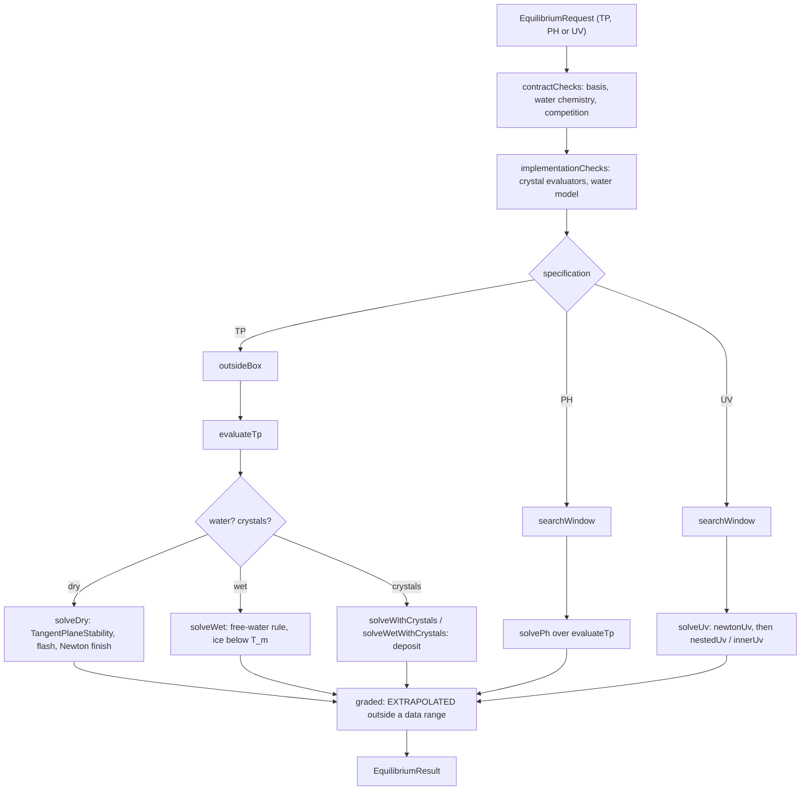

# Multiphase equilibrium engine

**Snapshot:** 3a527f1e (branch claude/water-steam-virial, mod 0.15.0), 2026-10-28 · **Updated:** 2026-10-28 (batch 2026-10-27-heat-exchanger-design, water steam: `SteamVirial`, the second-virial steam of `separate-free-water-v3` (IF97 Region 2's B(T)), its computed 2 % limit table, the steam's fugacity on condensed water and ice, `SteamVirialTest` with `If97Region2`) · earlier: 2026-10-27 (batch 2026-10-26-multi-machine-framework: `ThermoIdentity` format `thermo-identity-v2`, its parts the package's and the spine's declared-revision identities in place of fingerprints; `PhaseContract.forNetworkPackage` takes the spine revision) · earlier: 2026-10-21 (0.11.1 test review: archived tests no longer named; `slowGates` beside `test`, G5 = 19) · 2026-10-21 (mod rename to IChemE, 0.11.0: package `com.wormzjl.icheme`, mod id `icheme`) · earlier: 2026-10-19
Up: [code guide](README.md)

## Read this when

- A network node, junction or vessel gets the wrong phases, phase labels or phase amounts (gas, hydrocarbon liquid, free water, ice, CO2 frost).
- An island holds with `HELD (phases)` and the detail names `CRITICAL_BAND`, `UNSTABLE_PRODUCT`, `UNRESOLVED_PRODUCT`, `CRYSTAL_PHASES` or `CRYSTAL_STEP`. A PH or UV search does not converge, or its answer comes from a balance (`coexistenceFromBalance`).
- An answer is graded `RESEARCH_ONLY` or `EXTRAPOLATED` ("extrapolated past ..." in its evidence).
- You add a crystal to a package's competition, change the free-water or ice rule, or change the stability test or flash settings.

This chapter covers `science/thermo/phase/**`, `TangentPlaneStability`, `NumericalBox` and `IdealGasFunction`. It ends at the engine's public API and at the interfaces it consumes (`FreeWaterModel`, `IdealGasFunction`, `SolidPhaseEvaluator`, `CrystalFugacity`). The network side is in [fluid-science.md](fluid-science.md): when the network calls the engine, how it turns failures into holds, the "outside data range" status-line notice, `NetworkPhaseEngine` and the implementations it supplies (`NetworkFreeWater`, `CoefficientIdealGas`, `Steam`, `SpinePackageData`, `TranslatedPengRobinson.residualOnly`). The records the engine reads (`ReferenceSpine`, `CrystalReference`, `MaterialCoverage`), the PR78 kernel and `PairInteractions` are in [thermo-materials.md](thermo-materials.md). The column does not use the engine and refuses crystal packages ([column-v3.md](column-v3.md)).

## In one paragraph

Physically, a mixture at a given temperature and pressure splits into the phases that minimise its Gibbs energy: a gas,
one hydrocarbon liquid, free liquid water or ice, and a pure crystal such as dry ice (CO2-I) wherever a species'
chemical potential in the fluid exceeds the crystal's. At a fixed enthalpy and pressure (a junction) or a fixed energy
and volume (a closed vessel), the temperature and pressure follow from the same minimum. In code, a request
(`EquilibriumRequest`) has a specification (TP, PH or UV), the amounts over the package contract's basis (the EOS
components, then `Water`), and a phase competition (fluid only, or the fluid phases plus the package's pure crystals).
`FluidTpEquilibrium` refuses or answers it: contract checks, a tangent-plane stability test of the hydrocarbon feed on
the PR78 kernel, a flash with a Newton finish on the Gibbs energy when the feed is unstable, the network's separate
free-water rule (ice below the melting line), then each crystal against the fluid answer by chemical potential. PH and
UV are outer searches over TP answers inside the numerical box. Steps that TP leaves undetermined (pure coexistence,
boiling, freezing, a triple point, a binary's three-phase step) are split from the energy and volume balance. The
`EquilibriumResult` gives the phases and amounts on the shared basis, a classification, a coverage grade, typed details
and diagnostics. Data ranges never refuse: an answer outside them is graded `EXTRAPOLATED`, and only the numerical box
(10..6000 K, 1 Pa..1 GPa) bounds a trial. The engine is deterministic and allocation-light; a `Workspace` carries only
prepared temperatures between calls. Its only production caller is the fluid network (`NetworkPhaseEngine`).

## Class map

Paths are under [`src/main/java/com/wormzjl/icheme/science/thermo/`](../../../src/main/java/com/wormzjl/icheme/science/thermo/). Line counts are at the snapshot.

| Class | Role | Read it for |
|---|---|---|
| [`phase/FluidTpEquilibrium`](../../../src/main/java/com/wormzjl/icheme/science/thermo/phase/FluidTpEquilibrium.java) (5708) | The engine: `tp`, `ph`, `uv` (also warm-started `uv(request, workspace, hintT, hintP)`); onsets `depositionTemperature`, `frostTemperature`, `freezingTemperature`, `depositionPressure`; `anchoredCrystal`, `forPackage`, `pureBandBox`; nested `Settings` (12 components, `DEFAULT`) and `Workspace` | Every algorithm; public constants |
| [`phase/EquilibriumRequest`](../../../src/main/java/com/wormzjl/icheme/science/thermo/phase/EquilibriumRequest.java) (71) | Record: `Specification` {TP, PH, UV}, two values (K and Pa; Pa and J; J and m3), species list (the contract basis, in order), amounts, competition | Input validation |
| [`phase/EquilibriumResult`](../../../src/main/java/com/wormzjl/icheme/science/thermo/phase/EquilibriumResult.java) (476) | Answer: `Status`, `UnsupportedReason`, `Classification` (13 values), `PhaseAmounts` list, `coexisting`, `Coverage`/`CoverageGrade`, `FreeWater`, `Deposition`, `Diagnostics`; detail prefixes; aggregates (`enthalpy`, `internalEnergy`, `volume`, `conservationDefect`) | Status rules, grades, typed failures |
| [`phase/PhaseContract`](../../../src/main/java/com/wormzjl/icheme/science/thermo/phase/PhaseContract.java) (160) | What a package promises: basis, `WaterParticipation`, qualified competitions, water-chemistry species, `PhaseDomain`, fluid coverage, `ThermoIdentity`; `forNetworkPackage`, `forPackage`, `admittedCrystals`, `resolve` | Which requests are refused and why |
| [`phase/PhaseCompetition`](../../../src/main/java/com/wormzjl/icheme/science/thermo/phase/PhaseCompetition.java) (58) | `(crystals, packageCrystals)`; `FLUID_ONLY`, `FLUID_AND_CRYSTALS` (the package's set, resolved by the contract), `withCrystals` | Competition semantics |
| [`phase/PhaseDomain`](../../../src/main/java/com/wormzjl/icheme/science/thermo/phase/PhaseDomain.java) (56) | The package envelope (`fluid_domain`, through `FluidDomain.envelope`) used for grading; `open` for research and test contracts | `covers`: extrapolated or not |
| [`phase/CubicPhaseEvaluator`](../../../src/main/java/com/wormzjl/icheme/science/thermo/phase/CubicPhaseEvaluator.java) (264) | Fluid family `pr78_translated_v1`: translated PR78 at the state pressure for every root (`TranslatedPengRobinson.residualOnly`), one `IdealGasFunction` per component; `forPackage` (a spine package, from `SpinePackageData`), `fromPackage` (the caller's translations and ideal gases), a public constructor on a constant k matrix | State and derivative conventions |
| [`phase/CrystalPhaseEvaluator`](../../../src/main/java/com/wormzjl/icheme/science/thermo/phase/CrystalPhaseEvaluator.java) (217) | `SolidPhaseEvaluator` of a crystal record; `anchor(CubicPhaseEvaluator)`, `anchored(...)` gives the immutable `Anchored` view (a `CrystalFugacity`) | Crystal state, ln phi against the ideal gas |
| [`phase/FreeWaterIce`](../../../src/main/java/com/wormzjl/icheme/science/thermo/phase/FreeWaterIce.java) (126) | Ice Ih of the free water: melting line by Clapeyron, fugacity over ice (IAPWS R14-08 scaled to meet the liquid's on the line); immutable | Freeze rules |
| [`phase/SteamVirial`](../../../src/main/java/com/wormzjl/icheme/science/thermo/phase/SteamVirial.java) (117) | The free water's steam beyond the ideal gas (`separate-free-water-v3`): IAPWS-IF97 Region 2's second virial B(T) (its five I = 1 terms), v = RT/p + B, p_w = n_w RT/(V - n_w B), residual h, s, g; linear below 273.15 K | Steam volume, partial pressure and energy, engine and network alike |
| [`phase/FreeWaterModel`](../../../src/main/java/com/wormzjl/icheme/science/thermo/phase/FreeWaterModel.java) (45) | Interface of the water the free-water rule needs: revision, saturation pressure, steam partial-pressure limit, liquid, steam, ice; implemented by the network (`NetworkPhaseEngine.NetworkFreeWater`) | Water datum contract |
| [`phase/PhaseState`](../../../src/main/java/com/wormzjl/icheme/science/thermo/phase/PhaseState.java) (179), [`PhaseDerivatives`](../../../src/main/java/com/wormzjl/icheme/science/thermo/phase/PhaseDerivatives.java) (70), [`PhaseAmounts`](../../../src/main/java/com/wormzjl/icheme/science/thermo/phase/PhaseAmounts.java) (54) | Caller-owned phase state (frozen copies in results); first derivatives at fixed composition; one phase of a result over the shared basis | Conventions, conservation |
| [`phase/PhaseIdentification`](../../../src/main/java/com/wormzjl/icheme/science/thermo/phase/PhaseIdentification.java) (134) | Venkatarathnam–Oellrich phase identification parameter (PIP) on the untranslated cubic; liquid-like when PIP > max(1, Z); `denseLiquidLike` (v < 3.9514 b, `VAPOUR_BRANCH_VOLUME_RATIO`) | Phase labels |
| [`phase/ThermoIdentity`](../../../src/main/java/com/wormzjl/icheme/science/thermo/phase/ThermoIdentity.java) (89) | Identity of the numbers: package revision (`MaterialCatalog.fluidRevision`) + evaluator family + spine revision (`MaterialCatalog.spineRevision`) + water formulation; `revision()`; nothing is hashed | What invalidates caches |
| [`phase/DepositionOnset`](../../../src/main/java/com/wormzjl/icheme/science/thermo/phase/DepositionOnset.java) (63) | Onset answer (frost point, liquidus or three-phase point); `approximation` for diagnostics only | Onset searches |
| [`phase/PhaseKind`](../../../src/main/java/com/wormzjl/icheme/science/thermo/phase/PhaseKind.java) (27), [`WaterParticipation`](../../../src/main/java/com/wormzjl/icheme/science/thermo/phase/WaterParticipation.java) (24), [`SolidPhaseEvaluator`](../../../src/main/java/com/wormzjl/icheme/science/thermo/phase/SolidPhaseEvaluator.java) (52), [`CrystalFugacity`](../../../src/main/java/com/wormzjl/icheme/science/thermo/phase/CrystalFugacity.java) (12) | Kinds `VAPOR`, `LIQUID`, `FLUID`, `SOLID`, `FREE_WATER`; water `NONE` or `SEPARATE_FREE_WATER`; the solid contract with its `TriplePointAnchor`; a crystal's ln(f_s/P) | |
| [`TangentPlaneStability`](../../../src/main/java/com/wormzjl/icheme/science/thermo/TangentPlaneStability.java) (819) | Michelsen tangent-plane test on the kernel; one-pressure and per-branch-pressure `test`; `Verdict` {STABLE, UNSTABLE, UNRESOLVED}; `Settings.DEFAULT`; public `cholesky`, `solveCholesky` (shared with the engine's Newton) | Stability verdicts |
| [`NumericalBox`](../../../src/main/java/com/wormzjl/icheme/science/thermo/NumericalBox.java) (53) | 10..6000 K, 1 Pa..1 GPa, partial-pressure floor 1e-6 Pa; `contains`, `require`, `containsPartialPressure`, `requirePartialPressure` | The only bound a trial meets (also read by fluid `FluidThermodynamics`, `HydrocarbonModel`, `FluidDomain`, `PassiveStepSolver`) |
| [`IdealGasFunction`](../../../src/main/java/com/wormzjl/icheme/science/thermo/IdealGasFunction.java) (31) | Ideal-gas interface: h(298.15 K) = formation enthalpy, s(298.15 K, 1e5 Pa) = standard entropy; continues past its range with Cp held | Datum convention. Implemented by `ReferenceSpine` and the network's `CoefficientIdealGas` and `Steam` |

## Main flow

1. **Construction.** `FluidTpEquilibrium.forPackage(catalog, packageId)` builds a spine package's engine
   (`PhaseContract.forPackage`, `CubicPhaseEvaluator.forPackage`, default settings, one `CrystalPhaseEvaluator` per
   admitted crystal, no water model). The network builds its own through `NetworkPhaseEngine.of`, with
   `NetworkFreeWater`. The constructor anchors each crystal once to the evaluator's pure liquid at its triple point,
   builds the coverage of each qualified crystal competition, and precomputes the corners of pure water's triple-point
   triangle in UV (`waterTriangle`).
2. **`contractChecks`.** A species list other than the contract basis throws `IllegalArgumentException`. Water beside a
   water-chemistry species is `UNSUPPORTED` with `WATER_CHEMISTRY_NOT_MODELLED`. The competition is resolved
   (`PhaseContract.resolve`: `FLUID_AND_CRYSTALS` becomes the package's crystal set); one the contract does not qualify
   is `PHASE_COMPETITION_NOT_QUALIFIED`.
3. **`implementationChecks`.** A competing crystal without its evaluator here, or water without a `FreeWaterModel`, is
   `NOT_IMPLEMENTED`. Then the request's material goes into the workspace (feed, hydrocarbon and water totals).
4. **TP.** `outsideBox` answers `NOT_CONVERGED` for a state outside the box. `evaluateTp` dispatches to `solveDry`,
   `solveWet`, `solveWithCrystals` or `solveWetWithCrystals`. An exception from the model (no physical root, a
   mechanically unstable root) becomes `NOT_CONVERGED` "evaluation refused: ...".
5. **PH and UV.** PH checks its pressure against the box, then `searchWindow` and `solvePh`. UV runs `searchWindow`, then
   `solveUv`: `newtonUv` first, else `nestedUv` with `innerUv` per temperature. Both answer undetermined steps from the
   balance (topic 4).
6. **`graded`.** A converged answer outside a data range of the models it used (`outsideData`) is regraded
   `EXTRAPOLATED`, the range named in its evidence.

Request, contract and result model

- Units are SI: K, Pa, J, m3, mol. A request's amounts are per species of the contract basis, in order: the EOS
  components, then `Water` for a network package. The record refuses non-finite values, a non-positive T or P (TP),
  P (PH) or V (UV), negative amounts, no material and duplicate species.
- Status rules (enforced by the `EquilibriumResult` constructor):
  - `CONVERGED`: a classification other than `NONE`, at least one phase, and a grade an answer can have.
    `PURE_COEXISTENCE_UNDERDETERMINED` is the exception: no phases and exactly two `coexisting` states.
  - `UNSUPPORTED`: a typed `UnsupportedReason`, no phases, grade `UNAVAILABLE`.
  - `NOT_CONVERGED`: no phases, grade `UNAVAILABLE`, the attempt's diagnostics.
- Classifications (13): `SINGLE_VAPOR`, `SINGLE_LIQUID`, `SINGLE_FLUID`, `SUPERCRITICAL_FLUID`, `VAPOR_LIQUID`,
  `LIQUID_LIQUID`, `PURE_COEXISTENCE_UNDERDETERMINED`, `SOLID_PRESENT`, `VAPOR_SOLID`, `LIQUID_SOLID`,
  `VAPOR_LIQUID_SOLID`, `FREE_WATER`, `NONE`. `holdsCrystal()` is true for the four crystal classes. Under `FREE_WATER`,
  `freeWater().hydrocarbon()` carries the hydrocarbon phases' own classification.
- `UnsupportedReason`: `PHASE_COMPETITION_NOT_QUALIFIED`, `WATER_CHEMISTRY_NOT_MODELLED`, `NOT_IMPLEMENTED`.
- Detail prefixes:
  - `CRITICAL_BAND` (`NOT_CONVERGED`): a failure inside the declared critical band.
  - `UNSTABLE_PRODUCT`, `UNRESOLVED_PRODUCT` (`NOT_CONVERGED`): a converged split whose product the re-check proved
    unstable, or left unresolved; a third phase is not excluded.
  - `CRYSTAL_PHASES` (`UNSUPPORTED`, `NOT_IMPLEMENTED`): two liquids or three fluid phases beside a crystal, or two
    crystals forming.
  - `CRYSTAL_STEP` (`NOT_CONVERGED`): a PH or UV search closed on a crystal step of a near-pure feed's major species
    that its pure step does not answer.
- `CoverageGrade`: `QUALIFIED`, `ESTIMATED_DECLARED_ERROR`, `RESEARCH_ONLY`, `EXTRAPOLATED`, `UNAVAILABLE`; `answer()`
  is true for the first four. A fluid answer carries the contract's fluid coverage (the network package:
  `ESTIMATED_DECLARED_ERROR`) with "; fluid-only: solid phases not assessed". Under a crystal competition the grade is
  the worst of the fluid grade and each crystal record's. Inside the critical band it is `RESEARCH_ONLY`; outside a data
  range `EXTRAPOLATED`.
- `solidsAssessed()` is false for a `FLUID_ONLY` result: a constrained fluid answer, not a complete equilibrium. A solid
  phase must name a crystal of the competition, or be the free water's ice.
- Contracts: `forNetworkPackage` is the package's PR78 components then `Water` as separate free water, fluid-only, the
  network envelope, no water-chemistry species, graded `ESTIMATED_DECLARED_ERROR`. `forPackage` adds one competition:
  the fluid phases with every crystal the package admits, as one whole set. `admittedCrystals` takes the package's
  crystal records that are usable and graded `qualified` or `estimated_declared_error`.

Stability and flash

- Stability (`TangentPlaneStability`, Michelsen): the feed sits on its physical root with the lower Gibbs energy, which
  fixes d_i = ln z_i + ln phi_i(z). A trial W is measured by tm(W) = 1 + Σ W_i (ln W_i + ln phi_i(W) - d_i - 1);
  tm < -1e-8 anywhere proves instability. Trials run in a fixed order: Wilson vapour (W = zK), Wilson liquid (W = z/K),
  then each pure present component while at most 8 components are present. Each trial runs successive substitution with
  a dominant-eigenvalue extrapolation, then Newton on α = 2√W. Absent components stay absent; a one-component feed
  compares its two roots' fugacities directly.
- Per-branch pressures (free water): every liquid-branch evaluation is at P and every vapour-branch evaluation at
  pc = P - p_w, with ln(pc/P) + (pc - P) c_i/(RT) on the vapour's ln phi_i. A single root at the vapour pressure counts
  as the vapour branch only when it is vapour-like by PIP: a dense fluid at the lower pressure is not a vapour. Equal
  pressures give the one-pressure test bit for bit.
- Flash: Rachford–Rice substitution on ln K_i = ln phi_i^L - ln phi_i^V from the stability test's stationary
  composition, each phase on its own lower-Gibbs root, a dominant-eigenvalue extrapolation every `accelerationCycle`
  steps, solved in the minor phase's fraction so a trace phase keeps its precision.
- Newton finish: when substitution is slow (`SLOW_SUBSTITUTION_STEPS` with the eigenvalue above `SLOW_EIGENVALUE`),
  past `substitutionLimit`, collapsing onto the feed or losing the split. It minimises the Gibbs energy over the vapour
  mole numbers: Hessian scaled by √(v_i l_i/z_i) and shifted by μI until Cholesky succeeds, the step cut so no amount
  shrinks below a tenth of itself, an Armijo line search on ΔG/RT. Converged at max |g_i| < `FUGACITY_TOLERANCE`.
  Amounts are split per component (the smaller share directly, the larger by difference), so each component conserves
  to rounding.
- Merge and labels: a split with Σ z_i (ln K_i)² < `mergeTieLine` and molar volumes within `mergeVolumeGap` is one fluid
  (`SINGLE_FLUID`). Otherwise both products are re-tested. The denser phase is `LIQUID`, the lighter `VAPOR`; two
  liquid-like products denser than the cubic's critical volume, outside the band, are `LIQUID_LIQUID` (lighter first).
  A one-root single phase is labelled by PIP; a pure component above its critical point is `SUPERCRITICAL_FLUID`.
- Critical band: a pure fluid (one component at least 0.95 of the amount) inside one of the four reduced boxes of
  `pureBandBox`; a split with a tie line below `BAND_TIE_LINE`; a single mixture phase whose stability test met a
  stationary point within `BAND_STATIONARY_DISTANCE` of the feed; a failed split whose last iterate or seed was that
  short. No split is fabricated, and no single phase is reported stable when the test said unstable.
- An `UNRESOLVED` feed stability test is repeated once with `UNRESOLVED_STABILITY_BUDGET_FACTOR` times the per-trial
  budget.

Free water and ice

- The rule (`solveWet`): water never dissolves in the hydrocarbon phases. The hydrocarbon liquid is at P, the hydrocarbon
  vapour at pc = P - p_w, the steam shares the gas volume, and liquid water comes from the water model at P.
- The steam (`SteamVirial`, since `separate-free-water-v3`, 2026-10-28) is a second-virial gas: its ideal-gas functions
  (`FreeWaterModel.vapor`) plus IF97 Region 2's B(T), so v = RT/p + B, p_w = n_w RT/(V_gas - n_w B), and the residuals
  h = p (B - T dB/dT), s = -p dB/dT, g = p B at the steam's partial pressure. Condensed water (liquid at p_sat, ice at
  its fugacity) carries the steam's chemical potential at that pressure, g_ig + B p, so it coexists with the steam
  exactly at p_w = p_sat. Ideal steam was 7.6 % too light at 10 bar on saturation; the virial is 1.0 % off there.
- Without hydrocarbons the water is all liquid when P >= p_sat and all steam otherwise.
- With both: when P > p_sat + `SATURATION_MARGIN` (1e-6 Pa) the hydrocarbons are split at (P, P - p_sat), and the steam
  that saturates the gas, p_sat V_gas/(RT + p_sat B), is taken from the water if there is that much. Otherwise all
  water is steam, and pc solves pc + n_w RT/(V_gas(pc) - n_w B) = P: up to 3 fixed-point steps, else a bisection on
  [1e-6 Pa, P] (70 halvings, stop at 1e-8, accepted within 1e-6).
- Steam above the water model's qualified partial pressure (`vaporPartialPressureLimit`; the network's
  `FluidThermodynamics.waterVaporPressureLimit`, where the virial's volume leaves 2 % of IF97 Region 2: 1.8 MPa below
  500 K, 4.5 MPa from 575 K, 65 MPa from 875 K) is answered and graded `EXTRAPOLATED`.
- Ice (`FreeWaterIce`): below the melting line T_m(P) the condensed water is ice, and the rule runs with the ice's
  fugacity in place of p_sat. The line is Clapeyron's, dT/dP = T_t (v_L - v_s)/h_fus = -7.42e-8 K/Pa (272.42 K at
  10 MPa). The ice's fugacity is p_sub(T) p_sat(T_m(P))/p_sub(T_m(P)), so it meets the liquid's exactly on the line and
  the steam's partial pressure is continuous across it. On the line itself the liquid is the condensed phase; a freeze
  is a step that a PH or UV balance splits.
- Ice is water's own rule, never a crystal of a competition. It forms beside a competing crystal too: ice and CO2 frost
  coexist.

PH and UV searches

- Window (`searchWindow`): the numerical box. A search starts inside the overlap of the data of every model the
  material uses (the envelope, the carried species' ideal gases, the steam's range) and moves out only as far as the
  specification asks.
- PH (`solvePh`): a bracketed search in T at fixed P from the ideal-gas temperature of the enthalpy. Newton with the
  phase's c_p for one dry phase, a secant between answers with the same phases otherwise, bisection when two steps fail
  to halve the bracket's smaller residual.
- UV (`solveUv`): Newton on (ln T, ln P) for ((U - U_spec)/(NRT), ln(V/V_spec)), with the analytic Jacobian of one dry
  phase, else differences and Broyden's update, and a halving line search. It starts where the feed as one cubic phase
  has U_spec at V_spec, and stops after 30 TP answers unless its last step cut the residual fourfold. Then the nested
  search in T at the specified volume, each temperature solving V(P) = V_spec in ln P (`innerUv`). The warm start
  `uv(request, workspace, hintT, hintP)` allows `WARM_UV_EVALUATIONS` (16) TP answers before the cold search; the
  network's vessel crystal refresh uses it.
- Convergence: a step or bracket within `outerTolerance`, the specification met within `SPECIFICATION_TOLERANCE` of NRT
  and in ln V, at most `maximumOuterIterations` TP answers per search.
- Steps answered from a balance (`Diagnostics.coexistenceFromBalance()`), target = (1 - β) x_1 + β x_2 once a bracket
  straddles the jump: `pureCoexistence`, `wetCoexistence`, `waterBoiling`, `waterFreezing`, `freezingAtVolume`,
  `waterTriplePoint`, `pureCrystalStep`, `pureTriplePoint`, `binaryThreePhase`. A target inside any other step is
  `NOT_CONVERGED`. A bracket that closes at the box's pressure bound with the energy still short is `NOT_CONVERGED`
  naming that bound.

Crystal competition and onsets

- Anchoring (once, at construction): g_s(T_t, P_t) = mu_L and s_s = (h_L - mu_L)/T_t - dH_fus/T_t on this evaluator's
  pure liquid; for a Gibbs-function record this fixes g0 and g1. The crystal's ln phi = (g_s - g_ig(T, P))/(RT) against
  the species' ideal gas, so its chemical potential compares directly with a fluid phase's.
- TP: the fluid answer of the feed first, then each crystal by D = (mu_i - mu_s)/(RT). Above `DEPOSITION_TOLERANCE` the
  solid amount is solved so that the fluid the crystal leaves, re-flashed with the stability test, has the crystal's
  chemical potential: the vapour-solid Newton first (`depositFromVapour`), else the general solve whose every iterate
  is a re-flash (`depositFromFluid`). The answer is `VAPOR_SOLID`, `LIQUID_SOLID` or `VAPOR_LIQUID_SOLID`.
- A pure feed, or a species below `DEPOSITION_TRACE` in the fluid, deposits or freezes completely (`SOLID_PRESENT`).
- With free water the crystals compete against the free-water rule's hydrocarbon phases at the hydrocarbon partial
  pressure (`solveWetWithCrystals`).
- Near-pure feeds: a dry feed whose other species total at most 1e-5 of its largest is near-pure. PH and UV answer its
  major species' crystal steps as a pure feed's, the traces carried in the fluid up to 1e-4 of it; a step this rule
  does not answer is `CRYSTAL_STEP`.
- Crystal ceiling (`crystalCeiling`): the lowest record maximum temperature of the competition, 300 K for CO2-I. It is
  not a data range: crystals cease to exist above it, onset searches stay below it, and a PH or UV start that fails
  restarts there.
- Onsets: `depositionTemperature` (whatever the fluid answer of the whole feed is: frost point, liquidus or three-phase
  point), `frostTemperature` (the feed as one vapour), `freezingTemperature` (the feed as one liquid) and
  `depositionPressure`. Each is a bracketed search on D in 1/T or ln P, at most 100 fluid answers.
  `DepositionOnset.approximation` (the partial-pressure estimate) is for diagnostics only.

Data ranges, numerical box and grades

- `outsideData` checks the package envelope (`PhaseDomain.covers`), the ideal-gas range of each carried species, with
  water the steam's range and its partial-pressure limit, and the record of each crystal among the phases and of an
  onset's crystal. Outside any of them a converged answer is `EXTRAPOLATED`; it is still an answer.
- The numerical box is where the mathematics stops being trusted, never a data range. A TP state outside it is
  `NOT_CONVERGED`, searches stay inside it, and the fluid code calls `NumericalBox.require` on its trial states, which
  makes a rejected trial and a backtrack, not a hold.
- Continuation past a data range is the models' job: `ReferenceSpine`, `CrystalReference`, `ViscosityCorrelation`
  ([thermo-materials.md](thermo-materials.md)) and the fluid's coefficient path ([fluid-science.md](fluid-science.md)).
  The rule is the owner's of 2026-10-16 (AGENTS.md).

Identity and caching

- `ThermoIdentity.revision()` is `thermo-identity-v2` followed by four length-prefixed parts: the package revision
  (`packageRevision()`, from `MaterialCatalog.fluidRevision`: the declared revision of every record the fluid models
  read), the evaluator family, the spine revision (`spineRevision()`, from `MaterialCatalog.spineRevision`: each spine
  and crystal record's declared revision; `NO_SPINE` "spine:none" without one), and the water part
  (`separate-free-water-v3:<water revision>`, or `NO_WATER` "water:none"; v3 since 2026-10-28, the virial steam). Nothing is hashed (owner decision
  2026-10-26): a data change moves the identity only through the revision bump that declares it
  ([thermo-materials.md](thermo-materials.md)).
- Family ids: `pr78_translated_v1` (`CubicPhaseEvaluator.FAMILY`); crystals
  `crystal_segments_triple_point_anchored_v1` and `crystal_jaeger_span_2012_triple_point_anchored_v1`.
- Cache rule (class comment): anything that stores a number computed from a phase state keys on `revision()` and is
  discarded when it changes: the network's thermodynamic revision, regression fixtures and pins, warm starts and
  factorizations. The column's neural models and their eligibility check key instead on the reference package's
  `scientificRevision` and compare content directly (`MaterialCatalog.samePhysics`: the axis's science without the
  water's revision and ice, which the column never reaches). The network's `HydrocarbonModel` builds the revision of a spine package from
  `ThermoIdentity.of(...)` with its own network family ([fluid-science.md](fluid-science.md)).

Determinism and threading

- Fixed arithmetic order and a fixed trial order; elementary functions through `DeterministicMath`.
- The engine is immutable after construction. A `Workspace` is per thread and belongs to one engine (`own` refuses
  another engine's). The network keeps one per thread in a `ThreadLocal` of `NetworkPhaseEngine`.
- `CrystalPhaseEvaluator` caches a `volatile Anchored last` for callers that pass an equal anchor. `FreeWaterIce` is
  immutable and shared.
- Iterations allocate nothing; results hold frozen `PhaseState` copies.

Constants with current values

- `FluidTpEquilibrium.Settings.DEFAULT`: lnKTolerance 1e-10, maximumIterations 1000, accelerationCycle 5,
  coexistenceTolerance 1e-9, trivialDistance 1e-8, stability `TangentPlaneStability.Settings.DEFAULT`,
  substitutionLimit 50, maximumNewtonIterations 50, mergeTieLine 1e-8, mergeVolumeGap 1e-2, maximumOuterIterations 100,
  outerTolerance 1e-11.
- `TangentPlaneStability.Settings.DEFAULT`: instabilityTolerance 1e-8, convergenceTolerance 1e-10, newtonSwitch 1e-2,
  maximumSuccessiveSubstitutions 30, accelerationCycle 5, maximumIterations 100, trivialDistance 1e-4,
  pureComponentTrialLimit 8, exhaustive false.

| Public constant of `FluidTpEquilibrium` | Value |
|---|---|
| `SATURATION_MARGIN` | 1e-6 Pa |
| `PARTIAL_PRESSURE_FLOOR` | `NumericalBox.MINIMUM_PARTIAL_PRESSURE` = 1e-6 Pa |
| `PARTIAL_PRESSURE_BISECTIONS`, `PARTIAL_PRESSURE_TOLERANCE`, `PARTIAL_PRESSURE_ACCEPTANCE`, `PARTIAL_PRESSURE_FIXED_POINT_STEPS` | 70, 1e-8, 1e-6, 3 |
| `UNRESOLVED_STABILITY_BUDGET_FACTOR` | 10 |
| `SPECIFICATION_TOLERANCE` | 1e-6 |
| `WARM_UV_EVALUATIONS` | 16 |
| `DEPOSITION_TOLERANCE`, `DEPOSITION_TRACE` | 1e-9, 1e-15 |
| `SLOW_SUBSTITUTION_STEPS`, `SLOW_EIGENVALUE` | 10, 0.9 |
| `FUGACITY_TOLERANCE` | 1e-10 |
| `BAND_TIE_LINE`, `BAND_STATIONARY_DISTANCE` | 0.1, 0.1 |
| `NumericalBox` | 10..6000 K, 1 Pa..1e9 Pa, partial pressure 1e-6 Pa..1e9 Pa |

Traps and misleading names

- `FluidTpEquilibrium` also answers PH, UV, crystals and onsets.
- The packages depend on each other in both directions. `science/thermo/phase` imports `science/fluid/thermo`
  (`CubicPhaseEvaluator` imports `SpinePackageData` and `TranslatedPengRobinson`; `PhaseContract` and `PhaseDomain`
  import `FluidDomain`), and `science/fluid/thermo` imports `science/thermo/phase` (`FluidThermodynamics`,
  `HydrocarbonModel`, `NetworkPhaseEngine`, `NetworkCrystals`, `TranslatedPengRobinson`). `TangentPlaneStability`
  imports `phase/PhaseIdentification`. The engine is not free of the fluid package.
- `FluidTpEquilibrium.forPackage` needs a spine package and builds no water model, so a request carrying water is
  `NOT_IMPLEMENTED`, with crystals or without. The contract refuses it first, as `WATER_CHEMISTRY_NOT_MODELLED`, only
  when the request also holds a species that needs aqueous chemistry (class comment restated in 0.9.1). The network
  builds its own engine.
- `PhaseContract.forNetworkPackage` qualifies fluid-only; `forPackage` adds the crystal set. The network uses
  `forPackage` when its package admits crystals.
- `PhaseKind` on a `PhaseState` is the root situation the evaluator met (one root gives `FLUID`); on a `PhaseAmounts`
  it is the equilibrium's label.
- A crystal leaves the composition block of `PhaseDerivatives` unfilled, and nothing flags it.
- `EXTRAPOLATED` is an answer, not a failure. `CRYSTAL_PHASES` is `UNSUPPORTED`, not `NOT_CONVERGED`.
- `DepositionOnset.approximation` is never the answer.
- Ice is in no competition: a `FLUID_ONLY` result can hold ice under `FREE_WATER`.
- `IdealGasFunction` states a formation-enthalpy datum, but the network's `CoefficientIdealGas` of a spine-less package
  sits on the network's sensible datum (zero at 298.15 K and 1e5 Pa); only spine packages carry formation data.

## Change the layer that owns it

| Change | Owning class | Tests that pin it |
|---|---|---|
| Stability test (trials, Newton, per-branch pressures) | `TangentPlaneStability` | `TangentPlaneStabilityTest` |
| Flash, Newton finish, merge, critical band, two liquids | `FluidTpEquilibrium` (`hydrocarbon`, `attempt`, `newtonFinish`, `merged`, `inBand`, `pureBandBox`), `Settings` | `FluidTpEquilibriumTest`, `FluidTpEquilibriumP3Test` |
| Phase labels | `PhaseIdentification` | `FluidTpEquilibriumP3Test` (`singlePhasesAreLabelledByThePhaseIdentificationParameter`, `hotGasesAreVapourLikeOverTheGrid`, `theLabelRuleSeparatesAHotGasFromACompressedLiquid`) |
| PH/UV searches and balance steps | `FluidTpEquilibrium` (`solvePh`, `solveUv`, `newtonUv`, `nestedUv`, `wetCoexistence`, `freezingAtVolume`, `waterTriplePoint`) | `FluidTpEquilibriumPhUvTest`, `qualification/G3F8ConservationAndDerivativeTest` |
| Free-water rule | `FluidTpEquilibrium` (`solveWet`, `freeWaterSplit`, `hydrocarbonVapour`), `FreeWaterModel` | `FluidTpEquilibriumP3Test.freeWaterFollowsTheNetworkRule`, `freeWaterPhaseCountEqualsTheNetworkFlash`, `FreeWaterIceTest` |
| Steam volume and energy, qualified partial pressure | `SteamVirial`; fluid `FluidThermodynamics.waterVaporPressureLimit` | `SteamVirialTest` (against the full IF97 Region 2 of `If97Region2`, itself checked on IF97's verification tables), fluid `FluidPropertyCoverageTest` (NIST steam), runtime `FluidFactsCompatTest.aWorldSavedUnderTheIdealSteamRestatesOntoTheVirialSteam` |
| Ice | `FreeWaterIce`; data `crystals/ice_ih.json`, the water's `ice` | `FreeWaterIceTest` |
| Crystal competition and deposition | `FluidTpEquilibrium` (`solveWithCrystals`, `solveWetWithCrystals`, `depositFromVapour`, `depositFromFluid`, `binaryThreePhase`, `pureCrystalStep`), `CrystalPhaseEvaluator` | `GasSolidEquilibriumTest`, `NearPureCrystalStepTest`, `CrystalPhaseEvaluatorTest`, `SolidCarbonDioxideQualificationTest`, `qualification/G4*`, `G5*` |
| Onsets | `depositionTemperature`, `frostTemperature`, `freezingTemperature`, `depositionPressure`, `DepositionOnset` | `GasSolidEquilibriumTest`, `G4F1`, `G4F2`, `G5F2` |
| Admitted competitions, water chemistry | `PhaseContract` | `FluidTpEquilibriumTest.waterChemistryAndQualifiedCrystalsFollowTheContract`, `GasSolidEquilibriumTest.theCrystalCompetitionIsQualifiedAsAWholeSet`, `SpinePackageEvaluatorTest` |
| Grades and extrapolation | `graded`, `outsideData`, `PhaseDomain`, `EquilibriumResult.Coverage` | `qualification/G3F9DataRangeBoundaryTest`, `FluidTpEquilibriumPhUvTest.aClosedVesselBeyondThePressureEnvelopeIsAnsweredExtrapolated` |
| Fluid evaluator and conventions | `CubicPhaseEvaluator` (and fluid `TranslatedPengRobinson.residualOnly`, `SpinePackageData`) | `CubicPhaseEvaluatorTest`, `SpinePackageEvaluatorTest` |
| Solid contract | `SolidPhaseEvaluator`, `CrystalFugacity` | `SolidPhaseEvaluatorTest`, `CrystalPhaseEvaluatorTest` |
| Cache identity | `ThermoIdentity` | `ThermoIdentityTest` |
| Numerical box | `NumericalBox` | fluid `RangeContinuationGateTest` |
| How the network calls the engine | fluid-science: `NetworkPhaseEngine`, `FluidThermodynamics` | `science/fluid/thermo/NetworkPhaseEngineTest`, `LegacyNetworkPathPinTest`, `SpineNetworkPathTest`, `science/fluid/network/CrystalDepositionIslandTest`, `CrystalFlushBudgetTest`, `LiquidFullBubblePointTest` |

## Tests that document it

- Unit tests, `science/thermo/phase` (81 tests): `CrystalPhaseEvaluatorTest` (5), `CubicPhaseEvaluatorTest` (6),
  `FluidTpEquilibriumP3Test` (16: critical band, Newton finish, merging, phase labels, free water, the longer stability
  budget, two liquids, unstable products), `FluidTpEquilibriumPhUvTest` (8), `FluidTpEquilibriumTest` (7),
  `FreeWaterIceTest` (7), `GasSolidEquilibriumTest` (12), `NearPureCrystalStepTest` (4),
  `SolidCarbonDioxideQualificationTest` (5), `SolidPhaseEvaluatorTest` (2), `SpinePackageEvaluatorTest` (3),
  `SteamVirialTest` (4), `ThermoIdentityTest` (2). Helpers: `PhaseTestSupport`, `SolidCarbonDioxideReferences`,
  `If97Region2` (the full IF97 Region 2 residual, Region 4's saturation line and the B23 boundary).
- `science/thermo/TangentPlaneStabilityTest` (10: brute-force minima, per-branch verdicts, bitwise repeats, a dense
  liquid is no vapour at the lower pressure).
- Qualification families, `science/thermo/qualification` (described in [verification.md](verification.md)):
  G3F1..G3F10 (23 tests), G4F1 (4), G4F2 (1), G5F1..G5F6 (11). Helpers: `G3Support`, `G5Support`. Fixtures: the CoolProp
  files in `src/test/resources/science/thermo/coolprop/`, `gerg2008/pilot-binaries.json`, `solid-co2-holdouts/*.tsv`
  (14 files).
- The Helmholtz oracle, `science/thermo/reference`: `HelmholtzReferenceParityTest` (2).
- The network side: `science/fluid/thermo/NetworkPhaseEngineTest` (8) and the tests in [fluid-science.md](fluid-science.md).
- Gradle: only `test` runs these; `fluidScienceTest` matches `science.fluid.*` only. No dedicated task.

## Terms

- **TPD (tangent-plane distance)**: tm(W) of a trial phase against the feed's tangent plane; negative proves instability.
- **Stationary point / trivial solution**: a converged trial; a trial that collapsed onto the feed itself.
- **Branch pressure**: the pressure a liquid or vapour branch is evaluated at under the free-water rule (P or P - p_w).
- **PIP**: the phase identification parameter, the label of a one-root fluid.
- **Critical band**: the declared near-critical region whose answers are research-only and whose failures are typed.
- **Free water**: pure water beside the hydrocarbons, liquid or ice, never dissolved.
- **Melting line**: T_m(P) of the free water's ice.
- **Crystal anchor**: the triple point where a crystal meets the fluid family's liquid.
- **Crystal ceiling**: the lowest record maximum temperature of a competition's crystals.
- **Deposition driving force D**: (mu_i - mu_s)/(RT) of a crystal's species in the fluid answer.
- **Onset**: the frost point, liquidus or three-phase point where D = 0.
- **Coexistence from balance**: a step that TP leaves undetermined, split by the energy and volume balance.
- **Coverage grade**: the quality label of an answer (`QUALIFIED` .. `UNAVAILABLE`).
- **Numerical box**: 10..6000 K and 1 Pa..1 GPa; the only bound on a trial.
- **Contract basis**: the request's species list, the EOS components then `Water`.
