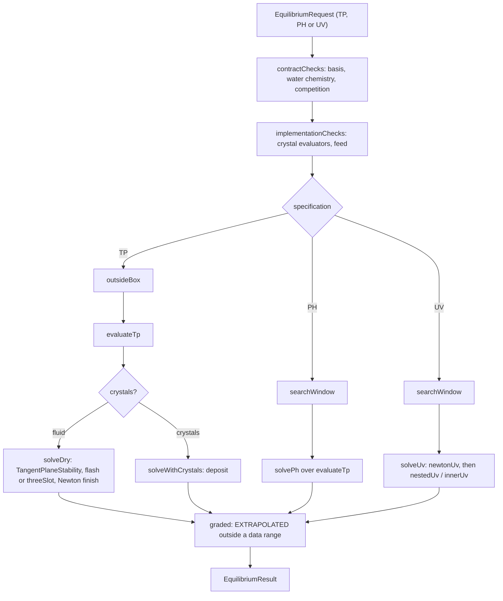

# Multiphase equilibrium engine

**Snapshot:** branch `claude/ethanol-compound-matrix-4b318d` after W3b's N10 (batch `2026-11-11-aqueous-solvents`), 2026-11-12: water is a component of the cubic on every network package with water (`WaterParticipation.IN_EQUATION_OF_STATE`, derived pairs, water's IF97 share on the balance book), up to three fluid phases (the three-slot system), ice Ih a crystal of the competition; the separate free-water rule (`solveWet`, `PartialPressureClosure`, `FreeWaterModel`, `FreeWaterIce`, `Classification.FREE_WATER`, `PhaseKind.FREE_WATER`, `SEPARATE_FREE_WATER`, the Dalton helpers of `SteamVirial`) is deleted; the stability test's liquid trial seeds water at a trace (`TangentPlaneStability.SEED_TRACE`) · earlier: f4130065f (branch `claude/refinery-compounds-thermos-252973`, 0.23.0), 2026-11-09 · 2026-11-03 (batch 2026-11-02-dry-ice-cost: carried crystals, `FLUID_CARRYING_CRYSTALS`, `TangentPlaneStability.TrialFilter`) · 2026-10-27 (`ThermoIdentity` format `thermo-identity-v2`, declared revisions) · 2026-10-21 (mod rename to IChemE, 0.11.0) · earlier: 2026-10-19
Up: [code guide](README.md)

## Read this when

- A network node, junction or vessel gets the wrong phases, phase labels or phase amounts (gas, oil, aqueous liquid, ice, CO2 frost).
- An island holds with `HELD (phases)` and the detail names `CRITICAL_BAND`, `UNSTABLE_PRODUCT`, `UNRESOLVED_PRODUCT`, `CRYSTAL_PHASES` or `CRYSTAL_STEP`. A PH or UV search does not converge, or its answer comes from a balance (`coexistenceFromBalance`).
- An answer is graded `RESEARCH_ONLY` or `EXTRAPOLATED` ("extrapolated past ..." in its evidence).
- You add a crystal to a package's competition, change water's share or its pairs, or change the stability test or flash settings.
- A step's answer states a CO2-rich liquid, a stand-in or one liquid where you expected frost (carried crystals, below).
- A wet gas condenses its oil late or all at once (the liquid trial's water trace, below).

This chapter covers `science/thermo/phase/**`, `TangentPlaneStability`, `NumericalBox` and `IdealGasFunction`. It ends at the engine's public API and at the interfaces it consumes (`IdealGasFunction`, `SolidPhaseEvaluator`, `CrystalFugacity`). The network side is in [fluid-science.md](fluid-science.md): when the network calls the engine, how it turns failures into holds, the "outside data range" status-line notice, `NetworkPhaseEngine` and the implementations it supplies (`CoefficientIdealGas`, `SpinePackageData`, `TranslatedPengRobinson.residualOnly`). The records the engine reads (`ReferenceSpine`, `CrystalReference`, `MaterialCoverage`, `DerivedPairs`), the PR78 kernel, `PairInteractions` and `HuronVidalExcess` are in [thermo-materials.md](thermo-materials.md). The column does not use the engine and refuses crystal packages ([column-v3.md](column-v3.md)).

## In one paragraph

Physically, a mixture at a given temperature and pressure splits into the phases that minimise its Gibbs energy: a gas,
up to two liquids (an oil and an aqueous liquid), and a pure crystal such as ice or dry ice (CO2-I) wherever a species'
chemical potential in the fluid exceeds the crystal's. Every compound, water included, stands in every fluid phase. At
a fixed enthalpy and pressure (a junction) or a fixed energy and volume (a closed vessel), the temperature and pressure
follow from the same minimum. In code, a request (`EquilibriumRequest`) has a specification (TP, PH or UV), the
amounts over the package contract's basis (its compounds, water last where the package carries it), and a phase
competition (fluid only, the fluid phases plus the package's pure crystals, or the fluid phases carrying them: a
network step's request, where no crystal forms and none is a fluid phase of its own). `FluidTpEquilibrium` refuses or
answers it: contract checks, a tangent-plane stability test of the feed on the PR78 kernel, a flash with a Newton
finish on the Gibbs energy when the feed is unstable (the three-slot system when a polar compound is present), then
each crystal against the fluid answer by chemical potential. PH and UV are outer searches over TP answers inside the
numerical box. Steps that TP leaves undetermined (pure coexistence, a triple point, a binary's three-phase step) are
split from the energy and volume balance. The `EquilibriumResult` gives the phases and amounts on the shared basis, a
classification, a coverage grade, typed details and diagnostics. Data ranges never refuse: an answer outside them is
graded `EXTRAPOLATED`, and only the numerical box (10..6000 K, 1 Pa..1 GPa) bounds a trial. The engine is
deterministic and allocation-light; a `Workspace` carries only prepared temperatures between calls. Its only
production caller is the fluid network (`NetworkPhaseEngine`).

## Class map

Paths are under [`src/main/java/com/wormzjl/icheme/science/thermo/`](../../../src/main/java/com/wormzjl/icheme/science/thermo/). Line counts are at the snapshot.

| Class | Role | Read it for |
|---|---|---|
| [`phase/FluidTpEquilibrium`](../../../src/main/java/com/wormzjl/icheme/science/thermo/phase/FluidTpEquilibrium.java) (6288) | The engine: `tp`, `ph`, `uv` (also warm-started `uv(request, workspace, hintT, hintP)`); onsets `depositionTemperature`, `frostTemperature`, `freezingTemperature`, `depositionPressure`; `anchoredCrystal`, `forPackage`, `forDerivedPackage`, `pureBandBox`; the three-slot system (`threeSlot`, `slotFractions`, `slotNewton`); carried crystals (`carriedTrial`, `crystalLean`, `carriedSplit`, `beyondStandIn`); nested `Settings` (12 components, `DEFAULT`) and `Workspace` | Every algorithm; public constants |
| [`phase/EquilibriumRequest`](../../../src/main/java/com/wormzjl/icheme/science/thermo/phase/EquilibriumRequest.java) (71) | Record: `Specification` {TP, PH, UV}, two values (K and Pa; Pa and J; J and m3), species list (the contract basis, in order), amounts, competition | Input validation |
| [`phase/EquilibriumResult`](../../../src/main/java/com/wormzjl/icheme/science/thermo/phase/EquilibriumResult.java) (427) | Answer: `Status`, `UnsupportedReason`, `Classification` (15 values), `PhaseAmounts` list, `coexisting`, `Coverage`/`CoverageGrade`, `Deposition`, `Diagnostics`; detail prefixes; aggregates (`enthalpy`, `internalEnergy`, `volume`, `conservationDefect`) | Status rules, grades, typed failures |
| [`phase/PhaseContract`](../../../src/main/java/com/wormzjl/icheme/science/thermo/phase/PhaseContract.java) (193) | What a package promises: basis, `WaterParticipation`, qualified competitions, water-chemistry species, `PhaseDomain`, fluid coverage, `ThermoIdentity`; `forPackage`, `forDerivedPackage`, `forDerived`, `derivedBasis`, `admittedCrystals`, `resolve`; `qualifies` (the carried request wherever a crystal competition is) | Which requests are refused and why |
| [`phase/PhaseCompetition`](../../../src/main/java/com/wormzjl/icheme/science/thermo/phase/PhaseCompetition.java) (74) | `(crystals, packageCrystals, carried)`; `FLUID_ONLY`, `FLUID_AND_CRYSTALS` (the package's set, resolved by the contract), `FLUID_CARRYING_CRYSTALS` (a step's request: no crystal competes, `fluid+carried-crystals`), `withCrystals` | Competition semantics |
| [`phase/PhaseDomain`](../../../src/main/java/com/wormzjl/icheme/science/thermo/phase/PhaseDomain.java) (56) | The package envelope (`fluid_domain`, through `FluidDomain.envelope`) used for grading; `open` for research and test contracts | `covers`: extrapolated or not |
| [`phase/CubicPhaseEvaluator`](../../../src/main/java/com/wormzjl/icheme/science/thermo/phase/CubicPhaseEvaluator.java) (373) | Fluid family `pr78_translated_v1`: translated PR78 at the state pressure for every root (`TranslatedPengRobinson.residualOnly`), one `IdealGasFunction` per component; `forPackage`, `fromPackage`, a public constructor on a constant k matrix; the derived family `DERIVED_FAMILY` (`derived`): pairs from `DerivedPairs` (Huron-Vidal rule, Mathias-Copeman alpha), water untranslated, `WaterShare` on each state's balance book; `waterComponent()`, `derivation()` | State and derivative conventions; the two books |
| [`phase/WaterShare`](../../../src/main/java/com/wormzjl/icheme/science/thermo/phase/WaterShare.java) (395) | Water's own share of h, s and v in a phase of the cubic (W3a D2): `x_w W L + x_w^2 (1 - W) G`, the liquid gap L to IF97 Region 1, the gas gap G to the second virial of `SteamVirial`, the weight W a C2 quintic of v/b; never in g or ln phi; `REVISION` | Why water's enthalpy and volume are IF97's while its fugacity is the cubic's |
| [`phase/CrystalPhaseEvaluator`](../../../src/main/java/com/wormzjl/icheme/science/thermo/phase/CrystalPhaseEvaluator.java) (261) | `SolidPhaseEvaluator` of a crystal record; `forPackage` takes the package's ideal gas of the species, its spine or its fit (`CoefficientIdealGas`, E27); `anchor(CubicPhaseEvaluator)` on the family's own pure liquid at the record's triple point, `anchored(...)` gives the immutable `Anchored` view (a `CrystalFugacity`; ice carries the liquid's water share, W3a D5) | Crystal state, ln phi against the ideal gas |
| [`phase/SteamVirial`](../../../src/main/java/com/wormzjl/icheme/science/thermo/phase/SteamVirial.java) (110) | IAPWS-IF97 Region 2's second virial B(T) (its five I = 1 terms), v = RT/p + B, residual h and c_p; linear below 273.15 K | Read by `WaterShare` (B, dB/dT) and the column's water (`V3WaterProperties`) |
| [`phase/PhaseState`](../../../src/main/java/com/wormzjl/icheme/science/thermo/phase/PhaseState.java) (223), [`PhaseDerivatives`](../../../src/main/java/com/wormzjl/icheme/science/thermo/phase/PhaseDerivatives.java) (99), [`PhaseAmounts`](../../../src/main/java/com/wormzjl/icheme/science/thermo/phase/PhaseAmounts.java) (54) | Caller-owned phase state (frozen copies in results): the cubic's book (g, ln phi) and the balance book (h, s, v with water's share, `shareEnthalpy`, `shareEntropy`, `shareVolume`, `balanceInternalEnergy`, `balanceVolume`); first derivatives at fixed composition; one phase of a result over the shared basis | Conventions, conservation |
| [`phase/PhaseIdentification`](../../../src/main/java/com/wormzjl/icheme/science/thermo/phase/PhaseIdentification.java) (134) | Venkatarathnam–Oellrich phase identification parameter (PIP) on the untranslated cubic; liquid-like when PIP > max(1, Z); `denseLiquidLike` (v < 3.9514 b, `VAPOUR_BRANCH_VOLUME_RATIO`) | Phase labels |
| [`phase/ThermoIdentity`](../../../src/main/java/com/wormzjl/icheme/science/thermo/phase/ThermoIdentity.java) (90) | Identity of the numbers: package revision + evaluator family + spine revision + water part; `of` (a package without water), `revision()`; nothing is hashed | What invalidates caches |
| [`phase/DepositionOnset`](../../../src/main/java/com/wormzjl/icheme/science/thermo/phase/DepositionOnset.java) (63) | Onset answer (frost point, liquidus or three-phase point); `approximation` for diagnostics only | Onset searches |
| [`phase/PhaseKind`](../../../src/main/java/com/wormzjl/icheme/science/thermo/phase/PhaseKind.java) (22), [`WaterParticipation`](../../../src/main/java/com/wormzjl/icheme/science/thermo/phase/WaterParticipation.java) (24), [`SolidPhaseEvaluator`](../../../src/main/java/com/wormzjl/icheme/science/thermo/phase/SolidPhaseEvaluator.java) (52), [`CrystalFugacity`](../../../src/main/java/com/wormzjl/icheme/science/thermo/phase/CrystalFugacity.java) (12) | Kinds `VAPOR`, `LIQUID`, `FLUID`, `SOLID`; water `NONE` or `IN_EQUATION_OF_STATE`; the solid contract with its `TriplePointAnchor`; a crystal's ln(f_s/P) | |
| [`TangentPlaneStability`](../../../src/main/java/com/wormzjl/icheme/science/thermo/TangentPlaneStability.java) (896) | Michelsen tangent-plane test on the kernel; one-pressure and per-branch-pressure `test`, and the per-branch `test` with a `TrialFilter`; the water-rich trial (W3a D3) and the liquid trial's water trace (`SEED_TRACE`, W3b); `Verdict` {STABLE, UNSTABLE, UNRESOLVED}; `Settings.DEFAULT`; public `cholesky`, `solveCholesky` | Stability verdicts |
| [`NumericalBox`](../../../src/main/java/com/wormzjl/icheme/science/thermo/NumericalBox.java) (53) | 10..6000 K, 1 Pa..1 GPa, partial-pressure floor 1e-6 Pa; `contains`, `require`, `containsPartialPressure`, `requirePartialPressure` | The only bound a trial meets (also read by fluid `FluidThermodynamics`, `HydrocarbonModel`, `FluidDomain`, `PassiveStepSolver`) |
| [`IdealGasFunction`](../../../src/main/java/com/wormzjl/icheme/science/thermo/IdealGasFunction.java) (31) | Ideal-gas interface: h(298.15 K) = formation enthalpy, s(298.15 K, 1e5 Pa) = standard entropy; continues past its range with Cp held | Datum convention. Implemented by `ReferenceSpine` and `science/fluid/thermo/CoefficientIdealGas` |

## Main flow

1. **Construction.** `FluidTpEquilibrium.forPackage(catalog, packageId)` builds a package's engine: a package with
   water in its cubic on its derived contract (`forDerivedPackage`), any other on `PhaseContract.forPackage` and
   `CubicPhaseEvaluator.forPackage`; default settings; one `CrystalPhaseEvaluator` per admitted crystal. The network
   builds its own through `NetworkPhaseEngine.of` on `PhaseContract.forDerived` of its model's evaluator. The
   constructor requires the evaluator's basis to be the contract's, anchors each crystal once to the evaluator's pure
   liquid at its triple point, and builds the coverage of each qualified crystal competition.
2. **`contractChecks`.** A species list other than the contract basis throws `IllegalArgumentException`. Water beside a
   water-chemistry species is `UNSUPPORTED` with `WATER_CHEMISTRY_NOT_MODELLED` (no catalog contract names such a
   species since W3b; test contracts do). The competition is resolved (`PhaseContract.resolve`: `FLUID_AND_CRYSTALS`
   becomes the package's crystal set); one the contract does not qualify is `PHASE_COMPETITION_NOT_QUALIFIED`.
   `FLUID_CARRYING_CRYSTALS` qualifies wherever the contract has a crystal competition (`qualifies`).
3. **`implementationChecks`.** A competing crystal without its evaluator here is `NOT_IMPLEMENTED`. Then the request's
   material goes into the workspace (feed and total).
4. **TP.** `outsideBox` answers `NOT_CONVERGED` for a state outside the box. `evaluateTp` dispatches to `solveDry` or
   `solveWithCrystals`. An exception from the model (no physical root, a mechanically unstable root) becomes
   `NOT_CONVERGED` "evaluation refused: ...". The carried request competes no crystal, so it takes `solveDry`, with its
   stability tests filtered and its splits restated (see "Carried crystals" below).
5. **PH and UV.** PH checks its pressure against the box, then `searchWindow` and `solvePh`. UV runs `searchWindow`, then
   `solveUv`: `newtonUv` first, else `nestedUv` with `innerUv` per temperature. Both answer undetermined steps from the
   balance.
6. **`graded`.** A converged answer outside a data range of the models it used (`outsideData`) is regraded
   `EXTRAPOLATED`, the range named in its evidence.

Request, contract and result model

- Units are SI: K, Pa, J, m3, mol. A request's amounts are per species of the contract basis, in order: the package's
  compounds, water last where the package carries it (`PhaseContract.derivedBasis`). The record refuses non-finite
  values, a non-positive T or P (TP), P (PH) or V (UV), negative amounts, no material and duplicate species.
- Status rules (enforced by the `EquilibriumResult` constructor):
  - `CONVERGED`: a classification other than `NONE`, at least one phase, and a grade an answer can have.
    `PURE_COEXISTENCE_UNDERDETERMINED` is the exception: no phases and exactly two `coexisting` states.
  - `UNSUPPORTED`: a typed `UnsupportedReason`, no phases, grade `UNAVAILABLE`.
  - `NOT_CONVERGED`: no phases, grade `UNAVAILABLE`, the attempt's diagnostics.
- Classifications (15): `SINGLE_VAPOR`, `SINGLE_LIQUID`, `SINGLE_FLUID`, `SUPERCRITICAL_FLUID`, `VAPOR_LIQUID`,
  `LIQUID_LIQUID`, `VAPOR_LIQUID_LIQUID`, `PURE_COEXISTENCE_UNDERDETERMINED`, `SOLID_PRESENT`, `VAPOR_SOLID`,
  `LIQUID_SOLID`, `VAPOR_LIQUID_SOLID`, `LIQUID_LIQUID_SOLID`, `VAPOR_LIQUID_LIQUID_SOLID`, `NONE`. `holdsCrystal()` is
  true for the six crystal classes.
- `UnsupportedReason`: `PHASE_COMPETITION_NOT_QUALIFIED`, `WATER_CHEMISTRY_NOT_MODELLED`, `NOT_IMPLEMENTED`.
- Detail prefixes:
  - `CRITICAL_BAND` (`NOT_CONVERGED`): a failure inside the declared critical band.
  - `UNSTABLE_PRODUCT`, `UNRESOLVED_PRODUCT` (`NOT_CONVERGED`): a converged split whose product the re-check proved
    unstable, or left unresolved.
  - `CRYSTAL_PHASES` (`UNSUPPORTED`, `NOT_IMPLEMENTED`): three crystals, two crystals whose fluid is not answered, a fluid
    with a product proved unstable beside a crystal, and, on a contract without water in the cubic, two liquids or three
    fluid phases beside a crystal. Only under a crystal competition: the network meets it at a vessel's refresh, never
    in a step.
  - `CRYSTAL_STEP` (`NOT_CONVERGED`): a PH or UV search closed on a crystal step of a near-pure feed's major species
    that its pure step does not answer.
- `CoverageGrade`: `QUALIFIED`, `ESTIMATED_DECLARED_ERROR`, `RESEARCH_ONLY`, `EXTRAPOLATED`, `UNAVAILABLE`; `answer()`
  is true for the first four. A fluid answer carries the contract's fluid coverage (a network package:
  `ESTIMATED_DECLARED_ERROR`) with "; fluid-only: solid phases not assessed". Under a crystal competition the grade is
  the worst of the fluid grade and each crystal record's. Inside the critical band it is `RESEARCH_ONLY`; outside a data
  range `EXTRAPOLATED`.
- `solidsAssessed()` is false for a `FLUID_ONLY` or a carried result: a constrained fluid answer, not a complete
  equilibrium. A carried answer is graded as a fluid one. A solid phase must name a crystal of the competition.
- Contracts:
  - `forDerivedPackage` / `forDerived`: the package's compounds other than water in package order, then water,
    `IN_EQUATION_OF_STATE` (`NONE` without water in the package), fluid-only plus the admitted crystals as one set
    (ice among them), the package envelope, `ESTIMATED_DECLARED_ERROR`, the derived family's identity.
  - `forPackage`: a package with water in its cubic takes `forDerivedPackage`; any other its PR78 compounds without
    water, `NONE`, fluid-only plus the admitted crystals, the package's spine in the identity.
  - `admittedCrystals` takes the package's crystal records that are usable and graded `qualified` or
    `estimated_declared_error`.

Stability and flash

- Stability (`TangentPlaneStability`, Michelsen): the feed sits on its physical root with the lower Gibbs energy, which
  fixes d_i = ln z_i + ln phi_i(z). A trial W is measured by tm(W) = 1 + Σ W_i (ln W_i + ln phi_i(W) - d_i - 1);
  tm < -1e-8 anywhere proves instability. Trials run in a fixed order: Wilson vapour (W = zK), Wilson liquid
  (W = z/K), then each pure present component while at most 8 components are present, else the water-rich trial (on a
  list with water in the cubic, W3a D3). Each trial runs successive substitution with a dominant-eigenvalue
  extrapolation, then Newton on α = 2√W. Absent components stay absent; a one-component feed compares its two roots'
  fugacities directly.
- The liquid trial's water trace (W3b): on a list with water in the cubic, where water and another component are
  present, the Wilson liquid seeds water at `SEED_TRACE` (1e-6) of its Wilson value, so it searches toward the oil
  liquid. Wilson's liquid of a steam-laden gas holds a third or more of water; its substitution ran to the aqueous
  side, which above water's dew point proves nothing, and naphtha with 23 % steam at 2.5 bar stayed all gas from 358 K
  up to 384 K, then condensed 42 % at once. The aqueous side stays the pure-component or water-rich trial's. The
  three-slot split's first liquid follows the same rule (`SEED_TRACE` is the one constant).
- Per-branch pressures: the overloads that evaluate the liquid branch at P and the vapour branch at another pressure
  are still in `TangentPlaneStability` and in the engine's split (`setBranches`, `Workspace.branched`), but since N10
  every caller passes one pressure. Equal pressures give the one-pressure test bit for bit.
- Flash: Rachford–Rice substitution on ln K_i = ln phi_i^L - ln phi_i^V from the stability test's stationary
  composition, each phase on its own lower-Gibbs root, a dominant-eigenvalue extrapolation every `accelerationCycle`
  steps, solved in the minor phase's fraction so a trace phase keeps its precision.
- Newton finish: when substitution is slow (`SLOW_SUBSTITUTION_STEPS` with the eigenvalue above `SLOW_EIGENVALUE`),
  past `substitutionLimit`, collapsing onto the feed or losing the split. It minimises the Gibbs energy over the vapour
  mole numbers: Hessian scaled by √(v_i l_i/z_i) and shifted by μI until Cholesky succeeds, the step cut so no amount
  shrinks below a tenth of itself, an Armijo line search on ΔG/RT. Converged at max |g_i| < `FUGACITY_TOLERANCE`.
  Amounts are split per component (the smaller share directly, the larger by difference), so each component conserves
  to rounding.
- The three-slot system (`threeSlot`, W3a D3): an unstable feed of a derived list with a polar compound present.
  Slots vapour, liquid and second liquid; for fixed ln phi the phase fractions minimise Michelsen's convex
  Q(β) = Σ β_k - Σ z_i ln(Σ_k β_k/phi_ik) (`slotFractions`), then substitution on the stacked ln phi and the Newton
  finish over the present phases' mole numbers (`slotNewton`). Seeds: Wilson's vapour, Wilson's liquid of the
  non-polar compounds (water at the trace), the water-rich liquid. An absent slot is watched until it stays absent; two
  present slots that coincide are one. The products are audited by the stability test; a failed audit reseeds an
  absent slot once; a second failure is `UNSTABLE_PRODUCT`. Every other feed keeps the two-slot path bit for bit.
- Merge and labels: a split with Σ z_i (ln K_i)² < `mergeTieLine` and molar volumes within `mergeVolumeGap` is one fluid
  (`SINGLE_FLUID`). Otherwise both products are re-tested. The denser phase is `LIQUID`, the lighter `VAPOR`; two
  liquid-like products denser than the cubic's critical volume, outside the band, are `LIQUID_LIQUID` (lighter first).
  A one-root single phase is labelled by PIP; a pure component above its critical point is `SUPERCRITICAL_FLUID`. The
  network's oil and aqueous labels are its own (by water fraction, [fluid-science.md](fluid-science.md)).
- Critical band: a pure fluid (one component at least 0.95 of the amount) inside one of the four reduced boxes of
  `pureBandBox`; a split with a tie line below `BAND_TIE_LINE`; a single mixture phase whose stability test met a
  stationary point within `BAND_STATIONARY_DISTANCE` of the feed; a failed split whose last iterate or seed was that
  short. No split is fabricated, and no single phase is reported stable when the test said unstable.
- An `UNRESOLVED` feed stability test is repeated once with `UNRESOLVED_STABILITY_BUDGET_FACTOR` times the per-trial
  budget.

Water in the cubic

- Water is a compound of the cubic like every other (W3a D1): it dissolves and is dissolved, and a feed can split into
  a gas and two liquids. Its pairs come from `DerivedPairs` (group counts and Henry constants on the Huron-Vidal rule,
  [thermo-materials.md](thermo-materials.md)); its alpha is a Mathias-Copeman fit.
- Two books per phase state (W3a D2). The cubic's book holds g and ln phi: every equilibrium condition reads it. The
  balance book holds h, s and v with water's share (`WaterShare`): IF97 Region 1's liquid and the second-virial gas
  of `SteamVirial`, weighted by the phase's density. So pure liquid water's enthalpy and volume are Region 1's, while
  its fugacity is the cubic's. Energy and volume balances, levels and walls read the balance book.
- The datum: saturated liquid water at 298.15 K lies the water record's declared latent heat (43988.01 J/mol, IF97)
  below the saturated steam (G1 of W3b; `V3WaterProperties.liquidEnthalpyOffset`).
- Ice Ih is a crystal of the competition (W3a D5), anchored like any crystal to the cubic's pure liquid water at the
  record's triple point; its anchor carries the liquid's water share (`liquidShare`), so ice and the cubic's liquid
  meet there on the model's own terms. Ice forms from the water-rich liquid at the temperature its composition sets,
  beside another crystal too (two crystals at once, `twoCrystals`).
- Removed in N10 (W3b): the separate free-water rule (`solveWet`, `solveWetWithCrystals`, `PartialPressureClosure`,
  `wetCoexistence`, `waterBoiling`, `waterFreezing`, `freezingAtVolume`, `waterTriplePoint`), `FreeWaterModel`,
  `FreeWaterIce`, `Classification.FREE_WATER`, `PhaseKind.FREE_WATER`, `WaterParticipation.SEPARATE_FREE_WATER` and
  `PhaseContract.forNetworkPackage`. Nothing saved names them by name.

PH and UV searches

- Window (`searchWindow`): the numerical box. A search starts inside the overlap of the data of every model the
  material uses (the envelope and the carried species' ideal gases) and moves out only as far as the specification
  asks.
- PH (`solvePh`): a bracketed search in T at fixed P from the ideal-gas temperature of the enthalpy. Newton with the
  phase's c_p for one phase, a secant between answers with the same phases otherwise, bisection when two steps fail
  to halve the bracket's smaller residual.
- UV (`solveUv`): Newton on (ln T, ln P) for ((U - U_spec)/(NRT), ln(V/V_spec)), with the analytic Jacobian of one
  phase, else differences and Broyden's update, and a halving line search. It starts where the feed as one cubic phase
  has U_spec at V_spec, and stops after 30 TP answers unless its last step cut the residual fourfold. Then the nested
  search in T at the specified volume, each temperature solving V(P) = V_spec in ln P (`innerUv`). The warm start
  `uv(request, workspace, hintT, hintP)` allows `WARM_UV_EVALUATIONS` (16) TP answers before the cold search; the
  network's vessel crystal refresh uses it.
- Convergence: a step or bracket within `outerTolerance`, the specification met within `SPECIFICATION_TOLERANCE` of NRT
  and in ln V, at most `maximumOuterIterations` TP answers per search.
- Steps answered from a balance (`Diagnostics.coexistenceFromBalance()`), target = (1 - β) x_1 + β x_2 once a bracket
  straddles the jump: `pureCoexistence`, `pureCrystalStep`, `pureTriplePoint`, `binaryThreePhase` (vapour, liquid and
  crystal), `binaryFluidThreePhase` (a binary's vapour and two liquids, W3a D4), and `leverStep` (a closed bracket's
  step by the lever rule). A target inside any other step is `NOT_CONVERGED`. A bracket that closes at the box's
  pressure bound with the energy still short is `NOT_CONVERGED` naming that bound.

Crystal competition and onsets

- Anchoring (once, at construction): g_s(T_t, P_t) = mu_L and s_s = (h_L - mu_L)/T_t - dH_fus/T_t on this evaluator's
  pure liquid; for a Gibbs-function record this fixes g0 and g1. The crystal's ln phi = (g_s - g_ig(T, P))/(RT) against
  the species' ideal gas, so its chemical potential compares directly with a fluid phase's.
- TP: the fluid answer of the feed first, then each crystal by D = (mu_i - mu_s)/(RT). Above `DEPOSITION_TOLERANCE` the
  solid amount is solved so that the fluid the crystal leaves, re-flashed with the stability test, has the crystal's
  chemical potential: the vapour-solid Newton first (`depositFromVapour`), else the general solve whose every iterate
  is a re-flash (`depositFromFluid`). With water in the cubic the crystal stands beside two liquids or three fluid
  phases too (`LIQUID_LIQUID_SOLID`, `VAPOR_LIQUID_LIQUID_SOLID`, W3b step 1).
- A pure feed, or a species below `DEPOSITION_TRACE` in the fluid, deposits or freezes completely (`SOLID_PRESENT`).
- Near-pure feeds: a feed whose other species total at most 1e-5 of its largest is near-pure. PH and UV answer its
  major species' crystal steps as a pure feed's, the traces carried in the fluid up to 1e-4 of it; a step this rule
  does not answer is `CRYSTAL_STEP`.
- Crystal ceiling (`crystalCeiling`): the lowest record maximum temperature of the competition, 300 K for CO2-I. It is
  not a data range: crystals cease to exist above it, onset searches stay below it, and a PH or UV start that fails
  restarts there.
- Onsets: `depositionTemperature` (whatever the fluid answer of the whole feed is: frost point, liquidus or three-phase
  point), `frostTemperature` (the feed as one vapour), `freezingTemperature` (the feed as one liquid) and
  `depositionPressure`. Each is a bracketed search on D in 1/T or ln P, at most 100 fluid answers.
  `DepositionOnset.approximation` (the partial-pressure estimate) is for diagnostics only.
- The network asks for the competition only at a vessel's refresh, where crystal mass moves (D23). Its steps carry the
  crystals instead (next section).

Carried crystals (a step's request)

- `FLUID_CARRYING_CRYSTALS` (batch 2026-11-02-dry-ice-cost, owner decision D23: only a vessel's refresh books a crystal)
  is what a network step asks where crystals would compete: a crystal package, a crystal species present, at or below
  the crystal ceiling (`FluidThermodynamics.stepCompetition`; elsewhere fluid-only). No crystal competes: the request
  runs `solveDry` at about a fifth of the competition's kernel work. The phase a crystal would take is no fluid phase of
  its own, which gives three shapes: a dense fluid stays one liquid; a vapour keeps a stand-in of crystal species only
  in the liquid slot; a vapour beside a methane-rich liquid leaves the CO2 in that liquid, supersaturated. Ice's
  stand-in is supercooled water in the aqueous liquid.
- The filter (`carriedTrial`, through `TangentPlaneStability.TrialFilter` in every stability test of the feed and of
  both products, `stabilityOf`). It excludes a stationary dense trial in two cases. First, a crystal species is over
  `CARRIED_SHARE` (0.5) of the trial or of the tested phase, that phase is dense or a split's product, and it is
  supersaturated by the deposit test's own sign (`supersaturated`, D > `DEPOSITION_TOLERANCE`). Second, the trial is
  the dense supersaturated phase with the crystal species taken out (`crystalLean`). A feed on a vapour root is never
  filtered. Above the triple point nothing is supersaturated, so nothing is excluded. A feed of the three-slot system
  is not filtered: a crystal's stand-in is a liquid of its own there (W3b, option A).
- `TrialFilter` judges a trial that proved instability or ran out of its budget. An excluded trial proves and seeds
  nothing. With a filter and no surviving trial the result reports distance 0 and the feed. The overloads without a
  filter are unchanged bit for bit.
- `carriedSplit` restates a converged split. With no crystal-rich product (over 0.5 and supersaturated, `crystalRich`)
  the split is the answer. Both products dense outside the critical band is the stand-in split of a dense fluid: the
  feed is one liquid. Otherwise a crystal-rich denser product keeps only its crystal species and the lighter product
  takes the rest.
- The three-fluid window. Below the triple point PR78 continues vapour, liquid and frost as three fluid phases: 3 % CO2
  at 101 kPa between 113 and 129 K. A split whose vapour product is unstable beside a stable crystal-rich liquid records
  that liquid's crystal species (`standIn`). When the split then fails, `beyondStandIn` holds the stand-in out, splits
  the rest alone and returns the stand-in to the liquid.

Data ranges, numerical box and grades

- `outsideData` checks the package envelope (`PhaseDomain.covers`), the ideal-gas range of each carried species, and
  the record of each crystal among the phases and of an onset's crystal. Outside any of them a converged answer is
  `EXTRAPOLATED`; it is still an answer.
- The numerical box is where the mathematics stops being trusted, never a data range. A TP state outside it is
  `NOT_CONVERGED`, searches stay inside it, and the fluid code calls `NumericalBox.require` on its trial states, which
  makes a rejected trial and a backtrack, not a hold.
- Continuation past a data range is the models' job: `ReferenceSpine`, `CrystalReference`, `ViscosityCorrelation`,
  `WaterShare` ([thermo-materials.md](thermo-materials.md)) and the fluid's coefficient path
  ([fluid-science.md](fluid-science.md)). The rule is the owner's of 2026-10-16 (AGENTS.md).

Identity and caching

- `ThermoIdentity.revision()` is `thermo-identity-v2` followed by four length-prefixed parts: the package revision, the
  evaluator family, the spine revision (`NO_SPINE` "spine:none" without one), and the water part. `of` builds a
  package without water (`NO_WATER` "water:none"). The derived contract (`forDerived`) builds its own: the package
  revision `MaterialCatalog.fluidRevision` with the derivation's identity (`DerivedPairs.Result.identity`), the family
  `DERIVED_FAMILY`, and the water part `water-in-eos-v1:<water dataset revision>:<WaterShare.REVISION>`. Nothing is
  hashed (owner decision 2026-10-26): a data change moves the identity only through the revision bump that declares it.
- Family ids: `pr78_translated_v1` (`CubicPhaseEvaluator.FAMILY`), the derived family; crystals
  `crystal_segments_triple_point_anchored_v1` and `crystal_jaeger_span_2012_triple_point_anchored_v1`.
- Cache rule (class comment): anything that stores a number computed from a phase state keys on `revision()` and is
  discarded when it changes: the network's thermodynamic revision, regression fixtures and pins, warm starts and
  factorizations. The column's neural models key instead on the values they were trained on (`TrainedPhysics`).

Determinism and threading

- Fixed arithmetic order and a fixed trial order; elementary functions through `DeterministicMath`.
- The engine is immutable after construction. A `Workspace` is per thread and belongs to one engine (`own` refuses
  another engine's). The network keeps one per thread in a `ThreadLocal` of `NetworkPhaseEngine`.
- `CrystalPhaseEvaluator` caches a `volatile Anchored last` for callers that pass an equal anchor. `WaterShare` keeps
  the liquid gap of the last (T, P) in its per-thread scratch.
- Iterations allocate nothing; results hold frozen `PhaseState` copies.

Constants with current values

- `FluidTpEquilibrium.Settings.DEFAULT`: lnKTolerance 1e-10, maximumIterations 1000, accelerationCycle 5,
  coexistenceTolerance 1e-9, trivialDistance 1e-8, stability `TangentPlaneStability.Settings.DEFAULT`,
  substitutionLimit 50, maximumNewtonIterations 50, mergeTieLine 1e-8, mergeVolumeGap 1e-2, maximumOuterIterations 100,
  outerTolerance 1e-11.
- `TangentPlaneStability.Settings.DEFAULT`: instabilityTolerance 1e-8, convergenceTolerance 1e-10, newtonSwitch 1e-2,
  maximumSuccessiveSubstitutions 30, accelerationCycle 5, maximumIterations 100, trivialDistance 1e-4,
  pureComponentTrialLimit 8, exhaustive false. `SEED_TRACE` 1e-6.

| Public constant of `FluidTpEquilibrium` | Value |
|---|---|
| `UNRESOLVED_STABILITY_BUDGET_FACTOR` | 10 |
| `SPECIFICATION_TOLERANCE` | 1e-6 |
| `WARM_UV_EVALUATIONS` | 16 |
| `DEPOSITION_TOLERANCE`, `DEPOSITION_TRACE` | 1e-9, 1e-15 |
| `SLOW_SUBSTITUTION_STEPS`, `SLOW_EIGENVALUE` | 10, 0.9 |
| `FUGACITY_TOLERANCE` | 1e-10 |
| `BAND_TIE_LINE`, `BAND_STATIONARY_DISTANCE` | 0.1, 0.1 |
| `NumericalBox` | 10..6000 K, 1 Pa..1e9 Pa, partial pressure 1e-6 Pa..1e9 Pa |

Traps and misleading names

- `FluidTpEquilibrium` also answers PH, UV, crystals and onsets.
- A balance answer meets its target by construction, so a balance that does not hold leaves no residual. Only a round
  trip shows it.
- The packages depend on each other in both directions. `science/thermo/phase` imports `science/fluid/thermo`
  (`CubicPhaseEvaluator` imports `SpinePackageData` and `TranslatedPengRobinson`; `PhaseContract` and `PhaseDomain`
  import `FluidDomain`), and `science/fluid/thermo` imports `science/thermo/phase`. `TangentPlaneStability` imports
  `phase/PhaseIdentification`. The engine is not free of the fluid package.
- `hydrocarbonTotal` in the workspace is the whole feed's amount, water included: the name is from the free-water
  rule.
- The per-branch-pressure machinery (`setBranches`, `Workspace.branched`, the per-branch `TangentPlaneStability.test`
  overloads) has no caller with two pressures since N10.
- `PhaseContract.forPackage` of a package without water qualifies the admitted crystals as well as fluid-only; the
  network uses `forDerived` on its own evaluator. The carried request is in no `qualifiedCompetitions` list:
  `qualifies` answers it wherever a crystal competition is.
- `FLUID_CARRYING_CRYSTALS` is neither `fluidOnly()` nor `crystalsCompete()`; test `carried()`.
- `PhaseKind` on a `PhaseState` is the root situation the evaluator met (one root gives `FLUID`); on a `PhaseAmounts`
  it is the equilibrium's label.
- A crystal leaves the composition block of `PhaseDerivatives` unfilled, and nothing flags it.
- `EXTRAPOLATED` is an answer, not a failure. `CRYSTAL_PHASES` is `UNSUPPORTED`, not `NOT_CONVERGED`.
- `DepositionOnset.approximation` is never the answer.
- `IdealGasFunction` states a formation-enthalpy datum, but `CoefficientIdealGas` of a spine-less package sits on the
  network's sensible datum (zero at 298.15 K and 1e5 Pa); only spine packages carry formation data. A crystal anchored
  to such a family (CO2-I and ice in `icheme:refinery`) is on that datum too: its formation offset is 0 (E27).
- `SteamVirial` is no longer the free water's steam: since N10 it is the second virial `WaterShare`'s gas gap and the
  column's water read.

## Change the layer that owns it

| Change | Owning class | Tests that pin it |
|---|---|---|
| Stability test (trials, the water-rich trial, the liquid trial's water trace, Newton) | `TangentPlaneStability` | `TangentPlaneStabilityTest`, `AqueousEquilibriumTest`, fluid `WetGasGatesTest.naphthaBesideSteamCondensesAtItsOwnPartialPressure` |
| Flash, Newton finish, merge, critical band, two liquids | `FluidTpEquilibrium` (`hydrocarbon`, `attempt`, `newtonFinish`, `merged`, `inBand`, `pureBandBox`), `Settings` | `FluidTpEquilibriumTest`, `FluidTpEquilibriumP3Test` |
| Three fluid phases | `FluidTpEquilibrium` (`threeSlotFeed`, `threeSlot`, `slotFractions`, `slotNewton`, `slotOutcome`) | `AqueousEquilibriumTest` (with `kernelEvaluationsRecorded`, the per-answer evaluation table), fluid `AqueousNetworkGatesTest`, `WetGasGatesTest` |
| Water's share of h, s, v | `WaterShare`, `CubicPhaseEvaluator.derived`, `PhaseState` | `WaterShareTest`, `AqueousEquilibriumTest` |
| Phase labels | `PhaseIdentification` | `FluidTpEquilibriumP3Test` (`singlePhasesAreLabelledByThePhaseIdentificationParameter`, `hotGasesAreVapourLikeOverTheGrid`, `theLabelRuleSeparatesAHotGasFromACompressedLiquid`) |
| PH/UV searches and balance steps | `FluidTpEquilibrium` (`solvePh`, `solveUv`, `newtonUv`, `nestedUv`, `pureCoexistence`, `binaryFluidThreePhase`, `leverStep`) | `FluidTpEquilibriumPhUvTest`, `NetworkPhaseEngineTest`, `qualification/G3F8ConservationAndDerivativeTest` |
| Steam's second virial | `SteamVirial` | `SteamVirialTest` (against the full IF97 Region 2 of `If97Region2`), fluid `FluidPropertyCoverageTest` (NIST steam) |
| Crystal competition and deposition, ice | `FluidTpEquilibrium` (`solveWithCrystals`, `depositFromVapour`, `depositFromFluid`, `twoCrystals`, `binaryThreePhase`, `pureCrystalStep`), `CrystalPhaseEvaluator`; data `crystals/ice_ih.json` | `GasSolidEquilibriumTest`, `NearPureCrystalStepTest`, `CrystalPhaseEvaluatorTest`, `SolidCarbonDioxideQualificationTest`, `RefineryCarbonDioxideCrystalTest`, `AqueousEquilibriumTest`, `qualification/G4*`, `G5*` |
| Carried crystals (a step's request) | `FluidTpEquilibrium` (`carriedTrial`, `crystalLean`, `carriedSplit`, `beyondStandIn`, `stabilityOf`), `TangentPlaneStability.TrialFilter`, `PhaseCompetition.FLUID_CARRYING_CRYSTALS`, `PhaseContract.qualifies` | fluid `science/fluid/thermo/CarriedCrystalsTest`, `NetworkPhaseEngineTest`, fluid `CrystalDepositionIslandTest` |
| Onsets | `depositionTemperature`, `frostTemperature`, `freezingTemperature`, `depositionPressure`, `DepositionOnset` | `GasSolidEquilibriumTest`, `G4F1`, `G4F2`, `G5F2` |
| Admitted competitions, water chemistry | `PhaseContract` | `FluidTpEquilibriumTest.waterChemistryAndQualifiedCrystalsFollowTheContract`, `GasSolidEquilibriumTest.theCrystalCompetitionIsQualifiedAsAWholeSet`, `SpinePackageEvaluatorTest` |
| Grades and extrapolation | `graded`, `outsideData`, `PhaseDomain`, `EquilibriumResult.Coverage` | `qualification/G3F9DataRangeBoundaryTest`, `FluidTpEquilibriumPhUvTest.aClosedVesselBeyondThePressureEnvelopeIsAnsweredExtrapolated` |
| Fluid evaluator and conventions | `CubicPhaseEvaluator` (and fluid `TranslatedPengRobinson.residualOnly`, `SpinePackageData`) | `CubicPhaseEvaluatorTest`, `SpinePackageEvaluatorTest` |
| Solid contract | `SolidPhaseEvaluator`, `CrystalFugacity` | `SolidPhaseEvaluatorTest`, `CrystalPhaseEvaluatorTest` |
| Cache identity | `ThermoIdentity`, `PhaseContract.forDerived` | `ThermoIdentityTest`, `SpinePackageEvaluatorTest` |
| Numerical box | `NumericalBox` | fluid `RangeContinuationGateTest` |
| How the network calls the engine | fluid-science: `NetworkPhaseEngine`, `FluidThermodynamics` | `science/fluid/thermo/NetworkPhaseEngineTest`, `SpineNetworkPathTest`, `science/fluid/network/CrystalDepositionIslandTest`, `CrystalFlushBudgetTest`, `LiquidFullBubblePointTest` |

## Tests that document it

- Unit tests, `science/thermo/phase` (88 tests): `AqueousEquilibriumTest` (13: water with hydrocarbons and ethanol on
  `pilot_aqueous`, the three-slot system, ice beside two liquids, the evaluation table), `CrystalPhaseEvaluatorTest` (2),
  `CubicPhaseEvaluatorTest` (6), `FluidTpEquilibriumP3Test` (14: critical band, Newton finish, merging, phase labels, the
  longer stability budget, two liquids, unstable products), `FluidTpEquilibriumPhUvTest` (7), `FluidTpEquilibriumTest`
  (7), `GasSolidEquilibriumTest` (12), `NearPureCrystalStepTest` (4), `RefineryCarbonDioxideCrystalTest` (3),
  `SolidCarbonDioxideQualificationTest` (5), `SolidPhaseEvaluatorTest` (2), `SpinePackageEvaluatorTest` (3),
  `SteamVirialTest` (4), `ThermoIdentityTest` (2), `WaterShareTest` (4). Helpers: `PhaseTestSupport`,
  `SolidCarbonDioxideReferences`, `If97Region2` (the full IF97 Region 2 residual, Region 4's saturation line and the
  B23 boundary).
- `science/thermo/TangentPlaneStabilityTest` (10: brute-force minima, per-branch verdicts, bitwise repeats, a dense
  liquid is no vapour at the lower pressure).
- Qualification families, `science/thermo/qualification` (described in [verification.md](verification.md)):
  G3F1..G3F10, G4F1, G4F2, G5F1..G5F6. Helpers: `G3Support`, `G5Support`. Fixtures: the CoolProp files in
  `src/test/resources/science/thermo/coolprop/`, `gerg2008/pilot-binaries.json`, `solid-co2-holdouts/*.tsv`.
- The Helmholtz oracle, `science/thermo/reference`: `HelmholtzReferenceParityTest` (2).
- The network side: `science/fluid/thermo/NetworkPhaseEngineTest` (14), `CarriedCrystalsTest` (10),
  `AqueousNetworkGatesTest` (7), `WetGasGatesTest` (6) and the tests in [fluid-science.md](fluid-science.md).
- Gradle: only `test` runs these; `fluidScienceTest` matches `science.fluid.*` only. No dedicated task.

## Terms

- **TPD (tangent-plane distance)**: tm(W) of a trial phase against the feed's tangent plane; negative proves instability.
- **Stationary point / trivial solution**: a converged trial; a trial that collapsed onto the feed itself.
- **Water trace (`SEED_TRACE`)**: the share of its own value a seed gives a compound it means to leave out: water in the
  liquid trial and the three-slot split's first liquid, every other compound in the water-rich liquid.
- **Two books**: a phase state's cubic book (g, ln phi: the equilibrium) and balance book (h, s, v with water's share).
- **Three-slot system**: the vapour, liquid and second-liquid split of a feed with a polar compound.
- **PIP**: the phase identification parameter, the label of a one-root fluid.
- **Critical band**: the declared near-critical region whose answers are research-only and whose failures are typed.
- **Crystal anchor**: the triple point where a crystal meets the fluid family's liquid.
- **Crystal ceiling**: the lowest record maximum temperature of a competition's crystals.
- **Deposition driving force D**: (mu_i - mu_s)/(RT) of a crystal's species in the fluid answer.
- **Onset**: the frost point, liquidus or three-phase point where D = 0.
- **Carried crystals**: a step's request (`FLUID_CARRYING_CRYSTALS`): no crystal forms, and the phase it would take is no
  fluid phase of its own; the CO2 stays in one liquid or a stand-in until a vessel's refresh.
- **Coexistence from balance**: a step that TP leaves undetermined, split by the energy and volume balance.
- **Coverage grade**: the quality label of an answer (`QUALIFIED` .. `UNAVAILABLE`).
- **Numerical box**: 10..6000 K and 1 Pa..1 GPa; the only bound on a trial.
- **Contract basis**: the request's species list: the package's compounds, water last where the package carries it.
