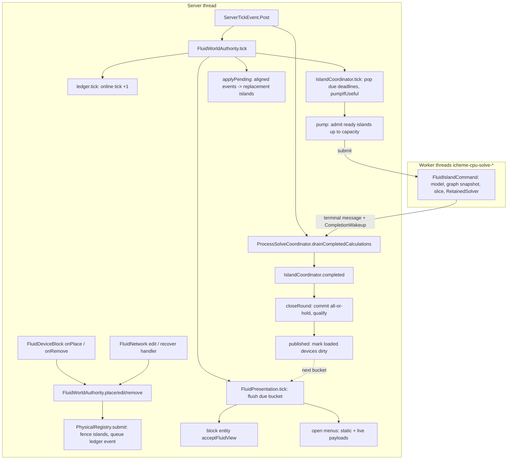

# Fluid runtime: the Minecraft side of the fluid system

**Process control (batch 2026-10-26-process-control, 0.14.1):** sensors, control valves and vessel geometry; the contracts are in [process-control.md](process-control.md).

`FluidDeviceSpec` and `PassiveNetwork.Inventory` retain immutable vessel geometry, so unloaded islands need no shape/chunk lookup. Physical registry edits preserve amounts, energy and solids when geometry changes. Loaded legacy shapes queue registration reconciliation. Fluid facts schema 3 appends, after schema 2's joints and lanes, a device spec's vessel geometry record and the `control_valve` control; absent geometry defaults to the old prism. Solved state format 22 discards incompatible caches, retaining facts. The schema-1, schema-2 and schema-3 corpus images are gated. A sensor-configured valve is one registry edit through `PhysicalFluidTopology.Device.withControl`, which keeps a laid pipe's joints and lane (`InstrumentService.editSensorValve`).
Flowmeter placements are derived from saved accessory facts into a transient registry host set (`PhysicalRegistry.flowmeters`, set before `load`). A checkpoint does not carry the taps: `PhysicalRegistry.load` attaches the ones it compiles to each restored island before its first slice (`IslandCoordinator.attachObservationPoints`), and a certificate replay in `materialise` keeps the island's taps. Installing or removing a flowmeter (`PhysicalRegistry.flowmeter(host, installed)`) queues the host's registration again at its next revision, so the island recompiles on the engine schedule; `forgetFlowmeter`, for a host being removed, changes only the set. The taps add no storage or resistance and are no part of a pipe's identity or a certificate's signature. Accepted worker observations flash the transported stream at each installed meter's local pressure/temperature; failures make the measurement unavailable, never hold the island. Stopped connected observations report zero. Publication builds readings on the engine schedule even with no open GUI; menu opening replays the cached menu payload only. Protocol is `fluid-15`. `FluidDeviceBlockEntity.refreshGeometry` recognizes the Valve interface, retaining modular fittings and their registered forward direction.

**Snapshot:** d02d221f (main, mod 0.15.0), 2026-10-27 · **Updated:** 2026-10-27 (batch 2026-10-27-skirt-shadow: `ShapeRasterizerTest.aSkirtShowingItsInsideLetsSkylightThrough`, GameTest `EquipmentCompatGameTests.aSkirtsFloorTakesTheSkylightAboveTheDrum` (35 fluid GameTests); `test` 1644 and fluid GameTests 35/35 at d02d221f; `slowGates` not run for the merge (owner: "no test")) · earlier: 2026-10-27 (batch 2026-10-26-multi-machine-framework: facts schema 4, where the world basis keeps the package's declared-revision identity in place of a hash; the edit listeners; a pipe line resized as one event (`PhysicalFluidTopology.line`, `PhysicalRegistry.resizeLine`, refused by a nozzle that takes a smaller pipe, `NOZZLE_TOO_SMALL`, `67343274`); the assembly hooks in the tick, the chunk load and the stop, see [machine-assemblies.md](machine-assemblies.md)) · earlier: 2026-10-27 (batch 2026-10-26-process-control: vessel geometry in the device spec, control valves, flowmeter taps, state format 22, protocol `fluid-15`; main 0.14.0 merged in: facts schema 3 after the pipe-laying schema 2, `Device.withControl`; review finding 5: taps attached to restored islands and kept by a certificate replay, an installation queues its host's registration) · earlier: 2026-10-27 (batch 2026-10-26-pipe-laying-system: explicit pipe joints, rack lanes as ledger positions, transition pipes, facts schema 2, a laid line as one ledger event, registrar `pipeline-tool-2`; the tool and the racks are in [pipe-laying.md](pipe-laying.md)) · earlier: 2026-10-26 (batch 2026-10-26-chunk-loading-review: a loading fluid block reads no neighbour in a chunk that is not loaded, a reloaded open tank's roof glides from the level its node cell saved, an unload ends the tank's watches) · earlier: 2026-10-26 (batch 2026-10-26-accessory-store-compat: the authority opens the accessory store before its own saved data); 2026-10-26 (batch 2026-10-26-backward-compat: checkpoint envelope 1 with a facts and a state section per unit, state format 20, facts schema 1 (`FluidFacts`), the load's EXACT and FACTS routes, restatement on changed property data and the `Restated` ledger total, the one reset of a pre-envelope world; a layout refresh moves or resizes a vessel or mover by one edit that keeps its identity and contents, `relocateMover` removed) · earlier: 2026-10-25 (batch 2026-10-21-floating-roof-tanks: open tanks and their displays, constructed movers, pipe fittings, generator and mover power, requested world-space displays, checkpoint format 19 / unit format 12 and the format reset on world open, protocol `fluid-14`); 2026-10-21 (0.11.1 test review; mod rename to IChemE, 0.11.0); 2026-10-20 (drums as multi-cell reservoirs)
Up: [code guide](README.md)

## Read this when

- You change what happens when a player places, breaks, rotates or configures a fluid block (tank, pipe, generator, void), or installs, toggles or removes a pipe fitting (shutoff, check or pressure valve, Y-strainer, inline pump or compressor, sight glass).
- You touch scheduling: when an island solves, holds, retries, certifies (STEADY) or wakes, or how the worker pool is sized.
- You touch what a GUI or a loaded block receives, and when (presentation buckets, the cached snapshot on open, the menu packets).
- You change the save format (envelope 1, state format 22, facts schema 4: what a world keeps across builds and what it computes again) or a `[solver]` / `[fluid]` key in `icheme-common.toml`.
- You change what a queued device edit tells its listeners (`FluidWorldAuthority.listen`; the machine assemblies revert on it, [machine-assemblies.md](machine-assemblies.md)), or how a whole pipe line is resized (`resizeLine`).
- You change which faces join: a laid pipe's explicit joints, a rack lane at its rack's position, a transition pipe beside a lane (the laying tool and the racks themselves: [pipe-laying.md](pipe-laying.md)).
- You change how a drum, tank or sphere (a multi-cell vessel of [equipment.md](equipment.md)) registers as a reservoir (its ports, volume, level height, open flag), how a constructed pump or compressor registers as a mover, or how a layout refresh moves or resizes either.
- You change a requested world-space display: an open tank's roof and liquid, a sight glass, a constructed mover's running state.

The Minecraft-free solver (`science/fluid`) is in [fluid-science.md](fluid-science.md). The column is in [column-v3.md](column-v3.md). The client screens are in [client-gui.md](client-gui.md).

## In one paragraph

A player places fluid devices. Neighbouring devices connect, and each connected set with a hydraulic boundary becomes an **island**. Only online time moves the plant: one server tick is one online tick at a nominal 20 TPS. Nothing advances while the server is off. In code, a block placement becomes a queued **ledger event** in [`WorldTopologyLedger`](../../../src/main/java/com/wormzjl/icheme/runtime/fluid/WorldTopologyLedger.java). The event fences the islands it touches. [`PhysicalRegistry`](../../../src/main/java/com/wormzjl/icheme/runtime/fluid/PhysicalRegistry.java) applies the event once those islands are aligned at its tick, and replaces them with recompiled islands. [`IslandCoordinator`](../../../src/main/java/com/wormzjl/icheme/runtime/fluid/IslandCoordinator.java) keeps one deadline per island in [`IslandScheduler`](../../../src/main/java/com/wormzjl/icheme/runtime/fluid/IslandScheduler.java). When a slice falls due, the coordinator sends an immutable command to the shared worker pool ([`BoundedCpuSolveService`](../../../src/main/java/com/wormzjl/icheme/runtime/BoundedCpuSolveService.java) through [`ProcessSolveServices`](../../../src/main/java/com/wormzjl/icheme/runtime/ProcessSolveServices.java)). Completions are drained on the server thread, and a round's results are committed together, all or nothing. A commit is a **publication**. A publication only marks loaded devices dirty. [`FluidPresentation`](../../../src/main/java/com/wormzjl/icheme/runtime/fluid/FluidPresentation.java) delivers views on a 100-tick bucket per island (about 5 s). The one exception: opening a GUI, or a client's watch of a world-space display (an open tank, a sight glass, a constructed mover, a gauge), replays the last cached snapshot at once. [`FluidWorldAuthority`](../../../src/main/java/com/wormzjl/icheme/runtime/fluid/FluidWorldAuthority.java) is the one object per server that owns all of this. The block, block entity and menu are thin adapters that hold no fluid state.

## Class map

Paths are relative to `src/main/java/com/wormzjl/icheme/`.

| Class | Role | Read it for |
|---|---|---|
| **Bootstrap and registries** | | |
| [`IChemE`](../../../src/main/java/com/wormzjl/icheme/IChemE.java) | `@Mod` entry: registries, payload registration, config spec, server lifecycle and tick hooks | Tick order; `FluidOptions`; every config key |
| [`registry/ModBlocks`](../../../src/main/java/com/wormzjl/icheme/registry/ModBlocks.java) | Five `FluidDeviceBlock`s (`fluid_reservoir`, `fluid_pipe`, `fluid_generator`, `fluid_void`, `inline_filter`; none occludes; the removed one-block `fluid_pump` and `fluid_compressor` ids are block aliases of `fluid_pipe`, batch 2026-10-28-old-mover-removal), `pipe_rack` ([pipe-laying.md](pipe-laying.md)), the equipment blocks and the column block | Block ids. The pump, compressor and filter blocks have no block item: their item ids belong to pipe fittings |
| [`registry/ModItems`](../../../src/main/java/com/wormzjl/icheme/registry/ModItems.java) | Block items for tank, pipe, generator, void and constructor; seven `PipelineFittingItem`s; `pipeline_tool`, `pipe_laying_tool` and the `pipe_rack` block item; the gauges and `accessory_wrench`; `recovered_solids`, `fluid_debugger`; data components `pipeline_tool_settings`, `pipe_laying_settings`, `pipe_laying_paint`, `pipe_laying_secondary`, `gauge_settings` | Item ids ([instrument-accessories.md](instrument-accessories.md)) |
| [`registry/ModBlockEntities`](../../../src/main/java/com/wormzjl/icheme/registry/ModBlockEntities.java) | One `fluid_device` block-entity type for all seven blocks | |
| [`registry/ModMenus`](../../../src/main/java/com/wormzjl/icheme/registry/ModMenus.java) | Menu types `fluid_device`, `pipeline_tool` (both pipe tools' settings), `gauge` (and the equipment and column menus) | |
| **World adapters (no fluid state)** | | |
| [`world/level/block/FluidDeviceBlock`](../../../src/main/java/com/wormzjl/icheme/world/level/block/FluidDeviceBlock.java) | Connection blockstates; a pipe (nested `Pipe`) also carries its fitting: `shutoff` (`Shutoff` NONE/OPEN/CLOSED/CHECK), `pressure_control`, `inline_filter`, `inline_mover` (`InlineMover` NONE/PUMP/COMPRESSOR), and on every block `sight_glass` with `sight_glass_axis`; `onPlace` → `place` with the fitting the state carries, or `edit` (facing; only a pipe may face up or down: `vertical`); `onRemove` → `remove`; use: a pipe with a pressure valve, filter or mover opens its menu, an empty hand on a shutoff toggles it (`togglePipeCutoff`), a plain pipe passes, any other block opens its menu (debug with the debugger item); a pipe's shape follows its drawn outside diameter, a device's is its block less a texel at the sides; `laying` (static, server thread) is set while the laying tool places its blocks, which then register nothing in `onPlace` | Which faces connect (a fitted pipe, the movers and the filter use the facing axis only; two boundaries never connect; a pipe also meets an equipment shell cell whose `nozzleFacing` faces it; each side needs a joint on the shared face, `joints`; a pipe meets a `pipe_rack` only as a transition pipe, `transition`, towards a lane jointed to it) |
| [`world/level/block/entity/FluidDeviceBlockEntity`](../../../src/main/java/com/wormzjl/icheme/world/level/block/entity/FluidDeviceBlockEntity.java) | Holds `FluidIdentity`, its gauges' static `Instrument.Metadata` and its drawn geometry (the registered bore and a 7-bit size code plus a flange bit per face, `Drawn` model data, flange pairs where a straight pipe's coordinate along its run is a multiple of `LineGeometry.SPOOL` 12, a transition pipe's `offsets` towards a rack lane's point; static geometry, not process data, see [client-gui.md](client-gui.md)); a copy of its registration's `joints` and the line's two paints (`Joints`, `Paint`, `Secondary` NBT, [pipe-laying.md](pipe-laying.md)); `openEnds` and the client index `clientOpenEnds` for the tool's marks; binds it on load; receives views; opens the menu, then replays the cache | Opening order; `refreshGeometry` (the joints follow the projected registration; a rack next door redraws) |
| [`world/inventory/FluidDeviceMenu`](../../../src/main/java/com/wormzjl/icheme/world/inventory/FluidDeviceMenu.java) | Server: subscription to the bucket; client: joins static and live payloads; valid for any `FluidView.Receiver` (a fluid block or a drum's node cell) | `stillValid` (`REACH` 8 blocks; a drum's menu: 8 + its largest box side), 5-tick edit rate limit |
| [`world/item/RecoveredSolidsItem`](../../../src/main/java/com/wormzjl/icheme/world/item/RecoveredSolidsItem.java) | Non-stackable item carrying a filter's recovered solids as JSON custom data | Exactly-once delivery key (`transfer` UUID) |
| **Authority and topology** | | |
| [`FluidWorldAuthority`](../../../src/main/java/com/wormzjl/icheme/runtime/fluid/FluidWorldAuthority.java) | One per server: model of the network package (`networkPackage(catalog)`), ledger, registry, runtime, presentation, saved data and the gauges' `InstrumentService`; `place` (with the fitting a pipe's blockstate carries), `placeVessel(node, ports, volume, levelHeight, open)` (a drum, tank or sphere: one RESERVOIR registration at its node cell, placed empty, D54), `placeMover(suction, kind, ports)` (a constructed pump or compressor), `edit` (also a layout refresh's move or resize of a vessel or mover, which keeps its identity, controls and contents, decision D7), `remove`, `recoverFilter`; `lay(cells, diameter, hosts)` (a laid line: one passive pipe per `Laid` cell, rack lanes included, and the new joints of the laid pipes it meets, in one ledger event); `placeLane` and `place(…, joints)` (a lane or laid pipe registered again from its block); the fittings `installPipe{Cutoff,Valve,PressureValve,Filter,Mover}`, `togglePipeCutoff`, `removePipeAccessory`; `committedDevice` (a static read); `loadedChunk` (rebinds placed blocks and vessels, re-registers missing ones, a laid pipe with its saved joints, and binds each rack's lane copy); the watches `watchTanks`, `watchSightGlasses`, `watchMovers`, `forgetWatcher` (`deviceUnloaded` ends all three kinds for the device); builds views; `capture` refuses an island that holds no device; `phaseHeld` logs a phase hold (`status=PHASE_HOLD`, rate-limited per island); `resizeLine(id, diameter, largest)` (a pipe line, at most `LINE_LIMIT` 4096 pipes, `PhysicalRegistry.resizeLine`; `largest` is the caller's per-pipe limit, the nozzles beside it); `listen(EditListener)` (static): each `submit` tells every listener its `DeviceChange`s (position, device before and after, null for none; a moved device stands at two positions), after it submits; `tick` runs `AssemblyNetwork.presentationTick` after the column's, and `forget` also forgets `AssemblyNetwork` | `tick()`; `view(...)`; `published(...)`; the presentation host's `present` (for a vessel the tank glide first, then the block entity and gauges; sight glass, mover state; none for a rack lane) |
| [`WorldTopologyLedger`](../../../src/main/java/com/wormzjl/icheme/runtime/fluid/WorldTopologyLedger.java) | Persistent identities, registrations, queued timestamped events (max 4096), online tick, material totals on the component basis (`MaterialTotal.plus`: a crystal is booked as its component's moles plus its energy offset; no potential energy), recoveries; nested `FluidBasis` (package id, component axis and `revision`, the package's fluid identity `MaterialCatalog.fluidRevision`, at most `MAX_IDENTITY` characters, saved with the topology; `requireCurrent` at load), `RecoveredSolid` (a recovery awaiting delivery to a player or a loaded chunk) and `Restated` (cumulative: the energy restatements gave the vessels and the moles and solid kilograms the new data no longer has; the ninth `Snapshot` component; not live stock); `Overlay.check`: an edit keeps its device's kind and dimension and raises its revision by one, a device may move, and a vessel's edit changes at most its geometry (`FluidDeviceSpec.sameCharge`) | `tick()` increments the online tick |
| [`PhysicalRegistry`](../../../src/main/java/com/wormzjl/icheme/runtime/fluid/PhysicalRegistry.java) | Device → island owner, chunk membership, diagnostics; `submit` fences (only neighbours the edit joins, `joined`; `standsFor`: a fixed boundary the walk only passes fences no island, except a lone boundary's island of one, `loneIsland`), `applyPending` batches aligned events; an applied vessel edit keeps its moles, energy and solids in its new geometry and elevation, and the chunk index follows a moved device (`apply`); `Host.committed(removed, recompiled)`; `load` refuses a saved island that holds no device, and attaches the flowmeter taps it compiles to each restored island (`flowmeters` before `load`); `flowmeter(host, installed)` queues the host's registration at its next revision, `forgetFlowmeter` changes only the set; `installPipe*`, `removePipeAccessory` and `togglePipeCutoff` queue a fitting edit on the latest projected registration, so pending bore and setting edits are kept and rapid clicks compose (a fitting is refused beside a jointed sideways neighbour, `canInstallFitting`); `pipeViews(device)`; every walk takes a face's neighbour from `PhysicalFluidTopology.across`, so it follows rack lanes; `resizeLine(id, diameter, limit, largest)` queues one event in which each pipe of the line keeps its length, roughness, fittings and spec (returns the line's length in pipes; 0 when `id` is no pipe; -1 past `limit`; `LANE_TOO_NARROW` -2 when a rack lane on it is narrower than `RackGeometry.width` of the new drawn size; `NOZZLE_TOO_SMALL` -3 when the bore is over `largest` (a `ToDoubleFunction<Device>`) of any pipe on it; nothing queued on a refusal or when no pipe changes) | Event cost bounded by the touched neighbourhood |
| [`PhysicalFluidTopology`](../../../src/main/java/com/wormzjl/icheme/runtime/fluid/PhysicalFluidTopology.java) | Pure adapter: registered devices → science islands; never reads chunks. A `Device` carries `generatorEnabled` (a generator's source switch; placed off), `cutoff` (`Cutoff` NONE/OPEN/CLOSED/CHECK, stable codes 0 to 3, pipes only), `inlineFilter`, and its control: a pipe whose control is a pump, compressor or valve (`FlowControl.Valve`: a control valve, or a legacy pressure valve), or that carries a filter, compiles as that device (`hydraulicKind`). It may carry `Port`s (cell, face, phase port, `ConnectionRole` VESSEL/SUCTION/DISCHARGE; at most `MAXIMUM_PORTS` 64): a reservoir's are VESSEL, a constructed mover has exactly one SUCTION port at its node cell and one DISCHARGE port, both BULK. It then occupies its node cell and its ports' cells (`cells()`) and meets pipes only at its ports (`contacts()`, `meets`); `portAt` gives a link's phase port; `withPlacement(position, ports)` is the same device at a new node with new ports (a layout refresh, D7); `withControl(control)` the same device with another control (a sensor configuring its valve), joints and lane kept. A check-valve pipe stays a node of its run, and the run carries the reverse direction it forbids (`checkRestrictions`). An actuator's half of a link takes the bore and roughness of the pipe it joins (`half`). `View(islandIndex, pipeId, forward, tap, flowDirection)` maps a pipe block to its run. **Joints and lanes** ([pipe-laying.md](pipe-laying.md)): `Device.joints` (a bit per `Direction`; `ALL_FACES` 63 for every device but a laid pipe), `jointAt`, `withJoints`; `mechanicallyConnects` needs the joint on both sides, so a line laid beside another never joins it. A rack lane is a laid pipe at `Position.lane` 1 to `RACK_PLACES` 14 (`withLane`) with `slots` its width (at most `RACK_WIDTH` 4, `laneFits`) and `points` its face points (`point(direction)`), at most two joints, passive, no fitting. Two lanes meet where their points coincide; a lane meets a plain pipe only if it is a `transitionPipe` (`lanesMeet`). `across(at, device, from, cell, direction)` gives what a face meets, lanes included, for `compile` and the registry walks. **Pipe line** (static `line(at, start, limit)`, the pipeline tool's sneak-use): the pipes reached through mechanical joints (`Device.mechanicallyJoins`: as built, whatever a valve, cutoff or switch says); it goes straight through a junction (three or more joints) and stops before one it would enter from the side, an inline mover belongs to no line, lanes are met through `across` and each side must meet the other; null past `limit` | `Position`, `Device`, `Port`, `Contact`, `Direction`, `View` records |
| [`FluidDeviceSpec`](../../../src/main/java/com/wormzjl/icheme/runtime/fluid/FluidDeviceSpec.java) | Validated volume (≤ `MAX_VOLUME` 30,000 m³), T, p, composition, slurry, `levelHeight` (≤ `MAX_LEVEL_HEIGHT` 128 m; the shorter constructors give `PassiveStepSolver.LEVEL_HEAD_HEIGHT` 1 m, a one-block tank) and `open` (a floating-roof tank, open to the atmosphere); a reservoir's volume, level height and open flag are its vessel's, and only a layout refresh changes them: `sameCharge` (same T, p, composition and solids) is the one edit a placed vessel takes | `validate`: a void's or generator's T, p inside the package envelope (`FluidDomain.requireInput`) |
| [`FluidPresetCatalog`](../../../src/main/java/com/wormzjl/icheme/runtime/fluid/FluidPresetCatalog.java) | Material presets projected onto the network axis | GUI preset list |
| [`FluidPropertyReloadGuard`](../../../src/main/java/com/wormzjl/icheme/runtime/fluid/FluidPropertyReloadGuard.java) | Compares the model revision (`FluidThermodynamics.revision()`) rebuilt from the live material catalog with the startup one, so a datapack reload that changes the model (a crystal record included) holds the network: `HOLD` reads `HELD: property data changed; save and reopen the world to restate the fluid network on the new data`; `validateSolids` checks only the custom solids a save owns or references (its hold, set in `FluidWorldAuthority.refreshProperties`: `HELD: solid property data changed; save and reopen the world to read its solids on the new data`) | Why islands show a property `HELD`; solid property hold |
| **Scheduling and solving** | | |
| [`MinecraftFluidRuntime`](../../../src/main/java/com/wormzjl/icheme/runtime/fluid/MinecraftFluidRuntime.java) | Bridges the coordinator to `ProcessSolveServices`; installs the readiness pump; island → dimension | `Dispatcher` implementation |
| [`IslandCoordinator`](../../../src/main/java/com/wormzjl/icheme/runtime/fluid/IslandCoordinator.java) | Clocks, rounds, commits, fences, holds and the phase-hold park, certificates, topology replacement (it conserves each vessel's contents, `Inventory.sameContents`; a replacement of one original's structure carries its junctions and interval), the status line's data-range `notice`; a restored island's flowmeter taps (`attachObservationPoints`, before its first slice; a certificate replay in `materialise` keeps the island's taps, since a restored certificate's graph has none) | `pump`, `closeRound`, `hold`, `qualify`, `materialise`, `acceptAtFence`, `topology`, `onPhaseHold` |
| [`IslandScheduler`](../../../src/main/java/com/wormzjl/icheme/runtime/fluid/IslandScheduler.java) | Deadline heap on the online epoch; lazy invalidation by generation; nested `FairQueue` (round-robin among ready islands only) | The six `Kind`s; dispatch order |
| [`IslandClock`](../../../src/main/java/com/wormzjl/icheme/runtime/fluid/IslandClock.java) | Online, committed and retry ticks plus cadence (20–400 ticks), on the shared epoch | `nextSlice`, `readyAtTick`, `rest`, adaptive cadence |
| [`IslandCertificate`](../../../src/main/java/com/wormzjl/icheme/runtime/fluid/IslandCertificate.java) | Stationarity evidence, linear replay of the last interval, saved form and `Signature` (its property revision at most `MAXIMUM_PROPERTY_REVISION` 65,536 characters: it names the package's fluid identity twice) | Replay arithmetic |
| [`CertificatePolicy`](../../../src/main/java/com/wormzjl/icheme/runtime/fluid/CertificatePolicy.java) | Certificate settings captured at server start | Defaults and bounds |
| [`RetainedSolver`](../../../src/main/java/com/wormzjl/icheme/runtime/fluid/RetainedSolver.java) | Per-island solver cache (sparsity, ordering); reset per job to the committed interval (`replayStart`) | Why a retry is bit-reproducible |
| **Solids** | | |
| [`SlurryFeed`](../../../src/main/java/com/wormzjl/icheme/runtime/fluid/SlurryFeed.java) | Generator particle concentration and grades | |
| **Checkpoint** | | |
| [`FluidSavedData`](../../../src/main/java/com/wormzjl/icheme/runtime/fluid/FluidSavedData.java) | Overworld `SavedData` `icheme_fluid_core`; captures on the server thread, commits on the IO worker; `open(server, models, catalog)` resets a world saved before the envelope (`FormatMismatchException`, owner decision D4) to an empty one and refuses one it cannot read, its files kept; `load` reads exactly or from facts, and a facts load marks the data dirty; `route()`, `reason()` | `SaveTiming`; the one reset; the load route |
| [`FluidCheckpointCodec`](../../../src/main/java/com/wormzjl/icheme/runtime/fluid/FluidCheckpointCodec.java) | The frozen envelope (`ENVELOPE` 1: core keys `Envelope`, `StateFormat`, `FactsSchema`; unit header `UNIT_MAGIC`, `UNIT_ENVELOPE` 13, then a facts and a state section) and state format `VERSION` 22: core NBT record and binary island/topology units; a solid population is read back as its package record (crystal or custom solid); `FormatMismatchException` (no envelope) and `Unreadable` (what a newer build wrote); nested `Writer`/`Reader`, the canonical binary primitives (LEB128, sparse doubles, exact bits) | `VERSION`, `ENVELOPE`, what a unit holds; one value, one encoding |
| [`FluidFacts`](../../../src/main/java/com/wormzjl/icheme/runtime/fluid/FluidFacts.java) | Package-private. Facts schema `SCHEMA` 4 (2 appends a registration's `joints`, a lane's `slots` and `points`, a position's `lane`; 3 a device spec's vessel geometry record and the `control_valve` control; 4 retires the basis's hash, written empty, and appends the basis `revision`): a section is a text table and one record of positional fields, appended only, each read with its default when absent; a record longer than this build reads refuses; enums by name, `ALIASES` (empty) for renamed ones. `world` and `island` write and read the units' facts, `events` the topology unit's state; `disagreement` cross-checks an exact load; `rebuild` makes the world from facts alone and restates it on changed property data | What a world keeps across builds; the facts route; restatement |
| [`FluidCheckpointStore`](../../../src/main/java/com/wormzjl/icheme/runtime/fluid/FluidCheckpointStore.java) | Pack files, SHA-256 index, dirty tracking, atomic commit, orphan cleanup; `load(core, models, catalog)` gives `Loaded(checkpoint, world, route, reason)`, `Route` EXACT or FACTS | Commit protocol; the load ladder |
| **Presentation** | | |
| [`FluidPresentation`](../../../src/main/java/com/wormzjl/icheme/runtime/fluid/FluidPresentation.java) | 100-tick buckets keyed by island; dirty marks; menu subscriptions; input replies; `observe`/`unobserve`: a device with a requested world-space display is marked at each of its buckets, even while its island is idle | The engine-owned GUI schedule |
| [`FluidView`](../../../src/main/java/com/wormzjl/icheme/runtime/fluid/FluidView.java) | Read-only view of a committed interval (identity, revisions, ticks, status, state, flows, pipe history and routes, filter, pipe info, outlets, and for a vessel `Tank`: level height, open, vent and spill kg/s, capacity, top and bottom pressure, null while empty); `Receiver` interface | View fields |
| [`TankOutlets`](../../../src/main/java/com/wormzjl/icheme/runtime/fluid/TankOutlets.java) | Tank port lines and `tank(...)` from committed data (no flash); a LIQUID or OVERFLOW port's head is g·m_liquid·H/V with the vessel's own `Inventory.levelHeight` as H (`bottomHead`); `released` gives the vent and spill rates of the last interval | Phase-port display; vent and spill |
| [`TankDisplay`](../../../src/main/java/com/wormzjl/icheme/runtime/fluid/TankDisplay.java) | An open tank's drawn liquid level, free-water level, fill height and two liquid tints (components mixed by mass fraction, Beer-Lambert); nested `Glide` moves from the last display to the new one over one bucket (100 ticks), the same on client and server; the first glide after a load starts at the level the roof stands at (`Glide.next(old, standing, display, tick)`, `standing` from `FloatingRoofs.standing`, NaN when no tank is indexed: the display then stands at once) | Roof and liquid drawing; the roof's collision height |
| [`PipePresentation`](../../../src/main/java/com/wormzjl/icheme/runtime/fluid/PipePresentation.java) | Pipe contents and speeds from committed graph/history; nested `SpeedWindow` (display only); `SightGlass(argb, bubbles, flowDirection)` from the accepted transport (no optical model); `pumpStatus` puts a pump's operating condition on its status line; `actuatorMappings` | Sight glass; pump status text |
| [`network/FluidNetwork`](../../../src/main/java/com/wormzjl/icheme/network/FluidNetwork.java) | Protocol `fluid-15`: the menu payloads, `Controls` (with `Power` ON/OFF), `MenuData` (refuses a crystal of a component off the axis, `requireCrystalAxis`; sensor readings and `ValveData`, [process-control.md](process-control.md)); edit/recover handlers; client cache of 32 views; the requested displays (`registerDisplays`: tank watch on `fluid-15`, `sight-glass-3`, `mover-1`, `instruments-1`, `pipeline-tool-2`); `pipeline-tool-2` also carries the laying tool's open, lay, answer and dismantle payloads ([pipe-laying.md](pipe-laying.md)) | Packet validation |
| **Shared runtime** | | |
| [`network/ProcessSolveCoordinator`](../../../src/main/java/com/wormzjl/icheme/network/ProcessSolveCoordinator.java) | The only completion router: column vs fluid; also stop routing | `drainCompletedCalculations` |
| [`runtime/ProcessSolveServices`](../../../src/main/java/com/wormzjl/icheme/runtime/ProcessSolveServices.java) | Server lifecycle adapter of the pool; fluid commands and results; 64 completions per tick; nested `CompletionWakeup` (coalesces worker signals into at most one pending server task) | `FluidIslandCommand` (the full solve on the whole wall budget), `notices`, `owe(...)`; between-tick drains |
| [`runtime/BoundedCpuSolveService`](../../../src/main/java/com/wormzjl/icheme/runtime/BoundedCpuSolveService.java) | Generic bounded pool: one job per owner, bounded ready queue, cancellation, two-phase shutdown | Owner-thread confinement |
| [`runtime/WorkerAllocation`](../../../src/main/java/com/wormzjl/icheme/runtime/WorkerAllocation.java) | Worker count resolution; demand grows at once, shrinks after 200 ticks | Automatic sizing |
| [`runtime/PresentationMailbox`](../../../src/main/java/com/wormzjl/icheme/runtime/PresentationMailbox.java) | 100-tick session mailbox, used by the **column** (`ColumnPresentation`), not by fluids | See column-v3.md |
| **Measurement (never simulation state)** | | |
| [`FluidRuntimeDiagnostics`](../../../src/main/java/com/wormzjl/icheme/runtime/fluid/FluidRuntimeDiagnostics.java) | Opt-in counters (island visits, pumps, views, packets), off by default; nested `Meter`, the opt-in server-thread time meter (nested scopes count once) | Benchmarks |

## Main flow

**(a) A block is placed → topology → island**

1. `FluidDeviceBlock.onPlace` (server only) calls `FluidWorldAuthority.place(position, kind, facing, cutoff, pressureValve, filter, inlineMover)` with the fitting the blockstate carries (a plain pipe carries none). It allocates the next identity and sets the default control: a pump at 0.01 m³/s and 500 kPa, a compressor at 0.05 m³/s and ratio 3 (`PhysicalFluidTopology.defaultMover`), a pressure valve at 200 kPa. A new pipe takes the largest bore of the pipes it connects to, else 0.05 m. A generator gets a water spec and is placed switched off; every other kind gets a nitrogen spec. A reservoir is placed empty, with `reservoirVolumeCubicMetres` (decision D54). The block entity is then bound to the identity.
   - A drum, tank or sphere comes in through `EquipmentStructure.register` → `FluidWorldAuthority.placeVessel(node, ports, volume, levelHeight, open)` instead ([equipment.md](equipment.md)): one RESERVOIR registration at its node cell (its lowest inside shell cell) with a VESSEL port per nozzle, nitrogen at 298.15 K and ambient pressure, placed empty, one queued ledger edit. `open` is true for a floating-roof tank. The node cell's `EquipmentShellBlockEntity` takes the identity (`bindIdentity`). The authority never binds a vessel's node cell itself: a loaded cell whose identity differs is logged `UNBOUND` and the saved registration is kept.
   - A constructed pump or compressor comes in through `placeMover(suction, kind, ports)`: one registration at its suction cell with one SUCTION and one DISCHARGE port and the default controls. Its power switch (`FlowControl.Mover.enabled`) and requested flow are edited from its menu; a one-block mover on a pipe has no power switch.
   - A layout refresh ([equipment.md](equipment.md), `EquipmentStructure.reregister`) keeps a vessel's or mover's registration by one queued `edit` (decision D7): `Device.withPlacement` gives its new node and ports, and a vessel also takes its new volume, level height and opening (`FluidDeviceSpec.sameCharge` holds). It keeps its identity, its controls and what it holds. When the edit applies, `PhysicalRegistry.apply` keeps a vessel's moles, energy and solids in its new geometry and elevation (no stream carries potential energy, D37, so a move books nothing) and moves its chunk-index entry; the island's next interval start closes its state to the new wall ([fluid-science.md](fluid-science.md), `NetworkReduction.atRest`).
   - A pipe fitting is not a block placement. `PipelineFittingItem` sets the pipe's blockstate and calls `installPipe{Cutoff,Valve,PressureValve,Filter,Mover}`, a queued edit of the projected registration ([instrument-accessories.md](instrument-accessories.md)). The wrench calls `removePipeAccessory`. An empty hand on a shutoff calls `togglePipeCutoff`. The sight glass edits no registration.
   - A line the laying tool lays comes in through `PipeLaying.lay` → `FluidWorldAuthority.lay(cells, diameter, hosts)` instead ([pipe-laying.md](pipe-laying.md)): one passive pipe registration per cell at the tool's bore, with nitrogen and explicit joints (a rack lane at its rack's position with its lane number, width and face points), and the new joints of the laid pipes it starts or ends at as edits, all in one queued ledger event. Its blocks are placed with `FluidDeviceBlock.laying` set, so their `onPlace` registers nothing.
2. `submit` → `PhysicalRegistry.submit` walks from the position through devices that no island owns. It enters a neighbour only if the edited device joins it before or after the edit (`joined`: `device().joins(other, cell, direction)` through each of its `contacts()`, its faces or a vessel's ports in other cells, on the latest registration or on the proposed one); an adjacent device that shares no flow path with the edit is not touched, so a block broken beside an unrelated (possibly held) network does not wait on it. It stops at an owned device, which fences that whole island, or at a device that a queued event edits, which orders the new event after that one. A fixed boundary (generator, void) that the walk only passes fences no island (D17). The one exception is a boundary alone in its island of one: the join replaces that island with the rest (D32, `PhysicalRegistry.standsFor`/`loneIsland`). `IslandCoordinator.fence(event, tick, islands)` stops those islands from slicing past the event tick. The ledger records the event.
3. On the next tick, `FluidWorldAuthority.tick` → `applyPending` → `PhysicalRegistry.applyPending` batches the queued events of one tick and one dimension whose owners are **aligned**: committed tick = fence tick and no attempt in flight. Certified islands are materialised to the fence first, and a held island accepts the event at its committed tick without a solve (`acceptAtFence`, see below). A burst of 1024 unapplied events applies at once, without waiting for the tick.
4. The batch compiles only the touched components and calls `MinecraftFluidRuntime.topology` → `IslandCoordinator.topology`. That replaces the affected islands with new ids in one change. Stock is kept: each vessel in a replacement holds what its original island committed (or what a constructed vessel starts with), bit for bit (`Inventory.sameContents`, else `Topology event changed stock`), while its geometry and elevation follow the registry. The revision is raised, and a new island starts with `initialIntervalSeconds` cadence, or the merged islands' largest cadence. A replacement whose graph has the same structure as exactly one original with a solved interval (the same pipe identities and node ids, in order: `PassiveNetwork.sameStructure`) carries that island's committed junction states (`PassiveNetwork.withJunctionStates(replacement.graph, old.graph, model)`) and its last interval, the endpoint its next job starts from; the freshly minted junction states are discarded, and each carried junction's buffer is sized on its carried state by the mint's own rule (`sizeJunctionHoldups`; bundled 145). Any other replacement starts with no carried interval. `RegistryHost.committed(removed, recompiled)` drops the cached `publishedMenuData` of removed and of recompiled devices, marks each recompiled device for its next bucket (`presentation.markIfLoaded`), then calls `presentation.rekey()`; each recompiled device that is loaded redraws (`drawn`: `FluidDeviceBlockEntity.refreshGeometry` with its registered bore, then its neighbours' faces and nozzles). Open menus follow their device to the new island's bucket, and a device left in no island (a pipe whose only tank was broken) stops showing the old network: its next bucket presents its new view. An opening menu waits for that bucket.
5. If an island is still solving, the event waits in the queue. The fence ends that island's slices at the event tick, so the island aligns on its own.

**(b) A due deadline → worker solve → completion drained → presentation published**

1. `IslandClock.readyAtTick` gives the online tick at which time alone makes a slice ready. `reconsider` books it as one `SLICE_DUE` (or `RETRY`) entry in `IslandScheduler`.
2. Each tick, `IslandCoordinator.tick` pops due entries (`runDue`). The island becomes ready in `IslandScheduler.FairQueue`, and `pumpIfUseful` → `pump` runs. Capacity is min(idle workers, 64 − dispatched this tick, 64 − pending).
3. For each admitted island: `IslandClock.nextSlice` → `FluidIslandCommand(model, graph, seconds, settings, hardBudget, retainedSolver)` → `ProcessSolveServices.submitFluidIsland`. The admitted islands form one **round**, with a `ROUND_TIMEOUT` deadline.
4. The worker runs the full solve on the whole wall budget and posts a terminal message. An accepted result carries the data-range notices of its end state (`ProcessSolveServices.notices`); a failed one may carry a phase hold. `ProcessSolveServices.CompletionWakeup` posts one `TickTask`, so the drain can run between ticks. `ProcessSolveCoordinator.drainCompletedCalculations` routes at most 64 completions per tick (the rest are owed to the next tick) and then calls the readiness pump.
5. `completed` marks the attempt as terminal. A result that arrives after the hard budget counts as none. When every entry is terminal or the budget has run out, `closeRound` validates each candidate (revision, interval, commit hook), commits it or applies the hold policy, samples cadence, runs `qualify` (certificates) and calls `publisher.published(changed)`. An accepted island's status is its detail plus its notice (`island.status = outcome.detail() + island.notice`): the open vessels' release line, then the data-range notice; a held one with a phase hold reads `HELD (phases): …`.
6. `FluidWorldAuthority.published` marks the saved data dirty, logs holds (a phase hold through its own rate-limited line, `phaseHeld`), and calls `presentation.markIfLoaded` for each member device. **Nothing is pushed.** At the island's next bucket (online tick ≡ island id mod 100), `flush` builds each view once from one island read. It hands the view to the block entity (`present`) and caches a `MenuData` per device in `publishedMenuData`.

**(c) GUI open → cached snapshot → subscription**

1. Right-click → `FluidDeviceBlockEntity.open` → `player.openMenu`. The menu constructor calls `FluidWorldAuthority.subscribe(menu)`. That registers the menu in its island's bucket slot and sends nothing.
2. After `openMenu` has installed the menu and sent its opening packet, `replayOnOpen(menu)` sends the cached `publishedMenuData` entry as static plus live payloads with an empty reply. This is a read of cached data: no view is built, no solve runs, and no pending event is applied. With no cached entry, nothing is sent and the menu waits for its bucket. Until then the client shows `FluidNetwork.lastDelivered(identity)` if this session has one.
3. The menu receives a live payload at every bucket of its island. It receives the static payload only when the registration revision changed.
4. An edit or recovery packet is validated and queued as a ledger event. `world.input(...)` records it, and the reply arrives with the menu's first bucket after that tick: `Queued for simulation event at tick N`, then `Applied`, or `Not applied: <reason>`.
5. `FluidDeviceMenu.removed` → `unsubscribe`. A menu abandoned without `removed` is dropped at its next bucket by `Host.open`.

**(d) A requested world-space display**

1. A client renderer asks by packet ([client-gui.md](client-gui.md)): `TankWatch` for open tanks by node cell (on `fluid-15`), `Watch` `sight_glass_watch` (`sight-glass-3`), `Watch` `mover_watch` (`mover-1`), `InstrumentWatch` for gauges (`instruments-1`, [instrument-accessories.md](instrument-accessories.md)). A request names at most 64 targets (`FluidNetwork.MAXIMUM_WATCHED`), each kind on its own. A tank or sight glass must lie within 128 blocks (`WATCH_RANGE`), a constructed mover within 96 (`MOVER_RANGE`).
2. `watchTanks`, `watchSightGlasses`, `watchMovers` or `InstrumentService.watch` checks each target (loaded, the right identity and kind, the right dimension, in range) and replays the last published display if there is one. This is a read: nothing solves and no event applies. A sight glass, mover or gauge watch also calls `FluidPresentation.observe`, so the device's buckets present it even while its island is idle; a tank needs no observe, because every presentation of a loaded open tank renews its glide.
3. At each bucket, the presentation host's `present` hands the view to the block entity and the gauges (`InstrumentService.publish`). For an open tank it first builds the next `TankDisplay.Glide` (before the block entity takes the view, so the first glide after a load starts at the level the node cell saved and the roof glides instead of jumping), gives it to `FloatingRoofs` (the roof's server-side collision) and sends it to the watchers. For a pipe with a sight glass it sends `PipePresentation.sightGlass`. For a constructed mover it sends `MoverState` (running = enabled and requested flow > 0). A watcher who left the level, went out of range or disconnected is dropped there.
4. An unwatch, a logout (`forgetWatcher`, from `IChemE.onPlayerLoggedOut`), an unloaded or removed device, or a topology commit that removed the device ends the watch.

Threading model

- **Server thread owns everything** in `runtime/fluid`. `FluidWorldAuthority`, `MinecraftFluidRuntime`, `IslandCoordinator`, `IslandScheduler`, `IslandClock` and `FluidPresentation` each check `owned()` and throw on any other thread. `FluidWorldAuthority.find` throws off the server thread.
- **Workers** (`BoundedCpuSolveService`, thread prefix `icheme-cpu-solve-`) receive only an immutable `ProcessSolveCommand` and the island's `RetainedSolver`, whose exclusive use is latched by `SolverOwnership`. They never call back. They put an immutable terminal message on a blocking queue and fire the `ProcessSolveServices.CompletionWakeup` signal.
- **Between ticks**: `CompletionWakeup` → `server.tell(TickTask)` → `drainCompletedCalculations`. A completion can therefore be committed and published between ticks. Presentation still waits for the bucket inside `FluidWorldAuthority.tick`.
- **Tick hook order** (`IChemE.onServerTickPost`): meter enter (`FluidRuntimeDiagnostics.Meter`) → material catalog change check (column viewers) → `drainCompletedCalculations` (property refresh, route ≤ 64, `pumpReady`) → `FluidWorldAuthority.tick` (property refresh, online tick +1, `coordinator.tick`, apply pending events + pump, `InstrumentService.tick`, presentation bucket, column presentation tick, `setDirty`) → meter exit.
- **Chunk load** events are queued as a `TickTask` (`FluidWorldAuthority.loadedChunk`). It rebinds each placed fluid block and vessel to its registration, registers a placed block that has none (after the one reset of a pre-envelope world: see the checkpoint section), queues a pipe block whose registration is a portless `PUMP` or `COMPRESSOR` (a saved one-block mover) as the in-line mover there (`PhysicalRegistry.convertOneBlockMover`: identity, facing, control, spec and joints kept, the largest bore it meets on its axis; an upright one keeps its registration and a `mover_compat` warning), and marks the chunk's devices dirty. It never loads a chunk or solves. A fluid block's `onLoad` (once its chunk is in the level) redraws its joints from loaded neighbours only: a face whose neighbour chunk is not loaded keeps its saved joint (`FluidDeviceBlock.connectedState`, as `computeFaces`), and the neighbour's own load settles both sides.
- **Level tick** (`IChemE.onLevelTickPost`, server levels): `FloatingRoofs.carry` lifts what stands on a rising roof, a read of each tank's glide.
- **Saves**: capture and encoding run on the server thread (a capture materialises certified islands). The pack and the core record are written on Minecraft's IO worker.
- Packet handlers are registered with `HandlerThread.MAIN`.

Scheduling, holds and certificates (STEADY)

- Deadline kinds (`IslandScheduler.Kind`): `SLICE_DUE`, `RETRY`, `ROUND_TIMEOUT`, `ALLOCATOR_SHRINK`, `RECOVERY_RETRY`, `CERTIFICATE_HORIZON`. Presentation buckets are not in the heap: `FluidPresentation` keeps its own next-due tick.
- Each island has at most one live deadline. A stale entry is dropped on pop by its generation number.
- **Clock**: `onlineTick = epoch − base`, where the epoch is the ledger's online tick. Debt = online − committed. A slice is `[committed, min(committed + min(cadence, maxSlice), fence)]`.
- **Adaptive cadence** (`adaptiveCadence`): 3 CPU-bound samples (CPU/wall ≥ 0.75 and wall ≥ soft budget) give ×1.25, up to 400 ticks. 10 light samples give ×0.9, down to 20 ticks.
- **Budgets**: hard = `wallBudgetMilliseconds` (2000 ms by default); every attempt is the full solve on it. Soft = 75 % of it, the adaptive cadence's load threshold only (a light sample is an accepted interval under a quarter of it). No job is cut at the soft budget.
- **Hold policy** (`hold`): every hold gets a fresh `RetainedSolver`. A slice longer than one tick is halved. At one tick, the retry waits cadence × 2^k, with k ≤ 6. Each accepted interval doubles the slice cap back, and the cap is lifted once it reaches cadence/2. A **phase hold** (`ThermoHold`: a phase set the network cannot carry, or the critical band) whose fresh-solver retry meets the same hold (`sameAs`) *parks* the island (`holdUntilInputsChange`, counter `phaseHolds`). Its status reads `HELD (phases): …; the retry failed the same way, so the island waits for a change to its network`, and its WARN repeats at most every `PHASE_HOLD_WARNING_TICKS` (6000). The park ends at `inputsChanged`: a fence, a released fence or a property resume. Leaving a data range never holds; the status line carries a notice instead.
- **Held island and a topology event** (`acceptAtFence`, owner decision 2026-10-15): `Island.held` is set in `closeRound` when the attempt was not accepted, outside a suspension, at the current revision, and cleared by an accepted interval. The fence install calls `inputsChanged`, so a held island first gets one fresh attempt. When the registry asks for alignment (both `aligned` methods) and the island is still held, with no certificate, no pending entry, no attempt in flight and no suspension, and its fence lies in (committed, online], the clock moves to the fence without a solve (`clock.rest(fence, fence)`). The inventory is unchanged over the unsolved span (no flow, so mass and energy stay exact), and the topology change then replaces the island with a fresh one that starts its own solve. Counters: `FluidRuntimeDiagnostics.heldEventAcceptances` and `droppedHeldTicks`. A property hold (suspension) still freezes topology events.
- **Certificate entry** (`qualify`): the interval must be accepted, outside a stop or a property suspension (else the refusal reads `stopped or suspended`), and free of solid-transport transitions and phase-hold rejections (keys with the `ThermoHold.REASON_PREFIX`, `phase-hold: `). An open vessel's vent and spill are rates a steady island repeats, so they do not keep it from certifying (`IslandCertificate`, `rate`); a changed closure, forbidden direction or filter cake does. The interval must repeat the previous one within `certificateStationaryTolerance` for `restConfirmIntervals` intervals in a row (at least 2 unless the map is the exact identity). Then `IslandCertificate.issue`.
- **Certified island**: it is never ready and drops its solver cache. It holds one `CERTIFICATE_HORIZON` deadline. Its committed tick moves only by `materialise`, a linear replay of the last interval, on a snapshot read, an alignment, a save, a property hold or its own deadline. A presentation read stops one tick short of a wake and never wakes the island. At the horizon it solves one revalidating slice and renews if the result is stationary. A topology event or a property resume discards the certificate.
- REST and STEADY are now **one certificate kind**. The status reads `STEADY: no flow since … s` or `STEADY: replaying X kg/s since … s[, next check at … s]`, followed by the open vessels' release line if any (`; venting x kg/s`, `; spilling y kg/s`, `IslandCoordinator.releaseLine`) and the island's data-range notice if it has one (`[; outside data range: …]`). An accepted island's status carries the same two notices.
- **Property reload**: `FluidPropertyReloadGuard` (including its solid check `validateSolids`) sets a hold (`HELD: property data changed; save and reopen the world …`), and `suspendForPropertyChange` freezes committed time while the debt keeps accruing. A running world never restates; a reopened world whose property basis changed restates its contents from its facts (checkpoint section). `resumeQualifiedProperties` discards every certificate. The guard and the certificate `Signature` compare the model revision (`FluidThermodynamics.revision()`). It names the package data, the line cap law (`line-cap-saturation-v1`), the maximum velocity, the trace cutoff and the solid settings.
- `-Dicheme.fluid.scheduler.verify=true` re-derives every island's schedule at each pump and tick and fails on drift. It is set by `test`, `fluidRuntimeTest`, `fluidScienceTest` and the `fluidGameTestServer` run.

Checkpoint envelope 1 (state format 22, facts schema 4): layout, load route and what it round-trips

- **Facts and state** (AGENTS.md, "Saves and data formats"; batch 2026-10-26-backward-compat). The envelope is frozen (`FluidCheckpointCodec.ENVELOPE` = 1): the core record's frame and every unit's header, then the unit's facts section (its schema and length) and its state section (its format and length). Facts are what the player built and put in, in the `FluidFacts` encoding, which every later build reads. State is what the engine computes again, in this build's state format only (`VERSION` = 22). State format 22 (batch 2026-10-26-process-control) adds to an island unit's graph each node's vessel geometry, the control-valve control and each pipe's actuator area. State format 20 put the envelope and the facts around format 19's units and moved the registry and the ledger's totals from the topology unit's state into its facts. Formats 13 to 19 added, in order: the open vessels (open flag of specs and inventories, the OVERFLOW phase port, the boundary transfers' kinds); a mover's directed ports (connection role); a mover's requested flow and power flag; the generator's source flag; the pipe cutoff code; CHECK and the per-pipe forbidden-direction mask; the pipe-filter flag. The class comment lists every format by batch.
- **Facts schema** (`FluidFacts.SCHEMA` = 4; schema 4 (batch 2026-10-26-multi-machine-framework) retires the basis record's third field, schema 1 to 3's `hex64:hex64` hash of the package data: it is written empty and read as empty or as that hash, never used; the basis appends `revision`, the package's fluid identity; a basis without it reads "" and restates the world once; schema 2 appends a registration's `joints` (default every face, 63), a rack lane's `slots` (default 0, at most 4) and `points` (default 0), and a position's `lane`, written only when not 0, so a block's position keeps its schema-1 record; schema 3 appends a device spec's vessel geometry record (form by name, capacity, height, diameter, length, boot diameter, boot length; default a prism of the spec's volume and level height) and the `control_valve` control). A section is its text table, then one record. A record is its field count, then its fields in a fixed order. A field is only appended and never changes meaning or unit: a record an older build wrote lacks trailing fields only, and each reads the default written beside its read (the behaviour before the field). A record with more fields than this build reads was written by a newer build and is refused (decision D9). Enums are written by name (kind, facing, cutoff, port face, phase port, role; a control by its kind: `passive`, `pump`, `compressor`, `pressure_valve`, `control_valve` with its source by name, sensor UUID, revision and mass and volume targets), and `FluidFacts.ALIASES` maps a renamed or removed constant (empty at schema 4). An optional value is a list of at most one.
- **What the facts hold.** The topology unit's (`FluidFacts.world`): the next identity, the `FluidBasis`, every registration (id, position, kind, facing, geometry, control, generator flag, cutoff, filter flag, ports with cell, face, phase port and role, the spec with volume, T, p, composition, slurry feed, level height, open flag and vessel geometry, then the revision, joints, lane width and lane points), the constructed and destroyed totals, the pending recoveries and the `Restated` total. An island unit's (`FluidFacts.island`): dimension, package, component axis, every vessel's inventory (volume, level height, open flag, moles, energy, solids) with its state's T, P and phase split, every filter's cake by device identity, and for a certified island its certificate base with the drift its replay adds (`Drift`, the arithmetic of `IslandCertificate`). The topology unit's state is its queued events; an island unit's state is the rest (below).
- **Load ladder** (`FluidCheckpointStore.load(core, models, catalog)` → `Loaded(checkpoint, world, route, reason)`):
  1. `readCore`: no `Envelope` but a `FluidFormat` (state format 19 or older) is a `FormatMismatchException`; another `Envelope`, a `StateFormat` below 20, or a `FactsSchema` outside 1 to `SCHEMA` is `FluidCheckpointCodec.Unreadable`. Any other `StateFormat` reads.
  2. Each package of the table: one this build no longer models, or whose `PropertyRevision`, `EnergyRevision` or `EnergyComponents` are not the current model's, marks the world for restatement.
  3. Each listed pack: its size, magic, pack format (a later one is `Unreadable`) and id. Each unit: its SHA-256, its header (magic, `UNIT_ENVELOPE` 13, kind, identity, revision and generation as the index gives them, else `Unreadable`) and its facts, read at every load. Its state is decoded only while no reason to rebuild is known; a state of another format, or one that does not validate (a malformed field, a fence before the committed tick, a solid id that names no record or constants that are not the record's), names the reason and sends the load to its facts.
  4. A topology basis that is not `FluidBasis.capture(catalog)` (package, axis and `MaterialCatalog.fluidRevision`, the declared revisions of the records the network reads) marks the world for restatement too. A schema 1 to 3 world has no revision, so it restates once.
  5. Route **EXACT** (empty `reason`): the islands resume as saved and the loaded index seeds the dirty tracking. Each island's facts are compared with its state (`FluidFacts.disagreement`): a disagreement fails a run with `icheme.fluid.scheduler.verify` and is otherwise logged (`fluid_checkpoint status=FACTS_DISAGREE`), the state kept.
  6. Route **FACTS**: `FluidFacts.rebuild`, logged WARN `fluid_checkpoint status=FACTS reason=… saved_islands=… islands=… vessels=… restated=…`. Nothing stored is reused: `FluidSavedData` marks itself dirty, the next save writes every unit afresh, and the packs read stay until its core commits. A checkpoint with no topology unit has nothing to rebuild from and is refused.
- **Rebuild from facts** (`FluidFacts.rebuild`). The registry, its settings and the ledger's totals are the saved ones; the queued events are state and are dropped (D5). Vessel contents and filter cakes are placed by device identity, a certified island's at its committed tick (`Island.at`). The devices compile into islands as a topology change compiles them (`PhysicalFluidTopology.compile`, junctions minted), under new island identities, awake at the epoch with no solved interval, cadence `REBUILT_CADENCE` 20, status `WAITING: rebuilt from saved facts (<reason>)[; removed by the property data: …]`. Generators and voids start from their specs (one outside the package's input box is clamped into it). A registered vessel with no saved contents starts empty, and the contents of a vessel that is no registered reservoir are dropped and booked as removed; each is logged `fluid_checkpoint status=FACTS detail=…`. A filter with no saved cake starts clean. A solid is read as its current record; a changed record is logged.
- **Restatement** on changed property data (owner decisions D2, D3). Every amount is mapped onto the current component axis by id, through the package's aliases. A vessel keeps its moles, volume, solids and temperature; `flashTP` at its saved T and P on the new data gives its energy and phase split, and the island's first interval closes it to its wall (a vessel off its wall row is not at rest, [fluid-science.md](fluid-science.md)). A component or solid the data no longer has leaves the world: its moles and kilograms, and the vessels' energy difference, are added to the ledger's `WorldTopologyLedger.Restated` (cumulative over loads; not live stock); the islands' status names what was removed, and the load logs WARN `fluid_checkpoint status=RESTATED vessels=… energy_delta_J=… removed=…`. A device spec holding only removed components then holds nitrogen (logged).
- **Refusals** leave every file untouched: `Unreadable` (a later envelope, facts schema or pack format, a unit header that is not the index's, facts this build cannot read), a missing, short or damaged pack, a digest mismatch, or a world-less checkpoint whose state cannot be used. `FluidSavedData.open` then reads the checkpoint again to name the reason and throws `Existing fluid authority could not be read: …`. The `FluidWorldAuthority` constructor opens the accessory store first (`InstrumentService.Store.open`), before this data and before any runtime starts; a store it cannot read refuses the world the same way ([instrument-accessories.md](instrument-accessories.md)).
- **The one reset** (owner decision D4): `FluidSavedData.open` catches the `FormatMismatchException` of a world saved before the envelope, logs `fluid_checkpoint status=RESET`, and starts an empty authority on `FluidCheckpointStore.resetForFormatChange()` (an unopened store; new pack numbers skip the old packs, which stay until the new core commits). Inventories, controls and pending events are lost. Placed blocks and vessels register again as their chunks load (`loadedChunk`, `EquipmentStructure.restoreFluidBinding`). `FluidSavedData.load` itself never resets. `FluidCheckpointFormatTest.preEnvelopeFormatsAreAMismatchAndANewerPackIsUnreadable` pins the mismatch (formats 1 to 3, 7 to 11 and 19, the tag unchanged) and the newer pack; no unit test opens a world, so the reset itself has no test.
- **Core record**: `data/icheme_fluid_core.dat`, overworld `SavedData`. It holds `Envelope`, `StateFormat`, `FactsSchema`, `Epoch`, the `Strings` table, `Packages` (per package: `Package`, `PropertyRevision`, `EnergyRevision`, `EnergyComponents`), the pack list with sizes, `NextPack`, `NextGeneration`, the topology unit reference, and `Islands` in columns. The columns are identity, revision, unit generation, `Online`/`Committed`/`Retry`/`Cadence`, the certificate summary `Base` (or `AWAKE = -1`)/`Since`/`Start`/`Horizon`, and the unit location with its SHA-256. `SHA256` covers every field.
- **Packs**: `data/icheme_fluid/fluid-<n>.pack`. A save writes one new pack (more only past 256 MiB) holding only the units whose island revision or payload generation changed, plus units moved out of mostly-dead packs. The pack is written first and the core second, both atomically. A pack is deleted only when neither the new core nor the previous core references it.
- **Island unit**: header (magic `0x43434655`; `UNIT_ENVELOPE` 13, in the byte where a unit of format 19 or older held its unit format, 12 at most; kind, id, revision, generation), the facts section, then the state section: dimension, package, status, fences, and the graph topology. Nodes: id, elevation, kind, inventory volume, level height and open flag. Pipes: id, ends, sections, control (tag 0 passive; 1 pump and 3 compressor: requested flow, limit, power flag; 2 pressure valve: its pressure), each end's phase port and the forbidden-direction mask. After that: state, the last solved interval (endpoint modes, heads, end flows, and each boundary transfer with its kind), and for a certified island its signature and base graph. A certified island's unit stores its base, not the materialised state, so the unit does not change while the island stays certified.
- **Endpoint modes** are `u8` ordinals of `FlowControl.Mode` in the state: `PASSIVE 0, PUMP_TARGET 1, PUMP_HEAD_LIMIT 2, VALVE_REGULATING 3, VALVE_OPEN 4, CLOSED 5, INLET_WRONG_PHASE 6, PUMP_SUCTION_LIMIT 7`. An ordinal past the last fails the state.
- **Solids**: every population (stock, stream, cake, pending recovery) is written as its material's id, revision, density and heat capacity, then its size and mass, in the facts as in the state. The state reads it back as the record that id names in the island's package, a crystal of the package or a custom solid (`record`); an unknown id, or constants that differ from the record, fails the state ("the saved state names a solid this data does not have"), and the facts route reads the current record or books a solid the data no longer has as removed.
- **Topology unit**: header, then its facts (above) and its state, the queued events: each with the registrations it would install, its touched devices and its recovery, written in the facts encoding (`FluidFacts.events`). The ledger's online tick is the core record's `Epoch`. The recovered solids are read as records of the basis package (`decodeTopology(bytes, onlineTick, models)`).
- On load, a saved certificate is restored if its `Signature` still holds. Otherwise it is discarded (WARN `status=CERTIFICATE_DISCARDED`) and the materialised inventory is kept. The log line `fluid_world status=LOADED format=… route=… online_tick=… islands=… certificates_saved=… certificates_restored=… awake=…[ reason=…]` summarises the load.
- **Corpus** (AGENTS.md: one image per facts-schema or shape-field change): `src/test/resources/compat/fluid/schema-1/` (`core.dat`, `pack-1.bin`, `expected.properties`: 7 registrations, 2 vessels, their total moles) and `schema-2/` (9 registrations, 2 vessels, 2 laid pipes and 1 rack lane, counted by the `laid` and `lanes` properties) and `schema-3/` (11 registrations, 3 vessels, 2 laid pipes, 1 rack lane, 1 shaped vessel and 1 control valve, counted by the `shaped` and `controlValves` properties; an older image reads prisms and no control valve) and `schema-4/` (the same counts as `schema-3/`, its basis carrying the revision). `FluidFactsCompatTest.everyCorpusImageRebuildsFromItsFactsToItsRecordedTotals` rebuilds every image from its facts, and fails while this build's schema has no image (it then writes one under `build/compat/fluid/`).

Wire packets and codecs (protocol <code>fluid-15</code> and the display registrars)

| Payload id | Registrar | Direction | Fields | Handler |
|---|---|---|---|---|
| `icheme:fluid_edit` | `fluid-15` | C→S | varint menuId, BlockPos, long identity, long revision, UTF JSON ≤ 4096 of `Controls` | `FluidNetwork.edit` |
| `icheme:fluid_recover_solids` | `fluid-15` | C→S | varint menuId, BlockPos, long identity, long revision | `FluidNetwork.recover` |
| `icheme:fluid_static` | `fluid-15` | S→C | varint menuId, long identity, UTF JSON ≤ 262144 of `StaticData` | `menu.acceptStatic` |
| `icheme:fluid_live` | `fluid-15` | S→C | varint menuId, long identity, UTF JSON ≤ 262144 of `LiveData` | `menu.acceptLive` |
| `icheme:tank_watch` | `fluid-15` | C→S | two BlockPos lists (watch, unwatch), ≤ 64 each | `watchTanks` |
| `icheme:tank_display` | `fluid-15` | S→C | BlockPos node, `TankDisplay.Glide` (two displays of three floats and two ARGB ints, long tick) | `TankRenderer.accept` |
| `icheme:sight_glass_watch`, `icheme:sight_glass_display` | `sight-glass-3` | C→S, S→C | `Target` lists (BlockPos, identity; ≤ 64, no duplicates); `Target` + `PipePresentation.SightGlass` | `watchSightGlasses`; `SightGlassRenderer.accept` |
| `icheme:mover_watch`, `icheme:mover_state` | `mover-1` | C→S, S→C | `Target` lists; `MoverState(target, compressor, running)` | `watchMovers`; `MoverSounds.accept` |
| `icheme:instrument_watch`, `icheme:instrument_display`, `icheme:gauge_save` | `instruments-1` | see [instrument-accessories.md](instrument-accessories.md) | | |
| `icheme:pipeline_tool_save` | `pipeline-tool-2` | C→S | varint menuId, double diameter, int paint, int secondary (each `Paint.line`) | `PipelineToolMenu.save` |
| `icheme:pipe_laying_open`, `icheme:pipe_lay`, `icheme:pipe_lay_answer`, `icheme:pipe_dismantle` | `pipeline-tool-2` | C→S, S→C | see [pipe-laying.md](pipe-laying.md) | `PipelineToolMenu.open`, `PipeLaying.lay`, `PipeLayingClient.answered`, `PipeLaying.dismantle` |

- JSON is Gson. Records validate in their compact constructors on both sides. A solid population's material carries its crystal record (component and energy offset), and `MenuData` refuses a crystal of a component off the axis (`requireCrystalAxis`). A vessel's view carries its `FluidView.Tank`. Bounds: status ≤ 2048 characters, reply ≤ 1024, ≤ 12 pipe history and route entries, phase axis 3 × components, and only a tank lists outlets.
- `Controls` requires `power` (`Power` ON or OFF); a missing or unknown value is refused. `Controls.from(registration)` reads OFF for a generator switched off or a constructed mover that is off.
- **Admission** drops a packet silently if any of these fail: the menu id, identity and position match; `stillValid` holds; the menu is not a debug menu; the player may build and is not a spectator; `mayInteract` holds; `admitEdit` (5 ticks since the last edit). A rejected *value* becomes `Not applied: <innermost message>`.
- Kind-specific edits, by `hydraulicKind`: pipe and filter → diameter; pump → requested flow, maximum added pressure and power; compressor → requested flow, pressure ratio (1.01 to 10) and power; pressure valve → pressure; generator → T, p, composition, solids and power (its source switch); void → pressure. A reservoir refuses edits. Power OFF on a one-block mover is refused (only a constructed mover has a switch). Generator, void and valve values are checked against the package envelope (`FluidDeviceSpec.validate` → `FluidDomain.requireInput`; the valve's pressure through `requireInputPressure`) before anything is queued. This is an input box, never a hold of a state the network reaches by itself.
- Menu opening buffer: BlockPos, long identity, boolean debug, double reach (`FluidDeviceMenu.REACH` 8 for a block; a vessel's is larger). The block-entity update tag carries `FluidIdentity`, the gauges' metadata and the drawn geometry `Bore` (double, ≤ `PipeSizes.MAX_BORE`) and `Faces` (6 bytes: size code ≤ 64 plus a flange bit), a pipe's `Joints`, `Paint`, `Secondary` and a transition pipe's drawn `Offsets` (long, never saved); a vessel's shell cell keeps `FluidIdentity` out of its update tag ([equipment.md](equipment.md)).

Config keys (<code>config/icheme-common.toml</code>, COMMON)

| Key | Default | Notes |
|---|---|---|
| `enableCalculationLogging` | true | Lifecycle and calculation logs |
| `solver.workers` | 0 | 0 = automatic (≤ `automaticWorkerLimit`, ≤ processors − 2); 1–32 fixed |
| `solver.automaticWorkerLimit` | 12 | |
| `solver.readyQueueCapacity` | 8 | 1–32 |
| `solver.deadlineMilliseconds` | 45000 | Column solves |
| `solver.gracefulShutdownMilliseconds` / `forcedShutdownMilliseconds` | 1000 / 1000 | |
| `fluid.initialIntervalSeconds` | 5 | New islands only |
| `fluid.adaptiveCadence` | true | |
| `fluid.wallBudgetMilliseconds` | 2000 | Hard budget per island interval (every attempt is the full solve); 75 % is the adaptive cadence's load threshold |
| `fluid.maximumVelocityMetresPerSecond` | 100 | |
| `fluid.reservoirVolumeCubicMetres` | 1.0 | |
| `fluid.fluidTraceCutoffMoleFraction` | `FluidThermodynamics.DEFAULT_TRACE_CUTOFF_MOLE_FRACTION` | 0 = exact off |
| `fluid.solidViscosityPascalSeconds`, `solidTraceVolumeFraction`, `solidSuspensionMultiplier`, `filterSolidCapacityCubicMetres`, `filterCleanResistance` | 100, 1e-8, 10, 0.01, 1e6 | Solids |
| `fluid.debugChat` | false | Holds reported in chat, at most once per second |
| `fluid.restDetection` | true | Certificates on/off |
| `fluid.certificateStationaryTolerance` / `certificateInventoryBudget` | 1e-7 / 1e-6 | |
| `fluid.certificateMaximumIntervals` / `restConfirmIntervals` / `restRecheckSeconds` | 17280 / 2 / 0 | |

`IChemE.fluidOptions()` reads these once, when `FluidWorldAuthority` is built at server start. The `columnV3.*` keys are covered in column-v3.md.

Traps

- **Do not present from a handler or a load.** A block-entity load, a binding, a chunk load or a publication may only call `markDirty`/`markIfLoaded`. Only `FluidPresentation.tick` delivers, except `replayOnOpen`, which replays the cache.
- **`FluidWorldAuthority.view(id)` is a cached read**: it applies no queued event (they apply on the engine's tick). Diagnostics that must see queued events (`capture`, `diagnosticSnapshots`, `materialiseAll`, `presentationKey`) still flush; GUI and packet paths never call them.
- **`recoverFilter` only queues.** Like an edit, it validates the registration, revision and kind and the player's free slot, and submits a ledger event with a `Recovery`. The engine applies it with the next batch, takes the cake then and delivers the item; an empty filter or full inventory at that point is refused in the menu's next reply (`PhysicalRegistry`, `refused`).
- **A world-less checkpoint is a fixture, not a world.** The codec writes checkpoints with islands and no topology unit (`FluidCheckpointCodec.encode` to an in-memory `Image`, regression fixtures; tests edit images with `CheckpointImages`) and `FluidSavedData.load` reads them exactly; one whose state cannot be used (another state format, changed property data) has no registry to rebuild its islands from and is refused. `FluidSavedData.open` refuses one as a world with the fresh-world message (no `legacyUnbound` path since 2026-10-15).
- **A layout refresh is an edit, not a replacement** (D7). A refreshed vessel or mover keeps its identity, controls and contents. The ledger refuses an edit that changes a device's kind or dimension or skips a revision (`Stale device edit or a changed kind or dimension`) and a vessel edit that changes more than its geometry (`Finite-reservoir initialization cannot be reapplied`, `FluidDeviceSpec.sameCharge`). A vessel rebuilt to another capacity keeps its contents at the old state until its island's next interval start closes it to the new wall.
- A held island loses its unsolved interval when an event fenced on it applies: online time between its committed tick and the fence is dropped, not simulated (`droppedHeldTicks`). This is the owner's choice for a network that cannot solve; it is not a hold policy.
- **A pump's ERROR is not a hold.** `PipePresentation.pumpStatus` puts a pump's accepted operating mode on its own status line: `pump running`, `pump off`, or `ERROR: …` for the head limit, the suction limit (cavitation), a dry or wrong-phase inlet, or no forward flow. The island keeps advancing; the island's own status follows after ` / `, so a real solver hold still shows.
- **A fresh generator feeds nothing.** `place` registers a generator switched off (`generatorEnabled` false); its menu's power switch turns it on. Only a constructed mover has a power switch; a one-block mover on a pipe refuses OFF.
- **A watch never solves.** A tank, sight glass, mover or gauge watch replays the cached display and, except for a tank, adds the device to `FluidPresentation.observe`. The next display arrives with the device's bucket.
- **A load reads only loaded chunks.** On a server level, `getBlockState` or `getBlockEntity` in a chunk that is not loaded loads it at once, on the server thread. A load path checks `hasChunkAt` or `isLoaded` first (`connectedState`, `computeFaces`, `EquipmentStructure`). `server.execute` called on the server thread runs the task at once: it defers nothing (review 2026-10-26-chunk-loading-review, D1).
- **A data-range notice is not a hold.** An island past a component's data range keeps running; its status line carries `; outside data range: …` after its own words (`DataRangeNotices`). Only a phase hold (`HELD (phases): `) parks an island. A test that waits for `HELD` on an out-of-range state waits forever (`FluidDataRangeIslandTest`).
- **An island must hold a device.** `FluidWorldAuthority.capture` refuses to save an island with no member, and `PhysicalRegistry.load` refuses to restore one (D32). This is why a join fences a lone boundary's island of one (`loneIsland`): the batch replaces it instead of leaving it empty.
- Wall time decides only the round budget and cadence samples, never simulated time. The `ROUND_TIMEOUT` deadline assumes 50 ms ticks, so `tick()` also checks every open round's elapsed nanoseconds directly.
- **A laid pipe joins only through its joints.** A hand-placed pipe and every other device has every face (`ALL_FACES`); a pipe the laying tool laid has the faces its route uses, and a face joins only where both sides have a joint. A rack lane shares its block position with the other lanes of its rack (`Position.lane` tells them apart), has no menu and no view, and is registered again from its rack's copy after a facts loss. A walk that looks up `cell.offset(direction)` directly misses lanes: use `PhysicalFluidTopology.across`.
- A generator or void shared by several islands reads its status from its lowest island and its flow from all of them (decision D17).
- `FluidDeviceBlockEntity.released` runs only on the server thread. A removal on another thread leaves the device marked as loaded until its next bucket, which then sees it unloaded.
- The `fluidRuntimeTest` filter catches `runtime.fluid.*` and `runtime.Fluid*Test`. `BoundedCpuSolveServiceTest`, `PresentationMailboxTest` and `ProcessSolveServicesRequestTest` run only under `test`.

## Change the layer that owns it

| Symptom or change | Owning class | Tests that pin it |
|---|---|---|
| GUI update timing, replies, cached open | `FluidPresentation`, `FluidWorldAuthority.PresentationHost` | `PresentationBucketTest`, `FluidPresentationGameTests`, `CrystalIslandRuntimeTest.theCrystalReachesTheViewsAndMenusOnTheEnginesBucketOnly` |
| Packet fields, bounds, admission, protocol id | `FluidNetwork` | `FluidPacketCodecTest` (16, incl. `theProtocolIsFluidFourteenWithDistinctStaticAndLivePayloads`, `tankCapacityAndBothPressuresRoundTripAndMalformedReadingsAreRejected`), `FluidPacketGameTests` |
| Island ready/deadline logic, fairness | `IslandCoordinator`, `IslandScheduler` (with `FairQueue`), `IslandClock` | `IslandCoordinatorTest`, `IslandSchedulerTest`, `IslandClockTest` |
| Certificate entry, replay, horizon | `IslandCoordinator.qualify/materialise`, `IslandCertificate` | `IslandCertificateTest` (incl. `aPhaseHoldRejectionKeepsTheIntervalFromCertifying`), `RestIslandTest`, `RestGaugeTest`, `RestResolutionWorldTest`, `CrystalIslandRuntimeTest.aDepositedVesselCertifiesAndReplaysItsCrystalsExactly` |
| Hold and retry policy, phase-hold park | `IslandCoordinator.hold` | `IslandCoordinatorTest.aReproducedPhaseHoldWaitsForAnInputChangeInsteadOfTheLadder`, `IslandCoordinatorTest.aDifferentHoldOnTheRetryKeepsTheLadder`, `CrystalIslandRuntimeTest.aCrystalBesideTwoLiquidsParksTheIslandTypedAndAFencedEventIsAcceptedWhileHeld`, `RetainedSolverTest`, `WorkerTrajectoryEquivalenceTest`, `HoldClassWorldsTest` |
| Wall budget of an attempt | `ProcessSolveServices.FluidIslandCommand`, `IslandCoordinator.Settings` | `FluidIslandCommandTest.aJobPastTheOldSoftBudgetIsTheFullSolveOnTheWholeWallBudget` |
| Data-range notice on the status line | `ProcessSolveServices.notices`, `IslandCoordinator` (`notice`), `science/fluid/thermo/DataRangeNotices` | `FluidDataRangeIslandTest.aCompressorHeatingNitrogenPastItsRecordKeepsRunning` |
| Held island at a topology fence | `IslandCoordinator.acceptAtFence`, `aligned`, `closeRound` (`held`) | `IslandCoordinatorTest.aHeldOwnerAcceptsAFencedEventAtItsCommittedTickWithItsInventoryUnchanged`, `PhysicalRegistryTest.aPipeBrokenInAHeldNetworkLeavesItAtOnce` |
| A replacement island of the same graph keeps its junction states and resizes their buffers | `IslandCoordinator.topology` (the replacement step), `PassiveNetwork.sameStructure`/`withJunctionStates`/`sizeJunctionHoldups` | `JunctionSeedingGateTest.aFilterPlacedBeyondATankLeavesAnUnchangedVentHeaderItsState`, `aJunctionCarriedAcrossAReplacementHasItsBufferSizedOnWhatItHolds` |
| Recompiled devices after a topology commit | `PhysicalRegistry.Host.committed`, `FluidWorldAuthority.RegistryHost` | none (the test host `EventPathWorld` ignores `recompiled`); check in the dev client |
| Placement, removal, event batching, fences | `PhysicalRegistry`, `WorldTopologyLedger` | `PhysicalRegistryTest` (incl. `anEventDoesNotFenceAnAdjacentIslandItIsNotJoinedTo`), `WorldTopologyLedgerTest`, `HoldClassWorldsTest` (topology event fence), `QueuedRemovalWalkTest`, `PhysicalFluidTopologyTest`, `LoneBoundaryJoinTest.joiningALoneGeneratorAndALoneVoidToATankEndsTheirIslandsOfOneThroughASaveAndAReload` |
| A vessel as a reservoir: ports, their phase classes, the cells it occupies, volume, level height and open flag | `FluidWorldAuthority.placeVessel`, `PhysicalFluidTopology.Device` (`ports`, `cells`, `contacts`, `portAt`, `withPlacement`), `FluidDeviceSpec.levelHeight`/`sameCharge`; a refresh's move or resize: `WorldTopologyLedger.Overlay.check`, `PhysicalRegistry.apply`, `IslandCoordinator.topology` (`Inventory.sameContents`); the world side `EquipmentStructure.register/reregister` ([equipment.md](equipment.md)) | `DrumReservoirTest` (2: pipes join a drum only at its nozzles with their declared ports, volume 20 and level height 4, a removed drum frees its cells; the registration round-trips through the topology codec), `VesselRebuildTest.aRebuiltVesselKeepsItsIdentityAndWhatItHoldsInItsNewPlaceAndSize` (a charged 2 m³ drum moved a cell down across a chunk edge at twice the volume keeps its identity, moles and energy and settles at about half its pressure) |
| An open tank: overflow, vent and spill, its certificate, its display and watchers | `FluidWorldAuthority.placeVessel(…, open)`, `publishTank`, `watchTanks`; `TankDisplay`; `TankOutlets.tank`/`released`; physics in [fluid-science.md](fluid-science.md) (`OpenVessel`) | `OpenTankRuntimeTest` (5), `TankOutletsTest` (3), `FloatingRoofsTest.aReloadedRoofGlidesFromTheLevelItsNodeCellSaved` |
| A fluid block's load: joints, no chunk loaded beyond it | `FluidDeviceBlockEntity.onLoad`, `FluidDeviceBlock.connectedState` | `ChunkLoadGameTests.aLoadingPipeReadsNoNeighbourInAChunkThatIsNotLoaded` |
| Explicit joints, rack lanes, transition pipes, a laid line as one event | `PhysicalFluidTopology` (`Device.joints`/`slots`/`points`, `across`, `joins`, `transitionPipe`), `FluidWorldAuthority.lay`/`placeLane`, `FluidDeviceBlock.connects`; the tool and racks in [pipe-laying.md](pipe-laying.md) | `PhysicalFluidTopologyTest` (9, incl. `twoLinesLaidSideBySideStayTwoLines`, `aLaneMeetsOnlyATransitionPipe`, `jointsRoundTripThroughTheFacts`), `FluidFactsCompatTest` (corpus `schema-2/`), `PipeLayingGameTests` |
| A pipe line resized as one event (the pipeline tool's sneak-use): where a line stops, rack lanes, too long, too narrow, a nozzle that takes less | `PhysicalFluidTopology.line` (`mechanicallyJoins`), `PhysicalRegistry.resizeLine`, `FluidWorldAuthority.resizeLine` (`LINE_LIMIT`); the item in [instrument-accessories.md](instrument-accessories.md) | `PipeLineResizeTest` (8) |
| What a queued edit tells its listeners (the assemblies' revert) | `FluidWorldAuthority.listen`, `DeviceChange`, `submit`; the listener `AssemblyService.edited` ([machine-assemblies.md](machine-assemblies.md)) | `AssemblyGameTests.aRemovedPipeRevertsACompleteReport` |
| Pipe fittings: install, toggle, remove, check-valve direction, filter flag | `PhysicalRegistry.install*`/`removePipeAccessory`/`togglePipeCutoff`, `PhysicalFluidTopology` (`Cutoff`, `hydraulicKind`, `checkRestrictions`), `FluidDeviceBlock`; the items in [instrument-accessories.md](instrument-accessories.md) | `PipelineFittingTest` (21) |
| A flowmeter's tap: compiled, attached after a reload, kept by a certificate replay, recompiled after an installation | `PhysicalRegistry.flowmeters`/`flowmeter`/`forgetFlowmeter`/`load`, `IslandCoordinator.attachObservationPoints`/`materialise`, `PhysicalFluidTopology.compile` (observation points) | `PipelineFittingTest` (`aFlowmeterTapsItsPipeOnTheEngineScheduleAndAgainAfterAReload`, `aRestingIslandKeepsItsTapThroughItsRestoredCertificate`), `FlowmeterObservationTest` |
| A constructed mover: ports, discharge direction, power, a refresh's move | `FluidWorldAuthority.placeMover`/`edit`, `PhysicalFluidTopology.Device` (`ConnectionRole`, `withPlacement`) | `PhysicalFluidTopologyTest` (`aConstructedMoversDischargeUsesItsNozzleContactInsteadOfItsRemoteSuctionDatum`, `pumpControlUsesItsOutletDirectionAndItsSuctionJunctionInEitherOrientation`), `FluidCheckpointCodecTest.portsACompressorAndARefusedMoverRoundTripExactly`, `VesselRebuildTest.aMovedMachineKeepsItsIdentityAndAVesselsChargeNeverChanges` |
| A mover's or valve's link bore | `PhysicalFluidTopology.half` | `PhysicalFluidTopologyTest.anActuatorTakesTheBoreOfThePipeOnEachSide`, `FluidPumpedFillLineTest` (rig `RWCWR`) |
| Save fields, packs, the envelope, load refusal | `FluidCheckpointCodec`, `FluidCheckpointStore`, `FluidSavedData` | `FluidCheckpointCodecTest` (incl. `aCrystalIsReadBackAsItsRecordBesideACustomSolidAndAnIdNamingNoRecordIsRefused`, `aChangedThermodynamicBasisRebuildsFromFactsAndNeverReinterpretsStock`), `FluidCheckpointFormatTest` (incl. `preEnvelopeFormatsAreAMismatchAndANewerPackIsUnreadable`), `FluidCheckpointStoreTest`, `WorldTopologyLedgerTest.aTankBrokenHoldingDryIceBooksItsCrystalAsItsComponent`, `McpGameplayRegressionTest`, `FluidCheckpointGameTests` (the saved world loads by route EXACT) |
| Facts: their schema, the facts route, restatement, the corpus | `FluidFacts` (`world`, `island`, `disagreement`, `rebuild`), `FluidCheckpointStore.load`, `WorldTopologyLedger.Restated` | `FluidFactsCompatTest` (7: a schema-1 world restates once onto the declared revisions, every amount kept, and loads EXACT after its next save; another state format rebuilds every vessel exactly as saved; a changed basis restates keeping amounts and T and books the energy; a removed component is booked and named on the status line; unreadable facts refuse the world; a missing field reads its default and an extra one refuses; every corpus image under `src/test/resources/compat/fluid/` rebuilds to its recorded totals) |
| Worker pool, drain budget, wakeups | `BoundedCpuSolveService`, `ProcessSolveServices` (with `CompletionWakeup`), `WorkerAllocation` | `BoundedCpuSolveServiceTest`, `ProcessSolveServicesRequestTest`, `CompletionWakeupTest`, `WorkerAllocationTest`, `FluidCompletionBudgetGameTests` |
| Default device settings, boundary validation | `FluidWorldAuthority.place`, `FluidDeviceSpec` | `FluidDeviceSpecDomainTest` |
| Status text, pump status, tank ports, pipe panel, sight glass, mover sound gain | `FluidWorldAuthority.view`, `TankOutlets`, `PipePresentation` (`pumpStatus`, `sightGlass`); the sound gain is `science/equipment/UnitDesign.soundGain` | `TankOutletsTest`, `PipePresentationTest` (13), `FluidPhasePortGameTests` |
| Property or material reload (a network water model without `ice` is refused at loading, before publication: [thermo-materials.md](thermo-materials.md)) | `FluidPropertyReloadGuard` | `FluidPropertyReloadGuardTest` (incl. `aChangedCrystalRecordHoldsTheWorld`), `PropertyReloadCoordinatorTest`, `FluidPropertyReloadGameTests`, `MaterialReloadGameTests` |
| Filter recovery, solids item | `FluidWorldAuthority.recoverFilter/deliverRecoveries`, `RecoveredSolidsItem` | `SolidRuntimeTest`, `SolidPhaseGameTests` |
| Measurement counters and time meter (incl. `phaseHolds`, `heldEventAcceptances`, `droppedHeldTicks`) | `FluidRuntimeDiagnostics` (with `Meter`) | `FluidRuntimeDiagnosticsTest` |
| How the physics behaves (flows, phases, pumps) | not here: `science/fluid` | see [fluid-science.md](fluid-science.md); the runtime test `JunctionSeedingGateTest` pins science rules (`PassiveStepSolver.BalanceNet`) |

## Tests that document it

- **Unit tests**: [`src/test/java/com/wormzjl/icheme/runtime/fluid/`](../../../src/test/java/com/wormzjl/icheme/runtime/fluid/) (74 files, `DrumReservoirTest`, `OpenTankRuntimeTest`, `PipelineFittingTest`, `PipeLineResizeTest`, `FluidFactsCompatTest` and `VesselRebuildTest` included, many of them physical scenario tests through the shared rigs `EventPathWorld` (with a reload constructor that restores as `FluidWorldAuthority` starts, and a cold-catalog constructor), `BlockLineHarness`, `CertifyingRig`, `CheckpointImages` and `JunctionLedger`; `HoldClassWorldsTest` (40 tests) holds the placed worlds of the earlier hold classes and the still-pipe gates (cold 850, 829), `JunctionSeedingGateTest` (7 tests) the junction-seeding gate worlds, the carried buffer sizing (bundled 145) and the D46 gate (bundled 188, read through `EventPathWorld.beforeSolves`)) and [`src/test/java/com/wormzjl/icheme/runtime/`](../../../src/test/java/com/wormzjl/icheme/runtime/) (7 files, incl. `FluidIslandCommandTest` and `FluidDataRangeIslandTest`).
- **GameTests**: [`src/fluidGameTest/java/com/wormzjl/icheme/fluid/gametest/`](../../../src/fluidGameTest/java/com/wormzjl/icheme/fluid/gametest/), test mod `FluidTestMod`, namespace `icheme_fluid_test`. Files: `FluidPresentationGameTests`, `FluidPacketGameTests`, `FluidCheckpointGameTests`, `FluidCompletionBudgetGameTests`, `FluidPropertyReloadGameTests`, `MaterialReloadGameTests`, `FluidPhasePortGameTests`, `FluidPumpStartupGameTests`, `SolidPhaseGameTests`, `FluidHarnessGameTests`, `EquipmentCompatGameTests` (3: a retired kind removed whole, a blocked refresh retried at the next load, a skirted drum's floor lit by the sky and restated at load; [equipment.md](equipment.md)), `ChunkLoadGameTests` (2: a loading pipe reads no neighbour in an unloaded chunk, a removed column calculator cancels its solve), `PipeLayingGameTests` (4: a laid line joins only its ends, a line through racks and its lanes, a one-block lane reaches the clients, a column's nozzle takes no larger pipe than its place clears; [pipe-laying.md](pipe-laying.md)), `ProcessControlGameTests` (1; [process-control.md](process-control.md)), `AssemblyGameTests` (6; [machine-assemblies.md](machine-assemblies.md)) (34 tests in this namespace; GameTest areas are not cleared between batches, so a test removes what it registers), plus `ColumnRegroupingGameTests` (namespace `icheme_column_test`) and the review world `ColumnReviewWorld` (namespace `icheme_review`, run `reviewWorldServer`; not a gate, [machine-assemblies.md](machine-assemblies.md)). The benchmark is `FluidServerBenchmark` (profiles `one`, `many`, `contention` and the timed `stress100`, `transient100`, `rest100`, `mixed100`, `viewers`).
- **Gradle tasks** ([build.gradle](../../../build.gradle); not run for this chapter):
  - `fluidRuntimeTest`: `runtime.fluid.*` and `runtime.Fluid*Test`, scheduler verify on.
  - `fluidScienceTest`.
  - `test`: the quick suite; it leaves out the slow gate classes (`slowGateClasses` in build.gradle, `HoldClassWorldsTest` among them).
  - Run configuration `fluidGameTestServer` (task `runFluidGameTestServer`): game dir `run/fluid-gametest[-<fluidGameTestRunId>]`, scheduler verify on.
  - `fluidServerBenchmark` (via `fluidBenchmarkServer`, `-PfluidBenchmarkRunId`, `-PfluidRestDetection`).
  - `fluidSolverRegression`; `slowGates` (the slow gate classes; `check` runs `test` and `slowGates`).
  - Under AGENTS.md, timing runs run alone, and the GameTests run inside the one final `gates.sh` run.
- **Design background**:
  - [2026-09-15-fluid-network](../../2026-09-15-fluid-network/): engine design and implementation.
  - [2026-09-23-fluid-scheduling-rest](../../2026-09-23-fluid-scheduling-rest/): scheduler, certificates, engine-owned presentation.
  - [2026-09-23-fluid-followups](../../2026-09-23-fluid-followups/): hold policy, checkpoint storage.
  - [2026-09-26-phase-ports-and-compressor](../../2026-09-26-phase-ports-and-compressor/): ports, compressor, format 6/7.
  - [2026-10-15-code-consolidation](../../2026-10-15-code-consolidation/): causal module system removed (format 8), protocol `fluid-9`, single-use types nested in their owners.
  - [2026-09-24-coolprop-low-temperature](../../2026-09-24-coolprop-low-temperature/): unified thermo: phase holds, data-range notices, crystals as solids, lone-boundary joins (D32), protocol `fluid-10`.
  - [2026-10-18-unified-thermo-consolidation](../../2026-10-18-unified-thermo-consolidation/): dead members removed.
  - [2026-10-18-fluid-solver-simplification](../../2026-10-18-fluid-solver-simplification/): the line cap law, checkpoint format 11.
  - [2026-10-19-junction-seeding](../../2026-10-19-junction-seeding/): the junction balance; a replacement island of the same graph carries its junctions.
  - [2026-10-15-custom-equipment-rendering](../../2026-10-15-custom-equipment-rendering/): drums as multi-cell reservoirs with ports and their own level height, checkpoint format 12 (unit format 5), drawn pipe geometry, actuator halves at the line's bore.
  - [2026-10-21-floating-roof-tanks](../../2026-10-21-floating-roof-tanks/): open tanks, their glide display and watches (format 13, `fluid-11`). The fittings, movers and displays that followed have their own folders: `2026-10-23-functional-pumps-compressors` (format 14), `2026-10-23-pump-compressor-switch-sound` (15), `2026-10-23-fluid-device-controls-display` (16), `2026-10-23-fluid-format-reset`, `2026-10-23-pipeline-shutoff-valve` (17), `2026-10-24-pipeline-check-valve` (18), `2026-10-24-pressure-valve-accessory`, `2026-10-25-inline-pump-accessory`, `2026-10-25-accessory-refinements` (19), and the `pipeline-sight-glass` and `sight-glass-*` folders.
  - [2026-10-26-backward-compat](../../2026-10-26-backward-compat/): facts kept, state rebuilt: the envelope, facts schema 1, state format 20, the facts route and restatement, a refreshed vessel or mover kept by one edit (D1 to D9; `BACKWARD_COMPAT_PLAN.md`, section 13 for what the code does).
  - [2026-10-26-pipe-laying-system](../../2026-10-26-pipe-laying-system/): the laying tool, explicit joints, rack lanes as ledger positions, transition pipes, facts schema 2, registrar `pipeline-tool-2` ([pipe-laying.md](pipe-laying.md)).
  - [2026-10-26-process-control](../../2026-10-26-process-control/): sensors, control valves, vessel geometry, flowmeter taps, state format 22, facts schema 3, protocol `fluid-15` ([process-control.md](process-control.md)).
  - [2026-10-26-multi-machine-framework](../../2026-10-26-multi-machine-framework/): facts schema 4 (the basis's declared-revision identity), the edit listeners, the pipe line resize; the assemblies in [machine-assemblies.md](machine-assemblies.md).

## Terms

- **Island**: one connected hydraulic network with a boundary, solved as one unit. It gets a new id whenever its topology changes.
- **Online tick**: the ledger's tick counter. It advances by one per server tick and only while the server runs. It is the shared epoch of every island clock.
- **Committed tick / debt**: how far an island's accepted state has reached, and the online time it still owes.
- **Slice**: one interval `[start, end)` of online ticks sent to a worker as one job.
- **Round**: the islands admitted in one pump. They are committed together when all are terminal or the hard budget runs out.
- **Fence**: an event tick that an island may not solve past until the event applies. **Aligned** means committed = fence and no job in flight.
- **Hold**: a rejected or failed attempt. Debt is kept, and the island retries per the hold policy. Statuses start with `HELD`; a phase hold reads `HELD (phases): `. Leaving a data range is never a hold.
- **Data-range notice**: the non-blocking note `; outside data range: …` that an accepted or certified island's status carries when its committed state lies outside a component's data range (`DataRangeNotices`). It is saved with the status and restored from it.
- **Certificate (STEADY)**: proof that an island's interval repeats. The island advances by replay instead of solving.
- **Materialise**: replay a certified island up to a target tick on demand.
- **Publication**: a round's commits reported to `FluidWorldAuthority.published`. It marks dirty and pushes nothing.
- **Bucket**: the presentation slot `key mod 100`, where the key is the owning island or the device itself. It flushes once every 100 online ticks.
- **Revision**: a device registration's edit counter, which guards against stale edits and drives the static payload. An island's revision invalidates in-flight attempts.
- **Recovery**: filter cake removed as a `RecoveredSolidsItem`, delivered exactly once to the player or dropped at the filter, with retries every 20 ticks.
- **Vessel port**: a nozzle of a multi-cell vessel (a drum, tank or sphere) or a constructed mover in its registration (`PhysicalFluidTopology.Port`): the cell whose face the flange lies on, the outward face, the phase port its position fixes, and its role (VESSEL, SUCTION, DISCHARGE). A pipe joins the device only there.
- **Level height**: the height H a reservoir's level head is stated over (head g·m_c·H/V): 1 m for a one-block tank, a drum's own height (standing: apex to apex; lying: its diameter), a floating-roof tank's fill height, a sphere's diameter. It is part of the vessel's identity, saved in the spec and in each island node.
- **Open tank**: a vessel registered with `open` (a floating-roof tank). It overflows, vents and spills to the atmosphere instead of holding pressure ([fluid-science.md](fluid-science.md)).
- **Fitting**: a valve, filter, inline mover or sight glass carried by a pipe block's state and registration; the pipe keeps its block, entity and identity.
- **Watch**: a client's explicit request for a world-space display (open tank, sight glass, constructed mover, gauge). It ends with an unwatch, a logout or the device's removal.
- **Facts / state** (of a checkpoint): what the player built and put in, which every later build reads (the registry with every setting, vessel contents, filter cakes, the ledger's totals and recoveries, a certified island's drift; the online tick is the core record's `Epoch`), and what the engine computes again, in one build's format only (graphs, solved intervals, junction states, certificates, statuses, fences, queued events). Each unit carries both sections.
- **Route**: how a load read its checkpoint: EXACT (the state as saved) or FACTS (rebuilt from the facts, `FluidFacts.rebuild`).
- **Restatement**: a FACTS load on changed property data: amounts and temperatures kept, energy and phases from the new data, the difference and what the data no longer has booked in `WorldTopologyLedger.Restated`.
- **Glide**: an open tank's display moving linearly from the previous one to the new one over one bucket; the client draws it and the server's roof collision follows it. After a load, the first glide starts at the level the roof stands at.
