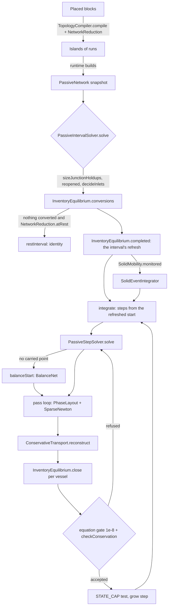

# Fluid network science

**Process control (batch 2026-10-26-process-control, 0.14.1):** vessel geometry, control valves and conditional outlet streams; the contracts are in [process-control.md](process-control.md).

`VesselGeometry` supplies cumulative condensed volume, inverse body-relative height, boot datum and stacked-phase hydrostatic head. The head (`head`) stands over the body bottom, z = 0, the vessel node's elevation: a boot's column is the line below its nozzle, which the connection's column carries. `PassiveStepSolver.portHead` weighs each round-vessel layer's liquid and its volume share of the solids (`phaseSolidShare`); a vessel holding solids and no liquid stands them as one bed. Existing constructed capacities stay unchanged; prism geometry is the legacy registration default. Height percentage is height/span, with raw out-of-span telemetry.
`FlowControl.ControlValve` carries source UUID/revision and separate pressure (200000 Pa absolute), mass (1 kg/s) and actual-volume (.01 m³/s) settings. A bare valve is fully open in either direction. Active control is forward only: `VALVE_REGULATING` states upstream pressure or the mass/actual local volume flux; `VALVE_OPEN` states zero extra head; `CLOSED` states exact zero flow. Throttling adds no shaft work. `Pipe.actuatorArea` retains the registered local valve bore independently of narrower run sections, and survives copying/checkpoint/certificate identity. Carry keys include configuration and source identity. `ControlConstraints` detects dependent junction mass-control rows and shared upstream pressure rows, marks their loops `VALVE_CONFLICT`, and uses their accepted bore-based openings (default 1). Unrelated modes and island diagnostics remain intact.
`PhaseDraw` supports equal-volume simultaneous liquid withdrawal and depletion/fallback segments. Ordinary bottom: HC and water together, then surviving liquid, then gas. Boot drain: water, HC, gas. Boot HC: HC, water above D/3, gas. The implicit step adds a bounded water-rate complementarity row at a boot weir, jointly reading end inventory, arrivals and all outlets; at the boundary it solves a water/gas split. Rate solves use stationary phase selection, without a transient level-error row. Weir graphs use the existing colored Jacobian; other graphs retain block differentiation. Hydraulic density, caps, reconstruction and `PipeTransfer` consume the same draw. At a vanishing flow a LIQUID end holding both liquids (`PhaseDraw.mixedLiquids`; `leading` is -1 there) draws `PhaseDraw.mixedShares(state, volume)` of its connection's volume: equal volumes until the smaller liquid is spent, the larger then fills the rest, both whole when together they fill less, half and half for no volume. It is continuous in either amount: a trace film over a full liquid draws almost none of the film. Every end function (`endDensity`, `endViscosity` through `mixedViscosity`, `solidShare`, `suctionMassFlow`, `endMoles`, `endMass`, `endSpecificEnthalpy`, `endStream` through `mixedLiquidStream`) takes the connection volume `Pipe.volume()`; `NetworkReduction.resolutionFlow` and `SolidEventIntegrator.mobility` (outlet MIXED) read this stream, not the bulk.

**Snapshot:** f20ceefa (branch `claude/heat-exchanger-design-cf05d1`), 2026-10-28 · **Updated:** 2026-10-28 (batch 2026-10-27-heat-exchanger-design: heat-exchanging connections (`PassiveNetwork.Pipe.heat`, a `HeatLaw`), the heat in the energy rows, seeds and booking (`HEAT` boundaries), the per-step and per-slice plans (`PassiveStepSolver.plan`, `couple`), a kettle's pool on its vessel's inventory (`Inventory.pool`, `poolHeat`, `boilUp`), a passage's channel count (`PipeResistance.Geometry.channels`), junction holdups that skip a heat side's passage; the laws and the relay in [heat-exchangers.md](heat-exchangers.md)) · earlier: 2026-10-28 (batch 2026-10-27-heat-exchanger-design, water steam, at 3a527f1e on branch `claude/water-steam-virial`: the state's steam volume, partial pressure and enthalpy from the second virial (`SteamVirial`), the vapour stiffness `p_w V/(V - n_w B)`) · earlier: 2026-10-27 (batch 2026-10-26-multi-machine-framework: the model and viscosity revisions and the spine formation datum are built on declared-revision identities (`MaterialCatalog.fluidRevision`, `spineRevision`) in place of fingerprints; no physics changed) · earlier: 2026-10-27 (batch 2026-10-26-process-control: vessel geometry, control valves (`FlowControl.Valve`, `ControlValve`, `VALVE_CONFLICT`, `ControlConstraints`), boot and mixed liquid draws; then review findings 2-4 and 6: the head over the body bottom with its solids, `PhaseDraw.mixedShares` over the connection volume, a flow valve in the rest test; the seed-236 trace rule: omitted hydrocarbon traces in water-full vessels, `FluidThermodynamics.omittedTrace` replacing `carriedTrace`, `OMITTED_TRACE_VOLUME`, `PassiveStepSolver.omittedArrival`) · earlier: 2026-10-26 (batch 2026-10-26-backward-compat: a vessel whose state misses its wall row by more than `WALL_RESOLUTION` is not at rest; `Inventory.sameContents`; level heights also saved as facts) · earlier: 2026-10-25 (batch 2026-10-21-floating-roof-tanks: open vessels (`OpenVessel`, `Inventory.open`, `wallCapacity`, the OVERFLOW port, vent and spill boundary transfers); a mover's requested flow and power flag; a pipe's permanent forbidden directions and retained check-valve nodes; accepted pressure-valve modes carried into the next step; a pump's carried limit keeping its rate root's phase basis; accepted pipe observations for gauges); 2026-10-21 (0.11.1 test review; mod rename to IChemE, 0.11.0); 2026-10-21 (0.10.1, the OD4 holds after 0.10.0: a junction's own split `junctionSplit` for the phase check and the arriving seed, the stock-alone seed and `laidOutFor`, the flash seeds, the D61 population labels, the balance's converged-only closures, `runFlow` and 1e-9 slopes, one suction floor with `waterFloor` and the water bisection's nearer side, still pipes from `carriedFlows`); 2026-10-20 (a vessel's own level height, `Inventory.levelHeight`; the OD4 holds: `f983306b`, the cycle key carries each pass's static column ends and a junction's arriving-phase seed is its fluid-only PH split; `8fd61a13`, that split's stock is the buffer's own energy field; `9de0d85f`, owner decision E5, amending D38 C: a hydrocarbon liquid vanishes on its volume share alone, `belowShare`)
Up: [code guide](README.md)

## Read this when

- A tank, pipe, pump, compressor, valve or filter shows a flow, pressure, temperature or phase that is wrong. You need the equations and the stage that owns them.
- An island is held, an interval is refused, or a log says `Substep refinement exhausted`, `Phase/device active-set cycle` or `phase-hold: ...`. A status line that ends in `; outside data range: ...` is a notice, not a hold.
- You change an open (floating-roof) vessel: its vent, overflow or spill, or its wall that never goes taut.
- You change a pipe's one-way restriction (a check valve) or a mover's power switch.
- You change a constitutive law: pipe friction, the velocity cap, pump or compressor limit, phase-port draw, a line's static column, junction holdup, the balanced start of a solve, vessel wall, crystal freezing and melting at a vessel's refresh, a crystal melting on arrival in a junction (D61), a solid closure carried across an interval start (D62), slurry rules.
- You change how a heat-exchanging connection (an exchanger side, an air cooler, a fired coil) or a kettle's pool enters the step: its energy rows, the seeds, the booking, the per-step or per-slice plan. The laws themselves, the relay and the controller are in [heat-exchangers.md](heat-exchangers.md).
- You add a component, a crystal or property data and the network must accept it: the engine contract (`NetworkPhaseEngine`), a spine package (`SpinePackageData`), the catalog's crystal records (`NetworkCrystals`). Data past its range gives a notice, never a refusal.

The Minecraft side (block entities, `FluidNetwork`, scheduling, checkpoints, presentation) is in [fluid-runtime.md](fluid-runtime.md). The multiphase equilibrium engine (`science/thermo/phase/**`: `FluidTpEquilibrium`, `CubicPhaseEvaluator`, `CrystalPhaseEvaluator`, `FreeWaterIce`; `TangentPlaneStability`, `NumericalBox`, `IdealGasFunction`) is in [equilibrium-engine.md](equilibrium-engine.md). The shared cubic EOS kernel, `PhaseSupport`, `TraceTruncationPolicy`, `DeterministicMath` and the material catalog are in [thermo-materials.md](thermo-materials.md).

## In one paragraph

Physically, an island is a set of vessels (tanks), fixed boundaries (generators that only supply, voids that only receive) and small mixing junctions, joined by pipe runs that can carry a pump, compressor, back-pressure valve, check valve or inline filter. An open vessel (a floating-roof tank) stands at ambient pressure whatever it holds; its gas vents to the atmosphere, the liquid above its fill height can leave by an overflow nozzle, and the liquid above its shell top spills. Fluid flows from high to low driving pressure (end pressure, plus the static column, plus device head) against Darcy-Weisbach friction, and every throttling line saturates smoothly at its velocity cap. Each vessel is a bag with a stiff wall: below its capacity it stands at the ambient 101 325 Pa; at capacity the contents set the pressure. The steady state is the point where every vessel's mass and energy stop changing: pressures equalise through open runs; a pump holds its set suction volume flow, its pressure-rise limit or its suction limit (it cannot pull its suction below the bubble pressure of the liquid it draws); a closed or one-way end carries nothing. In code, `TopologyCompiler` and `NetworkReduction` turn placed blocks into islands of runs. `PassiveIntervalSolver` refreshes every vessel once at the interval start (`InventoryEquilibrium`; crystal mass moves there, and in a junction above the crystal's melting point, where it melts on arrival, D61), then advances the island over the requested interval in adaptive backward-Euler steps. Each step (`PassiveStepSolver.solve`) is one sparse Newton on all node states and connection law flows with an active-set loop around it. A solve with no carried point starts from the island's quasi-steady balance. `ConservativeTransport` then books amounts and energy exactly from the converged flows, and `InventoryEquilibrium` closes every vessel to what it holds. A connection may carry a heat law (an exchanger side, an air cooler, a fired heater's coil): its heat is a pure function of its flow and the donor's enthalpy for the step, enters the receiver's energy row as a mover's work does and is booked as a `HEAT` boundary; its slice inputs are planned before the Newton ([heat-exchangers.md](heat-exchangers.md)). Phases are decided by the multiphase equilibrium engine ([equilibrium-engine.md](equilibrium-engine.md)) through `NetworkPhaseEngine`, with TP, PH, UV and crystal competition. Each hydrocarbon phase is the translated PR78 at its own pressure (a liquid at the state pressure, a vapour at its hydrocarbon partial pressure), with E-PPR78 kij(T) on a spine package. Free water is IF97 region 1 at the state pressure. Ice Ih (on every package) and the package's admitted crystals are solid populations. Past its data a property continues and a notice reports it (`FluidThermodynamics`). The package has no Minecraft imports and no wall-clock time.

## Class map

All paths are under [`src/main/java/com/wormzjl/icheme/science/fluid/`](../../../src/main/java/com/wormzjl/icheme/science/fluid/).

| Class | Role | Read it for |
|---|---|---|
| **fluid** | | |
| [`SolverOwnership`](../../../src/main/java/com/wormzjl/icheme/science/fluid/SolverOwnership.java) | Thread latch for retained solver workspaces | Why a second worker on one island fails fast |
| **topology** | | |
| [`TopologyCompiler`](../../../src/main/java/com/wormzjl/icheme/science/fluid/topology/TopologyCompiler.java) | Block ids to runs and islands; pump-cycle check; `compile(nodes, links, retainedPipes)` keeps a check-valve pipe as a node of its run; `Kind` gains `HEAT_SIDE` (a heat unit's passage, compiled as an inline filter is, [heat-exchangers.md](heat-exchangers.md)) | Node kinds, run merging, `fixed`/`destination` rules |
| **network** (graph model) | | |
| [`PassiveNetwork`](../../../src/main/java/com/wormzjl/icheme/science/fluid/network/PassiveNetwork.java) | Immutable island snapshot: `Reservoir`, `Pipe` (with `blockedDirections`, the solid closures an interval start reopens, and `forbiddenDirections`, a check valve's permanent mask; `effectiveBlockedDirections`, `blocked`), `Inventory` (with `open` and `wallCapacity`: infinite for an open vessel; `pool`, a kettle's `Pool`, kept by `with`, set by `withPool`), `PhasePort` (BULK, VAPOR, LIQUID, OVERFLOW), `NodeKind`; `sameStructure`, `withJunctionStates`; `Pipe.heat` (a `HeatLaw`, null for a plain run; `withHeat`; its `shape()` in the pipe's `Identity`) and `Pipe.withControl` (an exchanger's real valve at its planned target, W8) | Data model; junction holdup minting (`mintJunctions`, from `PassiveStepSolver.balanceStarts`); one buffer sizing rule (`sizeJunctionHoldups`) wherever a junction gets a state, a heat side's passage not counted (it holds no fluid, so its ends are sized on their lines as headers; the owner's test of 2026-10-28); empty vessel (`emptyVessel`, with or without a level height); `Inventory.with` (same vessel, new contents); `Inventory.sameContents` (the same moles, energy and solids bit for bit, whatever the geometry: what a topology event conserves); `Pipe.volume`; an island replaced by one of the same structure carries its junctions |
| [`FlowControl`](../../../src/main/java/com/wormzjl/icheme/science/fluid/network/FlowControl.java) | `Passive`, `Mover` (`Pump`, `Compressor`: `requestedVolumeFlow`, `enabled`; `targetVolumeFlow()` is the requested flow when enabled, else 0), `Valve` (sealed: `PressureValve`, the legacy form `InstrumentService.reconcileLegacyValves` converts, and `ControlValve` with its `ValveSource`; `bare`, `pressureControl`, `targetMassFlow`); `Mode` enum (9 values, `VALVE_CONFLICT` the ninth) | Device laws: rise limit, ideal shaft work (no efficiency), inlet refusal thresholds; a mover switched off is a pump at zero target (CLOSED) |
| [`OpenVessel`](../../../src/main/java/com/wormzjl/icheme/science/fluid/network/OpenVessel.java) | An open vessel's releases over a step: the vent (the start gas, at `dt / RELEASE_TIME` of it and at most `VENT_SPEED` × footprint), the overflow band (liquid above the fill height, lighter first), the spill (liquid above the shell top, `FREEBOARD` over the fill height); `releases`, `releasing`, `overflows`, `releasesAll` | Floating-roof tanks; why an open tank never pressurises |
| [`PipeResistance`](../../../src/main/java/com/wormzjl/icheme/science/fluid/network/PipeResistance.java) | Darcy-Weisbach with laminar/turbulent blend; `Geometry.channels` (default 1): a run of equal channels in parallel loses what one loses at the flow over the count, its area and volume all channels' (an exchanger's tubes; part of the facts, the state, the certificate's graph identity and `Pipe.coalesce`'s merge key) | Friction law and its derivative |
| **network** (heat; the laws, the relay and the controller in [heat-exchangers.md](heat-exchangers.md)) | | |
| [`HeatLaw`](../../../src/main/java/com/wormzjl/icheme/science/fluid/network/HeatLaw.java) and its four laws `HeatSide`, `AirCooled`, `FiredCoil`, `ConvectionCoil`; `HeatCurve`, `ExchangerRelay`, `HeatControl`, `Pool` | A connection's heat for a step, a pure function of its flow and the donor's enthalpy on the donor's curve: no unknown, no mode, zero at no flow; slice inputs planned before the Newton | What `PassiveStepSolver` reads through `sideHeat`, `plan`, `couple` and `poolHeat` |
| [`InlineFilter`](../../../src/main/java/com/wormzjl/icheme/science/fluid/network/InlineFilter.java) | Filter cake and its energy, owned by a pipe | Capacity, clogged state |
| [`ScheduledTransfer`](../../../src/main/java/com/wormzjl/icheme/science/fluid/network/ScheduledTransfer.java) | Boundary withdrawal/injection rates at a vessel, booked in the same balances as pipe flow | How a machine would exchange material with an island. No runtime class creates one; only tests do (`ScheduledTransferTest`, `MixedGasJunctionTransientTest`, `VirtualJunctionHoldupTest`, `PhasePortPriorityTest`, `CrystalDepositionIslandTest`, `LiquidFullBubblePointTest`) |
| [`PipeTransfer`](../../../src/main/java/com/wormzjl/icheme/science/fluid/network/PipeTransfer.java) | Gross per-pipe transport history (forward and reverse) | What a pipe carried, by phase; not owned stock |
| **network** (reduction and checks) | | |
| [`NetworkReduction`](../../../src/main/java/com/wormzjl/icheme/science/fluid/network/NetworkReduction.java) | Dead-end pruning, split at fixed boundaries, static drives per direction (`drives`, through `PassiveStepSolver.columnDensity`), rest test, `reopened` | Why an island is not solved; `REST_RESOLUTION` and `resolutionFlow` (D42; they serve the rest test only; a LIQUID end holding both liquids reads its `PhaseDraw.mixedShares` stream); `WALL_RESOLUTION` (a vessel off its wall row is not at rest; nor is a vessel whose kettle pool heats, `atRest`); a configured valve in the rest test passes forward only (a pressure valve its drive above the set point, a flow valve its static drive, nothing at a zero target); ambient state; an interval start reads every transport closure open except a filter stopped at capacity (`reopened`, D33); the solid events then decide the closures again on the committed graph, and a closure nothing moves carries (D62, `SolidEventIntegrator.carried`) |
| [`InletPhase`](../../../src/main/java/com/wormzjl/icheme/science/fluid/network/InletPhase.java) | Suction supply walk (`walk`); per-slice pump/compressor refusal | `INLET_WRONG_PHASE`, dry suction thresholds; the suction fill is `PhaseDraw.fill` |
| [`PhaseDraw`](../../../src/main/java/com/wormzjl/icheme/science/fluid/network/PhaseDraw.java) | Priority draw of a phase port, capacities, segments; `fill`, a port's phases in priority order by volume; `mixedLiquids` and `mixedShares` (a LIQUID end holding both liquids: what first fills the connection's volume under the equal-volume rule) | Top/bottom outlet behaviour (decision D11); the one fill of suction intakes and static columns (D34); a BULK end of a donor holding solids but no liquid draws its gas (`order`) |
| [`VesselCrystals`](../../../src/main/java/com/wormzjl/icheme/science/fluid/network/VesselCrystals.java) | The crystal part of a vessel's refresh, the one place crystal mass moves; nested `Settled`, `Joint`, `JointClosure` | Freezing and melting at fixed volume (taut) or ambient pressure (slack); `settle`, `competes`, `precipitateDiameter` |
| [`JunctionCrystals`](../../../src/main/java/com/wormzjl/icheme/science/fluid/network/JunctionCrystals.java) | Package-private, new in 0.9.2: the crystal part of a junction (D61, amends D23 for junctions); nested `Split` | Which junctions sit above a crystal's melting point (`of`, decided once per step on the junction's start state; null in a rate solve or where none does); `melts`, `split` (per kilogram of a stock's solids: component mass, offsets, moments removed; a Newton state whose seed named no solid population is read as the island's populations, kept as a list, 0.10.1), `kept`. Read by `PassiveStepSolver.Equations` and `ConservativeTransport`, so the Newton point states what the booking books |
| **network** (solvers) | | |
| [`PassiveIntervalSolver`](../../../src/main/java/com/wormzjl/icheme/science/fluid/network/PassiveIntervalSolver.java) | Adaptive backward-Euler controller over one interval; nested `StageGuard` (per-step check hook that declares a `SolidEventIntegrator.Transition`) | Step acceptance, growth, reopen, trace flush, `replayStart`; the interval-start refresh (`InventoryEquilibrium.Refreshed` passed to `integrate`); the committed graph handed to `SolidEventIntegrator.solve` beside the reopened start (D62); the cold rate seed (`coldRateSeed`); the accepted endpoint modes handed to the next step (`carriedModes`, so a pressure valve regulating at its setpoint stays regulating; a rejected attempt never replaces them); `Result.observations`; `carriedFlows`, the flows the last accepted step left on the structure (package-private, read by `SolidEventIntegrator` where the rate solve fails, 0.10.1); `solve(…, reads)`: the coupled sides planned once at the interval's start (`implicit.couple` with each side's `ExchangerRelay.Read`), and the local heat actuators planned at each step's start from the last accepted step's flows (`implicit.plan`) |
| [`PassiveStepSolver`](../../../src/main/java/com/wormzjl/icheme/science/fluid/network/PassiveStepSolver.java) | One BE step: start closures, balanced start, seeds, active-set pass loop; nested `Runs`, `Start`, `BalanceNet`, `Proposal`, `PassKey`, `PipeObservation` (the accepted pipe row a gauge reads: end pressures, elevations, section lengths and losses, temperature; never fed back), inner `Equations` | Every row of the island system; device modes; the velocity cap law (`saturated`, `saturationSlope`, `CAP_EXPONENT`); the static column (`columnDensity`); the balanced start (`BalanceNet`, `balanceStart`, `balanceStarts`, `supplierSeeds`; a sealed junction keeps its pressure, `BalanceNet.sealed`; a junction nothing reaches is its own buffer at its own enthalpy, `BalanceNet.held`); the junction melt rows (D61: `Equations.melting`, `heldMelt`, `heldMeltEnergy`, `heldKept`); the arriving-phase seeds (`arrivingPhases`: the junction's own split, `junctionSplit`, of its stock plus deliveries, or of its stock alone where nothing arrives; a seed kept only where it is laid out for the mixture, `laidOutFor`; 0.10.1); the flash seeds (`flashSeeds`, `settledFlash`, `restateFlashFlows`: a vapour newly appearing in a junction is seeded where its own connections settle it, marched up by 1.5 from the pressure it appears at; 0.10.1); the balance's suction floor (`BalanceNet.suctionFloor`, `waterFloor`: water alone at the saturation temperature of its own enthalpy; 0.10.1); a pump's carried head or suction limit (`carriedMoverLimit`): a repeated rate call starts from its cached root's phases when they differ from the input's; an open vessel's releases as constant terms of its rows (`Equations.releases`) and the OVERFLOW end's capacity; the active-set cycle key (`PassKey`: structure with modes and junction donors, phase-port segments, static column ends `Equations.columnCodes`, folded record, proposal); ledger audit (with the `Melted` conversion). Heat (batch 2026-10-27-heat-exchanger-design): `sideHeat` (a connection's heat on the donor end's curve, `sideCurve`, cached per end in `sideCurves` while the law's span and films, the port and the donor state hold), read by `Equations.nodeAccumulate` (into the receiver's energy row and inflow, as a mover's work), `Equations.sideHeat` (the reconstruction's `EdgeHeat`), the balanced start (`BalanceNet.seeded`), the junction start mix and `arrivingPhases` (a junction a heater boils is seeded with its vapour); `plan` (per step: a radiant coil's firing, a controlled air cooler's draught, an in-island convection coil's flue gas); `couple` (per slice: each coupled side's wall, bypass, give-back and sit-out, each pool, each convection coil fed from another island, and a complete exchanger side's valve target, held within `VALVE_DEADBAND` 1e-3); `poolHeat` (a kettle's pool into its vessel's energy row on the step's start state) and `boilUp` (its vapour, counted as gas the vessel's ports may draw within the step, D11 extended) |
| [`ConservativeTransport`](../../../src/main/java/com/wormzjl/icheme/science/fluid/network/ConservativeTransport.java) | Exact booking of amounts, energy, solids from solved flows; `BoundaryTransfer` with its `Kind` (EXCHANGE, FLUSH, VENT, SPILL, HEAT); `EdgeHeat`, the Newton's own heat function, which `reconstruct` books | Conservation by construction; a heat-exchanging connection's heat into the receiver and out of the island as a `HEAT` boundary at the connection's id, energy only, and a kettle's pool's at its key; an open vessel's releases booked out of it as fixed amounts and as VENT and SPILL boundaries (one that releases all it holds and that nothing reaches ends the step empty); junction pinning; emptying vessels; no potential energy in any stream or ledger; a crystal melted in a junction booked as its component with its offset (D61: `Melted`, `Projection.melted`, `reach`, `melt`, `meltingSolve`) |
| [`InventoryEquilibrium`](../../../src/main/java/com/wormzjl/icheme/science/fluid/network/InventoryEquilibrium.java) | Restates a vessel's T, P, phases (and crystals) from its inventory | `Refreshed`; `refresh`; `conversions` (the rest test's refresh of the stocks that may convert, `mayConvert`); `completed` (the interval's one refresh); `passes` (a vessel's own pass loop, D30); `close` after booking; `split`; `CLOSURE` |
| [`SolidEventIntegrator`](../../../src/main/java/com/wormzjl/icheme/science/fluid/network/SolidEventIntegrator.java) | Interval driver when an island is monitored for solid events (`SolidMobility.monitored`) | Settled beds, clogged filters as located transitions; takes the interval's `Refreshed` and refreshes each later segment start; closure test `SolidMobility.closable`; the still pipes (`still`, decided once at the interval start from the rate solve, or from `PassiveIntervalSolver.carriedFlows` where it fails, 0.10.1); the closure carry (D62: `carried`, `carriedWithoutRate`, `drawnThrough`; one `mobility` check shared with `failed`) |
| **solver** | | |
| [`PhaseLayout`](../../../src/main/java/com/wormzjl/icheme/science/fluid/solver/PhaseLayout.java) | Unknowns and rows of one node for a frozen phase set; wall row (an infinite capacity, an open vessel's, keeps the slack branch alone) | Variable encoding, vessel/junction rows, SLACK/TAUT wall, closure; a pipe junction's own rows isolated (`junctionClosure`, no net flow at a retained pressure, ending with `Vanished` where a point empties a start phase); `LOG_READ_SPAN`; the model-aware `support` overload (a stand-in liquid admits every component); `support(seed, …, junction)` lays out no hydrocarbon of an omitted trace (`FluidThermodynamics.omittedTrace`), and `equilibriumResidual` states no split without hydrocarbon components |
| [`SparseNewton`](../../../src/main/java/com/wormzjl/icheme/science/fluid/solver/SparseNewton.java) | Damped Newton with coloured FD Jacobian, chord reuse, workspace forks | `Equations` contract, `Nonconvergence` (`phaseHold()`, `at(node)`), settings, `ITERATIONS` |
| **linalg** | | |
| [`SparseLuSolver`](../../../src/main/java/com/wormzjl/icheme/science/fluid/linalg/SparseLuSolver.java) | EJML sparse LU, RCM ordering, equilibration, backward-error check | Linear solve failures, ordering reuse |
| [`SparseMatrix`](../../../src/main/java/com/wormzjl/icheme/science/fluid/linalg/SparseMatrix.java) | Immutable CSC matrix | Matrix format |
| **state** | | |
| [`SolidInventory`](../../../src/main/java/com/wormzjl/icheme/science/fluid/state/SolidInventory.java) | Conserved solid populations (material x size), max 64; crystals are populations too | Solid moments, merging, accumulation; `crystals()`, `withoutCrystals()`; one size per solid per stock (`oneSizePerSolid`, `size(material)`, `SIZE_DIGITS`); a population below `Double.MIN_NORMAL` kg is roundoff zero and dropped (the subnormal flush) |
| [`ParticleSize`](../../../src/main/java/com/wormzjl/icheme/science/fluid/state/ParticleSize.java) | Exact decimal particle diameter key | Population identity |
| [`EnergyReference`](../../../src/main/java/com/wormzjl/icheme/science/fluid/state/EnergyReference.java) | Energy datum per component basis | Sensible 298.15 K datum, rebasing |
| **thermo** | | |
| [`FluidThermodynamics`](../../../src/main/java/com/wormzjl/icheme/science/fluid/thermo/FluidThermodynamics.java) | Property model: `State`, `flashTP`, the engine entry points (`equilibriumTP`, `equilibriumPH`, private `equilibriumUV`), phase streams, velocity limits, phase check, trace folding, crystals, holds, data-range notices | Everything a node state means; `phaseCheck` with `vanishing`, `nothing`; `junctionSplit` (0.10.1: a junction's own split, its rows closed from the engine's PH answer at its pressure and enthalpy; null where the closure fails or empties a start phase, D40 A, D38 C; used by the outer phase check and the arriving-phase seed) (one share test, `belowShare`: by volume, and for water and either gas also by moles, E5), `collapsing`, `crossing`; `folded`; `omittedTrace` (D41: a junction's carried dry gas, a water-full vessel's hydrocarbon trace within `OMITTED_TRACE_VOLUME` of its volume); `dataRanges`; `crystalSolids`, `freeWaterIce`, `crystalsAtVolume`/`crystalsAtPressure`, `crystalsCompete`, `condensedShareOnly`; `CriticalBandHold`, `UnsupportedPhases`; `thermodynamicRevision()`/`revision()` |
| [`HydrocarbonModel`](../../../src/main/java/com/wormzjl/icheme/science/fluid/thermo/HydrocarbonModel.java) | Package-backed hydrocarbon/nitrogen phase properties, each phase at its own pressure, by two paths chosen by the package | Coefficient path (shifted-polynomial ideal gas, constant kij, calibration anchors, its own pure-component PR78 liquid Z `pureLiquidCompressibility`) and spine path (`SpinePackageData`); each translation anchored at its own (T, P); `FORMULATION`, `SPINE_DATUM`, `NETWORK_FAMILY`; `RootAbsent` (a typed missing root); `idealGasFitRange`; revision (`MaterialCatalog.fluidRevision` + the formulation tags + the water revision; for a spine package the `ThermoIdentity` revision with `MaterialCatalog.spineRevision`) |
| [`TranslatedPengRobinson`](../../../src/main/java/com/wormzjl/icheme/science/fluid/thermo/TranslatedPengRobinson.java) | Volume-translated PR78 on the shared kernel, with the analytic fixed-composition volumetric block (no composition-derivative chain) | Ideal-gas Cp (coefficient fits held at the end value past their range, or the spine variant's one `IdealGasFunction` per component with a datum offset, D10); `residualOnly` for the engine; `PairInteractions` with kij(T) (`PengRobinsonKernel.Mixing.TEMPERATURE_DEPENDENT_PAIRS`); translation, volumetric block |
| [`WaterRegion1`](../../../src/main/java/com/wormzjl/icheme/science/fluid/thermo/WaterRegion1.java) | IAPWS-IF97 region 1 (liquid water) at the state pressure | Free-water density and enthalpy; continued outside its triple point to 623.15 K range (held values, continuous slopes) and below saturation (metastable liquid); `METASTABLE_MARGIN_PASCAL`; `Workspace` |
| [`FluidDomain`](../../../src/main/java/com/wormzjl/icheme/science/fluid/thermo/FluidDomain.java) | The package envelope (`fluid_domain`) and the input box of a device setting | `requireInput`, `requireInputPressure`, `requireInputTemperature` (a fired heater's set point); refuses no network state |
| [`ThermoHold`](../../../src/main/java/com/wormzjl/icheme/science/fluid/thermo/ThermoHold.java) | Sealed hold supertype: `CriticalBandHold`, `UnsupportedPhases` (capability limits only) | `REASON_PREFIX`, `at`, `sameAs` |
| [`DataRangeNotices`](../../../src/main/java/com/wormzjl/icheme/science/fluid/thermo/DataRangeNotices.java) | One advisory notice per subject and side | `STATUS_MARKER`, `line` |
| [`NetworkCrystals`](../../../src/main/java/com/wormzjl/icheme/science/fluid/thermo/NetworkCrystals.java) | The package's crystals and the free water's ice as solids | `Crystal.logFugacityCoefficient`; `Crystal.meltingTemperature(P)` (the ice's own line; an admitted crystal's straight line through its record's triple point and the engine's pure melting point at `MELTING_PRESSURE` = 10 MPa); constant population properties |
| [`NetworkPhaseEngine`](../../../src/main/java/com/wormzjl/icheme/science/fluid/thermo/NetworkPhaseEngine.java) | Package-private: the equilibrium engine on the network's contract and free water | `tp`, `ph`, `crystalUv`; nested `Steam` (the steam's ideal-gas functions; the engine adds the second virial, `SteamVirial`) |
| [`SpinePackageData`](../../../src/main/java/com/wormzjl/icheme/science/fluid/thermo/SpinePackageData.java) | A spine package's components, pairs, translations, ideal gas and formation datum (`FORMATION_DATUM:` + the package's spine revision) | Shared by `HydrocarbonModel` and `CubicPhaseEvaluator.forPackage` |
| [`FluidMaterialCatalog`](../../../src/main/java/com/wormzjl/icheme/science/fluid/thermo/FluidMaterialCatalog.java) | Network package id, nitrogen and water indices | Basis order (water last) |
| **transport** | | |
| [`MixtureViscosity`](../../../src/main/java/com/wormzjl/icheme/science/fluid/transport/MixtureViscosity.java) | Log-mixing liquid, Wilke vapour viscosity | Viscosity revision string (`MaterialCatalog.fluidRevision` + the formulation labels; each viscosity record's revision is part of it); `liquidData`/`vaporData`/`waterLiquidData` (the ranges notices read); continuation past a table; the supercritical slot rule (`liquidSource`); liquid water's viscosity held inside Region 1's range |
| [`SlurryTransport`](../../../src/main/java/com/wormzjl/icheme/science/fluid/transport/SlurryTransport.java) | Krieger-Dougherty viscosity, settling and deposition speed; nested `Settings` (captured solid transport settings, the one source of the solid defaults) | Slurry correlations; defaults; `SLUSH_FRACTION` (an outlet stops carrying a slurry at half solids; the viscosity law keeps 0.62); gravity is `PassiveStepSolver.GRAVITY` |
| [`SolidMobility`](../../../src/main/java/com/wormzjl/icheme/science/fluid/transport/SolidMobility.java) | Whether a connection may carry a donor's solids; `Reason`; `closable`, `monitored` | Blockage reasons; which islands the solid event integrator drives |
| **diagnostics** | | |
| [`SolverDiagnostics`](../../../src/main/java/com/wormzjl/icheme/science/fluid/diagnostics/SolverDiagnostics.java) | Opt-in process-wide counters and timers, off by default | Cost counters of campaigns and benchmarks (`phaseSeeds`, `phaseRefusals` among them) |

## Main flow

Lifeline of one interval and one step (full acceptance):

1. The runtime calls `PassiveIntervalSolver.solve(initial, duration, settings, checkpoint, startingStep)` (normally through `RetainedSolver`, which first calls `replayStart` so a job depends only on the committed interval, then starts at `min(initialStep, duration)`).
2. `PassiveNetwork.sizeJunctionHoldups` sizes any unsized junction buffer. `NetworkReduction.reopened` reads every transport closure open for the interval (D33); every later path reads that graph. `decideInlets` runs `InletPhase.decide` once for the slice on it and hands the refused movers to the step solver (`refuseInlets`).
3. `InventoryEquilibrium.conversions` refreshes the stocks that may convert (a crystal that may freeze or melt, sizes to merge). Only when nothing converted does `NetworkReduction.atRest` check the start (D23 (6)). A vessel holding fluid whose state misses its wall row (`PhaseLayout.wallRow` on `wallCapacity`) by more than `WALL_RESOLUTION` is not at rest (batch 2026-10-26-backward-compat): a vessel a layout refresh rebuilt to another capacity keeps its contents at the old state, and the interval's refresh closes it to the new wall. A state at its wall meets the row to `CLOSURE` (1e-11), a step's end to the Newton's 1e-9. A configured valve drives forward only, never back: a pressure valve by the smaller of its static drive and its excess over the set point, a flow valve by its static drive, and by nothing at a zero target; the rest interval reports either CLOSED. If nothing can drive a flow above `REST_RESOLUTION`, `restInterval` returns the identity of the committed graph and no Newton runs.
4. Otherwise `InventoryEquilibrium.completed` finishes the interval's one refresh. The island goes to `SolidEventIntegrator` when `SolidMobility.monitored` holds (a filter, a solid, any hydrocarbon liquid, a solids feed) or when the immobile-viscosity setting is below 0.002 Pa s and a node holds free water; else to `integrate`. `SolidEventIntegrator.solve` also takes the committed graph, whose closures the carry reads (D62, see "Solid closures across an interval start" below). `run` neither sizes nor refreshes. It loops: step `h` truncated to the remaining time, `StageGuard.checkRate` at t0, `PassiveStepSolver.solve(start, h, ...)`. While no step of the structure was accepted (`backwardEulerCold`), `start` is `coldRateSeed`: the junction states of one rate solve of the port graph (itself started from the balance), each junction's own solids scaled with its fluid mass. If that rate solve fails, the step starts from the balance.
5. In `solve`: `initialModes` per connection. A pump starts on its target, or on its head limit where the target exceeds `A_min v_limit` of its suction or its suction walk is capped; it reads its own lines only (D40 A). A valve starts open or closed. From the previous point only a pump's head limit, suction limit or shutoff is carried (`previousModes`; a carried suction limit needs a floor). A pressure valve starts in the mode of the last accepted endpoint, which `PassiveIntervalSolver.run` hands over (`carriedModes`; `replayStart` takes the committed endpoint's): at its setpoint a regulating valve may carry flow and throttling head, so it is not re-closed at every step. Then closed edges, slice refusals and `closeDeadHeads`. A solve without a carried point (`needsBalance`, `carriedPoint`) runs `relieveSealedPockets` and `balanceStart`, and takes its graph, law flows, modes and closures. The balance decides pump modes (head limit, suction limit) and pressure-valve modes on its balanced pressures; the pass loop may revise them. The valve rules:
   - a closed back-pressure valve whose balanced inlet stands above its target with a forward drive regulates, its inlet anchored at the target;
   - a regulating valve that nothing reaches closes;
   - a regulating valve that cannot relieve its inlet at its target (the inflow exceeds what it passes there) opens;
   - an open valve whose inlet falls under the target regulates again.

   Then `closeIllegalStarts`, `relieveSealedPockets`, `reachableComponents` and `initialPhaseSeeds`. `initialPhaseSeeds` seeds a vessel whose hydrocarbon over the step is an omitted trace (`omittedArrival`, see "Omitted traces" below) with its own state, without entry traces. Its last stage, `arrivingPhases`, lays each junction out for the phases its stock plus the step's deliveries hold (the PH split, fluid only; see "Arriving-phase seeds" below), and an empty vessel for what arrives (D54).
6. Pass loop (at most `min(512, 16 + 2 nodes + 2 pipes)` passes): build `Equations` with one `PhaseLayout` per node. Solve with `SparseNewton.solve` (`ITERATIONS` = 30; tolerance `NEWTON_TOLERANCE` = 1e-9, or a tenth of it with a small taut headspace). On failure, read the last iterate, in order: cavitation (`cavitates`); an emptying vessel (`runsDry`); a pending `Proposal` that the iterate collapses is refuted and recorded (`FluidThermodynamics.collapsing`, D39 B); `foldedIterate` folds what the iterate empties and proposes nothing; `drainedSeeds` (D11). On convergence: `reactivate`, `keptEmptying`, then at most one active-set change (device mode first, then boundary closure; decision A272) and re-pass; then `segmentsMoved`. A repeated `PassKey` (structure with modes and junction donors, phase-port segments, static column ends, folded record, proposal node and phases) throws `Phase/device active-set cycle`.
7. `ConservativeTransport.reconstruct` books amounts, energy and solids from the transported flows and pins junction masses. Each vessel is closed by `InventoryEquilibrium.close`. A dry vessel the flows reached (`filled`), an appeared phase (`phaseAppeared`; an omitted trace, `FluidThermodynamics.omittedTrace`, is not one) or a fold (`recordFolds`) sends the loop back. Then `phaseCorrection` runs on the converged reconstruction; a phase it adds becomes the pending `Proposal`.
8. Equation gate: the max residual of the reconstructed point must be at most 1e-8; else `polishRefusedPoint` gets one try. Then `checkConservation` audits the ledger. The `Result` carries states, transported flows, modes, heads, inventories, boundary transfers and `PipeTransfer` samples.
9. Back in the interval loop: the step is accepted if no vessel's pressure (over max(100 Pa, P0)) or mass (over the larger of its mass and `STATE_MASS_REFERENCE_DENSITY` x its volume) changed by more than `STATE_CAP` = 0.05. Other paths: a reopenable run (`reopenable`) forces a re-solve, `flushTraces` removes components below 1e-24 of a node, and `atRest` at the step end ends the interval early. The step grows by `clamp(0.9 sqrt(cap/change), 0.5, 2)`.

Data model and units

- All SI: Pa, K, m3, kg, mol, J, kg/s, m. Mass flows are signed: positive from `Pipe.first` to `Pipe.second`.
- The connection unknown is the law flow `q_law` (unbounded). The transported flow `q = saturated(q_law, q_cap)` is what every booking reads (`Equations.flow`), and what `PassiveStepSolver.Result.massFlows` and `PassiveIntervalSolver.Result.endpointFlows` hold.
- Component basis: the network package's hydrocarbon and gas components (nitrogen required), then water as the last index (`FluidMaterialCatalog.waterIndex`). `PassiveNetwork.Inventory.moles` and `State.componentCount()` use this order.
- `PassiveNetwork.Reservoir` is every node, not only tanks. `NodeKind`: `RESERVOIR` (vessel with inventory), `JUNCTION` (buffer, see below), `GENERATOR` (fixed state, supply only), `VOID` (fixed state, receive only), `PORT` (a vessel held fixed for one rate solve; never a world object).
- `Inventory(volume, moles, internalEnergy, solids, levelHeight, open)`: the conserved truth of a vessel. `volume` is the capacity `V_max`; for an open vessel it is the volume up to the fill height (the overflow nozzle's), and the shell rises `OpenVessel.FREEBOARD` above it. Every reading of the wall goes through `wallCapacity()`: `volume` for a closed vessel, infinity for an open one. The geometry (footprint, level head, `HOLDS_NOTHING`) keeps `volume`. For a junction, `internalEnergy` holds enthalpy `m h` (see Traps). `moles` excludes crystal mass: a crystal is a `SolidInventory` population (`NetworkCrystals`), exchanged with its component only in a vessel's refresh; inside a step it is inert.
- `volume` and `levelHeight` are the vessel's geometry, not its contents. `levelHeight` (finite, > 0) is the height H its level head stands over: `PassiveStepSolver.LEVEL_HEAD_HEIGHT` (1 m, the four-argument constructor) for a one-block tank, a drum's own height (batch 2026-10-15-custom-equipment-rendering, owner decision 2026-10-16: apex-to-apex length standing, diameter lying; see [equipment.md](equipment.md)). It takes part in `equals`/`hashCode`, and the island unit saves it per node, in its state (since format 12) and in each vessel's facts ([fluid-runtime.md](fluid-runtime.md)). `Inventory.with(moles, internalEnergy, solids)` keeps both while the contents change. Every rebuild of a node's inventory goes through it: `InventoryEquilibrium.refresh`, `VesselCrystals.melt`/`frozen`/`settled`, `PassiveStepSolver.emptyBagSplit`/`vesselSplit`/`emptyingGraph`, `ConservativeTransport.reconstruct0` (vessels and junctions), `PassiveIntervalSolver.flushTraces` and, on the runtime side, `IslandCertificate.graphAt`. A new rebuild site that calls the constructor instead resets a drum to 1 m. The runtime changes a vessel's geometry on purpose in one place, a layout refresh's edit (`PhysicalRegistry.apply`, decision D7), which keeps its contents; `Inventory.sameContents` compares contents alone, and `equals` still includes the geometry.
- `Pipe(id, first, second, sections, control, blockedDirections, filter, firstPort, secondPort, forbiddenDirections)`. `sections` with the same diameter and roughness are merged (`coalesce`). `blockedDirections` is a 2-bit mask: 1 forbids first-to-second, 2 forbids the reverse, 3 closes both. `forbiddenDirections` uses the same bits for a fitting's permanent restriction (a check valve, oriented with its run); `NetworkReduction.reopened` clears only `blockedDirections`, and `effectiveBlockedDirections` is the two together. Both masks are part of the pipe identity, `PassiveIntervalSolver.flowKey` and the certificate signature. A check valve adds no loss coefficient and no cracking pressure: forward flow sees the pipe's own resistance. `Pipe.Identity` is the cake-free key for workspaces. `volume()` is the sum of the section volumes; the static column reads it.
- One structure: `PassiveNetwork.sameStructure(a, b)` is true for the same pipe identities and node ids, in order (it delegates to `PassiveStepSolver.sameStructure`). `withJunctionStates(graph, from, model)` takes every junction's state from the node of the same id in `from`, sizes its buffer on that state by the mint's rule (`sizeJunctionHoldups`; the old buffer is not carried), and throws on a different structure. The runtime uses it so that an island replaced by one of the same structure keeps its junctions (see [fluid-runtime.md](fluid-runtime.md)).
- `PhasePort`: `BULK` (side), `VAPOR` (top), `LIQUID` (bottom; adds level head `PassiveStepSolver.portHead`: in a prism (`VesselGeometry.Form.PRISM`) g·m_c·H/V, m_c the condensed mass, H the vessel's `levelHeight`, V its inventory volume, both its identity and not the trial state's EOS volume; in a round vessel `VesselGeometry.head` of two stacked layers over the body bottom, each with its liquid's mass and its volume share of the solids). `BOOT_WATER` (a boot drum's boot drain: water, hydrocarbon, gas) and `BOOT_HC` (its hydrocarbon outlet: hydrocarbon, water above the D/3 weir, gas), both with the same head over the body bottom; the boot's own column is the connection's. `OVERFLOW` (an open vessel's nozzle at its fill height): it draws only the liquid held above the fill height at the step start, lighter liquid first (`PhaseDraw` order: light, heavy, gas), and is a dry end while the level stands at or below it; its driving pressure is a LIQUID port's. Valid only at a vessel or port end.
- `FluidThermodynamics.State`: T, P, liquid and vapour hydrocarbon moles, free water, water vapour, partial pressures (the steam's `p_w = n_w R T/(V - n_w B)` in the hydrocarbon vapour's volume, the state pressure for steam alone; H adds the virial's `p_w (B - T dB/dT)`), volume, H, U, mass, phase volumes, phase property records, solids and their moments, `waterCompressibility` (Region 1's own; the acoustic bound reads it). Phase ids: `GAS = 0`, `OIL = 1`, `WATER = 2`. A stand-in liquid may occupy the hydrocarbon liquid slot: a crystal's condensed share (`FluidThermodynamics.condensedShareOnly`).
- `PhaseLayout` unknowns per node: component totals (scaled by the node amount), `ln(v/l)` splits for two-phase components, free water and water vapour amounts, `ln(T/350)`, `ln(P/1e5)`, `ln(P_hc/1e5)` when water vapour and gas coexist, three solid moments. Edge unknowns: one mass flow per connection, plus a device head (scaled by 1e5 Pa) and a filter loading where present.

Equations and algorithm

**Connection row** (`Equations.edgeRows`): `(P_a,end - P_b,end - rho_col g dz ± head - loss(q_law)) / pressureScale = 0`. Here `P_end` is node pressure plus the port offset (`endPressure`); a mover's head adds, a valve's subtracts. `loss` is `Pipe.pressureDrop` at the law flow, in the density and viscosity of the stream drawn at the end the flow leaves (at a LIQUID end holding both liquids, their `PhaseDraw.mixedShares` of the line's volume). A mover's column is its suction stream's density. A passive run's column is `columnDensity` of the pass's column end (D34): the line, of volume `Pipe.volume()`, filled with that port's phases in priority order by volume (`PhaseDraw.fill`); a BULK end gives the bulk. So a milligram trace at a bottom port stands as gas, not as a liquid column. Gas keeps its own density in every column.

**Friction** (`PipeResistance`): laminar Hagen-Poiseuille `128 mu L q / (pi rho D^4)`; turbulent Darcy with the Swamee-Jain friction factor `0.25 / log10(eps/3.7D + 5.74/Re^0.9)^2`; a C1 smoothstep blend over Re 2000..4000; minor loss `K q^2 / (2 rho A^2)`.

**Velocity cap** (`PassiveStepSolver.saturated`, `saturationSlope`): the cap is part of every throttling line's law, not an active set. The line carries `q = q_law (1 + (q_law/q_cap)^8)^(-1/8)` (`CAP_EXPONENT` = 8): 8.3 % under the cap where the drive equals the cap's own drop, within 0.06 % of it at twice that drive, the law itself at a tenth. `q_cap` is the drawn stream's density x `A_min` x the velocity limit of the end the flow leaves (`massFlowLimit`; a priority mixture's pinned phases in `Equations.capLimit`; a filling filter's cake room in `filterCapFlow`). The saturated modes (`saturates`) are `PASSIVE`, `PUMP_HEAD_LIMIT`, `PUMP_SUCTION_LIMIT` and `VALVE_OPEN`. A pump at its target and a regulating valve state their own flow or pressure and are not saturated. Two mode decisions read the cap: a pump target above `A_min v_limit` of its suction starts on, or moves to, its head limit; a regulating valve whose flow exceeds `capLimit` opens.

**Velocity limit** (`FluidThermodynamics`): a bulk stream's `velocityLimit = min(configured maximum, isothermal acoustic bound)`; a vapour stream's `vaporVelocityLimit = min(maximum, V_v / sqrt(M_v V_v / stiffness))`, the stiffness the hydrocarbon vapour's `-v/(dv/dP)` plus the steam's `p_w V/(V - n_w B)` (the second-virial steam, `SteamVirial`; `p_w Z` for steam alone); a liquid stream's is the configured maximum (`phaseVelocityLimit`). The configured maximum defaults to `DEFAULT_MAXIMUM_VELOCITY` = 100 m/s.

**Devices** (`FlowControl`). The pump target row fixes the suction volume flow. In `PUMP_HEAD_LIMIT` the head equals the rise limit:
- pump: `maxAddedPressure * rho_suction / rho_ref`, with `rho_ref` = the model's own Region 1 water at 298.15 K and 101 325 Pa, 997.05 kg/m3 (`pumpReferenceDensity`);
- compressor: `(r_max - 1) P_suction`.

Shaft power is the ideal work (a mover has no efficiency), booked as heat into the discharge:
- pump: `q / rho_s * head`;
- compressor: isothermal work `q (P_s / rho_s) ln(1 + head / P_s)`.

`PUMP_SUCTION_LIMIT` replaces the target with `P_suction = P_floor` when the pump would cavitate. The floor is the water saturation pressure where the pass laid free water out at the suction node. Else it is the pressure of the supplier the suction walk ends at, when that supplier holds gas beside a hydrocarbon liquid and is not the pump's own first node (`vapourPressure`, `suctionFloors`). The balance may start a pump on it, and anchors its suction junction at one floor for the mode round and for a pump that arrives there (`BalanceNet.suctionFloor`, 0.10.1). Its water floor is `waterFloor`: where the junction holds water alone and liquid, the saturation pressure at the temperature its liquid reaches on the saturation curve at its own enthalpy (one Newton step on the saturated liquid's enthalpy), so a liquid drawn down from a higher pressure stands at its own vapour pressure and nothing flashes; vapour beside the water or a hydrocarbon keeps the saturation pressure at its temperature. The valve (`PressureValve`) holds its upstream pressure (`VALVE_REGULATING`) or is open or closed. Reverse flow through it is closed.

**Vessel rows** (`PhaseLayout.residual`): backward-Euler component balances `n = n_old + dt (sum in - sum out)` with donor compositions; an energy balance including flow enthalpy, shaft work, the heat a heat-exchanging connection delivers with its stream, a kettle pool's heat (explicit on the step's start state) and the wall's work on the ambient; phase equilibrium rows for two-phase components; and the wall row. No stream or ledger carries potential energy (no `g z`); a pump's lift work arrives in the lifted fluid as heat.

**Wall row** (decision D54, `PhaseLayout.wallRow`): `max(taut, slack) = 0` with `taut = (V - V_max)/V_max` and `slack = 2 (P_amb - P)/P_amb`. The Jacobian uses the branch of its build point (`linearising`, decision A423). An open vessel's capacity is infinite (`wallCapacity`), so its row is the slack branch alone: its surface stands at `P_amb` whatever it holds.

**Open vessels** (`OpenVessel`; owner decisions FR1, FR2, FR8). Over a step of `dt` an open vessel releases a share `min(1, dt / RELEASE_TIME)` of its start excess, as constant terms of its balance rows (no unknown): the vent takes that share of its start gas, at its start composition and enthalpy, no faster than `VENT_SPEED` (100 m/s) through its footprint (`volume / levelHeight`); the spill takes that share of the liquid above the shell top, lighter liquid first, with its volume share of the solids. Gas that forms within a step leaves in the next. An OVERFLOW port draws the band between the fill height and the shell top. The liquids stand stratified, heavier at the bottom. `ConservativeTransport` books vent and spill out of the vessel as VENT and SPILL boundary transfers; a vessel whose releases take all it holds and that nothing reaches or draws ends the step empty (D54). VENT and SPILL are rates a steady island repeats, so they do not keep an island from certifying, and `NetworkReduction.atRest` is false while a vessel releases (`OpenVessel.releasing`).

**Junction rows** (`junctionInflow`, `junctionRows`): `(m_J/dt + Q) w = (m_J/dt) w_old + sum q w_e` for mass fractions and enthalpy, stated in amount form over `m_J`, with `q` the transported flows; the pressure is algebraic. Buffer size `m_J = HOLDUP_TAU * max over connections of rho * A_min * velocityLimit`, with `HOLDUP_TAU` = 0.05 s, on the junction's state. One rule (`sizeJunctionHoldups`) sizes a junction wherever it gets a state: at a mint (`mintJunctions`), at a carry across a same-structure replacement (`withJunctionStates`), and at a solve's entry for a graph built directly. A junction is a fitting of fixed volume, so its mixing lag does not depend on what fills it (bundled 145: a buffer sized on the minted N2 placeholder, 0.011 kg, was carried while 21.5 kg/s of water passed). Between sizings the mass pin keeps the buffer at exactly `m_J`.

**Crystals melting in a junction** (D61, `JunctionCrystals`; amends D23 for junctions). A junction is a fitting full of fluid with no refresh of its own. Above a pure crystal's melting temperature (`NetworkCrystals.Crystal.meltingTemperature(P)`) no amount of it is stable beside any fluid, so what the junction receives of it, and what it holds of it, melts at once. The crystal arrives as its component, with the crystal's own enthalpy: its stored `c (T - 298.15) + P v` plus its energy offset, so the fusion heat (and, for a gas, the vaporisation heat) is charged to the junction (cold 778: 0.011 kg/s of CO2 crystal arriving 90 K above its melting point in a 2.39 kg/s CO2 stream at 307 K costs about 7.6 kW, 2 K of that stream). In the Newton rows (`junctionInflow`) the melting share of each arriving solid stream enters the component and enthalpy sums and leaves the solid moments; the junction's own stock melts the same way (`heldMelt`, `heldMeltEnergy`, its kept moments `heldKept`). Which junctions melt which crystals is decided once per step, on the junction's state at the step's start, so no switch sits inside a residual. Below its melting point a crystal stays an inert population, as in every vessel's step. A rate solve holds its junctions at their stock and melts nothing. The admitted crystal's line is straight through its record's triple point and the engine's own pure melting point at `MELTING_PRESSURE` = 10 MPa (CO2-I: 216.6 K at 0.518 MPa, about 218.6 K at 10 MPa, within 0.13 K of Span and Wagner); below the triple-point pressure it continues, so a crystal between its sublimation point and that line is kept. Ice reads the free-water rule's line (`FreeWaterIce.meltingTemperature`).

**Newton** (`SparseNewton.solve`): every production solve takes `SparseNewton.ITERATIONS` = 30 iterations at most (the pass, the polish, a vessel's closure, the crystal joint closure). Coloured one-sided finite-difference Jacobian (relative step 1e-6), or the block sweep `differentiateEntries`; sparse LU; natural (affine-invariant) merit line search with up to 24 backtracks; chord steps reuse the Jacobian while `linearisationHolds` (`CHORD_CONTRACTION` = 0.5). `maximumStep` keeps amounts positive. `project` holds traces below `TRACE_CLAMP_FRACTION` x floor instead of shrinking the whole step. The balance's own Newton (below) has its own literal limits.

**Reconstruction** (`ConservativeTransport.reconstruct0`): with the flows fixed, one sparse matrix per step (upwind, implicit donor) solved for every component with one factorization. Junctions are pinned at `m_J`. Phase-port draws are booked as fixed donors; a component that would go negative is re-booked implicitly. Every vessel is then closed to its booked inventory (`InventoryEquilibrium.close`, Newton to `CLOSURE` = 1e-11), in the vessel's own pass loop (`InventoryEquilibrium.passes`, D30); a failed iterate's fold joins the closure's A85 record. Where a junction melts a crystal (D61), the reconstruction books what it holds and what arrives of that crystal into its component's right-hand side, only at the junctions the step's booked flows can bring the population to (`reach`). `meltingSolve` then solves each population first, on a matrix whose melting junctions take none of it from a solved donor, books what those donors deliver as the component, and solves the fluid components last; every quantity stays linear in its own right-hand side, so the booking is exact. The melted mass, its moles and its offsets leave as `Projection.melted` (`Melted`), and the junction's energy gains the offsets.

**Balanced start** (`PassiveStepSolver.balanceStart`, `BalanceNet`). A solve without a carried point (`needsBalance`) starts from the island's quasi-steady balance. A point is carried (`carriedPoint`) for the same structure and the solve's own point; a rate solve carries only on value-identical states, and a rate solve's point starts a step only where `coldRateSeed` wrote it back. At most `BALANCE_ROUNDS` = 2 rounds of:
1. `BalanceNet`: the junction pressures at which every junction's net inflow is zero under each open connection's own law. That law is the loss inverted on the drive in the donor's column (`BalanceNet.runFlow`, a search bracketed on both sides of its root, 0.10.1), saturated at the donor's cap, nothing in a refused direction, a pump's prescribed flow or its rise, a filter's cake law. Held nodes are fixed; a regulating valve's and a suction-limited pump's junction is anchored. Unknowns are numbered breadth first for a banded Jacobian (`solveBanded`). A damped Newton (30 iterations, tolerance 1e-6 of the largest cap flow, finite-difference slopes over 1e-9 of the pressure since 0.10.1) with Gauss-Seidel sweeps (at most 12) runs inside the hull of the held pressures, widened by the island's columns and pump rises. A sweep bisects each junction on the sign of its net inflow, except a sealed one (`BalanceNet.sealed`: no open connection carries anything at the current pressures, each refused the way its drive points or with no drive), which keeps its pressure. Cold 743: a liquid-full junction at 4.96 MPa between two plugs and a one-way 485 kPa supply it stands above has no inflow at any pressure above that supply's; the bisection put it on the flat range's edge, as vapour at 485 kPa, where no step converged. A two-phase junction carries a `TABLE` = 5 point table of PH density and cap in ln P, flashed fluid-only (`FluidThermodynamics.equilibriumPH(..., false, ...)`). Pump and valve modes are then decided on the balanced pressures (up to 4 rounds of decisions, each followed by a new solve). `hardClosed` holds what never reopens in the solve (a start closure, a blocked way, a refused inlet); `closed` also holds the device modes the balance may revise.
2. Each junction is restated as the upwind mixture the balanced flows deliver, PH at its balanced pressure (`BalanceNet.seeded`, `BalanceNet.mixed`: the engine's PH answer where a hydrocarbon is present; water alone, which has no two-phase TP state at its own vapour pressure, by a temperature bisection that ends on the bracket side nearer the delivered enthalpy, 0.10.1). A junction that already holds that mixture is not flashed again (`holdsMixture`). A junction nothing reaches mixes only its own buffer in its row, so where the balance moved its pressure it is stated as that buffer let down at its own enthalpy (PH, `BalanceNet.held`; the buffers are the solve's input graph, `BalanceNet.buffers`). The mint has no buffer yet (`buffers` null) and keeps the TP flash at the junction's old temperature. Cold 743's full world: a sealed junction holding 2.25 kg of LNG and CO2 at 4.96 MPa and 200.4 K, put on its 485 kPa supply's pressure, was restated at its old temperature as vapour holding about 1 MJ more than its buffer, and its energy row had no root; at its own enthalpy it is two-phase at 165 K, as the real liquid flashes.

A round that moves no junction pressure by more than 1e-6 of itself ends the rounds. Then each open connection gets its law flow at the balanced ends, and, where the balance converged, a passive connection that the balanced ends drive only the forbidden way is closed (an unconverged iterate closes nothing, 0.10.1, cold 654). The balance is a starting point only: no inventory moves. The mint (`balanceStarts`, called by `PassiveNetwork.mintJunctions`) starts round 0 from the supplier composition (`supplierSeeds`, D55): mover suction lines first, then the flow-weighted supplier streams flashed at the suppliers' flow-weighted end pressure, then a hop-by-hop sweep. `Runs` is the run walk shared by `reopenable` and `closeDeadHeads`.

**Phase check and folds** (`FluidThermodynamics.phaseCheck`, `PassiveStepSolver.phaseCorrection`). After a converged pass each node is checked. A phase leaves only when the solve empties it: by the trace fold under `PHASE_TRACE_FRACTION` = 1e-9, or by vanishing (`vanishing`: below the vanishing share of the node's fluid, and shrinking by moles since the solve's start). One test states the share for `vanishing` and `nothing` (`belowShare`): every phase is below `VANISHING_SHARE` = 1e-6 of the node's fluid volume; water and either gas must also be below it by moles; the hydrocarbon liquid (phase 0) is judged on its volume alone. The volume test is D38 C (2026-10-18): a gas holds about a hundred times its mole share in volume, so a mole test alone folded a 21 mL bubble, 2.6e-7 of a liquid-full tank's moles, and moved the tank's pressure by 16 % (bundled 407, 26); below 1e-6 of the volume a fold moves a liquid node by 2 kPa at most. The liquid's volume-only test is owner decision E5 (2026-10-20, amending D38 C), the mirror case: a liquid in a gas vessel holds about twenty times its volume share in moles. A 1 m3 methane tank at its dew point (429 kPa, 363 K; the D34 gate, minimized bundled 322) condenses 0.077 mL a step, 1.5e-6 of its moles but 7.7e-8 of its volume; in a real tank that film drains down the gas-filled line within a second. Kept as a phase, it left the wet tank's Newton on a near-null mode (sub-pascal restoring rows on a 4.3e5 Pa row scale) with no root above 3.7e-4 s, and the gate passed only on 0.9.2's exact doubles. A TP answer only says which phase is missing (D25, D26). A junction's own split is its PH answer; a vessel's is its closure from its own state at the crossing (`crossing`, D40 A). A proposed phase that its own split holds below the share (`belowShare`) is refused, whatever its direction (`nothing`). A failed iterate only folds: `collapsing` is vanishing plus any phase below `VANISHING_COLLAPSE` = 1e-3 of its start share. A proposal that the next pass collapses is refuted and recorded (D39 B).

**Omitted traces** (decision D41; for vessels since 2026-10-27, the seed-236 trace; `FluidThermodynamics.omittedTrace(state, junction)`). A node's hydrocarbon is an omitted trace when free water is its only standing phase (no water vapour) and its hydrocarbon, liquid and gas together, is below `PHASE_TRACE_FRACTION` of its fluid moles: by D34 no hydrocarbon phase exists, and the trace fold has no phase to give it to. A junction omits a carried dry gas only (no hydrocarbon liquid volume); its liquid trace is what its outflow carries to the vessels after it, whose rows resolve what they hold. A vessel omits liquid and gas, but only while their volume is within `OMITTED_TRACE_VOLUME` = 1e-15 of the vessel's: its wall row resolves the volume of its contents, and at that share a liquid-full water vessel's pressure moves 2e-6 Pa. Such a node's step layout, and a vessel's closure, carry no unknown and no row for any hydrocarbon component (`PhaseLayout.support`: every component ABSENT; `equilibriumResidual` states no split without components). The transport reconstruction books the trace exactly and the state keeps it in the phases its own flash gives; a share at or above the trace is a phase appearance (`phaseAppeared` skips an omitted trace). A vessel whose hydrocarbon over the step is an omitted trace (what it holds plus what its inflows deliver at the start flows over `dt`, as `arrivingInVessel` reads them, with no steam held or arriving: `PassiveStepSolver.omittedArrival`) is seeded with its own state, without the 1e-12 entry traces (D40 A) that made a phantom two-phase seed. A vessel that holds no hydrocarbon and receives none keeps its entry traces. Bundled fuzz seed 236 (E5): a water-full tank's 1e-21 mol of crude, laid out as two trace phases, had no finite Jacobian trial at 1/32 s and over and no two-phase closure root below, so the island held. Gate: runtime `TracePhaseFoldTest` (`aCrudeTraceInAWaterFullVesselHasNoPhaseOfItsOwn`; `waterThroughATankHoldingACrudeTraceKeepsUp`, seed 236 minimized).

**Arriving-phase seeds** (`PassiveStepSolver.arrivingPhases`, group L A300-A303; the last stage of `initialPhaseSeeds`). A pass is laid out for its seeds' phases, so a junction seeded as its held gas has no unknown for the water that reaches it. Each junction's mixture over the step is its stock plus what its connections deliver at the pass's start flows (its stock alone where nothing arrives, 0.10.1, cold 729) (`startPoint`) over `dt`, each the stream its donor end draws (`endMoles`, `endSpecificEnthalpy`), scaled to the seed's mass. The stock is what the junction's own rows mix (D46, as `BalanceNet.held` states it, `8fd61a13`): the buffer's amounts and its energy field (`inventory().internalEnergy()`, in enthalpy form) less its solids' enthalpy at the property state's T and P. It is not the property state's specific enthalpy over the buffer's amounts: the balance states a junction as what is delivered to it (`BalanceNet.seeded`), which can be another mixture. In cold 583 a subcooled LNG buffer (16.23 kg at 134.35 K, 656 kPa) stood at -809.5 kJ/kg in its buffer but -782.5 kJ/kg in its property state; split on the latter it became 45 % vapour by volume at 139.97 K, a gas the junction does not hold, and cold 583, 743 and bundled 354 held. It is split at the seed's pressure and the enthalpy of stock plus deliveries, as the junction's own split is (D26, `FluidThermodynamics.equilibriumPH` from the mass-weighted temperature, crystals off: a starting basis books no crystal and the seed keeps the junction's own solids), then folded as a junction (D34, D41). Only where the engine returns nothing does the TP flash at the mass-weighted temperature stand in, as in the empty-bag branch (D54, `emptyBagSplit`). Where the seed is not laid out for the engine's answer (`laidOutFor`: hydrocarbon liquid and gas as the mixture's, every water phase of the mixture held; water keeps the superset for D10's entry trace; 0.10.1, cold 994), the seed becomes the junction's own split of the mixture (`FluidThermodynamics.junctionSplit`, its rows closed from that answer, 0.10.1, cold 285), unless that split fails, empties a start phase or is itself the seed's layout; the changed seeds then go to `flashSeeds`; a junction donor delivers its own updated seed, so a phase reaches a run of junctions in one stage (at most `nodes + 1` rounds). A seed laid out for its mixture is kept to the bit; a rate-only solve does nothing here. The enthalpy carries the latent heat a temperature mix leaves out (OD4 holds, bundled 889, E9): water at 326.648 K reaching a pump suction held at its vapour pressure (14.63 kPa, saturation 326.606 K) is liquid beside 6.6e-6 of its mass as steam, where the TP flash made all of it steam and the suction limit's row had no vapour pressure to stand at. Crystals stay off because with them competing in this split the cold quick check's seeds 77 and 151 held E5 and six more ran out of wall time. Pinned only by the bundled fuzz world 889 and the moved `JUNCTION_ARRIVING_PHASE` line of `JunctionWaterTraceTest` (`waterToVoidKg` 18.51159 → 18.32124), the buffer-energy stock only by the fuzz replays of cold 583 and 743 and bundled 354. Gate since 0.10.1: `PumpCavitationTest.waterArrivingAtACavitatingSuctionStaysLiquid` (889 minimized to 11 blocks: suction at the vapour pressure, flow below target, steam share under 1e-3).

**Flash seeds** (`PassiveStepSolver.flashSeeds`, `settledFlash`, `restateFlashFlows`; 0.10.1, cold 509, 170, 592, 757). A junction holds no pressure of its own, and a liquid-only layout leaves a junction that must flash far below its bubble pressure: its outflow is carried at a liquid's density and cap. Where a vapour appears in a junction that held none, for the phase check's proposal and for what arrives, the junction is restated where its own connections settle it: its own split (`junctionSplit`) marched up from the pressure the vapour appears at by `FLASH_STEP` = 1.5, never past its highest neighbour, keeping the last trial whose connections still take in more than they pass (one step under the root, where the vapour holds; a seed at the root walked off to an all-vapour iterate, cold 592). Its connections then restart at their own laws at the restated ends (`restateFlashFlows`, `flashRestated`, cleared once the next pass is built). A liquid condensing in a gas junction is not restated (cold 118). The phase check proposes from the lowest pressure up, so a run of junctions flashes from its downstream end (cold 757).
**Active-set cycle key** (`PassiveStepSolver.PassKey`). The key is the pass's structure (`WorkspaceKey` with the mode codes, closures and frozen junction donors), its phase-port segments (`Equations.segmentCodes`), its static column ends (`Equations.columnCodes`, from `columnEnds`), the folded record and the pending proposal. Everything in it decides which equations the pass states. A column end changes a row's value and no structural entry, and each pass states it from its own seed, so two passes with the same modes can state different equations (OD4 holds, bundled 145, E7): a junction still holding gas under a liquid-full tank stands one metre of water higher under the water column than under the gas column, and a 150 kPa pressure valve on it was closed at 152.5 kPa (water column), regulated (gas column), and its closed pass under the gas column, which converges at 143.0 kPa, was refused as a repeat of the first. The columns are a finite record, so the sequence stays finite; a pair of passes that alternates its columns repeats a key one pass later. Pinned by `JunctionSeedingGateTest.aJunctionCarriedAcrossAReplacementHasItsBufferSizedOnWhatItHolds` (bundled 145; without the columns in the key it holds E7 at 3867).

**Crystals and ice** (`VesselCrystals`, `NetworkCrystals`). At each interval and solid-event segment start a vessel's refresh equilibrates its crystals with its fluid: fugacity equality, with the crystal amounts as extra unknowns of the vessel's closure (`Joint`), at fixed volume while the wall is taut and at the ambient pressure while it is slack. The latent offset and the ambient's work on a moving bag are booked as an energy-only boundary transfer. Frozen mass enters at `precipitateDiameter` and merges to one size per solid (`SolidInventory.oneSizePerSolid`). The free water's ice applies on every package; ice and a competing crystal coexist. Above the crystals' ceiling a vessel holds none of the package's crystals. A junction has no refresh: a crystal it receives above the crystal's melting point melts on arrival inside the step (D61, see "Crystals melting in a junction" above); below it, the crystal passes through as an inert population.

**Solid closures across an interval start** (`SolidEventIntegrator.solve`, D33 amended by D62). Every interval still starts with its closures read open (`NetworkReduction.reopened`), and the solid events decide them again at t0 from one rate solve of the port graph (`PassiveStepSolver.portRate`). A pipe the drive moves is decided by its flow (`failed`), as before. A pipe the committed graph left closed both ways that nothing moves keeps its closure while an end still holds what closed it (`carried`): what closed it (the bed a slow carrier let settle, a particle too wide for the bore, the slush) is still there. The mobility check (`mobility`) is read both ways at a vanishing flow (`±Double.MIN_VALUE`), so no roundoff sign picks the donor. "Nothing moves it" means:
- with a rate solve: the rate solve with the closure reopened leaves the pipe roundoff-still (`still`);
- without one (the rate solve failed, cold 15): form C, `carriedWithoutRate` (still pipes from the carried flows, see "Still pipes" below). A closure on a line a mover draws through (`drawnThrough`: the passive pipes on a mover's suction side, reached from its first end through junctions) reads open and the steps decide it by its flow; every other closure an end still holds keeps. Form A (keep every closure) closed `PumpCavitationTest`'s suction line; form B (the drive read from a rate solve with the closures closed) cleared neither cold 183 nor 118.

A carried closure is declared at t0 like any other, and the rate solve is tried again with it closed. Gate: cold 183's 10-block world.

**Interval controller** (`PassiveIntervalSolver.run`): first-order backward Euler (owner decision D4), from the interval's one refresh (`conversions`, then `completed`). `Settings.defaults()` = initial 1 s, maximum 20 s, 1024 attempts. A runtime job starts at `min(initialStep, duration)` (`RetainedSolver.solve`); tests that want a small first step use `FluidTestSupport.COLD_START_SECONDS` = 0.05 s. A refused change that halving did not reduce (at least 0.9 of the change at twice the step) is an algebraic jump and is accepted.

Contracts and invariants

- **Conservation by construction.** Newton only finds flows, heads and modes. Owned amounts and energy come only from `ConservativeTransport`. `checkConservation` audits components, total energy (internal energy plus filter cake energy; no `m g z`), solids per population, junction buffers (their own term, decision D46) and boundary transfers. What a junction melts (D61) is an internal conversion: its mass leaves the solid balance and enters the component balance, and its offsets enter the energy balance (`Projection.melted`); the world's ledger already counts a crystal as its component with its offset, so nothing changes there.
- **Junction buffers are not inventory** (D46). Nothing is booked when a buffer is minted, sized or destroyed. `mintJunctions` starts new junctions from `balanceStarts`, whose round 0 is the supplier composition (decision D55). Total mass is exact (the mass pin). Only composition goes unbooked: each buffer life puts `m_J (w_install - w_end)` into the vessels, about 1e-5 of turnover. The gate is bundled 188 (`JunctionSeedingGateTest`, `D46_GATE`, 1.286 kg of water); the owner closed the watch item on 2026-10-19.
- **Still pipes** (owner decision of 2026-10-19). A pipe at rest carries no solids, and the sign of a roundoff flow names no donor. `SolidEventIntegrator.still` reads a flow of the interval-start rate solve within `PassiveStepSolver.NEWTON_TOLERANCE` of its largest flow (at least 1 kg/s) as still. Where that rate solve fails, it reads the flows the last accepted step left on the structure (`PassiveIntervalSolver.carriedFlows`) by the same bound; a structure with nothing carried keeps the sign reading (0.10.1, cold 850: a taut tank held as a port failed eight rate solves in a row and a 2e-12 kg/s flow read DEPOSITION). It is decided once, where the closures are decided, and a still pipe raises no solid transition and keeps its state for the whole interval, its steps included. No threshold on a real flow fires inside a step. D42's resolution flow (`NetworkReduction.resolutionFlow`) serves the rest test only. A still pipe the last interval left closed keeps its closure while an end holds what closed it (D62).
- **A closure stands while nothing moves its pipe** (D62, amends D33, owner decision of 2026-10-19). An interval start reads every closure open, and the solid events re-decide it on the committed graph; it carries only while nothing moves the pipe and an end holds what closed it (`SolidEventIntegrator.carried`), so none is a permanent deposit.
- **Empty vessels** (D54). `PassiveNetwork.emptyVessel` holds no moles and stands at the ambient state (`NetworkReduction.ambient`: `initialNitrogenCharge(1, 298.15, 101 325)`, 1 m3 of nitrogen, about 40.9 mol, at 298.15 K and 101 325 Pa). A vessel that runs dry within a step is solved as a junction holding its stock (`emptyingGraph`) and ends empty.
- **A vessel off its wall is not at rest** (batch 2026-10-26-backward-compat). `atRest` requires `|wallRow(state, wallCapacity)|` ≤ `WALL_RESOLUTION` of every vessel that holds fluid: the rest gauge on the row's slack branch. A closed bag charged below the ambient misses its row too (its slack branch, D54, stands it at the ambient), so `LevelHeadTest.aGeneratorBelowTheBottomPressureStaysDeadHeadedWithoutReopens` now starts its tank at 200 kPa, above the ambient.
- **Dry end** (D33 with D54). A vessel whose fluid (the bag less its solids) is at most `HOLDS_NOTHING` = 1e-6 of its capacity holds no fluid (`PassiveStepSolver.holdsNoFluid`), whatever solids it holds. An end of it gives nothing, its column is the other end's, and a step lays it out dry.
- **Crystal mass moves only in a vessel's refresh** (D23), **and in a junction above the crystal's melting point** (D61, amending D23 for junctions): there it melts on arrival, decided once per step on the junction's start state. Elsewhere within a step a crystal is an inert population.
- **A subnormal solid mass is roundoff zero** (owner decision of 2026-10-20). `SolidInventory` drops a population below `Double.MIN_NORMAL` kg: no double states its volume or heat capacity (cold 163: a junction's crystal buffer, decaying behind a carried closure, reached 1.5e-321 kg, its volume underflowed to 0, and the stock's guard refused every trial step, a numerical guard acting as a hold).
- **No Minecraft, no clock.** The interval is simulated seconds; `checkpoint` is the caller's cancellation hook.
- **Determinism.** Every transcendental goes through `science.math.DeterministicMath` (StrictMath-based); `DeterministicMathSourceTest` fails on a direct `Math.log/exp/pow`. Sums use Kahan `PhaseLayout.sum`; maps that order work are `TreeMap` or `LinkedHashMap`. `replayStart` drops numeric Jacobians and LU so a job does not depend on earlier jobs (`RetainedSolverTest`). The balance is a pure function of the step's input graph, start modes and closures. Its density tables are cached process-wide (`BalanceNet.TABLE_CACHE`, a synchronized `WeakHashMap` keyed by `State`) and per solver (`balanceFor`/`balanceCache`); a hit returns what a recomputation would.
- **Ownership.** One `SolverOwnership` per retained island solver. `acquire`/`release` around a job; `check` in every workspace entry.
- **Typed refusals.**
  - `SparseNewton.Nonconvergence`: a step failed. It carries the last iterate and an optional `ThermoHold` (`phaseHold()`); `at(node)` attaches the node.
  - `ThermoHold`: a capability limit, never a data range. `CriticalBandHold` (the engine did not converge in the declared critical band) or `UnsupportedPhases` (a phase set the network cannot carry). Its reason keys start with `phase-hold: `.
  - A trial outside `NumericalBox` or with no EOS root (`HydrocarbonModel.RootAbsent`) is a plain `IllegalArgumentException`: a rejected trial, not a hold.
  - `SolidEventIntegrator.Transition`: a located solid closure.
  - `StateChangeRejection` (private): the controller refused a converged step.
  - No partial interval ever commits (`Interval substep limit; no partial interval may commit`).
- **Leaving a data range never holds** (owner rule of 2026-10-16). Every property continues past its data. `FluidThermodynamics.dataRanges` reads a node's state against the declared ranges and writes notices (`DataRangeNotices`); the runtime calls it on each node of an interval's end state (`ProcessSolveServices`).
- **Inlet decisions are per slice.** `InletPhase.decide` uses the committed state, with its transport closures read open (D33), and endpoint modes only (with hysteresis), so a replay decides the same way.
- **Validation on construction.** Records reject non-finite or negative values: `Inventory`, `Pipe`, `Geometry`, `FlowControl` settings (a mover has no efficiency to validate), `SolidInventory` (at most 64 populations), `ScheduledTransfer`.

Constants with current values

| Constant | Value | Where |
|---|---|---|
| `GRAVITY` | 9.80665 m/s2 | `PassiveStepSolver` |
| `HOLDUP_TAU` | 0.05 s | `PassiveStepSolver` |
| `NEWTON_TOLERANCE` | 1e-9 (a tenth with a small taut headspace); also the still-pipe bound | `PassiveStepSolver` |
| `CHORD_CONTRACTION` | 0.5 | `PassiveStepSolver` |
| `TRACE_CLAMP_FRACTION`, `TRACE_RETENTION`, `SOLID_CLAMP_FRACTION` | 1e-6, 0.01, 1e-6 | `PassiveStepSolver` |
| `FILTER_CAPACITY_MARGIN` | 1e-12 | `PassiveStepSolver` |
| `CAP_EXPONENT` | 8 | `PassiveStepSolver` |
| `HOLDS_NOTHING` | 1e-6 of capacity | `PassiveStepSolver` |
| `BALANCE_ROUNDS` | 2 | `PassiveStepSolver` |
| `BalanceNet.TABLE` | 5 points | `PassiveStepSolver` |
| Balance Newton | 30 iterations, at most 12 sweeps, tolerance 1e-6 x largest cap flow, slopes over 1e-9 of the pressure (literals) | `PassiveStepSolver.BalanceNet.solveOnce` |
| Equation gate | 1e-8 | `PassiveStepSolver.solve` |
| `ITERATIONS` | 30 | `SparseNewton` |
| `STATE_CAP` | 0.05 | `PassiveIntervalSolver` |
| `STATE_MASS_REFERENCE_DENSITY` | 900 kg/m3 | `PassiveIntervalSolver` |
| `TRACE_FLUSH_FRACTION` | 1e-24 | `PassiveIntervalSolver` |
| `MAXIMUM_TRANSITION_REJECTIONS` | 40 | `PassiveIntervalSolver` |
| `REST_RESOLUTION` | 0.1 Pa | `NetworkReduction` |
| `WALL_RESOLUTION` (package-private) | 2 `REST_RESOLUTION` / `AMBIENT_PRESSURE`, about 1.97e-6 (the rest gauge on the wall row's slack branch) | `NetworkReduction` |
| `CLOSURE` | 1e-11 | `InventoryEquilibrium` |
| `FREEBOARD` | 1 m (shell top over the fill height) | `OpenVessel` |
| `RELEASE_TIME` | 1 s (a step of `dt` releases `dt / RELEASE_TIME` of the start excess, at most all) | `OpenVessel` |
| `VENT_SPEED` | 100 m/s through the footprint | `OpenVessel` |
| `LEVEL_HEAD_HEIGHT` | 1 m (a one-block tank's level height; a drum states its own in `Inventory.levelHeight`) | `PassiveStepSolver` |
| `AMBIENT_PRESSURE` | 101 325 Pa | `PhaseLayout` |
| `TRACE_DIFFERENCE_GUARD` | 1e-30 | `PhaseLayout` |
| `LOG_READ_SPAN` | 1e4 | `PhaseLayout` |
| `DEFAULT_MAXIMUM_VELOCITY` | 100 m/s | `FluidThermodynamics` |
| `DEFAULT_TRACE_CUTOFF_MOLE_FRACTION` / `MAX_...` | 1e-6 / 1e-5 | `FluidThermodynamics` |
| `PHASE_TRACE_FRACTION` | 1e-9 | `FluidThermodynamics` |
| `OMITTED_TRACE_VOLUME` | 1e-15 of a vessel's volume (a vessel's omitted hydrocarbon trace, D41) | `FluidThermodynamics` |
| `VANISHING_SHARE` / `VANISHING_COLLAPSE` | 1e-6 / 1e-3 | `FluidThermodynamics` |
| Pump reference density | 997.05 kg/m3 (derived from Region 1) | `FluidThermodynamics.pumpReferenceDensity` |
| `METASTABLE_MARGIN_PASCAL` | 2 MPa | `WaterRegion1` |
| `REGION_1_MAXIMUM_TEMPERATURE` / `_PRESSURE` | 623.15 K / 100 MPa | `WaterRegion1` |
| `ThermoHold.REASON_PREFIX` | `phase-hold: ` | `ThermoHold` |
| `DataRangeNotices.STATUS_MARKER` | `; outside data range: ` | `DataRangeNotices` |
| `Pump.VAPOUR_REFUSE` / `VAPOUR_RESUME` | 0.02 / 0.005 (vapour volume share) | `FlowControl` |
| `Compressor.CONDENSED_REFUSE` / `CONDENSED_RESUME` | 0.01 / 0.002 (condensed mass share) | `FlowControl` |
| `InletPhase.DRY_REFUSE` / `DRY_RESUME` | 0.005 / 0.01 (capacity share) | `InletPhase` |
| `DEFAULT_ROUGHNESS_METRES` | 4.5e-5 m | `PipeResistance` |
| `SolidInventory.MAXIMUM_POPULATIONS` | 64 | `SolidInventory` |
| `SolidInventory.SIZE_DIGITS` | 9 | `SolidInventory` |
| Smallest solid population | `Double.MIN_NORMAL` (about 2.2e-308 kg); below it a population is dropped | `SolidInventory` |
| `NetworkCrystals.MELTING_PRESSURE` | 1e7 Pa (second point of an admitted crystal's melting line) | `NetworkCrystals` |
| `SlurryTransport.MAXIMUM_PACKING_FRACTION` | 0.62 | `SlurryTransport` |
| `SlurryTransport.SLUSH_FRACTION` | 0.5 | `SlurryTransport` |
| `SlurryTransport.Settings.defaults()` | immobile 100 Pa s, trace 1e-8, suspension x10, filter 0.01 m3 / 1e6 | `SlurryTransport` |
| `MAXIMUM_BACKWARD_ERROR` (LU) | 1e-10 | `SparseLuSolver` |

Traps and misleading names

- **`PassiveNetwork` is not passive.** It holds pumps, compressors and valves. The code does not document what "passive" means here. Read the name as "island snapshot".
- **`Reservoir` means any node**: a vessel, junction, generator, void or port. Use `kind()`, `junction()` and `fixed()`. `fixed()` is true for `PORT` as well.
- **`Inventory.internalEnergy` of a junction is `m h`** (enthalpy form), not U (`PassiveNetwork.mintedJunction`).
- **An unsized junction is an all-zero inventory.** `PassiveNetwork.unsized` tests for exactly that, so a sized junction always holds positive mass.
- **`PhasePort` vs `NodeKind.PORT`.** These are unrelated: a tank outlet face and a rate-solve copy of a vessel.
- **Ports act on outflow only.** Inflow through any port is delivered as through a bulk end (D3). The LIQUID level head applies in both directions.
- **The SLACK/TAUT "modes" are not an enum.** The empty-start plan describes vessel modes, but the code has one semismooth row (`wallRow`) and a branch record (`PhaseLayout.Wall`). Search for `taut`, not `SLACK`.
- **`FluidThermodynamics.thermodynamicRevision()` starts with `fluid-trbdf2-r1`**, but the integrator is backward Euler. The string is a revision key only. The full `revision()` adds the hydraulic keys: `line-cap-saturation-v1` names the cap law (`PassiveStepSolver.saturated`), `max=` the configured velocity maximum.
- **`FlowControl.Mode` ordinals are saved** in the island units' state sections (since format 11, unit format 4; now state format 22). `INLET_WRONG_PHASE` is ordinal 6, `PUMP_SUCTION_LIMIT` 7 and `VALVE_CONFLICT` 8. Do not reorder them within a state format: a reorder needs a new `FluidCheckpointCodec.VERSION`, and a world of the old one is then rebuilt from its facts without its solved intervals. The enums the facts carry (device kind, cutoff, phase port, role) are saved by name ([fluid-runtime.md](fluid-runtime.md)).
- **`Pump` is not a curve.** It is a set suction volume flow up to a rise limit (owner rule: no mechanistic pump).
- **"100 m/s" is a default, not the cap.** A line's cap is the donor stream's velocity limit: the configured maximum (default 100 m/s), or a bulk or vapour stream's acoustic bound where that is lower.
- **The edge unknown is the law flow, not the flow carried.** A line deep in saturation has `q_law` far above `q`. `PassiveIntervalSolver.Result.endpointFlows` are transported flows, and `replayStart` loads them as both `previousFlows` and `previousLawFlows`. So at every job start a saturated line restarts at `q_law = q`, about 8 % under its carried flow (`2^(-1/8)` = 0.917 at `q = q_cap`). This is deterministic, and the Newton reaches the same root.
- **A rate solve (`solveRate`, dt = 1) is not a step.** It holds junction compositions at their buffers and books their accumulation as `HeldJunctions`. Phase-port capacities are infinite in a rate solve. But a cold structure's first step starts from a rate solve's converged point (`coldRateSeed`), and a rate solve without a carried point is itself balance-started (`needsBalance` does not test `rateOnly`).
- **`SparseNewton.Settings.defaults()` still states 20 iterations and 1e-8.** Only tests call it; production passes `ITERATIONS`. The balance's Newton has its own literal limits (30 iterations, 12 sweeps), not tied to `ITERATIONS`.
- **`BalanceNet.TABLE_CACHE` is keyed by `State` alone, not by model.** `State` is a record over `double[]` fields with no `equals` override, so its arrays compare by reference and a hit needs the same state instance; that instance belongs to one island's model. The cache would serve a stale table only if one state instance met two models. It is the one shared mutable structure in the step solver outside `SolverOwnership`.
- **"Stand-in".** Between refreshes a crystal's condensed share is carried in the hydrocarbon liquid slot (`condensedShareOnly`), and free water below its melting line is carried as liquid water (the ice's stand-in). The solids appear at the next refresh. The phase check never counts a stand-in as the node's own liquid (D31 B).
- **`PassiveStepSolver` is about 4200 lines.** The private `solve` (the pass loop) starts at line 321 and ends at the `Device active-set limit` throw (line 654). `balanceStart` is at line 2299 and `BalanceNet` at 2335. The inner class `Equations` (from line 3066) holds all row assembly.
- **`targetVolumeFlow` is not the setting.** A mover stores `requestedVolumeFlow` and `enabled`; `targetVolumeFlow()` is 0 while it is off. The checkpoint and the menu carry the requested flow.
- **An open vessel's `volume` is not its shell.** It is the volume to the fill height; the shell's is `OpenVessel.topVolume` = volume × (H + `FREEBOARD`) / H. Code that reads the wall must use `wallCapacity()`.
- **Two passes with the same modes are not the same pass.** A pass states its static columns from its own seed (`Equations.columnEnds`), so the cycle key carries them (`PassKey`, `columnCodes`). A new per-pass choice that changes a row's value without a structural entry belongs in `PassKey` too, or the guard refuses a pass that states other equations (bundled 145, E7).
- **A junction's arriving-phase seed is a PH split, not a TP flash.** `arrivingPhases` mixes enthalpies, not temperatures; the mass-weighted temperature is only the engine's start, and the TP flash only its fallback. Since 0.10.1 the engine's answer is itself only the start of the junction's own split (`junctionSplit`), which decides the phases. The split runs with crystals off; the seed keeps the junction's own solids. Its stock enthalpy is the buffer's energy field less its solids, not `endSpecificEnthalpy(node.state(), BULK)` times the buffer's mass: the property state can be another mixture (cold 583, 27 kJ/kg apart).
- **`balanceStart` has two overloads.** The five-argument one passes the solve's input graph as the junctions' buffers; the mint (`balanceStarts`) calls the six-argument one with `buffers` null, which keeps the old-temperature TP flash for a junction nothing reaches.
- **A junction's crystal melt and its `possible` components.** Where any junction melts a crystal (outside a rate solve), each node holding a crystal admits that crystal's component among the components it can bring (`PassiveStepSolver`, the `possible` sets, then carried along the open connections as before), so a melting junction's rows have the component's unknown. Most constants carry their measurement history in Javadoc: read it before you change one.
- **`initialNitrogenCharge` is a placement initializer only.** Persistence restores the inventory and never calls it again. Its first argument is a volume (m3), not an amount.
- **`FluidMaterialCatalog.conservedCount`/`waterIndex` read `MaterialRuntime.current()`**, a global. They do not read the model you hold.
- **`HydrocarbonModel` has its own PR78 cubic on the coefficient path.** `pureLiquidCompressibility` (package-private static) copies the expressions of the former `PengRobinson78` (now a test-tree oracle) for one pure component, so the volume shifts keep their bits; each translation is anchored at its anchor's own T and P. It is not `PengRobinsonKernel`: no domain bounds, no root refinement. A kernel change does not change the calibration. A spine package takes `SpinePackageData`'s translations instead.
- **`science/fluid/thermo` and `science/thermo/phase` depend on each other in both directions.** `FluidThermodynamics` and `NetworkPhaseEngine` call the engine; `CubicPhaseEvaluator` imports `SpinePackageData` and `TranslatedPengRobinson`, and `PhaseContract` and `PhaseDomain` import `FluidDomain`. See [equilibrium-engine.md](equilibrium-engine.md).

## Change the layer that owns it

| Symptom or change | Owning class | Tests that pin it |
|---|---|---|
| Which blocks form an island; dead ends; split at a generator or void | `TopologyCompiler`, `NetworkReduction` | `TopologyCompilerTest`, runtime `DeadEndPruningTest`, `FixedBoundarySplitTest` |
| Island solved although at rest, or not solved although driven | `NetworkReduction.atRest`, `REST_RESOLUTION`, `WALL_RESOLUTION` (a vessel off its wall row), `InventoryEquilibrium.conversions` (a converting stock is not at rest, D23 (6)) | `RestResolutionTest`, runtime `RestIslandTest`, `RestGaugeTest`, `VesselRebuildTest.aRebuiltVesselKeepsItsIdentityAndWhatItHoldsInItsNewPlaceAndSize` (a closed drum rebuilt at twice its volume settles at about half its pressure), `FlowControlTest.aFlowValveRestsWhenNothingDrivesThroughIt` |
| Wrong friction pressure drop | `PipeResistance`, `Pipe.coalesce` | `HydraulicReferenceQualificationTest` (includes the pipe resistance and section aggregation cases); a passage's channels: `science/equipment/HeatSidesTest.manyChannelsLoseWhatOneLosesAtItsShareOfTheFlow` |
| A heat-exchanging connection's heat in the rows, seeds and booking; a pool's heat and boil-up; when a law's slice inputs are planned | `PassiveStepSolver` (`sideHeat`, `sideCurve`, `plan`, `couple`, `poolHeat`, `boilUp`), `ConservativeTransport` (`EdgeHeat`, `HEAT`), `PassiveIntervalSolver.solve(…, reads)`; the laws in [heat-exchangers.md](heat-exchangers.md) | `HeatSideNetworkTest` (the ledger with heat, a junction that boils from heat, reversal, zero flow, the bypass), runtime `HeatSideTopologyTest`, `ExchangerCouplingTest` |
| A junction's buffer beside a heat side | `PassiveNetwork.sizeJunctionHoldups` (a heat side's passage not counted) | no test of its own: the owner's test of 2026-10-28 found it (an outlet holding half a bundle, the fired heater's 100 kPa hold); the heat classes run with the rule |
| A line's static column (a trace at a port stands as gas) | `PassiveStepSolver.columnDensity`, `PhaseDraw.fill`, `Pipe.volume`, `NetworkReduction.drives` | runtime `HoldClassWorldsTest.aLiquidTraceAtATanksBottomPortLeavesItsDropLineAGasColumn` |
| Flow too high or choked | `PassiveStepSolver.saturated`/`saturationSlope`/`CAP_EXPONENT`, `massFlowLimit`, `Equations.cap`/`capLimit`/`filterCapFlow`; `FluidThermodynamics.velocityLimit`/`vaporVelocityLimit`/`phaseVelocityLimit` | `VelocityClampTest`, `HydraulicReferenceQualificationTest` (rows near the cap), runtime `HoldClassWorldsTest.aChokedJunctionThatCannotBalanceKeepsOneLineOnItsLaw` and `aJunctionBetweenALineAtItsCapAndItsOutletsFindsItsPressure`, `JunctionSeedingGateTest` |
| Pump or compressor flow, head, power | `FlowControl.Pump`/`Compressor`, `PassiveStepSolver.nextMode`/`initialModes`/`suctionFloors`/`vapourPressure`, `BalanceNet.solve` (start modes), `BalanceNet.suctionFloor`/`waterFloor` (the balance's floor) | `FlowControlTest`, `PumpRiseScalingTest`, `CompressorTest`, runtime `PumpCavitationTest` (including `anLngSupplierAtItsBubblePointHoldsItsPumpOnTheSuctionLimit`, `aPumpWhoseSuctionLineCannotFeedItsTargetStandsOnItsSuctionLimit` and `waterArrivingAtACavitatingSuctionStaysLiquid`) |
| Pressure valve starts in the wrong mode | `BalanceNet.solve` (valve rules), `PassiveStepSolver.nextMode` | runtime `JunctionSeedingGateTest.aBackPressureValvePlacedUnderAChokedGasSupplyOpensAtTheStart` |
| Pump refuses gas, compressor refuses liquid, dry suction | `InletPhase`, `FlowControl.Mover.refuses` | `InletPhaseTest`, runtime `DrySuctionTest` |
| Top or bottom outlet draws the wrong phase; a bottom end holding both liquids draws the wrong mix | `PhaseDraw` (`mixedShares`), `PassiveStepSolver.endPressure`/`portHead` and the end functions | `PhasePortTest`, `PhasePortPriorityTest`, `LevelHeadTest`, `ProcessOutletTest.aTraceFilmDoesNotTurnTheBottomStreamHalfOil` |
| An open tank pressurises, vents too much or too little, overflows or spills wrongly | `OpenVessel`, `PassiveNetwork.Inventory.wallCapacity`, `PhaseLayout.wallRow`, `PassiveStepSolver.Equations` (`releases`, `overflowCapacities`), `ConservativeTransport` (VENT, SPILL) | `OpenTankTest` (8), runtime `OpenTankRuntimeTest.aFedOpenTankOverflowsVentsAndCertifiesSteady` |
| A check valve passes reverse flow, or a closure reopening clears it | `PassiveNetwork.Pipe.forbiddenDirections`/`effectiveBlockedDirections`, `TopologyCompiler.compile(…, retainedPipes)`, runtime `PhysicalFluidTopology.checkRestrictions` | runtime `PipelineFittingTest` (`allSixDirectionsPassForwardAndBlockReverse…`, `reopeningSolidClosuresCannotOpenTheCheckValve…`, `checkNodesRetainPressure…`) |
| A pressure valve at its setpoint re-closes every step | `PassiveIntervalSolver.run` (`carriedModes`), `PassiveStepSolver.solve` (accepted endpoint modes) | `PressureValveContinuationTest` (3, fixture `fluid/pressure-valve-continuation.json`) |
| A repeated pump rate call fails after a flash | `PassiveStepSolver.solve` (`carriedMoverLimit`, `samePhaseLayouts`) | `PumpRateWarmStartTest` (2) |
| A vessel's level head over its own height (a drum), or a rebuilt inventory that lost it; a round vessel's or boot drum's head | `PassiveStepSolver.portHead`, `VesselGeometry.head`, `PassiveNetwork.Inventory.levelHeight`/`with` | `VesselGeometryTest.bootHeadStandsOverTheBodyBottom`, `ProcessOutletTest.aSlurryHeadWeighsItsSolids`, `LevelHeadTest.aTallerVesselHasItsOwnLevelHeadAndKeepsItThroughASolve`, runtime `FluidCheckpointCodecTest.aVesselsLevelHeightRoundTrips`, `DrumReservoirTest` |
| Junction mixing lag or startup; a solve's start point; a sealed junction or one nothing reaches | `PassiveNetwork.sizeJunctionHoldups`/`mintJunctions`, `junctionInflow`; `PassiveStepSolver.balanceStart`, `BalanceNet` (`runFlow`, `solveOnce`, `sweep`, `sealed`, `seeded`, `mixed`, `held`), `balanceStarts`, `supplierSeeds`; `PassiveIntervalSolver.coldRateSeed` | `JunctionStartFormTest`, `JunctionWaterTraceTest`, runtime `VirtualJunctionHoldupTest`, `MixedGasJunctionTransientTest`, `JunctionSeedingGateTest` (7 worlds), `HoldClassWorldsTest` (`twoGeneratorsVentingIntoAVoidStartTheirJunctionAsTheirMixture`, `aLoneSupplierThroughANarrowPipeStartsItsJunctionsAtTheirBalancePressure`, `aSealedJunctionTheBalanceHasBalancedKeepsItsPressure` (cold 743, 14 blocks), `aJunctionPutAtANewPressureIsStatedAsWhatItsRowMixes` (full cold 743, 22 blocks)) |
| A re-mint that should keep its junction states; a carried buffer's size | `PassiveNetwork.sameStructure`/`withJunctionStates`/`sizeJunctionHoldups` (called by the runtime's island replacement) | runtime `JunctionSeedingGateTest.aFilterPlacedBeyondATankLeavesAnUnchangedVentHeaderItsState`, `aJunctionCarriedAcrossAReplacementHasItsBufferSizedOnWhatItHolds` (bundled 145) |
| Unbooked composition of a junction buffer (D46) | `PassiveNetwork.sizeJunctionHoldups`, `ConservativeTransport` (mass pin), `checkConservation` (junction term) | runtime `JunctionSeedingGateTest.aBufferMintedOnWaterAndWashedByNitrogenCreatesNoMoreWaterThanItWasMintedWith` (bundled 188, `D46_GATE`) |
| Empty tank fills or drains wrongly; bag at ambient | `PhaseLayout.wallRow`/`bagVolume`, `emptyingGraph`, `PassiveStepSolver.holdsNoFluid`/`HOLDS_NOTHING` | `EmptyNetworkTest`, runtime `EmptyTankFillsTest`, `HoldClassWorldsTest` (emptying vessel) |
| Mass or energy not conserved | `ConservativeTransport`, `checkConservation` | `ConservativeTransportTest`, `SolidConservationTest`, runtime `TraceFlushLedgerTest` |
| Vessel T/P inconsistent with contents | `InventoryEquilibrium.close`/`refresh`/`conversions`/`completed`/`passes`/`split`, `FluidThermodynamics.crossing` | `BackwardEulerStepTest`, `TraceTruncationStepTest`, `LiquidFullBubblePointTest`, runtime `VesselPhaseSeedTest` |
| Crystals or ice freeze, melt or deposit wrongly | `VesselCrystals`, `NetworkCrystals`, `InventoryEquilibrium.refresh`; in a junction `JunctionCrystals`, `ConservativeTransport.meltingSolve` | `PrecipitatedSolidsTest`, `CrystalDepositionIslandTest`, `CrystalFlushBudgetTest`, `WaterIntoCryogenicMethaneTest`, runtime `CrystalIslandRuntimeTest`, `LiquidCo2LetDownTest`, `HoldClassWorldsTest.aCrystalArrivingInAWarmJunctionMeltsThere` (cold 778, prints `MELT_GATE`), `SolidRuntimeTest.aSubnormalMassIsNoStock` |
| Too many substeps or refused intervals | `PassiveIntervalSolver.run` (`STATE_CAP`, growth) | `PassiveTimeRefinementTest`, `TransientQualificationTest`, `fluidSolverRegression` |
| Newton stalls; Jacobian wrong | `SparseNewton` (`ITERATIONS`), `Equations.differentiateEntries` | `SparseNewtonTest` (includes structural reuse), `BlockJacobianEquivalenceTest` |
| `Phase/device active-set cycle` on passes that state different equations; a junction seeded without a phase that arrives, or with one the latent heat forbids | `PassiveStepSolver.PassKey`/`Equations.columnCodes`/`segmentCodes`; `arrivingPhases` (`initialPhaseSeeds`, `laidOutFor`), `FluidThermodynamics.junctionSplit`, `flashSeeds`/`settledFlash` | the cycle key: runtime `JunctionSeedingGateTest.aJunctionCarriedAcrossAReplacementHasItsBufferSizedOnWhatItHolds` (bundled 145, E7 without the columns); the PH seed: `PumpCavitationTest.waterArrivingAtACavitatingSuctionStaysLiquid` (bundled 889 minimized); its buffer-energy stock, the junction split and the flash seeds: no gate test, only the fuzz worlds (bundled 354; cold 583, 743, 285, 509, 170, 592, 729, 994), cold 583 and 743, and `JunctionWaterTraceTest`'s moved `JUNCTION_ARRIVING_PHASE` line |
| Trace components or phases flicker; a trace phase kept or folded on the wrong share; a hydrocarbon trace in a water-full vessel laid out as phases | `FluidThermodynamics.foldTracePhases`/`phaseCheck`/`vanishing`/`collapsing`/`nothing`/`belowShare` (D38 C, E5), `FluidThermodynamics.omittedTrace`/`OMITTED_TRACE_VOLUME` (D41), `PhaseLayout.support`, `PassiveStepSolver.foldedIterate`/`Proposal`/`PassKey`/`omittedArrival`/`phaseAppeared` | `TraceTruncationLayoutTest`, `TraceTruncationStepTest`, runtime `TracePhaseFoldTest` (seed 236: `aCrudeTraceInAWaterFullVesselHasNoPhaseOfItsOwn`, `waterThroughATankHoldingACrudeTraceKeepsUp`), runtime `HoldClassWorldsTest` (`aFailedIterateRaisesNoPhaseHold`, `aBubbleTheNextPassDrivesToNothingIsRefused`, `aJunctionsVapourCollapsingInASubcooledLiquidLeavesAtAFailedIterate`, `aCrudeGeneratorFillsATankToLiquidFullAndRests`, `aReceiverLandingOnItsBubblePointIsNotProposedAVapourBelowItsResolution`, `aLiquidTraceAtATanksBottomPortLeavesItsDropLineAGasColumn` (the D34 gate, minimized bundled 322: E5's volume-only liquid share)) |
| Past a data range; a phase hold | `FluidThermodynamics.dataRanges`, `DataRangeNotices`, `FluidDomain.requireInput`, `ThermoHold` | `DataRangeContinuationTest`, `RangeContinuationGateTest`, `FluidPropertyCoverageTest`, runtime `FluidDataRangeIslandTest` |
| EOS, water or liquid volume values | `TranslatedPengRobinson`, `HydrocarbonModel`, `WaterRegion1`, `NetworkPhaseEngine`, `SpinePackageData` | `TranslatedPengRobinsonTest`, `HydrocarbonModelTest`, `WaterRegion1Test`, `FluidNitrogenCryogenicTest`, `LegacyNetworkPathPinTest`, `SpineNetworkPathTest`, `DirectLiquidContinuityTest`, `DirectLiquidDeterminismTest`, `solver/DirectLiquidJacobianRowsTest`, `NetworkPhaseEngineTest` |
| Solid settling, filter clog; a still pipe deposits; a closure carried across an interval start | `SolidMobility` (`closable`), `SlurryTransport` (`SLUSH_FRACTION`), `SolidEventIntegrator` (`failed`, `still`, `carried`, `carriedWithoutRate`), `PassiveIntervalSolver.carriedFlows` | `SlurryTransportTest`, `SolidChainTransportTest`, `SolidClosureFeasibilityTest`, `SolidTransportAcceptanceTest`, runtime `SlurryTankPumpTest`, `HoldClassWorldsTest.aStillPipeBesideATankHoldingCrystalsDepositsNothing` (cold 850, `STILL_PIPE_GATE`), `aTankDrainingDownAWideLineBelowItsSuspensionVelocityClosesItAtTheIntervalStart` (cold 829), `aClosureNothingMovesCarriesAcrossTheIntervalStartInATankDrainingToAVoid` (cold 183, D62 gate), `aClosureNothingMovesCarriesAcrossTheIntervalStart` (cold 15, regression only), `PumpCavitationTest` (a mover's suction line reads open, form C) |
| Non-bitwise result across JDKs | `DeterministicMath` callers | `DeterministicMathSourceTest`, `DeterministicMathTest` |
| Result depends on job history | `PassiveStepSolver.replayStart`, `SolverOwnership` | runtime `RetainedSolverTest` |

## Tests that document it

Unit tests live in [`src/test/java/com/wormzjl/icheme/science/fluid/`](../../../src/test/java/com/wormzjl/icheme/science/fluid/). Island-level behaviour is mostly pinned in [`src/test/java/com/wormzjl/icheme/runtime/fluid/`](../../../src/test/java/com/wormzjl/icheme/runtime/fluid/) (see [fluid-runtime.md](fluid-runtime.md)).

- Start here: `network/PassiveStepSolverTest`, `network/BackwardEulerStepTest` (includes the boundary and phase cases), `network/NetworkRegimeTest` for small islands with physical expectations.
- Phases at a node: `network/LiquidFullBubblePointTest`, `network/StagnantJunctionTest`.
- Devices and ports: `network/CompressorTest`, `network/InletPhaseTest`, `network/PhasePortPriorityTest`, `network/LevelHeadTest` (incl. `aTallerVesselHasItsOwnLevelHeadAndKeepsItThroughASolve`: 1 m³ of water in a vessel four times as tall shows four times the head, drains faster, and the solved inventory keeps H), `network/PumpJunctionStartupTest`, `network/PressureValveContinuationTest` (3: equal-setpoint top and bottom valves on a hot-crude drum keep a mixed discharge with components and energy conserved, replay deterministically, and a control change drops the carry), `network/PumpRateWarmStartTest` (2: repeated WTI rate calls and eleven 3.2 s intervals after a 1.5 → 2 m³/s step, with independent balances).
- Heat ([heat-exchangers.md](heat-exchangers.md)): `network/HeatCurveTest`, `network/HeatSideNetworkTest`, `network/ExchangerRelayTest`, `network/HeatControlTest`, `network/FiredCoilTest`, `network/ConvectionCoilTest`; on placed worlds and the real coordinator, runtime `HeatSideTopologyTest` and `ExchangerCouplingTest`.
- Vessel geometry, outlets and control valves ([process-control.md](process-control.md)): `network/VesselGeometryTest` (6, incl. `bootHeadStandsOverTheBodyBottom`), `network/ProcessOutletTest` (10, incl. `aSlurryHeadWeighsItsSolids` and `aTraceFilmDoesNotTurnTheBottomStreamHalfOil`), `network/FlowControlTest` (10, incl. `aFlowValveRestsWhenNothingDrivesThroughIt`), `network/FlowmeterObservationTest`; omitted traces: runtime `TracePhaseFoldTest` (5).
- Open vessels: `network/OpenTankTest` (8: vent, feed, gas-only vessel, a stabilised crude venting nothing, the head over the footprint, the overflow band, a spill without an overflow line); runtime `OpenTankRuntimeTest`.
- The balanced start and the junction buffers: `runtime/fluid/JunctionSeedingGateTest`, 7 tests: `aJunctionMintedUnderAnLngGeneratorStartsBalancedAndItsFirstIntervalKeepsATenMillisecondStep`, `aRunOfThreeLinksPastItsCapsStartsAtEachLinksOwnLawAndKeepsUp`, `anAllChokedVentNetworkRearrangedUnderAHighPressureGasGeneratorKeepsUp`, `aFilterPlacedBeyondATankLeavesAnUnchangedVentHeaderItsState`, `aBackPressureValvePlacedUnderAChokedGasSupplyOpensAtTheStart`, `aJunctionCarriedAcrossAReplacementHasItsBufferSizedOnWhatItHolds` (bundled 145; since OD4 it also pins the cycle key's static columns, `PassKey`: the valve's junction still holds gas when the second tank turns liquid-full at 3767, and without the columns in the key the island holds E7 at 3867), `aBufferMintedOnWaterAndWashedByNitrogenCreatesNoMoreWaterThanItWasMintedWith` (bundled 188, D46; it prints `D46_GATE`).
- The arriving-phase PH seed (`arrivingPhases`, OD4 holds): gate `runtime/fluid/PumpCavitationTest.waterArrivingAtACavitatingSuctionStaysLiquid` since 0.10.1 (bundled 889 minimized to 11 blocks; it asserts the cavitation, not the mode label). The PH split was pinned before by the bundled fuzz world 889 (E9 without it) and by `network/JunctionWaterTraceTest`'s moved `JUNCTION_ARRIVING_PHASE` line (`waterToVoidKg` 18.51159 → 18.32124, share 1.0; batch `2026-10-15-custom-equipment-rendering`, `MOVED_REFERENCES.md`). Its buffer-energy stock (`8fd61a13`) is pinned only by the fuzz replays of cold 583 and 743 and bundled 354, which held on the property state's enthalpy.
- The share test (`FluidThermodynamics.belowShare`, E5): runtime `HoldClassWorldsTest.aLiquidTraceAtATanksBottomPortLeavesItsDropLineAGasColumn` (the D34 gate, minimized bundled 322). Under the mole test the upper tank kept its 0.077 mL dew-point film and held F at 4497 on any 1e-12 change of the junction seed. Since E5 the lower tank's 0.43 mL trace liquid vanishes too, and the printed `STATIC_COLUMN_WORLD` gas column moved 45.0 → 45.008 Pa (`MOVED_REFERENCES.md`, round 3).
- Still pipes: `runtime/fluid/HoldClassWorldsTest.aStillPipeBesideATankHoldingCrystalsDepositsNothing` (cold 850; prints `STILL_PIPE_GATE ... solidTransitionRejections=0`, 1 146 with the rule off) and `aTankDrainingDownAWideLineBelowItsSuspensionVelocityClosesItAtTheIntervalStart` (cold 829).
- The 0.9.2 gates (batch `2026-10-20-crystal-junction-holds`, all in `runtime/fluid/HoldClassWorldsTest` unless named; each fails with its rule-off patch from `tools/crystal-junction-holds/`):
  - `aCrystalArrivingInAWarmJunctionMeltsThere`: cold 778, 7 blocks, D61; prints `MELT_GATE seed=778 tankLine=... flow=...`; rule off: E4 at 1185.
  - `aSealedJunctionTheBalanceHasBalancedKeepsItsPressure`: cold 743 pair-minimized to 14 blocks, the sealed junction; rule off: E5 at 11358.
  - `aClosureNothingMovesCarriesAcrossTheIntervalStartInATankDrainingToAVoid`: cold 183, 10 blocks, D62 (both branches act); rule off: E5 at 2379.
  - `aClosureNothingMovesCarriesAcrossTheIntervalStart`: cold 15, 11 blocks; it keeps up without D62 too since `235d69bb`, so it is a regression only.
  - `aJunctionPutAtANewPressureIsStatedAsWhatItsRowMixes`: the full cold 743 world, 22 blocks, the PH restatement; rule off: E5 at 13758.
  - `SolidRuntimeTest.aSubnormalMassIsNoStock`: the subnormal flush.
- Qualification against references: `network/HydraulicReferenceQualificationTest`, `network/HydraulicMatrixQualificationTest`, `network/SharedSourceDepletionQualificationTest`, `network/TransientQualificationTest`.
- Numerics: `solver/SparseNewtonTest`, `solver/PhaseLayoutTest`, `solver/TraceTruncationLayoutTest`, `solver/DirectLiquidJacobianRowsTest`, `network/BlockJacobianEquivalenceTest`, `SparseLuSolverTest`, `PackagedSparseLuTest`.
- Thermo: `thermo/FluidThermodynamicsTest`, `thermo/FluidNitrogenCryogenicTest`, `thermo/AmbientCrudePresetTest`, `thermo/HydrocarbonModelTest` (liquid compression; pure-liquid and mixture chemical-potential volume identities), `thermo/NetworkPhaseEngineTest`, `thermo/SpineNetworkPathTest`, `thermo/LegacyNetworkPathPinTest` (JDK-pinned coefficient path), `thermo/DataRangeContinuationTest`, `thermo/RangeContinuationGateTest`, `thermo/DirectLiquidContinuityTest`, `thermo/DirectLiquidDeterminismTest`.
- Crystals and solids: `network/PrecipitatedSolidsTest`, `network/CrystalDepositionIslandTest`, `network/CrystalFlushBudgetTest`, `network/WaterIntoCryogenicMethaneTest`.
- Shared helpers: `fluid/support/FluidTestSupport`, `fluid/support/ConservationAssertions`, `network/PortFixture`, `thermo/HydrocarbonValues`.

Gradle tasks (from [`build.gradle`](../../../build.gradle); not run for this guide):

- `fluidScienceTest`: every test in `com.wormzjl.icheme.science.fluid.*`, with `icheme.fluid.scheduler.verify=true`. It fails when no test matches.
- `fluidRuntimeTest`: `runtime.fluid.*` plus `runtime.Fluid*Test`.
- `fluidSolverRegression`: `fluid.benchmark.FluidSolverRegressionTest`. It replays the `chain-100` fixture against its captured reference states, uses one fork, and takes properties `fluidRegressionReferences`, `-Capture`, `-Mode` (default `declared`) and `-TraceCutoff`.
- `fluidServerBenchmark`: paced server replicate on a fresh world (`prepareFluidBenchmark`). This is a timing run: run it alone (AGENTS.md).
- The plain `test` task excludes `**/fluid/benchmark/**`.

## Terms

- **Island**: a connected part of the network solved as one system. A generator or void may belong to several islands.
- **Run**: a chain of pipe blocks with two connections each, compiled into one `Pipe` with several sections.
- **Junction**: a non-storing node where three or more runs meet, or a device end. It has a small relaxation buffer `m_J`.
- **Generator / void**: fixed-state boundaries that only supply or only receive.
- **Port (node)**: a vessel held fixed for one instantaneous rate solve.
- **Phase port**: a tank outlet face that draws by phase priority (top VAPOR, bottom LIQUID, side BULK, an open vessel's OVERFLOW at its fill height).
- **Mover**: a pump or compressor. A constructed one has a power switch (`enabled`); off, its target is zero.
- **Open vessel**: a vessel under a floating roof (`Inventory.open`): never taut, it vents its gas and spills above its shell.
- **Vent / spill**: an open vessel's releases to the atmosphere, booked as VENT and SPILL boundary transfers.
- **Forbidden directions**: a pipe's permanent one-way mask from a check valve; unlike a solid closure, an interval start does not reopen it.
- **Active set**: per connection, the mode and closure; per node, the phase set and trace support. All are fixed during one Newton pass.
- **Law flow / transported flow**: a connection's unknown `q_law`, the flow its law gives at its drive, and what it carries, `q`, the law flow saturated at the cap.
- **Balance (balanced start)**: the island's quasi-steady junction pressures and mixtures on the start states; a solve's starting point where no point is carried.
- **Backward Euler (BE)**: implicit first-order step; a whole step is one Newton.
- **Refresh**: a vessel restated from its inventory once per interval and solid-event segment start; the one place crystal mass moves.
- **Crystal**: a solid population made of a fluid component (an admitted crystal of the package, or the free water's ice).
- **Stand-in**: a crystal's condensed share carried in the hydrocarbon liquid slot, or free water below its melting line carried as liquid, until the next refresh.
- **Reconstruction**: exact booking of conserved quantities from converged flows.
- **Equation gate**: the residual check of the reconstructed point (1e-8).
- **Proposal**: a phase the converged point's check added to one node; the next pass keeps it or refutes it (D39 B).
- **Rest**: an island no drive above 0.1 Pa can move and whose vessels stand on their walls; its interval is the identity.
- **Trace fold / flush**: a phase below 1e-9 of a node is merged into another phase (no booking). A shrinking phase below 1e-6 of the node's fluid by volume, and for water and either gas also by moles (`belowShare`, D38 C, E5), vanishes the same way, in any node; at a failed iterate, so does a phase below 1e-3 of its start share. A component below 1e-24 is removed and booked as a boundary transfer.
- **Omitted trace** (D41): hydrocarbon below 1e-9 of a node's moles beside free water alone, with no unknown and no row in the step layout: a junction's carried dry gas, or a vessel's liquid and gas within 1e-15 of its volume. The reconstruction still books it.
- **Dry end**: a vessel holding no fluid at the bag's resolution (`HOLDS_NOTHING`); it gives nothing and is laid out dry.
- **Data-range notice**: an advisory on the island's status line for a state past a data range; never a hold.
- **Phase hold**: a typed capability limit (`ThermoHold`) that holds an island.
- **Slack / taut**: a vessel bag below capacity (at ambient pressure) or at capacity (pressure from contents).
- **Slice**: one scheduled interval of an island; inlet refusals hold for a whole slice.

