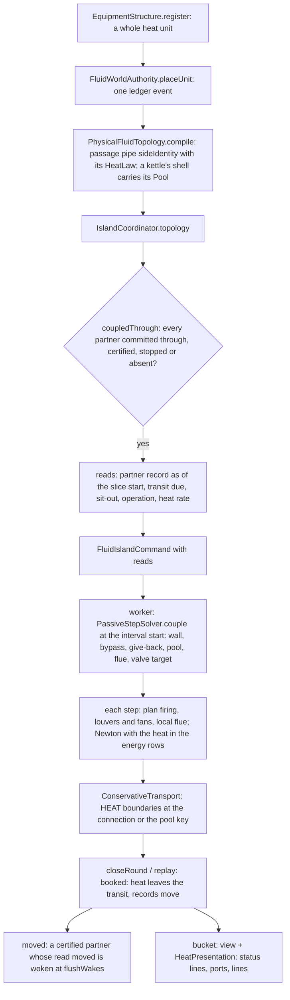

# Heat exchangers: heat sides, the coupling across islands and built-in control

**Snapshot:** SNAPSHOT_SHA (branch `claude/heat-exchanger-design-cf05d1`), 2026-10-28 · **Updated:** 2026-10-28 (new chapter, batch 2026-10-27-heat-exchanger-design: work packages W1 to W8, the owner-test fixes (louvers, the settled-transit wake, junction holdups that skip a heat side's passage) and F1, the convection coil against the flue gas; W9, the column hook, deferred)
Up: [code guide](README.md)

## Read this when

- An exchanger, kettle, air cooler or fired heater moves the wrong heat, its outlet stands at the wrong temperature, or it moves none.
- A side's status line says `LIMITED`, `LOW LIMIT`, `DUTY INSUFFICIENT`, `LINES NOT CHECKED`, `LINES NOT COMPLETE` or `LINES COMPLETE`, and you need to know why.
- Two coupled islands wake each other, never certify, or one waits for the other (the coupling fence).
- You change a heat law, the films, a unit's surface or passage, the built-in controller, the kettle's pool, the fired heater's coils or an exchanger's control lines.
- You change a heat unit's facts (`HeatUnit`, fluid facts schema 5), the heat in transit, or what a heat side's screen receives (`HeatPresentation`, protocol `fluid-16`).
- You rebuild the heat review world (`HeatExchangerReviewWorld`, `runReviewWorldServer`).

The step's equations, junctions and booking are in [fluid-science.md](fluid-science.md). Islands, certificates, checkpoints and packets are in [fluid-runtime.md](fluid-runtime.md). The units' shapes and nozzles are in [equipment.md](equipment.md). The walk and the matcher that check an exchanger's lines are in [machine-assemblies.md](machine-assemblies.md). The Control tab and the flowsheet are in [client-gui.md](client-gui.md).

## In one paragraph

Physically, an exchanger passes a hot and a cold stream past a steel wall in counterflow; an air cooler blows ambient air over finned tubes; a fired heater burns fuel, gives most of its heat to a radiant coil and the rest, in the flue gas, to a convection coil; a kettle boils a pool of liquid around a tube bundle. In code, each passage of a unit is a fluid device of kind `HEAT_SIDE` with inlet and outlet ports, and a kettle's shell is a closed vessel. A side compiles as an inline filter does: its passage is one pipe between its inlet node and a junction at its outlet, and that pipe carries a **heat law** (`HeatLaw`: `HeatSide`, `AirCooled`, `FiredCoil`, `ConvectionCoil`). Inside a step's Newton the heat is a pure function of the connection's flow and the donor's specific enthalpy, on the donor stream's enthalpy-temperature-film curve (`HeatCurve`): no unknown, no mode, exactly zero at no flow. Everything else is a slice input fixed before the Newton: an air cooler's louvers and fans and a radiant coil's firing are planned at each step's start; an exchanger's wall, its bypass and its give-back are planned at each slice's start from the other side as read. The wall holds no heat (owner Q10). The two sides of an exchanger may sit in two islands; they exchange only energy, through a **relay**: each side plans against its partner's record as of its slice start (the fence, form C, owner Q16), and what the two sides booked differently waits as the exchanger's **heat in transit**, a fact on the pair, returned by the give-back. The heat enters the receiver's energy row as a mover's work does and is booked as a `HEAT` boundary at the connection, so the ledger, the audit, the certificate replay and the checkpoint carry it. Each controllable side has a built-in controller (`HeatControl`) that sets its own actuator between slices or steps, dead-beat on its own law; an exchanger whose lines are complete works a real control valve instead (W8).

## Class map

Paths are relative to `src/main/java/com/wormzjl/icheme/`.

| Class | Role | Read it for |
|---|---|---|
| **Heat laws (`science/fluid/network`, Minecraft-free)** | | |
| [`HeatLaw`](../../../src/main/java/com/wormzjl/icheme/science/fluid/network/HeatLaw.java) | Sealed: `heat(curve, inlet, massFlow)` (W into the stream), `coldest`/`hottest` (the span the donor's curve covers, 10 K beyond), `films`, `shape()` (the facts that shape the equations, part of the connection's identity) | The contract every law keeps |
| [`HeatSide`](../../../src/main/java/com/wormzjl/icheme/science/fluid/network/HeatSide.java) | An exchanger side or a kettle's tubes: facts `area`, `films`, `partner` (the other side's connection id, 0 for none), `control`; slice inputs `wall` (K per cell, in a forward flow's order), `bypass`, `giveBack` (J/kg on the whole flow), `active` (the sit-out), `limit` | The march through the cells; a reversed flow meets the cells the other way |
| [`AirCooled`](../../../src/main/java/com/wormzjl/icheme/science/fluid/network/AirCooled.java) | An air cooler's process side against air at a constant temperature; `Air` (per m² of face: bare tube, fin film, air capacity rate, `natural` draught share); `draught` the actuator (0 louvers shut, `natural` louvers open and fans still, 1 full fans), `fans()`, `louvers()`, `planned` | UA_eff = C (1 − e^(−UA/C)) per phase; louvers |
| [`FiredCoil`](../../../src/main/java/com/wormzjl/icheme/science/fluid/network/FiredCoil.java) | A fired heater's radiant coil: `setTemperature`, `duty`, `firing` (β), `partner` (its convection coil); `planned` | β · \|ṁ\| · (h_set − h_in), at most the duty |
| [`ConvectionCoil`](../../../src/main/java/com/wormzjl/icheme/science/fluid/network/ConvectionCoil.java) | A fired heater's convection coil (F1): counterflow against the flue gas leaving the radiant box; `conductance` (UA), `radiant` (its radiant coil's id), `flue` (C_g, W/K); `FLAME` 2073.15 K, `BRIDGEWALL` 1073.15 K, `flueOf(radiantHeat)` | ε C_min (T_bw − T_in) |
| [`HeatCurve`](../../../src/main/java/com/wormzjl/icheme/science/fluid/network/HeatCurve.java) | One stream's h-T-film curve, fixed for a step: `sample` (16 divisions, phase changes bisected to 1e-5 K, refined to 0.2 K off the chord, knots at vapour fractions `LIQUID_UNTIL` 0.05 and `GAS_FROM` 0.95, at most 512 knots), `march` (exact per segment), `temperatureAt`, `enthalpyAt` (a plateau's vapour end), `lowestEnthalpyAt` (its liquid end), `temperatureSlope`, `withFilms`; `Films` (`DEFAULT` 2000, 5000, 100 W/m²K) | The film per phase on the curve; C1 extension past the end knots, with no notice (owner Q15) |
| [`ExchangerRelay`](../../../src/main/java/com/wormzjl/icheme/science/fluid/network/ExchangerRelay.java) | The relay as pure functions: `Partner` (the other side as read, or a kettle's pool as a `Bath`), `Read` (partner, stopped, transit due, partner's slice length, sit-out, `Operation`, `heatRate`), `Operation` (a bypass or feed valve, W8), `wall` (the 8-cell quasi-steady wall), `bathWall`, `plan`, `planPool`, `capacityRate`, `share`; `TOLERANCE` 0.01 K, `MAXIMUM_SWEEPS` 200, `BYPASS_TOLERANCE` 1e-6, `MAXIMUM_ROUNDS` 8 | How a side heads for the wall and gives back its share of the transit |
| [`HeatControl`](../../../src/main/java/com/wormzjl/icheme/science/fluid/network/HeatControl.java) | The built-in controller: `Target` MANUAL, OUTLET_TEMPERATURE, DUTY; `value`, `lowLimit`, `manual`; `Limit` NONE, LOWEST, HIGHEST, LOW_LIMIT; `setting` (an Illinois root on the side's own law, the give-back not counted) | Dead-beat control; why an actuator stands at an end |
| [`Pool`](../../../src/main/java/com/wormzjl/icheme/science/fluid/network/Pool.java) | A kettle's pool on its vessel's `Inventory`: facts `id`, `partner`, `area`, the bundle's `bottom` and `bundle` diameter; slice inputs `wall`, `giveBack` (W), `active`; `wetted`, `film`, `heat` | The bundle's heat into the vessel; the film follows the level |
| **Geometry (`science/equipment`)** | | |
| [`HeatSides`](../../../src/main/java/com/wormzjl/icheme/science/equipment/HeatSides.java) | `Unit` EXCHANGER, KETTLE, AIR_COOLER, FIRED_HEATER; `Side` TUBE, SHELL, PROCESS, CONVECTION, RADIANT; `unit(kind)`, `of(shape)` (each side's nozzle roles, surface and passage, in registration order), `pool(kind)`, `kettleBundle`, `kettleShell`, `heatSide(...)` (the law a side's facts give), `coilDuty`, `airFilms`, `fanPower`; `AIR`, `AIR_TEMPERATURE` 298.15 K, `EXCHANGER_CELLS` 8 | What a unit registers and how big its surface and passage are |
| **Runtime (`runtime/fluid`)** | | |
| [`HeatUnit`](../../../src/main/java/com/wormzjl/icheme/runtime/fluid/HeatUnit.java) | A side's facts on its registration (`PhysicalFluidTopology.Device.heat`): `unit`, `side`, `area`, `partner` (the other side's registration), `Control(mode, target, lowLimit, share)`, `transitJoule`; `Mode` OFF, OUTLET_TEMPERATURE, DUTY, FIRING, RATIO; `heatSide()`, `controller()`, `controllable()`, `lines()`, `pool()`, `fans()`, `burners()` | The control a player sets; which law a side compiles to |
| [`IslandCoordinator`](../../../src/main/java/com/wormzjl/icheme/runtime/fluid/IslandCoordinator.java) (its exchanger coupling section) | `Coupled` relay state per side (two `SideRecord`s, booked spans, at most `MAXIMUM_BOOKED` 64), `SideKind` EXCHANGER (exchanger sides, kettle tubes and pools), RADIANT, CONVECTION; `coupledThrough` (the fence), `reads`, `booked`, `moved`, `flushWakes`, `operations`, `transits`, `settledTransit`, `transit`, `removeTransit`; `WAKE_TEMPERATURE` 0.05 K, `WAKE_FLOW` 1e-3, `WAKE_TRANSIT` 1e-3 | When a coupled side may solve, what it reads, when a partner wakes |
| [`HeatPresentation`](../../../src/main/java/com/wormzjl/icheme/runtime/fluid/HeatPresentation.java) | Completes a side's `FluidView.Heat` where its view is built: the actuator (`FluidView.Heat.ACTUATORS`: none, bypass, bypass_valve, feed_valve, fans, louvers, burners) and its effort, the controller's limit, every port of the unit with its stream, and an exchanger's lines part by part | What the Control tab and the stream switch show (presentation reads only) |
| [`FluidWorldAuthority`](../../../src/main/java/com/wormzjl/icheme/runtime/fluid/FluidWorldAuthority.java) (heat parts) | `placeUnit(sides, vessel)` and `removeUnit(ids)` (one ledger event each, the pair whole), `UnitSide`, `UnitVessel`; `edit` moves a fired heater's partner coil in the same event; `Lines` (`Status` NOT_VALIDATED, CHECKED, UNMETERED, COMPLETE), `lines(side, value)`, `operate`, `holdValves`; `controlStatus`, `linesStatus`; the transit loaded from and written to the facts | Registration, status lines, the real valves |
| **Assembly (W8)** | | |
| [`science/assembly/ExchangerBlueprint`](../../../src/main/java/com/wormzjl/icheme/science/assembly/ExchangerBlueprint.java) | `Lines` NONE, BYPASS, RATIO; `Design(tube, shell)`; slots `<side>_inlet_tee`, `_bypass_valve`, `_outlet_tee`, `_feed_valve`, `_meter`; `operated(side, lines)`; `of(design)` | What an exchanger's controls ask for |
| [`runtime/assembly/ExchangerLines`](../../../src/main/java/com/wormzjl/icheme/runtime/assembly/ExchangerLines.java) | `design` (from the sides' registered controls), `publish` (a report as each side's `Lines`, with the valve its control works) | How a check reaches the solver |
| **Client** | | |
| `client/gui/common/HeatControlColumn`, `HeatDiagram`, `HeatFlowsheet` | The Control tab, the unit's flowsheet on a design grid, the stream switch ([client-gui.md](client-gui.md)) | The screen |

## Main flow

1. **Build.** A whole exchanger, kettle, air cooler or fired heater registers through `EquipmentStructure.register` ([equipment.md](equipment.md)): one `UnitSide` per `HeatSides.of(shape)` entry, at its first inlet's cell (`ShapeRasterizer.fluidCells`), its inlet and outlet nozzles as `INLET` and `OUTLET` ports, its passage geometry and a new `HeatUnit`; a kettle adds its shell as a `UnitVessel`. `FluidWorldAuthority.placeUnit` places them in one ledger event and names the partners (an exchanger's two sides, a fired heater's two coils, a kettle's tubes and shell). A refresh moves or restates the sides with their identities, partner, control and transit (D7); a removal takes all of them in one event (`removeUnit`). An exchanger built before this batch registers when it next loads whole, control off (owner Q9).
2. **Compile.** `PhysicalFluidTopology.compile` treats a `HEAT_SIDE` as an inline filter: its inlet runs end at its node, its outlet runs leave from a new junction at its first outlet port's height, and one passive pipe with the id `sideIdentity(id)` (`Long.MIN_VALUE/2 + id`) carries its passage (`PipeResistance.Geometry` with its channel count) and `withHeat(heat.heatSide())`. The nozzles are 1 m stubs at the line's bore. An exchanger side without a partner has no law. A kettle's shell compiles as a reservoir whose `Inventory.pool` is an idle `Pool` keyed `sideIdentity(shell)` and partnered with `sideIdentity(tubes)`; a held pool with the same facts keeps its slice inputs. `PassiveNetwork.sizeJunctionHoldups` skips a heat side's passage: the passage holds no fluid (Q10), so its ends are sized on their lines, as headers.
3. **The fence** (owner Q16, form C). `IslandCoordinator.coupledThrough` is a readiness condition in `reconsider`, in the pump's predicate and in `verify`: each of the island's coupled sides' partners has committed through the island's committed tick, or is certified (materialised at dispatch), or is stopped (held, phase-parked or suspended: never from lag), or has no island, or is in this island. The side furthest behind can always go, so the fence cannot deadlock. A fast side runs up to one partner cadence behind online time.
4. **The reads.** At dispatch, `reads(island, slice)` gives each coupled side its `ExchangerRelay.Read` (arithmetic on the server): the partner's stream as of the slice start (the later of its two records at or before that tick; after a load only the current one, decision D1), whether it is stopped, the transit due (the booked transit with the partner's heat booked past the slice start taken out), the partner's slice length, the sit-out share, the `Operation` of a complete exchanger side (W8) and, for a convection coil whose radiant coil is in another island, the radiant coil's heat rate. `FluidIslandCommand` carries them to the worker; `RetainedSolver.solve` and `PassiveIntervalSolver.solve` pass them on.
5. **The slice plan** (worker, once per interval): `PassiveStepSolver.couple` plans each coupled side with `ExchangerRelay.plan` (its wall, bypass, give-back and active share), each pool with `planPool`, each convection coil from `Read.heatRate`, and each complete side's valve target. Both curves span both inlets, 10 K beyond, each at its own stream's pressure. A side without a read gets a flat wall at its own temperature and moves no heat.
6. **The step plan** (worker, every step): `PassiveStepSolver.plan` sets each radiant coil's firing (`FiredCoil.planned`), each controlled air cooler's draught (`AirCooled.planned`) and the flue gas of a convection coil whose radiant coil is in the same island (`ConvectionCoil.flueOf` of the radiant coil's planned heat), from the last accepted step's flows.
7. **The Newton.** A heat-exchanging connection delivers its donor's stream with the heat it took up, into the receiver's energy row and inflow, as a mover's work is (`Equations.sideHeat`, on the donor end's curve `sideCurve`, cached per end while its span, films, port and donor state hold). The balanced start (`BalanceNet.seeded`), the junction start mix and the arriving-phase seeds read the delivered stream, so a junction a heater boils is seeded with its vapour. A pool's heat (`PassiveStepSolver.poolHeat`) enters its vessel's energy row on the step's start state, and its boil-up (`boilUp`) counts as gas the vessel's ports may draw within the step.
8. **Booking.** `ConservativeTransport.reconstruct` books each side's heat (its `EdgeHeat`, the Newton's own function) into the receiver and as a `HEAT` boundary at the connection id, and a pool's at its key. A vessel whose pool heats is never at rest (`NetworkReduction.atRest`).
9. **Commit.** At a commit or a certificate replay, `booked` takes each side's heat (from its `HEAT` boundaries) out of the pair's transit, keeps the span for its partner's as-of reads, records the sit-out, and moves the side's record to the span's end with its heat rate. `moved` decides whether a certified partner must solve again; `flushWakes` ends those certificates at the engine's next decision point (a round's close, `runDue`, a pump), never inside a presentation read (counter `FluidRuntimeDiagnostics.couplingWakes`).
10. **Presentation.** At the side's bucket the authority builds its view: the status line is prefixed with the lines' status, the controller's limit and, for a radiant coil short of its set point, `DUTY INSUFFICIENT`; `HeatPresentation.complete` adds the actuator, its effort, the ports and the lines. Opening the screen replays the cached view, as for any fluid device.

The units: sides, surfaces and passages (HeatSides)

| Unit | Shape kinds | Sides in registration order | Surface | Passage |
|---|---|---|---|---|
| EXCHANGER | `EXCHANGER` | TUBE (TUBE_INLET → TUBE_OUTLET), SHELL (SHELL_INLET → SHELL_OUTLET), partners | `ProcessUnit.tubeSurface(D, L)` = 75 D² L, each side | tubes (`tubePassage`): 630 D² tubes per pass of 14.8 mm bore, two passes over 2 L, 4 velocity heads per pass; shell (`shellPassage`): 18 mm hydraulic diameter, 0.1 D² crossflow area, 2.5 L |
| KETTLE | `KETTLE` | TUBE, then the shell: a closed RESERVOIR with FEED, VAPOUR_OUTLET and LIQUID_OUTLET ports (`HeatSides.pool`), partners | tubes 75 D² L of the bundle | tubes as an exchanger's; shell a lying drum 1.6 bundles across over 0.9 L + 0.3 m (`kettleShell`), the bundle `shell/1.6` across (`kettleBundle`) |
| AIR_COOLER | `AIR_COOLER` | PROCESS, no partner | 5 m² of bare tube per m² of face, per bay | each bay's tubes in one pass of 21.2 mm bore, the trains in parallel, the bays of a train in series, 1.5 velocity heads per bay (`airCoolerPassage`) |
| FIRED_HEATER | `VERTICAL_HEATER`, `CABIN_HEATER` | CONVECTION, RADIANT, partners (the player pipes the crossover) | `coilArea`: 30 % of `ProcessUnit.heaterDuty` at 15 kW/m², 70 % at `RADIANT_FLUX` 35 kW/m² | 6" tubes of 146 mm bore in parallel passes of 8 MW each, half a velocity head per return bend every 10 m (`heaterPassage`) |

- `PipeResistance.Geometry.channels` (default 1) is the passage's channel count: the run loses what one channel loses at the flow over the count; its area and volume are all channels'. It is in the facts' geometry record, the checkpoint state, the certificate's graph identity and the sections' merge key.
- `EquipmentShape.fluidDevice()` is true for every kind with heat sides. `AirCoolerDesign`'s datasheet has an air-side line (bare surface, fan power at full speed).
- Fan power is 1 kW per m² of face at full speed and the cube of the speed below it (`fanPower`). It is a datasheet and screen line only: it heats the air, not the stream.

Heat laws, films and the curve

| Law | Used by | Heat (W into the stream) | Slice inputs, planned by |
|---|---|---|---|
| `HeatSide` | exchanger sides, a kettle's tubes | (1 − bypass) \|ṁ\| marched through the cells against the wall on the donor's curve, times `active`, plus \|ṁ\| · giveBack | wall, bypass, give-back, active, limit: per slice (`ExchangerRelay.plan`, `PassiveStepSolver.couple`) |
| `AirCooled` | an air cooler's process side | one march against air at 298.15 K over the bare surface with `Air.films(draught)`; 0 with the louvers shut | draught and limit: per step (`AirCooled.planned`, `PassiveStepSolver.plan`) |
| `FiredCoil` | the radiant coil | β · \|ṁ\| · (h_set − h_in); h_set = `curve.enthalpyAt(T_set)` | β: per step (`FiredCoil.planned`): 1 within the duty, duty/demand beyond it, 0 at or above the set point or with the burners out |
| `ConvectionCoil` | the convection coil | counterflow ε C_min (T_bw − T_in) over UA = 54.9 W/m²K × bare tube (`HeatSides.CONVECTION_U`); the stream's mean capacity rate from its inlet to the bridgewall on its curve | flue C_g = Q_r / (T_flame − T_bw): per step from the radiant coil in the same island, else per slice from `Read.heatRate` |

- **Films** (`HeatCurve.Films.DEFAULT`): liquid 2000, boiling or condensing 5000, gas 100 W/m²K, each with its share of the wall and fouling. Each knot of the curve carries the film of its vapour fraction: liquid below 0.05, the two-phase film to 0.95, gas at 1, linear between. The knots at 0.05 and 0.95 give a pure component's plateau the two-phase film.
- **The march** (`HeatCurve.march`) integrates dh/dA = −h_film(h) (T(h) − T_wall) / ṁ exactly on each segment (a partial-fraction integral, with its constant-film and common-root limits through `DeterministicMath.log1p`/`expm1`). The stream approaches the wall and never crosses it.
- **The curve** (`HeatCurve.sample`) is the stream the donor end's port draws (`endMoles`: a drum's liquid draw has its own bubble point), at the donor's pressure. Beyond its end knots it extends its end lines, value and slope continuous, and raises no notice (owner Q15): the property models' own data-range notices report every node state. Solids are not on the curve.
- **Air** (`HeatSides.AIR`): per m² of face, 5 m² bare tube, 50 m² of fins under a 100 W/m²K film, 3.5 kW/K of air at full fans; natural draught a quarter of that (`NATURAL_DRAUGHT` 0.25). At full fans 2.15 (liquid), 2.44 (condensing) and 0.43 (gas) kW/K per m² of face.
- A heat law's `shape()` is in the connection's identity (`PassiveNetwork.Pipe.Identity`); its slice inputs are not.

The relay: the wall, the give-back and the heat in transit

- **The wall** (`ExchangerRelay.wall`): both streams marched through `EXCHANGER_CELLS` 8 cells in counterflow on their curves with their films. Each sweep passes the cells in one stream's order, then in the other's; each cell's temperature is an Illinois root of its two heats, bracketed by the two entering temperatures, to a tenth of `TOLERANCE`. It stops when no cell moves more than 0.01 K, or after 200 sweeps (a wall stopped short is still a valid wall: energy stays exact). It starts from the side's last planned wall; a start the first sweep moves by less than the tolerance is kept unchanged, so a steady side plans the same wall and its island can certify.
- **A still or stopped partner** gives an active share of 0: the side's cells move nothing and it keeps its wall. A side whose own flow is unknown or still gets a wall at the partner's inlet.
- **The give-back**: the side's share of the transit due, `W_own Δt_own / (W_own Δt_own + W_other Δt_other)` with W the capacity rate through the cells (`capacityRate`: ṁ Δh / ΔT, or the curve's slope at the inlet where ΔT is about 0; unbounded on a plateau, which then takes it all). It is an enthalpy shift on the whole flow, scaled so the outlet at the slice start stays between the two inlet temperatures; the rest stays in transit. A side without flow takes none. A kettle's tubes take none: the pool takes all of it (`planPool`).
- **The heat in transit** is one energy per exchanger, positive when owed to the streams. The coordinator holds it by pair key (`sideIdentity` of the side with the lower registration id). The **booked** transit is what the coordinator and the facts hold; the **settled** transit (`settledTransit`) adds both sides' heat booked past the side further behind. The energy ledger balances on the booked one; the steady state, the wake and "returns to 0" read the settled one.
- **Wake** (decision D4, `moved`): a commit wakes the partner's certificate when its stream's temperature moved more than 0.05 K, its flow more than 0.1 %, or the settled transit grew past 0.1 % of the partner's last slice heat plus 1 J; a partner's bypass that moved more than 0.001, and a kettle's pool whose film moved more than 0.1 % (it boils dry or floods), count as its record moving. A radiant coil wakes its convection coil when its heat rate moved more than 0.1 % plus 1 W. After a load, a certified partner's first record is adopted as its baseline, so a load wakes nothing.
- **Fired heater coils** (F1) share no transit: their heat comes from fuel. Only the convection coil waits at the fence.
- **Determinism**: form C makes a side's result independent of job times. The command carries numbers only; the worker builds both curves.

Built-in control (HeatControl, HeatUnit.Mode) and its status lines

| `HeatUnit.Mode` | Sides | Controller | Actuator (effort 0 → 1) |
|---|---|---|---|
| OFF | controllable sides | none (MANUAL with a low limit) | the manual `share` holds |
| OUTLET_TEMPERATURE | exchanger sides, kettle tubes, air cooler | OUTLET_TEMPERATURE at `target` K | exchanger: bypass fully open → shut; air cooler: louvers shut → full fans |
| DUTY | as above | DUTY at `target` W | as above |
| FIRING | fired heater coils only (required there) | none: the coil's own law | burners (`share`), set point `target` |
| RATIO | exchanger sides only | none: the feed valve holds `target` × the other side's flow (W8) | the feed valve; holds nothing until the lines are complete |

- `HeatControl.setting` finds the effort whose heat meets the target on the side's own law (an Illinois root), the give-back not counted (that loop settles 4 to 5 times slower). A target past full effort takes full effort (`HIGHEST`); one past the inlet, or below the lowest effort's heat, takes the lowest (`LOWEST`). On a cooled side the low limit then holds the effort back (`LOW_LIMIT`), in every mode, manual included.
- A set point on a plateau names its liquid end on a cooled side (`lowestEnthalpyAt`) and its vapour end on a heated side (`enthalpyAt`). The target vapour fraction of plan section 6 is not built.
- An exchanger side's bypass is planned per slice, with the wall, in turn until the bypass moves less than 1e-6 (at most 8 rounds). An air cooler's draught is planned per step, as a fired coil's firing is.
- Defaults: a new side is OFF; an air cooler's fans run (`share` 1); a fired heater fires to 573.15 K (300 °C) with its burners lit (`HeatUnit.FIRING`). A coil's edit moves its partner coil in the same event; a set point must lie inside the package's temperature envelope (`FluidDomain.requireInputTemperature`).
- Status lines, prefixed to the island's status in this order: the lines (below), then `LIMITED: the bypass is fully open` / `closed`, `LIMITED: the louvers are shut` / `the fans run at full speed`, `LOW LIMIT: the outlet is held at %.1f K`, and for a radiant coil firing at its maximum `DUTY INSUFFICIENT: outlet %.1f K below the set point`. The client reads the two numbers by these formats.

The kettle (W7)

- The tubes are a `HeatSide` (unit KETTLE, side TUBE) partnered with the shell's pool; the shell is a closed reservoir (`HeatUnit.pool()`), whose `Inventory` carries the `Pool`.
- The pool's heat is explicit on a step's start state: Σ film · A_cell · (T_wall − T) · active + give-back, into the vessel's energy row, booked as a `HEAT` boundary at the pool's key. The wall is planned at the slice start from the tubes as read (`bathWall`: one pass, each cell's wall where the tube stream's heat equals the pool's through its film).
- **The film follows the level** (`Pool.wetted`): the share of the bundle's cross-section under the liquid level (`VesselGeometry.heightAt`, `segmentArea`); wet tubes take the boiling film over vapour or the liquid film without it, dry tubes the gas film. A kettle that boils dry stops heating.
- **The boil-up counts in the phase draw** (D11 extended): a vapour port's capacity adds the pool's heat over the latent heat at the start state, so the vapour port draws the boil-up, not liquid.
- The tubes are controllable (outlet temperature or duty by their bypass: medium that leaves without crossing the bundle). The LIQUID_OUTLET is a plain vessel port: the level is the player's (no weir).

The exchanger's control lines (W8)

- **The design is the sides' controls** (`HeatUnit.lines`): OUTLET_TEMPERATURE or DUTY asks for a bypass (inlet tee, control valve, outlet tee), RATIO for a feed valve and a flowmeter on the other side's feed. `ExchangerLines.design` reads it from the registrations; `ExchangerBlueprint.of` gives the slots and links.
- **Check lines** on a side's screen sends `fluid_check_lines` (`FluidNetwork.LinesPayload`); the exchanger is validated at the next server tick, as a column's queued check is (`AssemblyService.validate`, [machine-assemblies.md](machine-assemblies.md)). `ExchangerLines.publish` hands the report to each side as `FluidWorldAuthority.Lines`: NOT_VALIDATED, CHECKED (with the parts not in place), UNMETERED (complete, but the valve carries no flowmeter, so it stands open as a bare valve), COMPLETE (with the valve's registration). Status lines: `LINES NOT CHECKED: …`, `LINES NOT COMPLETE: n parts not in place; …`, `LINES NOT COMPLETE: the bypass (feed) valve needs its flowmeter to regulate; …`, `LINES COMPLETE: the bypass valve controls` / `the feed valve holds the ratio`.
- **Operation** (`FluidWorldAuthority.operate` → `IslandCoordinator.operations`): a complete side's read carries its `Operation`. At the slice start `couple` plans the valve's mass flow target with the side: a bypass valve takes the controller's bypass share of the side's and the bypass's flows together, and the side's own bypass stays shut; a feed valve takes the ratio times the other side's flow as read. A target within `VALVE_DEADBAND` 1e-3 of the valve's stands, so a steady plant keeps its graph and certifies; `IslandCoordinator.sameControl` accepts the planned target in the candidate check. A side whose operation changed wakes its island.
- **Not complete**: a bypass control works the internal bypass (owner Q13); a ratio holds nothing. A report that reverts leaves its valve at its last planned target, applied as the valve's mass flow setting at the next tick (`holdValves`).
- A flowmeter installed on or removed from a pipe reverts a report that read it (`AssemblyService.metered`); a side whose control asks for other lines drops its exchanger's report (`AssemblyService.redesigned`, log `assembly status=REDESIGNED`). The authority keeps the lines while the server runs; a chunk load's check of a stored report publishes them again.
- Not built: the split-range pass valve; a LIMITED status for a saturated real valve; operating a valve outside the side's own island.

Saves, formats and the wire

- **Facts** (fluid facts schema 5, `FluidFacts.SCHEMA`; corpus `compat/fluid/schema-5/`): a geometry record appends its channel count (default 1); a registration appends an optional heat unit (unit and side by name, area, partner, control: mode by name, target, low limit, share; `transitJoule`). Only the lower-id side of a pair holds the transit (`WorldTopologyLedger.Snapshot.withHeatTransits`; read back by `heatTransits` into `IslandCoordinator.transit` when the authority starts). A removed unit books its transit as destroyed energy (`WorldTopologyLedger.removedHeat`). `HeatUnit` refuses a fired heater coil without a FIRING set point, FIRING outside a fired heater and RATIO outside an exchanger.
- **State** (checkpoint state format 29; rebuilt freely): 23 a geometry's channel count; 24 a pipe's heat side; 25 the heat law tagged (0 none, 1 heat side, 2 fired coil); 26 a side's partner and active share; 27 its controller and limit, tag 3 an air cooler; 28 a node's pool; 29 tag 2 the radiant coil with its partner, tag 4 the convection coil, an air cooler's draught. The relay's records, booked spans and wake queue are not saved: after a load a side's record is rebuilt from its graph and last result, its last span from the interval's `HEAT` boundaries (D1).
- **Certificates**: graph identity `icheme-certificate-graph-identity-8` digests each heat law's facts and slice inputs and each pool, so a replay holds them fixed.
- **Wire** (`fluid-16`, no compatibility work): `FluidView.Heat` (unit, side, paired, outlet temperature, heat, fans and fan power, bypass, burners, set point and most heat; the actuator, effort, limit, `Port`s and `Lines`), `FluidView.PipeInfo.reading`, `FluidNetwork.Controls.heat` (an edit of a controllable side), `fluid_open_partner` (`PartnerPayload`: the Other side button opens the partner's own cell, nothing queued) and `fluid_check_lines` (`LinesPayload`).

Traps

- **A slice input is not a fact.** Wall, bypass, give-back, draught, firing and flue are planned; changing them never edits a registration. Only the `HeatUnit` control and the transit are facts.
- **Plan the heat where its inputs are known.** A law that needs its partner plans per slice (`couple`); one that needs only its own stream plans per step (`plan`). Nothing switches inside a Newton.
- **The booked and the settled transit differ** by the heat the side ahead booked past the other's committed tick (about 1 MJ for a 5 s side one slice ahead of a 20 s side). A wake that read the booked one ping-ponged (the owner's test); a ledger check that reads the settled one is off by one slice's heat.
- **A heat side's passage sizes no junction.** Sizing its ends on every tube at the cap flow held half a bundle at the outlet and caused the fired heater's 100 kPa hold (the owner's test).
- **A bare control valve stands open.** A complete bypass whose valve has no flowmeter is UNMETERED and does not operate.
- **A kettle's tubes take no give-back**; the pool takes all of it.
- A pipe gauge downstream of a side reads the outlet junction; a gauge on the unit itself reads its inlet node.
- The heaters' FUEL nozzle stays unconnected (fuel is another scope, Q11). The air is a constant 25 °C (no weather, biome or altitude).
- The campaign has no exchanger worlds: the wall's cost is gated in `ExchangerCouplingTest`, not in the campaign.

## Change the layer that owns it

| Change | Owning class | Tests that pin it |
|---|---|---|
| A stream's curve, films, the march, a plateau's ends | `HeatCurve` | `HeatCurveTest` |
| An exchanger side's heat, bypass, reversal, zero flow, a boiling junction | `HeatSide`, `PassiveStepSolver` (`sideHeat`, `sideCurve`), `ConservativeTransport` (`EdgeHeat`, `HEAT`) | `HeatSideNetworkTest` |
| The wall solve, the give-back share, the plan | `ExchangerRelay` | `ExchangerRelayTest` |
| The coupling: fence, reads, booking, wake, transit, loads, certify | `IslandCoordinator` (coupling section), `PassiveStepSolver.couple`, `RetainedSolver`, `ProcessSolveServices.FluidIslandCommand` | `ExchangerCouplingTest` (real coordinator, solver and codec on a test rig: steady state at several cadence pairs, a held side, a feed/effluent loop, steam in methane against water, a side without flow, a save and load, certify and wake, control, the kettle, the real bypass valve and the ratio, the coils across two islands) |
| The controller | `HeatControl`, `HeatUnit.controller` | `HeatControlTest` |
| An air cooler's air, louvers and fans | `AirCooled`, `HeatSides.AIR` | `HeatSideTopologyTest`, `HeatSidesTest` |
| A fired heater's coils | `FiredCoil`, `ConvectionCoil`, `PassiveStepSolver.plan` | `FiredCoilTest`, `ConvectionCoilTest`, `HeatSideTopologyTest` |
| A unit's sides, surfaces, passages | `HeatSides`, `ShapeRasterizer.fluidCells` | `HeatSidesTest`, `ShapeRasterizerTest` |
| A side's registration, compile and outlet junction | `PhysicalFluidTopology` (`HEAT_SIDE`, `INLET`/`OUTLET`, `sideIdentity`, `pooled`), `FluidWorldAuthority.placeUnit`/`removeUnit`, `EquipmentStructure` | `HeatSideTopologyTest` |
| The kettle's pool | `Pool`, `ExchangerRelay.planPool`, `PassiveStepSolver.poolHeat`/`boilUp` | `ExchangerCouplingTest` (boil-up against Q/λ, a duty held by the tubes' bypass, an empty shell) |
| The exchanger's lines | `ExchangerBlueprint`, `ExchangerLines`, `AssemblyMatcher` (FLOWMETER, nested tees), `FluidWorldAuthority.lines`/`operate` | `ExchangerBlueprintTest`, `AssemblyGameTests.anExchangersBypassValidatesAndARemovedPipeReverts` |
| Facts, state and the corpus | `HeatUnit`, `FluidFacts`, `FluidCheckpointCodec`, `IslandCertificate.graphIdentity` | `FluidFactsCompatTest` (corpus `schema-5/`), `FluidCheckpointCodecTest` |
| What the screen receives | `HeatPresentation`, `FluidView.Heat`, `FluidNetwork` | `HeatPresentationTest`, `FluidPacketCodecTest`; the client side in [client-gui.md](client-gui.md) (`HeatDiagramTest`, `HeatControlColumnTest`) |

## Tests that pin it

All run under `test`; none is a slow gate class.

- [`science/fluid/network/`](../../../src/test/java/com/wormzjl/icheme/science/fluid/network/): `HeatCurveTest` (the kernel against the analytic exponential and latent knots, a film step along the curve, a pure condensing stream against water at U 1430), `HeatSideNetworkTest` (the ledger with heat, a junction that boils from heat, reversal, zero flow, the bypass), `ExchangerRelayTest`, `HeatControlTest`, `FiredCoilTest`, `ConvectionCoilTest` (the design split, bounds, smoothness).
- [`science/equipment/HeatSidesTest`](../../../src/test/java/com/wormzjl/icheme/science/equipment/HeatSidesTest.java): each unit's sides, surfaces, passages, the air films and the coils' duty split.
- [`runtime/fluid/`](../../../src/test/java/com/wormzjl/icheme/runtime/fluid/): `HeatSideTopologyTest` (a side compiles as a passive pipe of its passage to an outlet junction, and only a side carries a heat unit and inlet and outlet ports; the air cooler at fans on and off, and held by its louvers and fans through an inlet step; the radiant coil at its set point, short of its duty, above its set point and raising steam; the convection coil on the radiant coil's flue gas), `ExchangerCouplingTest`, `HeatPresentationTest`, and the heat cases of `FluidFactsCompatTest`, `FluidCheckpointCodecTest` and `FluidPacketCodecTest`.
- [`science/assembly/ExchangerBlueprintTest`](../../../src/test/java/com/wormzjl/icheme/science/assembly/ExchangerBlueprintTest.java) on `TestGraph`; GameTest `AssemblyGameTests.anExchangersBypassValidatesAndARemovedPipeReverts`.
- **Review world** (not a gate): [`HeatExchangerReviewWorld.theHeatUnitsStandRunning`](../../../src/fluidGameTest/java/com/wormzjl/icheme/fluid/gametest/HeatExchangerReviewWorld.java) (namespace `icheme_review`, batch `review-heat`, run by `runReviewWorldServer` beside `ColumnReviewWorld`): five units on water lines from generators to voids, left running in `run/review-world/world` (both exchangers held at 30 °C, one with a real bypass whose lines are not checked; the largest air cooler at 80 °C; a vertical heater fed by an In-line Pump to 200 °C; a 1 m kettle at 0.5 MW). After a minute it logs each unit's status, outlet and duty (`review_heat` lines). `documentation/2026-10-27-heat-exchanger-design/REVIEW_WORLD.md` says how to copy it into a client's saves.
- Offline studies (not gates): `tools/heat-exchanger-design/` (harness parts 1 to 8).

Design background: `documentation/2026-10-27-heat-exchanger-design/` (`HEAT_EXCHANGER_PLAN.md` section 10, W1 to W8 and F1 as built; `OWNER_TEST_REVIEW.md`; `HX_TIMING_STUDY_REVIEW.md` for the fence).

## Terms

- **Heat side**: one passage of a heat unit, a fluid device of kind `HEAT_SIDE`; its passage is one compiled pipe (`sideIdentity`) that carries its heat law.
- **Heat law**: how a connection exchanges heat for a step (`HeatLaw`): a pure function of its flow and the donor's enthalpy on the donor's curve.
- **Partner**: the other side of a unit (an exchanger's other side, a kettle's tubes and shell, a fired heater's other coil).
- **Slice input**: a law's value fixed by a plan before the Newton (wall, bypass, give-back, active share, draught, firing, flue, a valve's planned target).
- **Wall**: the quasi-steady temperature of each of the exchanger's 8 cells; it holds no heat.
- **Heat in transit**: what the two sides of one exchanger booked differently, one energy per exchanger, a fact; booked versus settled as above.
- **Give-back**: a side's share of the transit, returned as an enthalpy shift on its flow over its slice.
- **Sit-out**: the share of a slice in which the partner counted this side stopped; the side's cells are inactive for it.
- **Fence**: the readiness condition that a coupled side's partners have committed through its slice start (form C).
- **Effort**: the actuator's position from 0 to 1 (bypass fully open to shut; louvers shut to full fans; burners out to full).
- **Lines**: an exchanger side's control piping as an assembly (bypass or ratio station) and its report's state.
</content>
</invoke>
