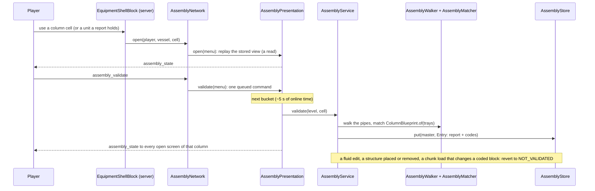

# Machine assemblies: a column's plant, validated against its design

**Snapshot:** 0893d2339 (branch `claude/distillation-failure-mode-control-db2da5`, `claude/custom-shader-system-caff9e` merged in), 2026-11-10. Batch `2026-11-10-column-failure-modes`, merged as 0.26.0: Start carries the reboiler's and pumparound coolers' heat sides and the powered members (`ColumnStarts`), refusals as `Refusal` texts, set points on a column that never ran (`AssemblyService.setpoints`), a kettle's lines (`ExchangerLines`); protocol `assembly-6`, store format 2 unchanged · earlier: 971dd8346 (branch `claude/custom-shader-system-caff9e`), 2026-11-10. Batch `2026-11-10-vacuum-pump`, to merge as 0.25.0: a vacuum column's pump on the receiver's vapour outlet (`ColumnBlueprint` slots `vacuum_pump`, `water_pump`; `AssemblyDiagram`); protocol `assembly-4` and store format 2 unchanged · earlier: 3efffdb2d (branch `claude/simulator-sizing-refactor-6bacab`, the consolidation review of `codex/simulator-sizing`), 2026-11-08. Batch `2026-11-06-simulator-sizing`, merged as 0.22.0 on 2026-11-08.

## Utilities, members and set points at Start (0.26.0, batch 2026-11-10-column-failure-modes)

- `ColumnStarts.build` now also gives `FluidWorldAuthority.ColumnStart` the heat sides of every unit in slot `REBOILER` and in each `pumparoundCooler(i)` (`heatSides`, one unit after another), the air condenser's fan sides (an AIR_COOLER member's sides whose heat unit has fans) and the pumps' movers of `REFLUX_PUMP` and each `pumparoundPump(i)` (`movers`: a casing's through `EquipmentStructure.movers`, or the registration of an in-line pump at the slot's place), as `ColumnUnit.Members`. The ledger keeps those that qualify ([column-operation.md](column-operation.md)).
- Refusal texts come from `Refusal` (`NO_DESIGN`, `NO_SAVED_POINT`, `VACUUM`, `INCOMPLETE`, `VALVE_UNREGISTERED`); the words are unchanged.
- `AssemblyService.setpoints` takes set points on a column that never ran, on its design's (it refuses with "the column has no operating point" or `Refusal.VACUUM`); `operation` marks the idle view editable unless the column is a vacuum column.
- `ExchangerLines` gives lines to an EXCHANGER and to a KETTLE (whose tubes a column may set, mode COLUMN), each side by its registration's own side.
- Protocol `assembly-6` (`assembly-5`: the conditions list; `assembly-6`: accepted set points and tray readings in the operation view). `AssemblyNetwork.encodeOperation`/`decodeOperation` give the view's bytes to the DCS's column page.

## The vacuum pump on the receiver (0.25.0)

- With `ColumnComponents.Vacuum` `LIQUID_RING` or `DRY_SCREW` (shape fields 12; owner V5: "placed on the drum vapor outlet") the blueprint asks for the vacuum pump of the design's type on the receiver's VAPOUR_OUTLET before the offgas valve, and a water pump (of the reflux pump's kind) on its BOOT_DRAIN before the water valve, in place of the ejector on the overhead (table below). `AssemblyDiagram` draws both parts. A vacuum column still refuses to start in the world (open item of the batch).

## Column C1 instrumentation (0.22.0)

`ControlHosts.refreshColumnMembers`, which each `ControlService` cadence calls before it validates edits, reads the accepted cached `AssemblyReport` and loaded member registration identities. It does not walk or validate pipes from a GUI request, load chunks, or run the column solver. Stable member/slot/channel identities expose accepted member process and utility readings through the column's physical C1. Existing assembly/column ownership still reserves its outputs; monitoring does not replace its duty/energy-transfer controller. Line placement/edit notifications now come through the shared `LineLaying` owners.

## Exchanger configuration and shared laying (0.22.0)

`ColumnComponents` and blueprint member choices carry `ExchangerType`. The match compares the built exchanger's selected sub-type as well as kind/count/dimensions and reports a configuration mismatch when Standard and Crossflow differ. Missing saved type means Standard. `AssemblyNetwork` now uses `assembly-4` for these choices; wire payloads are tested on fresh data, not migrated.

Assembly pipe laying and previews use the same selected layout/nozzle definition as constructor rendering and occupied cells. Crossflow applies to standalone exchangers and column condensers, trims and pumparound coolers; the kettle pool is unchanged. This does not redesign column operation: the existing duty/energy transfer contract still determines the running column's heat work. Assembly registration/reversion remains event-driven, preserving physical equipment and stored settings.

Up: [code guide](README.md)

## Read this when

- A column's assembly screen shows a part in the wrong colour, the wrong state or the wrong place, or Check parts gives an answer you did not expect.
- Units the design wants in parallel (a condenser's banks or shells, kettles, a pumparound's coolers, an air-then-water condenser's trim) check wrong: `UNIT_COUNT`, `UNIT_SHAPES` or a branch at their split or merge.
- An exchanger's control lines (a bypass round a side, a ratio station on its feed) check wrong, or a side's control does not work its real valve.
- A report did not go back to "not validated" after a change, or went back without one (`assembly status=REVERTED` lines).
- You add a slot, a link or a part form to a column's blueprint, or a new kind of assembly.
- You change what a click on a column or on a unit next to it opens, or the laying tool's assembly marks.
- Start refuses a complete column, or a change stops a running one.
- You touch the `assembly-6` packets (`assembly-4` before batch 2026-11-10-column-failure-modes), the `icheme_assemblies` store, or the review world (`runReviewWorldServer`).

The column's design (what Save design stores, `ColumnComponents` with its member counts, `ColumnDesign`) and the column's nozzles are in [equipment.md](equipment.md); Save design is on the process simulator's column (`ProcessSimulatorNetwork.SaveDesign`). The pipes and fittings the walk reads are registry devices ([fluid-runtime.md](fluid-runtime.md)). What a started column does is in [column-operation.md](column-operation.md).

## In one paragraph

A real distillation column is one item of a plant: an overhead system (an ejector under vacuum, a condenser, a receiver drum with a water boot, a reflux pump, a tee that splits reflux from distillate), a valve on every line that leaves the plant, a pump and a cooler per pumparound, and a kettle reboiler where the design has reboiler duty. The process simulator's column saves which of these the design needs, and how many identical units stand in parallel on each heat-transfer step (the condenser's banks or shells, an air-then-water condenser's trim shells, the kettles, each pumparound's coolers); the constructor builds the column with that design; the player places and pipes the other units. **Check parts** checks the pipes against the design and reports each part as in place (teal), misplaced (yellow) or missing (red). In code, a column built with components is an assembly master. `ColumnBlueprint.of(trays)` gives its slots and links. `AssemblyWalker` reads the pipes around it from the fluid registry and the shells in loaded chunks, as a `PortGraph`. `AssemblyMatcher` follows the links from the column, meets a step of several units where its line splits and goes on where their outlets join again, and gives an `AssemblyReport`. `AssemblyStore` keeps each master's report and the structural code of every block it relied on. A validation runs only when the player presses the button; nothing polls. A fluid edit, a structure placed or removed, or a chunk load that changes a coded block reverts the report to not validated (`AssemblyService`). The column's screen is an engine presentation session: it shows the stored view at once and gets answers on the engine's bucket (`AssemblyPresentation`, AGENTS.md "Engine schedule and player-facing updates"). A shell-and-tube exchanger is the second kind of master: when a side's control asks for lines (a bypass for an outlet temperature or a duty, a ratio station for a ratio), `ExchangerBlueprint` gives its slots, the side's screen asks for the check, and `ExchangerLines` publishes the report to the fluid world as each side's lines; a complete one lets the side's control work the real valve ([heat-exchangers.md](heat-exchangers.md)). A column whose report is complete can be started: its report names the boundary valves, and `ColumnStarts` turns them into a start request ([column-operation.md](column-operation.md)).

## Class map

Paths are relative to `src/main/java/com/wormzjl/icheme/`.

| Class | Role | Read it for |
|---|---|---|
| **Model (`science/assembly`, Minecraft-free)** | | |
| [`PortGraph`](../../../src/main/java/com/wormzjl/icheme/science/assembly/PortGraph.java) | The pipes as validation sees them: `run(Port)` from a unit's port to its end, `branches(Junction, Run arrived)`; `Unit(origin, kind, lying, boot, nozzles, size)` with `Size(diameter, length, bank)` (what makes units in parallel identical; null where not known), `Port(unit, role, ordinal)`; `Element(kind, direction, position, pipesBefore)` with `Fitting` CONTROL_VALVE, INLINE_PUMP, OTHER, FLOWMETER (a pipe with a flowmeter and no other fitting; codes are by ordinal, a new kind goes last); ends `AtPort`, `Junction`, `Terminal`, `OpenEnd`, `NotLoaded`, `Unconnected`; `Run(elements, end, pipes, positions)` | What a walk hands the matcher |
| [`Blueprint`](../../../src/main/java/com/wormzjl/icheme/science/assembly/Blueprint.java) | Slots and links: `Slot(part, index)` (lang key `gui.icheme.assembly.slot.<part>`); forms `UnitForm(kind, lyingWithBoot, in, out, utilities)`, `FittingForm`, `TeeForm(branches)`; `Step(slot, form, family, anyOrder, count)` (the first form is designed, the others fill the slot as the wrong kind; `count`, set by `withCount`, the identical units in parallel on a unit step, 1 for one unit in line); `Start` at a slot's port or after a slot; finishes `AtUnit`, `ToPort`, `Outside`; `Link(name, start, steps, finish, upstream, owner)` | The vocabulary of a design |
| [`ColumnBlueprint`](../../../src/main/java/com/wormzjl/icheme/science/assembly/ColumnBlueprint.java) | `of(trays)`: the column's slots and links from its `ColumnComponents` (below), each heat-transfer step with its member count; refuses trays without components; `waterCooled(condenser)`: the slot whose units' water sides cool the condenser (`CONDENSER` for an exchanger, `TRIM_CONDENSER` for air then water, none for an air cooler) | What a column asks for |
| [`ExchangerBlueprint`](../../../src/main/java/com/wormzjl/icheme/science/assembly/ExchangerBlueprint.java) | An exchanger's control lines (W8): `Lines` NONE, BYPASS, RATIO, FEED (a column condenser's water side: a control valve and a flowmeter beyond it on the side's own feed; the column sets the flow, [column-operation.md](column-operation.md)); `Design(tube, shell)`, `any()`; slots `exchanger`, `<side>_inlet_tee`, `<side>_bypass_valve`, `<side>_outlet_tee`, `<side>_feed_valve`, `<side>_meter`, `<side>_feed_meter` (`feedMeter`); `of(design)` (refuses a design without lines); `operated(side, lines)`, the slot whose valve the side's control works | What an exchanger asks for |
| [`AssemblyMatcher`](../../../src/main/java/com/wormzjl/icheme/science/assembly/AssemblyMatcher.java) | `match(blueprint, graph, master, taken)`: binds slots along the links in order; the worst fault per slot; deterministic; `EXTERNAL_REACH` 16; a flowmeter no step asks for is passed over and reads either way; a branch that splits again (a bypass) scores a run ending at a junction; a counted step's units at a split (`parallel`) and where they join again (`merge`; a manifold reads at most `MAX_MANIFOLD_RUNS` 64 runs, a loop is a branch fault) | Every state a slot can get |
| [`AssemblyReport`](../../../src/main/java/com/wormzjl/icheme/science/assembly/AssemblyReport.java) | `SlotReport(slot, state, member, at, detail, parallel)` (`parallel`: the origins of the further units beside `member`; `units()`, the member then those), `State` with its `Colour`, `PortReport(unit, role, ordinal, PortState)`, `footprint`, `members` (master first); `connected`/`misplaced`/`missing`/`complete`; `NONE` = `Long.MIN_VALUE` | The result |
| [`AssemblyView`](../../../src/main/java/com/wormzjl/icheme/science/assembly/AssemblyView.java) | What the screen shows: `Status` NO_DESIGN, NOT_VALIDATED, CHECKED, COMPLETE, the report (only when checked), `changedAt`, `operation` (an `OperationView` or null; `withOperation`; a watch carries none) | The GUI's input |
| **Server (`runtime/assembly`, `network`)** | | |
| [`AssemblyWalker`](../../../src/main/java/com/wormzjl/icheme/runtime/assembly/AssemblyWalker.java) | `PortGraph` over the world; a unit's `Size` from its shape (diameter, tangent length, bank); `Ground` (`loaded`, `piece`, `shell`), `Piece(pipe, terminal, fitting, facing, faces)` with `code()`, `Shell(origin, shape)`; `MAX_WALK` 8192 blocks, `exhausted()`; `codes()` (the code of every block and nozzle read); `nozzleCode(kind, nozzle)` = `-1 - (kind.ordinal() << 16 \| nozzle)` | How pipes become runs |
| [`LevelGround`](../../../src/main/java/com/wormzjl/icheme/runtime/assembly/LevelGround.java) | Package-private `Ground`: the registry's latest projected registrations (`FluidWorldAuthority.at`) and the shell block entities, loaded chunks only; `piece(device, metered)` (`FluidWorldAuthority.flowmeterOn`: a plain pipe with a flowmeter is a FLOWMETER) | Which device is which fitting |
| [`AssemblyStore`](../../../src/main/java/com/wormzjl/icheme/runtime/assembly/AssemblyStore.java) | Per-level `SavedData` `icheme_assemblies`, `FORMAT` 2 (a slot's units in parallel), state: `Entry(status, report, codes, changedAt)`, `Status` NOT_VALIDATED, CHECKED, COMPLETE; indexes by position and by chunk (`mastersAt`, `mastersInChunk`); `put`, `revert`, `forget`, `taken(except)`, `rebuilding()` | What survives a save |
| [`AssemblyService`](../../../src/main/java/com/wormzjl/icheme/runtime/assembly/AssemblyService.java) | Static, one queue per server: `designed(shape)`, `view` and `watched` (reads), `holder`, `cellOf`, `request`, `validate` (a designed column, or an exchanger whose sides ask for lines; an exchanger asking for none forgets its entry), `tick`; the revert paths `edited` (also `redesigned`: a side's control asks for other lines), `placed`, `removed`, `chunkLoaded`, `controllerLoaded`, `metered` (a flowmeter installed or removed, from `InstrumentService`); `published` (an exchanger's entry to its sides' lines after a revert or a chunk check); `walks(server)` counter; for a column's run: `start`, `stop`, `setpoints`, `operation` (the tab's view), `dismantled` | When a report is made and when it reverts; what stops a running column |
| [`ColumnStarts`](../../../src/main/java/com/wormzjl/icheme/runtime/assembly/ColumnStarts.java) | Package-private: `build(level, world, origin)` gives a `Built(request, refusal)`: the boundary valves of a complete report as `FluidWorldAuthority.PortSpot`s, the design's set points, the nozzles, the condenser's water sides (every unit of the `ColumnBlueprint.waterCooled` slot) and the air condenser's bare tube (every air cooler bank's) | How a report becomes a start |
| [`ExchangerLines`](../../../src/main/java/com/wormzjl/icheme/runtime/assembly/ExchangerLines.java) | Package-private: `design(level, world, vessel)` reads the lines each side's registered control asks for (`HeatUnit.lines()`, through `EquipmentStructure.sideIdentities`); `publish(level, world, vessel, entry)` sets each such side's `FluidWorldAuthority.Lines`: NOT_VALIDATED, CHECKED with the parts not in place counted, UNMETERED (complete, its valve without a flowmeter), COMPLETE (its valve with one) with the operated valve's identity and the slot states | How a report reaches a side's control |
| [`AssemblyPresentation`](../../../src/main/java/com/wormzjl/icheme/runtime/assembly/AssemblyPresentation.java) | The column screens' sessions on a `PresentationMailbox` (100-tick buckets): `open`, `validate`, `act` (Start, Stop or Apply, a queued command like Validate), `close` (a command queued before still runs), `tick`; `Host` | Engine-owned GUI updates |
| [`AssemblyWatch`](../../../src/main/java/com/wormzjl/icheme/runtime/assembly/AssemblyWatch.java) | The laying tool's watch, `RANGE` 48 blocks: `start`, `stop`, `tick`; `Host` | The tool's marks (W7) |
| [`network/AssemblyNetwork`](../../../src/main/java/com/wormzjl/icheme/network/AssemblyNetwork.java) | Protocol `assembly-4` (main thread); `open(player, vessel, cell)`, `target`, `closed`, `datasheet`, `presentationTick`, `forget`; the `VIEW` codec; `Action` START, STOP, APPLY; `REFUSALS` (each server's last refused Start per master, until the next press, not saved) | What a click opens; the wire |
| [`world/inventory/AssemblyMenu`](../../../src/main/java/com/wormzjl/icheme/world/inventory/AssemblyMenu.java) | Menu `assembly`: origin, cell (a shell cell of the column), anchor, reach (`REACH` 8 + the clicked structure's largest size), selected member; client `view()`/`accept`; `removed` ends the session | Who may keep the screen open |
| **Client** | | |
| [`gui/screens/inventory/AssemblyScreen`](../../../src/main/java/com/wormzjl/icheme/client/gui/screens/inventory/AssemblyScreen.java) | The column's screen: on the GUI kit's door and glass ([client-gui.md](client-gui.md)), the drawing (`AssemblyBlock`) beside the parts list (`AssemblyColumn`), Check parts, Open unit, Datasheet, and the column's name entry in the title strip (saved by `EquipmentNetwork.rename`, [equipment.md](equipment.md)); tabs Operation (`OperationColumn`, when the report is complete and the view has an operation) and Structure | What the player sees |
| [`gui/flowsheet/AssemblyBlock`](../../../src/main/java/com/wormzjl/icheme/client/gui/flowsheet/AssemblyBlock.java) | The drawing: the process simulator's column block (`ColumnBlock` of a `ColumnDoor` built from the trays by `params`: trays, feed, draws, steam, pumparounds, condenser, member counts, pumps; a kettle for reboiler duty, an ejector for a vacuum top), each part a slot of `ColumnBlueprint`; `fit(box)`, `draw(canvas, box, report, selected, name, texts)` (each part by its check, `look`; the tower neutral while in place; the column's name on its plate), `part(x, y)` (a click's slot). No Minecraft classes | The drawing |
| [`gui/common/AssemblyDiagram`](../../../src/main/java/com/wormzjl/icheme/client/gui/common/AssemblyDiagram.java) | Minecraft-free parts and ports of a column's assembly: `Part(slot, name, where, wanted)` per slot (the parts list's names and hovers), `Port(slot, role, ordinal, partner)` in a fixed order (ordinal -1: any of that role); `of(trays)`, `part(slot)`; texts are keys under `gui.icheme.assembly.` (`KEY`) | The parts list, the ports' order |
| [`AssemblyToolClient`](../../../src/main/java/com/wormzjl/icheme/client/AssemblyToolClient.java), [`PortColours`](../../../src/main/java/com/wormzjl/icheme/client/PortColours.java) | The laying tool's watch on the client (`watch`, `received`, `colour`, `frame`, `line`); `PortColours.assembly(diagram, slot, role, ordinal)`: a nozzle's colour by its port's index in `AssemblyDiagram.ports` (golden-ratio hues), -1 where the design has no port; fallback port class colours (`VAPOUR`, `BULK`, `LIQUID`, `OVERFLOW`), `CONNECTED` grey, `MISPLACED` yellow | The tool's marks |

## Main flow

1. **A click.** `EquipmentShellBlock.use` runs on the server. `AssemblyNetwork.open` finds the target: a column opens its own screen (its controller cell); a unit opens the screen of the column whose report holds it (`AssemblyService.holder`, the least master if two do), with the unit selected. Otherwise the structure opens its own screen (`EquipmentShellBlock.openOwn`). A fake player opens nothing.
2. **Open.** The menu opens first; then the session subscribes and gets the stored view at once (`AssemblyService.view`: `NO_DESIGN` for a column without components, `NOT_VALIDATED` with no entry, else the entry). Nothing is walked.
3. **Check.** A press of Check parts queues one command in the session (a second press before the bucket is refused). On the bucket, each master is validated at most once (`validated`), and every open screen of that master gets the view, changed or not. Other sessions get the view only when it changed.
4. **Walk and match.** `AssemblyService.validate` builds an `AssemblyWalker` over `LevelGround` and calls `AssemblyMatcher.match(ColumnBlueprint.of(trays), walker, master unit, store.taken(master))` (an exchanger: `ExchangerBlueprint.of(ExchangerLines.design(...))`, then `ExchangerLines.publish`). The entry is COMPLETE when every slot is teal, else CHECKED. A walk that hit `MAX_WALK` logs `assembly status=WALK_LIMIT`.
5. **Revert.** The report holds until something it relied on changes (below). Then its entry becomes NOT_VALIDATED with `changedAt`, the place of the change, and the screens show it at the next bucket.
6. **Start and Stop.** The Operation tab's Start, Stop and Apply are `icheme:assembly_operation` commands, queued as Validate is and run on the bucket (`AssemblyPresentation.act`); every open screen of the column gets the answer. A running column stops when its report reverts or its structure is removed.

Start, Stop and what they touch (ColumnStarts)

- **Refusals, in order** (`ColumnStarts.build`; the tab shows the text as a NOT_READY engine line): "no designed column here"; "the design has no operating point: save it from the calculator again"; "a vacuum column cannot run yet" (a design with an ejector); "the assembly is not complete"; "a boundary valve is not registered". The ledger side has its own ([column-operation.md](column-operation.md), `FluidWorldAuthority.startColumn`).
- **Ports from slots.** `port(slot)` maps `feed_valve`, `steam_valve`, `offgas_valve`, `water_valve`, `distillate_valve`, `draw_valve` and `bottoms_valve`. The valve comes from the slot's `member` (a fitting's device), not from `at`. An inlet's column side is against the valve's facing, an outlet's along it, and the port's cell is one step from the valve on that side. Conditions come from `PortConditions.estimate`.
- **Nozzles** are `ShapeRasterizer.ports` of the column's shape; `startColumn` walks from their pipe blocks to the boundary valves.
- **Condenser.** The water sides come from every unit (`SlotReport.units`) of the slot `ColumnBlueprint.waterCooled` names: the condenser's shells for an exchanger, the trim's shells for air then water, none for an air cooler (`EquipmentStructure.heatSides`). Where the condenser slot is not water-cooled, the start also carries the bare tube of every air cooler bank it holds (`HeatSides.of(...).area()`), what the fans hold ([column-operation.md](column-operation.md)).
- **A start reverts nothing.** A held device keeps its structural code, and a port has ports, so `LevelGround.piece` is null and it has no code.
- **Stops.** `revert` and `removed` call `stopColumn` first. A dismantle also calls `dismantled` (`FluidWorldAuthority.columnRemoved`): the unit leaves with its accounts booked as destroyed. A refresh calls `removed` alone, so its unit stays, stopped.
- **Set points.** `setpoints(level, origin, values)` takes feed, condenser, reflux, reboiler, steam…, draws…, pumparounds…, holds the feed to the design rate and refuses a wrong count. Since batch 2026-11-10-column-failure-modes a column that has not run yet takes them on its design's set points (a stopped unit with no stations), unless it has no operating point or is a vacuum column.
- **`operation`** gives the tab's snapshot, a read: the unit's view; otherwise stopped on the design's set points, or NOT_READY for a vacuum column or a refused Start; null without an operating point.

The column's blueprint (ColumnBlueprint)

Slots in report order: `column`, [`ejector`], `condenser`, [`trim_condenser`], `receiver`, [`vacuum_pump`], `offgas_valve`, [`water_pump`], `water_valve`, `reflux_pump`, `reflux_tee`, `reflux_valve`, `distillate_valve`, `feed_valve`, `steam_valve` i, `draw_valve` i, `pa_pump` i and `pa_cooler` i, [`reboiler`], `bottoms_valve`. Bracketed slots follow the design's flags: a vacuum top takes the ejector, or with `ColumnComponents.Vacuum` `LIQUID_RING` or `DRY_SCREW` (shape fields 12, batch 2026-11-10-vacuum-pump, owner V5) the vacuum pump and the water pump instead.

| Link | From | Steps | Finish |
|---|---|---|---|
| overhead | column VAPOUR_OUTLET | [ejector: SUCTION → DISCHARGE, MOTIVE a utility]; condenser: an air cooler's PROCESS_INLET or an exchanger's SHELL_INLET (decision D15; the other kind is the wrong kind); air then water: the air cooler PROCESS_INLET → PROCESS_OUTLET, then the trim, an exchanger's SHELL_INLET | at the unit (the trim's, with air then water) |
| condensate | after the condenser (the trim) | receiver: a lying drum with a boot at its SIDE connection (any other drum is the wrong kind) | at the unit |
| offgas | receiver VAPOUR_OUTLET | [the vacuum pump of the design's type: SUCTION → DISCHARGE]; a control valve | outside |
| water | receiver BOOT_DRAIN | [the water pump, of the reflux pump's kind]; a control valve | outside |
| oil | receiver LIQUID_OUTLET | the reflux pump (standard or in-line as designed; the other is the wrong kind); the reflux tee: one branch through the reflux valve to the column's REFLUX, one through the distillate valve outside | at the tee |
| feed (upstream) | column FEED | a control valve | outside |
| steam i (upstream) | column STEAM i | a control valve | outside |
| draw i | column DRAW i | a control valve | outside |
| pumparound i | column PUMPAROUND_DRAW i | the pump and the cooler in either order (`anyOrder`; the cooler on its shell side, tubes a utility) | the column's RETURN i |
| reboiler, vapour_return, bottoms (with a kettle) | column BOTTOMS → kettle FEED; kettle VAPOUR_OUTLET → column VAPOUR_RETURN; kettle LIQUID_OUTLET → a control valve | | outside |
| bottoms (no kettle) | column BOTTOMS | a control valve | outside (Q9 (a): no vapour return) |

**Member counts** (batch 2026-11-02-process-simulator, S3b; the trim, C1). The condenser step takes `units().condenser()` units (air cooler banks or exchanger shells), the trim step `units().trim()` shells, the kettle step `units().kettle()` kettles and each pumparound's cooler step `units().cooler(i)`; a count of 1 is one unit in line, as before the counts. The pumps and the receiver take none. Several units stand between a split and a merge on their link: the line splits into their inlets and their outlets join again, and the line goes on from there. Where the condenser's banks and the trim's shells are both several, the banks' outlet header may split straight into the trim's shells. A link that starts after such a slot (the condensate, a kettle's vapour return and liquid) starts where its units' ports join.

The reflux line is in every design, also at a zero reflux ratio (owner answer Q2). An upstream link (feed, steam) is walked from the column against the stream. `ColumnBlueprintTest.theBlueprintNamesEveryNozzleOfTheBuiltColumnAndNoOther` ties the blueprint to `ColumnStructure`'s nozzles.

The exchanger's lines (ExchangerBlueprint, ExchangerLines)

A shell-and-tube exchanger (kind EXCHANGER) is a master only while a side's control asks for lines (`HeatUnit.lines()`: BYPASS for an outlet temperature or a duty, RATIO for a ratio, FEED where a column's condenser holds the side's water). The design is read from the registered controls each time (`ExchangerLines.design`); it is never saved on the shell.

| Link | From | Steps | Finish |
|---|---|---|---|
| `<side>_bypass` (upstream) | the side's inlet nozzle | the inlet tee: one branch outside (the feed), the other through the bypass valve to the outlet tee, whose branches go to the side's outlet nozzle and outside (the product) | at the unit |
| `<side>_feed` (upstream) | the side's inlet nozzle | a control valve (the feed valve) | outside |
| `<other side>_reference` (upstream, with RATIO) | the other side's inlet nozzle | a flowmeter | outside |
| `<side>_feed` (upstream, with FEED) | the side's inlet nozzle | the feed valve, then a flowmeter (`<side>_feed_meter`) | outside |

- **Asking.** The heat side's screen sends `icheme:fluid_check_lines` (protocol fluid-16, [fluid-runtime.md](fluid-runtime.md)); `FluidNetwork.checkLines` queues `AssemblyService.request` at the side's cell. It runs on the next server tick, as a column's queued check does; the side's status line reports it at the next bucket.
- **Publishing.** After every validation, revert and chunk check, `ExchangerLines.publish` writes each asking side's `FluidWorldAuthority.Lines`: NOT_VALIDATED, CHECKED (parts not in place counted), UNMETERED (complete, but the operated valve carries no flowmeter, so it stands open) or COMPLETE (the valve carries its flowmeter), with the operated valve's identity and the slot states the side's screen colours its parts by. A side asking for no lines gets none. The fluid world keeps lines only while the server runs; a chunk check publishes them again.
- **What the lines do** (in [heat-exchangers.md](heat-exchangers.md)): a COMPLETE side's control sets the real valve's flow target, and its own internal bypass stays shut. Until then a bypass control works the internal bypass, a ratio holds nothing, and the status line names what is missing.
- A change of control that asks for other lines forgets the entry (`redesigned`); the next check validates the new design.

The walk (AssemblyWalker, LevelGround)

- A run starts at a nozzle's pipe block and follows joined blocks. Only pipes join (decision D20). A fitting passes along its axis and is recorded as an `Element` with its direction and the pipes before it.
- A run ends at a structure's nozzle (`AtPort`), a block of three or more joints (`Junction`, whose other runs `branches` gives), a one-block tank, generator or void (`Terminal`, outside), an open end, a chunk that is not loaded (`NotLoaded`), or no pipe in front of a nozzle (`Unconnected`).
- The walk reads loaded chunks only (`getChunkNow`), never passes through a vessel or a constructed mover, and stops after `MAX_WALK` 8192 blocks; the rest reads as not loaded.
- `LevelGround.piece(device)`: a device with ports (a vessel, a constructed mover, a heat side, a steam turbine) is null: the walk meets it at its shell's nozzles. A pipe's fitting comes from the law it compiles through (`hydraulicKind`): VALVE is a CONTROL_VALVE whatever module or setting it has; PUMP or COMPRESSOR an INLINE_PUMP; a shutoff, check valve or strainer is OTHER and passes the line on; a plain pipe carrying a flowmeter is a FLOWMETER, which a step may ask for and a line otherwise passes over. A unit's heat side is never a piece: it has ports, so the walk meets it at the unit's nozzles. A one-block filter is OTHER, a one-block pump or compressor an INLINE_PUMP, a one-block valve a CONTROL_VALVE; a reservoir, generator or void is a terminal.
- Every block and nozzle read gets a structural code (`Piece.code()`, or `nozzleCode` for a nozzle); a setting edit does not change a code.

Slot states and port states (AssemblyMatcher, AssemblyReport)

States in rank order (a later one outranks an earlier one on the same slot):

| State | Colour | Meaning |
|---|---|---|
| OK | teal | in place |
| SHARED | yellow | the unit is already a member of another column's report (`taken`); it is not bound, and the line's later steps are MISSING |
| WRONG_ORDER | yellow | met on another line than its step expected |
| BRANCHED | yellow | a junction where the design has none: before a line's last step (unless the step is a tee), after it on a line that must reach a port, or a tee with more runs than branches |
| EXTRA_VALVE | yellow | a control valve the design does not ask for |
| VALVE_REVERSED | yellow | a control valve pointing against the stream |
| WRONG_PORT | yellow | a unit entered at the wrong nozzle, or a line ending at the wrong port |
| UNIT_SHAPES | yellow | units in parallel on one step are not all of one kind and size (`PortGraph.Size`) |
| UNIT_COUNT | yellow | another number of units in parallel than the step asks for (detail `found:wanted`; one unit in line where several are asked reads `1:n`) |
| WRONG_KIND | yellow | a unit or fitting of the slot's family but not the designed form |
| NOT_LOADED | red | the line runs into a chunk that is not loaded (or past the walk budget) |
| OPEN_END | red | the line stops |
| MISSING | red | nothing fills the slot |

- A unit is bound as soon as any of its ports is reached; a misplaced part stays bound and the walk goes on through it. A stopped line leaves its later steps pending; met later on another line they are WRONG_ORDER, never met they are MISSING.
- An outside line may end in a terminal, a branch, or an open end at least `EXTERNAL_REACH` 16 pipe blocks beyond its last valve; fittings after that boundary valve are outside the assembly and not checked.
- A fitting's arrow must point with the stream: along the walk downstream, back along it on an upstream link (feed, steam), so those valves point into the column.
- **Units in parallel** (`AssemblyMatcher.parallel`, `merge`). At a junction whose line's next step (or either of the next two in any order) counts several units, every unit of the step's form at the ends of the split's branches fills the slot: the first is the `member`, the others `parallel`. Each entry is checked as one unit's is (WRONG_PORT, WRONG_KIND, SHARED). The wrong number is UNIT_COUNT at the split, units of another kind or size UNIT_SHAPES, a branch to anything else BRANCHED, a fitting between the split and the units EXTRA_VALVE (one a line passes over excepted); a split that loops or reads past `MAX_MANIFOLD_RUNS` is BRANCHED. Their outlets must join again at one merge with one way on; no way on leaves the later steps MISSING. A step of one unit stops at a branch as before.
- A tee's branches are assigned by the best score over their permutations: a branch is taken by where it goes (its port 4, outside 2, a valve on it 1). A branch that splits again (an exchanger's bypass) adds 2 for a run ending at a junction and 1 for a valve where its steps ask for one: the feed and the bypass leaving an inlet tee both end outside the tee's own walk.
- Port states: NEEDED, CONNECTED, UTILITY (advice: cooling water, motive steam), UNUSED. Every port the blueprint names on a filled slot is NEEDED until a run reaches it (`requireNamed`). `PortColours.assembly` gives each nozzle the laying tool marks a colour by its port's place in `AssemblyDiagram.ports` (slot, role and ordinal in a fixed design order; the receiver's SIDE port, ordinal -1, matches any side nozzle); the colour does not change with the report or the connection. The tool reads a column's nozzles directly and other equipment through its watched report; other nozzles keep their class colours. Diagrams are cached by design and cleared with the watch or its next view.
- The same graph always gives the same report (`theSamePipesGiveTheSameReport`).

Reverting without polling (AssemblyService)

| Path | Trigger | Reverts | Log `reason=` |
|---|---|---|---|
| `edited` | each `FluidWorldAuthority.DeviceChange` of a queued edit (`FluidWorldAuthority.listen`, registered in `IChemE`) | a report with that position coded, when the code changed; a COMPLETE report whose coded block a new device stands beside; an exchanger whose side's control now asks for other lines forgets its entry and its sides' lines (`redesigned`, log `assembly status=REDESIGNED`) | `changed`, `branch` |
| `metered` | `InstrumentService` installs or removes a flowmeter on a pipe | a report with that position coded | `flowmeter` |
| `placed` | `EquipmentStructure.place` and the end of a refresh | a COMPLETE report coding a shell cell of the structure or the block in front of a nozzle; a new designed column gets a NOT_VALIDATED entry | `structure` |
| `removed` | a dismantle and the start of a refresh | the column's own entry is forgotten; a report holding the structure, or coding its cells or nozzle blocks | `removed` |
| `chunkLoaded` | a chunk with coded blocks loads (after `FluidWorldAuthority.loadedChunk`) | the next tick compares each coded block with what stands there (reads only) | `chunk_load` |

- A CHECKED report reverts only at a block or part it found: an addition beside it does not revert it, because the player is building. A COMPLETE one reverts on any structural change it relied on, a new branch included.
- Log line: `assembly status=REVERTED master=… was=… at=… reason=…`.
- `tick` (from `IChemE`'s server tick, after `FluidWorldAuthority.tick`) runs the queued chunk checks, then the queued requests, one validation per master per round. Nothing runs when nothing is queued.
- A dropped store (another format, or one that does not read) is marked `rebuild`: each designed column's controller cell queues one validation when it loads (`controllerLoaded`), and only for a column with no entry yet.

The laying tool's watch (AssemblyWatch, AssemblyToolClient)

- Holding the laying tool is the request. The client judges it (`AssemblyToolClient.watch`, called each tick by `PipeLayingClient`) and sends `assembly_watch` on and off: the server learns of a number key a tick after the request, so a server check of the hand would refuse the request it answers.
- Taking the tool up replays the stored view of every column with a block, a nozzle or a member within `RANGE` 48 blocks (`AssemblyService.watched`, reads). On each bucket the watcher gets the views that changed, the columns that came into range, and an end (no view) for each that left or is gone. The server does not check the hand: it drops only a watcher who left the world (`Host.present`: disconnected or removed), at the next bucket; putting the tool away ends the watch by the client's word (`stop`).
- On the client a watched port gets a frame 0.4 across round the tool's port square: yellow on a misplaced part's ports, grey once CONNECTED, the shared GUI colour while NEEDED or UTILITY (class colour for utilities absent from the diagram), none otherwise (`frame`). A column's own connected nozzle has the grey frame even without a report. Aiming at a watched nozzle adds its line to the label (`line`: the partner it should reach and its state, key `gui.icheme.assembly.tool.line`).

Formats and wire

- **Store** `icheme_assemblies` in each level's data storage (`AssemblyStore.of`), state (AGENTS.md: state formats change freely): `format` (`FORMAT` 2; 1 had no units in parallel), `rebuild`, `entries` (each: `master`, `status`, the coded positions and codes, `changed`, the slots with their `parallel` origins, fewer than `ColumnComponents.MAX_UNITS`, the ports, footprint and members). Bounds `MAX_MASTERS` 4096, `MAX_SLOTS` 256, `MAX_PORTS` 1024, `MAX_FOOTPRINT` 2 · `MAX_WALK`. A store of another format, or one that does not read, is dropped whole (`assembly_store status=STATE_DROPPED`) and marked for rebuilding.
- **Protocol `assembly-6`** (`assembly-4` before batch 2026-11-10-column-failure-modes, which changed only the operation view: conditions, accepted set points, trays; all `HandlerThread.MAIN`; bounds `MAX_SLOTS` 256, `MAX_PORTS` 1024, `MAX_MEMBERS` 256, `MAX_TEXT` 1024, `MAX_STREAMS` 32, `MAX_VALUES` 64; the `VIEW` codec leaves out the footprint, carries each slot's `parallel` origins after its detail (at most `MAX_UNITS` - 1) and the operation after the report):

| Payload | Direction | Fields |
|---|---|---|
| `icheme:assembly_state` | S→C | container id, view |
| `icheme:assembly_validate` | C→S | container id |
| `icheme:assembly_operation` | C→S | container id, action, values (Apply's set points) |
| `icheme:assembly_open_unit` | C→S | container id, member (varlong origin) |
| `icheme:assembly_watch` | C→S | bool on |
| `icheme:assembly_watched` | S→C | master (varlong), optional view |
| `icheme:assembly_datasheet` | S→C | BlockPos |

- **Menu opening buffer**: origin, column cell, anchor, reach (double), selected member (long).
- The column design itself, its member counts included, is a fact on the shell (`Components`, `Turns`) and on the process simulator (`Design`, `Designs`): [equipment.md](equipment.md).

Traps

- **A report is state.** Losing the store loses only reports; the columns validate again (after a drop, once per column as its controller loads). Never put a fact in it.
- **Only a check walks** (Check parts, or Check lines on an exchanger side's screen). A screen open, a watch, a chunk load or an edit never walks. A chunk load compares codes; an edit looks up one index.
- **A setting edit reverts nothing.** A valve's module or a pump's flow changes no structural code; installing or removing a fitting does.
- **Columns without components have no assembly** (`designed` is false): every column built before this batch, and every column a refresh rebuilt from such a shape. Their screen shows NO_DESIGN.
- **Open unit and Datasheet replace the column's screen.** `openOwn` opens the member's fluid menu or sends its datasheet, closing the column's menu and its session first.
- **The first report keeps a unit.** A unit another column's report already holds is SHARED for the next column validated and not bound there. Should two reports hold one (one validated while the other was reverted), a click opens the least master's screen (`holder`).
- `cellOf` looks for a loaded shell cell among the report's coded nozzles: a member whose cells are not loaded cannot be opened from the list.
- **An exchanger's lines are state twice over.** Its entry is in the store; the sides' `Lines` are in the fluid world and last only while the server runs. Every path that changes an exchanger's entry calls `published` or `ExchangerLines.publish`; a new path must too, or a side keeps working a valve its report no longer holds.
- **`assembly-4` names two view codecs.** The slots' `parallel` list (S3b) entered the `VIEW` codec without a protocol bump, so a client and a server built on either side of it agree on the protocol and misread each other's views.
- **A step's count is the design's.** The matcher checks the number of units in parallel against `ColumnComponents.Units`; the units' sizes are only compared with each other, never with a sizing.
- **A flowmeter changes a code.** A FLOWMETER is a fitting kind, so installing or removing one reverts a report that read the pipe (`metered`), as installing a valve does.

## Change the layer that owns it

| Change | Owning class | Tests that pin it |
|---|---|---|
| What a column asks for (slots, links, families, member counts) | `ColumnBlueprint` | `ColumnBlueprintTest` (3) |
| Units in parallel on a step: the split, the merge, their faults | `AssemblyMatcher` (`parallel`, `merge`), `Blueprint.Step.count`, `PortGraph.Size`, `AssemblyReport.SlotReport.parallel` | `AssemblyParallelTest` (6, on `TestGraph`'s manifold `Hub`s) |
| What an exchanger's controls ask for; a bypass tee's branches; the flowmeter fitting | `ExchangerBlueprint`, `AssemblyMatcher`, `PortGraph.Fitting`, `LevelGround.piece` | `ExchangerBlueprintTest` (4, on `TestGraph`) |
| An exchanger's report as its sides' lines; a redesign; a flowmeter's revert | `ExchangerLines`, `AssemblyService` (`validate`, `redesigned`, `metered`, `published`) | GameTest `AssemblyGameTests.anExchangersBypassValidatesAndARemovedPipeReverts`; the lines' effect in [heat-exchangers.md](heat-exchangers.md) |
| How a slot is filled or faulted; tee branches; outside lines | `AssemblyMatcher` | `AssemblyMatcherTest` (18, on the hand-built `TestGraph`) |
| How pipes and fittings are read from the world | `AssemblyWalker`, `LevelGround` | `AssemblyWalkerTest` (5), `LevelGroundTest` (1) |
| When a report reverts | `AssemblyService` (`edited`, `placed`, `removed`, `chunkLoaded`) | GameTests `AssemblyGameTests` (`aRemovedPipeRevertsACompleteReport`, `aPipeAddedAtAnOpenEndKeepsAPartialReport`) |
| What a save keeps; a dropped store | `AssemblyStore`, `AssemblyService.controllerLoaded` | `AssemblyStoreTest` (4), `AssemblyGameTests` (`aReloadKeepsACompleteReportWithoutAWalk`, `aDroppedStoreRebuildsWithOneWalkPerColumn`) |
| GUI timing: replay on open, one validation or command per bucket | `AssemblyPresentation`, `AssemblyNetwork` | `AssemblyPresentationTest` (4) |
| What Start needs; what stops a column | `ColumnStarts`, `AssemblyService` (`start`, `stop`, `dismantled`) | `ColumnOperationGameTests.aColumnRunsInItsPlantStopsAndLeaves` |
| The laying tool's watch | `AssemblyWatch`, `AssemblyToolClient`, `PipeLayingClient` | `AssemblyToolWatchTest` (4) |
| Packets and bounds | `AssemblyNetwork` | `network/AssemblyNetworkCodecTest` (4) |
| What a click opens | `AssemblyNetwork.open`/`target`, `EquipmentShellBlock.use`/`openOwn` | `AssemblyGameTests.aClickOnAMemberOpensItsColumnsGuiWithTheMemberSelected` |
| The drawing, the parts list, the words, the tool's port colours | `AssemblyBlock`, `AssemblyDiagram`, `AssemblyColumn`, `AssemblyScreen`, `PortColours.assembly`, `lang/en_us.json` (`gui.icheme.assembly.*`) | `client/gui/flowsheet/AssemblyBlockTest` (3), `client/gui/common/AssemblyDiagramTest` (5), `client/gui/common/AssemblyColumnTest` (8) |
| A nozzle's flow direction (IN, OUT), a unit's pass-through partner | `science/equipment/PortMarkings` ([equipment.md](equipment.md)) | `PortMarkingsTest` (6) |

## Tests that pin it

All unit tests run under `test` (none is a slow gate class in `build.gradle`).

- [`science/assembly/`](../../../src/test/java/com/wormzjl/icheme/science/assembly/): `ColumnBlueprintTest` (4: a plain column asks for its overhead system, the feed and the bottoms; a vacuum pump stands on the receiver's vapour outlet; an air-then-water condenser runs its air cooler then its trim; the blueprint names every nozzle of the built column and no other), `AssemblyParallelTest` (6: identical units in parallel fill their steps and the assembly is complete; an air-then-water condenser matches its banks then its trim shells; parallel kettles join their vapour and their liquid again; another number of units is a count fault; units of another size and a branch to anything else are faults; a single-unit step still stops at a branch), `AssemblyMatcherTest` (18: every case of the design table complete on its plant; the column alone; a partly connected unit; an open end; an unloaded chunk; a reversed pump and valve; a pumparound on the cooler's tube side; a standing drum as receiver; an extra valve and a valve beyond the boundary; an ejector after the condenser; a branch before the feed valve; the reflux tee's branches; a reflux line without its tee; a shared condenser; the 16-block outside rule; an in-line pump where a standard one is designed; determinism), `ExchangerBlueprintTest` (4: a built bypass is complete; a bypass fault is named on its slot; a ratio station needs the reference meter; a bypass and a ratio share a line), helper `TestGraph` (`bypass` round a side, `meter`; manifold `Hub`s, `leg`, for units in parallel).
- [`runtime/assembly/`](../../../src/test/java/com/wormzjl/icheme/runtime/assembly/): `AssemblyWalkerTest` (5), `LevelGroundTest` (1), `AssemblyStoreTest` (4), `AssemblyPresentationTest` (4), `AssemblyToolWatchTest` (4).
- `network/AssemblyNetworkCodecTest` (4).
- Client: `client/gui/common/AssemblyDiagramTest` (5: every slot has one part; every text has its English line; an air-then-water condenser pipes its air cooler to its trim; every port has its own colour for the laying tool; every port a line starts from or ends at is listed), `client/gui/common/AssemblyColumnTest` (8, the door and the parts list), `client/gui/flowsheet/AssemblyBlockTest` (3: every slot the assembly checks is one drawn part; the block fits the glass and a click finds its part; each part reads its check).
- GameTests [`AssemblyGameTests`](../../../src/fluidGameTest/java/com/wormzjl/icheme/fluid/gametest/AssemblyGameTests.java) (7, namespace `icheme_fluid_test`, batches `assembly-*`, `runFluidGameTestServer`): a plant built as designed validates complete; a click on a member opens its column's screen with the member selected; a removed pipe reverts a complete report; an exchanger's bypass validates, its shell side gets UNMETERED lines with the bypass valve, and a removed bypass pipe reverts the report and the lines; a pipe added at an open end keeps a partial report; a reload keeps a complete report without a walk; a dropped store rebuilds with one walk per column.
- **Review world** (not a gate): [`ColumnReviewWorld`](../../../src/fluidGameTest/java/com/wormzjl/icheme/fluid/gametest/ColumnReviewWorld.java) (namespace `icheme_review`, structure `data/icheme_review/structure/empty.nbt`), run `reviewWorldServer` (task `runReviewWorldServer`, game directory `run/review-world`, loads `icheme` and `icheme_fluid_test`). It builds a 2 m, 20-tray column with every part a design can ask for (feed on tray 12, a draw on tray 9, a pumparound from tray 7 to 5, a kettle and sump steam, an ejector, an air cooler, a lying receiver with a boot, the pumps and the PA cooler, a valve and a tank on every boundary line), validates it complete, then puts it back to not validated, and leaves the world in `run/review-world/world` to copy into a client's saves. The same run builds [`HeatExchangerReviewWorld`](../../../src/fluidGameTest/java/com/wormzjl/icheme/fluid/gametest/HeatExchangerReviewWorld.java) (batch `review-heat`), a row of heat units on water lines west of the column: an exchanger held by its internal bypass, the same exchanger with a real bypass whose lines are left unchecked and its valve without a flowmeter, an air cooler, a vertical fired heater raising steam, and a kettle; after a minute it logs each unit's status line, outlet and duty (`review_heat` lines). See [heat-exchangers.md](heat-exchangers.md). [`ColumnOperationReviewWorld`](../../../src/fluidGameTest/java/com/wormzjl/icheme/fluid/gametest/ColumnOperationReviewWorld.java) (batch `review-operation`) builds a crude column plant and starts it, and logs `review_operation` lines ([column-operation.md](column-operation.md)).

Design background: `documentation/2026-10-26-multi-machine-framework/` (the plan's sections 4 to 11, the owner's answers Q1 to Q9, findings F2 and F3, the column assembly cases); the exchanger's lines: `documentation/2026-10-27-heat-exchanger-design/` (the plan's section 7, W8).

## Terms

- **Assembly**: a master structure (here a column built with components) and the units, fittings and pipes its design asks for.
- **Master / member**: the column the assembly is validated from / a unit a slot holds.
- **Slot**: one required part of the design (a unit, a fitting or a tee). **Link**: a required pipe path between slots, or from a slot to outside.
- **Report**: a validation's result, a state per slot and per port. **Entry**: a report, its status and the codes it relied on, in the store.
- **Code**: a block's or nozzle's structural identity as the walk read it; what a revert compares.
- **Outside**: a terminal, or a line that runs on at least 16 pipe blocks past its boundary valve.
- **Utility**: a port the design advises but does not check (cooling water, motive steam).
- **Units in parallel**: the identical units a step's count asks for, between a split and a merge on its link; the first is the slot's member, the others its `parallel`.
- **Trim**: an air-then-water condenser's water exchanger, after its air cooler (`trim_condenser`).
