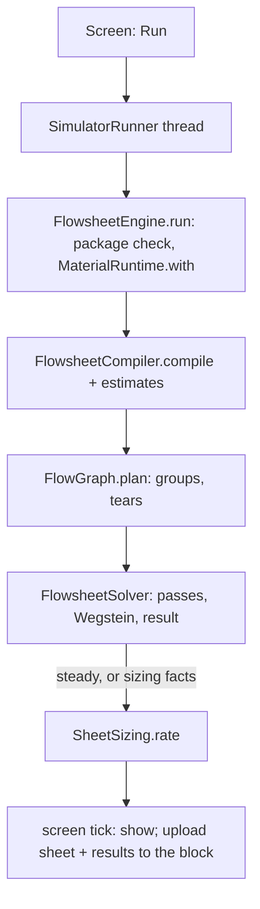

# Process simulator: the flowsheet, its run, sizing and the block

**Snapshot:** 6bf2205bf (branch `claude/in-game-process-simulator-93dd9a`), 2026-11-03 · **Updated:** 2026-11-03 (new chapter, batch 2026-11-02-process-simulator: W1 to W10b, S1 to S5, C1 to C3, U1 to U2, N1)

Up: [code guide](README.md)

## Read this when

- A run on the simulator's sheet fails, does not reach a steady state, or shows a mass or heat gap; a unit's door reads wrong.
- You add a unit model, a door row, a port, or a new equipment kind (plan 3.10, below).
- A Sizing row, lamp, Auto size or Size all looks wrong; a pressure path or a line size disagrees with a hand calculation.
- The block will not store, replay or hand over a sheet; an autosave or a flowsheet file will not open; Send to block or the constructor's Import misbehaves.
- You change the flowsheet file, the block's tags or the sent designs: these are facts with corpus images.
- You work on the simulator's screen, its pages and doors, its packets, or the block and its store. [client-gui.md](client-gui.md) keeps only the frame: where the screen is registered, the kit pieces it shares, and `CalculatorColumn` as the column door's builder.

## In one paragraph

Physically, the simulator is a steady-state, sequential-modular process simulator, like the ones plant engineers use to design before they build: feeds of known composition, temperature and pressure flow through units (column, drums, tanks, exchangers, kettles, coolers, fired heaters, pumps, compressors, valves, mixers, splitters, filters, ejectors), each unit closes its own mass and energy balance, and recycle loops are torn and iterated until the torn streams stop changing. In code, a `Flowsheet` (a record of the sheet's facts) is compiled by `FlowsheetCompiler` into `Calculation`s, one or more per unit; `FlowGraph` orders them and picks the fewest tears; `FlowsheetSolver` runs each group once, or loops it (a plain pass, then bounded Wegstein) to a steady state, and closes the sheet's mass and heat. The column is one BLOCK calculation that calls the same V3 solver as the world ([column-v3.md](column-v3.md)), with one calculation per heat side. `SheetSizing` then rates every unit and line against `Limit` rows (red Must, yellow Should, green), proposes real equipment with a 20 % spare (Auto, Size all), and builds the designs Send to block hands to the equipment constructor. The whole run happens on the client, on its own thread; the `process_simulator` block only stores the sheet and its results, replays them to whoever opens it, and lets one player at a time edit (AGENTS.md: the simulator's run is a client tool outside the engine's schedule).

## Class map

Paths are under `src/main/java/com/wormzjl/icheme/`. "pp" = package-private.

| Class | Role | Read it for |
| --- | --- | --- |
| **Science core (`science/flowsheet/`)** | | |
| `Flowsheet` | The sheet's facts: basis, units, streams, settings, sizing facts, unknown fields kept | What a file and the block hold |
| `FlowsheetFile` | The JSON format: `read`, `save`; keeps unknown fields, refuses a newer format (`file.newer`) | `FORMAT` |
| `FlowsheetCompiler` | A sheet into `Calculation`s, plus warm-start estimates from the last steady run; a unit that cannot run becomes a failing calculation; routes a utility port's water feed to its unit (`waterAlone`, `livePorts`) | `compile`, `estimates`, `typed` |
| `Calculation` (record, `Kind` STEP/BLOCK/CHECK) | One graph node: reads, writes, needs (links), gives (links), a `Law` | How a unit becomes graph nodes |
| `FlowGraph` (pp) | Strongly connected groups in order and the fewest tears (deterministic, `TRIALS` 200 000); links are never torn | Order and tears |
| `FlowsheetSolver` | Runs the plan: a group without tears once; a torn group one plain pass, then bounded Wegstein (one factor per tear); closes mass and heat; `Settings` (flow tolerance 1e-4, temperature 0.01 K, 30 passes, Wegstein factor −5..0) | `run`, `result` |
| `FlowsheetEngine` | The entry: refuses a sheet whose basis package is not the network's (`basis.package`), then works inside `MaterialRuntime.with` on a `FlowThermo`; `run`, `alone` (Solve alone), `rate` | Where a run starts |
| `FlowsheetRun` (record, `Status` STEADY/NOT_STEADY/FAILED/STOPPED) | Streams, outcomes, reports, loops, log, balances, order, passes | What the Results tab shows |
| `Board` | The run's known stream states and link values | Reads and writes of a pass |
| `Report`, `Note` | One calculation's readings, notes and boundary terms (enters, duty, leaves); a note's severity, subject, key (a suffix of `gui.icheme.flowsheet.`) and SI arguments | The log and door status |
| `FlowStream` (record), `StreamThermo`, `FlowThermo` | T, P, amounts on the package axis (water last), enthalpy, mass, phases; the world's flash as a stream thermo, with an enthalpy search | Every stream state |
| `UnitModel`, `UnitTypes` (`ALIASES`: `air_cooler` → `cooler`), `WiredUnit` (record, with `Utilities`), `Port` (record: id, direction, required, utility), `Params` | A tile's ports and calculations; a unit with its settings, wires, thermo, passages and regulated utility feeds | Adding a unit |
| `Passages` | A unit's passage drop laws: typed drops while it has no size, sized laws (`SizedPassages`) once it has one | Drops in the run |
| `EjectorLaw` | The vacuum set's steam law S1 (K = 1.6) | Ejector steam |
| `FlowsheetFailure` | A law's refusal, carrying a note key | Failing units |
| `SheetBody`, `SheetStore` | One gzip body (sheet and results) in parts, with its bounds; the block's body, kept unreadable bodies and the holder | The block's storage |
| `RevisionNotice` | Client and server catalog revision tokens; a mismatch is a notice, never a block | Dedicated servers |
| **Units (`science/flowsheet/unit/`)** | | |
| `ColumnUnit`, `ColumnDoor` (record) | The column as one BLOCK calculation (`ColumnUnit.solve`: warm from the last seed, else the learned start) plus one calculation per heat side; the condenser duty reaches its side as a link; regulated utility feeds (cooling water, kettle steam, stripping steam through its inlet valve); the steam CHECK | The column on the sheet |
| `ExchangerUnit`, `ExchangerRating` | Exchanger or kettle, target Outlet, Duty or Area; counterflow surface and duty on the two heat curves | Heat units |
| `CoolerUnit` | Target Outlet or Duty, coolant in at 25 °C; Air or Water is a sizing type only | Coolers |
| `FiredHeaterUnit`, `MoverUnit`, `ValveUnit` (isenthalpic), `VesselUnit` (drum or tank flash), `MixerUnit` (lowest inlet pressure), `SplitterUnit`, `FilterUnit` (solids leave as cake), `EjectorUnit` | The other units | Each unit's balance |
| **Sizing (`science/flowsheet/sizing/`)** | | |
| `Limit` (enum, `Kind` MUST/SHOULD/RULE, `Rank` CLOSEST/QUIET/PAID), `Bound`, `Lamp` (NONE < GREEN < YELLOW < RED) | Every rated row with its bound, unit and source; the name is the stable id | A row's lamp |
| `Rating`, `Reading` (records) | A unit's or line's readings and values | Sizing output |
| `UnitSize` (sealed) and the sizers `PumpSizing`, `CompressorSizing`, `ExchangerSizing`, `AirCoolerSizing` (fan speed and power), `CoolerSizing`, `HeaterSizing`, `DrumSizing`, `TankSizing`, `ValveSizing`, `ColumnSizing` (half-metre diameters by real solves), `EjectorSizing` | One `Size` record, `rate` and `auto` per kind | A unit's sizes |
| `LineSizing`, `Service` (enum) | A line's bore, speed and drop (pipe resistance on the network's viscosity); the service picks its rows | Line sizes |
| `PressurePath` (record) | From a set pressure through every step to its taker: available, lost, spare (bar) | Path rows |
| `Selection` | Auto: the smallest size that rates well, those holding the need with the spare first | Auto |
| `SheetSizing` | The whole sheet: `rate` (cheap, no trial columns), `sizeAll` (proposes, applies, re-runs once warm where a size moves the run), `designs` (the list Send to block hands over) | Size all, Send to block |
| `DesignBasis` (record, `DEFAULT` 1.10 design flow, 50 m line length, 60 K pumparound fall), `SizingFacts`, `UnitType` | The sheet's sizing basis and each item's chosen size and type | Sizing facts |
| **Client (`client/gui/flowsheet/`, Minecraft-free)** | | |
| `SimulatorRunner`, `SimulatorHost` (`NONE`) | Runs one job at a time on the thread "IChemE simulator run" (daemon, lowest priority): Run, Solve alone, Size all, the quiet rate; Stop sets a flag the next checkpoint throws on | Threads and Stop |
| `SimulatorFrame`, `SimulatorPage`, `DoorFrame`, `Door` (record), `SheetContext` (record), `SheetUnits` (record) | The screen's frame, pages and doors on the GUI kit | Layout |
| `UnitDoors`, `ColumnDoors`, `StreamDoors`, `BasisPage`, `ResultsPage`, `SizingPage`, `SelectionColumn`, `FileColumns` | The doors and pages: units, the column, streams, basis, Results, Sizing, the Auto list, Open/Save as and file names | A door's rows |
| `SheetEditor`, `SheetGestures`, `SheetClipboard` | Edits with undo and redo, the mouse, one clipboard | Editing |
| `SheetLayout`, `SheetPainter`, `Symbol` (enum, the symbol atlas), `Tiles`, `SheetView` | Boxes, ports, routes and hit tests (reads a stream's saved `route`); drawing; the palette; pan and zoom | Drawing |
| `ColumnBlock`, `AssemblyBlock` | The column block's drawing, and the assembly screen drawn as one | The column on the glass |
| `SheetState`, `SheetResults` (record), `StreamProps` (record), `NoteText` | Looks, greying and status; results; a note in the player's units | What a state shows |
| **Block and network** | | |
| `world/level/block/ProcessSimulatorBlock` | Opens the menu through `ProcessSimulatorNetwork.open`; solves nothing | The block |
| `world/level/block/entity/ProcessSimulatorBlockEntity` | The `SheetStore`, the sheet id, the saved column design, the sent designs; no update tag | NBT |
| `world/inventory/ProcessSimulatorMenu` (`Opening` record, `READ_ONLY`) | A slot-less menu; the opening's position, sheet id, reader or holder, stored and damaged flags, revision tokens | Who may edit |
| `network/ProcessSimulatorNetwork` | The packets: sheet parts both ways, Save design, Send designs, answers | Protocol |
| `network/SimulatorResults`, `network/ColumnWire` | A run's results as bytes (state); a column's input, choices and display result on the wire | Results and column wire |
| `client/gui/screens/inventory/ProcessSimulatorScreen`, `SimulatorBlockHost` | The one Minecraft screen (design height 480): forwards events, draws, polls the runner, uploads, autosaves | The game side of the screen |
| `science/equipment/SentDesign` (record), `world/level/block/entity/SentDesignTags` | One sent unit design (tag, member, count, shape, column) and its NBT | Send to block and Import |

## Main flow

1. The Run key calls `SimulatorHost.run`, which hands a private copy of the sheet to `SimulatorRunner`. The runner starts its own daemon thread; one job runs at a time. Nothing runs on the client tick or in the server's workers.
2. `FlowsheetEngine.run` refuses a sheet whose basis package differs from `FluidMaterialCatalog.networkPackage`, then works inside `MaterialRuntime.with` on a `FlowThermo`.
3. `FlowsheetCompiler.compile` makes the calculations; `estimates` seeds torn streams from the last steady run.
4. `FlowGraph.plan` orders strongly connected groups and tears the fewest streams. Two calculations writing one stream or giving one link throw.
5. `FlowsheetSolver.run`: a group without tears runs once. A torn group runs one plain pass, then bounded Wegstein. A tear that rises by the same step (`SAME_STEP` 0.01) on 3 passes stops with `loop.no_steady_state`; a Wegstein trial that fails a unit falls back to plain passes. `result()` closes mass and heat; a mass gap gives `run.mass_gap` and `NOT_STEADY`.
6. If the run is not stopped and is steady (or the sheet has sizing facts), the same thread rates it (`FlowsheetEngine.rate` → `SheetSizing.rate`).
7. The screen polls each tick, shows the run, and uploads the sheet and results to the block (`ranOut`). The Sizing tab re-rates quietly 10 ticks after the last edit.

Calculations, links and utility feeds

- A STEP reads streams and writes streams. A BLOCK is a calculation that solves a whole unit at once (the column). A CHECK writes nothing; the plan puts it after the groups it reads, so it runs once a loop has closed. A CHECK that throws becomes a warning note and blocks nothing (its own notes keep their severity, an error included), its reads do not count as consumers, and it is out of the stage order.
- Links carry a value between calculations that is not a stream (the condenser's duty to its side, the bottoms temperature, a steam row's stage pressure). Links are never torn.
- `FlowsheetSolver.result()` counts every written stream that no non-CHECK calculation reads as leaving the sheet. `WiredUnit` gives a free outlet its own stream `unit:port` for this reason. A unit that writes a stream nobody reads makes a mass gap.
- A sheet feed of water alone on a port with `utility = true` is not a boundary feed. `FlowsheetCompiler` hands it to the unit (`WiredUnit.Utilities`), whose utility calculation writes the feed at the flow its duty needs (`Note.info` `flow.set_by`). Cooling water leaves at min(T_in + 10 K, process cold end − 5 K) (`HeatSides.coolingWaterOutlet`); kettle steam leaves as saturated condensate; stripping steam flows at its row's rate through an isenthalpic inlet valve to the stage pressure, and a CHECK reads the supply against the stage once the sheet stands (`column.steam_pressure`, an error note).

Sizing, lamps and Auto

- Each `Limit` row has a kind: MUST (red when broken), SHOULD (yellow), RULE (picks a type or a service, lights no lamp). A unit's lamp is its worst row; a sheet's is its worst unit.
- The 20 % spare is the owner's "always have enough excess": `Limit.AUTO_SPARE` (RULE, at least 20 %) is what Auto adds to exchanger, kettle and air-cooler surface, heater duty, type and cabin count, and compressor displacement. The lamps read the bare need, so a sized unit is green with room. `PATH_EXCESS` (SHOULD, 20 %) and `EJECTOR_MOTIVE_SPARE` (SHOULD, 20 %) are spares on a path and on motive steam.
- Auto (`Selection`) calls the same `rate` a Fixed size calls, so an Auto size is never rated by another rule.
- `SheetSizing.sizeAll` sizes units that read no line first (a column with its members), pump NPSH and valve bores last. Where a size moves the run (a column's diameter, sized drops), it re-runs once, warm; a run that is not steady sizes nothing. The result is one undoable edit.
- A `PressurePath` runs from a set pressure through every step to its taker; `spare()` feeds the heater's and the valve's sizing. `PATH_SPARE` (MUST ≥ 0 bar) is red where a supply cannot reach its taker, a steam row's tray included.
- `ColumnSizing` tries half-metre diameters with real solves; a trial that does not solve is red on `COLUMN_SOLVES`.
- `AirCoolerSizing.fans` finds the fan speed (0..1) that holds the load on the chosen face; power goes with the cube of the speed. `Sized.fanPower()` is the sheet's total.

Send to block and Import

- Save design (`simulator_save_design`) stores the column door's `ColumnDesign.of(input, choices)` on the block; a refusal names its reason.
- Send to block (`simulator_send_designs`) carries `SheetSizing.designs`: one `SentDesign` per sized unit (valves left out, at most 64). The server takes it only from the holder, whole; it replaces the earlier list.
- The constructor's Import (`EquipmentNetwork`, protocol `equipment-17`) asks the nearest simulator within `EquipmentNetwork.IMPORT_REACH` (16 blocks, `EquipmentConstructorBlockEntity.simulator`) for its list: the saved column design first, then the sent designs. The player picks one; the constructor lands it. See [equipment.md](equipment.md).

Formats and versions

| Format | Version | Where | Kind |
| --- | --- | --- | --- |
| Flowsheet file and block body's sheet | `FlowsheetFile.FORMAT` = 1 | `science/flowsheet/FlowsheetFile` | Fact: corpus `compat/flowsheet/format-1*.json` (`FlowsheetFileTest`) |
| Block body | `SheetBody.FORMAT` = 1 | `science/flowsheet/SheetBody` | Fact (the sheet inside it) |
| Run results | `SimulatorResults.FORMAT` = 1 | `network/SimulatorResults` | State: dropped on a mismatch, rebuilt by a run |
| Sent designs | `SentDesignTags` (fields 2) | `world/level/block/entity/SentDesignTags` | Fact: corpus `compat/simulator/designs-<n>.snbt` (`SentDesignTagsTest`) |
| Column wire | `ColumnWire.WIRE_SCHEMA_VERSION` = 18 | `network/ColumnWire` | Wire |
| Simulator packets | `ProcessSimulatorNetwork.PROTOCOL` = "2" | `network/ProcessSimulatorNetwork` | Wire |
| Constructor packets | `EquipmentNetwork.PROTOCOL` = "equipment-17" | `network/EquipmentNetwork` | Wire |

The file keeps fields it does not know and refuses a newer format. `SheetLayout` reads a stream's `route`, so a change to it is a format change.

Traps

- A run uses the client's bundled catalog, also on a dedicated server; `RevisionNotice` only shows a notice when the tokens differ.
- Results carry no column warm start, so the first run after opening starts the column cold.
- The Sizing tab's lamps are state and never saved; the screen rebuilds them with a quiet rate job.
- A body still on its way counts as read-only. Network handlers run on the server thread; a store lands with its last part.
- `FlowsheetCatalog` and `SizingCoverage` live in `src/test`: their switches have no default, so a new kind fails `compileTestJava` until it is mapped.

## The screen

`client/gui/screens/inventory/ProcessSimulatorScreen` is the only Minecraft class of the screen. `IChemEClient.registerScreens` registers it on `ModMenus.PROCESS_SIMULATOR`. It is a plain `Screen` on a `ProcessSimulatorMenu` (`MenuAccess`), not an `AbstractContainerScreen`, so it has no slots and a typed E is text. A close, a disconnect and the block going all end it. It forwards events and draws. Everything it shows is built Minecraft-free in `client/gui/flowsheet/`, so `tools/heat-gui-renders/SimulatorRender.java` draws the same pages from shipped code.

- **Window:** `WindowScale.apply` at design height 480. The least window is 464 × 254 (`SimulatorFrame.LEAST_W`, `LEAST_H`). A door takes 790 × 524 (`DOOR_W`, `DOOR_H`). `removed()` restores the scale.
- **Frame and tabs:** `SimulatorFrame` gives the rectangles: title, tabs and file keys, the one status display, the canvas's well, the palette and the footer. The screen hit-tests them, and the render tool draws them. The tabs (`SimulatorFrame.Tab`) are FLOWSHEET, RESULTS, SIZING and BASIS. The Sizing tab opens only once the sheet can be sized (`SizingPage.open`). `SimulatorPage` says which keys stand where on each page.
- **The sheet:**
  - `SheetLayout` places boxes, ports and routes and answers hit tests.
  - `SheetPainter` draws them with the `Symbol` atlas (`textures/gui/flowsheet/symbols.png`).
  - `SheetView` pans and zooms.
  - `SheetGestures` turns mouse events into edits.
  - `SheetEditor` applies them, with undo and redo.
  - `Tiles` is the palette.
  - `ColumnBlock` draws a column with its members inside a boundary.
  - `SheetState` greys what is stale and builds the status.
- **Doors:** a click on a unit or a stream opens its door, a `Door` placed by `DoorFrame`.
  - `UnitDoors` builds every unit's door.
  - `ColumnDoors` builds the column's, through `client/gui/common/CalculatorColumn` (its tabs, the Templates dialog, Save design).
  - `StreamDoors` builds a stream's: feed, flow, T and P, components, the clipboard's Copy and Paste.
  - `SelectionColumn` lists Auto's sizes.
  - `FileColumns` holds the Open and Save as dialogs and the file names.
- **Pages:**
  - `ResultsPage`: streams, units, the run log through `NoteText` in the player's units, and the balances.
  - `SizingPage`: rows and lamps, Fixed and Auto, Size all, Send to block. It re-rates quietly 10 ticks after the last edit (`rateWhenDue`).
  - `BasisPage`: the package, the design basis, the solver settings.
- **Tick:** each tick the screen does four things.
  - It lets the block host upload a finished run (`SimulatorBlockHost.ranOut`).
  - It autosaves every 1200 ticks.
  - It clears a spent status line.
  - It re-rates the Sizing tab when that is due.
- **Close:** `onClose` lets the host send the sheet once more (`settle`). `removed()` autosaves, closes the host (the runner's job stops) and restores the window scale.
- **Host:** `SimulatorHost` is the screen's only link to running and storing. `SimulatorBlockHost` is the game's host: the runner plus the block's store. `SimulatorHost.NONE` serves the render tool and tests.

## Packets and protocol

`network/ProcessSimulatorNetwork`, protocol `"2"`, handlers on the server thread (`HandlerThread.MAIN`). Wire formats get no compatibility work (AGENTS.md).

| Payload | Direction | Carries | Server rule |
| --- | --- | --- | --- |
| `simulator_sheet_part` (`SheetPart`) | both | container id, part index and count, bytes | To the client: the replay on open, in `SheetBody.parts`. To the server: an upload, which counts only from the holder whose menu is this container, near its block. A store lands with its last part, and a bad body is refused while the stored sheet stands. |
| `simulator_save_design` (`SaveDesign`) | to server | container id, the column door's `V3ColumnInput` and `ColumnComponents.Choices` (`ColumnWire`) | Holder only. `ColumnDesign.of`, stored as the block's saved design. A refusal gives its reason. |
| `simulator_send_designs` (`SendDesigns`) | to server | container id, a tag of `SentDesign`s (`SentDesignTags`) | Holder only. The list must be whole, not empty and at most 64. It replaces the earlier list. |
| `simulator_answer` (`Answer`) | to client | container id, key (`store.saved`, `store.design_saved`, `store.design_refused`, `store.designs_sent`, `store.designs_refused`, or the menu's `READ_ONLY`), detail up to 256 characters | Each request's answer, shown on the status line |

Opening needs no packet of its own. `ProcessSimulatorBlock.useWithoutItem` calls `ProcessSimulatorNetwork.open`, and `open` does four things:
- it decides who edits (`block.opens`);
- it opens the menu with an `Opening`: position, sheet id, reader flag, the holder's name for a reader, stored and damaged flags, and the server's catalog revision tokens for `RevisionNotice`;
- it replays the stored body in parts;
- it parses the body once, solves nothing and creates no process state.

The constructor's Import uses `EquipmentNetwork` (`equipment-17`); see Send to block and Import above.

## The block and its store

- `process_simulator` replaced `column_calculator_v3`. The old id is an alias for the block, its item and its block entity (`ModBlocks`, `ModItems`, `ModBlockEntities`). It has no recipe.
- `ProcessSimulatorBlockEntity` holds a `SheetStore`, the sheet id (a UUID made at the first open), the saved column design, and the sent designs with any unreadable entries. It has no update tag, so the sheet never rides in a chunk packet.
- `SheetStore` has one holder.
  - The first player to open holds the sheet and edits; others read.
  - The holder is freed on close, on leaving, on disconnect and when the block goes.
  - A player who is no longer at this block's screen holds nothing (`atThisBlock`).
  - The holder is not saved.
- Uploads count only from the holder, near the block, with the screen open.
  - `SheetBody` bounds them: 1 MiB unpacked, parts of 30 000 bytes.
  - The client sends a body on Save, when a run ends and on close, never on an edit.
  - A body still on its way counts as read-only.
  - An unreadable body opens empty and is kept (`KeptSheets`).
- NBT:
  - `SheetId`;
  - `Sheet` (the body);
  - `KeptSheets`;
  - `Design` (the column's saved design, `ColumnDesignTags`);
  - `Designs` (sent designs, `SentDesignTags`, unreadable entries kept).
- Files on the client:
  - A sheet is saved as `.minecraft/IChemE/flowsheets/<name>.json`.
  - An autosave runs every 1200 ticks and on close. It writes `<name>.autosave.json` beside a named file, or `autosave-<sheet id>.json` for a sheet with no name. A player cannot use these names.
  - A reader never autosaves.

## New equipment joins the simulator (plan 3.10)

Every new `EquipmentShape.Kind`, `ConstructorColumn.Equipment` and `TopologyCompiler.Kind` constant joins the simulator (AGENTS.md, New equipment). `FlowsheetCatalog` (`src/test/.../client/gui/flowsheet/`) maps each to its tile, MODELLED or DRAWING_ONLY, through switches without a default, so a new constant fails `compileTestJava`. `FlowsheetPaletteCoverageTest` holds each to a tile, a port rule and a lang line; one tile may hold several kinds. `SizingCoverage` (`src/test/.../science/flowsheet/sizing/`) does the same for sizing: each kind names its size class or why it has none (`SizingCoverageTest`).

## Change the layer that owns it

| Symptom / change | Owning class | Tests that pin it |
| --- | --- | --- |
| A unit's balance or door | `science/flowsheet/unit/*`, `UnitTypes` | `FlowsheetUnitsTest` (39: every unit closes mass and energy), `FlowsheetColumnDoorTest` |
| Order, tears, loops | `FlowGraph`, `FlowsheetSolver` | `FlowGraphTest`, `FlowsheetSolverTest` |
| The column on the sheet against the world's solver | `ColumnUnit`, `ColumnDoor` | `FlowsheetColumnTest` (slow), `ColumnEjectorTest` (slow), `UtilityRegulationTest` (slow) |
| A utility feed's flow | `FlowsheetCompiler`, `WiredUnit.Utilities`, `ColumnUnit` | `UtilityRegulationTest` |
| A Sizing row or lamp | `Limit`, the unit's sizer | `LimitTest`, `UnitSizingTest`, `CoolerSizingTest`, `SheetSizingTest`; the sample: `UnitSizingSampleTest`, `ColumnSizingSampleTest` (slow) |
| Lines and paths | `LineSizing`, `Service`, `PressurePath`, `SheetSizing` | `LineSizingTest`, `ServiceTest`, `LineSizingSampleTest`, `SizeAllSampleTest` (slow) |
| The file | `FlowsheetFile` | `FlowsheetFileTest` (26, the corpus) |
| The block's store, uploads and packets ([packets](#packets-and-protocol), [block](#the-block-and-its-store)) | `SheetStore`, `SheetBody`, `ProcessSimulatorNetwork`, `ProcessSimulatorBlockEntity` | `SheetStoreTest`, `SimulatorBlockTest`, `ProcessSimulatorGameTests` |
| Sent designs and Import | `SheetSizing.designs`, `SentDesign`, `SentDesignTags`, `EquipmentNetwork` | `SentDesignTagsTest` (the corpus), `ProcessSimulatorGameTests.aConstructorImportsTheNearestSimulatorsDesign` |
| The screen ([the screen](#the-screen)) | `ProcessSimulatorScreen`, `client/gui/flowsheet/*` | `SimulatorFrameTest`, `SimulatorColumnsTest`, `SheetLayoutTest`, `SheetEditorTest`, `SheetGesturesTest`, `SizingPageTest`, `ColumnBlockTest`, `AssemblyBlockTest`; renders: `tools/heat-gui-renders/SimulatorRender.java` |
| The runner and Stop | `SimulatorRunner` | `SimulatorRunnerTest`, `SimulatorRunTest` (slow: Stop inside a column) |
| A new kind | `FlowsheetCatalog`, `SizingCoverage` (both in `src/test`) | `FlowsheetPaletteCoverageTest`, `SizingCoverageTest` |

## Tests that pin it

- `test`: `science/flowsheet/` (`FlowGraphTest`, `FlowsheetSolverTest`, `FlowsheetUnitsTest`, `FlowsheetColumnDoorTest`, `FlowsheetFileTest`, `SheetStoreTest`, `EjectorTest`), `science/flowsheet/sizing/` (`LimitTest`, `ServiceTest`, `LineSizingTest`, `UnitSizingTest`, `SheetSizingTest`, `CoolerSizingTest`), `client/gui/flowsheet/` (the screen tests above, `SimulatorBlockTest`, `SimulatorRunnerTest`, the two coverage tests), `network/ColumnWireTest`, `world/level/block/entity/SentDesignTagsTest`.
- `holdGates` (slow, `slowGateClasses`): `FlowsheetColumnTest`, `ColumnEjectorTest`, `SimulatorRunTest`, `LineSizingSampleTest`, `UnitSizingSampleTest`, `ColumnSizingSampleTest`, `SizeAllSampleTest`, `UtilityRegulationTest`.
- `runColumnGameTestServer` (namespace `icheme_column_test`): `ProcessSimulatorGameTests` (11): the old id, a reload with no update tag, a damaged sheet kept, the constructor's Import, a second player reads, uploads only from the screen near the block, a bad upload refused, the holder freed on disconnect, away and when the block goes, a replay that runs no solver.
- Shared fixture: `client/gui/flowsheet/SheetFixture` (the sample sheet).
- Probes and renders outside the gates: `tools/process-simulator/`, `tools/device-names/`, `tools/heat-gui-renders/` (`SimulatorPrototypes`, `SimulatorRender`, `SimulatorSizing`).

## Terms

| Term | Meaning here |
| --- | --- |
| Sheet | The flowsheet: units, streams, feeds, basis, settings, sizing facts |
| Door | A unit's or stream's settings page on the glass |
| Tear | A stream the solver guesses to break a loop, then iterates |
| Pass | One run through a torn group |
| Link | A value passed between calculations that is not a stream; never torn |
| Holder | The one player who edits a block's sheet; others read |
| Utility feed | A sheet feed of water alone on a utility port; its unit sets its flow |
| Auto, Fixed | A size Auto proposes (with the 20 % spare) or one the player keeps |
