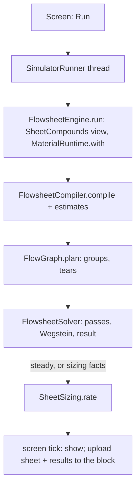

# Process simulator: the flowsheet, its run, sizing and the block

**Snapshot:** 1bd0b4236 (branch `claude/ethanol-compound-matrix-4b318d`), 2026-11-12. Batch `2026-11-11-aqueous-solvents`, to merge: the still and the column with water (`StillColumn`, `StillBatch.Finish.SETTLED`, `ColumnBlockSolve` on `ColumnWater.onAxis`), release pressures in sizing (`FlowThermo`, `PumpSizing`, `TankSizing`, `VesselUnit`), the `ethanol_rectifier` example and `crude_unit` written again on the batch's data, a stream's state in the run results as its three slots · earlier: 0893d2339 (branch `claude/distillation-failure-mode-control-db2da5`, `claude/custom-shader-system-caff9e` merged in), 2026-11-10. Batch `2026-11-10-column-failure-modes`, merged as 0.26.0: `SimulatorResults.FORMAT` 3 (`ColumnWire` writes the tray hydraulics' total dry drop, `V3TrayHydraulicsSummary.totalDryPascal`); stored results of format 2 are state and are dropped; no unit or tile changed · earlier: 971dd8346 (branch `claude/custom-shader-system-caff9e`), 2026-11-10. Batches `2026-11-10-steam-ejector-flow`, `2026-11-10-chimney`, `2026-11-10-vacuum-pump` and `2026-11-10-prime-movers`, to merge as 0.25.0: `ChimneyUnit`, `VacuumPumpUnit`, `PrimeMoverUnit` (MODELLED) with their sizers, the Vacuum and Power categories, the column's vacuum choice, `VACUUM_SPEED` smooth (`Bound.Step` exponent) · earlier: 7be61a4b9 (branch `claude/furnace-fuel-power-requirements-f7a46e`, main 0.23.6 merged in), 2026-11-10. Batches `2026-11-09-furnace-fuel-power`, `2026-11-09-flare-stack` and `2026-11-09-batch-distiller`, merged as 0.24.0 on 2026-11-10: the flare (`FlareUnit`, `FlareSizing`) and the batch still (`BatchStillUnit`, `StillBatch`, `StillSizing`, `StillCurve`, `Report.Series`, `SimulatorResults` format 2) as MODELLED units; the diverter valve is the splitter · earlier: f4130065f (branch `claude/refinery-compounds-thermos-252973`), 2026-11-09. Batches `2026-11-04-refinery-compounds` (W3, W4: each sheet runs on its own compound list, `SheetCompounds`; tokens and the file-open notice on the sheet's view), `2026-11-04-open-thermo-data` (the example on the medium grade) and `2026-11-05-neural-retrain` (the column unit's learned start), merged as 0.23.0 on 2026-11-09 · earlier: 050cd1098 (branch `codex/simulator-sizing`), 2026-11-08, batch `2026-11-06-simulator-sizing`, merged as 0.22.0 on 2026-11-08.

## The ethanol rectifier example (batch 2026-11-11-aqueous-solvents, W6, 2026-11-12)

`assets/icheme/flowsheet_examples/ethanol_rectifier.json`, listed after `crude_unit.json` in the index: a wash (ethanol
10, water 90 mol/s at 25 C, 2 bar) through the steam preheater E-1 (tube outlet 359.84 K, steam 20 mol/s at 420 K,
4 bar) into T-1, E1's rectifier (10 trays, feed on 8, 1 atm, condenser 70 C, reflux 3, reboiler 1.77 MW), on
`icheme:refinery`. It runs steady; the spirit is 0.8075 ethanol, as the W5 sheet. Its name is
`gui.icheme.flowsheet.example.ethanol_rectifier`; the picker shows names only. `tools/aqueous-solvents/probes/WriteRectifier.java`
builds the sheet, runs it and writes it stamped (`RevisionNotice.stamped`): run it again when the data move.
`FlowsheetAqueousColumnTest.theEthanolRectifierExampleRunsOnTheNetworkPackage`
runs it and checks its identity.

## Release pressures in sizing (batch 2026-11-11-aqueous-solvents, W3B_NETWORK_PLAN.md section 44)

- `FlowThermo` reads the world's release rule (`science.fluid.network.ReleasePressure`) on its own trial, a TP flash at the stream's temperature (an all-vapour state counts as share 1; a refused flash says nothing), from 100 Pa, to a ratio of 1.0005, with no cache: `vapourPressure(T, P, amounts)` (p_v: the compounds above their critical temperature left out, 16 flashes), `zoneEdge(T, P, amounts)` (E: at most the clean share of vapour, 16 flashes; the stream's pressure where it holds more there), `storagePressure(T, amounts)` (as much vapour as liquid by volume, V/L = 1, 17 flashes) and `roofStores` (storage pressure at most `ROOF_STORAGE`, 0.766 bar, the number `Limit.ROOF_BUBBLE` reads). `bubblePressure` (15 flashes) and `Service`'s suction class are unchanged. `ReleasePressureTest` holds the sheet's p_v and E within 1 % of the world's PH readings.
- `PumpSizing.Load` carries `npsh` over p_v, `edge` (E over the same pressure, m) and `boils` (whether it has a p_v): a drum liquid saturated with gas has the head over its vapour pressure, and the world's row carries what the gas costs. 32 flashes a pump.
- `TankSizing.Load` carries `storage` beside `bubble`: the type and both roof rows read the storage pressure, a sphere's design the bubble pressure. 32 flashes a tile. Where the search finds no storage pressure the tile reads its bubble pressure.
- `VesselUnit` (storage): a liquid a roof stores stands at ambient and its dissolved gas leaves by the Gas outlet; any other at the higher of ambient and its bubble pressure; never above the inlet. 17 flashes an evaluation under a roof, 32 for a sphere.

## Chimney, vacuum pump and prime mover units (0.25.0)

- Palette (`Tiles`, `ConstructorColumn`, `UnitTypes`): `heat` gains `chimney` (on the flare's symbol until its own); `machines` keeps the pump and compressor; new `vacuum` (`ejector`, `vacuum_pump` on the compressor's symbol; owner V4 A) and `power` (`steam_turbine` moved in, `combustion_engine` on the compressor's symbol, `gas_turbine` on the turbine's; owner P3 A). Tags CH, VP, G, GT. `FlowsheetCatalog` has each new kind MODELLED.
- `ChimneyUnit` (batch 2026-11-10-chimney): the stream leaves to the atmosphere through the stack; door: form, exit diameter, height, nearby structure's height; reads exit velocity, draft (`Chimney.draft`), friction, entry and exit losses, the inlet pressure needed, solids and opacity; warns NO DRAFT, ABOVE RATING, HOT STACK and a stack under GEP height. `ChimneySizing`: the smallest diameter passing `AUTO_SPARE` over the design flow at the form's velocity, within 7.5 to 30 m/s and the 100 m/s cap, the GEP height (2.5 times the structure's, at least 10 m) within the form's range.
- `VacuumPumpUnit` (batch 2026-11-10-vacuum-pump): the world's `VacuumPump` law for a type and a model (0 sizes it), discharge 105 kPa; readings power, capacity, load, model, rise, the motor; fails at blank-off. `VacuumPumpSizing`: the smallest model whose capacity at the suction holds the load, spare first. The column's `Vacuum` choice (`ColumnDoor`, `ColumnBlockSolve`, `BlockSizing`): the ejector on the vapour line, or a vacuum pump on the receiver's vapour outlet taking only the vent (no steam), its model sized.
- `PrimeMoverUnit` (batch 2026-11-10-prime-movers, owner P14 A): the fuel leaves through the combustor as a flare's gas does; its LHV heat gives the shaft power on the model's Willans line; warns at the wrong phase, over the rated fuel and a low supply; a gas turbine's free pair is its steam coil (`ExhaustCoil`, read at the water's inlet and its bubble point). `PrimeMoverSizing`: the smallest model whose rated fuel holds the fuel heat, spare first, with its coil where the run wired it.
- Steam ejector (batch 2026-11-10-steam-ejector-flow): the world's `SteamEjector` uses the sheet's correlation, so a sheet-sized set runs its sheet duty; `Limit.VACUUM_SPEED` is smooth below 5 kPa (`Bound.Step` with an exponent, `60 (5 kPa / P_s)^¼`); `ColumnEjectorTest`.
- `SizingFactsFile` saves `CHIMNEY`, `VACUUM_PUMP` and `PRIME_MOVER` sizes (no format change: a new kind is a new name).

## Flare and batch still units (0.24.0)

- `FlareUnit` (MODELLED): the stream leaves the sheet through the flame. Its door sets the tip; the run reports the heat released, the heating value, the flame temperature and the most the tip passes (`Flare.gas`), and warns at FLAME OUT, over capacity and solids. `FlareSizing`: the tip that passes the design flow with `Limit.AUTO_SPARE`.
- `BatchStillUnit` (MODELLED): one batch a cycle on the world's law (`StillBatch`, `BatchStill`, `StillColumn`); each cut, the vent and the residue leave as cycle-averaged flows. The door's Batch tab draws `StillCurve` from the run's `Report.Series` (`SimulatorResults` format 2). `StillSizing`: the pot from the constructor's list; the heater at 25 kW/m², the worm at the full boil-up plus 20 % at 40 K, the column at an F-factor of 1.5 Pa^0.5.
- The still and water (W4 of batch 2026-11-11-aqueous-solvents, 2026-11-12): the charge is on the column's basis, the sheet's axis with water last. A charge whose liquid stays one (a wash, an oil with its dissolved water) boils; one that settles into two liquids at the pot's start is refused, `still.water` (`StillColumn.twoLiquids`; owner choice 2: the sheet keeps refusing free water). A package whose column carries no water refuses any water. A pot that settles during the batch ends it, `StillBatch.Finish.SETTLED` with the `still.settles` warning; the rest is residue. `StillCurve` names water through the sheet's names. Gate: `BatchStillUnitTest.aNaphthaWithItsDissolvedWaterIsOneLiquidAndBoils`. No sheet carries a wash yet: the bundled network package holds no ethanol.
- The column and water (W5 of batch 2026-11-11-aqueous-solvents, 2026-11-12): `ColumnBlockSolve.run` reads the shared rule (`ColumnWater.onAxis`, [column-operation.md](column-operation.md)) on the flashed feed. On the axis the whole feed enters V3 on the list with water, an aqueous liquid included; a steam row with a flow fails `column.steam_on_axis` (naming the row); a solved liquid that would settle warns `column.two_liquids` (the trays) and `column.two_liquids_distillate`. Off the axis the feed's water is a steam feed and an aqueous liquid fails `column.liquid_water` (this rule stays). `ColumnUnit.catalogFor(thermo, waterOnAxis)` is the model's view of the sheet's compounds with or without water: `FlowThermo.catalog()` itself is the list without water, the model appends it. The sizing trials and the warm seed's check take the same catalog by the solved basis; a warm seed on the other list is dropped. Tests: `FlowsheetAqueousColumnTest` (test network `PilotSolventTestCatalog`: the refinery package plus the pilot ethanol).
- `Symbol.STILL` and the flare's symbol; the diverter valve is the simulator's splitter (`FlowsheetCatalog`). Owner questions: BATCH_STILL_SIMULATOR.md.

## Current viewport and constructor handoff (0.22.0)

The screen retains the player's GUI scale; `WindowScale` is removed. Layout and scrolling use the actual GUI viewport. Equipment type/count/dimensions remain separate from Auto/Manual sizing method, with constructor-style Manual controls and build requirements emphasized. Constructor nozzle controls now join its main door; no separate Nozzles navigation is required. Pump/generator constructors display rated/design RPM, not a pole selector. Sizing facts and dormant saved dimensions remain facts; these GUI changes do not alter the V3 solve or Send-to-block duty contract.

## Sizing and exchanger configurations (0.22.0)

`UnitSizing`, `CoolerSizing`, `ColumnSizing` and the sizing candidate types share `ExchangerType.CATALOG`. Auto searches available configurations and supported constructor dimensions: first meet existing limits and the 20% spare, then minimise physical count, then total surface; Standard wins an exact tie. When every candidate fails, the existing failure ranking still applies. A crossflow candidate computes required surface with its own thermal routing; an unreachable duty is unsuccessful.

`SizingPage` keeps **Sizing method** (Auto/Manual) separate from **Equipment** (type, count and size). Manual freezes the displayed build choices and uses constructor-style size controls. Auto may choose again on Size all; dormant manual choices remain saved. Build requirements emphasise unit counts and dimensions rather than a material bill. Constructor defaults begin within their design range; a player's paint scheme is remembered locally.

Type follows `SizingChoice`, `SizingFacts`, sent designs, constructor import and column member choices, including condensers, water trims and pumparound coolers. It does not create another flowsheet tile. `FlowsheetFile` remains format 2 with optional appended fields; missing type is Standard. Wire simulator protocol is `3`; it is not a saved-data migration. See [heat-exchangers.md](heat-exchangers.md).

Tests: `UnitSizingTest`, `CrossflowSizingTest`, `SizingPageTest`, `CrudeUnitSampleTest.ColumnSizingSampleTest`, sent-design and constructor compatibility tests.

Up: [code guide](README.md)

## Read this when

- A run on the simulator's sheet fails, does not reach a steady state, or shows a mass or heat gap; a unit's door reads wrong.
- You add a unit model, a door row, a port, or a new equipment kind (plan 3.10, below).
- A Sizing row, lamp, Auto size or Size all looks wrong; a pressure path or a line size disagrees with a hand calculation.
- The block will not store, replay or hand over a sheet; an autosave or a flowsheet file will not open; Send to block or the constructor's Import misbehaves.
- You change the flowsheet file, the block's tags or the sent designs: these are facts with corpus images.
- You work on the simulator's screen, its pages and doors, its packets, or the block and its store. [client-gui.md](client-gui.md) keeps only the frame: where the screen is registered, the kit pieces it shares, and `CalculatorColumn` as the column door's builder.

## In one paragraph

Physically, the simulator is a steady-state, sequential-modular process simulator, like the ones plant engineers use to design before they build: feeds of known composition, temperature and pressure flow through units (column, drums, tanks, exchangers, kettles, coolers, fired heaters, pumps, compressors, valves, mixers, splitters, filters, ejectors), each unit closes its own mass and energy balance, and recycle loops are torn and iterated until the torn streams stop changing. In code, a `Flowsheet` (a record of the sheet's facts) is compiled by `FlowsheetCompiler` into `Calculation`s, one or more per unit; `FlowGraph` orders them and picks the fewest tears; `FlowsheetSolver` runs each group once, or loops it (a plain pass, then bounded Wegstein) to a steady state, and closes the sheet's mass and heat. The column is one BLOCK calculation that calls the same V3 solver as the world ([column-v3.md](column-v3.md)), with one calculation per heat side. `SheetSizing` then rates every unit and line against `Limit` rows (red Must, yellow Should, green), proposes real equipment with a 20 % spare (Auto, Size all), and builds the designs Send to block hands to the equipment constructor. The whole run happens on the client, on its own thread; the `process_simulator` block only stores the sheet and its results, replays them to whoever opens it, and lets one player at a time edit (AGENTS.md: the simulator's run is a client tool outside the engine's schedule).

## Class map

Paths are under `src/main/java/com/wormzjl/icheme/`. "pp" = package-private.

| Class | Role | Read it for |
| --- | --- | --- |
| **Science core (`science/flowsheet/`)** | | |
| `Flowsheet` | The sheet's facts: basis, units, streams, settings, sizing facts, unknown fields kept | What a file and the block hold |
| `FlowsheetFile`, `SizingFactsFile` (pp), `JsonFields` (pp) | The JSON format: `read`, `save`; keeps unknown fields, refuses a newer format (`file.newer`) and an older one (`file.older`); sizing's facts in `SizingFactsFile`; each object's checked fields, `damaged` and `beside` in `JsonFields` | `FORMAT` |
| `FlowsheetCompiler` | A sheet into `Calculation`s, plus warm-start estimates from the last steady run; reads the sheet's ends as roles (`Wiring.roles`); a unit that cannot run becomes a failing calculation; routes a utility port's water feed to its unit (`waterAlone`, `livePorts`) | `compile`, `estimates`, `typed` |
| `Calculation` (record, `Kind` STEP/BLOCK/CHECK) | One graph node: reads, writes, needs (links), gives (links), a `Law` | How a unit becomes graph nodes |
| `FlowGraph` (pp) | Strongly connected groups in order and the fewest tears (deterministic, `TRIALS` 200 000); links are never torn | Order and tears |
| `FlowsheetSolver` | Runs the plan: a group without tears once; a torn group one plain pass, then bounded Wegstein (one factor per tear); closes mass and heat; `Settings` (flow tolerance 1e-4, temperature 0.01 K, 30 passes, Wegstein factor −5..0) | `run`, `result` |
| `FlowsheetEngine` | The entry: runs the sheet on the network package's view of its own compounds (`SheetCompounds.on`), whatever package the sheet names, and brings the run back onto the network's axis by id; `run`, `alone` (Solve alone), `rate` | Where a run starts |
| `SheetCompounds` | A sheet's compound list: the network package's compounds its feeds hold with a non-zero amount (by id or alias, a carried crystal's compound, a line's first estimate), in package order, water last; Nitrogen as placeholder when none; derived, never stored. `on(sheet, catalog, …)` gives the view (`MaterialCatalog.restrict`) and the maps between its axis and the network's; a feed compound the network lacks is parked with `basis.parked` | Why a sheet runs on fewer compounds than the world |
| `FlowsheetRun` (record, `Status` STEADY/NOT_STEADY/FAILED/STOPPED) | Streams, outcomes, reports, loops, log, balances, order, passes | What the Results tab shows |
| `Board` | The run's known stream states and link values | Reads and writes of a pass |
| `Report`, `Note` | One calculation's readings, notes and boundary terms (enters, duty, leaves); a note's severity, subject, key (a suffix of `gui.icheme.flowsheet.`) and SI arguments | The log and door status |
| `FlowStream` (record), `StreamThermo`, `FlowThermo` | T, P, amounts on the package axis (water last), enthalpy, mass, phases; the world's flash as a stream thermo, with an enthalpy search; `FlowThermo.water()` (always last), `waterMass`, `waterAlone` | Every stream state |
| `UnitModel`, `UnitTypes` (no aliases: a type it does not hold reads as a placeholder), `WiredUnit` (record, with `Utilities`), `Port` (record: id, direction, required, utility), `Params` | A tile's ports (the roles its calculations read), its reversible passages (`passages`) and calculations; a unit with its settings, wires, thermo, passages and regulated utility feeds | Adding a unit |
| `Passage` (record: `a`, `b`, `in`, `out`; `THROUGH`, `named`), `Wiring` | A reversible passage's two ends and the roles its model reads them by; a sheet's ends read as roles: the first stream on either end decides which is the inlet ([ports and passages](#ports-and-passages)) | Port sides |
| `Passages` | A unit's passage drop laws: typed drops while it has no size, sized laws (`SizedPassages`) once it has one | Drops in the run |
| `EjectorLaw` | The vacuum set's steam law S1 (K = 1.6) | Ejector steam |
| `FlowsheetFailure` | A law's refusal, carrying a note key | Failing units |
| `SheetBody`, `SheetStore` | One gzip body (sheet and results) in parts, with its bounds; the block's body, kept unreadable bodies and the holder | The block's storage |
| `RevisionNotice` | Client and server catalog revision tokens; a mismatch is a notice, never a block. `tokens(sheet, catalog)`: the token of the sheet's view (its results and column warm starts stand on it); `data`, `stamped` (Save, autosave, the clipboard export and a new sheet write the view's identity into the file's basis `revision`) and `moved` (the file-open notice, read once by `FileColumns.changes`) | Dedicated servers; the data notice on opening a file |
| **Units (`science/flowsheet/unit/`)** | | |
| `ColumnUnit`, `ColumnDoor` (record), `ColumnSides` (pp), `ColumnBlockSolve` (pp) | The column as one BLOCK calculation (`ColumnBlockSolve`; water on the axis or as steam by `ColumnWater.onAxis`, on `ColumnUnit.catalogFor`; `ColumnUnit.solve`: warm from the last seed, else the learned start; the first pass's seed is the steady run's `Report.Warm`, and the block leaves its own on its report) plus one calculation per heat side (`ColumnSides`); `ColumnUnit` holds the public port names and builders and `add` (a mole fraction onto the axis; an id the axis lacks fails the column); the condenser duty reaches its side as a link; regulated utility feeds (cooling water, kettle steam, stripping steam through its inlet valve); the steam CHECK | The column on the sheet |
| `ExchangerUnit`, `ExchangerRating` | Exchanger or kettle, target Outlet, Duty or Area; counterflow surface and duty on the two heat curves | Heat units |
| `CoolerUnit` | Target Outlet or Duty, coolant in at 25 °C; Air or Water is a sizing type only | Coolers |
| `VacuumPumpUnit` | Batch 2026-11-10-vacuum-pump: tile `vacuum_pump` (Vacuum category, with the ejector): the world's `VacuumPump` law for a type (`pump`) and a model (`model`, 0 the smallest that holds the load with the 20 % spare), a set discharge (`pressure`, 105 kPa); readings `power`, `capacity`, `load`, `model`, `rise` and the motor; fails at blank-off. `pick` gives a column's pump: the smallest single-stage ring, else the two-stage one's, or the screw | A vacuum pump's duty |
| `MoverUnit` | Pump or compressor on the world's closure (`FlowControl.Pump`/`Compressor`): a pump's shaft power is the ideal work over the best efficiency of a centrifugal pump rated at the tile's duty (`pumpEfficiency`, `CentrifugalPump.rated`, Corripio), a compressor's the polytropic work over 0.78; all of it heats the discharge; readings `power`, `hydraulic` (a pump), `efficiency`, `head`, and the proposed driver, a 2-pole (`POLES`) IE3 motor with `Motor.SPARE` 1.2 (`driver`: readings `motor`, `motor_efficiency`, `electric`) | A mover's duty and its motor |
| `TurbineUnit` | Steam turbine (`steam_turbine`, MODELLED since W8): steam in, exhaust out at the door's pressure (`EXHAUST_PRESSURE` 3.5e5 Pa default), shaft power out of the sheet by the world's `FlowControl.Turbine.shaftPower`, η the `SteamTurbine.typicalEfficiency` of a turbine rated at its own power; an exhaust at or above the inlet is refused | Turbine power |
| `FiredHeaterUnit`, `ValveUnit` (isenthalpic), `VesselUnit` (drum or tank flash), `MixerUnit` (lowest inlet pressure), `SplitterUnit`, `FilterUnit` (solids leave as cake), `EjectorUnit` | The other units | Each unit's balance |
| **Sizing (`science/flowsheet/sizing/`)** | | |
| `Limit` (enum, `Kind` MUST/SHOULD/RULE, `Rank` CLOSEST/QUIET/PAID), `Bound`, `Lamp` (NONE < GREEN < YELLOW < RED) | Every rated row with its bound, unit and source; the name is the stable id | A row's lamp |
| `Rating`, `Reading` (records) | A unit's or line's readings and values | Sizing output |
| `UnitSize` (sealed) and the sizers `PumpSizing` (with `Duty`: flow, head, shaft power, NPSH3 and proposed motor, the column door's table; NPSH available counted over the liquid's p_v, or over zero pressure where it has none; `PUMP_NPSH_WORLD` against the greater of the clean zone's edge and `0.85 NPSH3` (`ReleasePressure.limit` as heads over p_v, no row where neither exists), `PUMP_NPSH` against NPSH3 plus its margin), `TurbineSizing` (rated power from `MachineDuty.POWERS` with `Motor.SPARE`, the lowest steam class whose header holds the inlet, the nearest exhaust of `MachineDuty.EXHAUSTS`; rows `TURBINE_SPARE`, `TURBINE_INLET`, refusals on `UNIT_SHAPE`; saved as `STEAM_TURBINE` in `SizingFactsFile`), `CompressorSizing` (`COMPRESSOR_LIQUID` a SHOULD row since a wet suction is compressed), `ExchangerSizing`, `AirCoolerSizing` (fan speed and power), `CoolerSizing`, `HeaterSizing`, `DrumSizing`, `TankSizing`, `ValveSizing`, `ColumnSizing` (half-metre diameters by real solves), `EjectorSizing`, `VacuumPumpSizing` (the model against `COMPRESSOR_DISPLACEMENT` at the suction; a column with a vacuum pump has a `vacuum_pump` member in `BlockSizing`) | One `Size` record, `rate` and `auto` per kind | A unit's sizes |
| `LineSizing`, `Service` (enum) | A line's bore, speed and drop (pipe resistance on the network's viscosity); the service picks its rows | Line sizes |
| `PressurePath` (record) | From a set pressure through every step to its taker: available, lost, spare (bar) | Path rows |
| `Selection` | Auto: the smallest size that rates well, those holding the need with the spare first | Auto |
| `SheetSizing`, `Proposal`, `BlockSizing` (pp), `PathWalk` (pp), `SizedPassages` | The whole sheet: `SheetSizing.rate` (cheap, no trial columns), `pass`, `designs` (the list Send to block hands over), the entries and results, `PumparoundMember` (`pa <id> <part>`, one builder and parser); `Proposal.sizeAll` (proposes, applies, re-runs once warm where a size moves the run), `applied`, `pruned`; `BlockSizing` a column and its members (its first trial warm from the run's `Report.Warm`); `PathWalk` the pressure paths; `SizedPassages` each passage's drop rule, sizers and run alike | Size all, Send to block |
| `DesignBasis` (record, `DEFAULT` 1.10 design flow, 50 m line length, 60 K pumparound fall), `SizingFacts`, `UnitType` | The sheet's sizing basis and each item's chosen size and type | Sizing facts |
| **Client (`client/gui/flowsheet/`, Minecraft-free)** | | |
| `SimulatorRunner`, `SimulatorHost` (`NONE`) | Runs one job at a time on the thread "IChemE simulator run" (daemon, lowest priority): Run, Solve alone, Size all, the quiet rate; Stop sets a flag the next checkpoint throws on and drops the columns' warm starts (`FlowsheetRun.cold`); `steady`, the last steady run, starts the next Run; `restore` sets it from a block's stored steady run | Threads and Stop |
| `SimulatorFrame`, `SimulatorPage`, `DoorFrame`, `Door` (record), `SheetContext` (record), `SheetUnits` (record) | The screen's frame, pages and doors on the GUI kit | Layout |
| `UnitDoors`, `ColumnDoors`, `StreamDoors`, `BasisPage`, `ResultsPage`, `SizingPage`, `SelectionColumn`, `FileColumns` | The doors and pages: units, the column, streams, basis, Results, Sizing, the Auto list, Open/Save as and file names | A door's rows |
| `UnitGlass`, `ColumnGlass`, `SizingGlass`, `Reader` (record) | The glass beside a unit's and the column's door and the Sizing table (split from their doors and page); one reading of a unit's results in the display units; the column's Equipment glass holds the design's pump duties (reflux pump and each pumparound's, from the last rating's members `reflux pump` and `pa <id> pump`, `ColumnDoors.duties`) above its connection points, and it and the Results sheets scroll in their own view where taller than the glass (W8, D43, D44) | A door's rows |
| `FlowsheetExamples` | The bundled example flowsheets Open lists first: `assets/icheme/flowsheet_examples/index.json` and its files, read through a `Function<String, InputStream>` (the screen passes `ColumnTemplates.resources`, the resource manager); a file that does not read is listed with its reason, never thrown | The examples |
| `SheetEditor`, `SheetGestures`, `SheetClipboard` | Edits with undo and redo, the mouse, one clipboard | Editing |
| `SheetAutosave` (`CLIENT`) | The autosave's one writer, off the render thread; each file's newest sheet wins | Tick |
| `SheetLayout`, `SheetPainter`, `Symbol` (enum, the symbol atlas), `Tiles`, `SheetView` | Boxes, ports, routes and hit tests (reads a stream's saved `route`); drawing; the palette; pan and zoom | Drawing |
| `ColumnBlock`, `AssemblyBlock` | The column block's drawing, and the assembly screen drawn as one | The column on the glass |
| `SheetState`, `SheetResults` (record), `StreamProps` (record), `NoteText` | Looks, greying and status; results; a note in the player's units | What a state shows |
| **Block and network** | | |
| `world/level/block/ProcessSimulatorBlock` | Opens the menu through `ProcessSimulatorNetwork.open`; solves nothing | The block |
| `world/level/block/entity/ProcessSimulatorBlockEntity` | The `SheetStore`, the sheet id, the saved column design, the sent designs; no update tag | NBT |
| `world/inventory/ProcessSimulatorMenu` (`Opening` record, `READ_ONLY`) | A slot-less menu; the opening's position, sheet id, reader or holder, stored and damaged flags, revision tokens | Who may edit |
| `network/ProcessSimulatorNetwork` | The packets: sheet parts both ways, Save design, Send designs, answers | Protocol |
| `network/SimulatorResults`, `network/ColumnWire` | A run's results as bytes (state); a column's input, choices and display result on the wire | Results and column wire |
| `client/gui/screens/inventory/ProcessSimulatorScreen`, `SimulatorBlockHost` | The one Minecraft screen (design height 480): forwards events, draws, polls the runner, uploads, autosaves | The game side of the screen |
| `science/equipment/SentDesign` (record), `world/level/block/entity/SentDesignTags` | One sent unit design (tag, member, count, shape, column) and its NBT; `wrap`/`unwrap` the packets' `Designs` list | Send to block and Import |

## Main flow

1. The Run key calls `SimulatorHost.run`, which hands a private copy of the sheet to `SimulatorRunner`. The runner starts its own daemon thread; one job runs at a time. Nothing runs on the client tick or in the server's workers.
2. `FlowsheetEngine.run` takes the sheet's compound list (`SheetCompounds`), solves on `MaterialCatalog.restrict(network package, list)` inside `MaterialRuntime.with` on a `FlowThermo`, and writes the streams back on the network package's axis by id, where the screens, the stored results, Solve alone and sizing read them. A sheet drawn on another or a removed package runs on the network by compound ids. Sizing works on the same view (`SheetSizing.pass` maps the run down by id).
3. `FlowsheetCompiler.compile` makes the calculations and hands each unit its report from the last steady run (`WiredUnit.last`), where a column finds the seed its solve there ended on (`Report.Warm`: the V3 seed, the feed tray's and the steam rows' pressures; `current` while its package keeps that revision); `estimates` seeds torn streams from the same run. V3 judges whether the seed fits the column now (`warmCompatible`), else the learned start runs.
4. `FlowGraph.plan` orders strongly connected groups and tears the fewest streams. Two calculations writing one stream or giving one link throw.
5. `FlowsheetSolver.run`: a group without tears runs once. A torn group runs one plain pass, then bounded Wegstein. A tear that rises by the same step (`SAME_STEP` 0.01) on 3 passes stops with `loop.no_steady_state`; a Wegstein trial that fails a unit falls back to plain passes. `result()` closes mass and heat; a mass gap gives `run.mass_gap` and `NOT_STEADY`.
6. If the run is not stopped and is steady (or the sheet has sizing facts), the same thread rates it (`FlowsheetEngine.rate` → `SheetSizing.rate`).
7. The screen polls each tick, shows the run, and uploads the sheet and results to the block (`ranOut`). The Sizing tab re-rates quietly 10 ticks after the last edit.

Calculations, links and utility feeds

- A STEP reads streams and writes streams. A BLOCK is a calculation that solves a whole unit at once (the column). A CHECK writes nothing; the plan puts it after the groups it reads, so it runs once a loop has closed. A CHECK that throws becomes a warning note and blocks nothing (its own notes keep their severity, an error included), its reads do not count as consumers, and it is out of the stage order.
- Links carry a value between calculations that is not a stream (the condenser's duty to its side, the bottoms temperature, a steam row's stage pressure). Links are never torn.
- `FlowsheetSolver.result()` counts every written stream that no non-CHECK calculation reads as leaving the sheet. `WiredUnit` gives a free outlet its own stream `unit:port` for this reason. A unit that writes a stream nobody reads makes a mass gap.
- A sheet feed of water alone on a port with `utility = true` is not a boundary feed. `FlowsheetCompiler` hands it to the unit (`WiredUnit.Utilities`), whose utility calculation writes the feed at the flow its duty needs (`Note.info` `flow.set_by`). Cooling water leaves at min(T_in + 10 K, process cold end − 5 K) (`HeatSides.coolingWaterOutlet`); kettle steam leaves as saturated condensate; stripping steam flows at its row's rate through an isenthalpic inlet valve to the stage pressure, and a CHECK reads the supply against the stage once the sheet stands (`column.steam_pressure`, an error note).

Sizing, lamps and Auto

- Each `Limit` row has a kind: MUST (red when broken), SHOULD (yellow), RULE (picks a type or a service, lights no lamp). A unit's lamp is its worst row; a sheet's is its worst unit.
- The 20 % spare is the owner's "always have enough excess": `Limit.AUTO_SPARE` (RULE, at least 20 %) is what Auto adds to exchanger, kettle and air-cooler surface, heater duty, type and cabin count, and compressor displacement. The lamps read the bare need, so a sized unit is green with room. `PATH_EXCESS` (SHOULD, 20 %) and `EJECTOR_MOTIVE_SPARE` (SHOULD, 20 %) are spares on a path and on motive steam.
- Auto (`Selection`) calls the same `rate` a Fixed size calls, so an Auto size is never rated by another rule.
- `Proposal.sizeAll` sizes units that read no line first (a column with its members), pump NPSH and valve bores last. Where a size moves the run (a column's diameter, sized drops), it re-runs once, warm; a run that is not steady sizes nothing. The result is one undoable edit.
- A `PressurePath` runs from a set pressure through every step to its taker; `spare()` feeds the heater's and the valve's sizing. `PATH_SPARE` (MUST ≥ 0 bar) is red where a supply cannot reach its taker, a steam row's tray included.
- `ColumnSizing` tries half-metre diameters with real solves; a trial that does not solve is red on `COLUMN_SOLVES`.
- `AirCoolerSizing.fans` finds the fan speed (0..1) that holds the load on the chosen face; power goes with the cube of the speed. `Sized.fanPower()` is the sheet's total.

Send to block and Import

- Save design (`simulator_save_design`) stores the column door's `ColumnDesign.of(input, choices)` on the block; a refusal names its reason.
- Send to block (`simulator_send_designs`) carries `SheetSizing.designs`: one `SentDesign` per sized unit (valves left out, at most 64). The server takes it only from the holder, whole; it replaces the earlier list.
- The constructor's Import (`EquipmentNetwork`, protocol `equipment-18`) asks the nearest simulator within `EquipmentNetwork.IMPORT_REACH` (16 blocks, `EquipmentConstructorBlockEntity.simulator`) for its list: the saved column design first, then the sent designs. The player picks one; the constructor lands it. See [equipment.md](equipment.md).

Formats and versions

| Format | Version | Where | Kind |
| --- | --- | --- | --- |
| Flowsheet file and block body's sheet | `FlowsheetFile.FORMAT` = 2 (passage ends, option B) | `science/flowsheet/FlowsheetFile` | No compatibility (owner 2026-11-04): another format is refused; corpus `compat/flowsheet/format-2*.json` (`FlowsheetFileTest`) |
| Bundled examples | Each a sheet file of the current `FORMAT`, on the current network package and the identity of its view's data (`crude_unit.json`: the medium grade on `icheme:refinery`'s compounds; `ethanol_rectifier.json`: a wash into E1's rectifier, W6; `FlowsheetExamplesTest` prints the value to write) | `assets/icheme/flowsheet_examples/` | A format or material revision change fails `FlowsheetExamplesTest`: write the example again on the new one (the sample gates run it) |
| Block body | `SheetBody.FORMAT` = 1 | `science/flowsheet/SheetBody` | Fact (the sheet inside it) |
| Run results | `SimulatorResults.FORMAT` = 3 (2: a report's time series, batch 2026-11-09-batch-distiller; 3: a column display's tray hydraulics carry their total dry drop, batch 2026-11-10-column-failure-modes; since W3b of batch 2026-11-11-aqueous-solvents, `58376e618`, a stream's state is written as its vapour, oil and aqueous amounts, read back by `adoptingState`, with `FORMAT` still 3) | `network/SimulatorResults` | State: dropped on a mismatch, rebuilt by a run |
| Sent designs | `SentDesignTags` (fields 2) | `world/level/block/entity/SentDesignTags` | Fact: corpus `compat/simulator/designs-<n>.snbt` (`SentDesignTagsTest`) |
| Column wire | No number of its own: it rides in the simulator and constructor packets | `network/ColumnWire` | Wire |
| Simulator packets | `ProcessSimulatorNetwork.PROTOCOL` = "2" | `network/ProcessSimulatorNetwork` | Wire |
| Constructor packets | `EquipmentNetwork.PROTOCOL` = "equipment-18" | `network/EquipmentNetwork` | Wire |

The file keeps fields it does not know and refuses a newer format and an older one, which it would misread: a sheet file needs no compatibility (owner 2026-11-04), so a format change re-records the corpus and the block keeps an old body as unreadable (`KeptSheets`). `SheetLayout` reads a stream's `route`, so a change to it is a format change.

Ports and passages

A unit's ports are the roles its calculations read (`UnitModel.ports`). A passage that works either way in a plant is a `Passage` (`UnitModel.passages`, PORT_SIDES_REVIEW.md option B): the sheet shows its two ends, and the streams on them say which is the inlet.

- **Passages:** the valve, the filter, the cooler and the series heater (`a`, `b`); the apart heater's two coils (`convection_a`/`_b`, `radiant_a`/`_b`); the exchanger's tube and shell sides (`tube_a`/`_b`, `shell_a`/`_b`); the kettle's tubes; and in the column only the heat members' utility sides (owner, "Column components like heat exchanger utility side only"): `condenser_a`/`_b` (the condenser's water, or its trim's), `reboiler_a`/`_b`, `pa/<id>/a`/`b`.
- **Fixed:** machines (pump, compressor, ejector), the mixer, the splitter, vessels (drum and tank), the column's process ports, stripping steam and placeholders.
- **`Wiring`:** an end that is a stream's `to` is the inlet, one that is a `from` the outlet, and the other end takes the other role. The first stream on either end decides. An end against that, or an end that names a role, plays none and stays open. `Wiring.roles(sheet)` names every end by its role, and the compiler, `SheetSizing` (its path walk included) and the doors and pages (`SheetContext.into`, `outOf`, `streams`, through `SheetEditor.roles`) read that sheet; the layout and the editor read the ends. The exchanger stays counterflow whichever ends carry its sides: its model reads roles.
- **Editing:** `SheetEditor.takes` lets a free passage end take a stream's start or its end; once one end holds a stream, the other takes only the other role. Two ends of one passage wired the same way give `PASSAGE` (`flowsheet.refused.passage`); two fixed ports of one direction still give `PORT_SIDE`. A drag from a free end offers rings of both kinds (`SheetGestures.drawRings`). Where nothing decides (a free end to a pill, or to another free end), the stream leaves the end it is drawn out of, so a pill is a product (owner 2026-11-04, "product"); a passage is fed by landing a Feed on the end wanted. A free inlet of a fixed unit still starts a feed.
- **Drawing:** an end stands where it stands whichever way its stream runs: `a` where the inlet stood, so the cooler now draws `a` on its left like every passage. A column side entered by its second end turns its pipes' arrows (`ColumnBlock.of(unit, door, reversed)`). A free end's hover reads both roles (`flowsheet.port.either`).

Traps

- A run uses the client's bundled catalog, also on a dedicated server; `RevisionNotice` only shows a notice when the tokens differ. A token is a view's identity, so an edit to a package record, or to a compound the sheet does not feed, moves nothing; a sheet file saved before batch 2026-11-04-refinery-compounds W4 holds a package revision and opens once with the data notice (`flowsheet.file.change_revision`).
- Results carry no column warm start (`SimulatorResults` writes a report's readings, notes, start, duty, boundary and display, never `warm`), so the first run after opening starts its loops from the stored steady run and the column from the learned start. A run from a steady one is warm and prints other last digits than a cold one, within the loop's tolerance.
- The Sizing tab's lamps are state and never saved; the screen rebuilds them with a quiet rate job.
- A body still on its way counts as read-only. Network handlers run on the server thread; a store lands with its last part.
- `FlowsheetCatalog` and `SizingCoverage` live in `src/test`: their switches have no default, so a new kind fails `compileTestJava` until it is mapped.

## The screen

`client/gui/screens/inventory/ProcessSimulatorScreen` is the only Minecraft class of the screen. `IChemEClient.registerScreens` registers it on `ModMenus.PROCESS_SIMULATOR`. It is a plain `Screen` on a `ProcessSimulatorMenu` (`MenuAccess`), not an `AbstractContainerScreen`, so it has no slots and a typed E is text. A close, a disconnect and the block going all end it. It forwards events and draws. Everything it shows is built Minecraft-free in `client/gui/flowsheet/`, so `tools/heat-gui-renders/SimulatorRender.java` draws the same pages from shipped code.

- **Window:** current Minecraft GUI scale, native viewport layout/scrolling; opening or closing the screen does not change the global scale.
- **Frame and tabs:** `SimulatorFrame` gives the rectangles: title, tabs and file keys, the one status display, the canvas's well, the palette and the footer. `keys(third)` puts Close in the footer and the tab's two keys (the second `third(tab)` wide), then Undo and Redo, in two pairs 12 px apart (the owner, 2026-11-04: "regroup these buttons"): centred on the tab row between the tabs and the file keys where they fit (`keysOnTabRow`: every wide window, a compact one from 662 px), else centred on the title row, no further left than the title's plate (`SimulatorFrame(w, h, title)` takes the title's width). The tabs and file keys keep their wide widths only where the pairs still fit between them (`wideKeys`, from 856 px; Size all's 84 px measures the room, so no tab moves the row). `recesses(tab)`: the tabs, each pair, the file keys and the theme key each stand in a recess 3 px round (`Skin.recess`, drawn by `SimulatorPage.back`); the footer keeps Close bare and the display keys' engraved tray (the owner: "Revert to the original design on the bottom"). The P, T key (`conditionsKey`, a push button latched while shown, the owner's "Individual button on the bottom beside mole") stands in its own recess (`conditionsRecess`) 6 px left of the tray; `SheetUnits.conditions` carries it from `ClientConfig.streamConditions`, and `SheetPainter.draw` then puts each stream's T and P (`SheetContext.conditions`: the run's, or a feed's set values before a run) under its name or its pill, both lines or neither, plates then texts in one batch. The screen hit-tests them, and the render tool draws them. The tabs (`SimulatorFrame.Tab`) are FLOWSHEET, RESULTS, SIZING and BASIS. The Sizing tab opens only once the sheet can be sized (`SizingPage.open`). `SimulatorPage` says which keys stand where on each page.
- **The sheet:**
  - `SheetLayout` places boxes, ports and routes and answers hit tests.
  - The screen draws its whole frame, page or door or dialog and the widgets, in one `Canvas.batch` (P5): its fills go out in runs while its texts and sprites wait (`HeldDraws`, [client-gui](client-gui.md)). The render tool's 124 simulator pages went from 62,454 draw calls to 9,503 (the main screen 720 to 133, 103 of them sprites; Results 712 to 21), every pixel the same; `DrawCallTest` holds the sample in a frame batch to 17 fill and text runs.
  - `SheetPainter` draws them with the `Symbol` atlas (`textures/gui/flowsheet/symbols.png`). The grid, each line, circle and valve, the hatch and the tear are each one batch (`Canvas.batch`, [client-gui](client-gui.md)): the sample's Flowsheet tab went from 3,486 draw calls a frame to 718 (the render tool's `-Dcount`), and `DrawCallTest` holds the sheet's drawing to 360 (343 since the heads). Each line ends in one head (`FlowsheetPainter.head`, six design px deep, at least four), drawn after the port squares in one batch, its tip on the inlet square's edge or on the open end's pill (the owner, 2026-11-04, "Add directional arrow to all lines", option C); `wire` draws no head of its own there.
  - `SheetView` pans and zooms.
  - `SheetGestures` turns mouse events into edits. A press where `SheetLayout.at` finds nothing pans (`Mode.PAN`): the game sends `mouseMoved` before each `mouseDragged` at the same point, so the cursor (`lastX`) follows every move and a pan steps from where the last drag left it (`heldX`). Unit, pill and segment moves measure from the press. `SheetGesturesTest` drags as the game sends it. On a column only what is drawn grabs it (`SheetLayout.grabs`): the frame's outline, the tower, the members and the pipes within `REACH`, and the tag and ports found before; the empty plate pans (the owner, 2026-11-04, in place of D23's grab anywhere in the frame).
  - `SheetEditor` applies them, with undo and redo.
  - `Tiles` is the palette.
  - `ColumnBlock` draws a column with its members inside a boundary.
  - `SheetState` greys what is stale and builds the status.
- **Doors:** a click on a unit or a stream opens its door, a `Door` placed by `DoorFrame`. The screen builds the shown door once a frame and hands it to `signature`; a frame that rebuilds the widgets draws the door the build placed them on. The column door parses its params once (`ColumnDoor.of`) and hands the record on.
  - `UnitDoors` builds every unit's door; `UnitGlass` draws its glass (heat, streams, the sketch, through `Door.Glass`). A unit's readings go through `Reader` (its run's value of a key, its temperature and pressure in the display units), as `SelectionColumn`'s do.
  - `ColumnDoors` builds the column's, through `client/gui/common/CalculatorColumn` (its tabs, the Templates dialog, Save design); `ColumnGlass` draws its glass (the drawing, the connections, the results and the total drop).
  - `StreamDoors` builds a stream's: feed, flow, T and P, components, the clipboard's Copy and Paste. A stream template loads through `SheetClipboard.paste` with the template's flow: parts not on the sheet drop and the rest take the whole flow, a part of none is no part, and a template with none on the sheet changes nothing. A stream a unit makes has no tabs: its phase keys (named in full) pick the glass, and Solid lists `FlowStream.solids()` (material, size, kg/s); it opens on the phase that holds the most (`StreamDoors.largest`) until a press sets `Door.View.phasePicked`. `DoorFrame.tabs` gives no tabs for an empty list.
  - A door's `tab/` and `phase/` presses go through `Door.View.press`. kmol/h settings use `SheetUnits.KMOL_PER_HOUR`; a part's molar mass, water's where the package lacks it, is `StreamProps.Fluids.weight`. A reading that spans magnitudes goes through `SheetUnits.reading`: its decimals, three significant figures under 1, E form under 0.01 or from a million (`scientific`, `e`); flows, liquid volume, the results' composition, `ColumnGlass`'s percents and `SizingPage.number` use it.
  - A stream's flow follows the display key (`SheetUnits.Basis`: Mole, Mass, Volume, the actual m³ at the stream's own T and P): the feed's Flow entry in the panel and the door, the feed door's status line and the panel's Flow meter for a stream a unit makes. `SheetUnits.flow` is the one format, `molesOf` the one way back (through `SheetContext.feedMoles` and `StreamDoors.writeFeed`). `SheetContext.density` gives a feed greyed only by a flow edit the run's density while its T, P and mole fractions are the run's (density is intensive); otherwise Volume leaves the entry blank, takes no typing, and its hover says why (`door.volume_unknown`). The composition tables, `ResultsPage`, the unit doors' stream tables, the column door, splitter flows and `FileColumns` keep their own columns.
  - Every flow and pressure entry in a door shows, labels and reads in the display keys' units (D1, D2; `DoorUnitsTest`): pressures through `SheetUnits.p` and `pressure().si`; a unit's own flow setting (a column draw or steam feed, a splitter outlet) stays molar, for its makeup is known only after a run, and only its time follows the key (`SheetUnits.moles`, `molesUnit`, `molesPerSecond`). The column door passes its pressure and flow units to `CalculatorColumn.ColumnInput`. So does the column door's Results glass in its Products and Tray views (1b; `ColumnGlass.streamPairs`, `productHeader`, `nodePairs`): flows in kmol and kg per the time key, pressures in the pressure key, a tray's drop two digits finer (`SheetUnits.drop`). Its Profiles view follows too (1c): the pressure axis in the pressure key, the traffic in kmol per the time key, the drop bars, the Column dP notes and the status line's column drop through `ColumnGlass.dropText` (`door.column_dp`, `door.profile_pressure`, `door.profile_traffic`; `CalculatorColumn.drops` takes the label's formatter).
  - An entry's edit ends on Enter or on any click outside it (`SkinField.clickOutside`, first in `mouseClicked`; the rule is `EditFocus.ends`, `EditFocusTest`). Each keystroke already wrote the sheet; the screen's `commit` hook (`SkinField.onCommit`) ends the editor's step, so the next edit is an undo step of its own, and the next frame rebuilds the widgets with the values the sheet took, keeping a newly clicked entry focused at its cursor (`rebuildKeepingFocus`).
  - `SelectionColumn` lists Auto's sizes.
  - Run (key slot 1, the first pair) is primary, with a ▶, and lit amber while the results are out of date (`SimulatorPage.runDue`: it can act and `SheetState.outOfDate`, no run yet on a sheet with something on it or anything greyed since the run, the state behind the status line's "Changed since the last run"); its hover then says `hint.run_due`. Off while a run is going, Stop on. The screen's signature carries `runDue`, so an edit relights it.
  - `FileColumns` holds the Open and Save as dialogs and the file names. Each dialog's confirming key is primary in game as in the renders (`ProcessSimulatorScreen.dialogWidgets`): Save in the name dialogs and the unsaved prompt, Open in the changes prompt, Delete in the delete prompt, and a listing's `primary()` (Open's Open, the templates' and Replace's Load); in the frame, Run and Size all. Open lists the bundled examples first (`entries(folder, examples, t)`: the translated name `gui.icheme.flowsheet.example.<stem>`, the unit count, Saved "Example", the state as for a file). `FileColumns.opened` gives an example's sheet with no file name, so it opens unsaved, Save asks for a name, and the example itself never changes. Open's keys are Cancel, Folder, From clipboard, Delete, Open (`OPEN_FOLDER` to `OPEN_OPEN`, Open the primary). `deletable` takes any of the player's own files (an autosave, a damaged file), never an example; Delete is off with a hover when no row is chosen or on an example. The screen asks first (`Dialog.DELETE`, `deleting`: "Delete <name>?", Cancel back to Open, Delete primary); `delete(folder, entry)` removes only that file, a regular file directly in the folder and never a link, else refuses and changes nothing (the status line says `file.delete_failed`); `nameAfterDelete` drops the open sheet's file name when its own file went, so Save asks for one. The list reads again after a delete.
- **Pages:**
  - `ResultsPage`: streams, units, the run log through `NoteText` in the player's units, and the balances.
  - `SizingPage`: rows and lamps, Fixed and Auto, Size all, Send to block. It re-rates quietly 10 ticks after the last edit (`rateWhenDue`). `SizingGlass` draws, clicks, picks and scrolls its table. A member (`T-101/condenser`) hangs off its block's row on a tree (`Table.branch`); `parented` gives a block with no row of its own (the Lines table's column) a row of its tag, which picks nothing. The page's keys are `SimulatorPage.keys` with its own second and third keys, Size all and Send to block in Run's and Stop's place (`SimulatorFrame.keys(third(SIZING))`).
  - `BasisPage`: the package, the design basis, the solver settings.
- **Tick:** each tick the screen does four things.
  - It lets the block host upload a finished run (`SimulatorBlockHost.ranOut`).
  - It autosaves every 1200 ticks, through `SheetAutosave.CLIENT`: one writer thread for the client (no daemon, started when there is work), one waiting sheet per file: each file's newest sheet wins, the files in the order first asked for. A failed write hands its sheet back, and the next tick says `store.autosave_failed` on the status line; the next autosave tries again.
  - It clears a spent status line.
  - It re-rates the Sizing tab when that is due.
- **Close:** `onClose` lets the host send the sheet once more (`settle`). `removed()` autosaves, closes the host (the runner's job stops) and restores the window scale.
- **Host:** `SimulatorHost` is the screen's only link to running and storing. `SimulatorBlockHost` is the game's host: the runner plus the block's store. `SimulatorHost.NONE` serves the render tool and tests.

## Packets and protocol

`network/ProcessSimulatorNetwork`, protocol `"2"`, handlers on the server thread (`HandlerThread.MAIN`). Wire formats get no compatibility work (AGENTS.md).

| Payload | Direction | Carries | Server rule |
| --- | --- | --- | --- |
| `simulator_sheet_part` (`SheetPart`) | both | container id, part index and count, bytes | To the client: the replay on open, in `SheetBody.parts`. To the server: an upload, which counts only from the holder whose menu is this container, near its block. A store lands with its last part, and a bad body is refused while the stored sheet stands. |
| `simulator_save_design` (`SaveDesign`) | to server | container id, the column door's `V3ColumnInput` and `ColumnComponents.Choices` (`ColumnWire`) | Holder only. `ColumnDesign.of`, stored as the block's saved design. A refusal gives its reason. |
| `simulator_send_designs` (`SendDesigns`) | to server | container id, a tag of `SentDesign`s (`SentDesignTags`) | Holder only. The list must be whole, not empty and at most 64. It replaces the earlier list. |
| `simulator_answer` (`Answer`) | to client | container id, key (`store.saved`, `store.design_saved`, `store.design_refused`, `store.designs_sent`, `store.designs_refused`, or the menu's `READ_ONLY`), detail up to 256 characters | Each request's answer, shown on the status line |

Opening needs no packet of its own. `ProcessSimulatorBlock.useWithoutItem` calls `ProcessSimulatorNetwork.open`, and `open` does four things:
- it decides who edits (`block.opens`);
- it opens the menu with an `Opening`: position, sheet id, reader flag, the holder's name for a reader, stored and damaged flags, and the server's catalog revision tokens for `RevisionNotice`;
- it replays the stored body in parts;
- it parses the body once, solves nothing and creates no process state.

The constructor's Import uses `EquipmentNetwork` (`equipment-18`); see Send to block and Import above.

## The block and its store

- `process_simulator` replaced `column_calculator_v3`. The old id is an alias for the block, its item and its block entity (`ModBlocks`, `ModItems`, `ModBlockEntities`). It has no recipe.
- `ProcessSimulatorBlockEntity` holds a `SheetStore`, the sheet id (a UUID made at the first open), the saved column design, and the sent designs with any unreadable entries. It has no update tag, so the sheet never rides in a chunk packet.
- `SheetStore` has one holder.
  - The first player to open holds the sheet and edits; others read.
  - The holder is freed on close, on leaving, on disconnect and when the block goes.
  - A player who is no longer at this block's screen holds nothing (`atThisBlock`).
  - The holder is not saved.
- Uploads count only from the holder, near the block, with the screen open.
  - `SheetBody` bounds them: 1 MiB unpacked, parts of 30 000 bytes.
  - The client sends a body on Save, when a run ends and on close, never on an edit.
  - A body still on its way counts as read-only.
  - An unreadable body opens empty and is kept (`KeptSheets`).
- NBT:
  - `SheetId`;
  - `Sheet` (the body);
  - `KeptSheets`;
  - `Design` (the column's saved design, `ColumnDesignTags`);
  - `Designs` (sent designs, `SentDesignTags`, unreadable entries kept).
- Files on the client:
  - A sheet is saved as `.minecraft/IChemE/flowsheets/<name>.json`.
  - An autosave runs every 1200 ticks and on close. It writes `<name>.autosave.json` beside a named file, or `autosave-<sheet id>.json` for a sheet with no name. A player cannot use these names.
  - A reader never autosaves.

## New equipment joins the simulator (plan 3.10)

Every new `EquipmentShape.Kind`, `ConstructorColumn.Equipment` and `TopologyCompiler.Kind` constant joins the simulator (AGENTS.md, New equipment). `FlowsheetCatalog` (`src/test/.../client/gui/flowsheet/`) maps each to its tile, MODELLED or DRAWING_ONLY, through switches without a default, so a new constant fails `compileTestJava`. `FlowsheetPaletteCoverageTest` holds each to a tile, a port rule and a lang line; one tile may hold several kinds. `SizingCoverage` (`src/test/.../science/flowsheet/sizing/`) does the same for sizing: each kind names its size class or why it has none (`SizingCoverageTest`). Batch 2026-11-03-rotating-machinery: the steam turbine tile is MODELLED (`TurbineUnit`, `TurbineSizing`); `MOTOR`, `GENERATOR` and `GEARBOX` stand on the turbine's tile as DRAWING_ONLY (`FlowsheetCatalog.DRIVER`) and size nothing (D43); `TopologyCompiler.Kind.TURBINE` maps to the turbine tile.

## Change the layer that owns it

| Symptom / change | Owning class | Tests that pin it |
| --- | --- | --- |
| A unit's balance or door | `science/flowsheet/unit/*`, `UnitTypes` | `FlowsheetUnitsTest` (39: every unit closes mass and energy), `FlowsheetColumnDoorTest` |
| Order, tears, loops | `FlowGraph`, `FlowsheetSolver` | `FlowGraphTest`, `FlowsheetSolverTest` |
| The column on the sheet against the world's solver | `ColumnUnit`, `ColumnDoor` | `FlowsheetColumnTest` (slow), `ColumnEjectorTest` (slow), `UtilityRegulationTest` (slow) |
| A utility feed's flow | `FlowsheetCompiler`, `WiredUnit.Utilities`, `ColumnUnit` | `UtilityRegulationTest` |
| A Sizing row or lamp | `Limit`, the unit's sizer | `LimitTest`, `UnitSizingTest`, `CoolerSizingTest`, `SheetSizingTest`; the sample: `CrudeUnitSampleTest.UnitSizingSampleTest`, `CrudeUnitSampleTest.ColumnSizingSampleTest` (slow) |
| Lines and paths | `LineSizing`, `Service`, `PressurePath`, `SheetSizing` | `LineSizingTest`, `ServiceTest`, `CrudeUnitSampleTest.LineSizingSampleTest`, `CrudeUnitSampleTest.SizeAllSampleTest` (slow) |
| Which end of a passage is its inlet | `Passage`, `Wiring`, `UnitModel.passages`, `SheetEditor.takes` | `WiringTest`, `PassageEndsTest` |
| The file | `FlowsheetFile` | `FlowsheetFileTest` (25, the corpus) |
| The bundled examples and Open's rows | `FlowsheetExamples`, `FileColumns.entries`, `FileColumns.opened`, `assets/icheme/flowsheet_examples/` | `FlowsheetExamplesTest`; the sample gates run the crude unit; `FlowsheetAqueousColumnTest` runs the ethanol rectifier |
| Open's Delete: which rows go, the folder guard, the open sheet's name | `FileColumns.deletable`, `delete`, `nameAfterDelete`, `ProcessSimulatorScreen` (`Dialog.DELETE`) | `OpenDeleteTest`, `SimulatorBlockTest` (the keys) |
| The block's store, uploads and packets ([packets](#packets-and-protocol), [block](#the-block-and-its-store)) | `SheetStore`, `SheetBody`, `ProcessSimulatorNetwork`, `ProcessSimulatorBlockEntity` | `SheetStoreTest`, `SimulatorBlockTest`, `ProcessSimulatorGameTests` |
| Sent designs and Import | `SheetSizing.designs`, `SentDesign`, `SentDesignTags`, `EquipmentNetwork` | `SentDesignTagsTest` (the corpus), `ProcessSimulatorGameTests.aConstructorImportsTheNearestSimulatorsDesign` |
| The screen ([the screen](#the-screen)) | `ProcessSimulatorScreen`, `client/gui/flowsheet/*` | `SimulatorFrameTest`, `SimulatorColumnsTest`, `StreamFlowBasisTest` (the flow basis), `RunKeyTest` (Run lit), `SheetLayoutTest`, `SheetEditorTest`, `SheetGesturesTest`, `SizingPageTest`, `ColumnBlockTest`, `AssemblyBlockTest`, `DrawCallTest` (draw calls), `DoorUnitsTest` (a door in the display units), `SheetAutosaveTest` (the autosave writer), `EditFocusTest` (an edit ends on a click outside); renders: `tools/heat-gui-renders/SimulatorRender.java` (`-Donly=run-key`: Run's states, sheet 28, and what grabs a column, sheet 29; `-Dcount`: draw calls per page; `-Dbasis`: MOLE, MASS or VOLUME) |
| The runner and Stop | `SimulatorRunner` | `SimulatorRunnerTest`, `CrudeUnitSampleTest.SimulatorRunTest` (slow: Stop inside a column) |
| Where a run starts: tears and the column's warm start | `FlowsheetCompiler.compile`, `estimates`, `Report.Warm`, `ColumnBlockSolve`, `SimulatorRunner.restore`, `stop` | `CrudeUnitSampleTest.SimulatorRunTest.aRunFromASteadyOneStartsTheColumnWhereItEnded` (slow), `SimulatorRunnerTest.stopLeavesTheNextRunsColumnsToTheLearnedStart`, `SimulatorBlockTest.aStoredSteadyRunStartsTheNextRunsLoops` |
| A new kind | `FlowsheetCatalog`, `SizingCoverage` (both in `src/test`) | `FlowsheetPaletteCoverageTest`, `SizingCoverageTest` |

## Tests that pin it

- `test`: `science/flowsheet/` (`FlowGraphTest`, `FlowsheetSolverTest`, `FlowsheetUnitsTest`, `FlowsheetColumnDoorTest`, `FlowsheetFileTest`, `SheetStoreTest`, `EjectorTest`, `WiringTest`), `science/flowsheet/sizing/` (`LimitTest`, `ServiceTest`, `LineSizingTest`, `UnitSizingTest`, `SheetSizingTest`, `CoolerSizingTest`), `client/gui/flowsheet/` (the screen tests above, `PassageEndsTest`, `FlowsheetExamplesTest`, `OpenDeleteTest`, `DrawCallTest`, `SimulatorBlockTest`, `SimulatorRunnerTest`, the two coverage tests), `network/ColumnWireTest`, `world/level/block/entity/SentDesignTagsTest`.
- `holdGates` (slow, `slowGateClasses`): `FlowsheetColumnTest`, `ColumnEjectorTest`, `CrudeUnitSampleTest` (its `@Nested` groups `SimulatorRunTest`, `LineSizingSampleTest`, `UnitSizingSampleTest`, `ColumnSizingSampleTest`, `SizeAllSampleTest`, named by `CrudeUnitSampleTest$*`), `UtilityRegulationTest`.
- `runColumnGameTestServer` (namespace `icheme_column_test`): `ProcessSimulatorGameTests` (11): the old id, a reload with no update tag, a damaged sheet kept, the constructor's Import, a second player reads, uploads only from the screen near the block, a bad upload refused, the holder freed on disconnect, away and when the block goes, a replay that runs no solver.
- Shared fixture: `client/gui/flowsheet/SheetFixture` (the sample sheet: `sample()` reads the bundled crude unit example, so the sample gates run the sheet players open).
- Probes and renders outside the gates: `tools/process-simulator/`, `tools/device-names/`, `tools/heat-gui-renders/` (`SimulatorPrototypes`, `SimulatorRender`, `SimulatorSizing`).

## Terms

| Term | Meaning here |
| --- | --- |
| Sheet | The flowsheet: units, streams, feeds, basis, settings, sizing facts |
| Door | A unit's or stream's settings page on the glass |
| Tear | A stream the solver guesses to break a loop, then iterates |
| Pass | One run through a torn group |
| Link | A value passed between calculations that is not a stream; never torn |
| Holder | The one player who edits a block's sheet; others read |
| Utility feed | A sheet feed of water alone on a utility port; its unit sets its flow |
| Passage, end, role | A passage works either way; the sheet shows its two ends (`a`, `b`); a role (`in`, `out`, `tube_in`) is what the model reads, and the streams say which end plays which |
| Auto, Fixed | A size Auto proposes (with the 20 % spare) or one the player keeps |
