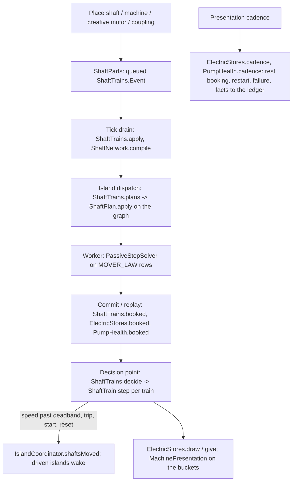

# Rotating machinery: machine laws, shaft trains, drivers, electricity, wear and the Create coupling

**Snapshot:** 050cd1098 (branch `codex/simulator-sizing`), 2026-11-08. Batch `2026-11-06-simulator-sizing`, prepared for owner-approved 0.22.0; not merged.

Normal casing-cover nuts are raised geometry over a plain cover sprite, recessed within the existing envelope. Optional client Low detail uses textured flat nuts and capped round meshes while retaining all mechanical frames, hex shafts, published RPM and animation clocks. See [equipment.md](equipment.md).
Up: [code guide](README.md)

## Service side, factory probes and RPM controls (0.22.0)

Constructed rotating equipment uses internal inlet/outlet P/T, flow and shaft-speed channels rather than manual sensor mounts. `EquipmentServices.serviceSide` derives the DATA side from shaft power flow, so connected driver/driven machines present it on the same service side; FE is opposite. Small pump/compressor cases fit the drive-end deck, large motor/generator enclosures are matched, and turbine sockets reuse its governor housing. Case/cover finishes follow equipment body paint.

Constructor controls expose rated/design RPM and no longer offer a 2/4-pole selector. Internal/saved pole fields are not a user-facing design choice. Motors remain frequency-controlled with the 3000 rpm ceiling. The governor and accepted shaft/runtime power laws are unchanged by the interface work; instrumentation is read-only. `VisualRotation` remains the common nonlinear visual-speed law, independent of process RPM.

## VFD demand, supply and shared rotation (0.22.0)

All newly constructed motors use VFD control: no pole choice in the design, maximum 3000 rpm, constant torque below saved base speed and constant power above it (`Motor.availablePower`). Legacy pole/drive facts still round-trip. Manual sets speed; Auto requires exactly one data-linked pump/compressor on the same shaft train and follows its native flow/discharge target. Motor sizing includes the existing 20% spare. Generator housing/appearance differs from motor.

`ElectricStores` keeps a motor-specific 10 s rated buffer with 5 s restart threshold. A live FE source must also be available: losing its cable/source stops RPM and animation at the next engine decision even if stored joules remain. Old energy above the new capacity is retained. `PowerNetwork`/`PowerGrid` check source availability without transferring power; other store capacities remain unchanged.

`InlineMachines` gives inline pump/compressor finite FE demand and line-size design values (liquid 2 m/s, 25 m head; nominal gas 10 m/s and air ratio 1.5 at 300 K). Native Create shafts can exchange rotation bidirectionally; the legacy coupling block still works. Creative RF exposes standard FE on all six faces.

`VisualRotation` maps physical RPM nonlinearly: x = |rpm|/1500, displayed turns/s = sign(rpm) × 12 / (1 + 6/[x(1+x)²]), with zero handled separately. 1500/3000 rpm display 4.8/9 turns/s, tending to 12. `RotationAnimation` preserves phase on updates/stops; pumps, motors, turbines, generators, shafts and other rotating equipment use it. Hex shaft orientation follows the connection axis/phase; stopped or newly unpowered parts publish zero speed. This visual mapping does not change mechanical power.

The compact centrifugal compressor has top inlet/outlet and no coolant port, matching the owner-approved rebuild. Common guarded couplings, steel/bolt treatments and motor/generator end-face separation address model alignment and z-fighting. See [wired-control-power.md](wired-control-power.md) for control/FE ownership and [equipment.md](equipment.md) for layout contracts.

## Read this when

- A pump or compressor delivers the wrong flow or head, cavitates (`PUMP_SUCTION_LIMIT`), runs on gas or wet gas, or a casing stands while its driver runs.
- A motor, steam turbine, generator, gearbox, creative motor or Create coupling does not turn, trips (`TRIPPED: OVERLOAD`, `TRIPPED: OVERSPEED`, `TRIPPED: NO POWER`), says `CURRENT LIMITED`, `STEAM LIMITED`, `POWER LIMITED`, `NO ROTATION`, or a train stands with `NO DRIVER`, `TWO DRIVERS` or `GEAR LOOP`.
- A unit's FE port takes or gives the wrong energy, an air cooler or induced tower says `NO POWER` or `UNMETERED`, or a config key under `energy`, `create` or `machines.wear` misbehaves.
- A pump loses health, fails (`FAILED`), or a repair kit is refused.
- A machine's page, a casing's Drive group, a pump's Suction and Health groups or its curve show the wrong numbers.
- You add a driver kind, a machine law, a shaft part or a Create-facing class.

The solver's rows and booking are in [fluid-science.md](fluid-science.md); the islands, checkpoints and buckets in [fluid-runtime.md](fluid-runtime.md); the machine shapes in [equipment.md](equipment.md); the screens in [client-gui.md](client-gui.md); the simulator's tiles in [process-simulator.md](process-simulator.md).

## In one paragraph

Physically, a centrifugal pump or compressor makes a head that falls with flow along its curve, scaled by speed through the affinity laws; a positive-displacement machine delivers its displacement less slip up to its relief valve; a VFD motor follows manual speed or a data-linked machine demand within its torque/power envelope and draws power over its motor/drive efficiency; a steam turbine gives `ṁ η_is Δh_is`; a gearbox joins two shafts at a ratio and 98 %. In code, the laws are pure records in `science/machine` (Minecraft-free, `DeterministicMath`). A constructed casing is a fluid mover whose connection carries `FlowControl.Machine` (its law at a speed share) or a set-flow `Pump`/`Compressor` (form F2e, `PositiveDisplacement`); every mover runs on its law in mode `MOVER_LAW`. Machines and drivers are joined by **shaft blocks** into **trains** (`ShaftNetwork.compile`): one driver per train, gearboxes join lines. A train's driver steps once per slice, quasi-steady, from the shaft power its machines booked (`ShaftTrain.step`); the engine sends each machine's speed share, a frame's displacement, a governor valve's target, a fan unit's power limit and a failed pump's closure into the next dispatch as `ShaftPlan`s. Drivers, fans and generators have **electric stores** in joules behind an FE port at their terminal box (`ElectricStores`, `TerminalEnergy`). Pumps keep a **health** fact that cavitation and running dry wear down (`Wear`, `PumpHealth`). With Create installed, a **Create coupling** drives a train at Create's speed up to the stress its network spares (`compat/create`). Nothing here runs on the tick loop: parts change by queued events, drivers step at the coordinator's decision points, stores and health book at commits and on the presentation cadence.

## Class map

Paths are relative to `src/main/java/com/wormzjl/icheme/`.

| Class | Role | Read it for |
|---|---|---|
| **Laws (`science/machine`, Minecraft-free)** | | |
| [`MachineLaw`](../../../src/main/java/com/wormzjl/icheme/science/machine/MachineLaw.java) | Sealed (`CentrifugalPump`, `CentrifugalCompressor`): `rise(flow, speed, ρ, P, k)`, `riseSlope`, `fluidPower`, `shaftPower`, rated flow, head, efficiency | The contract a curve keeps |
| [`CentrifugalPump`](../../../src/main/java/com/wormzjl/icheme/science/machine/CentrifugalPump.java) | `H = H_r (1.21 s² − 0.05 q s − 0.15 q\|q\| − 0.01 q)`; shaft power `P_r (0.35 s³ + 0.65 q s²)`; `rated(Q, H)` with `bestEfficiency(Q)` (Corripio); `ratedSpeed` (rpm, default the 2-pole speed); `npsh(speed)`; `withHeadShare` (gas) | The curve's slope bound (−0.01 H_r/Q_r) |
| [`CentrifugalCompressor`](../../../src/main/java/com/wormzjl/icheme/science/machine/CentrifugalCompressor.java) | `H_p/H_r = s² (0.645 + 1.244 x − 0.889 x²)`, `x = q/s`; `SURGE` 0.75 (recycle holds the machine flow, the net law a straight line past it); `DEFAULT_EFFICIENCY` 0.78; `ratio`, `pressureRise`, `polytropicHead`, `sigma`; `wetEfficiency` | Head to pressure ratio (PTC 10) |
| [`PositiveDisplacement`](../../../src/main/java/com/wormzjl/icheme/science/machine/PositiveDisplacement.java) | Form F2e: slip line `u = 1 − SLIP v` (`SLIP` 0.004), relief line `u = m (1 − v) + δ` (`RELIEF_SLOPE` 10), smooth minimum `ROUNDING` 0.02; `flow`, `rise`, `riseSlope`, `residual` | Set-flow pumps and compressors, the reciprocating frame |
| [`Npsh`](../../../src/main/java/com/wormzjl/icheme/science/machine/Npsh.java) | `NPSH3 = NPSH3_r (0.4 s² + 0.6 q²)`; `SUCTION_SPECIFIC_SPEED` 200; `BREAKDOWN` 0.85 (the floor is `p_v + 0.85 ρ g NPSH3`, `breakdownPressure`); `DUTY_NPSH3` 3.3 m, `dutySpeed`, `forDuty` (an in-line mover's design, D21) | The cavitation floor |
| [`GasEntrainment`](../../../src/main/java/com/wormzjl/icheme/science/machine/GasEntrainment.java) | Turpin's onset `α_T` from suction pressure; head share `M = 1/(1 + (α/1.6 α_T)^4)`; `churn` (the gas sound's loudness, `CHURN_PEAK` 0.568) | Gas in a centrifugal pump |
| [`SteamTurbine`](../../../src/main/java/com/wormzjl/icheme/science/machine/SteamTurbine.java) | `isentropicDrop` from the inlet's real `P/ρ`; `work = ṁ η_is Δh_is`; `typicalEfficiency` (0.45 single stage to 0.76 multistage, log blend 0.3 to 3 MW); `TRIP_SPEED` 1.10 | Turbine power |
| [`Motor`](../../../src/main/java/com/wormzjl/icheme/science/machine/Motor.java) | IEC ratings 0.75 kW to 20 MW (`standardRating`, `ratingFor` with `SPARE` 1.2), `ratedSpeed(poles)`, IE3 `efficiency`, `electricPower` (VSD `DRIVE_EFFICIENCY` 0.97), `LOWEST_SPEED` 0.1 | A motor's draw and a proposed rating |
| [`SpeedControl`](../../../src/main/java/com/wormzjl/icheme/science/machine/SpeedControl.java) | Once per slice, never in a Newton: `regulate` (secant or affinity guess, `LARGEST_STEP` 0.2), `powerLimited` and `balance` (`s (available/demand)^(1/6)`) | Why a speed settles in 2 to 4 slices |
| [`ShaftNetwork`](../../../src/main/java/com/wormzjl/icheme/science/machine/ShaftNetwork.java) | `Kind` SHAFT, MOTOR, GENERATOR, GEARBOX, STEAM_TURBINE, CASING, CREATIVE_MOTOR, CREATE_COUPLING; `Part`, `End`, `Cell`; `compile(parts)` → `Train` (key, driver, `Driven` ratio and efficiency, `Fault` NONE/NO_DRIVER/TWO_DRIVERS/GEAR_LOOP, shaft speed shares, ratios); `GEAR_EFFICIENCY` 0.98, `MAXIMUM_RATIO` 20, `CREATE_RATIO` 64 | How parts join |
| [`ShaftTrain`](../../../src/main/java/com/wormzjl/icheme/science/machine/ShaftTrain.java) | `Drive` FIXED_MOTOR, VARIABLE_MOTOR, TURBINE, CREATIVE, CREATE; `Mode` SPEED, REGULATE_FLOW, REGULATE_PRESSURE; `Trip` NONE, OVERLOAD, OVERSPEED (latched), NO_POWER (not latched, never saved); `Driver`, `Measure`, `step` → `Step` (speed, trip, status, governor feed-forward, electric draw); `CREATIVE_SPEED` 2950 rpm, `CREATIVE_LIMIT` 1 MW, `SPEED_DEADBAND` 1e-3 | A driver's next speed and status word |
| [`ElectricStore`](../../../src/main/java/com/wormzjl/icheme/science/machine/ElectricStore.java) | `Facts(joules, metered)` (`EMPTY`, `UNMETERED`); `BUFFER_SECONDS` 40 of rated draw, `RATE` 2× rated per tick, restart at `SLICE_SECONDS` 20; `draw`, `accepted`, `generatorLoad`, `onSpeed` (`SPEED_WINDOW` 5 %), `motorDraw`, `fanEfficiency` (`FAN_POLES` 4) | A store's arithmetic |
| [`Wear`](../../../src/main/java/com/wormzjl/icheme/science/machine/Wear.java) | Gülich's `intensity(σ)` (peak at σ 2.06, none from `INCEPTION` 4); `rate(σ, dry, Settings)`; lives `CAVITATION_HOURS` 2, `DRY_MINUTES` 10; `Settings` (config `machines.wear.*`) | How fast a pump wears |
| [`CreateCoupling`](../../../src/main/java/com/wormzjl/icheme/science/machine/CreateCoupling.java) | `STRESS_PER_FE` 34.13, `wattsPerStress` (1.465 W at the defaults), `impact`, deadbands (`moved`, `impactMoved`), `SPARE_SHARE`, `DESIGN_SPEED` 256 rpm | Create stress to watts |
| **Solver side (`science/fluid/network`)** | | |
| `FlowControl.Machine`, `Pump`, `Compressor`, `Turbine` | The movers' laws as rows; the turbine passes on its own resistance (`VALVE_OPEN`) and takes `shaftPower` out as a `SHAFT` boundary transfer ([fluid-science.md](fluid-science.md)) | |
| [`ShaftPlan`](../../../src/main/java/com/wormzjl/icheme/science/fluid/network/ShaftPlan.java) | A slice input keyed by device identity: `Kind` SPEED (share of rated), DISPLACEMENT (m³/s), GOVERNOR (kg/s), FANS (0 or 1), FAILED (0 closes, 1 reopens an in-line pump); `apply(graph, plans)`, `planned` | What the trains change in a dispatch |
| **Runtime (`runtime/fluid`)** | | |
| [`ShaftTrains`](../../../src/main/java/com/wormzjl/icheme/runtime/fluid/ShaftTrains.java) | The world's trains, `IslandCoordinator.Shafts`: `plans` (at dispatch, reads), `booked` (at commit and replay, records), `decide` (one driver step per train per tick for the trains that booked; `shaftsMoved` wakes the driven islands); `Event` Put, Remove, Configure, Reset, Governor, CreateInput (at most `MAXIMUM_EVENTS` 65536), applied at the tick drain; `STEAM_K` 1.3 | The engine loop of a train |
| [`ShaftUnit`](../../../src/main/java/com/wormzjl/icheme/runtime/fluid/ShaftUnit.java) | A part as saved (facts schema 10): id, kind, position, axis, `End`s, fluid device, rated power, design speed, poles, drive, `Settings(running, mode, setPoint, powerLimit, ratio)`, trip; `State(speed, previousSpeed, previousMeasured)` in the topology state | A train's facts and state |
| [`ElectricStores`](../../../src/main/java/com/wormzjl/icheme/runtime/fluid/ElectricStores.java) | One store per powered unit (motor, generator, air cooler side, induced tower basin): `receive`/`extract` (FE now, nothing wakes), `draw`/`give` (at a train's step), `booked` (fans at commit), cadence every `CADENCE` 100 ticks (rest booking, restart, facts to the ledger); `fanDraw`, `towerDraw`; `Settings(joulesPerFE, needPower)` | Why a unit says NO POWER |
| [`PumpHealth`](../../../src/main/java/com/wormzjl/icheme/runtime/fluid/PumpHealth.java) | Health per pump device (facts schema 12, only below 1): `booked` (at commit, from `PipeObservation.npshRatio` and `dry`), `cadence`, `plans` (FAILED), `queue`/`apply` (a repair); `GAS_RATIO` 0.5 | A pump's wear and repair |
| [`MachineView`](../../../src/main/java/com/wormzjl/icheme/runtime/fluid/MachineView.java), [`MachinePresentation`](../../../src/main/java/com/wormzjl/icheme/runtime/fluid/MachinePresentation.java) | One part's page view (status, speed, shaft power, electric power and FE/t, settings, trip, rating, store share and seconds left, governor valve, gearbox ratio, turbine steam, `Coupling`); sessions: replay on open, the buckets after, one unanswered edit per session | What a machine page receives |
| **World and wire** | | |
| `world/level/block/ShaftBlock`, `ShaftParts`, `ShaftCommand`, `CreativeMotorBlock` | The `shaft` block (drawn size 2 to 8 px from the train's torque, no block entity); the queued part events; `/icheme shaft` (operators: list, settings, start, stop, reset, ratio); the `creative_motor` block | Placing and removing parts |
| `world/level/block/entity/TerminalEnergy` | The FE capability on a structure's terminal cell, every face; consumers receive, a generator extracts | The FE port |
| `world/item/RepairKitItem` | `repair_kit`: queues `PumpHealth.Repair` on a casing cell or an in-line pump; consumed only when accepted | Repairs |
| [`network/MachineNetwork`](../../../src/main/java/com/wormzjl/icheme/network/MachineNetwork.java) | Protocol `machine-3`: `machine_state`, `machine_edit` (checked at receipt, queued as a shaft event), `machine_open_driver` (a casing's or turbine's page opens its driver's), `machine_datasheet`; `world/inventory/MachineMenu` | The page's wire |
| **Create (`compat/create`, loaded only with Create)** | | |
| `CreateCompat`, `CreateCouplingBlock`, `CreateCouplingBlockEntity`, `CreateCouplingRenderer`, `CreateCompatClient` | The only package that names a Create, Ponder, Flywheel or Catnip type; `IChemE` calls `CreateCompat.register` only when `create` is loaded. The coupling is a `KineticBlockEntity` stress consumer: Create's speed and spare stress reach the engine as `CreateInput` events; the engine's impact comes back and is cut to the spare when it lands; it saves nothing of its own | The Create boundary |

## Main flow

1. A placed structure with shaft ends, a shaft block, a creative motor or a Create coupling queues a `Put` (`ShaftParts`); a removal a `Remove`. They apply at the tick drain, and only then do trains recompile. A train is state; its key is its lowest part identity.
2. At an island's dispatch, `ShaftTrains.plans` gives each driven machine its speed share (from the driver's speed and the gear ratios), a reciprocating frame its displacement, a governor valve its mass target, a fan unit its limit and a failed pump its closure. `ShaftPlan.apply` writes them into the graph; a connection that differs from the dispatched one only by its plan is the same control (`ShaftPlan.planned`), and a train whose speed moves wakes its islands through `shaftsMoved` (step 4).
3. The solve runs every mover on its law ([fluid-science.md](fluid-science.md)). At the commit, `booked` records each machine's shaft power and a turbine's `SHAFT` transfer; fan units book their draw; pumps book their wear from the slice's suction read.
4. At the coordinator's decision points, `decide` steps each train that booked: demand is the driven machines' booked shaft power over their gears; `ShaftTrain.step` gives the next speed, trip and status. A motor draws from its store (`ElectricStores.draw`; an empty store gives `NO_POWER` and steps again stopped), a generator gives into its own (`give`, within `SPEED_WINDOW` of its rated speed). A Create coupling's step sets the stress impact sent back to Create.
5. On the presentation cadence a resting unit books its last power, a stopped unit whose store holds one slice of rated draw restarts, a pump at 0 health fails, and the stores' and health facts go to the ledger. Pages and the Drive, Power, Suction and Health groups read what was decided; no read solves.

Contracts: drivers, governors, regulation

- **Legacy fixed motor**: runs at its rated speed; a demand above its rating trips `OVERLOAD` (latched until a reset). **Variable motor** and **creative motor**: the set speed (share of design, or rpm for the creative motor), or regulating the train's first machine's flow (`REGULATE_FLOW`, exponent 1) or discharge pressure (`REGULATE_PRESSURE`, exponent 2) through `SpeedControl.regulate`; over the power limit they slow by `powerLimited` (`CURRENT LIMITED`, `POWER LIMITED`).
- **Steam turbine:** an internal admission governor follows requested speed and available shaft demand, limiting admitted work rather than letting higher available steam accelerate the train. Delivered steam still bounds its work. An external speed-sensor valve remains supported for a plant steam supply; it is not required to provide the internal limiter. With no delivered steam the train remains at zero speed. Overspeed protection remains a trip, not the normal regulating action.
- **Create coupling** (D40, form A): set speed = Create's |rpm|, limit = the power the network spares (`wattsPerStress` × spare stress × `SPARE_SHARE`); Create at rest gives `NO ROTATION`; the coupling's design speed is `DESIGN_SPEED` 256 rpm, which an auto gearbox behind it matches, up to `CREATE_RATIO` 64.
- **Faults**: two drivers, no driver, or a loop of gears stand the train with its fault word (`NO DRIVER`, `TWO DRIVERS`, `GEAR LOOP`); a lone shaft run makes no train (its page reads `LOOSE`).
- **Status words** go on the page and the casing's Drive group: `RUNNING`, `STOPPED`, `CURRENT LIMITED`, `POWER LIMITED`, `STEAM LIMITED`, `NO ROTATION`, `TRIPPED: …`.

Contracts: electricity (W5, D30)

- 1 FE = `energy.joulesPerFE` J (default 2.5); stores keep joules, so a config change keeps the energy they hold. `energy.machinesNeedPower` false books nothing and stops nothing.
- Powered units: a motor or generator (shaft unit), an air cooler's process side (its `HeatUnit.fanCount` fans, one 4-pole motor each, facts schema 11), an induced-draft tower's basin (one store for every cell's fan). Terminal cells: `ProcessUnit.terminal` (a motor's terminal box; the air cooler's and the tower's basin rim, `CoolingTowerDesign`).
- A non-motor unit from before schema 11 retains its legacy `UNMETERED` behaviour. Motors require live FE supply under the current motor-specific policy, while all saved energy remains preserved.
- An empty store stops a motor (`TRIPPED: NO POWER`, not latched) and holds a fan unit's fans at `fanLimit` 0 (`AirCooled.withFanLimit`, `CoolingTower.withFanLimit`): the louvers stay open and the air falls to natural draught; the controller reports what it cannot reach. The fan limit is a dispatch input, never a fact.
- A generator's load is the room its store has left (`generatorLoad`), so a full store sheds load.

Contracts: two-phase suction, wear and repair (W10a-W10d)

- No mover refuses gas or liquid any more (request 11, D19): a centrifugal pump's head reads `GasEntrainment.headShare` of its suction's vapour share once per solve (`PassiveStepSolver.readSuctions`), a centrifugal compressor's efficiency `wetEfficiency` of its liquid share; a set-flow pump delivers `(1 − α)` of its displacement as liquid, a frame the displacement less the liquid's volume. Only a dry suction (D58) and, at a compressor, solids above the trace refuse.
- Cavitation: a pump's suction floor is its liquid's bubble pressure plus `0.85 ρ g NPSH3(Q, s)`; an in-line pump's NPSH3 is its duty design's (`Npsh.forDuty`, D21).
- Wear (D34, simple form): `Wear.rate(σ, dry)` with `σ = NPSHA/NPSH3` from `PipeObservation.npshRatio` and `dry`, booked over committed online ticks; nothing wears from clean running. Health 0 fails the pump: a `FAILED` plan closes it, its settings kept. A repair kit queues `PumpHealth.Repair`; a failure and a repair wake the island. `machines.wear.enabled` false books nothing and closes nothing.
- Sound (D35, D36): `MoverState` (`mover-4`) carries the speed share, a pump's crackle and churn bytes (0 to 255) and an in-line pump's rpm; loops `pump_cavitation`, `pump_gas` over the casing loop; drivers play `motor_running`, `generator_running`, `turbine_running` (`DriverSounds`, watched by `driver_watch`/`driver_state`); pitch = rpm over the loop's authored rpm (`UnitDesign.PUMP_LOOP_RPM` 2950, `MOTOR_LOOP_RPM` 1500), within 0.5 to 2.
- Readings (D37, D38): `FluidView.Pump` (NPSH available and required, gas share, health, a casing's `Curve`); the device screen's Suction and Health groups and the pump curve (`PumpCurve`: H(Q), NPSH3(Q), 4 × NPSH3 dashed, NPSHA); status words `FAILED` > `CAVITATION` > `GAS` on the message display.

Formats and versions

- Fluid facts (`FluidFacts.SCHEMA` 14): 10 adds the machine and turbine controls, device kind `TURBINE`, valve source `SHAFT_SPEED` and the shaft units (after the column units); 11 the electric stores (after the shaft units) and an air cooler side's fan count; 12 the pumps' health (only pumps below 1). Corpus images `src/test/resources/compat/fluid/schema-10/` to `schema-12/`. A world before 10 has no shaft units; before 11, unmetered stores for its powered units; before 12, every pump new.
- Checkpoint state format 39 (`FluidCheckpointCodec.VERSION`): control tag 5 a machine on its curve (law, a pump's rated speed, speed, enabled, set flow and set pressure), tag 6 a steam turbine; the endpoint modes lost `PUMP_TARGET` and `PUMP_HEAD_LIMIT` and gained `MOVER_LAW`; a driver's `ShaftUnit.State` in the topology state.
- Accessory facts schema 4 (earlier schema 3 introduced sensor kind `SPEED`, mount `speed_pickup`, no new field); current sensor/accessory metadata has its schema-4 image.
- Wire (no compatibility work): `machine-3`, `mover-4`, `fluid-19` (a casing's `FluidView.Drive`, a fan unit's `FluidView.Power`, a pump's `FluidView.Pump`), `equipment-21` (the constructor's `MachineDuty` and deconstruction requests).
- Config (`icheme-common.toml`): `energy.joulesPerFE` 2.5, `energy.machinesNeedPower` true, `create.stressPerFE` 34.13, `machines.wear.enabled` true, `machines.wear.cavitationHours` 2.0, `machines.wear.dryMinutes` 10.0 (`IChemE.joulesPerFE`, `machinesNeedPower`, `stressPerFE`, `wearSettings`).
- Create is optional (`neoforge.mods.toml` `optional`); Create, Ponder, Flywheel, Registrate and KubeJS are `compileOnly` plus `optionalModRuntime`; `-PwithoutCreate` drops them from the dev, test and GameTest runtimes ([verification.md](verification.md)).

Traps

- **A casing's speed is not a fact.** `FlowControl.Machine.speed` is the train's slice input; saved facts carry none; a change of speed reaches a certified island only through `IslandCoordinator.shaftsMoved`, and a connection differing only by its plan compares equal (`ShaftPlan.planned`).
- **A set-flow pump is positive displacement now.** Its set flow is the displacement, its "maximum added pressure" the relief rise read on its supply's density (D11, A2); it is not a curve, and a flow valve above its set flow cannot regulate (`ControlConstraints.moverBounds`).
- **The pump booking is still the ideal work** (S1): `FlowControl.Pump.power` and a `Machine` pump give `Q Δp` to the fluid; a compressor gives polytropic work over 0.78. Shaft power on the train is the law's `shaftPower`.
- **`ShaftTrain.Step.electricPower` is booked** since W5 (`ShaftTrains` → `ElectricStores.draw`), although its javadoc (reading A14) still says "shown, not booked".
- **Nothing outside `compat/create` may name a Create type**: a pack without Create must load. `client/Outlines` replaced Catnip's outliner for that reason.

## Change the layer that owns it

| Symptom | Layer | Tests |
|---|---|---|
| Wrong head, power, NPSH3, gas share, wear rate, turbine work, motor rating | `science/machine/*` | `CentrifugalPumpTest`, `CentrifugalCompressorTest`, `PositiveDisplacementTest`, `NpshTest`, `GasEntrainmentTest`, `SteamTurbineTest`, `MotorTest`, `WearTest`, `SpeedControlTest` |
| Parts join wrongly, a fault, a ratio | `ShaftNetwork.compile` | `ShaftNetworkTest` |
| A driver's speed, trip, status | `ShaftTrain.step`, `ShaftTrains.decide` | `ShaftTrainTest`, runtime `ShaftCouplingTest`, GameTest `ShaftTrainGameTests` |
| A mover's row, cavitation, gas, turbine connection | `FlowControl`, `PassiveStepSolver` ([fluid-science.md](fluid-science.md)) | `MachineMoverTest`, `TwoPhaseMoverTest`, `SteamTurbineConnectionTest`, `ShaftPlanTest`, runtime `PumpCavitationTest` |
| FE stores, NO POWER, generator | `ElectricStore`, `ElectricStores`, `TerminalEnergy` | `ElectricStoreTest`, runtime `HeatUnitPowerTest`, GameTest `ElectricGameTests` |
| Health, failure, repair | `Wear`, `PumpHealth`, `RepairKitItem` | `WearTest`, runtime `PumpHealthTest`, GameTest `PumpHealthGameTests` |
| Create coupling | `CreateCoupling`, `compat/create/*` | `CreateCouplingTest`, GameTest `CreateCouplingGameTests` (with and without Create) |
| Saved shaft units, stores, health | `FluidFacts`, `WorldTopologyLedger` | `FluidFactsCompatTest`, `FluidCheckpointCodecTest` |
| Page and group data | `MachineView`, `MachinePresentation`, `MachineNetwork`, `client/gui/common/MachineColumn`, `PumpCurve` | `MachineColumnTest`, `PumpCurveTest`, `DeviceColumnTest`, `FluidPacketCodecTest` |
