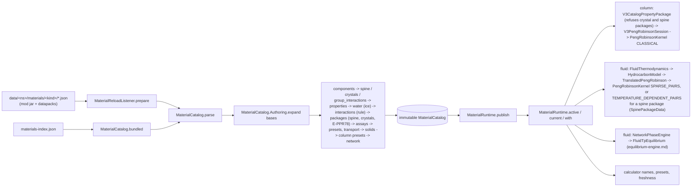

# Shared thermodynamics, materials and deterministic math

**Snapshot:** SNAPSHOT_SHA (branch `claude/heat-exchanger-design-cf05d1`), 2026-10-28 · **Updated:** 2026-10-28 (batch 2026-10-27-heat-exchanger-design, owner choice (b): a column preset's `columnDiameterMetres` must be above 0; the id `holland_3_2` is no longer reserved, the Holland example having left the presets; the steam's second-virial gas is in [equilibrium-engine.md](equilibrium-engine.md)) · earlier: 2026-10-27 at ce71b45c (batch 2026-10-26-multi-machine-framework, owner decisions 2026-10-26: nothing is hashed; every record declares its revision (a token, `JsonFields.revision`), and a package's identities are composed from them: `scientificRevision`, `fluidRevision`, `spineRevision`; `samePhysics` compares content directly; the fingerprints are gone; interactions records need a `revision`; the eight crude packages' pressure floor 1 kPa) · earlier: 2026-10-25 (batch 2026-10-21-floating-roof-tanks: the crude fractions' appearance colours from their normal boiling points; appearances read by the open tank's display and the sight glass) · earlier: 2026-10-21 (0.11.1 test review; mod rename to IChemE, 0.11.0); 2026-10-20 (`DeterministicMath` gains `sin`, `asin`, `atan2`; the rest of the chapter is unchanged since a08c7134)
Up: [code guide](README.md)

## Read this when

- You add a compound, a crude assay, a package or a preset, or a datapack override fails to load.
- You change a property correlation (PR78 constants, ideal-gas Cp, viscosity, liquid-mixture correction, water model).
- You add or change a reference spine, a crystal record (CO2-I, ice Ih), a group-interaction matrix or an E-PPR78 `rule`, a property's `volume_translation`, or the water's `ice`.
- A result differs between JDKs, JIT modes or machines, or a test reports a banned `Math.*` call.
- You edit a record and need to know which revision to bump, and so which identities move: column results, neural seeds, fluid worlds.

Phase answers (split, label, freeze, frost, deposit, PH/UV) are in [equilibrium-engine.md](equilibrium-engine.md). The network's use of them and of the property models is in [fluid-science.md](fluid-science.md).

## In one paragraph

A cubic equation of state (Peng-Robinson 1978) turns critical temperature, critical pressure and acentric factor of each
species, plus binary interaction parameters k_ij, into a compressibility factor Z, a log fugacity coefficient per species
and a residual enthalpy for a phase at (T, P, x). A k_ij is a constant, or, in a package with the E-PPR78 rule, a function
of temperature resolved at load from a group-interaction matrix and each species' group counts. An ideal-gas function
supplies the rest of the enthalpy and entropy: the `shifted_polynomial_5` Cp fit of each property record, or, in a package
with reference spines, the spine (formation enthalpy, standard entropy, segmented Cp) and never the fit. A *material
record* is the authored data behind them: identity and label (`components`), one property dataset per species
(`properties`), pair parameters (`interactions`, with an optional `rule`), group-interaction matrices
(`group_interactions`), reference spines (`spine`), pure crystals (`crystals`), a water model with its ice (`water`), and
a *package* that selects an ordered component axis, its properties, interactions, water, spines, admitted crystals and a
valid T/P range. Assays give a feed composition on that axis; presets give operating starting points. Past its data range
every material model continues, value and slope continuous; only a temperature that is not positive and finite is
refused. In code, the JSON lives under `data/<ns>/materials/<kind>/`, `MaterialReloadListener` reads the winning resource
set, `MaterialCatalog.parse` validates it as one transaction into an immutable SI catalog whose package identities are
composed from each record's declared revision (nothing is hashed), and
`MaterialRuntime` publishes it atomically and pins it per calculation. The shared `science/thermo` classes are the PR78
arithmetic; the column (`science/column/v3/thermo`), the fluid network (`science/fluid/thermo`) and the equilibrium engine
(`science/thermo/phase`) wrap them. All non-correctly-rounded elementary functions go through `DeterministicMath`, so
results are bitwise identical on every JVM.

## Class map

**`science/thermo`** ([source](../../../src/main/java/com/wormzjl/icheme/science/thermo/))

| Class | Role | Read it for |
|---|---|---|
| [`PengRobinsonKernel`](../../../src/main/java/com/wormzjl/icheme/science/thermo/PengRobinsonKernel.java) | Allocation-free PR78 kernel with caller-owned `Workspace`/`Evaluation`/`Derivatives`; analytic dZ, d ln phi/dT, d ln phi/dn; `Root` (`LIQUID`/`VAPOR`) is the one root choice of the column, the fluid code and the engine; three `Mixing` plans (`CLASSICAL`, `SPARSE_PAIRS`, `TEMPERATURE_DEPENDENT_PAIRS`; only the constructor that takes a `PairInteractions` selects the third, and the two pair plans share one sum body); typed `NoPhysicalRoot` (an `IllegalStateException`) | The arithmetic every engine solves on; root selection and coalescence policy; `Mixing` plans. Users: column, fluid `TranslatedPengRobinson`, `TangentPlaneStability`, `CubicPhaseEvaluator` (through `TranslatedPengRobinson.residualOnly`), `VolumeTranslation.shift` (a one-component kernel) |
| [`PairInteractions`](../../../src/main/java/com/wormzjl/icheme/science/thermo/PairInteractions.java) | The kernel's pair model: per declared pair a constant k_ij or E-PPR78 group terms; `evaluate` fills k, dk/dT and d²k/dT² per pair and allocates nothing; `Builder.constant`, `Builder.groupTerms`, `temperatureDependent()`, `REFERENCE_TEMPERATURE_KELVIN` = 298.15 | The E-PPR78 formula on the kernel's own a_i and b_i. Built by fluid `SpinePackageData` from `MaterialCatalog.Package.groupContributions()` |
| [`ThermoComponent`](../../../src/main/java/com/wormzjl/icheme/science/thermo/ThermoComponent.java) | Record: id, Tc (K), Pc (Pa), omega, M (kg/mol) | Input of the fluid `HydrocarbonModel`, `TranslatedPengRobinson`, `SpinePackageData` and the engine's `CubicPhaseEvaluator` |
| [`PhaseSupport`](../../../src/main/java/com/wormzjl/icheme/science/thermo/PhaseSupport.java) | Frozen per-component phase support (`ABSENT`, `BOTH`, `LIQUID_ONLY`, `VAPOR_ONLY`) from a reference point | Which phase a trace component keeps under truncation, in the fluid network (`PhaseLayout`, `InventoryEquilibrium`, `ConservativeTransport`, `PassiveStepSolver`, `VesselCrystals`). The column's truncated flash has its own enum `V3TruncatedFlash.Support.PhaseSupport` |
| [`TraceTruncationPolicy`](../../../src/main/java/com/wormzjl/icheme/science/thermo/TraceTruncationPolicy.java) | Trace cutoff (mole fraction, max 1e-2) and its error budgets; `REINSERTION_FACTOR` = 10 | Shared by V3 truncated flash and fluid `PhaseLayout` |
| `TangentPlaneStability`, `NumericalBox`, `IdealGasFunction`, `phase/**` | The equilibrium engine and its contracts | [equilibrium-engine.md](equilibrium-engine.md) |

`PengRobinson78` and `PhaseProperties` are test-tree classes (`src/test/.../science/thermo/`): an independent PR78 oracle for `PengRobinson78Test` and `V3PengRobinsonKernelTest`, with `PengRobinsonKernel.Root` as its root choice. No production class uses them. The test tree also holds a Java Helmholtz-energy oracle (`science/thermo/reference/`: `HelmholtzFluid`, `IdealHelmholtz`, `ResidualHelmholtz`, `SaturationAncillary` and others). It reads the CoolProp fluid files in `src/test/resources/science/thermo/coolprop/`, which `.gitattributes` stores `-text`; `ReferenceSpineTest.coolPropSegmentEqualsTheHelmholtzOracle` and `PilotVolumeAnchorTest` use it. Details are in [verification.md](verification.md).

**`science/material`** ([source](../../../src/main/java/com/wormzjl/icheme/science/material/))

| Class | Role | Read it for |
|---|---|---|
| [`MaterialCatalog`](../../../src/main/java/com/wormzjl/icheme/science/material/MaterialCatalog.java) | Parser, validator and immutable store of all 14 kinds; nested records `Property` (with `idealGasMinimumTemperature` and `volumeTranslation`; `cp` empty for a record without `ideal_gas_cp`), `Pr78`, `Validity` (a data range: leaving it never holds a state), `Water` (with nested `Ice(crystal, coefficients, exponents)`), `Assay`, `Package` (with `spine`, `crystals`, `groupContributions` and `scientificRevision`, the identity composed at load; static `label` gives its first part, what a screen shows), `NrtlPair`, `FluidAppearance` (RGB + transparency, `argb()`; stored, no main-code reader); nested `Authoring` (private: expands `bases`, with `extends`, into package `components`/`properties` before validation) and `FluidData` (the `transport` records: liquid volume references, conditional dissolved-solute log tables); accessors `crystals()`, `requireSpine(pkg, component)`, `volumeTranslation(pkg, component)`; the identities `fluidRevision(pkg)` and `spineRevision(pkg)` (at most `MAX_IDENTITY` 16,384 characters, else the package is refused at load); `samePhysics(first, second, axis)`; `bundled()` | Schema truth, validation order, identities, `inferenceView`; shared-basis composition and cycle errors; fluid EOS volume-translation inputs |
| [`ReferenceSpine`](../../../src/main/java/com/wormzjl/icheme/science/material/ReferenceSpine.java) | Kind `spine`; implements `IdealGasFunction`. 1 to 16 contiguous segments (`helmholtz_ideal_terms`, `nasa9`, `nasa7`) covering 298.15 K; h(298.15 K) is the formation enthalpy and s(298.15 K, 1e5 Pa) the standard entropy, chained across joins; a Cp step at a join above `maximum_cp_step_fraction` (default 0.005) refuses the record; past the ends Cp is held. Also carries the E-PPR78 `groups` and the `coverage`. `GAS_CONSTANT` 8.31446261815324 (pressure term only), `CEA_GAS_CONSTANT` 8.31451 (default of `nasa7`/`nasa9`) | Ideal gas and formation data of a spine package |
| [`CrystalReference`](../../../src/main/java/com/wormzjl/icheme/science/material/CrystalReference.java) | Kind `crystals`: model `Kind.SEGMENTS` (heat-capacity segments, linear molar volume, transitions) or `Kind.JAEGER_SPAN_2012`; anchored at the triple point to the fluid family's liquid (g_s = mu_L, h_s = h_L - dH_fus); `usable()` and `missing()`; past its ranges Cp, dv/dT and dv/dP are held | A crystal's properties relative to its anchor |
| [`JaegerSpanGibbsFunction`](../../../src/main/java/com/wormzjl/icheme/science/material/JaegerSpanGibbsFunction.java) | The CO2-I Gibbs function (Jäger and Span 2012); g0 and g1 are solved from the anchor (`integrationConstants`); the paper's 80..300 K and 0..500 MPa is a data range only; uses `DeterministicMath.atan` | Solid CO2 |
| [`GroupInteractionMatrix`](../../../src/main/java/com/wormzjl/icheme/science/material/GroupInteractionMatrix.java) | Kind `group_interactions`: symmetric A_kl and B_kl in MPa (`UNITS`), at most 64 groups; its declared `revision` enters the identity of every package that resolves its interactions from it | The E-PPR78 matrix record |
| [`GroupContributionInteractions`](../../../src/main/java/com/wormzjl/icheme/science/material/GroupContributionInteractions.java) | The E-PPR78 pairs of one package, resolved at load (`RULE_EPPR78` = "eppr78", `REFERENCE_TEMPERATURE` 298.15 K); a pair with an explicit constant k_ij is kept out; `science()` is the content `samePhysics` compares, only when the package has a rule | Load refusals of the rule |
| [`Eppr78Groups`](../../../src/main/java/com/wormzjl/icheme/science/material/Eppr78Groups.java) | The 40 groups of scheme `SCHEME` = "eppr78-2022" and their sources | Group names a spine may use |
| [`VolumeTranslation`](../../../src/main/java/com/wormzjl/icheme/science/material/VolumeTranslation.java) | A property's `volume_translation`: the saturated-liquid anchor at a reduced temperature (`TYPE` "saturated_liquid_reduced_temperature"); `shift` is c = v_ref - v_PR,L on the untranslated one-component kernel | Liquid volume anchor of a spine package |
| [`MaterialCoverage`](../../../src/main/java/com/wormzjl/icheme/science/material/MaterialCoverage.java) | A grade (`qualified`, `estimated_declared_error`, `research_only`, `unavailable`) and its evidence; required on spine and crystal records | Which crystals a package admits (equilibrium-engine.md) |
| [`CrystalPhasesUnavailable`](../../../src/main/java/com/wormzjl/icheme/science/material/CrystalPhasesUnavailable.java), [`IdealGasFitUnavailable`](../../../src/main/java/com/wormzjl/icheme/science/material/IdealGasFitUnavailable.java) | Typed `IllegalArgumentException` refusals: a consumer without crystal equations given a package with crystals; a consumer of the `shifted_polynomial_5` fits given a spine package | Thrown by `V3CatalogPropertyPackage` (both) and `MaterialCatalog.inferenceView` (crystals); see [column-v3.md](column-v3.md) |
| [`JsonFields`](../../../src/main/java/com/wormzjl/icheme/science/material/JsonFields.java) | Package-private: the one reader of typed JSON fields (`MAX_TEXT` = 2048); every error message starts with the field label; `revision`/`token`: a declared revision is a token `[A-Za-z0-9][A-Za-z0-9_.-]{0,63}` (at most 64 characters, so the separators `@ , ; / =` of an identity read back unambiguously) | Used by `MaterialCatalog`, `MaterialPresets`, `LiquidMixtureCorrection`, `ReferenceSpine`, `CrystalReference`, `JaegerSpanGibbsFunction`, `GroupInteractionMatrix`, `VolumeTranslation`, `MaterialCoverage` |
| [`MaterialAxis`](../../../src/main/java/com/wormzjl/icheme/science/material/MaterialAxis.java) | Ordered identity axis, max 65 (64 + water); `project` refuses to drop nonzero material | Moving vectors between axes |
| [`MaterialRuntime`](../../../src/main/java/com/wormzjl/icheme/science/material/MaterialRuntime.java) | Volatile published catalog + ThreadLocal pinned (catalog, package) context | `active()` vs `current()` vs `with(...)`; freshness checks |
| [`MaterialPresets`](../../../src/main/java/com/wormzjl/icheme/science/material/MaterialPresets.java) | Column and fluid presets, the single `networks` record, assay to mole-fraction conversion | Preset schema, preset limits, `moleFractions` |
| [`MaterialName`](../../../src/main/java/com/wormzjl/icheme/science/material/MaterialName.java) | Label descriptor: id, translation key, fallback, kind, NBP cut bounds | Petroleum-fraction labels |
| [`ViscosityCorrelation`](../../../src/main/java/com/wormzjl/icheme/science/material/ViscosityCorrelation.java) | Pure-phase mu(T) with `ANDRADE`/`SUTHERLAND`/`POWER_SUM`/`LOG_TABLE`; `dynamicViscosityPascalSeconds(T, Phase)` continues past the declared T range; results capped at `MAXIMUM_VISCOSITY` = 1e12 Pa s | Transport data and its continuation |
| [`LiquidMixtureCorrection`](../../../src/main/java/com/wormzjl/icheme/science/material/LiquidMixtureCorrection.java) | `symmetric_pair_groups_v1` correction to sum x ln mu, O(n) | Crude liquid viscosity mixing |
| [`SolidMaterialCatalog`](../../../src/main/java/com/wormzjl/icheme/science/material/SolidMaterialCatalog.java) | `solids` records, separate from the fluid axis; validates saved solid inventories (crystal populations skipped: `NetworkCrystals` builds them from the package's crystal record); nested `SolidMaterial(id, revision, density, heatCapacity, Crystal crystal)`, an incompressible solid whose stored U = cp (T - 298.15 K), and `Crystal(component, energyOffset)`, a crystal formed from the fluid (true u = c (T - 298.15) + u0) | Solid identity; solid-phase energy |

**`science/math`** ([source](../../../src/main/java/com/wormzjl/icheme/science/math/))

| Class | Role | Read it for |
|---|---|---|
| [`DeterministicMath`](../../../src/main/java/com/wormzjl/icheme/science/math/DeterministicMath.java) | The only allowed entry for log, log10, log1p, exp, expm1, cbrt, cos, sin, acos, asin, atan, atan2, tanh and pow in science and runtime code; delegates to `StrictMath` | The determinism contract |
| [`DeterministicPow`](../../../src/main/java/com/wormzjl/icheme/science/math/DeterministicPow.java) | Table-driven `pow` (Tang method), plain IEEE arithmetic, no FMA, within 1 ulp of fdlibm | `DeterministicMath.pow` |
| [`FdlibmPow`](../../../src/main/java/com/wormzjl/icheme/science/math/FdlibmPow.java) | fdlibm `e_pow.c` transliteration with hoisted tables, bitwise `StrictMath.pow` | `strictPow` and pow special cases |

**`material`** (Minecraft adapter)

| Class | Role | Read it for |
|---|---|---|
| [`MaterialReloadListener`](../../../src/main/java/com/wormzjl/icheme/material/MaterialReloadListener.java) | `SimplePreparableReloadListener`: prepare = read + `parse`, apply = `MaterialRuntime.publish` | Reload transaction; registered in `IChemE` on the game event bus |

## Main flow

1. **Datapack JSON.** Minecraft's resource manager picks the highest-priority file at each path; a replacement is a
   whole record. Bundled files live in [`src/main/resources/data/icheme/materials/`](../../../src/main/resources/data/icheme/materials/).
2. **Reload listener.** `prepare` lists every `materials/**.json` of every namespace, keys it as
   `data/<ns>/<path>`, and calls `MaterialCatalog.parse`. A throw aborts the reload before `apply`.
3. **Catalog.** `parse` groups records by kind (path segment after `materials/`), rejects duplicate IDs per kind
   (assays keyed `package/id`), expands `bases`, then validates components, spines, crystals, group-interaction
   matrices, properties, water, interactions, packages (with their assays and identities), presets, transport, solids,
   column presets (by running `V3ColumnProblemResolver.validateInput` inside `MaterialRuntime.with`) and the network
   record. It returns only a fully valid catalog. Cross-record rules on the way:
   - a water `ice` names a usable crystal of `Water` anchored at the water's `triple_point`;
   - when a `networks` record exists, the network package's water model must carry `ice` (owner decision of
     2026-10-19). `parse` refuses it last, naming the water record's file and the field (`<file>: ice: required, ...`),
     so a `/reload` of such data is refused before publication instead of holding a running network at its model build;
   - a `solids` record is read through `JsonFields`; a missing or ill-typed field is refused as `<file>: <field>: ...`,
     never a `NullPointerException` (`SolidMaterialCatalog.parse`);
   - an interactions `rule` needs model `pr78` and type `eppr78`, and the package that uses it needs a `spine`;
   - a package `spine` lists one record per component, for that component, with a molar mass within 1e-4 relative of
     the property's;
   - `ideal_gas_cp` is absent in a spine package and required in every other package (one ideal-gas source per species,
     decision D6);
   - package `crystals` need a `spine`, name package components and hold no duplicates;
   - the E-PPR78 pairs are resolved from the matrix and the spines' group counts (`GroupContributionInteractions.resolve`);
   - crystal and solid ids differ (checked in the `MaterialCatalog` constructor).
4. **Runtime.** `apply` calls `MaterialRuntime.publish` (a volatile write). Before any publish, `active()` returns
   `MaterialCatalog.bundled()`. `current()` returns the pinned catalog of the calling thread if inside `with(...)`,
   else `active()`. `IChemE.onServerStopped` calls `reset()`.
5. **Consumers.**
   - Column: `V3CatalogPropertyPackage` copies a `Package` into V3 components. It refuses a non-`pr78` package with
     `Thermodynamic solver unavailable: <model>`, then a package with crystals (`CrystalPhasesUnavailable`), then a
     spine package (`IdealGasFitUnavailable`). `V3PengRobinsonSession.kernelFor` builds the kernel. See
     [column-v3.md](column-v3.md).
   - Fluid: `HydrocarbonModel` builds `ThermoComponent`s and one volume shift per species, then
     `TranslatedPengRobinson` evaluates on `PengRobinsonKernel`. A package without a spine uses `Mixing.SPARSE_PAIRS`,
     the `shifted_polynomial_5` fits, and shifts calibrated with its own pure-component PR78 liquid Z
     (`pureLiquidCompressibility`) at the `MaterialCatalog.FluidData` volume references. For a spine package
     `SpinePackageData` gives the components, a `PairInteractions` model (`TEMPERATURE_DEPENDENT_PAIRS`), the spines as
     the ideal gas, and per species the `volume_translation` shift (`VolumeTranslation.shift`), else the calibration
     point or the standard density through `pureLiquidCompressibility`. Phase decisions come from `NetworkPhaseEngine`
     and `FluidTpEquilibrium` ([equilibrium-engine.md](equilibrium-engine.md)). `FluidDomain` refuses no state: it
     reports data ranges and checks device inputs (`requireInput`); `NumericalBox` is the only bound a trial meets. See
     [fluid-science.md](fluid-science.md).
   - Water: both engines read `MaterialRuntime.water()` (`V3WaterProperties`, `WaterRegion1`). The fluid model also
     builds `FreeWaterIce` from `Water.ice()` and `catalog.crystals()`. `FluidThermodynamics` still refuses a water model
     without ice, but the catalog refuses the network's at loading (step 3), so a datapack no longer reaches that refusal.
   - Server and UI: `ProcessSolveServices` pins the catalog per request; `FluidWorldAuthority.refreshProperties`
     compares the active catalog to the world's captured one and holds islands on a change; the server tick
     notices a new catalog instance and calls `ColumnV3Network.refreshMaterialViewers`;
     `ColumnCalculatorV3BlockEntity` uses `MaterialRuntime.name` and `isCurrent`.

Data schema and units (by kind)

Full field reference: [MATERIALS.md](../../../MATERIALS.md), which also covers the data-range continuation on the fluid
network ("Data ranges on the fluid network") and how a datapack selects the pilot package ("Selecting the pilot
package"). Every record needs `schema_version: 1` and `id`. IDs of every kind except `components` must match
`[a-z][a-z0-9_.:-]{0,127}`; component IDs are case-sensitive (`[A-Za-z][A-Za-z0-9_.:-]{0,63}` via `MaterialName`).
Strings are non-blank and at most 2048 characters (`JsonFields.MAX_TEXT`). All numbers are finite SI, except the
group-interaction matrix, which keeps the published MPa.

| Kind | Bundled files | Key fields (units) | Parsed into |
|---|---|---|---|
| `components` | 22 (12 `crude_pcNN`, 7 light ends, nitrogen, carbon dioxide, water) | `kind` (`chemical`/`petroleum_fraction`/`lump`), `translation_key`, `fallback`, `cut` (K bounds), required `appearance` | `MaterialName`, `MaterialCatalog.FluidAppearance` |
| `properties` | 24 (the 20 crude, light-end and nitrogen records, and `pilot_nitrogen`, `pilot_methane`, `pilot_ethane`, `pilot_carbon_dioxide`) | `molecular_weight_kg_per_mol`, `normal_boiling_point_kelvin`, `standard_liquid_density_kg_per_m3` at `standard_temperature_kelvin`/`standard_pressure_pascal`, `temperature_min/max_kelvin`, optional `ideal_gas_cp` (`shifted_polynomial_5`, ref 298.15 K, six coefficients, optional `temperature_min_kelvin` in (record min, 298.15]; absent in a spine package, required elsewhere), `models.pr78` (Tc K, Pc Pa, omega), optional `volume_translation` (`type` `saturated_liquid_reduced_temperature`, `reduced_temperature` in (0, 1), `temperature_kelvin` = Tr·Tc within 1e-9, `pressure_pascal`, `molar_volume_m3_per_mol`, texts `reference`, `oracle`, `source`; needs `pr78` and two physical roots there), optional `viscosity`, `liquid_mixture_descriptor`, `fluid_domain` | `Property`, `VolumeTranslation`, viscosities, `Descriptor`, property `Validity` |
| `interactions` | 3 (`tjl19`, `tjl20`, `pilot_cryogenic` with `pairs: []`; revisions `tjl19-frozen-kij-r1`, `tjl20-frozen-kij-r1`, `pilot-cryogenic-eppr78-r1`) | `revision` (required since 0.15.0), `model` (`pr78` uses `kij`; `nrtl` uses a12, b12_kelvin, a21, b21_kelvin, alpha, T range), `pairs`, optional `rule` (`type` `eppr78`, `group_interactions` id; `pr78` only) | Symmetric k matrix, `NrtlPair` list, or `GroupContributionInteractions` in the package |
| `group_interactions` | 1 (`eppr78_2022`: 40 groups, 356 pairs, revision `eppr78-2022-si-table-s4-r2`) | `revision`, `source`, `provenance`, `scheme`, `units` (`MPa`), `groups` (`number`, `name`), `pairs` (`first`, `second`, `a_mpa`, `b_mpa`) | `GroupInteractionMatrix`; per package `GroupContributionInteractions` |
| `spine` | 4 (nitrogen, methane, ethane, carbon dioxide) | `component`, `revision`, `molar_mass_kg_per_mol`, `formation_enthalpy`, `standard_entropy`, `ideal_gas.segments` (`helmholtz_ideal_terms`, `nasa9`, `nasa7`), `groups` (`scheme`, `counts`), `coverage` | `ReferenceSpine` |
| `crystals` | 2 (`crystal_carbon_dioxide_i`, a `gibbs_function` of type `jaeger_span_2012`; `crystal_ice_ih`, heat-capacity segments and a linear `molar_volume`) | `component`, `crystal`, `revision`, `source`, `anchor` (`triple_point`: T, P, fusion enthalpy), one model, `coverage` | `CrystalReference`, `JaegerSpanGibbsFunction` |
| `water` | 1 (revision `water-iapws-shomate-r2`) | `iapws_shomate_watson`: molar mass, triple point, Tc, Pc, enthalpy limit, Watson data, 6 saturation + 7 Shomate coefficients, optional `viscosity`, optional `ice` (`crystal`, `sublimation_pressure`: `type` `iapws_r14_08`, 3 `coefficients`, 3 `exponents`, `source`) | `Water`, `Water.Ice` |
| `bases` | 3 (`crude_18`, `crude_19`, `network` extends `crude_19` + Nitrogen) | ordered `components` + `properties`, optional `extends` | Inlined into packages by `MaterialCatalog.Authoring` |
| `packages` | 9 | `model`, `basis` or inline lists, `interactions`, `missing_interactions` (`zero`/`error`), `water_model`, `aliases`, `advisory_evidence` (max 32 x 256 chars), T/P range, optional `fluid_domain`, `liquid_mixture`, `spine` (one id per component), `crystals` | `Package` |
| `assays` | 8 | `package`, `basis` (`mole`/`mass`/`standard_liquid_volume`), positional `components`+`amounts` or sparse `amounts_by_component`, required `appearance` | `Assay` in its package |
| `presets` | 8 column + 5 fluid | column: `package`, `assay`, `order`, `visible`, `operating` (SI feed volume m3/s, K, Pa, W, mol/s, required `columnDiameterMetres` above 0 and at most 15 m); fluid: `component` or `package`+`assay` | `MaterialPresets.Column`/`Fluid` |
| `networks` | 1 (`default.json`, package `icheme:tjl20_methane_nitrogen`) | `package`, `default_column_preset`, ordered `fluid_presets` | `MaterialPresets.Network` |
| `transport` | 2 | `type`, `revision`, `source`; `liquid_volume_reference_points` (K, Pa, m3/mol) or `conditional_solute_log_tables` (K, Pa*s) | `MaterialCatalog.FluidData` (`revision()`: `type@revision` of each record, sorted) |
| `solids` | 1 (`demo_particle`, fictional) | `revision`, `density_kg_per_m3`, `heat_capacity_j_per_kg_kelvin` | `SolidMaterialCatalog.SolidMaterial` |

Assay conversion to mole fractions (`MaterialPresets.moleFractions`): mole as is; mass / M; standard liquid volume
x `volume_scale / amount_total` x rho / M; then normalise. Volume assays must quote the same reference T and P as every
selected property. `V3CatalogPropertyPackage.crudeFeed` has its own copy of this switch.

Bundled packages: `tjl19_dwsim`, `tjl20_methane`, `tjl20_methane_nitrogen`, `bonga_tjl20`, `cold_lake_blend_tjl20`,
`dalia_tjl20`, `upper_zakum_tjl20`, `wti_light_export_tjl20`, `pilot_cryogenic` (all `icheme:`). The eight crude
packages' column range starts at `pressure_min_pascal` 1000 (1 kPa, 50 kPa before 0.15.0, owner answer Q1), so a vacuum
column can be designed; it is an admission bound only, outside `samePhysics`, and the package revisions stayed
`crude-regrouped-r1`. The standalone index
[`materials-index.json`](../../../src/main/resources/materials-index.json) lists all 94 bundled material files and is used
only by `bundled()`; Minecraft discovers datapack files itself.

The pilot package (`packages/pilot_cryogenic.json`, revision `pilot-cryogenic-p3-r1`): Nitrogen, Methane, Ethane,
CarbonDioxide; `missing_interactions: error`; all six pairs from the E-PPR78 rule; four spines; the crystal CO2-I. Its
column-style range is 216.592..1200 K; its `fluid_domain` is 63.151..1200 K and 100 Pa..10 MPa. The bundled
`networks/default.json` does not select it; a datapack selects it by replacing that record (MATERIALS.md, "Selecting the
pilot package"). The test overlay is `src/test/resources/materials/pilot-cryogenic/` (an index, the network override and
the fluid presets `fluid_pilot_methane`, `fluid_pilot_ethane`, `fluid_pilot_carbon_dioxide`). Such an override lists
component presets only: a bundled crude preset fails `requireSharedFluidPhysics` on the pilot, which lacks its
components.

Nitrogen in a column feed: the visible column preset `tia_juana_nitrogen` (`presets/column_tia_juana_nitrogen.json`, order 6) puts package `icheme:tjl20_methane_nitrogen` (the network package) into the column editor catalog. Its assay `tia_juana_light_methane` carries no nitrogen; the nitrogen comes from the client bundled mixture `assets/icheme/mixturepreset/tia_juana_nitrogen.json` (Nitrogen relative amount 2.0, mole basis). The package uses interactions `icheme:tjl20` with `missing_interactions: zero`, which has no nitrogen pair, so every nitrogen–hydrocarbon kij is zero (advisory `NITROGEN_EXTENSION`). The bundled column model declines this package (see [column-v3.md](column-v3.md)); `V3ColumnFeedAndDrawLimitsTest` solves a 2 % N2 feed on the classical seed. The nitrogen record is `fluid-nitrogen-nist-r3`: its fit has no low-temperature segment and declares `ideal_gas_cp.temperature_min_kelvin` 273.16 K. The tjl20-family package envelopes and the methane and nitrogen records' `fluid_domain` reach 10 MPa.

PR78 conventions: units, constants, mixing, root selection, domain bounds

- Units: T in K, P in Pa, R = 8.31446261815324 J/(mol K) (`PengRobinsonKernel.GAS_CONSTANT`; the fluid code uses
  the same value as `FluidThermodynamics.R`). Outputs: Z dimensionless, natural-log fugacity coefficients, residual enthalpy J/mol.
- Pure terms: a_c = 0.45724 R^2 Tc^2 / Pc, b = 0.07780 R Tc / Pc, alpha = [1 + kappa(1 - sqrt(T/Tc))]^2. kappa uses
  the 1978 split at omega = 0.491: 0.37464 + 1.54226 w - 0.26992 w^2 below, 0.379642 + 1.48503 w - 0.164423 w^2 +
  0.016666 w^3 above.
- Mixing: a_ij = sqrt(a_i a_j)(1 - k_ij), b = sum x_i b_i. Kernel `Mixing.CLASSICAL` is O(n^2) and collapses to rank
  one when all k_ij = 0 (the column; bitwise-pinned). `Mixing.SPARSE_PAIRS` corrects the rank-one sum by the nonzero
  pairs only (the fluid network). The two differ only in roundoff. `Mixing.TEMPERATURE_DEPENDENT_PAIRS` has the
  sparse structure with the pair list of a `PairInteractions` model; the two pair plans share one sum body
  (`pairInteractions(Workspace)` returns the constants or the prepared k_ij(T)). `prepareTemperature` fills k_ij(T),
  dk/dT and d²k/dT² per pair into the `Workspace`, and every temperature derivative gains the pairs' own terms. A pair
  value that is not finite is refused before the temperature is cached. For an E-PPR78 pair (`PairInteractions` class
  comment):
  - E_ij(T) = -1/2 Σ_k Σ_l (α_ik - α_jk)(α_il - α_jl) A_kl (298.15/T)^(B_kl/A_kl - 1)
  - k_ij = [E_ij - (√a_i/b_i - √a_j/b_j)²] / [2 √(a_i a_j)/(b_i b_j)], on the kernel's own Soave a_i and b_i, evaluated
    in a rearrangement without cancellation.
  - A model whose pairs are all constant reproduces `SPARSE_PAIRS` bit for bit
    (`PengRobinsonKernelPairInteractionsTest.constantModelReproducesSparsePairsBitForBit`).
- The kernel requires the k matrix finite, symmetric within 1e-14 and with zero diagonal. On the `PairInteractions`
  path the matrix is a zero placeholder, and the model's component count must match the basis. Compositions are
  normalised; negative or all-zero input throws.
- Root selection (`PengRobinsonKernel.selectRoot`): cubic Z^3 + c2 Z^2 + c1 Z + c0 solved analytically. Vapor takes the
  largest real root. Liquid takes the smallest *physical* root, physical meaning Z > B + 1e-12. In the one-root region
  both phases get the same root. A root that is not backward accurate (residual > 8 ulp of the term scale) is refined
  by at most 4 Newton steps inside its derivative-monotonic interval, so it cannot jump branch. In the coalescence band
  |D| <= 1e-16 no refinement happens. If no root exceeds B the call throws `PengRobinsonKernel.NoPhysicalRoot`, an
  `IllegalStateException` that the fluid turns into `HydrocarbonModel.RootAbsent`.
- `evaluateDerivatives` refuses a state where the cubic slope at the root is below 1e-10 relative to its terms (two
  roots coalescing); callers fall back to differencing.
- Domain: the kernel checks the T and P range it was built with and throws `IllegalArgumentException` outside it
  (`prepareTemperature` checks T; evaluation checks T and P). The column builds it with the package's range
  (`V3PengRobinsonSession.kernelFor`). The fluid's `TranslatedPengRobinson` builds it with an open domain
  (`Double.MIN_VALUE..MAX_VALUE`) and checks states itself; the fluid's and the engine's trial states are bounded by
  `NumericalBox` ([equilibrium-engine.md](equilibrium-engine.md)). `VolumeTranslation.shift` builds a one-component
  kernel over 0.5 to 2 times its anchor's T and P.
- Wilson K (`wilsonK`) is for initialisation only, clamped to ln K in [-40, 40].
- The fluid `HydrocarbonModel.pureLiquidCompressibility` (package-private; volume calibration of one pure component,
  also called by `SpinePackageData` for a component without `volume_translation`) differs from the kernel: it checks
  only finite and positive T and P, has no root refinement, a near-ideal shortcut (|A|, |B| < 1e-14 gives Z = 1), and
  the liquid root is "smallest root > B + 1e-12" with a throw if none. These are the rules of the test-tree oracle
  `PengRobinson78`. A `volume_translation` shift is computed on the kernel itself instead: one component,
  `Root.LIQUID`, two physical roots required.

Determinism contract

Rule: `+ - * /`, `Math.sqrt` and `Math.fma` are correctly rounded and may be used directly. `Math.log/exp/pow/cbrt/sin/...`
may differ by JVM, JIT tier and JDK version, so science and runtime code calls `DeterministicMath` instead. Every method
there returns `StrictMath` bits (fdlibm, pure Java bytecode since JDK 21), except `pow`, which is `DeterministicPow`: same
bits on every JVM, within 1 ulp of fdlibm, no allocation. `strictPow` is `FdlibmPow`, bitwise `StrictMath.pow` without
its per-call table allocation. The facade wraps only functions that have a caller: `atan` serves
`JaegerSpanGibbsFunction`, `tanh` the GERG-2008 cosh terms of the methane spine (`ReferenceSpine`), and `sin`, `asin`
and `atan2` the equipment geometry (`science/equipment`: `ProcessUnit`, `ShapeRasterizer`, `Mesh`, `ColumnStructure`,
`Access` and the unit designs; see [equipment.md](equipment.md)), so a vessel's layout, stamp and collision are the
same bits on client and server. A new caller adds its function to the facade first.

Guard: [`DeterministicMathSourceTest`](../../../src/test/java/com/wormzjl/icheme/science/fluid/DeterministicMathSourceTest.java)
scans `src/main/java/.../science/`, `src/main/java/.../runtime/` and the test tree `fluid/benchmark/`, strips
comments, and fails on any direct `Math.` or `StrictMath.` call (or method reference, or static import) of
`sin|cos|tan|asin|acos|atan2|atan|sinh|cosh|tanh|exp|expm1|log|log10|log1p|pow|cbrt|hypot|random`. The facade file is
exempt. It also asserts at least 150 files were scanned (250 at this snapshot: 247 main files, `science/equipment`
included, and 4 benchmark files, minus the facade; the test's own comment still says about 190). `Math.abs/max/min/clamp/ulp/rint/scalb` remain allowed.
[`DeterministicMathTest`](../../../src/test/java/com/wormzjl/icheme/science/fluid/DeterministicMathTest.java) pins
`strictPow` against `StrictMath.pow`, `pow` bit patterns, special cases, regenerates the pow tables, checks that
`pow` allocates nothing, and pins `atan` and `tanh` to `StrictMath` bit for bit (`atanAndTanhAreStrictMathBitForBit`:
special values, 200 000 sampled inputs, 10 pinned values). `sin`, `asin` and `atan2` are one-line `StrictMath`
delegations with no test of their own. Both tests sit in package `science.fluid`, so they run in
`test` and in `fluidScienceTest`. Code outside `science/` and `runtime/` (for example `world/`, `network/`, client code)
is not scanned.

Reload, validation and identity behaviour

- One transaction: `parse` sees the whole winning set and either returns a complete catalog or throws an
  `IllegalArgumentException` prefixed with the resource path. Nothing is published on failure, so the last valid
  catalog stays active (code path verified; that an invalid *initial* load stops world loading is stated by
  MATERIALS.md and depends on Minecraft's reload handling, not verified here).
- Running work is unaffected: `MaterialRuntime.with(catalog, packageId, action)` pins a ThreadLocal context and
  restores the enclosing one in `finally`. `pinned(packageId, ...)` pins whatever `current()` is now.
- **Identities, not hashes** (owner decisions 2026-10-26; AGENTS.md "Saves and data formats"). Each record declares its
  `revision`, a token (`JsonFields.revision`). An edit of a record bumps that record's revision, and every identity that
  names the record moves with it; an edit without a bump moves nothing. A package's own `revision` covers only its own
  fields (components, bounds, domains, aliases, mixture correction). Assays are compositions: no identity carries them.

| Identity | Composed of (in this order) | Used for |
|---|---|---|
| `Package.scientificRevision()` | `<package>@<revision>;properties=<ref>@<rev>,…;interactions=<id>@<rev>[;group-interactions=<matrix>@<rev>];water=<id>@<rev>` | column result freshness (`MaterialRuntime.isCurrent`), the column's `datasetRevision`, the neural model's `propertyRevision`; a screen shows `Package.label`, the part before the first `;` |
| `fluidRevision(pkg)` | the scientific revision, then `;viscosity=<record>/<phase>@<rev>,…` (property records in component order, then the water), `;ice=<crystal>@<rev>` when the water has ice, `;fluid-data=` and `FluidData.revision()` (each transport record's `type@revision`, sorted) | the fluid network: the world basis (`WorldTopologyLedger.FluidBasis`), the model revision (`HydrocarbonModel`), the mixture viscosity cache (`MixtureViscosity`), the package part of `ThermoIdentity` |
| `spineRevision(pkg)` | `spine:` then each spine `<id>@<rev>` in component order, then each crystal `<id>@<rev>`; "" for a package with neither | the engine's `ThermoIdentity` ([equilibrium-engine.md](equilibrium-engine.md)), `SpinePackageData`'s formation datum |

  Every identity is at most `MAX_IDENTITY` 16,384 characters; `parse` refuses a package whose fluid identity is longer.
  A viscosity-only edit moves `fluidRevision` and leaves the column's identity, its results and its neural models alone.
  The bundled pins (each package's `label`, the pilot's full scientific and spine revisions) are in
  `src/test/.../material/PilotCryogenicCatalogTest.java` (`BUNDLED_PINS`, `PILOT_SCIENTIFIC_REVISION`, `PILOT_SPINE_REVISION`).
- **Same physics, compared directly.** `samePhysics(first, second, axis)` compares canonical JSON
  (`physicsContent`): the model, the axis, the axis's property constants (minus the record id), the k sub-matrix, the
  NRTL pairs on the axis, the water's numbers (minus `revision` and `ice`) and, for a package with a rule, the resolved
  E-PPR78 terms (`GroupContributionInteractions.science`). Assays, names, transport, record ids, revisions and the
  column's admission bounds are left out.
- `requireSharedFluidPhysics` makes every package-based fluid preset agree with the network package on its sub-axis
  (`samePhysics`, mixture correction, transport, `fluid_domain`). The network package must be PR78, contain Nitrogen, not
  contain Water, carry nitrogen viscosity for both phases and a `fluid_domain`; its water model needs `ice`, refused at loading.
- A calibration point the network reads (`transport/liquid_calibration.json`) is named by the `fluid-data` part of
  `fluidRevision`, for every package, spine or not.
- The column's neural models need both: the reference package's `scientificRevision` equals the model's
  `propertyRevision`, and `samePhysics(input package, reference package, model axis)` holds
  (`V3AnchorTransformerInitializer.supported`; [column-v3.md](column-v3.md)).
- `inferenceView` projects a package onto another axis for neural inference, borrowing missing species from a named
  reference package only when allowed. It refuses a package with crystals (`CrystalPhasesUnavailable`) and a package
  with E-PPR78 pairs. The projected view carries no spine and no crystals. It is not a save conversion.
- Crystal and solid ids are one namespace: a `crystals` record and a `solids` record never share an id.

Constants and limits

| Constant | Value | Where |
|---|---|---|
| Components per package / base | 1..64 (axis max 65 with water) | `MaterialCatalog.parse`, `MaterialCatalog.Authoring`, `MaterialAxis.MAX_CONSERVED_COMPONENTS` |
| Text fields | non-blank, at most 2048 characters | `JsonFields.MAX_TEXT` |
| Declared revisions (package, property, viscosity, water, interactions, transport, spine, crystal, group matrix) | a token `[A-Za-z0-9][A-Za-z0-9_.-]{0,63}`, at most 64 characters | `JsonFields.revision`/`token` |
| A composed identity | at most `MAX_IDENTITY` 16,384 characters | `MaterialCatalog.parse` (the package's fluid identity) |
| Presets | at most 64 records; column presets < 32; fluid presets <= 32; one `networks` record | `MaterialPresets.MAX_PRESETS` = 32 |
| Column preset stages | 2..64 | `MaterialPresets.read` |
| Cp reference | exactly 298.15 K | `parse` |
| Fit lower end | `ideal_gas_cp.temperature_min_kelvin` in (record min, 298.15] K | `parse` |
| Spine vs property molar mass | at most 1e-4 relative | `parse` |
| Spine segments | 1..16, containing 298.15 K; Cp step at a join at most `maximum_cp_step_fraction` (default 0.005) | `ReferenceSpine` (`DEFAULT_MAXIMUM_CP_STEP_FRACTION`) |
| Spine anchors | 298.15 K, 1e5 Pa; CEA R 8.31451 J/(mol K) | `ReferenceSpine.REFERENCE_TEMPERATURE`, `REFERENCE_PRESSURE`, `CEA_GAS_CONSTANT` |
| Group matrix | 1..64 groups, units MPa; E-PPR78 reference temperature 298.15 K | `GroupInteractionMatrix`, `GroupContributionInteractions.REFERENCE_TEMPERATURE` |
| Volume anchor | Tr in (0, 1); T = Tr·Tc within 1e-9 relative | `VolumeTranslation.read` |
| Ice sublimation | 3 coefficients, 3 exponents (IAPWS R14-08 eq. 6) | `parse` |
| Viscosity terms | power sum 1..16, table 2..2048 nodes | `ViscosityCorrelation` |
| Viscosity cap | 1e12 Pa s | `ViscosityCorrelation.MAXIMUM_VISCOSITY` |
| Liquid mixture default | coefficients 0, reference 323.15 K, slope cap 373.15 K | `LiquidMixtureCorrection.read` |
| Trace cutoff | 0..1e-2 mole fraction; budgets 8x cutoff; reinsertion 10x | `TraceTruncationPolicy` |
| Solid reference | 298.15 K | `SolidMaterialCatalog.SolidMaterial.REFERENCE_TEMPERATURE` |

The numerical box (10..6000 K, 1 Pa..1 GPa) is in [equilibrium-engine.md](equilibrium-engine.md).

Traps

- One production PR kernel, plus one pure-component copy. `PengRobinsonKernel` serves the column, the fluid network,
  the engine and `VolumeTranslation.shift`. The fluid `HydrocarbonModel.pureLiquidCompressibility` repeats the same
  constants and kappa rule for its volume calibration but differs in root policy and bounds (see above). A change to
  one is not a change to the other.
- The fit's lower end (`idealGasMinimumTemperature`, nitrogen's 273.16 K) is read only by the fluid
  (`HydrocarbonModel.idealGasFitRange`), which holds Cp below it. `IdealGasFunction` is the shared ideal-gas interface
  (`ReferenceSpine`, `NetworkPhaseEngine.CoefficientIdealGas`, `NetworkPhaseEngine.Steam`), but the
  `shifted_polynomial_5` polynomial is still evaluated in three places: `V3PropertyComponent` (column),
  `TranslatedPengRobinson.prepare` (fluid) and `NetworkPhaseEngine.CoefficientIdealGas`.
- `ideal_gas_cp` must be absent in a spine package and present in every other package (decision D6).
- For an E-PPR78 pair, `Package.interactions()` holds 0.0, not its kij. Read `groupContributions()` for every pair it
  lists (`Package` comment).
- **An edit without a revision bump moves nothing.** No identity reads the content of a record, so a changed number
  under the same revision keeps column results current, keeps neural models eligible and restates no world. Bump the
  revision of the record you change (AGENTS.md); `samePhysics` is the only direct content comparison.
- `fluid_domain` is outside `samePhysics`, so the column's neural eligibility does not move with it; it belongs to the
  package or property record, whose revision covers it.
- `MaterialRuntime.water()` without a pinned context reads the water of the hard-coded package
  `icheme:tjl20_methane`.
- `MaterialRuntime.active()` silently falls back to `bundled()` before the first publish (tests, tools, client).
- Adding a bundled JSON file without adding it to `materials-index.json` fails `verifyMaterialIndex` (runs before
  `processResources`), not a test.
- `missing_interactions: zero` (every bundled PR package except `pilot_cryogenic`, which uses `error`) means an absent
  pair is k = 0, not an error. Under `error` the pairs a `rule` resolves count as present.
- The catalog holds two crystals, CO2-I and ice Ih. Only a package's `crystals` list competes (the pilot: CO2-I). Ice Ih
  comes into every package through `Water.ice`, by water's own rule.
- The pilot package is bundled but not selected: `networks/default.json` names `tjl20_methane_nitrogen`.
- `PilotCryogenicCatalogTest.bundledPackageRevisionsAndSharedPhysicsAreUnchanged` pins each bundled package's label and
  checks that the regrouped crude packages and `tjl19_dwsim` share `tjl20_methane`'s physics on its axis (`TJL20_PHYSICS`).
- An NRTL package parses, but the column refuses it (`Thermodynamic solver unavailable: nrtl`).
- Solids are parsed by `SolidMaterialCatalog` with fewer checks than other kinds (no `source` check). Since 0.9.1 its
  four fields go through `JsonFields`, and an error names the file and the field.
- The example [`examples/material-override`](../../../examples/material-override/) is the bundled `tjl20_methane`
  record with only its density (357.0), `source` and `revision` (`tjl20-methane-nist-r1-example-density`) changed, so
  its `fluid_domain` ends at 10 MPa as the bundled one does, and the edit is declared by its revision bump. `MaterialPresetsTest` pins this, so the example cannot drift again. Methane belongs to the network package,
  so on a running world the reload guard holds the network (`HELD: property data changed`), as designed.
- `MaterialCatalog.FluidAppearance` is parsed/stored and read by `TankDisplay` mass-weighted mixing and sight-glass presentation.
  `appearance` stays a required datapack field (owner decision S10, 2026-10-15). No identity names it, so editing it
  holds no world.
- The 12 bundled `crude_pcNN` colours darken with the record's normal boiling point, from `#F8E8B0` (`crude_pc01`) to
  `#0C0A09` (`crude_pc12`). They are a precomputed presentation palette (made offline by
  `tools/sight-glass-bubbles/palette.py`, main checkout), not an optical model; nothing computes a colour at run time.

## Change the layer that owns it

| Change | Owning class / file | Tests that pin it |
|---|---|---|
| Add a compound or property dataset | `materials/components`, `materials/properties`, a `bases` record, `materials-index.json`; follow MATERIALS.md "Adding a compound" | `MaterialCatalogTest`, `MaterialPresetsTest.addingAQualifiedFixtureComponentAndMovingNitrogenNeedsNoFixedWidthEdits`, `MaterialAuthoringTest` |
| Add a crude feed | `materials/assays`, `materials/packages`, `materials/presets` | `MaterialPresetsTest` (includes the crude assay conversion) |
| New record field or validation rule | `MaterialCatalog.parse` (or `MaterialPresets.read`, `MaterialCatalog.FluidData.read`, `SolidMaterialCatalog.parse`, a record class's `read`); field reads through `JsonFields` | `MaterialCatalogTest.rejectsDuplicateIdsMissingReferencesAndAmbiguousAliases`, `invalidReloadCannotPublishPartialCatalog`, `PilotCryogenicCatalogTest`, `MaterialFluidDataTest.aNetworkWaterModelWithoutIceFailsLoadingWithItsFileAndField`, `aMalformedSolidRecordFailsWithItsResourceAndField` |
| Reference spine (ideal gas, formation data, groups) | `materials/spine/*.json`, `ReferenceSpine` | `ReferenceSpineTest`, `MethaneSpineTest`, `PilotCryogenicCatalogTest` |
| Crystal record | `materials/crystals/*.json`, `CrystalReference`, `JaegerSpanGibbsFunction` | `CrystalReferenceTest`, `JaegerSpanGibbsFunctionTest`; engine: `CrystalPhaseEvaluatorTest`, `FreeWaterIceTest` |
| E-PPR78 kij(T) | `group_interactions/eppr78_2022.json`, interactions `rule`, `GroupInteractionMatrix`, `GroupContributionInteractions`, `Eppr78Groups`, `PairInteractions`, kernel | `GroupContributionInteractionsTest`, `PairInteractionsTest`, `PengRobinsonKernelPairInteractionsTest` |
| Liquid volume anchor of a spine package | property `volume_translation`, `VolumeTranslation` | `PilotVolumeAnchorTest`, `PilotCryogenicCatalogTest.volumeTranslationRules` |
| A package one consumer cannot use | `CrystalPhasesUnavailable`, `IdealGasFitUnavailable` (thrown by the column and `inferenceView`) | `science/column/v3/CrystalPackageConsumersTest`, `science/fluid/thermo/SpineNetworkPathTest` |
| Continuation past a data range | `ViscosityCorrelation`, `ReferenceSpine`, `CrystalReference` | `ViscosityTest`, `ReferenceSpineTest.evaluationOutsideTheSegmentsContinuesOnTheEndsHeatCapacity`, `CrystalReferenceTest.segmentsContinuePastTheirRangeWithValueAndSlope`; fluid `RangeContinuationGateTest`, `DataRangeContinuationTest` |
| PR78 equation, mixing or root policy | `PengRobinsonKernel` (every engine) | `PengRobinsonKernelRootPrecisionTest`, `PengRobinsonKernelPairInteractionsTest`, `V3PengRobinsonKernelTest` (against the test-tree `PengRobinson78`), column and fluid regressions (see linked chapters) |
| Fluid volume calibration | `HydrocarbonModel.pureLiquidCompressibility`, `transport/liquid_calibration.json`, property `volume_translation`, `SpinePackageData` | `HydrocarbonModelTest`, `MaterialFluidDataTest` (incl. `aCalibrationPointAnchorsAPackageWithoutASpineWhateverTheRecordTranslates`), `PilotVolumeAnchorTest`, `fluidSolverRegression` exact |
| A record's revision; a package identity (`scientificRevision`, `fluidRevision`, `spineRevision`); `samePhysics` | `MaterialCatalog` (package `identity` in `parse`, `fluidIdentity`, `physicsContent`), `JsonFields.revision`, `FluidData.revision` | `MaterialCatalogTest` (`everyPackageIdentityListsTheDeclaredRevisionOfEachRecordItNames`, `aViscosityRevisionBumpMovesOnlyTheFluidIdentity`, `aRevisionThatIsNotATokenOrIsMissingIsRefusedNamingItsRecord`, `aRecordsRevisionBumpMakesEarlierResultsStaleButNamesDoNot`), `PilotCryogenicCatalogTest` (`spineIdentityIsTheRecordsDeclaredRevisions`), `MaterialFluidDataTest.fluidReferenceEditsMoveTheFluidRevisionNotThePhysicsAndCapturedModelsStayStable`, fluid `FluidFactsCompatTest.aSchemaOneWorldRestatesOnceOntoTheDeclaredRevisions` |
| Viscosity correlation type | `ViscosityCorrelation` + `MaterialCatalog.readViscosities` | `ViscosityTest` (includes the ambient viscosity case) |
| Liquid mixture correction | `LiquidMixtureCorrection` | `LiquidMixtureCorrectionTest`, `science/fluid/transport/MixtureViscosityTest` |
| Trace cutoff budgets | `TraceTruncationPolicy`, `PhaseSupport` | `science/fluid/network/TraceTruncationStepTest`, `science/fluid/solver/TraceTruncationLayoutTest`, V3 truncation tests |
| Elementary function use | `DeterministicMath` (never `Math.log` etc.) | `DeterministicMathSourceTest`, `DeterministicMathTest` |
| Labels and names | `MaterialName`, lang files | `network/MaterialNamesCodecTest` |
| Reload / publication | `MaterialReloadListener`, `MaterialRuntime` | `MaterialCatalogTest.runningContextKeepsBothPrAndWaterAcrossPublicationAndRestoresAfterFailure` |

## Tests that document it

- Unit tests, `science/material`: `MaterialCatalogTest` (11: shared identity, a record's revision bump, the composed
  identities, a viscosity bump moving only the fluid identity, revision tokens, partial reload, references, assays, NRTL,
  pinned context, retired input), `MaterialAuthoringTest` (4), `MaterialPresetsTest` (5, including the
  [`examples/material-override`](../../../examples/material-override/) whole-record override, pinned to differ from
  the bundled record only in density, `source` and `revision`, and the crude assay conversion), `MaterialFluidDataTest` (5: incl.
  a fluid reference edit moving the fluid revision only, the calibration anchor of a package without a spine, the network water model without ice, a malformed solid record), `ViscosityTest` (8, including the ambient viscosity case),
  `LiquidMixtureCorrectionTest` (4), `FluidAppearanceTest` (6, incl. `bundledCrudeFractionsDarkenWithNormalBoilingPoint`), `ReferenceSpineTest`
  (11), `MethaneSpineTest` (5), `CrystalReferenceTest` (6), `JaegerSpanGibbsFunctionTest` (4),
  `GroupContributionInteractionsTest` (7), `PilotCryogenicCatalogTest` (8: bundled revisions and shared physics, the pilot and its test
  override, its spine identity, ideal-gas and volume-translation rules, coverage), `PilotVolumeAnchorTest` (2). Helpers:
  `MaterialTestBasis`, `Cdu17TestCatalog`, `PilotCryogenicTestCatalog` (reads the pilot test overlay), and the two
  catalog extensions `Cdu17FixtureExtension` and `TjlReferenceExtension` on one base class `CatalogScopedExtension`.
- Unit tests, `science/thermo`: `PengRobinson78Test` (7: methane reference point, three-root state, ideal-gas limit,
  H^R vs d ln phi/dT; it tests the test-tree oracle), `PengRobinsonKernelRootPrecisionTest` (5: a ninety-digit
  oracle for cancellation roots, backward-accurate roots keep bits, ordering, zero co-volume boundary, coalescence
  band), `PairInteractionsTest` (7), `PengRobinsonKernelPairInteractionsTest` (4). `TangentPlaneStabilityTest` is in
  [equilibrium-engine.md](equilibrium-engine.md).
- Determinism: `science/fluid/DeterministicMathSourceTest` (2), `science/fluid/DeterministicMathTest` (7).
- Gradle (from `build.gradle`, not run here): `test` runs all unit tests except `**/fluid/benchmark/**`;
  `fluidScienceTest` runs `com.wormzjl.icheme.science.fluid.*` (includes the determinism tests, not
  `science.material` or `science.thermo`); `verifyMaterialIndex` is a build check wired before `processResources`.
- GameTest `MaterialReloadGameTests` (fluid run, `runFluidGameTestServer`): `materialReloadIsAtomic` publishes a
  higher-priority override, rejects an invalid one without replacing the snapshot, and restores the selection;
  `columnPresetsLoadWithRevisionChecks` loads every column preset from `MaterialRuntime.active()`.

## Terms

- **PR78**: Peng-Robinson cubic EOS with the 1978 high-acentric kappa correlation.
- **Z**: compressibility factor PV/(nRT). **A, B**: reduced attraction and co-volume, aP/(RT)^2 and bP/(RT).
- **ln phi**: log fugacity coefficient of a component in a phase. **H^R**: residual enthalpy, real minus ideal gas.
- **k_ij (BIP)**: binary interaction parameter. **Rank-one mixing**: the all-zero k case, a_mix = (sum x_i sqrt a_i)^2.
- **E-PPR78**: the group-contribution k_ij(T) of Jaubert et al., from group counts and a group-pair matrix A_kl, B_kl.
- **Package**: ordered component axis + selected properties + interactions + water + T/P range, optionally spines and
  crystals. **Basis**: reusable ordered component/property list. **Assay**: feed composition on a package axis.
- **Reference spine**: a species' formation enthalpy, standard entropy and segmented ideal-gas Cp.
- **Crystal anchor**: the triple point where a crystal record meets the fluid family's liquid (g_s = mu_L, h_s = h_L - dH_fus).
- **Volume anchor**: the saturated-liquid state (bundled: Tr = 0.8) whose molar volume a constant volume shift reproduces.
- **Coverage grade**: the declared quality of a spine or crystal record (`qualified`, `estimated_declared_error`,
  `research_only`, `unavailable`).
- **Declared revision**: a record's own `revision` token; an edit of the record bumps it.
- **Scientific revision**: a package's identity for the column, composed of the declared revisions of the records it
  names for its phase physics; a stale result has a different one. **Fluid revision**: the same plus what only the
  network reads (viscosities, the ice, the fluid reference data).
- **fluid_domain**: the fluid network's data range of a component, or a package's envelope; separate from the column's
  record range.
- **Data range vs numerical box**: leaving a data range gives a notice and a continuation; only the box refuses a trial.
- **Trace cutoff**: mole fraction below which a component's minor phase is dropped from the unknowns.
- **Backward accurate**: the cubic residual at the root is within 8 ulp of its term scale.
