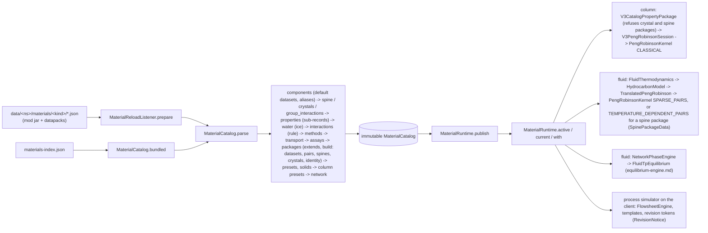

# Shared thermodynamics, materials and deterministic math

## Water in the cubic and derived pairs (batch 2026-11-11-aqueous-solvents, W2 to W3b, 2026-11-12)

The fluid network's phase model holds water as a compound of the cubic. What the materials side gives it:

| Class or record | Role | Read it for |
|---|---|---|
| [`DerivedPairs`](../../../src/main/java/com/wormzjl/icheme/science/material/DerivedPairs.java) | The PR78 kernel of a compound list with every pair derived from the compounds' own data: one source per unordered pair, the first that applies: `LIBRARY` (the package's interaction libraries, a classical pair), `HYDROGEN` (k_ij = 0), `HENRY` (water with a gas that carries `henry_in_water`: a classical k_ij at 298.15 and 373.15 K that gives the Henry constant), `ACTIVITY` (two liquids with modified UNIFAC counts, one a solvent: water, or a polar compound that names a homomorph; since `derived-pairs-r7` a polar compound without one, methyl mercaptan, takes E-PPR78 with a hydrocarbon (owner, section 13 of W5_COLUMN_PLAN.md): NRTL-form alpha and two energies fitted to the group model at 298.15 and 373.15 K), then the remaining sources of its class comment. `Result.identity` is part of the derived contract's package revision | Why a pair has the value it has; what a data edit moves |
| [`HuronVidalExcess`](../../../src/main/java/com/wormzjl/icheme/science/thermo/HuronVidalExcess.java) | The kernel's one mixing rule (`PengRobinsonKernel.huronVidal`, N8): a_mix/b_mix = Σ x_i a_i/b_i - gE/Λ with an NRTL gE weighted by the co-volumes. A classical pair enters as dg_ji = Λ[a_i/b_i - (1 - k_ij) s_i s_j/b_j]; with every pair classical the rule is the quadratic one exactly. The exponential sums run only over polar compounds with an amount in the phase | Mixing-rule cost and form |
| [`ModifiedUnifac`](../../../src/main/java/com/wormzjl/icheme/science/material/ModifiedUnifac.java) | The modified UNIFAC (Dortmund) table (`group_interactions/modified_unifac_dortmund.json`) and its activity coefficients from `group_counts`; the water-hydrocarbon block replaces the table's water parameters for hydrocarbons | Read once per data revision at load, never per tick |
| [`HenryConstant`](../../../src/main/java/com/wormzjl/icheme/science/material/HenryConstant.java) | A gas's `henry_in_water` sub-record, the IAPWS G7-04 form on the water model's Wagner-Pruss line | Gas solubility in water |
| `properties/cubic_water.json` (`icheme:cubic_water`, `cubic-water-r1`) | Water's record for the cubic: critical constants, a Mathias-Copeman alpha, group counts, no volume translation | `MaterialCatalog.CUBIC_WATER` |
| `water/*.json` (`water-iapws95-shomate-r4`) | r4 adds `datum_vaporization_enthalpy` 43988.01 J/mol (IF97's latent heat at 298.15 K): saturated liquid water at 298.15 K lies that far below the saturated steam (`V3WaterProperties.liquidEnthalpyOffset`, G1). A record without the field keeps the Watson datum (`MaterialCatalog.Water.datumVaporizationEnthalpy` NaN) | The water datum both engines share |

- `MaterialCatalog.withWater(packageId)` gives a network model its package with Water on `CUBIC_WATER` after the
  package's own compounds and the water model's ice among its crystals. No package record names it, so the column, the
  presets and the package's own identity are unchanged. It returns the package itself where it names Water already,
  where it is a lens, or where its method takes its ideal gas from reference spines: there is no water spine, so such
  a network stays dry and refuses water ([fluid-science.md](fluid-science.md)).
- W5: the V3 column derives its kernel the same way ([column-v3.md](column-v3.md)). `MaterialCatalog.lens(packageId)` is true for a package with no definition (a lens, the learned start's `inferenceView`), which keeps its own matrix. A pseudo-cut takes paraffinic group counts only in a scheme whose table the catalog holds (Dortmund, E-PPR78), so a catalog without them derives a cut's pairs from the later sources.
- Open data item: water's alpha function near 100 to 200 bar leaves the cubic's saturation temperature up to 0.43 K off
  Wagner-Pruss; a refit is W2's.
- The engine side (two books, `WaterShare`, the three-slot system, ice as a crystal) is in
  [equilibrium-engine.md](equilibrium-engine.md). Tests: `DerivedPairsTest`, `AqueousSolventDataTest`,
  `PengRobinsonKernelHuronVidalTest`, `V3WaterPropertyDerivativesTest` (the datum); test catalog
  `PilotAqueousTestCatalog` (`pilot_aqueous`: water, ethanol, n-hexane and gases).

**Snapshot:** 7be61a4b9 (branch `claude/furnace-fuel-power-requirements-f7a46e`, main 0.23.6 merged in), 2026-11-10. Batches `2026-11-09-furnace-fuel-power`, `2026-11-09-flare-stack` and `2026-11-09-batch-distiller`, merged as 0.24.0 on 2026-11-10: heating values (`MaterialCatalog.Combustion`, `heatingValues`, `formulas`; prebuilt by `tools/heating-values/`) and solid fuel records (`SolidFuelCatalog`, kind `fuels`) · earlier: 5daeda5f3 (branch `claude/refinery-compounds-thermos-252973`), 2026-11-09 (`TrainedPhysics` through `DeterministicMath`; the example datapack carries O9's sub-records). Batches `2026-11-04-refinery-compounds` (a package is a method plus a compound list, restricted views, identities by physics fields, 25 refinery compounds in `icheme:refinery`, freezing points), `2026-11-04-open-thermo-data` (open data, four generated crude grades, the Twu cut viscosity and one cut-pair term, CO2 and its crystal on the fit family, Tia Juana and the pilot as test overlays, the sub-records only `SubRecords` reads) and `2026-11-05-neural-retrain` (the neural physics check by value, `TrainedPhysics`), merged as 0.23.0 on 2026-11-09 · earlier: 3f459c176 (branch `claude/in-game-process-simulator-93dd9a`), 2026-11-04 · **Updated:** 2026-11-04 (merge package: the catalog's readers after the calculator block left, W8: no viewer refresh, the simulator's `RevisionNotice`, a placed calculator reading only its design; no code of this chapter changed since 6bf2205bf) · 2026-11-03 (batch 2026-11-02-process-simulator, W5 `61fe9196`: the five crude packages and their five column presets are gone; the five crude assays stand on `tjl20_methane` at `crude-regrouped-r2`; three column presets, four packages, 84 indexed files) · earlier: 2026-10-28 at f20ceefa (batch 2026-10-27-heat-exchanger-design, owner choice (b): a column preset's `columnDiameterMetres` must be above 0; the id `holland_3_2` is no longer reserved, the Holland example having left the presets; the steam's second-virial gas is in [equilibrium-engine.md](equilibrium-engine.md)) · earlier: 2026-10-27 at ce71b45c (batch 2026-10-26-multi-machine-framework, owner decisions 2026-10-26: nothing is hashed; every record declares its revision (a token, `JsonFields.revision`), and a package's identities are composed from them: `scientificRevision`, `fluidRevision`, `spineRevision`; `samePhysics` compares content directly; the fingerprints are gone; interactions records need a `revision`; the eight crude packages' pressure floor 1 kPa) · earlier: 2026-10-25 (batch 2026-10-21-floating-roof-tanks: the crude fractions' appearance colours from their normal boiling points; appearances read by the open tank's display and the sight glass) · earlier: 2026-10-21 (0.11.1 test review; mod rename to IChemE, 0.11.0); 2026-10-20 (`DeterministicMath` gains `sin`, `asin`, `atan2`; the rest of the chapter is unchanged since a08c7134)

## Heating values and solid fuel (0.24.0)

- `MaterialCatalog.Combustion`: a dataset's or water model's optional `combustion` sub-record, its lower heating value (J/mol; products CO2, water vapour, SO2 and N2), prebuilt from its `thermochemistry` by `tools/heating-values/` (45 records and the water). It is in no identity (owner O1). `heatingValues(packageId)` gives them in the network's conserved order (0: burns as an inert); `formulas` gives the atoms of C, H, N, O and S for the flare's flame.
- `SolidFuelCatalog` (kind `fuels`, `data/icheme/materials/fuels/`): an item's heat in a firebox is its mass × its lower heating value, its mass the fuel's bulk density over the 9 items a cubic metre holds (a log is one block; owner B1 B). Each record names an item or a tag and declares its own `revision`. An item without a record burns at its burn ticks × `energy.joulesPerBurnTick` (1.45 MJ).
Up: [code guide](README.md)

## Read this when

- You add a compound, a crude assay, a method, a package or a preset, or a datapack override fails to load.
- You change a property correlation (PR78 constants, ideal-gas Cp, viscosity, liquid-mixture correction, water model).
- You add or change a reference spine, a crystal record (CO2-I, ice Ih), a group-interaction matrix or an E-PPR78 `rule`, a property's `volume_translation`, or the water's `ice`.
- A result differs between JDKs, JIT modes or machines, or a test reports a banned `Math.*` call.
- You edit a record and need to know which revision to bump, and so which identities move: column results, neural seeds, fluid worlds.

Phase answers (split, label, freeze, frost, deposit, PH/UV) are in [equilibrium-engine.md](equilibrium-engine.md). The network's use of them and of the property models is in [fluid-science.md](fluid-science.md).

## In one paragraph

A cubic equation of state (Peng-Robinson 1978) turns critical temperature, critical pressure and acentric factor of each
species, plus binary interaction parameters k_ij, into a compressibility factor Z, a log fugacity coefficient per species
and a residual enthalpy for a phase at (T, P, x). A k_ij is a constant, or, in a package with the E-PPR78 rule, a function
of temperature resolved at load from a group-interaction matrix and each species' group counts. An ideal-gas function
supplies the rest of the enthalpy and entropy: the `shifted_polynomial_5` Cp fit of each property record, or, in a package
with reference spines, the spine (formation enthalpy, standard entropy, segmented Cp) and never the fit. A *material
record* is the authored data behind them: identity and label (`components`), one property dataset per species
(`properties`), pair parameters (`interactions`, with an optional `rule`), group-interaction matrices
(`group_interactions`), reference spines (`spine`), pure crystals (`crystals`), a water model with its ice (`water`), a
*method* (`methods`: the model, the ideal-gas source, the pair libraries in priority order, the missing-pair policy, the
water model, the column's pressure range and the liquid-mixture term), and a *package*: a method plus an ordered compound
list, each compound on its default dataset unless the package names another, and the crystals it admits. Its column
range, fluid envelope, aliases and assays are derived from those records. Assays are compositions by compound that apply
to every package holding their compounds; presets give operating starting points. A package may be viewed on a subset
of its compounds (`restrict`), built by the loader's own code. Past its data range
every material model continues, value and slope continuous; only a temperature that is not positive and finite is
refused. In code, the JSON lives under `data/<ns>/materials/<kind>/`, `MaterialReloadListener` reads the winning resource
set, `MaterialCatalog.parse` validates it as one transaction into an immutable SI catalog whose package identities are
composed from each record's declared revision (nothing is hashed), and
`MaterialRuntime` publishes it atomically and pins it per calculation. A dataset's `freezing`, `thermochemistry` and
`flammability` sub-records are validated as they are read and kept nowhere: no model reads them yet (the data gates
read them through the test helper `SubRecords`). The shared `science/thermo` classes are the PR78
arithmetic; the column (`science/column/v3/thermo`), the fluid network (`science/fluid/thermo`) and the equilibrium engine
(`science/thermo/phase`) wrap them. All non-correctly-rounded elementary functions go through `DeterministicMath`, so
results are bitwise identical on every JVM.

## Class map

**`science/thermo`** ([source](../../../src/main/java/com/wormzjl/icheme/science/thermo/))

| Class | Role | Read it for |
|---|---|---|
| [`PengRobinsonKernel`](../../../src/main/java/com/wormzjl/icheme/science/thermo/PengRobinsonKernel.java) | Allocation-free PR78 kernel with caller-owned `Workspace`/`Evaluation`/`Derivatives`; analytic dZ, d ln phi/dT, d ln phi/dn; `Root` (`LIQUID`/`VAPOR`) is the one root choice of the column, the fluid code and the engine; three `Mixing` plans (`CLASSICAL`, `SPARSE_PAIRS`, `TEMPERATURE_DEPENDENT_PAIRS`; only the constructor that takes a `PairInteractions` selects the third, and the two pair plans share one sum body); typed `NoPhysicalRoot` (an `IllegalStateException`) | The arithmetic every engine solves on; root selection and coalescence policy; `Mixing` plans. Users: column, fluid `TranslatedPengRobinson`, `TangentPlaneStability`, `CubicPhaseEvaluator` (through `TranslatedPengRobinson.residualOnly`), `VolumeTranslation.shift` (a one-component kernel) |
| [`PairInteractions`](../../../src/main/java/com/wormzjl/icheme/science/thermo/PairInteractions.java) | The kernel's pair model: per declared pair a constant k_ij or E-PPR78 group terms; `evaluate` fills k, dk/dT and d²k/dT² per pair and allocates nothing; `Builder.constant`, `Builder.groupTerms`, `temperatureDependent()`, `REFERENCE_TEMPERATURE_KELVIN` = 298.15 | The E-PPR78 formula on the kernel's own a_i and b_i. Built by fluid `SpinePackageData` from `MaterialCatalog.Package.groupContributions()` |
| [`ThermoComponent`](../../../src/main/java/com/wormzjl/icheme/science/thermo/ThermoComponent.java) | Record: id, Tc (K), Pc (Pa), omega, M (kg/mol) | Input of the fluid `HydrocarbonModel`, `TranslatedPengRobinson`, `SpinePackageData` and the engine's `CubicPhaseEvaluator` |
| [`PhaseSupport`](../../../src/main/java/com/wormzjl/icheme/science/thermo/PhaseSupport.java) | Frozen per-component phase support (`ABSENT`, `BOTH`, `LIQUID_ONLY`, `VAPOR_ONLY`) from a reference point | Which phase a trace component keeps under truncation, in the fluid network (`PhaseLayout`, `InventoryEquilibrium`, `ConservativeTransport`, `PassiveStepSolver`, `VesselCrystals`). The column's truncated flash has its own enum `V3TruncatedFlash.Support.PhaseSupport` |
| [`TraceTruncationPolicy`](../../../src/main/java/com/wormzjl/icheme/science/thermo/TraceTruncationPolicy.java) | Trace cutoff (mole fraction, max 1e-2) and its error budgets; `REINSERTION_FACTOR` = 10 | Shared by V3 truncated flash and fluid `PhaseLayout` |
| `TangentPlaneStability`, `NumericalBox`, `IdealGasFunction`, `phase/**` | The equilibrium engine and its contracts | [equilibrium-engine.md](equilibrium-engine.md) |

`PengRobinson78` and `PhaseProperties` are test-tree classes (`src/test/.../science/thermo/`): an independent PR78 oracle for `PengRobinson78Test` and `V3PengRobinsonKernelTest`, with `PengRobinsonKernel.Root` as its root choice. No production class uses them. The test tree also holds a Java Helmholtz-energy oracle (`science/thermo/reference/`: `HelmholtzFluid`, `IdealHelmholtz`, `ResidualHelmholtz`, `SaturationAncillary` and others). It reads the CoolProp fluid files in `src/test/resources/science/thermo/coolprop/`, which `.gitattributes` stores `-text`; `ReferenceSpineTest.coolPropSegmentEqualsTheHelmholtzOracle` and `PilotVolumeAnchorTest` use it. Details are in [verification.md](verification.md).

**`science/material`** ([source](../../../src/main/java/com/wormzjl/icheme/science/material/))

| Class | Role | Read it for |
|---|---|---|
| [`MaterialCatalog`](../../../src/main/java/com/wormzjl/icheme/science/material/MaterialCatalog.java) | Parser, validator and immutable store of all 14 kinds (`bases` is refused with a hint: a package names its compounds and may `extends` another); nested records `Property` (with `idealGasMinimumTemperature` and `volumeTranslation`; `cp` empty for a record without `ideal_gas_cp`), `Pr78`, `Validity` (a data range: leaving it never holds a state), `Freezing`, `Thermochemistry` and `Flammability` (a dataset's sub-records, validated at load and not kept: `Freezing.CRYSTAL_ANCHOR_TOLERANCE` 0.005 K against a crystal of the compound, `Thermochemistry.ELEMENTS` C, H, N, O, S), `Water` (with nested `Ice(crystal, coefficients, exponents)`), `Assay`, `Package` (with `spine`, `crystals`, `groupContributions` and `scientificRevision`, the identity composed at load), `NrtlPair`, `FluidAppearance` (RGB + transparency, `argb()`); private `Method` (`identity()`: the method by its physics fields), `Entries` (compound lists after `extends`), `Records`, `Definition` and `build` (the one place a package, its pairs and identity are made, for the loader and a view), `AssayRecord`; nested `FluidData` (the `transport` records: liquid volume references, conditional dissolved-solute log tables); accessors `crystals()`, `requireSpine(pkg, component)`, `volumeTranslation(pkg, component)`; `restrict(pkg, ids)` (the catalog with the package replaced by its view on those compounds, same id, the parent's column range and envelope); `inferenceView(pkg, active, TrainedPhysics)` (the lens of one neural inference); the identities `fluidRevision(pkg)` and `spineRevision(pkg)` (at most `MAX_IDENTITY` 16,384 characters, else the package is refused at load); package-private `physicsContent` (what tests compare); `bundled()` | Schema truth, validation order, identities, views and the lens; `extends` cycle errors; fluid EOS volume-translation inputs |
| [`ReferenceSpine`](../../../src/main/java/com/wormzjl/icheme/science/material/ReferenceSpine.java) | Kind `spine`; implements `IdealGasFunction`. 1 to 16 contiguous segments (`helmholtz_ideal_terms`, `nasa9`, `nasa7`) covering 298.15 K; h(298.15 K) is the formation enthalpy and s(298.15 K, 1e5 Pa) the standard entropy, chained across joins; a Cp step at a join above `maximum_cp_step_fraction` (default 0.005) refuses the record; past the ends Cp is held. Also carries the E-PPR78 `groups` and the `coverage`. `GAS_CONSTANT` 8.31446261815324 (pressure term only), `CEA_GAS_CONSTANT` 8.31451 (default of `nasa7`/`nasa9`) | Ideal gas and formation data of a spine package |
| [`CrystalReference`](../../../src/main/java/com/wormzjl/icheme/science/material/CrystalReference.java) | Kind `crystals`: model `Kind.SEGMENTS` (heat-capacity segments, linear molar volume, transitions) or `Kind.JAEGER_SPAN_2012`; anchored at the triple point to the fluid family's liquid (g_s = mu_L, h_s = h_L - dH_fus); `usable()` and `missing()`; past its ranges Cp, dv/dT and dv/dP are held | A crystal's properties relative to its anchor |
| [`JaegerSpanGibbsFunction`](../../../src/main/java/com/wormzjl/icheme/science/material/JaegerSpanGibbsFunction.java) | The CO2-I Gibbs function (Jäger and Span 2012); g0 and g1 are solved from the anchor (`integrationConstants`); the paper's 80..300 K and 0..500 MPa is a data range only; uses `DeterministicMath.atan` | Solid CO2 |
| [`GroupInteractionMatrix`](../../../src/main/java/com/wormzjl/icheme/science/material/GroupInteractionMatrix.java) | Kind `group_interactions`: symmetric A_kl and B_kl in MPa (`UNITS`), at most 64 groups; its declared `revision` enters the identity of every package that resolves its interactions from it | The E-PPR78 matrix record |
| [`GroupContributionInteractions`](../../../src/main/java/com/wormzjl/icheme/science/material/GroupContributionInteractions.java) | The E-PPR78 pairs of one package, resolved at load (`RULE_EPPR78` = "eppr78", `REFERENCE_TEMPERATURE` 298.15 K); a pair with an explicit constant k_ij is kept out; `science()` is the part of `physicsContent` a package with a rule adds | Load refusals of the rule |
| [`Eppr78Groups`](../../../src/main/java/com/wormzjl/icheme/science/material/Eppr78Groups.java) | The 40 groups of scheme `SCHEME` = "eppr78-2022" and their sources | Group names a spine may use |
| [`VolumeTranslation`](../../../src/main/java/com/wormzjl/icheme/science/material/VolumeTranslation.java) | A property's `volume_translation`: the saturated-liquid anchor at a reduced temperature (`TYPE` "saturated_liquid_reduced_temperature"); `shift` is c = v_ref - v_PR,L on the untranslated one-component kernel | Liquid volume anchor of a spine package |
| [`MaterialCoverage`](../../../src/main/java/com/wormzjl/icheme/science/material/MaterialCoverage.java) | A grade (`qualified`, `estimated_declared_error`, `research_only`, `unavailable`) and its evidence; required on spine and crystal records | Which crystals a package admits (equilibrium-engine.md) |
| [`CrystalPhasesUnavailable`](../../../src/main/java/com/wormzjl/icheme/science/material/CrystalPhasesUnavailable.java), [`IdealGasFitUnavailable`](../../../src/main/java/com/wormzjl/icheme/science/material/IdealGasFitUnavailable.java) | Typed `IllegalArgumentException` refusals: a consumer without crystal equations given a package with crystals; a consumer of the `shifted_polynomial_5` fits given a spine package | Thrown by `V3CatalogPropertyPackage` (both) and `MaterialCatalog.inferenceView` (crystals on the request's view); see [column-v3.md](column-v3.md) |
| [`TrainedPhysics`](../../../src/main/java/com/wormzjl/icheme/science/material/TrainedPhysics.java) | The phase physics a neural model was trained on, as values from its sidecar (`read`): each compound's PR78 Tc, Pc, omega and `shifted_polynomial_5` Cp, the constant pairs, the water's Wagner-Pruss, Watson and Shomate values, the trained T range. `compare`/`matches` on the request's active compounds: scalars within `RELATIVE_TOLERANCE` 1 %, functions of T on `GRID_INTERVALS` 200 (201 points), pairs within `PAIR_TOLERANCE` 0.001 (owner decisions E8, E9). No record id or revision takes part | Why a model binds or not; the lens's trained pairs |
| [`JsonFields`](../../../src/main/java/com/wormzjl/icheme/science/material/JsonFields.java) | Package-private: the one reader of typed JSON fields (`MAX_TEXT` = 2048); every error message starts with the field label; `revision`/`token`: a declared revision is a token `[A-Za-z0-9][A-Za-z0-9_.-]{0,63}` (at most 64 characters, so the separators `@ , ; / =` of an identity read back unambiguously) | Used by `MaterialCatalog`, `MaterialPresets`, `LiquidMixtureCorrection`, `ReferenceSpine`, `CrystalReference`, `JaegerSpanGibbsFunction`, `GroupInteractionMatrix`, `VolumeTranslation`, `MaterialCoverage`, `SolidMaterialCatalog` |
| [`MaterialAxis`](../../../src/main/java/com/wormzjl/icheme/science/material/MaterialAxis.java) | Ordered identity axis, `MAX_CONSERVED_COMPONENTS` 100 (a world list of 99 compounds and water; an island carries at most 64 and water, the V3 column 64); `project` refuses to drop nonzero material | Moving vectors between axes |
| [`MaterialRuntime`](../../../src/main/java/com/wormzjl/icheme/science/material/MaterialRuntime.java) | Volatile published catalog + ThreadLocal pinned (catalog, package) context | `active()` vs `current()` vs `with(...)`; freshness checks |
| [`MaterialPresets`](../../../src/main/java/com/wormzjl/icheme/science/material/MaterialPresets.java) | Column and fluid presets, the single `networks` record, assay to mole-fraction conversion; a fluid preset names a `component` or an `assay`, resolved on the network package (a `package` field is refused) | Preset schema, preset limits, `moleFractions` |
| [`MaterialName`](../../../src/main/java/com/wormzjl/icheme/science/material/MaterialName.java) | Label descriptor: id, translation key, fallback, kind, NBP cut bounds | Petroleum-fraction labels |
| [`ViscosityCorrelation`](../../../src/main/java/com/wormzjl/icheme/science/material/ViscosityCorrelation.java) | Pure-phase mu(T) with `ANDRADE`/`SUTHERLAND`/`POWER_SUM`/`LOG_TABLE`; `dynamicViscosityPascalSeconds(T, Phase)` continues past the declared T range; results capped at `MAXIMUM_VISCOSITY` = 1e12 Pa s | Transport data and its continuation |
| [`LiquidMixtureCorrection`](../../../src/main/java/com/wormzjl/icheme/science/material/LiquidMixtureCorrection.java) | A method's `cut_pair_v1` term (nested `Rule`): delta = G ((Σ_C x)² − Σ_C x²) added to Σ x ln mu over the listed compounds C, O(n); `crude_pr78`: G = 1.0956 on `crude_pc01..12`, revision `eccc-cut-pair-r1` (owner decision E12); a method without one has none | Crude liquid viscosity mixing |
| [`SolidMaterialCatalog`](../../../src/main/java/com/wormzjl/icheme/science/material/SolidMaterialCatalog.java) | `solids` records, separate from the fluid axis; validates saved solid inventories (crystal populations skipped: `NetworkCrystals` builds them from the package's crystal record); nested `SolidMaterial(id, revision, density, heatCapacity, Crystal crystal)`, an incompressible solid whose stored U = cp (T - 298.15 K), and `Crystal(component, energyOffset)`, a crystal formed from the fluid (true u = c (T - 298.15) + u0) | Solid identity; solid-phase energy |

**`science/math`** ([source](../../../src/main/java/com/wormzjl/icheme/science/math/))

| Class | Role | Read it for |
|---|---|---|
| [`DeterministicMath`](../../../src/main/java/com/wormzjl/icheme/science/math/DeterministicMath.java) | The only allowed entry for log, log10, log1p, exp, expm1, cbrt, cos, sin, acos, asin, atan, atan2, tanh and pow in science and runtime code; delegates to `StrictMath` | The determinism contract |
| [`DeterministicPow`](../../../src/main/java/com/wormzjl/icheme/science/math/DeterministicPow.java) | Table-driven `pow` (Tang method), plain IEEE arithmetic, no FMA, within 1 ulp of fdlibm | `DeterministicMath.pow` |
| [`FdlibmPow`](../../../src/main/java/com/wormzjl/icheme/science/math/FdlibmPow.java) | fdlibm `e_pow.c` transliteration with hoisted tables, bitwise `StrictMath.pow` | `strictPow` and pow special cases |

**`material`** (Minecraft adapter)

| Class | Role | Read it for |
|---|---|---|
| [`MaterialReloadListener`](../../../src/main/java/com/wormzjl/icheme/material/MaterialReloadListener.java) | `SimplePreparableReloadListener`: prepare = read + `parse`, apply = `MaterialRuntime.publish` | Reload transaction; registered in `IChemE` on the game event bus |

## Main flow

1. **Datapack JSON.** Minecraft's resource manager picks the highest-priority file at each path; a replacement is a
   whole record. Bundled files live in [`src/main/resources/data/icheme/materials/`](../../../src/main/resources/data/icheme/materials/).
2. **Reload listener.** `prepare` lists every `materials/**.json` of every namespace, keys it as
   `data/<ns>/<path>`, and calls `MaterialCatalog.parse`. A throw aborts the reload before `apply`.
3. **Catalog.** `parse` groups records by kind (path segment after `materials/`), rejects duplicate IDs per kind and
   an unknown kind (`bases` with a hint), then validates components (each compound's default dataset and its aliases,
   catalog-wide), spines, crystals, group-interaction matrices, properties (with their sub-records), water,
   interactions, methods, transport, assays, packages (their compound lists after `extends`, then `build`: datasets,
   pairs, spines, crystals, assays, envelope and identities), presets, solids, column presets (by running
   `V3ColumnProblemResolver.validateInput` inside `MaterialRuntime.with`) and the network record. It returns only a
   fully valid catalog. Cross-record rules on the way:
   - a package names `method`, `components` (an id, or an object with `id` and optional `properties`, `spine`),
     optional `extends`, `crystals` and `advisory_evidence`; a field that belongs to the method or a dataset
     (`model`, `basis`, `properties`, `interactions`, `water_model`, ranges, `fluid_domain`, `liquid_mixture`,
     `aliases`, `spine`) is refused; 1 to 99 distinct compounds;
   - a compound without a dataset named by the package or as its default is refused; a default dataset is one of the
     compound's own records;
   - the column range is the intersection of the datasets' ranges at the method's pressures (a view keeps its
     parent's); the fluid envelope is the hull of their `fluid_domain`s and the water's triple point, absent when a
     dataset declares none;
   - the method's pair libraries are read in order: the first that names a pair gives it, pairs outside the package
     are skipped; under `missing_interactions: error` every pair must be given; at most one library carries a `rule`,
     and only a method with `ideal_gas: spine` takes one;
   - every assay must be held by some package (a package holds an assay whose non-zero compounds it has); an assay's
     `package` field is refused;
   - a `freezing` sub-record agrees with every crystal record of its compound within 0.005 K (the triple point, else
     the melting point, against the anchor); a `liquid_mixture_descriptor` on a dataset is refused (the method lists
     the term's compounds);
   - a water `ice` names a usable crystal of `Water` anchored at the water's `triple_point`;
   - when a `networks` record exists, the network package's water model must carry `ice` (owner decision of
     2026-10-19). `parse` refuses it last, naming the water record's file and the field (`<file>: ice: required, ...`),
     so a `/reload` of such data is refused before publication instead of holding a running network at its model build;
   - a `solids` record is read through `JsonFields`; a missing or ill-typed field is refused as `<file>: <field>: ...`,
     never a `NullPointerException` (`SolidMaterialCatalog.parse`);
   - an interactions `rule` needs model `pr78` and type `eppr78`, and the method that uses it `ideal_gas: spine`;
   - under a spine method each compound takes its one spine record (or the one its entry names), for that compound,
     with a molar mass within 1e-4 relative of the dataset's;
   - `ideal_gas_cp` is absent under a spine method and required under a `fit` method (one ideal-gas source per
     species, decision D6);
   - package `crystals` name package components and hold no duplicates, on either ideal-gas source (E27);
   - the E-PPR78 pairs are resolved from the matrix and the spines' group counts (`GroupContributionInteractions.resolve`);
   - crystal and solid ids differ (checked in the `MaterialCatalog` constructor).
4. **Runtime.** `apply` calls `MaterialRuntime.publish` (a volatile write). Before any publish, `active()` returns
   `MaterialCatalog.bundled()`. `current()` returns the pinned catalog of the calling thread if inside `with(...)`,
   else `active()`. `IChemE.onServerStopped` calls `reset()`.
5. **Consumers.**
   - Column: `V3CatalogPropertyPackage` copies a `Package` into V3 components. It refuses a non-`pr78` package with
     `Thermodynamic solver unavailable: <model>`, then a package with crystals (`CrystalPhasesUnavailable`), then a
     spine package (`IdealGasFitUnavailable`). `V3PengRobinsonSession.kernelFor` builds the kernel. See
     [column-v3.md](column-v3.md).
   - Fluid: `HydrocarbonModel` builds `ThermoComponent`s and one volume shift per species, then
     `TranslatedPengRobinson` evaluates on `PengRobinsonKernel`. A package without a spine uses `Mixing.SPARSE_PAIRS`,
     the `shifted_polynomial_5` fits, and shifts calibrated with its own pure-component PR78 liquid Z
     (`pureLiquidCompressibility`) at the `MaterialCatalog.FluidData` volume references. For a spine package
     `SpinePackageData` gives the components, a `PairInteractions` model (`TEMPERATURE_DEPENDENT_PAIRS`), the spines as
     the ideal gas, and per species the `volume_translation` shift (`VolumeTranslation.shift`), else the calibration
     point or the standard density through `pureLiquidCompressibility`. Phase decisions come from `NetworkPhaseEngine`
     and `FluidTpEquilibrium` ([equilibrium-engine.md](equilibrium-engine.md)). `FluidDomain` refuses no state: it
     reports data ranges and checks device inputs (`requireInput`); `NumericalBox` is the only bound a trial meets. See
     [fluid-science.md](fluid-science.md).
   - Water: the column reads `MaterialRuntime.water()` (`V3WaterProperties`). The fluid network holds water in its
     cubic (`MaterialCatalog.withWater`, the section at the top): `WaterRegion1` gives water's share of enthalpy and
     volume, and the water model's ice record is one of the package's crystals (`Water.ice()`).
   - Views: the fluid network runs each island on the network package restricted to the island's own compounds
     (`FluidThermodynamics.on`, built on `MaterialCatalog.restrict`); the process simulator runs a sheet on the
     network package restricted to the compounds its feeds hold (`SheetCompounds`); an in-world column solves under
     its feed island's view ([fluid-runtime.md](fluid-runtime.md), [process-simulator.md](process-simulator.md),
     [column-operation.md](column-operation.md)). A state that holds none of the other compounds has the same numbers
     on a view as on the whole package (`RestrictedPackagePhysicsTest`).
   - Server and UI: `ProcessSolveServices` pins the catalog per request; `FluidWorldAuthority.refreshProperties`
     compares the active catalog to the world's captured one and holds islands on a change. The process simulator
     runs on the client's own catalog and shows a notice when the data its sheet's compounds run on differ from the
     identity the file holds (`RevisionNotice`, [process-simulator.md](process-simulator.md)).

Data schema and units (by kind)

Field reference: [MATERIALS.md](../../../MATERIALS.md), which also covers the data-range continuation on the fluid
network ("Data ranges on the fluid network"). At this snapshot it still describes the packages before the rework
(`bases`, a package's own model and ranges, the Tia Juana presets); this table and the code win. Every record needs `schema_version: 1` and `id`. IDs of every kind except `components` must match
`[a-z][a-z0-9_.:-]{0,127}`; component IDs are case-sensitive (`[A-Za-z][A-Za-z0-9_.:-]{0,63}` via `MaterialName`).
Strings are non-blank and at most 2048 characters (`JsonFields.MAX_TEXT`). All numbers are finite SI, except the
group-interaction matrix, which keeps the published MPa.

| Kind | Bundled files | Key fields (units) | Parsed into |
|---|---|---|---|
| `components` | 46 (12 `crude_pcNN`, 7 light ends, nitrogen, the 24 Tier 1 refinery compounds, carbon dioxide, water) | `kind` (`chemical`/`petroleum_fraction`/`lump`), `translation_key`, `fallback`, `cut` (K bounds), required `appearance`, optional `properties` (the default dataset), `aliases` (catalog-wide, never a component id), `identifiers` (text, in no identity) | `MaterialName`, `MaterialCatalog.FluidAppearance` |
| `properties` | 45 (25 `chemsep_*`, 12 `crude_pcNN`, `nitrogen`, `tjl20_methane`, six `tjl19_*` light ends) | `molecular_weight_kg_per_mol`, `normal_boiling_point_kelvin`, `standard_liquid_density_kg_per_m3` at `standard_temperature_kelvin`/`standard_pressure_pascal`, `temperature_min/max_kelvin`, optional `ideal_gas_cp` (`shifted_polynomial_5`, ref 298.15 K, six coefficients, optional `temperature_min_kelvin` in (record min, 298.15]; absent in a spine package, required elsewhere), `models.pr78` (Tc K, Pc Pa, omega), optional `volume_translation` (`type` `saturated_liquid_reduced_temperature`, `reduced_temperature` in (0, 1), `temperature_kelvin` = Tr·Tc within 1e-9, `pressure_pascal`, `molar_volume_m3_per_mol`, texts `reference`, `oracle`, `source`; needs `pr78` and two physical roots there), optional `viscosity`, `fluid_domain`, and the sub-records `freezing` (`normal_melting_kelvin`, optional `triple_point_kelvin`, `triple_point_pascal`, `fusion_enthalpy_j_per_mol`; `estimated`, `source`, own `revision`), `thermochemistry` (`formation_enthalpy_j_per_mol`, `elements` of C, H, N, O, S; `estimated`, `source`, `revision`) and `flammability` (`lfl_volume_fraction`, optional `ufl_volume_fraction`; `estimated`, `source`, `revision`) | `Property`, `VolumeTranslation`, viscosities, property `Validity`; the sub-records validated only |
| `interactions` | 3 (`tjl20`, `tjl20-frozen-kij-r1`, 11 pairs; `dwsim_refinery_pr78`, `dwsim-10.2.5-d3-r2`, 57 pairs, each with a refinery compound; `dwsim_refinery_pr78_co2`, `dwsim-10.2.5-d3-r1`, 8 CO2 pairs) | `revision`, `source`, `model` (`pr78` uses `kij`; `nrtl` uses a12, b12_kelvin, a21, b21_kelvin, alpha, T range), `pairs`, optional `rule` (`type` `eppr78`, `group_interactions` id; `pr78` only) | Symmetric k matrix, `NrtlPair` list, or `GroupContributionInteractions` in the package |
| `methods` | 1 (`crude_pr78`, `crude-pr78-r3`: `pr78`, `ideal_gas` `fit`, the three libraries above, `missing_interactions` `zero`, water `icheme:water`, 1 kPa..2 MPa, the cut-pair term) | `model`, `ideal_gas` (`fit`/`spine`), `interactions` (libraries in priority order, each once), `missing_interactions` (`zero`/`error`; `nrtl` needs `error`), `water_model`, `pressure_min_pascal`/`pressure_max_pascal`, optional `liquid_mixture` (`type` `cut_pair_v1`, `coefficient`, `components`, `source`, `revision`), `advisory_evidence` | `MaterialCatalog.Method`, `LiquidMixtureCorrection.Rule` |
| `group_interactions` | 0 (the pilot overlay holds `eppr78_2022`: 40 groups, revision `eppr78-2022-si-table-s4-r2`) | `revision`, `source`, `provenance`, `scheme`, `units` (`MPa`), `groups` (`number`, `name`), `pairs` (`first`, `second`, `a_mpa`, `b_mpa`) | `GroupInteractionMatrix`; per package `GroupContributionInteractions` |
| `spine` | 0 (the pilot overlay holds nitrogen, methane, ethane, carbon dioxide) | `component`, `revision`, `molar_mass_kg_per_mol`, `formation_enthalpy`, `standard_entropy`, `ideal_gas.segments` (`helmholtz_ideal_terms`, `nasa9`, `nasa7`), `groups` (`scheme`, `counts`), `coverage` | `ReferenceSpine` |
| `crystals` | 2 (`crystal_carbon_dioxide_i`, `crystal-carbon_dioxide-i-r2`, a `gibbs_function` of type `jaeger_span_2012`; `crystal_ice_ih`, `crystal-ice-ih-r1`, heat-capacity segments and a linear `molar_volume`) | `component`, `crystal`, `revision`, `source`, `anchor` (`triple_point`: T, P, fusion enthalpy), one model, `coverage` | `CrystalReference`, `JaegerSpanGibbsFunction` |
| `water` | 1 (revision `water-iapws95-shomate-r4`) | `iapws_shomate_watson`: molar mass, triple point, Tc, Pc, enthalpy limit, Watson data, 6 saturation + 7 Shomate coefficients, optional `datum_vaporization_enthalpy`, optional `viscosity`, optional `ice` (`crystal`, `sublimation_pressure`: `type` `iapws_r14_08`, 3 `coefficients`, 3 `exponents`, `source`), optional `thermochemistry` | `Water`, `Water.Ice` |
| `packages` | 3 (`tjl20_methane` and `tjl20_methane_nitrogen`, `crude-regrouped-r3`; `refinery`, `refinery-tier1-r3`; all on `crude_pr78`) | `method`, optional `extends` (the parent's compounds first; cycles refused), `components` (an id, or `{id, properties, spine}`), optional `crystals`, `advisory_evidence` (with the method's, max 32 x 256 chars) | `Package` |
| `assays` | 4 (`light_crude`, `medium_crude`, `heavy_crude`, `oil_sand_dilbit`, revision `generated-r1`, from `tools/crude-grades/`) | `basis` (`mole`/`mass`/`standard_liquid_volume`), positional `components`+`amounts` or sparse `amounts_by_component`, required `appearance`; no `package` | `Assay` in every package that holds its non-zero compounds |
| `presets` | 1 column (`medium_crude`, package `tjl20_methane`) + 7 fluid (water, nitrogen, the four grades, carbon dioxide) | column: `package`, `assay`, `order`, `visible`, `operating` (SI feed volume m3/s, K, Pa, W, mol/s, required `columnDiameterMetres` above 0 and at most 15 m); fluid: `component` or `assay` | `MaterialPresets.Column`/`Fluid` |
| `networks` | 1 (`default.json`, package `icheme:refinery`, `default_column_preset` `medium_crude`) | `package`, `default_column_preset`, ordered `fluid_presets` | `MaterialPresets.Network` |
| `transport` | 4 (`liquid_calibration`, `chemsep_liquid_reference`, `chemsep_carbon_dioxide_liquid_reference`, `dissolved_viscosity`) | `type`, `revision`, `source`; `liquid_volume_reference_points` (K, Pa, m3/mol) or `conditional_solute_log_tables` (K, Pa*s) | `MaterialCatalog.FluidData` (`revision(held)`: `type@revision` of each record with an entry for a held compound or the water, sorted) |
| `solids` | 1 (`demo_particle`, fictional) | `revision`, `density_kg_per_m3`, `heat_capacity_j_per_kg_kelvin` | `SolidMaterialCatalog.SolidMaterial` |

Assay conversion to mole fractions (`MaterialPresets.moleFractions`): mole as is; mass / M; standard liquid volume
x `volume_scale / amount_total` x rho / M; then normalise. Volume assays must quote the same reference T and P as every
selected property. `V3CatalogPropertyPackage.crudeFeed` has its own copy of this switch.

Bundled packages (all `icheme:`, all on the method `crude_pr78`): `tjl20_methane` (methane, six light ends, the 12
cuts; the column presets' package), `tjl20_methane_nitrogen` (extends it with Nitrogen) and the network package
`refinery` (extends that with the 24 Tier 1 compounds and CarbonDioxide on `chemsep_carbon_dioxide`, and admits the
CO2-I crystal: 45 compounds, the world list). The method's column range starts at 1 kPa, so a vacuum column can be
designed. `FluidMaterialCatalog.NETWORK_PACKAGE` is `icheme:refinery`; the runtime reads the network record
(`networkPackage(catalog)`). The column refuses `refinery` itself (its crystal) and runs on views without CO2. The four
generated grades replace the ExxonMobil and Tia Juana assays (owner decision E1); no saved format stores a preset or
assay id. The standalone index [`materials-index.json`](../../../src/main/resources/materials-index.json) lists all 119
bundled material files and is used only by `bundled()`; Minecraft discovers datapack files itself.

Test overlays (outside `data/` on the test classpath, so every other test's bundled catalog is the game's):
`src/test/resources/materials/tia-juana/` (`TiaJuanaTestCatalog`, `TiaJuanaExtension`: the TJL20 assay
`tia_juana_light_methane` and its fluid preset, the column presets `tia_juana` and `tia_juana_nitrogen`, the literature
case: package `tjl19_dwsim`, assay `tia_juana_light`, hidden preset `literature_tia_juana`) and
`src/test/resources/materials/pilot-cryogenic/` (`PilotCryogenicTestCatalog`: the method `pilot_eppr78` with
`ideal_gas: spine` and `missing_interactions: error`, package `pilot_cryogenic` `pilot-cryogenic-p3-r3` with Nitrogen,
Methane, Ethane, CarbonDioxide, four spines, the matrix `eppr78_2022` and all six pairs from the E-PPR78 rule, the crystal
CO2-I; a network override and the fluid presets `fluid_pilot_methane`, `fluid_pilot_ethane`). The game ships no spine,
group matrix or E-PPR78 package; the kinds and their code stay.

Nitrogen in a column feed: the bundled network package holds nitrogen; every nitrogen–hydrocarbon pair of `tjl20` is
absent and so zero (`missing_interactions: zero`, advisory `NITROGEN_EXTENSION`). The bundled column model lumps a known
off-axis compound such as nitrogen into the compound its `lumpMap` names, up to its off-axis limit
([column-v3.md](column-v3.md)). The nitrogen record is `fluid-nitrogen-coolprop-r4`: its fit has no low-temperature
segment and declares `ideal_gas_cp.temperature_min_kelvin` 273.16 K. The network envelope's floor is 54.361 K (oxygen's
data); the tjl20-family envelopes and the methane and nitrogen records' `fluid_domain` reach 10 MPa.

PR78 conventions: units, constants, mixing, root selection, domain bounds

- Units: T in K, P in Pa, R = 8.31446261815324 J/(mol K) (`PengRobinsonKernel.GAS_CONSTANT`; the fluid code uses
  the same value as `FluidThermodynamics.R`). Outputs: Z dimensionless, natural-log fugacity coefficients, residual enthalpy J/mol.
- Pure terms: a_c = 0.45724 R^2 Tc^2 / Pc, b = 0.07780 R Tc / Pc, alpha = [1 + kappa(1 - sqrt(T/Tc))]^2. kappa uses
  the 1978 split at omega = 0.491: 0.37464 + 1.54226 w - 0.26992 w^2 below, 0.379642 + 1.48503 w - 0.164423 w^2 +
  0.016666 w^3 above.
- Mixing: a_ij = sqrt(a_i a_j)(1 - k_ij), b = sum x_i b_i. Kernel `Mixing.CLASSICAL` is O(n^2) and collapses to rank
  one when all k_ij = 0 (the column; bitwise-pinned). `Mixing.SPARSE_PAIRS` corrects the rank-one sum by the nonzero
  pairs only (the fluid network). The two differ only in roundoff. `Mixing.TEMPERATURE_DEPENDENT_PAIRS` has the
  sparse structure with the pair list of a `PairInteractions` model; the two pair plans share one sum body
  (`pairInteractions(Workspace)` returns the constants or the prepared k_ij(T)). `prepareTemperature` fills k_ij(T),
  dk/dT and d²k/dT² per pair into the `Workspace`, and every temperature derivative gains the pairs' own terms. A pair
  value that is not finite is refused before the temperature is cached. For an E-PPR78 pair (`PairInteractions` class
  comment):
  - E_ij(T) = -1/2 Σ_k Σ_l (α_ik - α_jk)(α_il - α_jl) A_kl (298.15/T)^(B_kl/A_kl - 1)
  - k_ij = [E_ij - (√a_i/b_i - √a_j/b_j)²] / [2 √(a_i a_j)/(b_i b_j)], on the kernel's own Soave a_i and b_i, evaluated
    in a rearrangement without cancellation.
  - A model whose pairs are all constant reproduces `SPARSE_PAIRS` bit for bit
    (`PengRobinsonKernelPairInteractionsTest.constantModelReproducesSparsePairsBitForBit`).
- The kernel requires the k matrix finite, symmetric within 1e-14 and with zero diagonal. On the `PairInteractions`
  path the matrix is a zero placeholder, and the model's component count must match the basis. Compositions are
  normalised; negative or all-zero input throws.
- Root selection (`PengRobinsonKernel.selectRoot`): cubic Z^3 + c2 Z^2 + c1 Z + c0 solved analytically. Vapor takes the
  largest real root. Liquid takes the smallest *physical* root, physical meaning Z > B + 1e-12. In the one-root region
  both phases get the same root. A root that is not backward accurate (residual > 8 ulp of the term scale) is refined
  by at most 4 Newton steps inside its derivative-monotonic interval, so it cannot jump branch. In the coalescence band
  |D| <= 1e-16 no refinement happens. If no root exceeds B the call throws `PengRobinsonKernel.NoPhysicalRoot`, an
  `IllegalStateException` that the fluid turns into `HydrocarbonModel.RootAbsent`.
- `evaluateDerivatives` refuses a state where the cubic slope at the root is below 1e-10 relative to its terms (two
  roots coalescing); callers fall back to differencing.
- Domain: the kernel checks the T and P range it was built with and throws `IllegalArgumentException` outside it
  (`prepareTemperature` checks T; evaluation checks T and P). The column builds it with the package's range
  (`V3PengRobinsonSession.kernelFor`). The fluid's `TranslatedPengRobinson` builds it with an open domain
  (`Double.MIN_VALUE..MAX_VALUE`) and checks states itself; the fluid's and the engine's trial states are bounded by
  `NumericalBox` ([equilibrium-engine.md](equilibrium-engine.md)). `VolumeTranslation.shift` builds a one-component
  kernel over 0.5 to 2 times its anchor's T and P.
- Wilson K (`wilsonK`) is for initialisation only, clamped to ln K in [-40, 40].
- The fluid network's node Jacobian reads a phase's first-order neighbourhood (`HydrocarbonModel.tangent`, one
  `PengRobinsonKernel.evaluateDerivatives` call; [fluid-science.md](fluid-science.md)). For it
  `TranslatedPengRobinson.Values` gives the mixture's `attraction()`, `attractionTemperatureDerivative()` and
  `attractionAmountDerivative(i)`, and the static `Values.pressureVolumeDerivative(T, v, a, b)` is the untranslated
  cubic's `dP/dv` in closed form; `Workspace.idealGasEnthalpy(i)` is one component's ideal-gas enthalpy.
- The fluid `HydrocarbonModel.pureLiquidCompressibility` (package-private; volume calibration of one pure component,
  also called by `SpinePackageData` for a component without `volume_translation`) differs from the kernel: it checks
  only finite and positive T and P, has no root refinement, a near-ideal shortcut (|A|, |B| < 1e-14 gives Z = 1), and
  the liquid root is "smallest root > B + 1e-12" with a throw if none. These are the rules of the test-tree oracle
  `PengRobinson78`. A `volume_translation` shift is computed on the kernel itself instead: one component,
  `Root.LIQUID`, two physical roots required.

Determinism contract

Rule: `+ - * /`, `Math.sqrt` and `Math.fma` are correctly rounded and may be used directly. `Math.log/exp/pow/cbrt/sin/...`
may differ by JVM, JIT tier and JDK version, so science and runtime code calls `DeterministicMath` instead. Every method
there returns `StrictMath` bits (fdlibm, pure Java bytecode since JDK 21), except `pow`, which is `DeterministicPow`: same
bits on every JVM, within 1 ulp of fdlibm, no allocation. `strictPow` is `FdlibmPow`, bitwise `StrictMath.pow` without
its per-call table allocation. The facade wraps only functions that have a caller: `atan` serves
`JaegerSpanGibbsFunction`, `tanh` the GERG-2008 cosh terms of the methane spine (`ReferenceSpine`), and `sin`, `asin`
and `atan2` the equipment geometry (`science/equipment`: `ProcessUnit`, `ShapeRasterizer`, `Mesh`, `ColumnStructure`,
`Access` and the unit designs; see [equipment.md](equipment.md)), so a vessel's layout, stamp and collision are the
same bits on client and server. A new caller adds its function to the facade first.

Guard: [`DeterministicMathSourceTest`](../../../src/test/java/com/wormzjl/icheme/science/fluid/DeterministicMathSourceTest.java)
scans `src/main/java/.../science/`, `src/main/java/.../runtime/` and the test tree `fluid/benchmark/`, strips
comments, and fails on any direct `Math.` or `StrictMath.` call (or method reference, or static import) of
`sin|cos|tan|asin|acos|atan2|atan|sinh|cosh|tanh|exp|expm1|log|log10|log1p|pow|cbrt|hypot|random`. The facade file is
exempt. It also asserts at least 150 files were scanned (250 at this snapshot: 247 main files, `science/equipment`
included, and 4 benchmark files, minus the facade; the test's own comment still says about 190). `Math.abs/max/min/clamp/ulp/rint/scalb` remain allowed.
[`DeterministicMathTest`](../../../src/test/java/com/wormzjl/icheme/science/fluid/DeterministicMathTest.java) pins
`strictPow` against `StrictMath.pow`, `pow` bit patterns, special cases, regenerates the pow tables, checks that
`pow` allocates nothing, and pins `atan` and `tanh` to `StrictMath` bit for bit (`atanAndTanhAreStrictMathBitForBit`:
special values, 200 000 sampled inputs, 10 pinned values). `sin`, `asin` and `atan2` are one-line `StrictMath`
delegations with no test of their own. Both tests sit in package `science.fluid`, so they run in
`test` and in `fluidScienceTest`. Code outside `science/` and `runtime/` (for example `world/`, `network/`, client code)
is not scanned.

Reload, validation and identity behaviour

- One transaction: `parse` sees the whole winning set and either returns a complete catalog or throws an
  `IllegalArgumentException` prefixed with the resource path. Nothing is published on failure, so the last valid
  catalog stays active (code path verified; that an invalid *initial* load stops world loading is stated by
  MATERIALS.md and depends on Minecraft's reload handling, not verified here).
- Running work is unaffected: `MaterialRuntime.with(catalog, packageId, action)` pins a ThreadLocal context and
  restores the enclosing one in `finally`. `pinned(packageId, ...)` pins whatever `current()` is now.
- **Identities, not hashes** (owner decisions 2026-10-26; AGENTS.md "Saves and data formats"). Each record declares its
  `revision`, a token (`JsonFields.revision`). An edit of a record bumps that record's revision, and every identity that
  names the record moves with it; an edit without a bump moves nothing. Neither a package record's nor a method record's
  own `revision` is in any identity (option B of the varying-components review; owner decision D7): the identity lists
  the method's physics fields, the datasets and the libraries themselves, so a package record edit alone, a compound
  added to a package, or a pair library added for other compounds moves no identity of a view without them. Assays and a
  dataset's `freezing`, `thermochemistry` and `flammability` sub-records are in no identity.

| Identity | Composed of (in this order) | Used for |
|---|---|---|
| `Package.scientificRevision()` | `method=model:<m>,ideal-gas:<fit\|spine>,missing-interactions:<policy>,pressure-pascal:<min>..<max>[,liquid-mixture:<term revision>];properties=<dataset>@<rev>,… (package order);interactions=<library>@<rev>,… (only libraries that give a pair among its compounds)[;group-interactions=<matrix>@<rev>];water=<id>@<rev>` | the column's `datasetRevision` and staleness, the simulator's tokens and warm starts (`RevisionNotice`), the sheet file's data identity |
| `fluidRevision(pkg)` | the scientific revision, then `;viscosity=<record>/<phase>@<rev>,…` (property records in component order, then the water), `;ice=<crystal>@<rev>` when the water has ice, `;fluid-data=` and `FluidData.revision(held)` (each transport record with an entry for one of its compounds or the water, `type@revision`, sorted) | the fluid network: the world basis (`WorldTopologyLedger.FluidBasis`), the model revision (`HydrocarbonModel`), the mixture viscosity cache (`MixtureViscosity`), the package part of `ThermoIdentity` |
| `spineRevision(pkg)` | `spine:` then each spine `<id>@<rev>` in component order, then each crystal `<id>@<rev>`; "" for a package with neither | the engine's `ThermoIdentity` ([equilibrium-engine.md](equilibrium-engine.md)), `SpinePackageData`'s formation datum |

  A view's identities (`restrict`) name only its compounds' records. They list datasets in axis order, so reordering a
  view's own compounds moves it. Every identity is at most `MAX_IDENTITY` 16,384 characters; `parse` refuses a package
  whose fluid identity is longer. A viscosity-only edit moves `fluidRevision` and leaves the column's identity, its
  results and its neural models alone. The bundled pins are in `PilotCryogenicCatalogTest`, `MaterialCatalogTest`,
  `RestrictedPackagePhysicsTest` and `RefineryImportTest` (no column identity of the older packages moves with the
  refinery import).
- **Content, compared directly in tests.** `physicsContent(pkg, axis)` (package-private) is canonical JSON of the
  model, the axis, the axis's property constants (minus the record id), the k sub-matrix, the NRTL pairs on the axis,
  the water's numbers (minus `revision` and `ice`) and, for a package with a rule, the resolved E-PPR78 terms. No
  production code compares packages by it.
- A fluid preset names a component or an assay resolved on the network package. The network package must contain
  Nitrogen, carry nitrogen viscosity for both phases, and have a `fluid_domain` on every dataset; its water model needs
  `ice`, refused at loading.
- A calibration point the network reads (`transport/liquid_calibration.json`) is named by the `fluid-data` part of
  `fluidRevision`, for every package, spine or not.
- The column's neural models bind by value (`TrainedPhysics.matches` on the request's view of its active compounds;
  `V3NeuralRegistry.bind`, [column-v3.md](column-v3.md)): no record id, revision or package id takes part.
- `inferenceView(pkg, active, trained)` is the lens of one inference: a PR78 package on the model's compound list, the
  request's records for its active compounds, else the package's or the catalog's default dataset; pairs between two
  active compounds from the request, the others from the trained values. It keeps the request's column range, water and
  identity, and is never published. It is empty when the values differ beyond the tolerances, when the view resolves a
  pair by an E-PPR78 rule, or when a compound has no PR78 record with a fit; a view with a crystal is refused
  (`CrystalPhasesUnavailable`). It is not a save conversion.
- Crystal and solid ids are one namespace: a `crystals` record and a `solids` record never share an id.

Constants and limits

| Constant | Value | Where |
|---|---|---|
| Compounds per package | 1..99 (axis max 100 with water); an island 64 and water (`IslandSets.MAXIMUM_COMPOUNDS`); the V3 column 64 | `MaterialCatalog.build`, `MaterialAxis.MAX_CONSERVED_COMPONENTS` |
| Text fields | non-blank, at most 2048 characters | `JsonFields.MAX_TEXT` |
| Declared revisions (method, package, property, viscosity, liquid-mixture term, freezing, thermochemistry, flammability, water, interactions, transport, spine, crystal, group matrix) | a token `[A-Za-z0-9][A-Za-z0-9_.-]{0,63}`, at most 64 characters | `JsonFields.revision`/`token` |
| A composed identity | at most `MAX_IDENTITY` 16,384 characters | `MaterialCatalog.parse` (the package's fluid identity) |
| Presets | at most 64 records; column presets < 32; fluid presets <= 32; one `networks` record | `MaterialPresets.MAX_PRESETS` = 32 |
| Column preset stages | 2..64 | `MaterialPresets.read` |
| Cp reference | exactly 298.15 K | `parse` |
| Fit lower end | `ideal_gas_cp.temperature_min_kelvin` in (record min, 298.15] K | `parse` |
| Spine vs property molar mass | at most 1e-4 relative | `parse` |
| Spine segments | 1..16, containing 298.15 K; Cp step at a join at most `maximum_cp_step_fraction` (default 0.005) | `ReferenceSpine` (`DEFAULT_MAXIMUM_CP_STEP_FRACTION`) |
| Spine anchors | 298.15 K, 1e5 Pa; CEA R 8.31451 J/(mol K) | `ReferenceSpine.REFERENCE_TEMPERATURE`, `REFERENCE_PRESSURE`, `CEA_GAS_CONSTANT` |
| Group matrix | 1..64 groups, units MPa; E-PPR78 reference temperature 298.15 K | `GroupInteractionMatrix`, `GroupContributionInteractions.REFERENCE_TEMPERATURE` |
| Volume anchor | Tr in (0, 1); T = Tr·Tc within 1e-9 relative | `VolumeTranslation.read` |
| Ice sublimation | 3 coefficients, 3 exponents (IAPWS R14-08 eq. 6) | `parse` |
| Viscosity terms | power sum 1..16, table 2..2048 nodes | `ViscosityCorrelation` |
| Viscosity cap | 1e12 Pa s | `ViscosityCorrelation.MAXIMUM_VISCOSITY` |
| Liquid mixture term | none without `liquid_mixture` (delta = 0); `crude_pr78` G = 1.0956 | `LiquidMixtureCorrection.Rule` |
| Freezing point vs crystal anchor | within 0.005 K | `MaterialCatalog.Freezing.CRYSTAL_ANCHOR_TOLERANCE` |
| Neural physics check | scalars and functions 1 %, 201 grid points, pairs 0.001 absolute | `TrainedPhysics` |
| Trace cutoff | 0..1e-2 mole fraction; budgets 8x cutoff; reinsertion 10x | `TraceTruncationPolicy` |
| Solid reference | 298.15 K | `SolidMaterialCatalog.SolidMaterial.REFERENCE_TEMPERATURE` |

The numerical box (10..6000 K, 1 Pa..1 GPa) is in [equilibrium-engine.md](equilibrium-engine.md).

Traps

- One production PR kernel, plus one pure-component copy. `PengRobinsonKernel` serves the column, the fluid network,
  the engine and `VolumeTranslation.shift`. The fluid `HydrocarbonModel.pureLiquidCompressibility` repeats the same
  constants and kappa rule for its volume calibration but differs in root policy and bounds (see above). A change to
  one is not a change to the other.
- The fit's lower end (`idealGasMinimumTemperature`, nitrogen's 273.16 K) is read only by the fluid
  (`HydrocarbonModel.idealGasFitRange`), which holds Cp below it. `IdealGasFunction` is the shared ideal-gas interface
  (`ReferenceSpine`, `science/fluid/thermo/CoefficientIdealGas`), but the
  `shifted_polynomial_5` polynomial is still evaluated in four places: `V3PropertyComponent` (column),
  `TranslatedPengRobinson.prepare` (fluid), `CoefficientIdealGas` (engine and crystals) and `TrainedPhysics` (the
  neural check, as the column evaluates it).
- `ideal_gas_cp` must be absent under a spine method and present under a `fit` method (decision D6).
- A compound's default dataset is the one every package takes unless its entry names another: changing a component's
  `properties` moves every package and view that holds the compound.
- `restrict` keeps the package id: a view is "the same package" to every caller that keys by id. Callers that cache by
  model key on the compound list (`FluidThermodynamics.on`, `FluidCheckpointCodec.PackageKey`).
- For an E-PPR78 pair, `Package.interactions()` holds 0.0, not its kij. Read `groupContributions()` for every pair it
  lists (`Package` comment).
- **An edit without a revision bump moves nothing.** No identity reads the content of a record, so a changed number
  under the same revision keeps column results current and restates no world. Bump the revision of the record you
  change (AGENTS.md). The neural check is the one content comparison in the game: it reads values, so a changed
  number can unbind a model whatever its revision (`TrainedPhysics`).
- `fluid_domain` is outside the neural check, so a model's eligibility does not move with it; it belongs to the
  property record, whose revision covers it.
- `MaterialRuntime.water()` without a pinned context reads the water of the hard-coded package
  `icheme:tjl20_methane`.
- The freezing, thermochemistry and flammability sub-records have no accessor in `src/main`: no model reads them, so
  the catalog keeps none. Tests read them with `SubRecords` (test tree), which parses the catalog's own resources with
  the loader's readers.
- `MaterialRuntime.active()` silently falls back to `bundled()` before the first publish (tests, tools, client).
- Adding a bundled JSON file without adding it to `materials-index.json` fails `verifyMaterialIndex` (runs before
  `processResources`), not a test.
- `missing_interactions: zero` (`crude_pr78`; the pilot overlay's `pilot_eppr78` uses `error`) means an absent pair is
  k = 0, not an error. Under `error` the pairs a `rule` resolves count as present. Every hydrogen pair is zero by rule.
- The catalog holds two crystals, CO2-I and ice Ih. Only a package's `crystals` list competes (`refinery`: CO2-I,
  anchored to the fit family's own CO2 liquid, E27). Ice Ih comes into every package through `Water.ice`, by water's
  own rule.
- An NRTL package parses, but the column refuses it (`Thermodynamic solver unavailable: nrtl`).
- Solids are parsed by `SolidMaterialCatalog` with fewer checks than other kinds (no `source` check). Since 0.9.1 its
  four fields go through `JsonFields`, and an error names the file and the field.
- The example [`examples/material-override`](../../../examples/material-override/) is the bundled `tjl20_methane`
  record with only its density (357.0), `source` and `revision` (`tjl20-methane-spine-r3-example-density`) changed, so
  its `fluid_domain` ends at 10 MPa as the bundled one does, and the edit is declared by its revision bump. `MaterialPresetsTest` pins this, so the example cannot drift again. Methane belongs to the network package,
  so on a running world the reload guard holds the network (`HELD: property data changed`), as designed.
- `MaterialCatalog.FluidAppearance` is parsed/stored and read by `TankDisplay` mass-weighted mixing and sight-glass presentation.
  `appearance` stays a required datapack field (owner decision S10, 2026-10-15). No identity names it, so editing it
  holds no world.
- The 12 bundled `crude_pcNN` colours darken with the record's normal boiling point, from `#F8E8B0` (`crude_pc01`) to
  `#0C0A09` (`crude_pc12`). They are a precomputed presentation palette (made offline by
  `tools/sight-glass-bubbles/palette.py`, main checkout), not an optical model; nothing computes a colour at run time.

## Change the layer that owns it

| Change | Owning class / file | Tests that pin it |
|---|---|---|
| Add a compound or property dataset | `materials/components` (with its default `properties`), `materials/properties`, the package's `components` (or a package that `extends` it), pairs in a library the method names, `materials-index.json`; the import tool `tools/compound-import/`; follow MATERIALS.md "Adding a compound" | `MaterialCatalogTest`, `MaterialPresetsTest.addingAQualifiedFixtureComponentAndMovingNitrogenNeedsNoFixedWidthEdits`, `MaterialAuthoringTest`, `RefineryImportTest` (older identities unmoved), `RestrictedPackagePhysicsTest` |
| Add a crude feed | `materials/assays` (a composition by compound; the generator `tools/crude-grades/`; a column preset only if a gate or the network default reads it) | `MaterialPresetsTest` (includes the crude assay conversion), `column/v3/thermo/RegroupedCrudeTest` |
| A method (model, ideal-gas source, pair libraries, pressure range, liquid-mixture term) | `materials/methods/*.json`, `MaterialCatalog.Method` | `MaterialCatalogTest` (a method record edit moves nothing; a liquid-mixture revision moves the crude packages), `LiquidMixtureCorrectionTest` |
| Freezing, thermochemistry or flammability data | a dataset's sub-record (its own `revision`), `MaterialCatalog.readFreezing`/`readThermochemistry`/`readFlammability`; tests read through `SubRecords` | `MaterialCatalogTest` (`freezingSubRecordsAreInNoIdentity`, `aFreezingSubRecordIsValidatedAndAgreesWithItsCrystalAnchor`), `MaterialThermochemistryTest` |
| A neural model's physics check | `TrainedPhysics`, `MaterialCatalog.inferenceView` | `V3NeuralRegistryTest`, `V3BundledModelTest` ([column-v3.md](column-v3.md)) |
| New record field or validation rule | `MaterialCatalog.parse` (or `MaterialPresets.read`, `MaterialCatalog.FluidData.read`, `SolidMaterialCatalog.parse`, a record class's `read`); field reads through `JsonFields` | `MaterialCatalogTest.rejectsDuplicateIdsMissingReferencesAndAmbiguousAliases`, `invalidReloadCannotPublishPartialCatalog`, `PilotCryogenicCatalogTest`, `MaterialFluidDataTest.aNetworkWaterModelWithoutIceFailsLoadingWithItsFileAndField`, `aMalformedSolidRecordFailsWithItsResourceAndField` |
| Reference spine (ideal gas, formation data, groups) | `materials/spine/*.json`, `ReferenceSpine` | `ReferenceSpineTest`, `MethaneSpineTest`, `PilotCryogenicCatalogTest` |
| Crystal record | `materials/crystals/*.json`, `CrystalReference`, `JaegerSpanGibbsFunction` | `CrystalReferenceTest`, `JaegerSpanGibbsFunctionTest`; engine: `CrystalPhaseEvaluatorTest`, `FreeWaterIceTest` |
| E-PPR78 kij(T) | `group_interactions/eppr78_2022.json`, interactions `rule`, `GroupInteractionMatrix`, `GroupContributionInteractions`, `Eppr78Groups`, `PairInteractions`, kernel | `GroupContributionInteractionsTest`, `PairInteractionsTest`, `PengRobinsonKernelPairInteractionsTest` |
| Liquid volume anchor of a spine package | property `volume_translation`, `VolumeTranslation` | `PilotVolumeAnchorTest`, `PilotCryogenicCatalogTest.volumeTranslationRules` |
| A package one consumer cannot use | `CrystalPhasesUnavailable`, `IdealGasFitUnavailable` (thrown by the column and `inferenceView`) | `science/column/v3/CrystalPackageConsumersTest`, `science/fluid/thermo/SpineNetworkPathTest` |
| Continuation past a data range | `ViscosityCorrelation`, `ReferenceSpine`, `CrystalReference` | `ViscosityTest`, `ReferenceSpineTest.evaluationOutsideTheSegmentsContinuesOnTheEndsHeatCapacity`, `CrystalReferenceTest.segmentsContinuePastTheirRangeWithValueAndSlope`; fluid `RangeContinuationGateTest`, `DataRangeContinuationTest` |
| PR78 equation, mixing or root policy | `PengRobinsonKernel` (every engine) | `PengRobinsonKernelRootPrecisionTest`, `PengRobinsonKernelPairInteractionsTest`, `V3PengRobinsonKernelTest` (against the test-tree `PengRobinson78`), column and fluid regressions (see linked chapters) |
| Fluid volume calibration | `HydrocarbonModel.pureLiquidCompressibility`, `transport/liquid_calibration.json`, property `volume_translation`, `SpinePackageData` | `HydrocarbonModelTest`, `MaterialFluidDataTest` (incl. `aCalibrationPointAnchorsAPackageWithoutASpineWhateverTheRecordTranslates`), `PilotVolumeAnchorTest`, `fluidSolverRegression` exact |
| A record's revision; a package or view identity (`scientificRevision`, `fluidRevision`, `spineRevision`) | `MaterialCatalog` (`build`, `Method.identity`, `fluidIdentity`, `physicsContent`), `JsonFields.revision`, `FluidData.revision` | `MaterialCatalogTest` (`everyPackageIdentityListsTheDeclaredRevisionOfEachRecordItNames`, `aViscosityRevisionBumpMovesOnlyTheFluidIdentity`, `aPackageRecordEditAloneMovesNoIdentity`, `aDatasetRevisionBumpMovesEveryViewThatHoldsItsCompoundAndNoOther`, `aRevisionThatIsNotATokenOrIsMissingIsRefusedNamingItsRecord`, `aRecordsRevisionBumpMakesEarlierResultsStaleButNamesDoNot`), `PilotCryogenicCatalogTest` (`spineIdentityIsTheRecordsDeclaredRevisions`), `MaterialFluidDataTest.fluidReferenceEditsMoveTheFluidRevisionNotThePhysicsAndCapturedModelsStayStable`, fluid `FluidFactsCompatTest.aSchemaOneWorldRestatesOnceOntoTheDeclaredRevisions` |
| Viscosity correlation type | `ViscosityCorrelation` + `MaterialCatalog.readViscosities` | `ViscosityTest` (includes the ambient viscosity case) |
| Liquid mixture correction | `LiquidMixtureCorrection` | `LiquidMixtureCorrectionTest`, `science/fluid/transport/MixtureViscosityTest` |
| Trace cutoff budgets | `TraceTruncationPolicy`, `PhaseSupport` | `science/fluid/network/TraceTruncationStepTest`, `science/fluid/solver/TraceTruncationLayoutTest`, V3 truncation tests |
| Elementary function use | `DeterministicMath` (never `Math.log` etc.) | `DeterministicMathSourceTest`, `DeterministicMathTest` |
| Labels and names | `MaterialName`, lang files | `network/MaterialNamesCodecTest` |
| Reload / publication | `MaterialReloadListener`, `MaterialRuntime` | `MaterialCatalogTest.runningContextKeepsBothPrAndWaterAcrossPublicationAndRestoresAfterFailure` |

## Tests that document it

- Unit tests, `science/material`: `MaterialCatalogTest` (14: shared identity, a record's revision bump, the composed
  identities, a viscosity bump moving only the fluid identity, a package record edit moving nothing, a dataset bump
  moving only the views holding it, the freezing sub-record, revision tokens, partial reload, references, assays, NRTL,
  pinned context), `MaterialThermochemistryTest` (4), `RefineryImportTest` (3), `RefineryCarbonDioxideCatalogTest` (3),
  `MaterialAuthoringTest` (4), `MaterialPresetsTest` (5, including the
  [`examples/material-override`](../../../examples/material-override/) whole-record override, pinned to differ from
  the bundled record only in density, `source` and `revision`, and the crude assay conversion), `MaterialFluidDataTest` (5: incl.
  a fluid reference edit moving the fluid revision only, the calibration anchor of a package without a spine, the network water model without ice, a malformed solid record), `ViscosityTest` (8, including the ambient viscosity case),
  `LiquidMixtureCorrectionTest` (5), `FluidAppearanceTest` (6, incl. `bundledCrudeFractionsDarkenWithNormalBoilingPoint`), `ReferenceSpineTest`
  (11), `MethaneSpineTest` (5), `CrystalReferenceTest` (6), `JaegerSpanGibbsFunctionTest` (4),
  `GroupContributionInteractionsTest` (7), `PilotCryogenicCatalogTest` (9: bundled revisions, the pilot and its test
  overlay, its spine identity, ideal-gas and volume-translation rules, coverage), `PilotVolumeAnchorTest` (2); fluid
  `science/fluid/thermo/RestrictedPackagePhysicsTest` (3: a view equals its package bit for bit). Helpers:
  `MaterialTestBasis`, `Cdu17TestCatalog`, `PilotCryogenicTestCatalog` and `TiaJuanaTestCatalog` (the two test
  overlays), `SubRecords` (the sub-record lookups), and the catalog extensions `Cdu17FixtureExtension`,
  `TjlReferenceExtension` and `TiaJuanaExtension` on one base class `CatalogScopedExtension`.
- Unit tests, `science/thermo`: `PengRobinson78Test` (7: methane reference point, three-root state, ideal-gas limit,
  H^R vs d ln phi/dT; it tests the test-tree oracle), `PengRobinsonKernelRootPrecisionTest` (5: a ninety-digit
  oracle for cancellation roots, backward-accurate roots keep bits, ordering, zero co-volume boundary, coalescence
  band), `PairInteractionsTest` (7), `PengRobinsonKernelPairInteractionsTest` (4). `TangentPlaneStabilityTest` is in
  [equilibrium-engine.md](equilibrium-engine.md).
- Determinism: `science/fluid/DeterministicMathSourceTest` (2), `science/fluid/DeterministicMathTest` (7).
- Gradle (from `build.gradle`, not run here): `test` runs all unit tests except `**/fluid/benchmark/**`;
  `fluidScienceTest` runs `com.wormzjl.icheme.science.fluid.*` (includes the determinism tests, not
  `science.material` or `science.thermo`); `verifyMaterialIndex` is a build check wired before `processResources`.
- GameTest `MaterialReloadGameTests` (fluid run, `runFluidGameTestServer`): `materialReloadIsAtomic` publishes a
  higher-priority override, rejects an invalid one without replacing the snapshot, and restores the selection;
  `columnPresetsLoadWithRevisionChecks` loads every column preset from `MaterialRuntime.active()`.

## Terms

- **PR78**: Peng-Robinson cubic EOS with the 1978 high-acentric kappa correlation.
- **Z**: compressibility factor PV/(nRT). **A, B**: reduced attraction and co-volume, aP/(RT)^2 and bP/(RT).
- **ln phi**: log fugacity coefficient of a component in a phase. **H^R**: residual enthalpy, real minus ideal gas.
- **k_ij (BIP)**: binary interaction parameter. **Rank-one mixing**: the all-zero k case, a_mix = (sum x_i sqrt a_i)^2.
- **E-PPR78**: the group-contribution k_ij(T) of Jaubert et al., from group counts and a group-pair matrix A_kl, B_kl.
- **Method**: model, ideal-gas source, pair libraries, missing-pair policy, water, pressure range, liquid-mixture term.
  **Package**: a method plus an ordered compound list (each on a dataset) and its admitted crystals. **View**: a package
  restricted to some of its compounds (`restrict`), same id. **Assay**: a feed composition by compound.
- **Reference spine**: a species' formation enthalpy, standard entropy and segmented ideal-gas Cp.
- **Crystal anchor**: the triple point where a crystal record meets the fluid family's liquid (g_s = mu_L, h_s = h_L - dH_fus).
- **Volume anchor**: the saturated-liquid state (bundled: Tr = 0.8) whose molar volume a constant volume shift reproduces.
- **Coverage grade**: the declared quality of a spine or crystal record (`qualified`, `estimated_declared_error`,
  `research_only`, `unavailable`).
- **Declared revision**: a record's own `revision` token; an edit of the record bumps it.
- **Scientific revision**: a package's identity for the column, composed of the declared revisions of the records it
  names for its phase physics; a stale result has a different one. **Fluid revision**: the same plus what only the
  network reads (viscosities, the ice, the fluid reference data).
- **fluid_domain**: the fluid network's data range of a component, or a package's envelope; separate from the column's
  record range.
- **Data range vs numerical box**: leaving a data range gives a notice and a continuation; only the box refuses a trial.
- **Trace cutoff**: mole fraction below which a component's minor phase is dropped from the unknowns.
- **Backward accurate**: the cubic residual at the root is within 8 ulp of its term scale.
